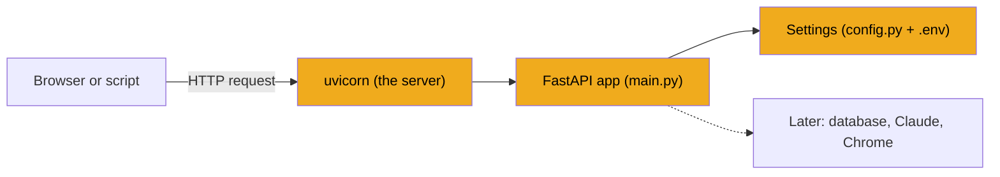

# Stage 1: Backend skeleton

> **Goal:** Set up the `backend/` folder, install every package JobBee needs, and start a small web server that reads its settings from a `.env` file.
>
> **By the end you will have:** a virtual environment with all of JobBee's packages (plus a Chromium browser for Playwright), a typed settings file, and a FastAPI app that answers `GET /` with JSON when you run it with uvicorn.

## Where this fits

The backend is the Python program that does all of JobBee's real work. The web page you'll build later talks to it, the daily job search runs inside it, and it starts Chrome when it's time to fill in an application. This stage builds the empty frame that everything else plugs into.



## New ideas in plain words

**HTTP request and response.** Browsers and servers talk in pairs of messages. The browser sends a *request*: a *method* (what to do), a *URL* (what to do it to), and sometimes a *body* (data). The server sends back a *response*: a *status code* (how it went) and a body (the answer).

| Method | Used for | Example in JobBee |
|---|---|---|
| `GET` | Read something | `GET /api/home` loads the inbox |
| `POST` | Do an action or create something | `POST /api/applications/7/apply` |
| `PUT` | Replace or update settings | `PUT /api/preferences` |
| `DELETE` | Remove something | `DELETE /api/watchlist/3` |

Status codes are three-digit numbers. The first digit tells you the kind of answer: `2xx` worked, `4xx` the request was wrong, `5xx` the server failed. These are the ones JobBee uses:

| Code | Meaning |
|---|---|
| `200` | OK |
| `201` | Created (a new row was made) |
| `202` | Accepted (work started in the background) |
| `204` | Done, nothing to send back |
| `400` | Bad request (for example, a key Anthropic rejected) |
| `404` | Not found |
| `409` | Conflict (for example, you clicked Apply twice) |
| `422` | The data had the wrong shape (FastAPI sends this for you) |
| `500` | The server crashed or couldn't finish |
| `502` | A server JobBee depends on (like Anthropic) couldn't be reached |

**API and endpoint.** An *API* (application programming interface) is a set of URLs a program answers so that other programs can use it. One URL plus one method is an *endpoint*, like `GET /api/health`. JobBee's backend is an API. It returns data, not finished web pages. The React app (stage 24) turns that data into pages.

**JSON.** The text format the API speaks. It looks like Python dicts and lists: `{"status": "ok", "db": true}`. Python's `True` becomes `true` and `None` becomes `null`. FastAPI converts in both directions for you.

**FastAPI and uvicorn.** FastAPI is a Python library for writing APIs. You write a normal function, put a line like `@app.get("/")` above it, and FastAPI calls that function when someone requests that URL. It turns your return value into JSON and builds a documentation page for you. FastAPI only describes *what* to answer. *Uvicorn* is the program that listens on a network port, receives requests and hands them to FastAPI. Think of FastAPI as the kitchen and uvicorn as the waiter.

**Decorator.** The `@something` line above a function. It hands the function to `something`, which can register it (as `@app.get("/")` does) or wrap it with extra behaviour (as `@lru_cache` does in Step 4).

**Type hints.** Notes like `app_port: int` or `name: str | None` say what type a value should have. `str | None` means "a string, or nothing". Plain Python ignores type hints. Some libraries read them, and Pydantic is one.

**Pydantic.** A library for data classes that check their own values. If a field is declared `app_port: int` and the value is `"8000"`, Pydantic converts it to the number `8000`. If the value is `"banana"`, it raises a clear error. JobBee uses Pydantic for its settings (this stage), for the shape of every API request and response (stage 4), and to check every answer Claude sends back (stage 6).

**Environment variables and `.env`.** Some settings change from one computer to another: which database file to use, which port to listen on, API keys. They don't belong in the code. Instead they're passed in from outside as *environment variables*, named values like `APP_ENV=dev` that every program on your computer can read. A `.env` file is a plain text list of these that the app reads when it starts. It stays out of git, because later it may hold secrets.

**Virtual environment.** A private folder of installed packages for one project, so JobBee's package versions never clash with another project's. You create it once with `python -m venv .venv`. From then on you run Python from inside it.

## Build it, step by step

Build your version in a new, empty folder (the [guide's README](README.md) calls it `my-jobbee`), not inside this repo. By the end of this stage it looks like this:

```text
my-jobbee/
  .gitignore          files git must never save
  backend/
    pyproject.toml    Step 1: the project and its packages
    .env.example      Step 2: a settings template (committed)
    .env              your own copy of the template (never committed)
    .venv/            the virtual environment (Step 3)
    app/
      __init__.py     Step 3: marks app/ as a Python package
      config.py       Step 4: typed settings
      main.py         Step 5: the FastAPI app (temporary version)
```

Later stages add more folders under `backend/app/` (`services/`, `migrations/`, `api/` and others), plus `backend/tests/`, `backend/scripts/` and the `frontend/` folder.

First create `my-jobbee/.gitignore`, at the top of your project, next to `backend/`. Git reads it to know which files never to save. Each line is a pattern: a name ending in `/` means a folder, and `*` matches anything.

<!-- code: .gitignore -->
**`.gitignore`** (whole file, 48 lines)

```text
# Python
__pycache__/
*.py[cod]
*$py.class
*.so
.venv/
venv/
env/
.eggs/
*.egg-info/
*.egg
.pytest_cache/
.mypy_cache/
.ruff_cache/

# Node / Vite
node_modules/
dist/
dist-ssr/
.vite/
*.local

# Env / secrets
.env
.env.*
!.env.example

# SQLite
*.db
*.sqlite
*.sqlite3

# OS / editor
.DS_Store
Thumbs.db
.vscode/
.idea/

# Uploads / user data
backend/data/
backend/uploads/

# Logs
*.log
logs/

# TypeScript build info
*.tsbuildinfo
```
<!-- /code -->

The groups, from top to bottom:

- **Python:** compiled files (`__pycache__/`), virtual environments (`.venv/`) and tool caches.
- **Node / Vite:** downloaded packages (`node_modules/`) and the built frontend (`dist/`), from stage 24 on.
- **Env / secrets:** `.env` will hold your settings and maybe a key. `!.env.example` is an exception: the `!` means "do save this one", because the template has no secrets.
- **SQLite:** database files.
- **Uploads / user data:** `backend/data/` will hold your database, your resume, tailored CVs and screenshots of filled forms. None of that belongs in git.

### Step 1: The project file, `backend/pyproject.toml`

`pyproject.toml` describes the project to Python's tools. pip reads it to learn the project's name, which Python it needs and which packages to install. pytest and ruff read their settings from it too. Create it at `backend/pyproject.toml`.

What each section does:

- **`[project]`** names the project and lists `dependencies`, the packages the app needs to run. `requires-python = ">=3.11"` stops pip from installing it on an older Python. `fastapi>=0.115` means "version 0.115 or newer".
- **Two exact pins.** `browser-use[core]==0.13.11` and `anthropic==1.15.0` use `==`, "exactly this version". The comment says why: the browser driver in stage 17 relies on names that differ between releases of these two packages, so any other version could break it.
- **`[project.optional-dependencies] dev`** lists tools only a developer needs. `pip install -e ".[dev]"` installs them along with the rest.
- **`[build-system]`** says which tool turns the folder into an installable package (setuptools).
- **`[tool.setuptools.packages.find]`** with `include = ["app*"]` says "the Python package is the `app/` folder and everything inside it". That's what lets you write `from app.config import get_settings` from anywhere.
- **`[tool.setuptools.package-data]`** lists non-Python files that belong to the package: the migration template (stage 3) and the per-site playbooks for the apply agent (stage 18).
- **`[tool.ruff]`** configures ruff, a tool that checks code style. It's optional; JobBee never needs it to run.
- **`[tool.pytest.ini_options]`** configures pytest (stage 4). `testpaths` tells it to look in `tests/`. `asyncio_mode = "auto"` lets it run `async def` tests (stage 6 explains `async`).

You install everything once, now, so no later stage has to stop and install packages. Here's what each package is for:

| Package | What it is | First used in |
|---|---|---|
| `fastapi` | The web framework: endpoints, request checking, the `/docs` page | Stage 1 |
| `uvicorn[standard]` | The server that runs the FastAPI app. `[standard]` adds optional extras, such as file watching for `--reload` | Stage 1 |
| `pydantic` | Data classes that check their values | Stage 1 (settings), 4 (API shapes), 6 (Claude's answers) |
| `pydantic-settings` | Fills a Pydantic class from environment variables and `.env` | Stage 1 |
| `python-dotenv` | Reads `.env` files. `pydantic-settings` uses it for you | Stage 1 |
| `keyring` | Talks to your operating system's password vault | Stage 2 |
| `sqlalchemy` | Lets Python code read and write a database using classes instead of hand-written SQL | Stage 3 |
| `alembic` | Upgrades the database layout step by step (migrations) | Stage 3 |
| `httpx` | Makes HTTP requests to other servers. FastAPI's test client is built on it | Stage 4 (tests), 6, 7, 8, 11, 14 |
| `python-multipart` | Lets FastAPI read uploaded files and form fields | Stage 7 |
| `pypdf` | Reads text out of PDF files and counts PDF pages | Stage 7, 10 |
| `python-docx` | Reads text out of Word (`.docx`) files | Stage 7 |
| `playwright` | Drives a browser from code. JobBee uses it to print HTML to PDF | Stage 10 |
| `browser-use[core]` | Browser automation. JobBee uses its Chrome remote control and its ready-made browser tools for Claude | Stage 15, 17 |
| `anthropic` | The official Python library for the Claude API | Stage 6, 14, 18 |
| `pytest` *(dev)* | Finds and runs tests | Stage 4 |
| `pytest-asyncio` *(dev)* | Lets pytest run `async def` tests | Stage 6 onwards |
| `ruff` *(dev)* | Style checker (optional) | Any time |
| `mypy` *(dev)* | Type checker (optional) | Any time |

<!-- code: backend/pyproject.toml -->
**`backend/pyproject.toml`** (whole file, 57 lines)

```toml
[project]
name = "jobbee-backend"
version = "0.1.0"
description = "JobBee agent backend: FastAPI + LLM abstraction + SQLite"
requires-python = ">=3.11"
dependencies = [
    "fastapi>=0.115",
    "uvicorn[standard]>=0.30",
    "pydantic>=2.7",
    "pydantic-settings>=2.4",
    "sqlalchemy>=2.0",
    "alembic>=1.13",
    "httpx>=0.27",
    "python-multipart>=0.0.9",
    "python-dotenv>=1.0",
    "pypdf>=4.0",
    "python-docx>=1.1",
    "keyring>=25.0",
    "playwright>=1.49",
    # Exact pins: app/apply/spike_driver.py shims names between these two releases.
    "browser-use[core]==0.13.11",
    "anthropic==1.15.0",
]

[project.optional-dependencies]
dev = [
    "pytest>=8.0",
    "pytest-asyncio>=0.23",
    "ruff>=0.5",
    "mypy>=1.10",
]

[build-system]
requires = ["setuptools>=68", "wheel"]
build-backend = "setuptools.build_meta"

[tool.setuptools.packages.find]
where = ["."]
include = ["app*"]

[tool.setuptools.package-data]
app = ["migrations/script.py.mako", "apply/playbooks/*.md"]

[tool.ruff]
line-length = 100
target-version = "py311"

[tool.ruff.lint]
select = ["E", "F", "I", "B", "UP", "SIM"]

[tool.ruff.lint.per-file-ignores]
# Autogenerated Alembic revisions keep Alembic's own formatting.
"app/migrations/versions/*" = ["E501"]

[tool.pytest.ini_options]
asyncio_mode = "auto"
testpaths = ["tests"]
```
<!-- /code -->

Don't install yet. pip needs the `app/` folder to exist first (Step 3).

### Step 2: The settings template, `backend/.env.example`

`backend/.env.example` is a template for your `.env` file. It **is** committed to git, so anyone who clones the project can see which settings exist. Each person copies it to `.env`, which is **not** committed.

How to read it:

- Each line is `NAME=value`. The names match the fields of the `Settings` class in Step 4 (upper case here, lower case there).
- Lines starting with `#` are comments. A line like `# MATCH_MODEL=claude-haiku-5-5` shows a default you can change: remove the `#` and edit the value.
- `ANTHROPIC_API_KEY=` is empty on purpose. Leave it empty. You'll paste your key into the app later, and the app saves it in your operating system's password vault, not in this file (stage 2).
- The groups follow the stages: the app and the database now, secrets in stage 2, Claude and spending limits in stage 6, the apply agent in stages 18 and 21, Gmail in stage 13.

<!-- code: backend/.env.example -->
**`backend/.env.example`** (whole file, 54 lines)

```ini
# --- App ---
APP_ENV=dev
APP_HOST=127.0.0.1
APP_PORT=8000

# --- Database ---
# Resolved relative to backend/ if not absolute. The schema is managed by Alembic
# migrations (app/migrations) and upgraded in place on startup.
DATABASE_URL=sqlite:///./data/jobbee.db

# --- Secrets ---
# The Claude key (when entered in the app), the Telegram bot token, inbox tokens and
# ATS passwords live in the OS credential store (Windows Credential Manager),
# never in SQLite or this file. "memory" is for tests only.
# SECRET_STORE=keyring

# --- Claude ---
# Easiest: paste your key in the app (welcome step 1 or Settings → Claude).
# Setting it here works too; a key saved in the app takes precedence.
LLM_PROVIDER=anthropic
ANTHROPIC_API_KEY=

# Models per task (defaults shown)
# MATCH_MODEL=claude-haiku-5-5        # screening job postings
# IMPORT_MODEL=claude-haiku-5-5       # reading your resume
# TAILOR_MODEL=claude-sonnet-5-5      # tailored CV + cover letter
# DISCOVER_MODEL=claude-sonnet-5-5    # web search for postings
# APPLY_MODEL=claude-opus-5-5         # filling application forms
# APPLY_EFFORT=medium                 # low | medium | high | xhigh | max
# APPLY_MAX_ITERATIONS=150
# APPLY_MAX_COST_USD=5                # per-application spend cap (estimated)

# Spend limits across every Claude call (also editable in Settings → Claude)
# DAILY_BUDGET_USD=10
# MONTHLY_BUDGET_USD=100

# How long a filled form waits for your Submit, and how many can wait at once
# SUBMIT_TTL_MIN=45
# MAX_PARKED_RUNS=2

# --- Other LLM providers (optional, for import/screening/tailoring only) ---
# LLM_PROVIDER=openai with OPENROUTER_API_KEY / LLM_API_KEY + LLM_BASE_URL + LLM_MODEL,
# or LLM_PROVIDER=ollama with LLM_BASE_URL=http://localhost:11434 and LLM_MODEL.
# Applying always uses Claude.
LLM_TIMEOUT_S=600
LLM_LONG_TIMEOUT_S=7200

# --- Gmail OAuth for LinkedIn alert emails (INSTALLER ONLY — never shown to end users) ---
# Run once:  cd backend && .\.venv\Scripts\python.exe scripts\setup_gmail_oauth.py
# End users only click "Sign in with Google" in Settings.
# GMAIL_CLIENT_ID=
# GMAIL_CLIENT_SECRET=
# GMAIL_OAUTH_REDIRECT_URI=http://127.0.0.1:8000/api/email/gmail/callback
# FRONTEND_URL=http://localhost:5173
```
<!-- /code -->

Make your own copy now, from the `backend` folder:

```powershell
cd my-jobbee\backend
Copy-Item .env.example .env
```

On Mac or Linux: `cp .env.example .env`.

### Step 3: The package marker, `backend/app/__init__.py`, then install

Create the folder `backend/app/` and, inside it, `__init__.py`. A folder with an `__init__.py` file is a Python *package*: something you can import from, like `from app.config import ...`. Code inside the package imports its neighbours with a leading dot, as in `from .config import get_settings`. One dot means "this package", two dots mean "the package one level up".

The file holds the version number. It lives in one place so the API docs page (Step 5) and the health check (stage 4) can both show it.

<!-- code: backend/app/__init__.py -->
**`backend/app/__init__.py`** (whole file, 3 lines)

```python
"""JobBee backend package."""

__version__ = "0.1.0"
```
<!-- /code -->

Now create the virtual environment and install the project. Run these from `my-jobbee\backend`:

```powershell
python -m venv .venv
.\.venv\Scripts\python.exe -m pip install --upgrade pip
.\.venv\Scripts\python.exe -m pip install -e ".[dev]"
.\.venv\Scripts\python.exe -m playwright install chromium
```

On Mac or Linux:

```bash
python3 -m venv .venv
.venv/bin/python -m pip install --upgrade pip
.venv/bin/python -m pip install -e ".[dev]"
.venv/bin/python -m playwright install chromium
```

What each line does:

1. `python -m venv .venv` creates the virtual environment in a folder called `.venv`.
2. The second line updates pip itself inside the venv. Old pip versions can fail on modern `pyproject.toml` files.
3. `pip install -e ".[dev]"` installs every package from Step 1, plus the `dev` tools. `-e` means *editable*: Python uses your `app/` folder directly, so your edits take effect without reinstalling. This is why `app/` had to exist first: pip records where the package lives at install time. This step downloads a lot (browser-use pulls in many packages) and can take a few minutes.
4. `playwright install chromium` downloads a copy of the Chromium browser that Playwright can drive. Stage 10 prints PDFs with a browser. It tries your installed Chrome first, then Edge, then this Chromium.

From now on, always run Python as `.\.venv\Scripts\python.exe` (Mac/Linux: `.venv/bin/python`). Plain `python` would use your system Python, which doesn't have these packages. You can *activate* the venv instead with `.\.venv\Scripts\Activate.ps1`, after which plain `python` means the venv's Python in that window. This guide always writes the full path, so it works either way.

### Step 4: The settings file, `backend/app/config.py`

`backend/app/config.py` describes every setting JobBee has, with a type and a default for each. The `pydantic-settings` library fills each field from, in this order:

1. a real environment variable (for example `APP_ENV` set in your terminal),
2. then the `.env` file,
3. then the default written in the class.

The first one found wins. Every other file asks this module for settings, so there's exactly one place to look when you wonder "where does this value come from?"

The file is long because it holds the settings for the whole app. You type it all now, so later stages never have to come back and edit it. Each part below says which stage uses which settings.

#### Part 1: The settings class and the first fields

<!-- code: backend/app/config.py lines=1-37 -->
**`backend/app/config.py`** (lines 1–37 of 187)

```python
"""Typed application settings, loaded from environment or `.env`."""

from __future__ import annotations

from functools import lru_cache
from pathlib import Path
from typing import Literal

from pydantic import Field
from pydantic_settings import BaseSettings, SettingsConfigDict

BACKEND_DIR = Path(__file__).resolve().parent.parent

LLMProviderName = Literal["anthropic", "openai", "ollama"]


class Settings(BaseSettings):
    """Application settings.

    Values come from (in order of precedence): real environment variables,
    `backend/.env`, then the defaults defined here.
    """

    model_config = SettingsConfigDict(
        env_file=str(BACKEND_DIR / ".env"),
        env_file_encoding="utf-8",
        extra="ignore",
        case_sensitive=False,
    )

    # --- App ---
    app_env: Literal["dev", "prod", "test"] = "dev"
    app_host: str = "127.0.0.1"
    app_port: int = 8000

    # --- Database ---
    database_url: str = "sqlite:///./data/jobbee.db"
```
<!-- /code -->

- **`from __future__ import annotations`** appears at the top of almost every JobBee file. It lets a type hint mention a class that's defined further down the file, and makes type hints cheaper to load. You can treat it as boilerplate.
- **`BACKEND_DIR`** is the `backend/` folder, worked out from this file's own location. `__file__` is the path of `config.py`. `.resolve()` makes it a full path. The first `.parent` is `app/`, the second is `backend/`. Pointing `env_file` at `BACKEND_DIR / ".env"` means the app finds `.env` whatever folder you start it from.
- **`LLMProviderName`** is a named `Literal` type. `Literal["anthropic", "openai", "ollama"]` allows exactly those three strings and nothing else. Stage 6 explains the three providers.
- **`class Settings(BaseSettings)`** is a Pydantic class. Each line like `app_port: int = 8000` is one setting: its name, its type and its default.
- **`model_config`** tunes how the class loads:
  - `extra="ignore"`: unknown names in `.env` are skipped instead of crashing the app.
  - `case_sensitive=False`: `APP_ENV=dev` in `.env` fills the field `app_env`.
- **`app_env`** can only be `"dev"`, `"prod"` or `"test"`. `APP_ENV=banana` stops the app at startup with a clear error. Failing early beats failing later in a strange way. Tests set it to `"test"` (stage 4), and stage 19 uses that to keep the daily scheduler from starting during tests.
- **`app_host` and `app_port`** record the address JobBee is meant to run on. No code reads them yet; you give uvicorn the host and port on its command line.
- **`database_url`** says which database file to use. Stage 3 explains the `sqlite:///` format. `./data/jobbee.db` is a *relative* path; Part 3 turns it into a full one.

#### Part 2: Secrets, Claude, the apply agent, budgets and Gmail

<!-- code: backend/app/config.py lines=38-108 -->
**`backend/app/config.py`** (lines 38–108 of 187)

```python

    # --- Secrets (inbox tokens, ATS passwords) ---
    secret_store: Literal["keyring", "memory"] = Field(
        default="keyring",
        description="keyring = OS credential store (Windows Credential Manager); memory = tests only.",
    )
    secret_store_service: str = "JobBee"

    # --- LLM ---
    llm_provider: LLMProviderName = "anthropic"
    llm_base_url: str = "https://api.openai.com/v1"
    llm_api_key: str = Field(default="", repr=False)
    openrouter_api_key: str = Field(default="", repr=False)
    openrouter_model: str = ""
    openrouter_base_url: str = "https://openrouter.ai/api/v1"
    agentrouter_api_key: str = Field(default="", repr=False)
    agentrouter_base_url: str = "https://agentrouter.org/v1"
    llm_model: str = "gpt-4o-mini"
    llm_temperature: float = 0.2
    llm_timeout_s: float = Field(
        default=600.0,
        description="Default timeout for matching and quick LLM calls (seconds).",
    )
    llm_long_timeout_s: float = Field(
        default=7200.0,
        description="Timeout for long inputs such as resume extraction (seconds, max 2h).",
    )

    # --- Claude apply agent (browser toolset) ---
    anthropic_api_key: str = Field(default="", repr=False)
    anthropic_workspace_id: str = Field(
        default="",
        description="Workspace for organization-wide API keys (sent as anthropic-workspace-id).",
    )
    apply_model: str = "claude-opus-5-5"
    apply_effort: Literal["low", "medium", "high", "xhigh", "max"] = "medium"
    apply_max_iterations: int = Field(default=150, ge=10, le=500)
    apply_max_cost_usd: float = Field(
        default=5.0,
        description="Per-application spend cap; the run stops when its estimated cost passes this.",
    )

    submit_ttl_min: int = Field(
        default=45,
        ge=5,
        description="How long a filled form waits for the user's Submit tap before it expires.",
    )
    max_parked_runs: int = Field(default=2, ge=1, le=5)

    # --- Claude models per task (used when LLM_PROVIDER=anthropic) ---
    match_model: str = "claude-haiku-5-5"
    import_model: str = "claude-haiku-5-5"
    tailor_model: str = "claude-sonnet-5-5"
    discover_model: str = "claude-sonnet-5-5"
    chat_model: str = "claude-haiku-5-5"

    # --- Spend limits across every Claude call (llm_usage ledger) ---
    daily_budget_usd: float = Field(default=10.0, ge=0)
    monthly_budget_usd: float = Field(default=100.0, ge=0)

    # --- Email sync ---
    email_enrich_jd: bool = Field(
        default=False,
        description="When true, fetch full job descriptions from posting URLs for short email snippets.",
    )

    # --- Gmail OAuth (installer configures once in .env — users only click Sign in with Google) ---
    gmail_client_id: str = ""
    gmail_client_secret: str = Field(default="", repr=False)
    gmail_oauth_redirect_uri: str = "http://127.0.0.1:8000/api/email/gmail/callback"
    frontend_url: str = "http://localhost:5173"
```
<!-- /code -->

These fields are grouped by comment banners. You won't use most of them until later stages:

| Group | Fields | Used in |
|---|---|---|
| Secrets | `secret_store` (`keyring` for real use, `memory` for tests), `secret_store_service` (the name your secrets are filed under) | Stage 2 |
| LLM | `llm_provider` and the base URLs, keys and model for non-Claude providers (OpenAI-compatible services, OpenRouter, AgentRouter, Ollama), `llm_temperature`, two timeouts | Stage 6 |
| Claude apply agent | `anthropic_api_key` (a fallback key from `.env`), `anthropic_workspace_id`, `apply_model`, `apply_effort`, `apply_max_iterations`, `apply_max_cost_usd` | Stages 2, 6, 18, 21 |
| Waiting for Submit | `submit_ttl_min` (how long a filled form waits for your click), `max_parked_runs` (how many filled forms can wait at once) | Stage 21 |
| Claude models per task | `match_model` (screening), `import_model` (reading your resume), `tailor_model` (tailored CV), `discover_model` (web search), `chat_model` | Stages 6–14 |
| Spend limits | `daily_budget_usd`, `monthly_budget_usd` | Stage 6 |
| Email and Gmail | `email_enrich_jd`, `gmail_client_id`, `gmail_client_secret`, `gmail_oauth_redirect_uri`, `frontend_url` | Stage 13 |

Some lines need a closer look:

- **`Field(default="", repr=False)`** on every key and secret. `Field(...)` lets you add rules to a field. `repr=False` keeps the value out of the text you get when you print the settings object, so a stray `print(settings)` or a log line never shows your key.
- **`Field(default=150, ge=10, le=500)`** adds limits: `ge` means "greater than or equal", `le` "less than or equal". An `APPLY_MAX_ITERATIONS=5` in `.env` would be rejected at startup.
- **`description=...`** is a note for humans. It has no effect on the value.
- **The Claude models.** Cheap and fast `claude-haiku-5-5` screens jobs, reads resumes and fact-checks tailored CVs. `claude-sonnet-5-5` writes tailored CVs and runs web searches. The strongest model, `claude-opus-5-5`, fills in application forms. You can change any of them in `.env`.
- **`email_enrich_jd`** is read by nothing in the current code. It's harmless to keep.

#### Part 3: Helpers that turn raw settings into ready-to-use values

<!-- code: backend/app/config.py lines=109-181 -->
**`backend/app/config.py`** (lines 109–181 of 187)

```python

    def resolved_llm_api_key(self) -> str:
        """Pick the API key for the active provider."""

        if self.llm_provider == "anthropic":
            return self.anthropic_api_key.strip()

        base = (self.llm_base_url or "").lower()
        if "agentrouter" in base and self.agentrouter_api_key.strip():
            return self.agentrouter_api_key.strip()
        if self.openrouter_api_key.strip():
            return self.openrouter_api_key.strip()
        if self.agentrouter_api_key.strip() and not self.llm_api_key.strip():
            return self.agentrouter_api_key.strip()
        return self.llm_api_key.strip()

    def resolved_llm_base_url(self) -> str:
        """Normalize base URL for the active provider."""

        if self.llm_provider == "anthropic":
            return "https://api.anthropic.com"

        if self.llm_provider != "openai":
            return self.llm_base_url.rstrip("/")

        if "agentrouter" in self.llm_base_url.lower() and self.agentrouter_api_key.strip():
            url = (self.agentrouter_base_url or self.llm_base_url).strip().rstrip("/")
            if "agentrouter" in url.lower() and not url.endswith("/v1"):
                return f"{url}/v1"
            return url

        if self.openrouter_api_key.strip():
            return self.openrouter_base_url.strip().rstrip("/")

        return self.llm_base_url.strip().rstrip("/")

    def resolved_llm_model(self) -> str:
        """Return the configured model id."""

        if self.llm_provider == "anthropic":
            model = self.llm_model.strip()
            return model if model.startswith("claude-") else self.match_model
        if (
            self.llm_provider == "openai"
            and self.openrouter_api_key.strip()
            and self.openrouter_model.strip()
        ):
            return self.openrouter_model.strip()
        return self.llm_model.strip() or "gpt-4o-mini"

    @property
    def is_dev(self) -> bool:
        return self.app_env == "dev"

    def gmail_oauth_available(self) -> bool:
        """True when the installer configured OAuth credentials (never shown to end users)."""

        return bool(self.gmail_client_id.strip() and self.gmail_client_secret.strip())

    def resolved_database_url(self) -> str:
        """Resolve relative SQLite URLs against the backend directory."""

        url = self.database_url
        prefix = "sqlite:///"
        if url.startswith(prefix):
            tail = url[len(prefix):]
            path = Path(tail)
            if not path.is_absolute():
                path = (BACKEND_DIR / path).resolve()
                path.parent.mkdir(parents=True, exist_ok=True)
                return f"{prefix}{path.as_posix()}"
        return url

```
<!-- /code -->

A raw setting isn't always the value code should use. These methods hold the rules in one place, so no other file has to repeat them:

- **`resolved_llm_api_key()`** picks the key for the active provider. For Claude it returns `anthropic_api_key` from the settings. (The app's real Claude key lookup, `claude_api_key()` in stage 2, checks the password vault first and falls back to this value.) For other providers it picks the AgentRouter key when the base URL points at AgentRouter, otherwise the OpenRouter key if there is one, otherwise the generic `llm_api_key`.
- **`resolved_llm_base_url()`** returns the address to send model requests to. For Claude it's always `https://api.anthropic.com`. For Ollama it's `llm_base_url`. For OpenAI-compatible services it picks the AgentRouter or OpenRouter address when you have that service's key, otherwise `llm_base_url`. Trailing slashes are removed, and an AgentRouter address always ends in `/v1`.
- **`resolved_llm_model()`** returns the model name. For Claude, `llm_model` is only used if it starts with `claude-`. Otherwise it falls back to `match_model`. That's why the default `llm_model = "gpt-4o-mini"` never reaches Claude. For an OpenAI-compatible service with an OpenRouter key, `openrouter_model` wins if it's set.
- **`is_dev`** has `@property` above it, so you read it like a field, without brackets: `settings.is_dev`. Step 5 uses it.
- **`gmail_oauth_available()`** is true when both Gmail app credentials are set. Stage 13 uses it.
- **`resolved_database_url()`** fixes the relative database path. A relative path is normally read from whatever folder you started Python in. You'll start JobBee from different places (uvicorn, Alembic, pytest), so this method always reads it from `backend/` instead. It also creates the `data/` folder if it's missing. An absolute path, like the temporary database the tests use, is returned unchanged.

Stage 4's `tests/test_config.py` checks several of these rules.

#### Part 4: One shared settings object

<!-- code: backend/app/config.py lines=182-187 -->
**`backend/app/config.py`** (lines 182–187 of 187)

```python

@lru_cache(maxsize=1)
def get_settings() -> Settings:
    """Cached accessor so importing modules share one Settings instance."""

    return Settings()
```
<!-- /code -->

`get_settings()` is how every other file gets the settings. The decorator `@lru_cache(maxsize=1)` remembers the result of the first call. Every later call returns the same `Settings` object without reading `.env` again.

Why it matters:

- `.env` is read once, not on every request.
- Every module sees the same values.
- **The catch:** if you edit `.env` while the server runs, nothing changes until you restart it. Code that changes settings on purpose clears the cache with `get_settings.cache_clear()`. The settings API in stage 6 does that, and so do some tests.

### Step 5: The temporary app, `backend/app/main.py`

`backend/app/main.py` builds the FastAPI app. This is a **temporary version**: it grows in later stages as each new part of the backend arrives, and stage 23 replaces it with the final file. Type it exactly as shown.

<!-- temp: backend/app/main.py -->
```python
"""FastAPI entry point.

Temporary version from stage 1. Stage 23 replaces it with the final file.
"""

from __future__ import annotations

import asyncio
import sys

# Playwright spawns a browser subprocess; uvicorn's default Windows loop cannot do that.
if sys.platform == "win32":
    asyncio.set_event_loop_policy(asyncio.WindowsProactorEventLoopPolicy())

from fastapi import FastAPI
from fastapi.middleware.cors import CORSMiddleware

from . import __version__
from .config import get_settings


def create_app() -> FastAPI:
    settings = get_settings()
    app = FastAPI(
        title="JobBee API",
        version=__version__,
    )

    # In dev the Vite proxy handles same-origin, but allow direct browser calls too.
    app.add_middleware(
        CORSMiddleware,
        allow_origins=["http://localhost:5173", "http://127.0.0.1:5173"]
        if settings.is_dev
        else [],
        allow_credentials=True,
        allow_methods=["*"],
        allow_headers=["*"],
    )

    @app.get("/", include_in_schema=False)
    def root() -> dict:
        return {
            "name": "JobBee API",
            "version": __version__,
            "docs": "/docs",
            "health": "/api/health",
        }

    return app


app = create_app()
```
<!-- /temp -->

Read it from the top:

1. **The Windows event loop line.** An *event loop* is the engine that runs async code (stage 6 gives a first look at async, and stage 8 explains it properly). On Windows, Python has two kinds. Only the *Proactor* kind can start another program, a *subprocess*. JobBee starts a browser as a subprocess later (Playwright prints PDFs in stage 10). This line makes Proactor the default before anything else is imported, so event loops that scripts and tests create later with Python's defaults can start a browser. Recent versions of uvicorn choose the Proactor loop on Windows by themselves, except in `--reload` mode (see Common mistakes). The line does nothing on Mac or Linux. It sits above the other imports, which is unusual, because it must run first.
2. **`create_app()`** builds the app inside a function. All setup lives in one place, and later versions of this file add more lines here: a startup hook (stage 3) and routers (stage 4 onwards).
3. **`FastAPI(title=..., version=...)`** creates the app. The title and version appear on the `/docs` page.
4. **CORS** (cross-origin resource sharing) is a browser safety rule. A page served from one address (an *origin*, like `http://localhost:5173`, where the web app's dev server will run in stage 24) may not call a different address (`http://127.0.0.1:8000`) unless that server says it's allowed. *Middleware* is code that runs around every request. This middleware tells browsers "pages from port 5173 may call me", but only when `settings.is_dev` is true. In any other mode the list is empty. Stage 24 adds a proxy that makes the web app and the API look like one origin, so this is a fallback.
5. **`@app.get("/", include_in_schema=False)`** registers `root()` for `GET /`. FastAPI turns the returned dict into JSON. `include_in_schema=False` hides it from the `/docs` page, because it's only a signpost. Its `"health"` entry points at `/api/health`, which you build in stage 4. Until then that URL answers `404`.
6. **`app = create_app()`** at the bottom creates the app when the module is imported. This variable is what uvicorn looks for when you run `app.main:app`: "in the module `app/main.py`, use the variable `app`".

## Check it works

**1. Start the server.** From `my-jobbee\backend`:

```powershell
.\.venv\Scripts\python.exe -m uvicorn app.main:app --host 127.0.0.1 --port 8000
```

On Mac or Linux: `.venv/bin/python -m uvicorn app.main:app --host 127.0.0.1 --port 8000`.

You should see:

```text
INFO:     Started server process [12345]
INFO:     Waiting for application startup.
INFO:     Application startup complete.
INFO:     Uvicorn running on http://127.0.0.1:8000 (Press CTRL+C to quit)
```

`127.0.0.1` means "this computer only", so nothing on your network can reach the server. Leave it running.

**2. Call it.** Open a second PowerShell window:

```powershell
Invoke-RestMethod http://127.0.0.1:8000/
```

```text
name       version docs  health
----       ------- ----  ------
JobBee API 0.1.0   /docs /api/health
```

`Invoke-RestMethod` sends a `GET` request and turns the JSON answer into a PowerShell table. On Mac or Linux, `curl http://127.0.0.1:8000/` prints the raw JSON: `{"name":"JobBee API","version":"0.1.0","docs":"/docs","health":"/api/health"}`. In the server window, a new line appears for each request, such as `"GET / HTTP/1.1" 200 OK`.

**3. Open the docs page.** Visit http://127.0.0.1:8000/docs in your browser. FastAPI built this page from your code. It shows the title "JobBee API" and version 0.1.0, and the message "No operations defined in spec!", because the only endpoint is hidden. Stage 4 adds the first visible one, and you'll use this page to try every endpoint you build.

Stop the server with Ctrl+C when you're done.

**4. Call the app without a server.** The hidden check for this stage does it this way. FastAPI's `TestClient` sends requests straight to the app inside one Python process (stage 4 explains it):

```powershell
.\.venv\Scripts\python.exe -c "from fastapi.testclient import TestClient; from app.main import app; r = TestClient(app).get('/'); assert r.status_code == 200; print(r.json())"
```

```text
{'name': 'JobBee API', 'version': '0.1.0', 'docs': '/docs', 'health': '/api/health'}
```

**5. See where settings come from.** Print one setting and the resolved database path:

```powershell
.\.venv\Scripts\python.exe -c "from app.config import get_settings; s = get_settings(); print(s.app_env, s.resolved_database_url())"
```

```text
dev sqlite:///C:/Users/you/my-jobbee/backend/data/jobbee.db
```

Your path will differ. Notice the empty `backend/data/` folder that `resolved_database_url()` created. Now override `.env` with a real environment variable, run the same command again, then remove the variable:

```powershell
$env:APP_ENV = "prod"
.\.venv\Scripts\python.exe -c "from app.config import get_settings; s = get_settings(); print(s.app_env, s.resolved_database_url())"
Remove-Item Env:APP_ENV
```

The first word is now `prod`: the environment variable beat `.env`. Try `$env:APP_ENV = "banana"` too. You get a `ValidationError` that says `Input should be 'dev', 'prod' or 'test'`. Remove the variable again afterwards. (Bash: put the variable in front of the command, `APP_ENV=prod .venv/bin/python -c "..."`. It then applies to that one command only.)

<!-- verify: backend | cp .env.example .env -->
<!-- verify: backend | python -c "from fastapi.testclient import TestClient; from app.main import app; r = TestClient(app).get('/'); assert r.status_code == 200; print(r.json())" -->

## Common mistakes

- **`ModuleNotFoundError: No module named 'app'`.** You started Python or uvicorn from the wrong folder: run it from `backend/`, where the `app/` folder is. If it happens even there, you probably ran `pip install -e` before `app/__init__.py` existed. Run the install line again.
- **Packages seem missing although you installed them.** You ran the system `python` instead of the venv's. Use `.\.venv\Scripts\python.exe`, or activate the venv first.
- **Editing `.env` and nothing changes.** `get_settings()` is cached. Restart the server.
- **A PowerShell variable that won't go away.** `$env:APP_ENV = "prod"` stays set for the rest of that PowerShell window and beats `.env`. Remove it with `Remove-Item Env:APP_ENV`, or open a new window.
- **Port 8000 already in use.** Another server is still running (on Windows the error mentions "only one usage of each socket address"). Stop it with Ctrl+C in its window, or use `--port 8001`.
- **Running with `--reload` once JobBee starts browsers.** `--reload` restarts the server whenever you save a file, which is handy now. But on Windows, uvicorn's reload mode builds the other kind of event loop (the *Selector* loop), which can't start a browser, and the policy line in `main.py` can't change that. A restart also kills any application the agent is in the middle of filling. From stage 10 on, run without `--reload`, as the repo's README does.

## Recap

- A backend answers HTTP requests. FastAPI turns decorated Python functions into endpoints, and uvicorn serves them.
- `pyproject.toml` lists every package. You installed them all once, in a virtual environment, plus Chromium for Playwright.
- Settings come from environment variables, then `.env`, then defaults. Pydantic checks their types, and `get_settings()` builds them once.
- The `resolved_*` helpers turn raw settings into the values code should use, such as a full database path.
- `main.py` builds the app in `create_app()`, sets the Windows event loop first, and allows the dev web app through CORS. It's temporary; stage 23 writes the final version.
- `/docs` is a free, interactive test page for your API.

**Next:** [Stage 2: Secrets and the keyring](02-secrets.md)
