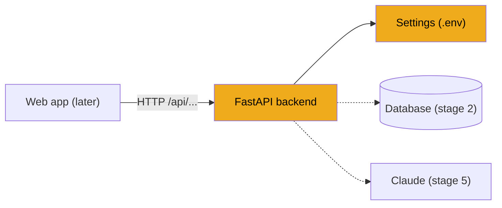

# Stage 1: Backend skeleton

> **Goal:** Start a small Python web server that answers `GET /api/health` with JSON.
>
> **By the end you will have:** a FastAPI app that reads its settings from a `.env` file, runs with uvicorn, and shows interactive API docs at http://127.0.0.1:8000/docs.

## Where this fits

Every other part of JobBee hangs off this server. The web app calls it, the daily search runs inside it, and the apply agent is started by it. This stage builds the empty frame.



## New ideas in plain words

**HTTP request and response.** A browser and a server talk in pairs of messages. The browser sends a *request*: a method (what to do), a URL (what to do it to), and sometimes a body (data). The server sends back a *response*: a status code (how it went) and a body (the answer).

| Method | Used for | Example in JobBee |
|---|---|---|
| `GET` | Read something | `GET /api/home` loads the inbox |
| `POST` | Do an action or create something | `POST /api/applications/7/apply` |
| `PUT` | Replace or update settings | `PUT /api/preferences` |
| `DELETE` | Remove something | `DELETE /api/watchlist/3` |

Status codes you'll see: `200` OK, `202` accepted (work started in the background), `204` done with nothing to return, `400` bad request, `404` not found, `409` conflict (e.g. you clicked Apply twice), `422` the data had the wrong shape, `500` the server crashed.

**API and endpoint.** An API is the set of URLs a server answers. Each URL plus method is an *endpoint*. JobBee's backend is an API. It returns data, not web pages; the React app (stage 13) turns that data into pages.

**JSON.** The text format the API speaks. It looks like Python dicts and lists: `{"status": "ok", "db": true}`. Python's `True` becomes `true`, and `None` becomes `null`.

**FastAPI.** A Python library for writing APIs. You write a normal function, put a decorator such as `@router.get("/health")` above it, and FastAPI calls it when that URL is requested. It also turns your return value into JSON and builds a docs page for you.

**Uvicorn.** FastAPI describes *what* to answer. Uvicorn is the program that listens on a network port and passes requests to FastAPI. Think of FastAPI as the kitchen and uvicorn as the waiter.

**Pydantic.** A library for data classes that check their own types. If you declare `db: bool` and someone passes `"yes"`, Pydantic either converts it or raises an error. FastAPI uses Pydantic models to describe request and response bodies. JobBee also uses them to check everything Claude sends back (stage 5).

**Environment variables and `.env`.** Settings that change between computers (ports, API keys, which database file) shouldn't be written into the code. They're passed in as environment variables, like `APP_ENV=dev`. A `.env` file is a plain text list of these that the app reads at startup. It stays out of git because it can hold secrets.

**Virtual environment.** A private folder of installed packages for one project, so JobBee's versions don't clash with other projects. You create it once with `python -m venv .venv`.

## Build it, step by step

### Step 1: Describe the project in `pyproject.toml`

Create `backend/pyproject.toml`. This file tells pip the project's name, which Python it needs, and which packages to install.

From [`backend/pyproject.toml`](../../backend/pyproject.toml):
```toml
[project]
name = "jobbee-backend"
version = "0.1.0"
description = "JobBee agent backend: FastAPI + LLM abstraction + SQLite"
requires-python = ">=3.11"
dependencies = [
    "fastapi>=0.115",
    "uvicorn[standard]>=0.30",
    "pydantic>=2.7",
    "pydantic-settings>=2.4",
    ...
]

[project.optional-dependencies]
dev = [
    "pytest>=8.0",
    "pytest-asyncio>=0.23",
    "ruff>=0.5",
    "mypy>=1.10",
]

[build-system]
requires = ["setuptools>=68", "wheel"]
build-backend = "setuptools.build_meta"

[tool.setuptools.packages.find]
where = ["."]
include = ["app*"]
```

- `dependencies` lists what the app needs to run. Start with these four. You'll add the rest (SQLAlchemy, httpx, anthropic…) in the stage that first needs each one. The real file shows the final list.
- `dev` lists tools only developers need: pytest for tests, ruff for style checks, mypy for type checks.
- `packages.find` with `include = ["app*"]` says "the Python package is the `app` folder". That lets you write `from app.config import get_settings` anywhere.

Then create the virtual environment and install the project in *editable* mode (`-e`). Editable means your code changes take effect without reinstalling.

```powershell
cd backend
python -m venv .venv
.\.venv\Scripts\pip install -e ".[dev]"
```

On Mac/Linux, use `.venv/bin/pip` instead of `.\.venv\Scripts\pip`.

### Step 2: Create the package folders

```text
backend/
  app/
    __init__.py      # marks app/ as a package and holds the version
    api/
      __init__.py    # empty: marks api/ as a package
    config.py
    schemas.py
    main.py
    api/health.py
```

From [`backend/app/__init__.py`](../../backend/app/__init__.py):
```python
"""JobBee backend package."""

__version__ = "0.1.0"
```

The version lives in one place so the health check and the API docs can both show it.

### Step 3: Typed settings with pydantic-settings

Create `backend/app/config.py`. The `Settings` class lists every setting with a type and a default. `pydantic-settings` fills each field from, in order: a real environment variable, then the `.env` file, then the default.

From [`backend/app/config.py`](../../backend/app/config.py):
```python
from functools import lru_cache
from pathlib import Path
from typing import Literal

from pydantic import Field
from pydantic_settings import BaseSettings, SettingsConfigDict

BACKEND_DIR = Path(__file__).resolve().parent.parent

LLMProviderName = Literal["anthropic", "openai", "ollama"]


class Settings(BaseSettings):
    """Application settings.

    Values come from (in order of precedence): real environment variables,
    `backend/.env`, then the defaults defined here.
    """

    model_config = SettingsConfigDict(
        env_file=str(BACKEND_DIR / ".env"),
        env_file_encoding="utf-8",
        extra="ignore",
        case_sensitive=False,
    )

    # --- App ---
    app_env: Literal["dev", "prod", "test"] = "dev"
    app_host: str = "127.0.0.1"
    app_port: int = 8000
```

What each part does:

- `BACKEND_DIR` is the `backend/` folder, worked out from this file's own location. Pointing `env_file` at `BACKEND_DIR / ".env"` means the app finds `.env` whichever folder you start it from.
- `extra="ignore"` means unknown keys in `.env` don't crash the app.
- `case_sensitive=False` means `APP_ENV=dev` in `.env` fills the field `app_env`.
- `Literal["dev", "prod", "test"]` allows only those three strings. `APP_ENV=banana` would fail at startup with a clear error, which is better than failing later in a strange way.

The health check also reports which AI provider and model are configured, so add these two fields now. Stage 5 explains them.

From [`backend/app/config.py`](../../backend/app/config.py):
```python
    # --- LLM ---
    llm_provider: LLMProviderName = "anthropic"
    ...
    llm_model: str = "gpt-4o-mini"
```

Don't be thrown by `gpt-4o-mini`. It's a fallback for other providers. With Claude, the real app picks a Claude model per task (stage 5).

Add a small helper property, and a function that builds the settings once:

From [`backend/app/config.py`](../../backend/app/config.py):
```python
    @property
    def is_dev(self) -> bool:
        return self.app_env == "dev"
    ...
@lru_cache(maxsize=1)
def get_settings() -> Settings:
    """Cached accessor so importing modules share one Settings instance."""

    return Settings()
```

`@lru_cache` remembers the result of the first call. Every later `get_settings()` returns the same object, so `.env` is read only once. The catch: if you edit `.env`, you must restart the server to see the change.

Now create `backend/.env.example`. It's a template that **is** committed to git. Each developer copies it to `.env`, which is **not** committed.

From [`backend/.env.example`](../../backend/.env.example):
```ini
# --- App ---
APP_ENV=dev
APP_HOST=127.0.0.1
APP_PORT=8000
```

```powershell
Copy-Item .env.example .env
```

Also create a `.gitignore` at the top of your project that lists `.env`, `.venv/`, `__pycache__/`, `*.db` and `node_modules/`. The real [`.gitignore`](../../.gitignore) is a good model.

### Step 4: Describe the response with a Pydantic model

Create `backend/app/schemas.py`. This file will hold the shape of every request and response in the API. Start with one.

From [`backend/app/schemas.py`](../../backend/app/schemas.py):
```python
from pydantic import BaseModel, ConfigDict, Field
...
class HealthResponse(BaseModel):
    status: Literal["ok"] = "ok"
    app_env: str
    version: str
    db: bool
    llm_provider: str
    llm_model: str
```

Declaring the response as a class has two benefits. FastAPI checks that your function really returns these fields, and the docs page shows the exact shape to anyone using the API. `status` has a default, so you never pass it.

### Step 5: Write the health endpoint

Create `backend/app/api/health.py`. The real version also checks the database, but there's no database yet. Start with this smaller version; you'll add the database check in stage 2.

Simplified version of [`backend/app/api/health.py`](../../backend/app/api/health.py):
```python
"""Health endpoint."""

from __future__ import annotations

from fastapi import APIRouter

from .. import __version__
from ..config import get_settings
from ..schemas import HealthResponse

router = APIRouter(tags=["health"])


@router.get("/health", response_model=HealthResponse)
def health() -> HealthResponse:
    settings = get_settings()
    return HealthResponse(
        app_env=settings.app_env,
        version=__version__,
        db=False,  # stage 2 replaces this with a real check
        llm_provider=settings.llm_provider,
        llm_model=settings.llm_model,
    )
```

- An `APIRouter` is a group of related endpoints. JobBee has one router per area: health, profile, applications, and so on. Grouping keeps each file small.
- `@router.get("/health", ...)` says "call this function for `GET /health`". The `/api` prefix is added in `main.py`.
- `tags=["health"]` groups the endpoint on the docs page.
- `from .. import __version__` uses a *relative import*: `..` means "the package one level up", which is `app`.

This handler is a plain `def`, not `async def`. FastAPI runs plain functions in a background thread so they can't block the server. You'll meet `async def` in later stages, when the code waits on the network.

### Step 6: Build the app in `main.py`

Create `backend/app/main.py`. It builds the FastAPI app and plugs the routers in. First, one Windows-only line that must run before anything else:

From [`backend/app/main.py`](../../backend/app/main.py):
```python
import asyncio
import sys

# Playwright spawns a browser subprocess; uvicorn's default Windows loop cannot do that.
if sys.platform == "win32":
    asyncio.set_event_loop_policy(asyncio.WindowsProactorEventLoopPolicy())
```

An *event loop* is the engine that runs async code. Windows has two kinds, and only the "Proactor" kind can start other programs. JobBee starts Chrome later (stages 9 and 16), so it chooses Proactor up front. You don't need it yet, but adding it now saves a confusing error later.

Then the app itself. The real `create_app` plugs in 15 routers and a startup hook; start with one router and no hook.

Simplified version of [`backend/app/main.py`](../../backend/app/main.py):
```python
from fastapi import FastAPI
from fastapi.middleware.cors import CORSMiddleware

from . import __version__
from .api import health
from .config import get_settings


def create_app() -> FastAPI:
    settings = get_settings()
    app = FastAPI(title="JobBee API", version=__version__)

    # In dev the Vite proxy handles same-origin, but allow direct browser calls too.
    app.add_middleware(
        CORSMiddleware,
        allow_origins=["http://localhost:5173", "http://127.0.0.1:5173"]
        if settings.is_dev
        else [],
        allow_credentials=True,
        allow_methods=["*"],
        allow_headers=["*"],
    )

    app.include_router(health.router, prefix="/api")

    @app.get("/", include_in_schema=False)
    def root() -> dict:
        return {"name": "JobBee API", "version": __version__, "docs": "/docs", "health": "/api/health"}

    return app


app = create_app()
```

- **`create_app()`** builds the app inside a function. Tests can call it to get a fresh app, and all setup lives in one place.
- **`include_router(..., prefix="/api")`** mounts the router under `/api`, so `/health` becomes `/api/health`. Every JobBee endpoint starts with `/api`. Stage 13 relies on that to tell API calls apart from web pages.
- **CORS** (cross-origin resource sharing) is a browser rule: a page from one address (`localhost:5173`, the React dev server) may not call a different address (`127.0.0.1:8000`) unless that server allows it. This middleware says "in dev, allow the React app". Stage 13 adds a proxy that makes this mostly unnecessary, but it's a useful fallback.
- **`app = create_app()`** at the bottom is what uvicorn looks for when you run `app.main:app`.

## Check it works

Start the server from the `backend` folder:

```powershell
cd backend
.\.venv\Scripts\python.exe -m uvicorn app.main:app --host 127.0.0.1 --port 8000 --reload
```

`app.main:app` means "in the module `app/main.py`, use the variable `app`". `--reload` restarts the server when you save a file, which is handy while building. (In later stages you'll drop `--reload`, because a restart kills any application the agent is in the middle of.)

You should see a line like `Uvicorn running on http://127.0.0.1:8000`. In a second terminal:

```powershell
Invoke-RestMethod http://127.0.0.1:8000/api/health
```

```text
status       : ok
app_env      : dev
version      : 0.1.0
db           : False
llm_provider : anthropic
llm_model    : gpt-4o-mini
```

On Mac/Linux, or with curl installed:

```bash
curl http://127.0.0.1:8000/api/health
# {"status":"ok","app_env":"dev","version":"0.1.0","db":false,"llm_provider":"anthropic","llm_model":"gpt-4o-mini"}
```

Now open **http://127.0.0.1:8000/docs** in your browser. FastAPI built this page from your code. Click `GET /api/health`, then **Try it out**, then **Execute**. You'll use this page to test every endpoint you build.

Finally, prove the settings work. Add `APP_ENV=prod` to `.env`, restart the server (the settings are cached), and call the health check again. `app_env` should now say `prod`. Set it back to `dev` afterwards.

## Common mistakes

- **`ModuleNotFoundError: No module named 'app'`**: you started uvicorn from the wrong folder. Run it from `backend/`, where the `app/` folder is.
- **Editing `.env` and nothing changes**: `get_settings()` is cached. Restart the server.
- **Using the system Python instead of the venv**: packages seem "missing" even though you installed them. Always call `.\.venv\Scripts\python.exe`, or activate the venv first with `.\.venv\Scripts\Activate.ps1`.
- **Committing `.env`**: it will hold your API key from stage 4 onwards. Check that `.gitignore` lists it before your first commit.
- **Port 8000 already in use**: another server is still running. Stop it with Ctrl+C in its terminal, or pick another port with `--port 8001`.

## How the real repo goes further

- **15 routers.** The real [`create_app`](../../backend/app/main.py) mounts routers for profile, documents, applications, apply runs, email, messaging, home, agent, setup, preferences, watchlist, site accounts, settings and LLM tests. You'll add each in its stage.
- **A startup and shutdown hook (`lifespan`).** By the end of the guide, the app upgrades the database, starts the daily scheduler and recovers interrupted applications when it starts. When it stops, it shuts all of that down in reverse order:

  From [`backend/app/main.py`](../../backend/app/main.py):
  ```python
  @asynccontextmanager
  async def lifespan(_: FastAPI):
      init_db()
      job_flow.register()
      run_manager.register_chat_actions(messaging)
      await run_manager.startup()
      await messaging.start()
      if get_settings().app_env != "test":
          scheduler.start()
      yield
      await scheduler.stop()
      await discovery.stop()
      await messaging.stop()
      await run_manager.shutdown()
  ```

  Everything before `yield` runs at startup; everything after runs at shutdown. You'll add the first line in stage 2.
- **Many more settings.** The real [`Settings`](../../backend/app/config.py) also holds the database URL, the model for each task, spending limits and apply-agent limits. Helpers such as `resolved_database_url` and `resolved_llm_model` turn raw settings into ready-to-use values.
- **A real database check** in [`health`](../../backend/app/api/health.py): it runs `SELECT 1` and reports `db: true` only if that works. You'll add it in the next stage.

## Recap

- A backend is a program that answers HTTP requests. FastAPI turns decorated Python functions into endpoints, and uvicorn serves them.
- Settings come from environment variables and `.env`, typed and checked by `pydantic-settings`, and cached by `get_settings()`.
- Pydantic models such as `HealthResponse` describe the shape of responses.
- Routers group endpoints. Everything is mounted under `/api`.
- `/docs` is a free, interactive test page for your API.

**Next:** [Stage 2: The database](02-database.md)
