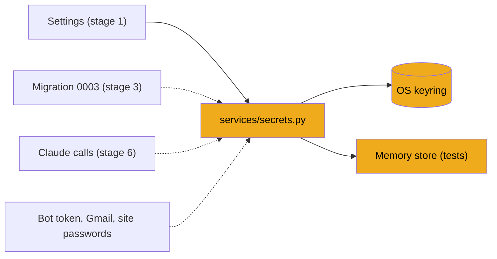

# Stage 2: Secrets and the keyring

> **Goal:** Give JobBee one safe place for secrets (API keys, passwords, login tokens): your operating system's password vault, never a file or the database.
>
> **By the end you will have:** `backend/app/services/secrets.py`, with a store backed by the OS keyring, an in-memory store for tests, and the helpers every later stage uses to read the Claude key and per-user secrets.

## Where this fits

Secrets come before the database for a practical reason. When stage 3 creates your database for the first time, it runs every migration in order, and migration `0003` imports `app.services.secrets`. That migration moves old plaintext Gmail tokens into the secret store. On your fresh database there's nothing to move, but the import still happens, so this module must already exist. Later, stage 6 reads your Claude key through it, and stages 11, 13 and 20 keep a bot token, Gmail tokens and job-site passwords here.



## New ideas in plain words

**Secret.** Any value that gives access to something: an API key, a password, a login token. Anyone who has your Claude key can spend your money. JobBee holds several over time: the Claude key, a Telegram bot token, a Gmail sign-in token and passwords for job-site accounts the agent creates.

**Why not keep secrets in git, the database or `.env`?**

| Place | The problem |
|---|---|
| git | History is forever. A key committed once stays in every copy of the repo, even after you delete the line. |
| The database | `jobbee.db` is an ordinary file. It gets copied, backed up and attached to bug reports. Any program running as you can read it. |
| `.env` | Also a plain text file. Fine on a developer's own machine, but easy to share by accident. |

JobBee still *reads* a Claude key from `.env` if you put one there, which is handy while developing. But when the app saves a secret, it saves it somewhere better.

**The OS keyring.** Every desktop operating system has a built-in password vault. It's encrypted and tied to your user account. The Python `keyring` library talks to whichever one you have:

| System | Vault | Where to look |
|---|---|---|
| Windows | Credential Manager | Control Panel → Credential Manager → Windows Credentials |
| macOS | Keychain | The Keychain Access app |
| Linux | Secret Service (GNOME Keyring, KWallet) | "Passwords and Keys" (Seahorse) |

Each entry has three parts: a *service* name (JobBee uses `JobBee`), a *user name* (JobBee puts the secret's name here, like `app:anthropic_api_key`) and the secret itself.

**A `Protocol` (an interface).** A `Protocol` lists the methods a kind of object must have, without saying how they work: "a secret store has `get`, `set` and `delete`". Any class with those three methods counts as a secret store. It doesn't have to inherit from anything. Type checkers such as mypy use the `Protocol` to check that callers only use those methods. That lets JobBee swap the real keyring for a plain dict in tests without callers noticing.

**Your own exception class.** `class SecretStoreError(RuntimeError)` makes a new kind of error. Code that calls the store only has to catch this one type, whatever the operating system or library raised underneath. `raise SecretStoreError(...) from e` keeps the original error attached, so the full story shows up when you debug.

**One shared object via `lru_cache`.** Stage 1's `get_settings()` used `@lru_cache` to build `Settings` once. The same trick builds one secret store. Everyone who calls `get_secret_store()` gets the same object. That matters in tests: the test and the app must look at the same in-memory dict.

**Importing inside a function.** Most imports sit at the top of a file and run when the file is loaded. An import written *inside* a function runs only when the function is called. This file does that twice, for two different reasons: `keyring` is only loaded when the real store is used, and `pipeline.state` is imported late because it doesn't exist until stage 5 (and importing it at the top would create a loop of modules importing each other).

**HTTP header.** A named line of extra information sent with a request, like `anthropic-workspace-id: wrkspc_123`. Headers travel next to the body. APIs use them for keys, formats and options.

## Build it, step by step

New files in this stage:

```text
backend/app/
  services/
    __init__.py
    secrets.py
```

### Step 1: The services package, `backend/app/services/__init__.py`

Create the folder `backend/app/services/` and this one-line `__init__.py`, which makes it a package. `services/` holds helpers shared by the API endpoints and the background agents. The docstring says these helpers don't depend on FastAPI or the database. That's the intent. A few of them, such as `app_config.py` in stage 5, do use the database.

<!-- code: backend/app/services/__init__.py -->
**`backend/app/services/__init__.py`** (whole file, 1 lines)

```python
"""Pure-Python helpers (no FastAPI / DB dependencies) shared by routers and agents."""
```
<!-- /code -->

### Step 2: The secret store, `backend/app/services/secrets.py`

This file is the only place in JobBee that talks to the keyring. Everything else asks it for secrets by name.

#### Part 1: The stores

<!-- code: backend/app/services/secrets.py lines=1-84 -->
**`backend/app/services/secrets.py`** (lines 1–84 of 138)

```python
"""Secret storage kept out of SQLite and API responses.

Local installs use the OS credential store via `keyring` (Windows Credential
Manager, macOS Keychain, Secret Service). The interface is small on purpose so
a hosted build can swap in a KMS-backed vault without touching callers.
"""

from __future__ import annotations

from functools import lru_cache
from typing import Protocol

from ..config import get_settings


class SecretStoreError(RuntimeError):
    """Raised when the backing store cannot read or write a secret."""


class SecretStore(Protocol):
    def get(self, name: str) -> str | None: ...

    def set(self, name: str, value: str) -> None: ...

    def delete(self, name: str) -> None: ...


class KeyringSecretStore:
    def __init__(self, service: str) -> None:
        self._service = service

    def get(self, name: str) -> str | None:
        import keyring
        from keyring.errors import KeyringError

        try:
            return keyring.get_password(self._service, name)
        except KeyringError as e:
            raise SecretStoreError(f"Could not read secret {name!r}: {e}") from e

    def set(self, name: str, value: str) -> None:
        import keyring
        from keyring.errors import KeyringError

        try:
            keyring.set_password(self._service, name, value)
        except KeyringError as e:
            raise SecretStoreError(f"Could not save secret {name!r}: {e}") from e

    def delete(self, name: str) -> None:
        import keyring
        from keyring.errors import KeyringError, PasswordDeleteError

        try:
            keyring.delete_password(self._service, name)
        except PasswordDeleteError:
            pass
        except KeyringError as e:
            raise SecretStoreError(f"Could not delete secret {name!r}: {e}") from e


class MemorySecretStore:
    """Process-local store for tests."""

    def __init__(self) -> None:
        self._values: dict[str, str] = {}

    def get(self, name: str) -> str | None:
        return self._values.get(name)

    def set(self, name: str, value: str) -> None:
        self._values[name] = value

    def delete(self, name: str) -> None:
        self._values.pop(name, None)


@lru_cache(maxsize=1)
def get_secret_store() -> SecretStore:
    settings = get_settings()
    if settings.secret_store == "memory":
        return MemorySecretStore()
    return KeyringSecretStore(settings.secret_store_service)

```
<!-- /code -->

- **The docstring** says the interface is small on purpose. A hosted version of JobBee could add a store backed by a cloud vault with the same three methods, and no caller would change.
- **`SecretStore(Protocol)`** is the interface. The `...` bodies are real Python: inside a `Protocol` they mean "no code here, only the shape".
- **`KeyringSecretStore`** is the real store. It remembers its service name (`JobBee`, from `settings.secret_store_service`) and passes it to every keyring call:
  - `keyring.get_password(service, name)` returns the secret, or `None` if there isn't one.
  - `keyring.set_password(service, name, value)` saves or replaces it.
  - `keyring.delete_password(service, name)` removes it. If the secret isn't there, keyring raises `PasswordDeleteError`. The store ignores that error, because "make sure it's gone" is what the caller wanted.
  - Every other keyring error becomes a `SecretStoreError`.
- **The error messages name the secret, never its value.** `{name!r}` puts the name in quotes (it's the `repr` of the string). Error messages end up in logs and on screens, so a value must never appear in one.
- **`import keyring` inside each method.** A test run with the memory store never loads the keyring library at all.
- **`MemorySecretStore`** keeps secrets in a dict called `_values`. They vanish when Python stops. It's for tests only. Stage 4's test setup checks that tests always use it and empties `_values` after each test.
- **`get_secret_store()`** reads the `secret_store` setting once and builds the matching store. Neither class inherits from `SecretStore`, but both fit it because they have the three methods. That's the `Protocol` idea at work.

#### Part 2: Secret names and the helpers other stages use

<!-- code: backend/app/services/secrets.py lines=85-138 -->
**`backend/app/services/secrets.py`** (lines 85–138 of 138)

```python

def user_secret_name(user_id: int, key: str) -> str:
    return f"user:{user_id}:{key}"


GMAIL_REFRESH_TOKEN = "gmail_refresh_token"
IMAP_APP_PASSWORD = "imap_app_password"
GMAIL_CLIENT_SECRET = "app:gmail_client_secret"
ANTHROPIC_API_KEY = "app:anthropic_api_key"


def claude_api_key() -> str:
    """The Claude API key: the one saved in the app first, then ANTHROPIC_API_KEY from `.env`."""

    try:
        stored = get_secret_store().get(ANTHROPIC_API_KEY)
    except SecretStoreError:
        stored = None
    if stored and stored.strip():
        return stored.strip()
    return get_settings().anthropic_api_key.strip()


WORKSPACE_ID_KEY = "anthropic_workspace_id"


def claude_workspace_id() -> str:
    """Workspace for organization-wide keys: the one saved in the app, then `.env`."""

    from ..pipeline.state import get_flag

    saved = (get_flag(WORKSPACE_ID_KEY) or "").strip()
    return saved or get_settings().anthropic_workspace_id.strip()


def claude_headers(workspace_id: str | None = None) -> dict[str, str]:
    """Extra headers for every Claude request (organization-wide keys must name a workspace)."""

    workspace = claude_workspace_id() if workspace_id is None else workspace_id.strip()
    return {"anthropic-workspace-id": workspace} if workspace else {}


def get_user_secret(user_id: int, key: str) -> str | None:
    value = get_secret_store().get(user_secret_name(user_id, key))
    return value.strip() if value and value.strip() else None


def set_user_secret(user_id: int, key: str, value: str | None) -> None:
    name = user_secret_name(user_id, key)
    cleaned = (value or "").strip()
    if cleaned:
        get_secret_store().set(name, cleaned)
    else:
        get_secret_store().delete(name)
```
<!-- /code -->

All of JobBee's secrets share one service name, so each needs a unique name. Two patterns keep them apart:

- **`app:...`** belongs to the whole app, like the Claude key.
- **`user:{id}:...`** belongs to one user. `user_secret_name(1, "gmail_refresh_token")` gives `user:1:gmail_refresh_token`. JobBee has one user today, but the database is built for more (stage 3), so per-user secrets carry the user's id.

| Secret name | Holds | Saved by |
|---|---|---|
| `app:anthropic_api_key` | Your Claude API key | The setup API (stage 23), from the welcome page (stage 25) |
| `app:gmail_client_secret` | The Gmail sign-in app's secret | Stage 5's `app_config.py`, used in stage 13 |
| `app:telegram_bot_token` | The Telegram bot token (named in `messaging/service.py`) | Stage 11 |
| `user:1:gmail_refresh_token` | Your Gmail sign-in token | Stage 13 |
| `user:1:imap_app_password` | An IMAP mailbox password | Stage 13 |
| `user:1:site:<host>` | A password for a job-site account the agent made | Stage 20 |

The helpers, one by one:

- **`claude_api_key()`** is the single place the rest of JobBee asks "what's the Claude key?". A key saved in the app wins. If there isn't one, it falls back to `ANTHROPIC_API_KEY` from `.env` (the `anthropic_api_key` setting). If the keyring itself is broken, the `except SecretStoreError` falls back to `.env` quietly instead of crashing. The Claude client in stage 6 and the apply agent in stage 18 both call it.
- **`claude_workspace_id()`** returns the workspace ID for organization-wide Claude keys. Such keys must name a workspace on every request. The ID is an identifier, not a password, so it isn't kept in the keyring. It's a *flag* in the database's `app_config` table, read with `get_flag` from `pipeline/state.py`. That file arrives in **stage 5**, and the import sits inside the function, so this module loads fine today. Calling `claude_workspace_id()` before stage 5 would fail.
- **`claude_headers(workspace_id=None)`** builds the extra headers for a Claude request: `{"anthropic-workspace-id": "..."}` when there's a workspace, or an empty dict. With no argument, it looks the workspace up with `claude_workspace_id()`. With an argument, it uses that value instead, which lets the setup API test a new workspace before saving it (stage 23).
- **`get_user_secret(user_id, key)`** reads a per-user secret and trims spaces. An empty value comes back as `None`, so "unset" and "blank" mean the same thing.
- **`set_user_secret(user_id, key, value)`** saves a per-user secret. If the value is empty or `None`, it *deletes* the entry instead. Callers "clear" a secret by setting it to nothing.

## Check it works

**1. The memory store.** This is the stage's hidden check. It uses the memory store, so it works on any computer and touches no real vault. In PowerShell, from `backend`:

```powershell
$env:SECRET_STORE = "memory"
.\.venv\Scripts\python.exe -c "from app.services.secrets import get_secret_store, set_user_secret, get_user_secret; set_user_secret(1, 'demo', 'x'); assert get_user_secret(1, 'demo') == 'x'; print('ok')"
Remove-Item Env:SECRET_STORE
```

```text
ok
```

On Mac or Linux, put the variable in front of the command:

```bash
SECRET_STORE=memory .venv/bin/python -c "from app.services.secrets import get_secret_store, set_user_secret, get_user_secret; set_user_secret(1, 'demo', 'x'); assert get_user_secret(1, 'demo') == 'x'; print('ok')"
```

The environment variable beats `.env` (stage 1), so `get_secret_store()` builds a `MemorySecretStore`. The secret goes into a dict and disappears when Python exits.

**2. A saved key beats `.env`.** Still with the memory store, give Python a key from the environment, then save one in the store:

```powershell
$env:SECRET_STORE = "memory"
$env:ANTHROPIC_API_KEY = "from-env"
.\.venv\Scripts\python.exe -c "from app.services.secrets import get_secret_store, claude_api_key, ANTHROPIC_API_KEY; print(claude_api_key()); get_secret_store().set(ANTHROPIC_API_KEY, 'from-store'); print(claude_api_key())"
Remove-Item Env:SECRET_STORE, Env:ANTHROPIC_API_KEY
```

```text
from-env
from-store
```

**3. Optional, Windows: the real vault.** Save a throwaway secret in Windows Credential Manager:

```powershell
.\.venv\Scripts\python.exe -c "from app.services.secrets import set_user_secret, get_user_secret; set_user_secret(1, 'demo', 'hello'); print(get_user_secret(1, 'demo'))"
```

It prints `hello`. Now open Control Panel → Credential Manager → **Windows Credentials**. Under **Generic Credentials** you'll find an entry named `JobBee` with the user name `user:1:demo`. Windows Credential Manager allows only one entry per name. So when JobBee saves a second secret, `keyring` moves the older one to an entry named after its user name, like `user:1:demo@JobBee`. Seeing both kinds of entry is normal.

Remove the demo secret by setting it to nothing:

```powershell
.\.venv\Scripts\python.exe -c "from app.services.secrets import set_user_secret, get_user_secret; set_user_secret(1, 'demo', ''); print(get_user_secret(1, 'demo'))"
```

It prints `None`, and the entry is gone from Credential Manager. On macOS, the Keychain may ask whether Python may use it; allow it. On Linux without a desktop session, see the first common mistake below.

<!-- verify: backend | SECRET_STORE=memory python -c "from app.services.secrets import get_secret_store, set_user_secret, get_user_secret; set_user_secret(1, 'demo', 'x'); assert get_user_secret(1, 'demo') == 'x'; print('ok')" -->

## Common mistakes

- **No keyring on Linux or WSL.** A server or WSL without a desktop session usually has no Secret Service. `keyring` then raises `NoKeyringError` ("No recommended backend was available"), which the store turns into `SecretStoreError`. `claude_api_key()` survives it by falling back to `.env`, but saving a secret fails. For experiments, set `SECRET_STORE=memory` in `.env` (secrets then last only until the server stops). For real use, install and unlock GNOME Keyring, or put your key in `.env` as `ANTHROPIC_API_KEY`.
- **Calling `claude_workspace_id()` or `claude_headers()` too early.** Both reach for `app.pipeline.state`, which you write in stage 5. Before then they fail with `ModuleNotFoundError: No module named 'app.pipeline'`. Nothing in stages 2–4 calls them.
- **Leaving `SECRET_STORE=memory` set in your PowerShell window.** `$env:` variables last until the window closes. If you then start the server in that window, a key you save is lost when it stops. Run `Remove-Item Env:SECRET_STORE`, or open a new window.
- **Printing or logging a secret value.** It's tempting while debugging. Logs and error messages are exactly where secrets leak. Name the secret, never print its value. The `{name!r}` messages in this file and `repr=False` on key fields in `Settings` (stage 1) follow that rule.
- **Expecting to store an empty string.** `set_user_secret(1, "x", "")` deletes the entry. That's deliberate: it's how callers clear a secret.
- **Building a store by hand.** `MemorySecretStore()` makes a new, separate dict. Always call `get_secret_store()`, so the app and the tests share the one store.

## Recap

- Secrets don't belong in git, the database or a shared file. JobBee keeps them in the OS keyring through the `keyring` library.
- A `Protocol` describes the store's three methods. The keyring store and the memory store both fit it, and the cached `get_secret_store()` picks one from the `secret_store` setting.
- Errors become `SecretStoreError` and name the secret, never the value.
- Secret names follow two patterns: `app:...` for the app, `user:{id}:...` for one user.
- `claude_api_key()` is the one way to get the Claude key: the saved key first, then `.env`.
- `claude_workspace_id()` imports `pipeline.state` lazily. That file arrives in stage 5.
- This module exists before the database because migration `0003` imports it.

**Next:** [Stage 3: The database](03-database.md)
