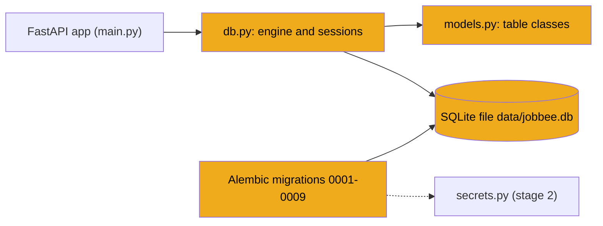
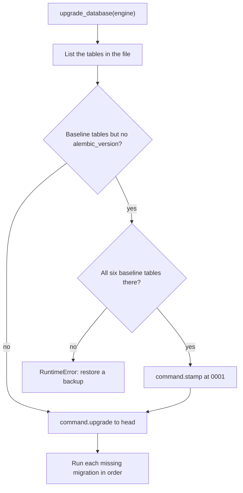
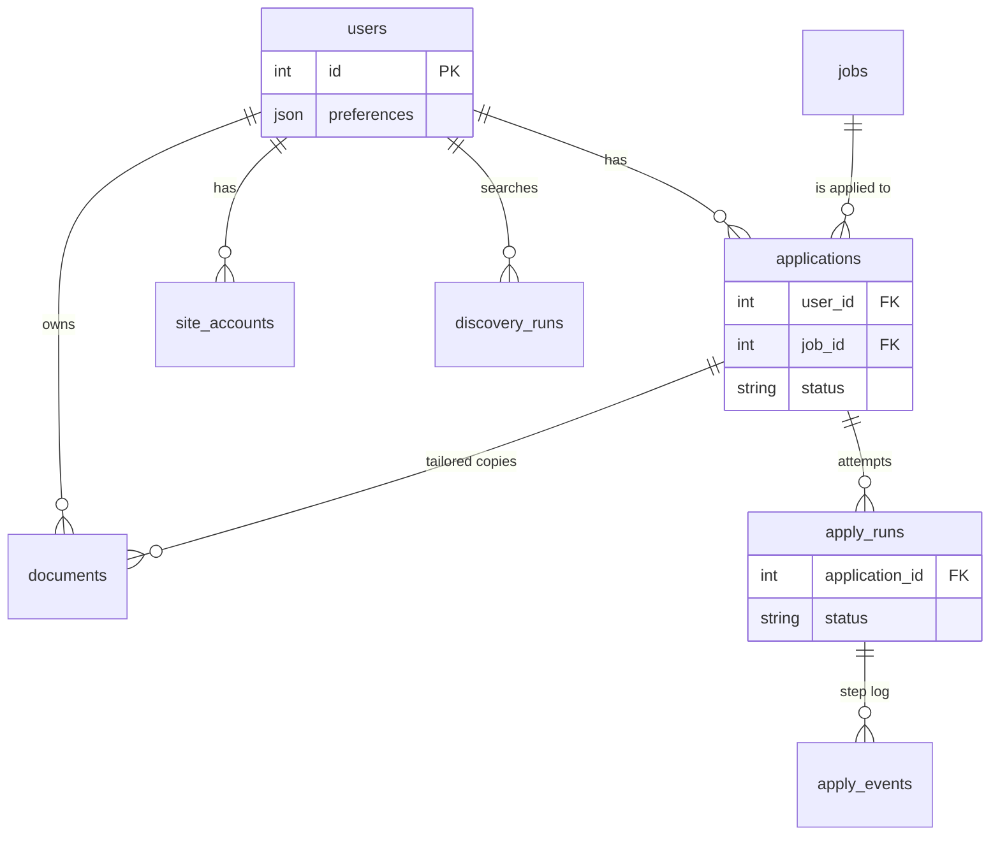
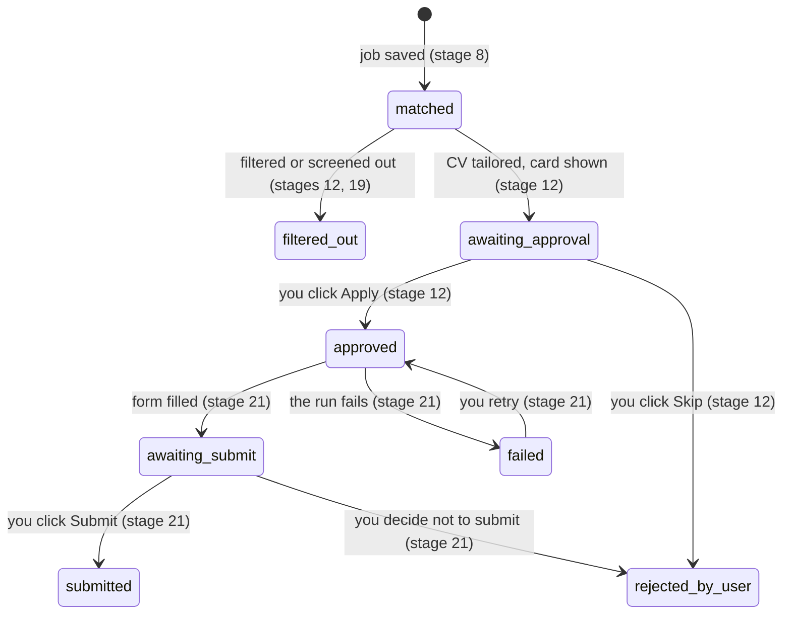

# Stage 3: The database

> **Goal:** Give JobBee a memory: one SQLite file with every table the app needs, created and upgraded by Alembic migrations.
>
> **By the end you will have:** `db.py` (the connection, sessions and an automatic upgrade), `models.py` (all 15 tables as Python classes), the Alembic setup, the nine real migrations, and a temporary `main.py` that upgrades the database every time the server starts.

## Where this fits

JobBee has to remember things across restarts: your profile, the jobs it found, what you approved, every application attempt and every cent spent on Claude. This stage builds the layer that stores all of it. Every later stage reads or writes through the files you write here.



## New ideas in plain words

**Database.** A program (or a file) that stores data in an organised way and answers questions about it later. Unlike a Python dict, it keeps the data when your program stops, and it can find one record among millions quickly.

**Table, row and column.** A table is like one tab of a spreadsheet. Each *column* is one kind of fact, with a fixed type. Each *row* is one record. A tiny `users` table:

| id | name | location |
|---|---|---|
| 1 | Ada | Toronto |
| 2 | Lin | Hanoi |

**Primary key.** The column that names each row uniquely, here `id`. No two rows share it, and it never changes. When you add a row, the database picks the next number for you.

**Foreign key.** A column that points at a row in another table. A `documents` row with `user_id = 1` means "this document belongs to user 1". That's how tables link together. One SQLite quirk: it only *checks* foreign keys if you switch that on with `PRAGMA foreign_keys=ON`, and JobBee doesn't. So in JobBee the links are a promise the code keeps, not a rule the database enforces.

**Index.** A sorted lookup list for one column, like the index at the back of a book. With an index on `user_id`, "all documents of user 1" stays fast however many rows there are.

**SQL.** The language databases understand. You'll rarely write it in JobBee, but you'll see it in migrations, so it helps to recognise it:

```sql
SELECT name, location FROM users WHERE id = 1;
UPDATE applications SET status = 'matched' WHERE status = 'awaiting_approval';
```

The first asks "from `users`, give me the name and location of row 1". The second changes every row that matches the `WHERE` part.

**SQLite.** A database that lives in a single file on your disk. There's no separate server to install or start, and Python can talk to it out of the box. That suits an app that runs on one PC for one person.

**ORM.** An *object-relational mapper* turns rows into Python objects and back. Instead of writing SQL, you write a class `User` with attributes, and the ORM writes the SQL for you. JobBee uses SQLAlchemy. Setting `user.name = "Ada"` and saving becomes an `UPDATE` statement.

**Session and transaction.** A *session* is a unit of work. Think of a shopping basket: you add, change and remove things in the basket, and nothing is final until checkout. `session.commit()` is the checkout: all the changes are saved together, or none are. That all-or-nothing group of changes is a *transaction*. `session.rollback()` empties the basket. You open a session, do one piece of work, commit, and close it.

**Context manager (`with`).** `with SessionLocal() as session:` runs some setup, then your indented block, then clean-up, even if your block raises an error. Here the clean-up closes the session. You'll see `with` around sessions, connections and transactions throughout JobBee.

**Migration.** A saved, numbered change to the database layout, such as "add a `pdf_path` column to `documents`". Your database file outlives your code. When the code needs a new column, the existing file must change to match, without losing its rows. Migrations are that list of changes. Each one names the one before it, so they always run in the same order.

**Alembic.** The migration tool for SQLAlchemy. It runs migrations in order and remembers which ones a database already has, in a one-row table called `alembic_version`. "Upgrade to head" means "run every migration this database doesn't have yet, up to the newest". Alembic can also compare your model classes with a database and write a draft migration for the difference (*autogenerate*).

**JSON columns.** Some facts are small lists or dicts, like your skills (`["python", "sql"]`). Rather than a separate table for each, JobBee stores them in a JSON column. SQLite keeps them as text, and SQLAlchemy turns them back into Python lists and dicts when you read them.

**Enums.** A fixed set of allowed values, like the statuses an application can have. In Python it's a class that lists the choices. Using an enum instead of free text stops typos like `"aproved"` from creeping in.

## Build it, step by step

New files in this stage:

```text
backend/
  alembic.ini                 Step 3
  app/
    db.py                     Step 1
    models.py                 Step 2
    migrations/
      env.py                  Step 4
      script.py.mako          Step 5
      versions/
        0001_baseline_schema.py ... 0009_site_accounts.py   Steps 6-14
    main.py                   Step 15 (temporary version)
```

`migrations/` and `versions/` don't need an `__init__.py`. Alembic loads those files by path, not by import.

### Step 1: Database plumbing, `backend/app/db.py`

`backend/app/db.py` holds the database plumbing that every other file imports: the connection to the file, the session factory, and the function that upgrades the database.

#### Part 1: The engine and the session factory

<!-- code: backend/app/db.py lines=1-34 -->
**`backend/app/db.py`** (lines 1–34 of 102)

```python
"""SQLite + SQLAlchemy session plumbing."""

from __future__ import annotations

import logging
from collections.abc import Iterator
from pathlib import Path

from sqlalchemy import Engine, create_engine, event, inspect
from sqlalchemy.orm import DeclarativeBase, Session, sessionmaker

from .config import get_settings

logger = logging.getLogger(__name__)


class Base(DeclarativeBase):
    """Shared declarative base for all ORM models."""


_settings = get_settings()
_engine_kwargs: dict = {"future": True}
if _settings.resolved_database_url().startswith("sqlite"):
    _engine_kwargs["connect_args"] = {"check_same_thread": False}

engine = create_engine(_settings.resolved_database_url(), **_engine_kwargs)
SessionLocal = sessionmaker(bind=engine, autoflush=False, autocommit=False, future=True)


MIGRATIONS_DIR = Path(__file__).resolve().parent / "migrations"
_BASELINE_REVISION = "0001"
_BASELINE_TABLES = {"users", "app_config", "email_sync_states", "documents", "jobs", "applications"}


```
<!-- /code -->

- **`Base`** is the parent class of every table class in `models.py`. SQLAlchemy keeps a list of all its subclasses in `Base.metadata`. Alembic reads that list to know which tables your code expects.
- **`engine`** knows how to open connections to the database file. It keeps a small *pool* of open connections and reuses them. The URL comes from `resolved_database_url()` (stage 1), so it's always `backend/data/jobbee.db` unless `DATABASE_URL` says otherwise.
- **The engine is built when `db.py` is first imported**, not when it's first used. Whatever `DATABASE_URL` says at that moment is what the whole program uses. Stage 4's test setup depends on this: it sets `DATABASE_URL` to a temporary file *before* importing anything from `app`.
- **`check_same_thread=False`.** Python's `sqlite3` module refuses to use a connection from a different thread than the one that opened it. FastAPI runs plain `def` endpoints in a pool of threads, and SQLAlchemy's pool hands connections from one thread to the next. Turning the check off is safe here because SQLAlchemy only lets one thread use a connection at a time.
- **`SessionLocal`** is a *session factory*: each call `SessionLocal()` gives you a fresh session (a new basket). `autoflush=False` means SQLAlchemy won't send half-finished changes to the database on its own before each query. `autocommit=False` and the two `future=True` arguments repeat SQLAlchemy 2.0's defaults and change nothing.
- **`logger`** is a named channel for log messages. `upgrade_database` uses it to report a rare event in Part 3.
- **`MIGRATIONS_DIR`, `_BASELINE_REVISION` and `_BASELINE_TABLES`** are used by `upgrade_database` in Part 3.

#### Part 2: Let several connections share the file

<!-- code: backend/app/db.py lines=35-48 -->
**`backend/app/db.py`** (lines 35–48 of 102)

```python
@event.listens_for(Engine, "connect")
def _sqlite_pragmas(dbapi_connection, _record) -> None:
    """WAL + busy timeout so the API and the apply worker can share the file."""

    import sqlite3

    if not isinstance(dbapi_connection, sqlite3.Connection):
        return
    cursor = dbapi_connection.cursor()
    cursor.execute("PRAGMA journal_mode=WAL")
    cursor.execute("PRAGMA busy_timeout=5000")
    cursor.close()


```
<!-- /code -->

A *pragma* is a SQLite setting. `@event.listens_for(Engine, "connect")` runs this function every time a new connection is opened. It listens on the class `Engine`, not on the one `engine` object, so *every* engine gets these settings: the app's, the one the `alembic` command makes, and the throwaway engines in stage 4's tests.

Why it matters: JobBee is one program, but many parts of it use the database at once. The API answers requests while the daily job search (stage 19) and the apply agent (stage 21) run in the background, and you might run Alembic or a script at the same time. Each opens its own connection to the same file.

- **`journal_mode=WAL`** (*write-ahead logging*) lets readers keep reading while one connection writes. Without it, a write blocks every reader. While the server runs you'll see two extra files next to the database, `jobbee.db-wal` and `jobbee.db-shm`. They belong to WAL mode; leave them alone.
- **`busy_timeout=5000`.** SQLite allows one writer at a time. When a second connection wants to write, it waits up to 5000 ms (5 seconds) for its turn instead of failing at once with "database is locked".
- The **`isinstance` check** skips connections that aren't SQLite, in case you ever point `DATABASE_URL` at another kind of database.

#### Part 3: Upgrade the database automatically

<!-- code: backend/app/db.py lines=49-86 -->
**`backend/app/db.py`** (lines 49–86 of 102)

```python
def _alembic_config():
    from alembic.config import Config

    cfg = Config()
    cfg.set_main_option("script_location", str(MIGRATIONS_DIR))
    return cfg


def init_db() -> None:
    upgrade_database(engine)


def upgrade_database(target: Engine) -> None:
    """Bring the database schema to the latest Alembic revision.

    Databases created before Alembic (via `create_all`) match the 0001
    baseline, so they are stamped at 0001 and then upgraded in place —
    existing rows are never dropped.
    """

    from alembic import command

    cfg = _alembic_config()
    with target.begin() as connection:
        cfg.attributes["connection"] = connection
        tables = set(inspect(connection).get_table_names())
        if tables & _BASELINE_TABLES and "alembic_version" not in tables:
            missing = _BASELINE_TABLES - tables
            if missing:
                raise RuntimeError(
                    "Database predates migrations and is missing tables "
                    f"{sorted(missing)}; restore a backup or start from an empty database."
                )
            logger.info("Stamping pre-migration database at baseline revision %s", _BASELINE_REVISION)
            command.stamp(cfg, _BASELINE_REVISION)
        command.upgrade(cfg, "head")


```
<!-- /code -->

- **`_alembic_config()`** builds Alembic's settings in code, pointing at `app/migrations/`. The running app doesn't need `alembic.ini` (Step 3). The Alembic imports sit inside the functions, so importing `db.py` doesn't load Alembic.
- **`init_db()`** upgrades the app's own database. The temporary `main.py` calls it on startup (Step 15).
- **`upgrade_database(target)`** takes any engine, so tests can upgrade a throwaway database instead of yours.
  - `with target.begin() as connection:` opens one connection and one transaction for the whole upgrade.
  - `cfg.attributes["connection"] = connection` hands that connection to `env.py` (Step 4), so the migrations run on exactly this database.
  - `command.upgrade(cfg, "head")` runs every migration the database doesn't have yet. On an up-to-date database it does nothing, which is why calling it on every startup is safe.

The middle of the function handles **databases older than Alembic**. Early versions of JobBee created their tables directly, with no `alembic_version` table. Such a database already matches migration `0001`. So when the file has some of the six baseline tables but no `alembic_version`, the code checks that all six exist. If any are missing, it stops with a clear `RuntimeError` instead of guessing. If they're all there, `command.stamp(cfg, "0001")` writes "this database has 0001" into a new `alembic_version` table *without running it*, and the upgrade continues from there. Existing rows are never dropped. Stage 4's `test_migrations.py` tests both paths.



On your new, empty database the answer is "no" and every migration runs, `0001` to `0009`.

#### Part 4: A session for each request, and the uploads folder

<!-- code: backend/app/db.py lines=87-102 -->
**`backend/app/db.py`** (lines 87–102 of 102)

```python
def get_session() -> Iterator[Session]:
    """FastAPI dependency that yields a request-scoped session."""

    session = SessionLocal()
    try:
        yield session
    finally:
        session.close()


UPLOADS_DIR = Path(__file__).resolve().parent.parent / "data" / "uploads"


def get_uploads_dir() -> Path:
    UPLOADS_DIR.mkdir(parents=True, exist_ok=True)
    return UPLOADS_DIR
```
<!-- /code -->

**`get_session()`** is a FastAPI *dependency*: something an endpoint needs that FastAPI prepares for it. From stage 7 on, endpoints ask for it with `Depends`. This one, which returns your profile, comes from stage 7:

From [`backend/app/api/profile.py`](../../backend/app/api/profile.py):
```python
@router.get("", response_model=ProfileResponse)
def read_profile(session: Session = Depends(get_session)) -> ProfileResponse:
    user = get_or_create_local_user(session)
    ...
```

A function with `yield` in it is a *generator*: it can pause in the middle and carry on later. On each request:

1. FastAPI calls `get_session()`. It runs up to `yield` and hands the session to your endpoint.
2. Your endpoint runs and returns.
3. FastAPI resumes `get_session()` after `yield`. The `finally` block closes the session, even if the endpoint crashed.

Every request gets its own basket, and nothing leaks into the next request.

**`UPLOADS_DIR`** is `backend/data/uploads/`, where stage 7 keeps your uploaded resume. `get_uploads_dir()` creates the folder on first use. Stage 4's test setup points `UPLOADS_DIR` at a temporary folder instead.

### Step 2: The tables, `backend/app/models.py`

`backend/app/models.py` describes every table as a Python class. Each class attribute is one column. You type all 15 tables now, even though most stay empty until later stages, because the migrations in Steps 6–14 create all of them and the two must agree.

| Table | What one row is | Used from |
|---|---|---|
| `users` | You: your profile, saved answers and preferences | Stage 7 |
| `app_config` | One app-wide setting (key and value) | Stage 5 |
| `email_sync_states` | Your connected inbox and how far it has been read | Stage 13 |
| `documents` | A resume or cover letter: yours, or a tailored copy for one job | Stages 7, 10 |
| `jobs` | One job posting, from any source | Stage 8 |
| `applications` | You and one job: its status, screening verdict, tailored documents | Stages 8, 9, 12, 21 |
| `apply_runs` | One attempt by the agent to fill in an application form | Stages 18, 21 |
| `apply_events` | One step of a run (a tool call, a question, a blocked click) | Stage 21 |
| `messaging_links` | Your Telegram chat, once paired | Stage 11 |
| `callback_tokens` | One button in a Telegram message that the bot will honour | Stage 11 |
| `chat_messages` | One message sent to or received from you | Stage 11 |
| `watchlist_companies` | A company whose job board JobBee checks | Stages 14, 19 |
| `site_accounts` | An account the agent created on a job site | Stage 20 |
| `discovery_runs` | One job search and what it found | Stage 19 |
| `llm_usage` | One Claude call: tokens and estimated cost | Stage 6 |

How the main tables link together:



`||--o{` reads "one ... to zero or more": one user owns zero or more documents.

#### Part 1: Imports, enums and timestamps

<!-- code: backend/app/models.py lines=1-57 -->
**`backend/app/models.py`** (lines 1–57 of 425)

```python
"""ORM models for the foundation milestone.

Even though the app is single-user today, we model `User` explicitly so the
schema is forward-compatible with multi-user / multi-profile use later.
"""

from __future__ import annotations

import enum
from datetime import datetime

from sqlalchemy import (
    JSON,
    Boolean,
    DateTime,
    Enum,
    Float,
    ForeignKey,
    Integer,
    String,
    Text,
    UniqueConstraint,
    func,
)
from sqlalchemy.orm import Mapped, mapped_column, relationship

from .db import Base


class DocumentKind(str, enum.Enum):
    resume = "resume"
    cover_letter = "cover_letter"


class ApplicationStatus(str, enum.Enum):
    matched = "matched"
    filtered_out = "filtered_out"  # dropped by hard filters or screening
    awaiting_approval = "awaiting_approval"  # card sent, waiting for Apply/Skip
    approved = "approved"  # queued for / being filled by the apply agent
    awaiting_submit = "awaiting_submit"  # filled; waiting for the user's Submit tap
    submitted = "submitted"
    rejected_by_user = "rejected_by_user"  # skipped
    failed = "failed"


class TimestampMixin:
    created_at: Mapped[datetime] = mapped_column(
        DateTime(timezone=True), server_default=func.now(), nullable=False
    )
    updated_at: Mapped[datetime] = mapped_column(
        DateTime(timezone=True),
        server_default=func.now(),
        onupdate=func.now(),
        nullable=False,
    )


```
<!-- /code -->

- **The imports** bring in column types (`String`, `Text`, `Integer`, `Float`, `Boolean`, `DateTime`, `JSON`, `Enum`), `ForeignKey`, `UniqueConstraint` and `func` (SQL functions such as `now()`). `Mapped`, `mapped_column` and `relationship` come from `sqlalchemy.orm`.
- **`(str, enum.Enum)`** makes each enum member a real string too. `ApplicationStatus.approved == "approved"` is `True`, and it turns into plain `"approved"` in JSON.
- **`DocumentKind`** has two members: a resume or a cover letter.
- **`ApplicationStatus`** is the heart of the app. Every job you see is an `Application` row moving through these eight statuses. The comments say what each one means.
- **`TimestampMixin`.** A *mixin* is a small class you add to other classes to give them extra attributes. Every table that inherits it gets `created_at` and `updated_at`.
  - `server_default=func.now()` asks the database to fill in the current time when a row is inserted.
  - `onupdate=func.now()` asks SQLAlchemy to refresh `updated_at` whenever it updates the row.
  - SQLite stores these times as text, in UTC, and they come back without a time zone attached. They may differ from your clock by a few hours.

The main moves between application statuses, and the stage whose code makes each move:



#### Part 2: You, and the key/value table

<!-- code: backend/app/models.py lines=58-112 -->
**`backend/app/models.py`** (lines 58–112 of 425)

```python
class WorkMode(str, enum.Enum):
    remote = "remote"
    hybrid = "hybrid"
    onsite = "onsite"


class User(TimestampMixin, Base):
    __tablename__ = "users"

    id: Mapped[int] = mapped_column(Integer, primary_key=True)
    name: Mapped[str] = mapped_column(String(120), nullable=False, default="")
    email: Mapped[str | None] = mapped_column(String(255), nullable=True, unique=True)

    # --- Profile fields (filled during onboarding) ---
    headline: Mapped[str | None] = mapped_column(String(255), nullable=True)
    location: Mapped[str | None] = mapped_column(String(255), nullable=True)
    years_experience: Mapped[float | None] = mapped_column(Float, nullable=True)
    min_salary: Mapped[int | None] = mapped_column(Integer, nullable=True)
    summary: Mapped[str | None] = mapped_column(Text, nullable=True)

    # JSON columns store small homogeneous lists. SQLite stores them as TEXT.
    target_roles: Mapped[list[str]] = mapped_column(JSON, nullable=False, default=list)
    target_locations: Mapped[list[str]] = mapped_column(JSON, nullable=False, default=list)
    work_modes: Mapped[list[str]] = mapped_column(JSON, nullable=False, default=list)
    skills: Mapped[list[str]] = mapped_column(JSON, nullable=False, default=list)
    links: Mapped[dict[str, str]] = mapped_column(JSON, nullable=False, default=dict)

    # Common answers for ATS screening questions (work auth, sponsorship, referral, etc.).
    application_defaults: Mapped[dict[str, str]] = mapped_column(JSON, nullable=False, default=dict)

    # How many top-scored matches to send to the approval queue after search.
    approval_top_n: Mapped[int] = mapped_column(Integer, nullable=False, default=5)

    onboarded_at: Mapped[datetime | None] = mapped_column(DateTime(timezone=True), nullable=True)

    # What the agent should look for and how often to ping the user (jobs_per_day,
    # min_match_score, excluded_companies, discovery_time, ...). See app/pipeline/prefs.py.
    preferences: Mapped[dict] = mapped_column(JSON, nullable=False, default=dict)

    documents: Mapped[list[Document]] = relationship(back_populates="user", cascade="all, delete-orphan")
    applications: Mapped[list[Application]] = relationship(back_populates="user", cascade="all, delete-orphan")
    email_sync_state: Mapped[EmailSyncState | None] = relationship(
        back_populates="user", cascade="all, delete-orphan", uselist=False
    )


class AppConfig(Base):
    """Key-value store for one-time local setup (e.g. Gmail OAuth app credentials)."""

    __tablename__ = "app_config"

    key: Mapped[str] = mapped_column(String(128), primary_key=True)
    value: Mapped[str] = mapped_column(Text, nullable=False, default="")


```
<!-- /code -->

- **`WorkMode`** lists the three work modes. Nothing imports it: the `work_modes` column stores plain strings, and stage 4's API shapes check them with a `Literal` instead.
- **`class User(TimestampMixin, Base)`** is a table class. `__tablename__ = "users"` names the table.
- **`Mapped[str | None]` plus `mapped_column(...)`** declares one column. The type hint says what Python sees. `nullable=True` lets the column be empty (`None`); `nullable=False` forbids that.
- **Column types.** `String(120)` is short text (up to 120 characters; SQLite doesn't actually enforce the limit). `Text` is long text, `Integer` a whole number, `Float` a decimal number, `JSON` a list or dict.
- **`unique=True`** on `email` means no two users may share an address.
- **`default=list`** passes the *function* `list`, so each new row gets its own fresh empty list. Never write `default=[]`: that one list object would be shared by every row.
- **The profile fields** (`headline`, `location`, `skills` and so on) are filled from your resume in stage 7. `application_defaults` holds answers to common form questions (phone, work authorisation, sponsorship), which the apply agent reuses (stages 18 and 21). `onboarded_at` records when you finished the welcome flow. `approval_top_n` limits how many matches go to your approval queue. `preferences` holds what the agent should look for (stage 9).
- **`relationship(...)`** isn't a column. It gives you `user.documents`, a Python list of that user's `Document` objects, loaded for you. `back_populates="user"` links it to `Document.user` on the other side, so both stay in step.
- **`cascade="all, delete-orphan"`**: when you delete a user through a session, SQLAlchemy deletes their documents and applications too. Because SQLite isn't checking foreign keys, this cascade is what really cleans up.
- **`uselist=False`** on `email_sync_state` makes it a single object instead of a list: each user has at most one inbox connection.
- **`AppConfig`** is a tiny key/value table for app-wide settings and switches (stage 5). Its primary key is a string, `key`, not a number. Any column whose values are unique can be a primary key.

#### Part 3: Your inbox connection and your documents

<!-- code: backend/app/models.py lines=113-167 -->
**`backend/app/models.py`** (lines 113–167 of 425)

```python
class EmailSyncState(TimestampMixin, Base):
    """Inbox connection + incremental sync cursor (one row per user)."""

    __tablename__ = "email_sync_states"

    id: Mapped[int] = mapped_column(Integer, primary_key=True)
    user_id: Mapped[int] = mapped_column(
        ForeignKey("users.id", ondelete="CASCADE"), unique=True, index=True
    )
    provider: Mapped[str | None] = mapped_column(String(32), nullable=True)
    connected_email: Mapped[str | None] = mapped_column(String(255), nullable=True)
    connected_at: Mapped[datetime | None] = mapped_column(DateTime(timezone=True), nullable=True)
    last_sync_at: Mapped[datetime | None] = mapped_column(DateTime(timezone=True), nullable=True)
    # The Gmail refresh token and IMAP app password live in the secret store
    # (services/secrets.py), keyed by user id — never in this table.
    gmail_history_id: Mapped[str | None] = mapped_column(String(64), nullable=True)
    imap_host: Mapped[str | None] = mapped_column(String(255), nullable=True)
    imap_user: Mapped[str | None] = mapped_column(String(255), nullable=True)
    imap_folder: Mapped[str | None] = mapped_column(String(255), nullable=True, default="INBOX")
    imap_uid_validity: Mapped[int | None] = mapped_column(Integer, nullable=True)
    imap_last_uid: Mapped[int | None] = mapped_column(Integer, nullable=True)
    oauth_state: Mapped[str | None] = mapped_column(String(128), nullable=True)

    user: Mapped[User] = relationship(back_populates="email_sync_state")


class Document(TimestampMixin, Base):
    __tablename__ = "documents"

    id: Mapped[int] = mapped_column(Integer, primary_key=True)
    user_id: Mapped[int] = mapped_column(ForeignKey("users.id", ondelete="CASCADE"), index=True)
    kind: Mapped[DocumentKind] = mapped_column(Enum(DocumentKind), nullable=False, index=True)
    label: Mapped[str] = mapped_column(String(120), nullable=False, default="")
    # Either inline content or a file pointer; keep both so we can support uploads
    # and direct paste-in. `content` always holds extracted plain text for the LLM,
    # `file_path` points at the original binary if the user uploaded one.
    content: Mapped[str | None] = mapped_column(Text, nullable=True)
    file_path: Mapped[str | None] = mapped_column(String(1024), nullable=True)
    original_filename: Mapped[str | None] = mapped_column(String(512), nullable=True)
    mime_type: Mapped[str | None] = mapped_column(String(255), nullable=True)
    byte_size: Mapped[int | None] = mapped_column(Integer, nullable=True)
    # Base docs are the user's own resume / cover letter (one active per kind).
    # Tailored docs are per-application copies and are owned by that application.
    is_base: Mapped[bool] = mapped_column(Boolean, nullable=False, default=True)
    application_id: Mapped[int | None] = mapped_column(
        ForeignKey("applications.id", ondelete="SET NULL", use_alter=True),
        nullable=True,
        index=True,
    )
    # Rendered PDF for upload to an ATS (tailored docs only).
    pdf_path: Mapped[str | None] = mapped_column(String(1024), nullable=True)

    user: Mapped[User] = relationship(back_populates="documents")


```
<!-- /code -->

- **`EmailSyncState`** is one row per user (`unique=True` on `user_id`) describing your connected inbox: which provider, which address, and how far JobBee has read (`gmail_history_id`, `imap_last_uid`) so it never reads the same email twice. The comment points out that the tokens themselves live in the secret store (stage 2), not here. Stage 13 uses this table.
- **`Document`** is a resume or cover letter.
  - **`ForeignKey("users.id", ondelete="CASCADE")`** makes `user_id` point at a row in `users`. `ondelete="CASCADE"` describes what *should* happen when that user is deleted; `"SET NULL"` (on `application_id`) means "keep this row, but clear the link".
  - **`index=True`** builds an index on that column.
  - **`Enum(DocumentKind)`** stores the enum as text (`"resume"`) and only lets valid members in from Python.
  - **`content` vs `file_path`.** `content` always holds the plain text, which is what Claude reads. `file_path` points at the original file on disk, which is what gets uploaded to job sites. Stage 7 fills both.
  - **`is_base`** separates your own resume and cover letter (base documents) from the tailored copies made for one job, which also set `application_id`. `pdf_path` points at the tailored copy's PDF (stage 10).
  - **`use_alter=True`.** `documents` points at `applications`, and `applications` points back at `documents` (Part 4). That's a loop. `use_alter` tells SQLAlchemy to add this one link after both tables exist, so neither has to come first.

#### Part 4: Jobs and applications

<!-- code: backend/app/models.py lines=168-216 -->
**`backend/app/models.py`** (lines 168–216 of 425)

```python
class Job(TimestampMixin, Base):
    __tablename__ = "jobs"
    __table_args__ = (UniqueConstraint("source", "external_id", name="uq_jobs_source_external"),)

    id: Mapped[int] = mapped_column(Integer, primary_key=True)
    source: Mapped[str] = mapped_column(String(64), nullable=False, index=True)
    external_id: Mapped[str | None] = mapped_column(String(255), nullable=True)
    url: Mapped[str] = mapped_column(String(2048), nullable=False)
    title: Mapped[str] = mapped_column(String(255), nullable=False)
    company: Mapped[str | None] = mapped_column(String(255), nullable=True)
    location: Mapped[str | None] = mapped_column(String(255), nullable=True)
    description: Mapped[str | None] = mapped_column(Text, nullable=True)
    match_score: Mapped[float | None] = mapped_column(Float, nullable=True)
    match_reason: Mapped[str | None] = mapped_column(Text, nullable=True)
    # "llm" scores are never overwritten by keyword re-ranking; "heuristic" ones are.
    match_source: Mapped[str | None] = mapped_column(String(16), nullable=True)
    canonical_url: Mapped[str | None] = mapped_column(String(2048), nullable=True, index=True)
    content_hash: Mapped[str | None] = mapped_column(String(64), nullable=True, index=True)
    work_mode: Mapped[str | None] = mapped_column(String(16), nullable=True)
    salary_text: Mapped[str | None] = mapped_column(String(255), nullable=True)
    posted_at: Mapped[datetime | None] = mapped_column(DateTime(timezone=True), nullable=True)
    discovered_via: Mapped[str | None] = mapped_column(String(32), nullable=True)


class Application(TimestampMixin, Base):
    __tablename__ = "applications"

    id: Mapped[int] = mapped_column(Integer, primary_key=True)
    user_id: Mapped[int] = mapped_column(ForeignKey("users.id", ondelete="CASCADE"), index=True)
    job_id: Mapped[int] = mapped_column(ForeignKey("jobs.id", ondelete="CASCADE"), index=True)
    resume_doc_id: Mapped[int | None] = mapped_column(ForeignKey("documents.id"), nullable=True)
    cover_doc_id: Mapped[int | None] = mapped_column(ForeignKey("documents.id"), nullable=True)
    status: Mapped[ApplicationStatus] = mapped_column(
        Enum(ApplicationStatus), nullable=False, default=ApplicationStatus.matched
    )
    notes: Mapped[str | None] = mapped_column(Text, nullable=True)
    submitted_at: Mapped[datetime | None] = mapped_column(DateTime(timezone=True), nullable=True)
    # Screening verdict: {"decision", "score", "summary", "reasons", "gaps"}.
    screen: Mapped[dict | None] = mapped_column(JSON, nullable=True)
    # Why it was filtered out or skipped, for the dashboard and future filtering.
    stage_reason: Mapped[str | None] = mapped_column(Text, nullable=True)
    # CV changes summary + the approval card's message id (to remove its buttons later).
    tailoring: Mapped[dict | None] = mapped_column(JSON, nullable=True)
    card_message_id: Mapped[str | None] = mapped_column(String(64), nullable=True)

    user: Mapped[User] = relationship(back_populates="applications")
    job: Mapped[Job] = relationship()


```
<!-- /code -->

- **`Job`** is one posting.
  - **`UniqueConstraint("source", "external_id")`** says no two rows may have the same pair. The same posting found twice by the same source can't be stored twice.
  - `match_score` and `match_reason` hold the screening score and its one-line summary. Stage 12 copies them here from Claude's verdict and sets `match_source` to `"llm"`. The comment on `match_source` dates from an older keyword scorer, whose `"heuristic"` scores could be replaced later; migration `0002` labels old rows one way or the other.
  - `canonical_url` and `content_hash` let stage 8 spot the same job arriving from different links. Both are indexed because they're looked up on every new posting.
  - `work_mode`, `salary_text`, `posted_at` and `discovered_via` are details shown on the job card and used to filter (stages 8, 14, 19).
- **`Application`** is your relationship with one job.
  - `resume_doc_id` and `cover_doc_id` point at the tailored documents made for this job (stages 10 and 12).
  - `status` starts as `matched`, the default.
  - `screen` holds the screening verdict as JSON (stage 9), and `stage_reason` says why a job was filtered out or skipped.
  - `tailoring` holds the summary of CV changes (stage 10), and `card_message_id` remembers the approval message on Telegram so its buttons can be removed later (stage 11).
  - `job: Mapped[Job] = relationship()` gives you `application.job`, with no matching list on `Job`, because nothing needs "all applications of a job".

#### Part 5: Apply runs and their step log

<!-- code: backend/app/models.py lines=217-283 -->
**`backend/app/models.py`** (lines 217–283 of 425)

```python
class ApplyRun(TimestampMixin, Base):
    """One attempt by the Claude apply agent to fill (and, once approved, submit) an application.

    Status: queued → starting → running (⇄ needs_human, attended runs only) →
      awaiting_submit (form filled, tab parked, waiting for the user's Submit tap)
        ⇄ revising (changing answers the user corrected)
        → submitting → submitted | submit_unconfirmed
        → discarded (user said don't submit) | expired (no answer in time)
      or needs_you (set aside: only a human at the PC can continue)
      or blocked | failed | cancelled while filling.
    """

    __tablename__ = "apply_runs"

    id: Mapped[int] = mapped_column(Integer, primary_key=True)
    application_id: Mapped[int] = mapped_column(
        ForeignKey("applications.id", ondelete="CASCADE"), index=True
    )
    status: Mapped[str] = mapped_column(String(32), nullable=False, default="starting")
    url: Mapped[str] = mapped_column(String(2048), nullable=False)
    ats: Mapped[str] = mapped_column(String(32), nullable=False, default="generic")
    model: Mapped[str] = mapped_column(String(64), nullable=False)
    effort: Mapped[str] = mapped_column(String(16), nullable=False)
    # What the run is waiting on: {"type": "human_action", ...} or {"type": "revise", ...}.
    pending: Mapped[dict | None] = mapped_column(JSON, nullable=True)
    # The user started it from their PC, so the agent may hand them the browser.
    attended: Mapped[bool] = mapped_column(Boolean, nullable=False, default=False)
    finish: Mapped[dict | None] = mapped_column(JSON, nullable=True)
    error: Mapped[str | None] = mapped_column(Text, nullable=True)
    iterations: Mapped[int] = mapped_column(Integer, nullable=False, default=0)
    tool_calls: Mapped[int] = mapped_column(Integer, nullable=False, default=0)
    input_tokens: Mapped[int] = mapped_column(Integer, nullable=False, default=0)
    output_tokens: Mapped[int] = mapped_column(Integer, nullable=False, default=0)
    cache_read_tokens: Mapped[int] = mapped_column(Integer, nullable=False, default=0)
    cache_write_tokens: Mapped[int] = mapped_column(Integer, nullable=False, default=0)
    cost_usd: Mapped[float] = mapped_column(Float, nullable=False, default=0.0)
    guard_trips: Mapped[int] = mapped_column(Integer, nullable=False, default=0)
    uninspected_clicks: Mapped[int] = mapped_column(Integer, nullable=False, default=0)
    review: Mapped[dict | None] = mapped_column(JSON, nullable=True)
    submit_candidates: Mapped[list | None] = mapped_column(JSON, nullable=True)
    finished_at: Mapped[datetime | None] = mapped_column(DateTime(timezone=True), nullable=True)
    # Filled form, parked for the user's Submit tap.
    tab_id: Mapped[str | None] = mapped_column(String(128), nullable=True)
    review_url: Mapped[str | None] = mapped_column(String(2048), nullable=True)
    answers: Mapped[list | None] = mapped_column(JSON, nullable=True)
    screenshot_path: Mapped[str | None] = mapped_column(String(1024), nullable=True)
    expires_at: Mapped[datetime | None] = mapped_column(DateTime(timezone=True), nullable=True)
    submit_card_message_id: Mapped[str | None] = mapped_column(String(64), nullable=True)
    confirmation: Mapped[dict | None] = mapped_column(JSON, nullable=True)


class ApplyEvent(Base):
    """Step log of an apply run (tool calls, questions, guard blocks…) for the UI."""

    __tablename__ = "apply_events"

    id: Mapped[int] = mapped_column(Integer, primary_key=True)
    run_id: Mapped[int] = mapped_column(
        ForeignKey("apply_runs.id", ondelete="CASCADE"), index=True
    )
    kind: Mapped[str] = mapped_column(String(32), nullable=False)
    data: Mapped[dict] = mapped_column(JSON, nullable=False, default=dict)
    created_at: Mapped[datetime] = mapped_column(
        DateTime(timezone=True), server_default=func.now(), nullable=False
    )


```
<!-- /code -->

- **`ApplyRun`** is one attempt by the Claude apply agent to fill in an application form. Its docstring lists the run statuses. They're plain strings (`String(32)`), not an enum. Stage 21 builds the code that moves a run between them.
  - `url`, `ats` (which job-site software the form runs on), `model` and `effort` record what the run was started with.
  - `pending` says what the run is waiting for (a question for you, or answers to change). `attended` is true when you started it from your PC, so the agent may hand you the browser.
  - The counters (`iterations`, `tool_calls`, the four token counts, `cost_usd`) track work and spend. `guard_trips` and `uninspected_clicks` count what the safety guards blocked or couldn't check (stages 16 and 17).
  - The last group (`tab_id`, `review_url`, `answers`, `screenshot_path`, `expires_at`, `submit_card_message_id`, `confirmation`) describes a filled form parked in a Chrome tab, waiting for your Submit click.
- **`ApplyEvent`** is one line of a run's step log, shown in the web app. It has only `created_at` instead of the mixin, because an event is written once and never changed. `ondelete="CASCADE"` on `run_id` says a run's events go with it.

#### Part 6: Telegram tables

<!-- code: backend/app/models.py lines=284-347 -->
**`backend/app/models.py`** (lines 284–347 of 425)

```python
class MessagingLink(TimestampMixin, Base):
    """A user's chat on a messaging channel (Telegram today).

    Pairing: the app issues a one-time code (stored hashed); `/start <code>` in the
    bot binds `chat_id`/`from_id`. Only messages from the linked chat are acted on.
    """

    __tablename__ = "messaging_links"
    __table_args__ = (UniqueConstraint("user_id", "channel", name="uq_messaging_user_channel"),)

    id: Mapped[int] = mapped_column(Integer, primary_key=True)
    user_id: Mapped[int] = mapped_column(ForeignKey("users.id", ondelete="CASCADE"), index=True)
    channel: Mapped[str] = mapped_column(String(32), nullable=False)
    chat_id: Mapped[str | None] = mapped_column(String(64), nullable=True)
    from_id: Mapped[str | None] = mapped_column(String(64), nullable=True)
    link_code_hash: Mapped[str | None] = mapped_column(String(64), nullable=True)
    link_expires_at: Mapped[datetime | None] = mapped_column(DateTime(timezone=True), nullable=True)
    linked_at: Mapped[datetime | None] = mapped_column(DateTime(timezone=True), nullable=True)


class CallbackToken(Base):
    """One button press the bot will honour: an opaque nonce instead of raw ids.

    Tokens sharing a `group` (e.g. the options of one question) are spent together.
    """

    __tablename__ = "callback_tokens"

    nonce: Mapped[str] = mapped_column(String(32), primary_key=True)
    user_id: Mapped[int] = mapped_column(ForeignKey("users.id", ondelete="CASCADE"), index=True)
    action: Mapped[str] = mapped_column(String(32), nullable=False)
    target_id: Mapped[int | None] = mapped_column(Integer, nullable=True)
    payload: Mapped[dict] = mapped_column(JSON, nullable=False, default=dict)
    group: Mapped[str | None] = mapped_column(String(32), nullable=True, index=True)
    expires_at: Mapped[datetime] = mapped_column(DateTime(timezone=True), nullable=False)
    used_at: Mapped[datetime | None] = mapped_column(DateTime(timezone=True), nullable=True)
    created_at: Mapped[datetime] = mapped_column(
        DateTime(timezone=True), server_default=func.now(), nullable=False
    )


class ChatMessage(Base):
    """Messages exchanged with the user, for the activity feed and keyboard clean-up."""

    __tablename__ = "chat_messages"

    id: Mapped[int] = mapped_column(Integer, primary_key=True)
    user_id: Mapped[int] = mapped_column(ForeignKey("users.id", ondelete="CASCADE"), index=True)
    channel: Mapped[str] = mapped_column(String(32), nullable=False)
    direction: Mapped[str] = mapped_column(String(8), nullable=False)  # "in" | "out"
    kind: Mapped[str] = mapped_column(String(32), nullable=False, default="text")
    text: Mapped[str] = mapped_column(Text, nullable=False, default="")
    external_id: Mapped[str | None] = mapped_column(String(64), nullable=True)
    application_id: Mapped[int | None] = mapped_column(
        ForeignKey("applications.id", ondelete="SET NULL"), nullable=True, index=True
    )
    run_id: Mapped[int | None] = mapped_column(
        ForeignKey("apply_runs.id", ondelete="SET NULL"), nullable=True
    )
    created_at: Mapped[datetime] = mapped_column(
        DateTime(timezone=True), server_default=func.now(), nullable=False
    )


```
<!-- /code -->

These three tables belong to stage 11, where JobBee talks to you on Telegram. That stage is optional to *use*, but the tables are created now with everything else.

- **`MessagingLink`** is your paired chat. The app issues a one-time code (stored only as a *hash*, a scrambled fingerprint that can't be turned back into the code), and sending `/start <code>` to the bot links your chat. Only messages from the linked chat are acted on.
- **`CallbackToken`** is one button the bot will honour. Instead of putting raw ids in a button, JobBee puts a random `nonce` (its primary key) and looks up what it means. Tokens expire, and `used_at` stops a button from working twice.
- **`ChatMessage`** logs each message sent to or received from you (`direction` is `"in"` or `"out"`). Don't confuse it with the `ChatMessage` class in stage 6's `llm/base.py`, which is a message to Claude.

#### Part 7: Watchlist, site accounts, searches and spend

<!-- code: backend/app/models.py lines=348-425 -->
**`backend/app/models.py`** (lines 348–425 of 425)

```python
class WatchlistCompany(TimestampMixin, Base):
    """A company whose public job board the agent polls (Greenhouse, Lever or Ashby)."""

    __tablename__ = "watchlist_companies"
    __table_args__ = (UniqueConstraint("user_id", "ats", "slug", name="uq_watchlist_board"),)

    id: Mapped[int] = mapped_column(Integer, primary_key=True)
    user_id: Mapped[int] = mapped_column(ForeignKey("users.id", ondelete="CASCADE"), index=True)
    name: Mapped[str] = mapped_column(String(255), nullable=False)
    ats: Mapped[str] = mapped_column(String(32), nullable=False)
    slug: Mapped[str] = mapped_column(String(255), nullable=False)
    careers_url: Mapped[str | None] = mapped_column(String(2048), nullable=True)
    last_polled_at: Mapped[datetime | None] = mapped_column(DateTime(timezone=True), nullable=True)
    last_error: Mapped[str | None] = mapped_column(Text, nullable=True)


class SiteAccount(TimestampMixin, Base):
    """An account the apply agent made on a job site (one per host, e.g. a Workday tenant).

    The password lives in the OS keyring (`services.secrets`, name `site:<host>`);
    this row is the index, since the keyring can't list its entries.
    """

    __tablename__ = "site_accounts"
    __table_args__ = (UniqueConstraint("user_id", "host", name="uq_site_account_host"),)

    id: Mapped[int] = mapped_column(Integer, primary_key=True)
    user_id: Mapped[int] = mapped_column(ForeignKey("users.id", ondelete="CASCADE"), index=True)
    host: Mapped[str] = mapped_column(String(255), nullable=False)
    login: Mapped[str] = mapped_column(String(320), nullable=False)
    # created → verified (email confirmed); "reset" after a password reset; "rejected" when
    # the site refused the saved password (it's reset before it's tried again).
    status: Mapped[str] = mapped_column(String(16), nullable=False, default="created")
    last_used_at: Mapped[datetime | None] = mapped_column(DateTime(timezone=True), nullable=True)


class DiscoveryRun(Base):
    """One job search: what the sources found and what the agent kept and sent."""

    __tablename__ = "discovery_runs"

    id: Mapped[int] = mapped_column(Integer, primary_key=True)
    user_id: Mapped[int] = mapped_column(ForeignKey("users.id", ondelete="CASCADE"), index=True)
    trigger: Mapped[str] = mapped_column(String(16), nullable=False)  # manual | schedule | more
    status: Mapped[str] = mapped_column(String(16), nullable=False, default="running")
    found: Mapped[int] = mapped_column(Integer, nullable=False, default=0)
    new: Mapped[int] = mapped_column(Integer, nullable=False, default=0)
    screened: Mapped[int] = mapped_column(Integer, nullable=False, default=0)
    kept: Mapped[int] = mapped_column(Integer, nullable=False, default=0)
    sent: Mapped[int] = mapped_column(Integer, nullable=False, default=0)
    cost_usd: Mapped[float] = mapped_column(Float, nullable=False, default=0.0)
    sources: Mapped[dict] = mapped_column(JSON, nullable=False, default=dict)
    error: Mapped[str | None] = mapped_column(Text, nullable=True)
    started_at: Mapped[datetime] = mapped_column(
        DateTime(timezone=True), server_default=func.now(), nullable=False, index=True
    )
    finished_at: Mapped[datetime | None] = mapped_column(DateTime(timezone=True), nullable=True)


class LlmUsage(Base):
    """Every Claude call's tokens and estimated cost; budgets are enforced from this ledger."""

    __tablename__ = "llm_usage"

    id: Mapped[int] = mapped_column(Integer, primary_key=True)
    task: Mapped[str] = mapped_column(String(32), nullable=False, index=True)
    model: Mapped[str] = mapped_column(String(64), nullable=False)
    input_tokens: Mapped[int] = mapped_column(Integer, nullable=False, default=0)
    output_tokens: Mapped[int] = mapped_column(Integer, nullable=False, default=0)
    cache_read_tokens: Mapped[int] = mapped_column(Integer, nullable=False, default=0)
    cache_write_tokens: Mapped[int] = mapped_column(Integer, nullable=False, default=0)
    web_searches: Mapped[int] = mapped_column(Integer, nullable=False, default=0)
    cost_usd: Mapped[float] = mapped_column(Float, nullable=False, default=0.0)
    application_id: Mapped[int | None] = mapped_column(Integer, nullable=True)
    run_id: Mapped[int | None] = mapped_column(Integer, nullable=True)
    created_at: Mapped[datetime] = mapped_column(
        DateTime(timezone=True), server_default=func.now(), nullable=False, index=True
    )
```
<!-- /code -->

- **`WatchlistCompany`** is a company whose public job board JobBee checks. `ats` and `slug` identify the board (for example `greenhouse` and `stripe`), and the unique constraint stops you adding the same board twice (stages 14 and 19).
- **`SiteAccount`** is an account the apply agent created on a job site. The password lives in the keyring under `site:<host>`. The docstring explains why this table exists at all: the keyring can't list its entries, so this row is the index of which sites have a password (stage 20).
- **`DiscoveryRun`** is one job search: how many postings were found, new, screened, kept and sent, what it cost, and any error (stage 19).
- **`LlmUsage`** is the spend ledger: one row per Claude call with its tokens and estimated cost. Stage 6 writes it and checks your daily and monthly budgets against it. `application_id` and `run_id` are plain integers here, not foreign keys.

### Step 3: Alembic's command-line settings, `backend/alembic.ini`

`backend/alembic.ini` is read only when you run the `alembic` command yourself, from `backend/`. The app never reads it.

<!-- code: backend/alembic.ini -->
**`backend/alembic.ini`** (whole file, 40 lines)

```ini
# CLI config: run `alembic <command>` from backend/. The database URL comes
# from app settings (DATABASE_URL / .env), not from this file.
[alembic]
script_location = %(here)s/app/migrations
prepend_sys_path = .
file_template = %%(rev)s_%%(slug)s

[loggers]
keys = root,sqlalchemy,alembic

[handlers]
keys = console

[formatters]
keys = generic

[logger_root]
level = WARNING
handlers = console
qualname =

[logger_sqlalchemy]
level = WARNING
handlers =
qualname = sqlalchemy.engine

[logger_alembic]
level = INFO
handlers =
qualname = alembic

[handler_console]
class = StreamHandler
args = (sys.stderr,)
level = NOTSET
formatter = generic

[formatter_generic]
format = %(levelname)-5.5s [%(name)s] %(message)s
datefmt = %H:%M:%S
```
<!-- /code -->

- **`script_location`** is the migrations folder. `%(here)s` means "the folder this file is in".
- **`prepend_sys_path = .`** adds `backend/` to Python's import path, so `env.py` can `import app`.
- **`file_template`** names each new migration file `<revision id>_<message>.py`. The doubled `%%` is how you write a single `%` in this file format.
- **There's no database URL here, on purpose.** It comes from your settings, so the app and the `alembic` command can never disagree about which file to use.
- **The logging sections** are standard Alembic boilerplate. JobBee's `env.py` never loads them, which is why the `alembic` command prints only its results.

### Step 4: The migration runner, `backend/app/migrations/env.py`

Alembic runs `env.py` for every command. Its job is to connect to the right database and run the migrations.

<!-- code: backend/app/migrations/env.py -->
**`backend/app/migrations/env.py`** (whole file, 59 lines)

```python
"""Alembic environment.

Runs both from the CLI (`alembic upgrade head` in `backend/`) and from
`app.db.init_db()`, which passes its own connection via `config.attributes`.
SQLite needs batch mode so ALTERs become table copies.
"""

from __future__ import annotations

from alembic import context
from sqlalchemy import create_engine

from app import models  # noqa: F401  (registers tables on Base.metadata)
from app.config import get_settings
from app.db import Base

config = context.config
target_metadata = Base.metadata


def _configure_and_run(connection) -> None:
    context.configure(
        connection=connection,
        target_metadata=target_metadata,
        render_as_batch=True,
        compare_type=True,
    )
    with context.begin_transaction():
        context.run_migrations()


def run_migrations_offline() -> None:
    context.configure(
        url=get_settings().resolved_database_url(),
        target_metadata=target_metadata,
        literal_binds=True,
        render_as_batch=True,
        dialect_opts={"paramstyle": "named"},
    )
    with context.begin_transaction():
        context.run_migrations()


def run_migrations_online() -> None:
    connection = config.attributes.get("connection")
    if connection is not None:
        _configure_and_run(connection)
        return

    engine = create_engine(get_settings().resolved_database_url())
    with engine.connect() as conn:
        _configure_and_run(conn)
    engine.dispose()


if context.is_offline_mode():
    run_migrations_offline()
else:
    run_migrations_online()
```
<!-- /code -->

- **`from app import models`** looks unused, but it matters. Importing the module runs the class definitions, and that's what adds each table to `Base.metadata`. Without it, Alembic would think your code has no tables.
- **`target_metadata = Base.metadata`** is the list of tables your code expects. Autogenerate and `alembic check` compare it with the database.
- **`_configure_and_run`** sets two options and runs the migrations inside a transaction:
  - `render_as_batch=True` makes autogenerate write SQLite-safe migrations (Step 6 explains this *batch mode*).
  - `compare_type=True` also notices when a column's type changes, not only added or removed columns.
- **`run_migrations_online()`** decides which connection to use. There are two ways this file gets run:
  1. **From the app.** `upgrade_database` (Step 1) puts its open connection in `config.attributes["connection"]`, and the migrations run on exactly that connection. That matters for tests, which upgrade throwaway databases.
  2. **From the command line.** No connection is passed, so `env.py` makes its own engine from your settings, uses it, and closes it with `dispose()`.
- **`run_migrations_offline()`** handles `alembic upgrade head --sql`, which prints the SQL instead of running it. You'll rarely need it.

### Step 5: The template for new migrations, `backend/app/migrations/script.py.mako`

When you run `alembic revision`, Alembic fills in this template to make a new migration file. `.mako` is a template format: each `${...}` is a placeholder Alembic replaces, such as the message, the new revision id and the previous one. `pyproject.toml` lists this file under `package-data` (stage 1) because it isn't Python but belongs to the package.

<!-- code: backend/app/migrations/script.py.mako -->
**`backend/app/migrations/script.py.mako`** (whole file, 27 lines)

```mako
"""${message}

Revision ID: ${up_revision}
Revises: ${down_revision | comma,n}
Create Date: ${create_date}
"""

from __future__ import annotations

from collections.abc import Sequence

import sqlalchemy as sa
from alembic import op
${imports if imports else ""}

revision: str = ${repr(up_revision)}
down_revision: str | None = ${repr(down_revision)}
branch_labels: str | Sequence[str] | None = ${repr(branch_labels)}
depends_on: str | Sequence[str] | None = ${repr(depends_on)}


def upgrade() -> None:
    ${upgrades if upgrades else "pass"}


def downgrade() -> None:
    ${downgrades if downgrades else "pass"}
```
<!-- /code -->

Every migration in Steps 6–14 starts from this shape.

### Step 6: The first migration, `backend/app/migrations/versions/0001_baseline_schema.py`

Steps 6 to 14 are JobBee's nine real migrations. Type them as they are, in order, rather than letting Alembic autogenerate one for you. There are three reasons:

1. **History matters.** `0001` must describe the layout *as it was* when JobBee started using Alembic, because old databases are stamped at `0001` (Step 1) and upgraded from there. Stage 4's `test_migrations.py` builds such an old database and checks every later step.
2. **Some migrations change data, not only layout.** `0002`, `0003` and `0008` contain `UPDATE` statements and copy secrets into the keyring. Autogenerate can't guess those.
3. **Short, ordered ids.** The project picked its revision ids by hand (`0001`, `0002`, …) instead of Alembic's random ones, so the order is obvious.

Autogenerate is still the right tool for *your own* future changes; see the tip after Step 14.

| Migration | What it does | Used from |
|---|---|---|
| `0001` | The six original tables | Stages 5, 7, 8, 13 |
| `0002` | Base vs tailored documents; keep model scores (data migration) | Stages 7, 10 |
| `0003` | Moves inbox secrets into the keyring (data migration) | Stage 13 |
| `0004` | `apply_runs`, `apply_events` | Stage 21 |
| `0005` | `llm_usage`, three Telegram tables, `users.preferences` | Stages 6, 9, 11 |
| `0006` | Pipeline columns on `applications` and `jobs` | Stages 8–12 |
| `0007` | Columns for a filled form waiting for Submit | Stage 21 |
| `0008` | `watchlist_companies`, `discovery_runs`; resets old cards (data migration) | Stages 14, 19 |
| `0009` | `site_accounts`; `apply_runs.attended` | Stages 20, 21 |

The first migration was autogenerated from the models of the time (the `please adjust!` comments are Alembic's). It's long, so it comes in three parts.

#### Part 1: The header, `app_config` and `jobs`

<!-- code: backend/app/migrations/versions/0001_baseline_schema.py lines=1-46 -->
**`backend/app/migrations/versions/0001_baseline_schema.py`** (lines 1–46 of 158)

```python
"""baseline schema

Revision ID: 0001
Revises: 
Create Date: 2026-10-18 14:57:29.408246
"""

from __future__ import annotations

from collections.abc import Sequence

import sqlalchemy as sa
from alembic import op

revision: str = '0001'
down_revision: str | None = None
branch_labels: str | Sequence[str] | None = None
depends_on: str | Sequence[str] | None = None


def upgrade() -> None:
    # ### commands auto generated by Alembic - please adjust! ###
    op.create_table('app_config',
    sa.Column('key', sa.String(length=128), nullable=False),
    sa.Column('value', sa.Text(), nullable=False),
    sa.PrimaryKeyConstraint('key')
    )
    op.create_table('jobs',
    sa.Column('id', sa.Integer(), nullable=False),
    sa.Column('source', sa.String(length=64), nullable=False),
    sa.Column('external_id', sa.String(length=255), nullable=True),
    sa.Column('url', sa.String(length=2048), nullable=False),
    sa.Column('title', sa.String(length=255), nullable=False),
    sa.Column('company', sa.String(length=255), nullable=True),
    sa.Column('location', sa.String(length=255), nullable=True),
    sa.Column('description', sa.Text(), nullable=True),
    sa.Column('match_score', sa.Float(), nullable=True),
    sa.Column('match_reason', sa.Text(), nullable=True),
    sa.Column('created_at', sa.DateTime(timezone=True), server_default=sa.text('(CURRENT_TIMESTAMP)'), nullable=False),
    sa.Column('updated_at', sa.DateTime(timezone=True), server_default=sa.text('(CURRENT_TIMESTAMP)'), nullable=False),
    sa.PrimaryKeyConstraint('id'),
    sa.UniqueConstraint('source', 'external_id', name='uq_jobs_source_external')
    )
    with op.batch_alter_table('jobs', schema=None) as batch_op:
        batch_op.create_index(batch_op.f('ix_jobs_source'), ['source'], unique=False)

```
<!-- /code -->

- **`revision = '0001'`** is this migration's id. **`down_revision = None`** says it comes first. Every later file names the one before it, which makes a chain: `0001 → 0002 → … → 0009`.
- **`upgrade()`** makes the change. **`downgrade()`** (Part 3) undoes it.
- **`op`** is Alembic's toolbox: `op.create_table`, `op.drop_table`, `op.execute` and so on. **`sa.Column`** describes one column, like `mapped_column` in `models.py`.
- **`server_default=sa.text('(CURRENT_TIMESTAMP)')`** is how the mixin's `func.now()` looks in SQL.
- **`op.batch_alter_table`** is *batch mode*. SQLite's `ALTER TABLE` can do very little: add or rename a column and, in newer versions, drop a simple one. It can't change a type or add a foreign key. In batch mode, Alembic builds a new table with the right shape, copies the rows over, drops the old table and renames the new one. Here it only creates an index, which SQLite could do directly, but `render_as_batch=True` writes every change to an existing table this way, and every JobBee migration follows the same habit.
- **`batch_op.f('ix_jobs_source')`** marks the name as final, so Alembic uses it exactly as written.

#### Part 2: `users`, `documents`, `email_sync_states` and `applications`

<!-- code: backend/app/migrations/versions/0001_baseline_schema.py lines=47-135 -->
**`backend/app/migrations/versions/0001_baseline_schema.py`** (lines 47–135 of 158)

```python
    op.create_table('users',
    sa.Column('id', sa.Integer(), nullable=False),
    sa.Column('name', sa.String(length=120), nullable=False),
    sa.Column('email', sa.String(length=255), nullable=True),
    sa.Column('headline', sa.String(length=255), nullable=True),
    sa.Column('location', sa.String(length=255), nullable=True),
    sa.Column('years_experience', sa.Float(), nullable=True),
    sa.Column('min_salary', sa.Integer(), nullable=True),
    sa.Column('summary', sa.Text(), nullable=True),
    sa.Column('target_roles', sa.JSON(), nullable=False),
    sa.Column('target_locations', sa.JSON(), nullable=False),
    sa.Column('work_modes', sa.JSON(), nullable=False),
    sa.Column('skills', sa.JSON(), nullable=False),
    sa.Column('links', sa.JSON(), nullable=False),
    sa.Column('application_defaults', sa.JSON(), nullable=False),
    sa.Column('approval_top_n', sa.Integer(), nullable=False),
    sa.Column('onboarded_at', sa.DateTime(timezone=True), nullable=True),
    sa.Column('created_at', sa.DateTime(timezone=True), server_default=sa.text('(CURRENT_TIMESTAMP)'), nullable=False),
    sa.Column('updated_at', sa.DateTime(timezone=True), server_default=sa.text('(CURRENT_TIMESTAMP)'), nullable=False),
    sa.PrimaryKeyConstraint('id'),
    sa.UniqueConstraint('email')
    )
    op.create_table('documents',
    sa.Column('id', sa.Integer(), nullable=False),
    sa.Column('user_id', sa.Integer(), nullable=False),
    sa.Column('kind', sa.Enum('resume', 'cover_letter', name='documentkind'), nullable=False),
    sa.Column('label', sa.String(length=120), nullable=False),
    sa.Column('content', sa.Text(), nullable=True),
    sa.Column('file_path', sa.String(length=1024), nullable=True),
    sa.Column('original_filename', sa.String(length=512), nullable=True),
    sa.Column('mime_type', sa.String(length=255), nullable=True),
    sa.Column('byte_size', sa.Integer(), nullable=True),
    sa.Column('created_at', sa.DateTime(timezone=True), server_default=sa.text('(CURRENT_TIMESTAMP)'), nullable=False),
    sa.Column('updated_at', sa.DateTime(timezone=True), server_default=sa.text('(CURRENT_TIMESTAMP)'), nullable=False),
    sa.ForeignKeyConstraint(['user_id'], ['users.id'], ondelete='CASCADE'),
    sa.PrimaryKeyConstraint('id')
    )
    with op.batch_alter_table('documents', schema=None) as batch_op:
        batch_op.create_index(batch_op.f('ix_documents_kind'), ['kind'], unique=False)
        batch_op.create_index(batch_op.f('ix_documents_user_id'), ['user_id'], unique=False)

    op.create_table('email_sync_states',
    sa.Column('id', sa.Integer(), nullable=False),
    sa.Column('user_id', sa.Integer(), nullable=False),
    sa.Column('provider', sa.String(length=32), nullable=True),
    sa.Column('connected_email', sa.String(length=255), nullable=True),
    sa.Column('connected_at', sa.DateTime(timezone=True), nullable=True),
    sa.Column('last_sync_at', sa.DateTime(timezone=True), nullable=True),
    sa.Column('gmail_refresh_token', sa.Text(), nullable=True),
    sa.Column('gmail_history_id', sa.String(length=64), nullable=True),
    sa.Column('imap_host', sa.String(length=255), nullable=True),
    sa.Column('imap_user', sa.String(length=255), nullable=True),
    sa.Column('imap_app_password', sa.Text(), nullable=True),
    sa.Column('imap_folder', sa.String(length=255), nullable=True),
    sa.Column('imap_uid_validity', sa.Integer(), nullable=True),
    sa.Column('imap_last_uid', sa.Integer(), nullable=True),
    sa.Column('oauth_state', sa.String(length=128), nullable=True),
    sa.Column('created_at', sa.DateTime(timezone=True), server_default=sa.text('(CURRENT_TIMESTAMP)'), nullable=False),
    sa.Column('updated_at', sa.DateTime(timezone=True), server_default=sa.text('(CURRENT_TIMESTAMP)'), nullable=False),
    sa.ForeignKeyConstraint(['user_id'], ['users.id'], ondelete='CASCADE'),
    sa.PrimaryKeyConstraint('id')
    )
    with op.batch_alter_table('email_sync_states', schema=None) as batch_op:
        batch_op.create_index(batch_op.f('ix_email_sync_states_user_id'), ['user_id'], unique=True)

    op.create_table('applications',
    sa.Column('id', sa.Integer(), nullable=False),
    sa.Column('user_id', sa.Integer(), nullable=False),
    sa.Column('job_id', sa.Integer(), nullable=False),
    sa.Column('resume_doc_id', sa.Integer(), nullable=True),
    sa.Column('cover_doc_id', sa.Integer(), nullable=True),
    sa.Column('status', sa.Enum('matched', 'awaiting_approval', 'approved', 'submitted', 'rejected_by_user', 'failed', name='applicationstatus'), nullable=False),
    sa.Column('notes', sa.Text(), nullable=True),
    sa.Column('submitted_at', sa.DateTime(timezone=True), nullable=True),
    sa.Column('created_at', sa.DateTime(timezone=True), server_default=sa.text('(CURRENT_TIMESTAMP)'), nullable=False),
    sa.Column('updated_at', sa.DateTime(timezone=True), server_default=sa.text('(CURRENT_TIMESTAMP)'), nullable=False),
    sa.ForeignKeyConstraint(['cover_doc_id'], ['documents.id'], ),
    sa.ForeignKeyConstraint(['job_id'], ['jobs.id'], ondelete='CASCADE'),
    sa.ForeignKeyConstraint(['resume_doc_id'], ['documents.id'], ),
    sa.ForeignKeyConstraint(['user_id'], ['users.id'], ondelete='CASCADE'),
    sa.PrimaryKeyConstraint('id')
    )
    with op.batch_alter_table('applications', schema=None) as batch_op:
        batch_op.create_index(batch_op.f('ix_applications_job_id'), ['job_id'], unique=False)
        batch_op.create_index(batch_op.f('ix_applications_user_id'), ['user_id'], unique=False)

    # ### end Alembic commands ###


```
<!-- /code -->

Compare these with `models.py` and you'll spot the history:

- `jobs` (Part 1) has no `match_source` (`0002`) and none of the six pipeline columns (`0006`).
- `users` has no `preferences` column yet (`0005` adds it).
- `documents` has no `is_base`, `application_id` or `pdf_path` (`0002`).
- `email_sync_states` still has `gmail_refresh_token` and `imap_app_password` as plain text (`0003` moves them to the keyring).
- `applications.status` lists six statuses, not eight. `filtered_out` and `awaiting_submit` arrived later without a migration. That works because on SQLite, SQLAlchemy stores an `Enum` as plain text with no rule in the database about which values are allowed. Python checks the values; the database doesn't.

#### Part 3: Undoing it

<!-- code: backend/app/migrations/versions/0001_baseline_schema.py lines=136-158 -->
**`backend/app/migrations/versions/0001_baseline_schema.py`** (lines 136–158 of 158)

```python
def downgrade() -> None:
    # ### commands auto generated by Alembic - please adjust! ###
    with op.batch_alter_table('applications', schema=None) as batch_op:
        batch_op.drop_index(batch_op.f('ix_applications_user_id'))
        batch_op.drop_index(batch_op.f('ix_applications_job_id'))

    op.drop_table('applications')
    with op.batch_alter_table('email_sync_states', schema=None) as batch_op:
        batch_op.drop_index(batch_op.f('ix_email_sync_states_user_id'))

    op.drop_table('email_sync_states')
    with op.batch_alter_table('documents', schema=None) as batch_op:
        batch_op.drop_index(batch_op.f('ix_documents_user_id'))
        batch_op.drop_index(batch_op.f('ix_documents_kind'))

    op.drop_table('documents')
    op.drop_table('users')
    with op.batch_alter_table('jobs', schema=None) as batch_op:
        batch_op.drop_index(batch_op.f('ix_jobs_source'))

    op.drop_table('jobs')
    op.drop_table('app_config')
    # ### end Alembic commands ###
```
<!-- /code -->

`downgrade()` drops everything in reverse order: indexes before their tables, and tables that point at others before the ones they point at. You'll rarely downgrade, but Alembic expects every migration to say how.

### Step 7: Base and tailored documents, `backend/app/migrations/versions/0002_base_documents_and_match_source.py`

This migration was written by hand. It adds `is_base`, `application_id` and `pdf_path` to `documents`, plus `match_source` to `jobs`. Then it fixes up existing rows.

<!-- code: backend/app/migrations/versions/0002_base_documents_and_match_source.py -->
**`backend/app/migrations/versions/0002_base_documents_and_match_source.py`** (whole file, 89 lines)

```python
"""Base vs. tailored documents; keep LLM match scores on re-rank.

Revision ID: 0002
Revises: 0001
Create Date: 2026-10-18
"""

from __future__ import annotations

from collections.abc import Sequence

import sqlalchemy as sa
from alembic import op

revision: str = "0002"
down_revision: str | None = "0001"
branch_labels: str | Sequence[str] | None = None
depends_on: str | Sequence[str] | None = None


def upgrade() -> None:
    with op.batch_alter_table("documents", schema=None) as batch_op:
        batch_op.add_column(
            sa.Column("is_base", sa.Boolean(), nullable=False, server_default=sa.true())
        )
        batch_op.add_column(sa.Column("application_id", sa.Integer(), nullable=True))
        batch_op.add_column(sa.Column("pdf_path", sa.String(length=1024), nullable=True))
        batch_op.create_index(
            batch_op.f("ix_documents_application_id"), ["application_id"], unique=False
        )
        batch_op.create_foreign_key(
            "fk_documents_application_id",
            "applications",
            ["application_id"],
            ["id"],
            ondelete="SET NULL",
        )

    with op.batch_alter_table("jobs", schema=None) as batch_op:
        batch_op.add_column(sa.Column("match_source", sa.String(length=16), nullable=True))

    # Tailored copies were only identifiable by label before; anything an
    # application points at is tailored too.
    op.execute(
        """
        UPDATE documents SET is_base = 0
        WHERE id IN (SELECT resume_doc_id FROM applications WHERE resume_doc_id IS NOT NULL)
           OR id IN (SELECT cover_doc_id FROM applications WHERE cover_doc_id IS NOT NULL)
           OR lower(label) LIKE 'tailored resume%'
           OR label LIKE 'Cover letter —%'
        """
    )
    op.execute(
        """
        UPDATE documents SET application_id = (
            SELECT a.id FROM applications a
            WHERE a.resume_doc_id = documents.id OR a.cover_doc_id = documents.id
            ORDER BY a.id LIMIT 1
        )
        WHERE is_base = 0
        """
    )
    # Keyword scores and unparseable-LLM placeholders get refreshed on the next
    # run; everything else came from the model and is kept.
    op.execute(
        """
        UPDATE jobs SET match_source = CASE
            WHEN match_score IS NULL THEN NULL
            WHEN match_reason LIKE 'Matched % keyword%'
              OR match_reason LIKE 'Limited overlap%'
              OR match_reason LIKE 'Could not parse model score%'
              OR match_reason LIKE 'Invalid model score%'
              THEN 'heuristic'
            ELSE 'llm'
        END
        """
    )


def downgrade() -> None:
    with op.batch_alter_table("jobs", schema=None) as batch_op:
        batch_op.drop_column("match_source")

    with op.batch_alter_table("documents", schema=None) as batch_op:
        batch_op.drop_constraint("fk_documents_application_id", type_="foreignkey")
        batch_op.drop_index(batch_op.f("ix_documents_application_id"))
        batch_op.drop_column("pdf_path")
        batch_op.drop_column("application_id")
        batch_op.drop_column("is_base")
```
<!-- /code -->

- **`server_default=sa.true()`** on `is_base`. Adding a `NOT NULL` column to a table that already has rows needs a value for those rows. The server default supplies it: every old document starts as a base document.
- **`create_foreign_key("fk_documents_application_id", ...)`** is the change SQLite can't do with `ALTER TABLE`. Batch mode copies the table to add it. The link is named so `downgrade()` can drop it by name.
- **Three data fixes with `op.execute`.** These run raw SQL:
  1. Any document an application points at, or whose label looks tailored, gets `is_base = 0`. Before this migration, tailored copies were only recognisable by their label.
  2. Each tailored document gets the `application_id` of the application that uses it.
  3. Each job's `match_source` is worked out from `match_reason`: keyword-style reasons become `'heuristic'` (refreshed on the next run), anything else from the model becomes `'llm'` (kept).

### Step 8: Secrets out of the database, `backend/app/migrations/versions/0003_move_secrets_to_store.py`

This is the migration that made stage 2 come first. It copies each user's Gmail token and IMAP password, and the Gmail app's client secret, into the secret store, then drops the plaintext columns.

<!-- code: backend/app/migrations/versions/0003_move_secrets_to_store.py -->
**`backend/app/migrations/versions/0003_move_secrets_to_store.py`** (whole file, 63 lines)

```python
"""Move inbox credentials out of SQLite into the secret store.

Revision ID: 0003
Revises: 0002
Create Date: 2026-10-18

Copies each user's Gmail refresh token / IMAP app password and the Gmail OAuth
client secret into `services.secrets` (OS keyring locally), then drops the
plaintext columns. If the store write fails the transaction rolls back and the
columns stay intact.
"""

from __future__ import annotations

from collections.abc import Sequence

import sqlalchemy as sa
from alembic import op

revision: str = "0003"
down_revision: str | None = "0002"
branch_labels: str | Sequence[str] | None = None
depends_on: str | Sequence[str] | None = None


def upgrade() -> None:
    from app.services.secrets import (
        GMAIL_CLIENT_SECRET,
        GMAIL_REFRESH_TOKEN,
        IMAP_APP_PASSWORD,
        get_secret_store,
        set_user_secret,
    )

    bind = op.get_bind()
    rows = bind.execute(
        sa.text(
            "SELECT user_id, gmail_refresh_token, imap_app_password FROM email_sync_states"
        )
    ).fetchall()
    for user_id, refresh_token, imap_password in rows:
        if refresh_token and refresh_token.strip():
            set_user_secret(user_id, GMAIL_REFRESH_TOKEN, refresh_token)
        if imap_password and imap_password.strip():
            set_user_secret(user_id, IMAP_APP_PASSWORD, imap_password)

    client_secret = bind.execute(
        sa.text("SELECT value FROM app_config WHERE key = 'gmail_client_secret'")
    ).scalar()
    if client_secret and client_secret.strip():
        get_secret_store().set(GMAIL_CLIENT_SECRET, client_secret.strip())
    op.execute("DELETE FROM app_config WHERE key = 'gmail_client_secret'")

    with op.batch_alter_table("email_sync_states", schema=None) as batch_op:
        batch_op.drop_column("gmail_refresh_token")
        batch_op.drop_column("imap_app_password")


def downgrade() -> None:
    # Secrets stay in the store; reconnect the inbox after downgrading.
    with op.batch_alter_table("email_sync_states", schema=None) as batch_op:
        batch_op.add_column(sa.Column("imap_app_password", sa.Text(), nullable=True))
        batch_op.add_column(sa.Column("gmail_refresh_token", sa.Text(), nullable=True))
```
<!-- /code -->

- **`from app.services.secrets import ...` inside `upgrade()`.** This import runs whenever the migration runs, including on your brand-new database. That's why `secrets.py` had to exist before this stage.
- **`bind = op.get_bind()`** gets the connection the migration is running on. `bind.execute(sa.text("SELECT ..."))` reads the old values with plain SQL. The model classes can't be used here, because `models.py` no longer has these columns.
- **The loop** saves each non-empty token with `set_user_secret`, as `user:<id>:gmail_refresh_token` and `user:<id>:imap_app_password`.
- **The client secret** moves from the `app_config` table to the store as `app:gmail_client_secret`, and its row is deleted.
- **Copy first, drop last.** The columns are dropped only after every secret was saved. If a keyring write fails, the migration stops with an error before anything is deleted or dropped.
- **`downgrade()`** puts the columns back, empty. The secrets stay in the store.

On your fresh database, `email_sync_states` and `app_config` are empty, so nothing is copied and the keyring is never touched.

### Step 9: Apply runs, `backend/app/migrations/versions/0004_apply_runs_and_events.py`

An autogenerated migration that creates `apply_runs` (with its first set of columns) and `apply_events`. Stage 21's run manager uses both.

<!-- code: backend/app/migrations/versions/0004_apply_runs_and_events.py -->
**`backend/app/migrations/versions/0004_apply_runs_and_events.py`** (whole file, 79 lines)

```python
"""apply runs and events

Revision ID: 0004
Revises: 0003
Create Date: 2026-10-18 16:07:48.317272
"""

from __future__ import annotations

from collections.abc import Sequence

import sqlalchemy as sa
from alembic import op

revision: str = '0004'
down_revision: str | None = '0003'
branch_labels: str | Sequence[str] | None = None
depends_on: str | Sequence[str] | None = None


def upgrade() -> None:
    # ### commands auto generated by Alembic - please adjust! ###
    op.create_table('apply_runs',
    sa.Column('id', sa.Integer(), nullable=False),
    sa.Column('application_id', sa.Integer(), nullable=False),
    sa.Column('status', sa.String(length=32), nullable=False),
    sa.Column('url', sa.String(length=2048), nullable=False),
    sa.Column('ats', sa.String(length=32), nullable=False),
    sa.Column('model', sa.String(length=64), nullable=False),
    sa.Column('effort', sa.String(length=16), nullable=False),
    sa.Column('pending', sa.JSON(), nullable=True),
    sa.Column('finish', sa.JSON(), nullable=True),
    sa.Column('error', sa.Text(), nullable=True),
    sa.Column('iterations', sa.Integer(), nullable=False),
    sa.Column('tool_calls', sa.Integer(), nullable=False),
    sa.Column('input_tokens', sa.Integer(), nullable=False),
    sa.Column('output_tokens', sa.Integer(), nullable=False),
    sa.Column('cache_read_tokens', sa.Integer(), nullable=False),
    sa.Column('cache_write_tokens', sa.Integer(), nullable=False),
    sa.Column('cost_usd', sa.Float(), nullable=False),
    sa.Column('guard_trips', sa.Integer(), nullable=False),
    sa.Column('uninspected_clicks', sa.Integer(), nullable=False),
    sa.Column('review', sa.JSON(), nullable=True),
    sa.Column('submit_candidates', sa.JSON(), nullable=True),
    sa.Column('finished_at', sa.DateTime(timezone=True), nullable=True),
    sa.Column('created_at', sa.DateTime(timezone=True), server_default=sa.text('(CURRENT_TIMESTAMP)'), nullable=False),
    sa.Column('updated_at', sa.DateTime(timezone=True), server_default=sa.text('(CURRENT_TIMESTAMP)'), nullable=False),
    sa.ForeignKeyConstraint(['application_id'], ['applications.id'], ondelete='CASCADE'),
    sa.PrimaryKeyConstraint('id')
    )
    with op.batch_alter_table('apply_runs', schema=None) as batch_op:
        batch_op.create_index(batch_op.f('ix_apply_runs_application_id'), ['application_id'], unique=False)

    op.create_table('apply_events',
    sa.Column('id', sa.Integer(), nullable=False),
    sa.Column('run_id', sa.Integer(), nullable=False),
    sa.Column('kind', sa.String(length=32), nullable=False),
    sa.Column('data', sa.JSON(), nullable=False),
    sa.Column('created_at', sa.DateTime(timezone=True), server_default=sa.text('(CURRENT_TIMESTAMP)'), nullable=False),
    sa.ForeignKeyConstraint(['run_id'], ['apply_runs.id'], ondelete='CASCADE'),
    sa.PrimaryKeyConstraint('id')
    )
    with op.batch_alter_table('apply_events', schema=None) as batch_op:
        batch_op.create_index(batch_op.f('ix_apply_events_run_id'), ['run_id'], unique=False)

    # ### end Alembic commands ###


def downgrade() -> None:
    # ### commands auto generated by Alembic - please adjust! ###
    with op.batch_alter_table('apply_events', schema=None) as batch_op:
        batch_op.drop_index(batch_op.f('ix_apply_events_run_id'))

    op.drop_table('apply_events')
    with op.batch_alter_table('apply_runs', schema=None) as batch_op:
        batch_op.drop_index(batch_op.f('ix_apply_runs_application_id'))

    op.drop_table('apply_runs')
    # ### end Alembic commands ###
```
<!-- /code -->

Notice `ondelete='CASCADE'` on both foreign keys. It records the intent: an application's runs belong to it, and a run's events belong to the run. (As the foreign-key note at the top says, SQLite only acts on this when foreign keys are switched on, and JobBee doesn't switch them on.)

### Step 10: Messaging, usage and preferences, `backend/app/migrations/versions/0005_messaging_and_usage.py`

This one creates four tables (`llm_usage`, `callback_tokens`, `messaging_links`, `chat_messages`) and adds `preferences` to `users`.

#### Part 1: The new tables and the preferences column

<!-- code: backend/app/migrations/versions/0005_messaging_and_usage.py lines=1-102 -->
**`backend/app/migrations/versions/0005_messaging_and_usage.py`** (lines 1–102 of 127)

```python
"""messaging, callbacks, chat log, llm usage, preferences

Revision ID: 0005
Revises: 0004
Create Date: 2026-10-18 19:36:01.563368
"""

from __future__ import annotations

from collections.abc import Sequence

import sqlalchemy as sa
from alembic import op

revision: str = '0005'
down_revision: str | None = '0004'
branch_labels: str | Sequence[str] | None = None
depends_on: str | Sequence[str] | None = None


def upgrade() -> None:
    # ### commands auto generated by Alembic - please adjust! ###
    op.create_table('llm_usage',
    sa.Column('id', sa.Integer(), nullable=False),
    sa.Column('task', sa.String(length=32), nullable=False),
    sa.Column('model', sa.String(length=64), nullable=False),
    sa.Column('input_tokens', sa.Integer(), nullable=False),
    sa.Column('output_tokens', sa.Integer(), nullable=False),
    sa.Column('cache_read_tokens', sa.Integer(), nullable=False),
    sa.Column('cache_write_tokens', sa.Integer(), nullable=False),
    sa.Column('web_searches', sa.Integer(), nullable=False),
    sa.Column('cost_usd', sa.Float(), nullable=False),
    sa.Column('application_id', sa.Integer(), nullable=True),
    sa.Column('run_id', sa.Integer(), nullable=True),
    sa.Column('created_at', sa.DateTime(timezone=True), server_default=sa.text('(CURRENT_TIMESTAMP)'), nullable=False),
    sa.PrimaryKeyConstraint('id')
    )
    with op.batch_alter_table('llm_usage', schema=None) as batch_op:
        batch_op.create_index(batch_op.f('ix_llm_usage_created_at'), ['created_at'], unique=False)
        batch_op.create_index(batch_op.f('ix_llm_usage_task'), ['task'], unique=False)

    op.create_table('callback_tokens',
    sa.Column('nonce', sa.String(length=32), nullable=False),
    sa.Column('user_id', sa.Integer(), nullable=False),
    sa.Column('action', sa.String(length=32), nullable=False),
    sa.Column('target_id', sa.Integer(), nullable=True),
    sa.Column('payload', sa.JSON(), nullable=False),
    sa.Column('group', sa.String(length=32), nullable=True),
    sa.Column('expires_at', sa.DateTime(timezone=True), nullable=False),
    sa.Column('used_at', sa.DateTime(timezone=True), nullable=True),
    sa.Column('created_at', sa.DateTime(timezone=True), server_default=sa.text('(CURRENT_TIMESTAMP)'), nullable=False),
    sa.ForeignKeyConstraint(['user_id'], ['users.id'], ondelete='CASCADE'),
    sa.PrimaryKeyConstraint('nonce')
    )
    with op.batch_alter_table('callback_tokens', schema=None) as batch_op:
        batch_op.create_index(batch_op.f('ix_callback_tokens_group'), ['group'], unique=False)
        batch_op.create_index(batch_op.f('ix_callback_tokens_user_id'), ['user_id'], unique=False)

    op.create_table('messaging_links',
    sa.Column('id', sa.Integer(), nullable=False),
    sa.Column('user_id', sa.Integer(), nullable=False),
    sa.Column('channel', sa.String(length=32), nullable=False),
    sa.Column('chat_id', sa.String(length=64), nullable=True),
    sa.Column('from_id', sa.String(length=64), nullable=True),
    sa.Column('link_code_hash', sa.String(length=64), nullable=True),
    sa.Column('link_expires_at', sa.DateTime(timezone=True), nullable=True),
    sa.Column('linked_at', sa.DateTime(timezone=True), nullable=True),
    sa.Column('created_at', sa.DateTime(timezone=True), server_default=sa.text('(CURRENT_TIMESTAMP)'), nullable=False),
    sa.Column('updated_at', sa.DateTime(timezone=True), server_default=sa.text('(CURRENT_TIMESTAMP)'), nullable=False),
    sa.ForeignKeyConstraint(['user_id'], ['users.id'], ondelete='CASCADE'),
    sa.PrimaryKeyConstraint('id'),
    sa.UniqueConstraint('user_id', 'channel', name='uq_messaging_user_channel')
    )
    with op.batch_alter_table('messaging_links', schema=None) as batch_op:
        batch_op.create_index(batch_op.f('ix_messaging_links_user_id'), ['user_id'], unique=False)

    op.create_table('chat_messages',
    sa.Column('id', sa.Integer(), nullable=False),
    sa.Column('user_id', sa.Integer(), nullable=False),
    sa.Column('channel', sa.String(length=32), nullable=False),
    sa.Column('direction', sa.String(length=8), nullable=False),
    sa.Column('kind', sa.String(length=32), nullable=False),
    sa.Column('text', sa.Text(), nullable=False),
    sa.Column('external_id', sa.String(length=64), nullable=True),
    sa.Column('application_id', sa.Integer(), nullable=True),
    sa.Column('run_id', sa.Integer(), nullable=True),
    sa.Column('created_at', sa.DateTime(timezone=True), server_default=sa.text('(CURRENT_TIMESTAMP)'), nullable=False),
    sa.ForeignKeyConstraint(['application_id'], ['applications.id'], ondelete='SET NULL'),
    sa.ForeignKeyConstraint(['run_id'], ['apply_runs.id'], ondelete='SET NULL'),
    sa.ForeignKeyConstraint(['user_id'], ['users.id'], ondelete='CASCADE'),
    sa.PrimaryKeyConstraint('id')
    )
    with op.batch_alter_table('chat_messages', schema=None) as batch_op:
        batch_op.create_index(batch_op.f('ix_chat_messages_application_id'), ['application_id'], unique=False)
        batch_op.create_index(batch_op.f('ix_chat_messages_user_id'), ['user_id'], unique=False)

    with op.batch_alter_table('users', schema=None) as batch_op:
        batch_op.add_column(sa.Column('preferences', sa.JSON(), nullable=False, server_default=sa.text("'{}'")))

    # ### end Alembic commands ###


```
<!-- /code -->

- `llm_usage` gets two indexes, on `created_at` and `task`. Stage 6 adds up today's and this month's spend by date, so the date index keeps that fast.
- `callback_tokens` uses the string `nonce` as its primary key.
- `users.preferences` is `NOT NULL`, so existing users need a value: `server_default=sa.text("'{}'")` gives them an empty JSON object.

#### Part 2: Undoing it

<!-- code: backend/app/migrations/versions/0005_messaging_and_usage.py lines=103-127 -->
**`backend/app/migrations/versions/0005_messaging_and_usage.py`** (lines 103–127 of 127)

```python
def downgrade() -> None:
    # ### commands auto generated by Alembic - please adjust! ###
    with op.batch_alter_table('users', schema=None) as batch_op:
        batch_op.drop_column('preferences')

    with op.batch_alter_table('chat_messages', schema=None) as batch_op:
        batch_op.drop_index(batch_op.f('ix_chat_messages_user_id'))
        batch_op.drop_index(batch_op.f('ix_chat_messages_application_id'))

    op.drop_table('chat_messages')
    with op.batch_alter_table('messaging_links', schema=None) as batch_op:
        batch_op.drop_index(batch_op.f('ix_messaging_links_user_id'))

    op.drop_table('messaging_links')
    with op.batch_alter_table('callback_tokens', schema=None) as batch_op:
        batch_op.drop_index(batch_op.f('ix_callback_tokens_user_id'))
        batch_op.drop_index(batch_op.f('ix_callback_tokens_group'))

    op.drop_table('callback_tokens')
    with op.batch_alter_table('llm_usage', schema=None) as batch_op:
        batch_op.drop_index(batch_op.f('ix_llm_usage_task'))
        batch_op.drop_index(batch_op.f('ix_llm_usage_created_at'))

    op.drop_table('llm_usage')
    # ### end Alembic commands ###
```
<!-- /code -->

### Step 11: Pipeline fields, `backend/app/migrations/versions/0006_pipeline_fields.py`

Autogenerated. It adds the four columns the job pipeline writes on `applications` (`screen`, `stage_reason`, `tailoring`, `card_message_id`) and six on `jobs` (`canonical_url`, `content_hash`, `work_mode`, `salary_text`, `posted_at`, `discovered_via`), with indexes on the two columns used to find duplicates.

<!-- code: backend/app/migrations/versions/0006_pipeline_fields.py -->
**`backend/app/migrations/versions/0006_pipeline_fields.py`** (whole file, 60 lines)

```python
"""pipeline fields

Revision ID: 0006
Revises: 0005
Create Date: 2026-10-18 19:49:47.735477
"""

from __future__ import annotations

from collections.abc import Sequence

import sqlalchemy as sa
from alembic import op

revision: str = '0006'
down_revision: str | None = '0005'
branch_labels: str | Sequence[str] | None = None
depends_on: str | Sequence[str] | None = None


def upgrade() -> None:
    # ### commands auto generated by Alembic - please adjust! ###
    with op.batch_alter_table('applications', schema=None) as batch_op:
        batch_op.add_column(sa.Column('screen', sa.JSON(), nullable=True))
        batch_op.add_column(sa.Column('stage_reason', sa.Text(), nullable=True))
        batch_op.add_column(sa.Column('tailoring', sa.JSON(), nullable=True))
        batch_op.add_column(sa.Column('card_message_id', sa.String(length=64), nullable=True))

    with op.batch_alter_table('jobs', schema=None) as batch_op:
        batch_op.add_column(sa.Column('canonical_url', sa.String(length=2048), nullable=True))
        batch_op.add_column(sa.Column('content_hash', sa.String(length=64), nullable=True))
        batch_op.add_column(sa.Column('work_mode', sa.String(length=16), nullable=True))
        batch_op.add_column(sa.Column('salary_text', sa.String(length=255), nullable=True))
        batch_op.add_column(sa.Column('posted_at', sa.DateTime(timezone=True), nullable=True))
        batch_op.add_column(sa.Column('discovered_via', sa.String(length=32), nullable=True))
        batch_op.create_index(batch_op.f('ix_jobs_canonical_url'), ['canonical_url'], unique=False)
        batch_op.create_index(batch_op.f('ix_jobs_content_hash'), ['content_hash'], unique=False)

    # ### end Alembic commands ###


def downgrade() -> None:
    # ### commands auto generated by Alembic - please adjust! ###
    with op.batch_alter_table('jobs', schema=None) as batch_op:
        batch_op.drop_index(batch_op.f('ix_jobs_content_hash'))
        batch_op.drop_index(batch_op.f('ix_jobs_canonical_url'))
        batch_op.drop_column('discovered_via')
        batch_op.drop_column('posted_at')
        batch_op.drop_column('salary_text')
        batch_op.drop_column('work_mode')
        batch_op.drop_column('content_hash')
        batch_op.drop_column('canonical_url')

    with op.batch_alter_table('applications', schema=None) as batch_op:
        batch_op.drop_column('card_message_id')
        batch_op.drop_column('tailoring')
        batch_op.drop_column('stage_reason')
        batch_op.drop_column('screen')

    # ### end Alembic commands ###
```
<!-- /code -->

All new columns are nullable, so existing rows need no default.

### Step 12: Parked forms, `backend/app/migrations/versions/0007_parked_submit_runs.py`

Autogenerated. It adds the seven `apply_runs` columns that describe a filled form waiting in a Chrome tab for your Submit click (stage 21).

<!-- code: backend/app/migrations/versions/0007_parked_submit_runs.py -->
**`backend/app/migrations/versions/0007_parked_submit_runs.py`** (whole file, 46 lines)

```python
"""parked submit runs

Revision ID: 0007
Revises: 0006
Create Date: 2026-10-18 19:56:40.558356
"""

from __future__ import annotations

from collections.abc import Sequence

import sqlalchemy as sa
from alembic import op

revision: str = '0007'
down_revision: str | None = '0006'
branch_labels: str | Sequence[str] | None = None
depends_on: str | Sequence[str] | None = None


def upgrade() -> None:
    # ### commands auto generated by Alembic - please adjust! ###
    with op.batch_alter_table('apply_runs', schema=None) as batch_op:
        batch_op.add_column(sa.Column('tab_id', sa.String(length=128), nullable=True))
        batch_op.add_column(sa.Column('review_url', sa.String(length=2048), nullable=True))
        batch_op.add_column(sa.Column('answers', sa.JSON(), nullable=True))
        batch_op.add_column(sa.Column('screenshot_path', sa.String(length=1024), nullable=True))
        batch_op.add_column(sa.Column('expires_at', sa.DateTime(timezone=True), nullable=True))
        batch_op.add_column(sa.Column('submit_card_message_id', sa.String(length=64), nullable=True))
        batch_op.add_column(sa.Column('confirmation', sa.JSON(), nullable=True))

    # ### end Alembic commands ###


def downgrade() -> None:
    # ### commands auto generated by Alembic - please adjust! ###
    with op.batch_alter_table('apply_runs', schema=None) as batch_op:
        batch_op.drop_column('confirmation')
        batch_op.drop_column('submit_card_message_id')
        batch_op.drop_column('expires_at')
        batch_op.drop_column('screenshot_path')
        batch_op.drop_column('answers')
        batch_op.drop_column('review_url')
        batch_op.drop_column('tab_id')

    # ### end Alembic commands ###
```
<!-- /code -->

### Step 13: Discovery and the watchlist, `backend/app/migrations/versions/0008_discovery_and_watchlist.py`

Written by hand. It creates `watchlist_companies` and `discovery_runs`, then repairs some old rows.

<!-- code: backend/app/migrations/versions/0008_discovery_and_watchlist.py -->
**`backend/app/migrations/versions/0008_discovery_and_watchlist.py`** (whole file, 81 lines)

```python
"""discovery runs and company watchlist

Revision ID: 0008
Revises: 0007
Create Date: 2026-10-19 10:00:00

Also resets old approval-queue rows that never got a screen or tailored CV back
to `matched`, so the new inbox doesn't show CV-less cards; discovery re-screens
them.
"""

from __future__ import annotations

from collections.abc import Sequence

import sqlalchemy as sa
from alembic import op

revision: str = '0008'
down_revision: str | None = '0007'
branch_labels: str | Sequence[str] | None = None
depends_on: str | Sequence[str] | None = None


def upgrade() -> None:
    op.create_table(
        'watchlist_companies',
        sa.Column('id', sa.Integer(), nullable=False),
        sa.Column('user_id', sa.Integer(), nullable=False),
        sa.Column('name', sa.String(length=255), nullable=False),
        sa.Column('ats', sa.String(length=32), nullable=False),
        sa.Column('slug', sa.String(length=255), nullable=False),
        sa.Column('careers_url', sa.String(length=2048), nullable=True),
        sa.Column('last_polled_at', sa.DateTime(timezone=True), nullable=True),
        sa.Column('last_error', sa.Text(), nullable=True),
        sa.Column('created_at', sa.DateTime(timezone=True), server_default=sa.text('(CURRENT_TIMESTAMP)'), nullable=False),
        sa.Column('updated_at', sa.DateTime(timezone=True), server_default=sa.text('(CURRENT_TIMESTAMP)'), nullable=False),
        sa.ForeignKeyConstraint(['user_id'], ['users.id'], ondelete='CASCADE'),
        sa.PrimaryKeyConstraint('id'),
        sa.UniqueConstraint('user_id', 'ats', 'slug', name='uq_watchlist_board'),
    )
    with op.batch_alter_table('watchlist_companies', schema=None) as batch_op:
        batch_op.create_index(batch_op.f('ix_watchlist_companies_user_id'), ['user_id'], unique=False)

    op.create_table(
        'discovery_runs',
        sa.Column('id', sa.Integer(), nullable=False),
        sa.Column('user_id', sa.Integer(), nullable=False),
        sa.Column('trigger', sa.String(length=16), nullable=False),
        sa.Column('status', sa.String(length=16), nullable=False),
        sa.Column('found', sa.Integer(), nullable=False),
        sa.Column('new', sa.Integer(), nullable=False),
        sa.Column('screened', sa.Integer(), nullable=False),
        sa.Column('kept', sa.Integer(), nullable=False),
        sa.Column('sent', sa.Integer(), nullable=False),
        sa.Column('cost_usd', sa.Float(), nullable=False),
        sa.Column('sources', sa.JSON(), nullable=False),
        sa.Column('error', sa.Text(), nullable=True),
        sa.Column('started_at', sa.DateTime(timezone=True), server_default=sa.text('(CURRENT_TIMESTAMP)'), nullable=False),
        sa.Column('finished_at', sa.DateTime(timezone=True), nullable=True),
        sa.ForeignKeyConstraint(['user_id'], ['users.id'], ondelete='CASCADE'),
        sa.PrimaryKeyConstraint('id'),
    )
    with op.batch_alter_table('discovery_runs', schema=None) as batch_op:
        batch_op.create_index(batch_op.f('ix_discovery_runs_user_id'), ['user_id'], unique=False)
        batch_op.create_index(batch_op.f('ix_discovery_runs_started_at'), ['started_at'], unique=False)

    op.execute(
        "UPDATE applications SET status = 'matched' "
        "WHERE status = 'awaiting_approval' AND tailoring IS NULL"
    )


def downgrade() -> None:
    with op.batch_alter_table('discovery_runs', schema=None) as batch_op:
        batch_op.drop_index(batch_op.f('ix_discovery_runs_started_at'))
        batch_op.drop_index(batch_op.f('ix_discovery_runs_user_id'))
    op.drop_table('discovery_runs')
    with op.batch_alter_table('watchlist_companies', schema=None) as batch_op:
        batch_op.drop_index(batch_op.f('ix_watchlist_companies_user_id'))
    op.drop_table('watchlist_companies')
```
<!-- /code -->

The `UPDATE` at the end is a data migration. Older versions could leave an application waiting for your approval without a tailored CV (`tailoring IS NULL`). The new inbox shows a card only with a CV, so those rows go back to `matched`, and the next job search screens them again.

### Step 14: Site accounts, `backend/app/migrations/versions/0009_site_accounts.py`

Written by hand. It creates `site_accounts` and adds `attended` to `apply_runs`. `server_default=sa.false()` gives existing runs the value "not attended". The docstring repeats the rule from `models.py`: passwords live in the keyring, and this table is only the index.

<!-- code: backend/app/migrations/versions/0009_site_accounts.py -->
**`backend/app/migrations/versions/0009_site_accounts.py`** (whole file, 53 lines)

```python
"""site accounts the apply agent made, and attended apply runs

Revision ID: 0009
Revises: 0008
Create Date: 2026-10-20 12:00:00

Passwords are not stored here: they live in the OS keyring. This table is the
index of which sites have one.
"""

from __future__ import annotations

from collections.abc import Sequence

import sqlalchemy as sa
from alembic import op

revision: str = '0009'
down_revision: str | None = '0008'
branch_labels: str | Sequence[str] | None = None
depends_on: str | Sequence[str] | None = None


def upgrade() -> None:
    op.create_table(
        'site_accounts',
        sa.Column('id', sa.Integer(), nullable=False),
        sa.Column('user_id', sa.Integer(), nullable=False),
        sa.Column('host', sa.String(length=255), nullable=False),
        sa.Column('login', sa.String(length=320), nullable=False),
        sa.Column('status', sa.String(length=16), nullable=False),
        sa.Column('last_used_at', sa.DateTime(timezone=True), nullable=True),
        sa.Column('created_at', sa.DateTime(timezone=True), server_default=sa.text('(CURRENT_TIMESTAMP)'), nullable=False),
        sa.Column('updated_at', sa.DateTime(timezone=True), server_default=sa.text('(CURRENT_TIMESTAMP)'), nullable=False),
        sa.ForeignKeyConstraint(['user_id'], ['users.id'], ondelete='CASCADE'),
        sa.PrimaryKeyConstraint('id'),
        sa.UniqueConstraint('user_id', 'host', name='uq_site_account_host'),
    )
    with op.batch_alter_table('site_accounts', schema=None) as batch_op:
        batch_op.create_index(batch_op.f('ix_site_accounts_user_id'), ['user_id'], unique=False)

    with op.batch_alter_table('apply_runs', schema=None) as batch_op:
        batch_op.add_column(
            sa.Column('attended', sa.Boolean(), nullable=False, server_default=sa.false())
        )


def downgrade() -> None:
    with op.batch_alter_table('apply_runs', schema=None) as batch_op:
        batch_op.drop_column('attended')
    with op.batch_alter_table('site_accounts', schema=None) as batch_op:
        batch_op.drop_index(batch_op.f('ix_site_accounts_user_id'))
    op.drop_table('site_accounts')
```
<!-- /code -->

`0009` is the newest migration, the *head*. A database that has it is up to date.

> **Your own schema changes later.** If you change JobBee after finishing the guide:
>
> 1. Edit `models.py`.
> 2. From `backend`, run `.\.venv\Scripts\python.exe -m alembic revision --autogenerate --rev-id 0010 -m "what changed"`. (`--rev-id` keeps the short numbering.)
> 3. Open the new file in `app/migrations/versions/` and read it. Autogenerate is a first draft. It can't write data fixes, and it may miss things.
> 4. Restart the server. `init_db()` applies the new migration on startup.

### Step 15: temporary `backend/app/main.py`

Replace your stage 1 `main.py` with this version. What changed:

- two new imports: `asynccontextmanager` and `init_db`;
- a new `lifespan` function;
- `lifespan=lifespan` passed to `FastAPI(...)`.

<!-- temp: backend/app/main.py -->
```python
"""FastAPI entry point.

Temporary version from stage 3. Stage 23 replaces it with the final file.
"""

from __future__ import annotations

import asyncio
import sys

# Playwright spawns a browser subprocess; uvicorn's default Windows loop cannot do that.
if sys.platform == "win32":
    asyncio.set_event_loop_policy(asyncio.WindowsProactorEventLoopPolicy())

from contextlib import asynccontextmanager

from fastapi import FastAPI
from fastapi.middleware.cors import CORSMiddleware

from . import __version__
from .config import get_settings
from .db import init_db


@asynccontextmanager
async def lifespan(_: FastAPI):
    init_db()
    yield


def create_app() -> FastAPI:
    settings = get_settings()
    app = FastAPI(
        title="JobBee API",
        version=__version__,
        lifespan=lifespan,
    )

    # In dev the Vite proxy handles same-origin, but allow direct browser calls too.
    app.add_middleware(
        CORSMiddleware,
        allow_origins=["http://localhost:5173", "http://127.0.0.1:5173"]
        if settings.is_dev
        else [],
        allow_credentials=True,
        allow_methods=["*"],
        allow_headers=["*"],
    )

    @app.get("/", include_in_schema=False)
    def root() -> dict:
        return {
            "name": "JobBee API",
            "version": __version__,
            "docs": "/docs",
            "health": "/api/health",
        }

    return app


app = create_app()
```
<!-- /temp -->

`lifespan` is the app's startup and shutdown hook, shaped like `get_session` in Step 1 but for the whole server. Code before `yield` runs once when the server starts; code after `yield` runs once when it stops. `@asynccontextmanager` is the Python helper that turns a function with one `yield` into that before-and-after shape. It's `async def` because FastAPI expects that here; stage 6 explains `async`. The `_` parameter is the app itself, which this function doesn't need.

So now, every time the server starts, `init_db()` brings the database up to date before the first request arrives. Later versions of this file add more lines on both sides of the `yield` (the Telegram bot, the scheduler, the run manager). Stage 23 replaces it with the final file.

## Check it works

**1. Create the database and list its tables.** From `backend`:

```powershell
.\.venv\Scripts\python.exe -c "from app.db import init_db, engine; init_db(); from sqlalchemy import inspect; print(sorted(inspect(engine).get_table_names()))"
```

```text
['alembic_version', 'app_config', 'applications', 'apply_events', 'apply_runs', 'callback_tokens', 'chat_messages', 'discovery_runs', 'documents', 'email_sync_states', 'jobs', 'llm_usage', 'messaging_links', 'site_accounts', 'users', 'watchlist_companies']
```

That's your 15 tables plus Alembic's `alembic_version`. `inspect(engine).get_table_names()` asks the database itself what tables it has. Look in `backend/data/`: `jobbee.db` is there now.

The hidden check runs this command with `SECRET_STORE=memory` in front, so it also works on a machine without a keyring. On your PC you don't need it: on a fresh database, migration `0003` imports the secrets module but has nothing to copy.

**2. Ask Alembic where the database is.**

```powershell
.\.venv\Scripts\python.exe -m alembic current
```

```text
0009 (head)
```

`(head)` means the database has the newest migration. `python -m alembic history` lists the whole chain, newest first, from `0008 -> 0009 (head)` down to `<base> -> 0001`.

**3. Check that your models and migrations agree.** You typed the same tables twice, once as classes and once as migrations. This command compares them:

```powershell
.\.venv\Scripts\python.exe -m alembic check
```

```text
No new upgrade operations detected.
```

If you mistyped a column name in one of the two places, it reports the difference instead, for example `add_column ... salary_txt` and `remove_column ... salary_text`. Fix the typo and run it again.

**4. Start the server.**

```powershell
.\.venv\Scripts\python.exe -m uvicorn app.main:app --host 127.0.0.1 --port 8000
```

The server starts as in stage 1, and this time `lifespan` runs `init_db()` during "Waiting for application startup." While it runs you'll see `jobbee.db-wal` and `jobbee.db-shm` next to `jobbee.db` in `backend/data/`. They disappear again after you stop the server and the last connection closes.

**5. Save and read a row.** This short script is practice only; it isn't part of JobBee. Create the folder `my-jobbee/practice/` (next to `backend/`) and save it there:

<!-- practice: practice/try_db.py -->
```python
"""Practice only, not part of JobBee: save a row, read it back, then delete it."""

from sqlalchemy import select

from app.db import SessionLocal, init_db
from app.models import User

init_db()

with SessionLocal() as session:
    ada = User(name="Ada", skills=["python", "sql"])
    session.add(ada)
    session.commit()
    print("saved with id", ada.id)

with SessionLocal() as session:
    user = session.execute(select(User).where(User.name == "Ada")).scalars().first()
    print(user.id, user.name, user.skills, user.created_at)
    session.delete(user)
    session.commit()
    print("deleted")
```
<!-- /practice -->

Run it from `backend` (on Mac/Linux: `.venv/bin/python ../practice/try_db.py`):

```powershell
.\.venv\Scripts\python.exe ..\practice\try_db.py
```

```text
saved with id 1
1 Ada ['python', 'sql'] 2026-10-22 07:43:54
deleted
```

- `import app` works from the `practice` folder because you installed the project in editable mode (stage 1).
- `with SessionLocal() as session:` opens a session and closes it at the end of the block. Outside FastAPI, that's how you use one.
- `session.add` puts the object in the basket. `commit` saves it, and only then does `ada.id` get a value.
- `select(User).where(...)` is SQLAlchemy's way of writing `SELECT ... FROM users WHERE ...`. `.scalars().first()` gives the first matching `User` object.
- The second session reads the row back from the file, proving it was saved. The script deletes it at the end, because from stage 7 on JobBee treats the first user row as you.

<!-- verify: backend | SECRET_STORE=memory python -c "from app.db import init_db, engine; init_db(); from sqlalchemy import inspect; print(sorted(inspect(engine).get_table_names()))" -->
<!-- verify: backend | SECRET_STORE=memory python -m alembic current -->
<!-- verify: backend | SECRET_STORE=memory python ../practice/try_db.py -->

## Common mistakes

- **Changing `models.py` without a migration.** The database doesn't change when the class does. You get errors like `no such column: jobs.salary_txt`. Write a migration (the tip after Step 14), and use `alembic check` to spot mismatches.
- **An empty autogenerated migration, or one full of `drop_table`.** `env.py` didn't import `app.models`, so `Base.metadata` was empty. Alembic compares "no tables wanted" with your database and proposes nothing, or proposes removing everything. Keep the `from app import models` line, and always read a migration before running it.
- **"No support for ALTER of constraints in SQLite".** You wrote `op.add_column`, `op.create_foreign_key` or similar outside batch mode. Wrap changes in `with op.batch_alter_table(...) as batch_op:` like every JobBee migration.
- **Changing a JSON list in place, and the change is lost.** `user.skills.append("go")` followed by `commit()` saves nothing. SQLAlchemy watches for *assignment* to the attribute, not for changes inside the list. Build a new value and assign it: `user.skills = [*user.skills, "go"]`. The real code does exactly that:

  From [`backend/app/apply/answers.py`](../../backend/app/apply/answers.py):
  ```python
        defaults = dict(user.application_defaults or {})
        saved = dict(defaults.get("saved_answers") or {})
        saved[key] = answer.strip()
        defaults["saved_answers"] = saved
        user.application_defaults = defaults  # reassign so SQLAlchemy sees the JSON change
        session.commit()
  ```

- **Holding a session open for a long time.** A session that has written something holds the write lock until it commits. Other writers wait 5 seconds (the `busy_timeout`), then fail with "database is locked". Objects in a long-lived session also go stale while other code changes the rows. Open a session, do one job, commit, close. Stage 12 shows the most important case: never keep a session open while waiting for Claude.
- **Deleting or committing the database files.** `backend/data/` holds your profile and your resume. Keep it out of git (your `.gitignore` from stage 1), and don't delete `jobbee.db-wal` while the server runs: it may hold changes not yet written into `jobbee.db`.

## Recap

- A database stores rows in tables. Primary keys name rows, foreign keys link them, and indexes keep lookups fast.
- `db.py` builds one engine when it's imported. WAL mode and a busy timeout let several parts of JobBee share one SQLite file.
- `get_session` gives each request its own session through `Depends`; `yield` lets it close the session afterwards.
- `models.py` describes all 15 tables. `ApplicationStatus` tracks every job from `matched` to `submitted`.
- Alembic runs the nine migrations in order and records the newest in `alembic_version`. `upgrade_database` runs them on every startup and stamps databases older than Alembic.
- Migrations can change data too: `0002`, `0003` and `0008` fix rows, and `0003` moves secrets into the keyring.
- `lifespan` in `main.py` upgrades the database before the first request.
- JSON columns only save when you assign a new value.

**Next:** [Stage 4: API shapes, health check and tests](04-api-shapes-health-and-tests.md)
