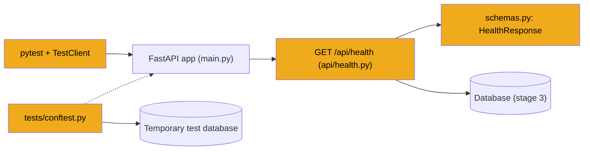

# Stage 4: API shapes, health check and tests

> **Goal:** Describe the shape of every request and response the API will use, add the first real endpoint, `GET /api/health`, and set up tests that never touch your real data or a real model.
>
> **By the end you will have:** `schemas.py` with every API shape, an `api/` package with the health router, a temporary `main.py` that mounts it under `/api`, and a `tests/` folder whose setup file isolates everything. Seven tests pass.

## Where this fits

From now on, every stage can be checked automatically. This stage adds the two things the rest of the backend leans on: the API's data shapes (used by every endpoint in stages 6–23 and mirrored by the web app in stages 24–28) and a test setup that gives tests their own database and secret store.



## New ideas in plain words

**Request and response shapes.** Every endpoint receives some data and sends some back. JobBee describes each of these as a Pydantic class (stage 1 introduced Pydantic). FastAPI uses them in both directions:

- **Incoming:** when an endpoint takes a Pydantic class as a parameter, FastAPI reads the request's JSON body into it. If a field is missing or has the wrong type, FastAPI answers `422` with a list of what was wrong, and your function never runs.
- **Outgoing:** `response_model=SomeClass` on an endpoint makes FastAPI check what you return, drop any fields the class doesn't list, and show the exact shape on the `/docs` page.

**`BaseModel`.** The parent class for these shapes. `class HealthResponse(BaseModel):` followed by typed fields is all it takes. A field with a default is optional; a field without one is required.

**`Literal` and type aliases.** `Literal["remote", "hybrid", "onsite"]` allows exactly those strings. Giving it a name, `WorkModeLiteral = Literal[...]`, lets many classes share one list. If you send `"office"`, the request is rejected with `422`.

**`Field(...)` rules.** `Field` adds limits to a field:

| Rule | Meaning | Example in JobBee |
|---|---|---|
| `ge=0`, `le=50` | Greater/less than or equal | `approval_top_n` between 1 and 50 |
| `gt=0.0` | Strictly greater than | a timeout above zero |
| `min_length`, `max_length` | Length of a string, or number of items in a list | a Claude key of at least 20 characters; 1 to 20 answer changes |
| `pattern=r"..."` | The string must match a *regular expression* (a text pattern) | a time like `07:30` |
| `default_factory=list` | Build a fresh default for each object | an empty list of skills |

**`from_attributes=True`.** Normally a Pydantic class is built from a dict. With `model_config = ConfigDict(from_attributes=True)`, it can also read the attributes of any object, such as a SQLAlchemy row from stage 3. `ApplyRunResponse.model_validate(run)` turns an `ApplyRun` row into a response in one line.

**Router.** An `APIRouter` is a group of related endpoints, usually one file. JobBee has one router per area (health, profile, applications and so on). `main.py` plugs each router into the app with a prefix, so every endpoint ends up under `/api`.

**`def` or `async def` endpoints.** FastAPI accepts both. A plain `def` endpoint runs in a background thread, so a slow database call can't freeze the server. `async def` (stage 6) suits endpoints that wait on the network.

**A test.** A small function that runs a piece of your code and checks the result. Instead of starting the server and clicking around after every change, you run all the tests in a second or two. When one fails, it tells you exactly what broke.

**pytest.** The tool that finds and runs tests. It looks in `tests/` (the `testpaths` setting from stage 1) for files named `test_*.py`, and inside them for functions named `test_*`. You don't register tests anywhere; the names are enough. Inside a test, `assert something` checks a fact. If the fact is false, the test fails and pytest shows the values involved.

**Fixture.** A helper that prepares something a test needs and cleans up afterwards. You ask for one by naming it as a parameter: `def test_x(tmp_path):`. pytest sees the name, runs the fixture and passes in its result. A fixture written with `yield` does its setup before the test and its clean-up after. An *autouse* fixture wraps every test without being asked for.

**Built-in fixtures.** `tmp_path` is a fresh, empty folder for each test. `monkeypatch` swaps something out for the length of one test (an environment variable, an attribute, a function in a module) and puts it back afterwards. Stage 5's test uses it, and later stages use it to replace Claude with a fake.

**`conftest.py`.** pytest loads a file with this exact name automatically, *before* it imports any test file in the folder. Shared setup and fixtures go there.

**`TestClient`.** FastAPI's test client calls your app's endpoints directly, inside the same Python process, without starting uvicorn or opening a port. `client.get("/api/health")` returns a response like a real HTTP call does. Used as `with TestClient(app) as client:`, it also runs the app's `lifespan`, so startup code like `init_db()` runs as it would on a real server.

**Why tests never touch real data or a real model.** Three reasons:

1. **Safety.** A test that writes to your real `jobbee.db` could wipe your profile or fill your inbox with junk. A test that writes to your real keyring could replace your Claude key.
2. **Cost.** Tests run hundreds of times. Every real Claude call costs money.
3. **Reliability.** A model's answer varies, and the internet can be down. A test should fail only when your code is wrong.

So tests get a temporary database, an in-memory secret store, blank API keys, and (from stage 6 on) *fakes*: small stand-in objects that behave like Claude from the caller's point of view but return fixed answers.

## Build it, step by step

New files in this stage:

```text
backend/
  app/
    schemas.py              Step 1
    api/
      __init__.py           Step 2
      health.py             Step 3
    main.py                 Step 4 (temporary version)
  tests/
    conftest.py             Check it works
    test_health.py
    test_config.py
    test_migrations.py
```

### Step 1: Every API shape, `backend/app/schemas.py`

`backend/app/schemas.py` holds the shape of every request and response in JobBee's API. You type the whole file now, so every later endpoint can import its shapes. Only `HealthResponse` is used in this stage. Each part below says which endpoints use its classes and which stage builds them. You don't need to understand every field yet: each stage that uses a class explains it in context.

#### Part 1: Shared lists and the health response

<!-- code: backend/app/schemas.py lines=1-34 -->
**`backend/app/schemas.py`** (lines 1–34 of 660)

```python
"""Pydantic request/response schemas exposed by the HTTP API."""

from __future__ import annotations

from datetime import datetime
from typing import Literal

from pydantic import BaseModel, ConfigDict, Field

WorkModeLiteral = Literal["remote", "hybrid", "onsite"]
WorkAuthorizationLiteral = Literal["yes_no_restrictions", "yes_with_restrictions", "no"]
YesNoLiteral = Literal["yes", "no"]
DocumentKindLiteral = Literal["resume", "cover_letter"]
ApplicationStatusLiteral = Literal[
    "matched",
    "filtered_out",
    "awaiting_approval",
    "approved",
    "awaiting_submit",
    "submitted",
    "rejected_by_user",
    "failed",
]


class HealthResponse(BaseModel):
    status: Literal["ok"] = "ok"
    app_env: str
    version: str
    db: bool
    llm_provider: str
    llm_model: str


```
<!-- /code -->

- **The `...Literal` aliases** are fixed lists shared by many classes. `DocumentKindLiteral` and `ApplicationStatusLiteral` match the enums in `models.py` (stage 3) exactly. `WorkAuthorizationLiteral` and `YesNoLiteral` are the answers to two common application-form questions.
- **`HealthResponse`** is the shape of `GET /api/health` (Step 3). `status: Literal["ok"] = "ok"` has a default, so the endpoint never passes it, and it can only ever be `"ok"`. The other five fields are required.

#### Part 2: Model settings and the test call (stage 6)

<!-- code: backend/app/schemas.py lines=35-72 -->
**`backend/app/schemas.py`** (lines 35–72 of 660)

```python
class SettingsResponse(BaseModel):
    llm_provider: Literal["anthropic", "openai", "ollama"]
    llm_base_url: str
    llm_model: str
    llm_temperature: float
    llm_timeout_s: float
    has_api_key: bool


class SettingsUpdate(BaseModel):
    llm_provider: Literal["anthropic", "openai", "ollama"] | None = None
    llm_base_url: str | None = None
    llm_api_key: str | None = None
    llm_model: str | None = None
    llm_temperature: float | None = Field(default=None, ge=0.0, le=2.0)
    llm_timeout_s: float | None = Field(default=None, gt=0.0, le=600.0)


class LLMTestRequest(BaseModel):
    """Optional fields override saved settings without persisting them."""

    provider: Literal["anthropic", "openai", "ollama"] | None = None
    base_url: str | None = None
    api_key: str | None = None
    model: str | None = None
    prompt: str = "Reply with just the word: pong"


class LLMTestResponse(BaseModel):
    ok: bool
    provider: str
    model: str
    content: str | None = None
    error: str | None = None
    prompt_tokens: int | None = None
    completion_tokens: int | None = None


```
<!-- /code -->

Stage 6's `api/settings.py` and `api/llm.py` use these four.

- **`SettingsResponse`** reports the AI provider settings. Notice `has_api_key: bool`: the response says *whether* a key is set, never the key itself.
- **`SettingsUpdate`** has every field optional (`| None = None`). That's a *partial update*: the web app sends only the fields you changed. `Field(ge=0.0, le=2.0)` keeps the temperature in range, and `gt=0.0, le=600.0` keeps the timeout above zero and at most ten minutes.
- **`LLMTestRequest`** lets you try a provider, URL, key or model *without saving it*; its docstring says so. The default prompt asks the model to answer `pong`.
- **`LLMTestResponse`** reports whether the test call worked, the reply, any error, and token counts.

#### Part 3: Profile and documents (stages 7 and 10)

<!-- code: backend/app/schemas.py lines=73-222 -->
**`backend/app/schemas.py`** (lines 73–222 of 660)

```python
class ApplicationDefaults(BaseModel):
    """Canonical answers reused across ATS application forms."""

    phone: str | None = None
    phone_extension: str | None = None
    phone_device_type: str | None = None
    country_phone_code: str | None = None
    address_line1: str | None = None
    address_line2: str | None = None
    city: str | None = None
    province: str | None = None
    postal_code: str | None = None
    country: str | None = None
    work_country: str | None = None
    work_authorization: WorkAuthorizationLiteral | None = None
    requires_sponsorship: YesNoLiteral | None = None
    referral_source: str | None = None
    willing_to_relocate: YesNoLiteral | None = None
    saved_answers: dict[str, str] = Field(default_factory=dict)


class ProfileResponse(BaseModel):
    """Single-user profile, surfaced for the onboarding wizard and the home page."""

    model_config = ConfigDict(from_attributes=True)

    id: int
    name: str
    email: str | None = None
    headline: str | None = None
    location: str | None = None
    years_experience: float | None = None
    min_salary: int | None = None
    summary: str | None = None
    target_roles: list[str] = Field(default_factory=list)
    target_locations: list[str] = Field(default_factory=list)
    work_modes: list[WorkModeLiteral] = Field(default_factory=list)
    skills: list[str] = Field(default_factory=list)
    links: dict[str, str] = Field(default_factory=dict)
    application_defaults: ApplicationDefaults = Field(default_factory=ApplicationDefaults)
    approval_top_n: int = Field(default=5, ge=1, le=50)
    onboarded_at: datetime | None = None
    is_complete: bool = False


class ProfileUpdate(BaseModel):
    """Partial-update payload for `PUT /api/profile`. All fields optional."""

    name: str | None = Field(default=None, max_length=120)
    email: str | None = Field(default=None, max_length=255)
    headline: str | None = Field(default=None, max_length=255)
    location: str | None = Field(default=None, max_length=255)
    years_experience: float | None = Field(default=None, ge=0, le=80)
    min_salary: int | None = Field(default=None, ge=0)
    summary: str | None = None
    target_roles: list[str] | None = None
    target_locations: list[str] | None = None
    work_modes: list[WorkModeLiteral] | None = None
    skills: list[str] | None = None
    links: dict[str, str] | None = None
    application_defaults: ApplicationDefaults | None = None
    approval_top_n: int | None = Field(default=None, ge=1, le=50)
    mark_onboarded: bool | None = None


class DocumentResponse(BaseModel):
    model_config = ConfigDict(from_attributes=True)

    id: int
    kind: DocumentKindLiteral
    label: str
    original_filename: str | None = None
    mime_type: str | None = None
    byte_size: int | None = None
    has_file: bool = False
    text_length: int = 0
    is_base: bool = True
    application_id: int | None = None
    created_at: datetime
    updated_at: datetime


class DocumentTextResponse(BaseModel):
    id: int
    kind: DocumentKindLiteral
    text: str


class ProfileDraft(BaseModel):
    """An un-saved profile, returned by `POST /api/profile/import`.

    Same shape as `ProfileUpdate` but every field is explicitly optional and
    we pair it with a `sources` map so the UI can render "from <source>"
    pills next to pre-filled fields.
    """

    name: str | None = None
    email: str | None = None
    headline: str | None = None
    location: str | None = None
    years_experience: float | None = None
    min_salary: int | None = None
    summary: str | None = None
    target_roles: list[str] = Field(default_factory=list)
    target_locations: list[str] = Field(default_factory=list)
    work_modes: list[WorkModeLiteral] = Field(default_factory=list)
    skills: list[str] = Field(default_factory=list)
    links: dict[str, str] = Field(default_factory=dict)
    application_defaults: ApplicationDefaults = Field(default_factory=ApplicationDefaults)


class ProfileImportResponse(BaseModel):
    """The result of `POST /api/profile/import`: a draft + provenance."""

    draft: ProfileDraft
    sources: dict[str, str] = Field(default_factory=dict)
    document_id: int | None = None
    warnings: list[str] = Field(default_factory=list)


```
<!-- /code -->

Stage 7's `api/profile.py` uses the profile classes. Stage 10's `api/documents.py` uses the two document classes.

- **`ApplicationDefaults`** holds your standard answers to application-form questions: phone, address, work authorisation, sponsorship, relocation. `saved_answers` is a dict of extra answers JobBee has learned from you. It's stored in the `users.application_defaults` JSON column (stage 3).
- **`ProfileResponse`** is your profile as the web app sees it. `from_attributes=True` lets it read a `User` row. `is_complete` isn't a column; the endpoint works it out.
- **`ProfileUpdate`** is the partial-update body for `PUT /api/profile`. The `max_length` limits match the column sizes in `models.py`, so text that wouldn't fit is rejected before it reaches the database. `mark_onboarded` asks the endpoint to record that you finished the welcome flow.
- **`DocumentResponse`** describes a stored document without its text. `has_file` and `text_length` are worked out by the endpoint. **`DocumentTextResponse`** carries the text when you ask for it.
- **`ProfileDraft`** and **`ProfileImportResponse`** are what `POST /api/profile/import` returns: a profile Claude read from your resume, *not yet saved*, plus `sources` (which field came from where) and `warnings`. You review it in the welcome flow (stage 25) before anything is stored.

The long run of empty lines at the end of this part is in the real file too. Python ignores blank lines.

#### Part 4: Email (stage 13)

<!-- code: backend/app/schemas.py lines=223-289 -->
**`backend/app/schemas.py`** (lines 223–289 of 660)

```python
EmailProviderLiteral = Literal["disabled", "gmail", "imap"]


class EmailStatusResponse(BaseModel):
    connected: bool
    provider: EmailProviderLiteral
    configured: bool
    connected_email: str | None = None
    gmail_oauth_available: bool = False
    last_sync_at: datetime | None = None
    gmail_history_id: str | None = None
    imap_last_uid: int | None = None
    mailbox: str | None = None


class EmailConnectRequest(BaseModel):
    """Connect an IMAP inbox (credentials stored per user in SQLite)."""

    imap_host: str = Field(min_length=1, max_length=255)
    imap_user: str = Field(min_length=1, max_length=255)
    imap_app_password: str = Field(min_length=1)
    imap_folder: str = Field(default="INBOX", max_length=255)


class EmailConnectResponse(BaseModel):
    ok: bool
    provider: EmailProviderLiteral
    message: str
    connected_email: str | None = None


class EmailGmailAuthorizeResponse(BaseModel):
    authorization_url: str


class EmailGmailSetupResponse(BaseModel):
    configured: bool
    redirect_uri: str
    has_client_id: bool
    setup_steps: list[str] = Field(default_factory=list)
    google_cloud_console_url: str
    gmail_api_enable_url: str
    oauth_clients_url: str


class EmailGmailSetupRequest(BaseModel):
    client_id: str = Field(min_length=8, max_length=512)
    client_secret: str = Field(min_length=8, max_length=512)


class EmailGmailSetupSaveResponse(BaseModel):
    ok: bool
    configured: bool
    message: str


class EmailDisconnectResponse(BaseModel):
    ok: bool = True
    message: str = "Inbox disconnected."


```
<!-- /code -->

Stage 13's `api/email.py` uses all of these, for connecting a Gmail or IMAP inbox and setting up Google sign-in.

- **`EmailStatusResponse`** reports whether an inbox is connected and how far it has been read. `EmailProviderLiteral` lists the three choices.
- **`EmailConnectRequest`** is the body for connecting an IMAP inbox. `min_length=1` rejects empty strings. Its docstring says the credentials are stored in SQLite; that's out of date. Since migration `0003` (stage 3), the password goes to the keyring.
- **The `EmailGmail...` classes** serve the one-time Google sign-in setup: the link to open, the setup steps, and the client ID and secret you paste in (`min_length=8`).

#### Part 5: Apply runs (stage 23)

<!-- code: backend/app/schemas.py lines=290-384 -->
**`backend/app/schemas.py`** (lines 290–384 of 660)

```python
# --- Claude apply runs ---

ApplyRunStatusLiteral = Literal[
    "queued",
    "starting",
    "running",
    "needs_user",
    "needs_human",
    "needs_you",
    "awaiting_submit",
    "revising",
    "submitting",
    "submitted",
    "submit_unconfirmed",
    "discarded",
    "expired",
    "blocked",
    "failed",
    "cancelled",
]
ApplyEffortLiteral = Literal["low", "medium", "high", "xhigh", "max"]


class ApplyRunResponse(BaseModel):
    model_config = ConfigDict(from_attributes=True)

    id: int
    application_id: int
    status: ApplyRunStatusLiteral
    url: str
    ats: str
    model: str
    effort: str
    pending: dict | None = None
    attended: bool = False
    finish: dict | None = None
    error: str | None = None
    iterations: int = 0
    tool_calls: int = 0
    cost_usd: float = 0.0
    guard_trips: int = 0
    uninspected_clicks: int = 0
    review: dict | None = None
    answers: list | None = None
    expires_at: datetime | None = None
    confirmation: dict | None = None
    created_at: datetime
    finished_at: datetime | None = None


class ApplyEventResponse(BaseModel):
    model_config = ConfigDict(from_attributes=True)

    id: int
    kind: str
    data: dict
    created_at: datetime


class ApplyRunDetailResponse(BaseModel):
    run: ApplyRunResponse
    events: list[ApplyEventResponse] = Field(default_factory=list)


class StartApplyRunRequest(BaseModel):
    model: str | None = None
    effort: ApplyEffortLiteral | None = None


class AnswerChange(BaseModel):
    field: str = Field(min_length=1, max_length=300)
    value: str = Field(max_length=2000)


class ApplyRunReviseRequest(BaseModel):
    changes: list[AnswerChange] = Field(min_length=1, max_length=20)


class ApplyRunResumeRequest(BaseModel):
    note: str = ""


class ApplyRunDecisionRequest(BaseModel):
    submit: bool


class ApplyAgentConfigResponse(BaseModel):
    api_key_configured: bool
    models: list[str]
    default_model: str
    efforts: list[str]
    default_effort: str
    max_cost_usd: float


```
<!-- /code -->

Stage 23's `api/apply_runs.py` uses these, over the `ApplyRun` and `ApplyEvent` tables from stage 3.

- **`ApplyRunStatusLiteral`** lists every status a run can have. Stage 21 explains them.
- **`ApplyRunResponse`** and **`ApplyEventResponse`** use `from_attributes=True`, so the endpoints build them straight from database rows. `ApplyRunDetailResponse` puts a run and its events together.
- **`StartApplyRunRequest`** lets you override the model and effort for one run.
- **`ApplyRunReviseRequest`** carries the answers you corrected on a filled form: a list of `AnswerChange` items. `Field(min_length=1, max_length=20)` on a list counts items: 1 to 20 changes per request.
- **`ApplyRunDecisionRequest`** is your final answer on a filled form: `submit` true or false.
- **`ApplyAgentConfigResponse`** reports `api_key_configured: bool`, again never the key.

#### Part 6: The home inbox (stage 22)

<!-- code: backend/app/schemas.py lines=385-519 -->
**`backend/app/schemas.py`** (lines 385–519 of 660)

```python
# --- Home (inbox feed) ---

ApplicationGroupLiteral = Literal["applied", "in_progress", "skipped", "not_a_fit", "didnt_finish"]


class JobCardInfo(BaseModel):
    id: int
    title: str
    company: str | None = None
    location: str | None = None
    work_mode: str | None = None
    salary_text: str | None = None
    url: str


class MatchCard(BaseModel):
    type: Literal["match"] = "match"
    application_id: int
    job: JobCardInfo
    score: int | None = None
    decision: str | None = None
    summary: str | None = None
    reasons: list[str] = Field(default_factory=list)
    gaps: list[str] = Field(default_factory=list)
    changes: list[str] = Field(default_factory=list)
    removed_claims: list[str] = Field(default_factory=list)
    resume_doc_id: int | None = None
    cover_doc_id: int | None = None
    style: str | None = None
    can_restyle: bool = False
    prepared_at: datetime | None = None
    older_resume: bool = False  # tailored from the resume the user has since replaced


class RunCard(BaseModel):
    """A run waiting on the user: review (Submit?), handoff (attended runs), set_aside (needs
    the user at their PC some time) or unconfirmed."""

    type: Literal["review", "handoff", "set_aside", "unconfirmed"]
    run_id: int
    application_id: int
    job: JobCardInfo
    handoff_kind: str | None = None
    updating: bool = False  # answers being changed on the parked form
    error: str | None = None
    message: str | None = None
    summary: str | None = None
    checks: list[str] = Field(default_factory=list)
    answers: list[dict] = Field(default_factory=list)
    screenshot_url: str | None = None
    expires_at: datetime | None = None
    clicked: bool | None = None


class PreparingCard(BaseModel):
    type: Literal["preparing"] = "preparing"
    application_id: int
    job: JobCardInfo
    stage: str


class NoticeCard(BaseModel):
    type: Literal["notice"] = "notice"
    id: int
    text: str
    level: str
    application_id: int | None = None
    retry: bool = False
    created_at: datetime


class ApplyingRow(BaseModel):
    run_id: int
    application_id: int
    job: JobCardInfo
    status: str
    last_event: dict | None = None
    started_at: datetime


class ApplicationRow(BaseModel):
    id: int
    job: JobCardInfo
    status: ApplicationStatusLiteral
    group: ApplicationGroupLiteral
    label: str
    stage_reason: str | None = None
    score: int | None = None
    updated_at: datetime
    submitted_at: datetime | None = None


class LastSearch(BaseModel):
    trigger: str
    status: str
    found: int
    kept: int
    sent: int
    error: str | None = None
    started_at: datetime
    finished_at: datetime | None = None


class AgentStatus(BaseModel):
    paused: bool
    searching: bool
    search_stage: str | None = None
    next_search_at: datetime | None = None
    last_search: LastSearch | None = None
    looking_for: str
    sent_today: int
    jobs_per_day: int
    shortlisted: int
    spend_today_usd: float
    daily_budget_usd: float
    budget_reached: bool


class SetupStatus(BaseModel):
    claude_key: bool
    resume: bool
    onboarded: bool
    telegram: bool
    inbox: bool


class HomeResponse(BaseModel):
    setup: SetupStatus
    agent: AgentStatus
    needs_you: list[RunCard | MatchCard | NoticeCard | PreparingCard] = Field(default_factory=list)
    applying: list[ApplyingRow] = Field(default_factory=list)
    counts: dict[str, int] = Field(default_factory=dict)
    applications: list[ApplicationRow] = Field(default_factory=list)


```
<!-- /code -->

Stage 22's `api/home.py` builds `HomeResponse`, the one big answer behind the home page (stages 26 and 27).

- **`JobCardInfo`** is a short job summary that every card and row reuses.
- **The cards.** `MatchCard` (a tailored match waiting for Apply or Skip), `RunCard` (a run waiting on you), `PreparingCard` (a job being tailored) and `NoticeCard` (a message) each have a `type` field with a fixed value. The web app reads `type` to know which card to draw.
- **`HomeResponse.needs_you`** is `list[RunCard | MatchCard | NoticeCard | PreparingCard]`: a list where each item may be any of the four card types.
- **`ApplyingRow`** and **`ApplicationRow`** are rows in the "applying now" list and your application history. `ApplicationGroupLiteral` sorts history into groups like `applied` and `skipped`.
- **`AgentStatus`** and **`LastSearch`** describe the agent bar: paused or not, the next and last search, today's spend against the budget.
- **`SetupStatus`** says which setup steps are done. `api/setup.py` (stage 23) uses it too.

#### Part 7: Actions, accounts and application details (stages 22 and 23)

<!-- code: backend/app/schemas.py lines=520-593 -->
**`backend/app/schemas.py`** (lines 520–593 of 660)

```python
class JobLinkRequest(BaseModel):
    url: str = Field(min_length=8, max_length=2048)


class JobLinkResponse(BaseModel):
    application_id: int
    status: ApplicationStatusLiteral
    duplicate: bool
    processing: bool
    message: str


class SkipRequest(BaseModel):
    reason: Literal["not_interested", "level", "location", "salary", "company"] | None = None


class ActionResponse(BaseModel):
    ok: bool = True
    message: str = ""
    run_id: int | None = None


class RunSummary(BaseModel):
    id: int
    status: str
    created_at: datetime
    finished_at: datetime | None = None
    cost_usd: float = 0.0
    iterations: int = 0
    error: str | None = None
    summary: str | None = None
    attended: bool = False
    answers: list[dict] = Field(default_factory=list)
    checks: list[str] = Field(default_factory=list)
    screenshot_url: str | None = None


class SiteAccountView(BaseModel):
    id: int
    host: str
    login: str
    status: str
    created_at: datetime
    last_used_at: datetime | None = None


class SiteAccountSecret(BaseModel):
    password: str


class ApplicationView(BaseModel):
    id: int
    status: ApplicationStatusLiteral
    group: ApplicationGroupLiteral | None = None
    label: str
    stage_reason: str | None = None
    job: JobCardInfo
    description: str | None = None
    posted_at: datetime | None = None
    discovered_via: str | None = None
    screen: dict | None = None
    changes: list[str] = Field(default_factory=list)
    removed_claims: list[str] = Field(default_factory=list)
    resume_doc_id: int | None = None
    cover_doc_id: int | None = None
    style: str | None = None
    can_restyle: bool = False
    runs: list[RunSummary] = Field(default_factory=list)
    can_retry: bool = False
    created_at: datetime
    updated_at: datetime
    submitted_at: datetime | None = None


```
<!-- /code -->

- **`JobLinkRequest`** and **`JobLinkResponse`** are for pasting a job link (stage 22's `api/agent.py`).
- **`SkipRequest`** carries an optional reason from a fixed list when you skip a job.
- **`ActionResponse`** is a small generic answer (`ok`, `message`, maybe a `run_id`) shared by many action endpoints in stages 22 and 23.
- **`SiteAccountView`** lists an account the agent made, *without* its password. **`SiteAccountSecret`** is returned only by a separate "reveal" endpoint in stage 23's `api/site_accounts.py`, so a password never appears in a list by accident.
- **`ApplicationView`** and **`RunSummary`** are the full details of one application and its runs, shown in the drawer (stage 27) by stage 23's `api/applications.py`.

#### Part 8: Preferences, styles, Claude setup and the watchlist (stages 10, 14 and 23)

<!-- code: backend/app/schemas.py lines=594-660 -->
**`backend/app/schemas.py`** (lines 594–660 of 660)

```python
class PreferencesPayload(BaseModel):
    """What the agent looks for; every field optional on update."""

    target_roles: list[str] | None = None
    target_locations: list[str] | None = None
    work_modes: list[WorkModeLiteral] | None = None
    min_salary: int | None = Field(default=None, ge=0)
    work_authorization: WorkAuthorizationLiteral | None = None
    requires_sponsorship: YesNoLiteral | None = None
    jobs_per_day: int | None = Field(default=None, ge=1, le=25)
    min_match_score: int | None = Field(default=None, ge=0, le=100)
    excluded_companies: list[str] | None = None
    discovery_time: str | None = Field(default=None, pattern=r"^([01]\d|2[0-3]):[0-5]\d$")
    max_job_age_days: int | None = Field(default=None, ge=1, le=120)
    web_search_enabled: bool | None = None
    document_style: str | None = Field(default=None, max_length=40)
    agent_accounts: bool | None = None
    agent_consents: bool | None = None


class DocumentStyleInfo(BaseModel):
    id: str
    name: str
    description: str


class StyleRequest(BaseModel):
    style: str = Field(max_length=40)


class ClaudeKeyRequest(BaseModel):
    """A new key, a workspace for an organization-wide key, or both."""

    api_key: str | None = Field(default=None, min_length=20, max_length=300)
    workspace_id: str | None = Field(default=None, max_length=100, pattern=r"^[A-Za-z0-9_-]*$")


class ClaudeStatus(BaseModel):
    connected: bool
    source: Literal["app", "env", "none"]
    workspace_id: str = ""
    models: dict[str, str]
    spend_today_usd: float
    spend_month_usd: float
    daily_budget_usd: float
    monthly_budget_usd: float


class BudgetUpdate(BaseModel):
    daily_budget_usd: float | None = Field(default=None, ge=0, le=1000)
    monthly_budget_usd: float | None = Field(default=None, ge=0, le=10000)


class WatchlistItem(BaseModel):
    model_config = ConfigDict(from_attributes=True)

    id: int
    name: str
    ats: str
    slug: str
    careers_url: str | None = None
    last_polled_at: datetime | None = None
    last_error: str | None = None


class WatchlistAddRequest(BaseModel):
    company: str = Field(min_length=2, max_length=500)
```
<!-- /code -->

- **`PreferencesPayload`** is what the agent looks for (stage 10's `api/preferences.py`). Its rules keep values sensible: 1 to 25 jobs a day, a match score from 0 to 100, and `discovery_time` matching `^([01]\d|2[0-3]):[0-5]\d$`, a time from `00:00` to `23:59`.
- **`DocumentStyleInfo`** and **`StyleRequest`** name a CV design (stages 10 and 23).
- **`ClaudeKeyRequest`** rejects clearly wrong input before any code runs: a key shorter than 20 characters, or a workspace ID with characters other than letters, digits, `_` and `-`.
- **`ClaudeStatus`** reports whether Claude is connected and where the key came from (`app`, `env` or `none`). Look at what it doesn't have: the key. Once saved, a key only goes in, never out. `BudgetUpdate` changes the spending limits (0 to 1000 a day, 0 to 10000 a month). All three belong to stage 23's `api/setup.py`.
- **`WatchlistItem`** (with `from_attributes=True`) and **`WatchlistAddRequest`** belong to stage 14's `api/watchlist.py`.

### Step 2: The routers package, `backend/app/api/__init__.py`

Create the folder `backend/app/api/` and this one-line `__init__.py`. Every file in `api/` is one router. The docstring repeats the rule: they're all mounted under `/api`.

<!-- code: backend/app/api/__init__.py -->
**`backend/app/api/__init__.py`** (whole file, 1 lines)

```python
"""HTTP routers, mounted under `/api` by `app.main`."""
```
<!-- /code -->

### Step 3: The health endpoint, `backend/app/api/health.py`

`backend/app/api/health.py` answers `GET /api/health`: a quick "is the server up, and can it reach the database?" check.

<!-- code: backend/app/api/health.py -->
**`backend/app/api/health.py`** (whole file, 32 lines)

```python
"""Health endpoint."""

from __future__ import annotations

from fastapi import APIRouter
from sqlalchemy import text

from .. import __version__
from ..config import get_settings
from ..db import engine
from ..schemas import HealthResponse

router = APIRouter(tags=["health"])


@router.get("/health", response_model=HealthResponse)
def health() -> HealthResponse:
    settings = get_settings()
    db_ok = True
    try:
        with engine.connect() as conn:
            conn.execute(text("SELECT 1"))
    except Exception:
        db_ok = False

    return HealthResponse(
        app_env=settings.app_env,
        version=__version__,
        db=db_ok,
        llm_provider=settings.llm_provider,
        llm_model=settings.llm_model,
    )
```
<!-- /code -->

- **`router = APIRouter(tags=["health"])`** creates the router. `tags` groups its endpoints under "health" on the `/docs` page.
- **`@router.get("/health", response_model=HealthResponse)`** registers `health()` for `GET /health`. The `/api` part comes from `main.py` (Step 4).
- **`from .. import __version__`** uses a relative import: `..` is the package one level up, `app`. `from ..db import engine` reaches stage 3's engine the same way.
- **The database check.** `engine.connect()` opens a connection and `conn.execute(text("SELECT 1"))` asks the smallest possible question: "give me the number 1". `text(...)` marks a string as raw SQL. If the database answers, it's reachable.
- **`except Exception: db_ok = False`.** Catching every error is usually a bad idea, but here it's the point: a health check should *report* a problem, not crash.
- **`llm_provider` and `llm_model`** are the raw settings. With the default settings, `llm_model` reads `gpt-4o-mini` even though JobBee uses Claude, because Claude calls pick their model per task (stage 1's `resolved_llm_model()` and stage 6).
- **`def`, not `async def`.** The database call blocks for a moment, so FastAPI runs this function in a background thread.

### Step 4: temporary `backend/app/main.py`

Replace `main.py` again. Two lines changed since stage 3: `from .api import health`, and `app.include_router(health.router, prefix="/api")` inside `create_app()`.

<!-- temp: backend/app/main.py -->
```python
"""FastAPI entry point.

Temporary version from stage 4. Stage 23 replaces it with the final file.
"""

from __future__ import annotations

import asyncio
import sys

# Playwright spawns a browser subprocess; uvicorn's default Windows loop cannot do that.
if sys.platform == "win32":
    asyncio.set_event_loop_policy(asyncio.WindowsProactorEventLoopPolicy())

from contextlib import asynccontextmanager

from fastapi import FastAPI
from fastapi.middleware.cors import CORSMiddleware

from . import __version__
from .api import health
from .config import get_settings
from .db import init_db


@asynccontextmanager
async def lifespan(_: FastAPI):
    init_db()
    yield


def create_app() -> FastAPI:
    settings = get_settings()
    app = FastAPI(
        title="JobBee API",
        version=__version__,
        lifespan=lifespan,
    )

    # In dev the Vite proxy handles same-origin, but allow direct browser calls too.
    app.add_middleware(
        CORSMiddleware,
        allow_origins=["http://localhost:5173", "http://127.0.0.1:5173"]
        if settings.is_dev
        else [],
        allow_credentials=True,
        allow_methods=["*"],
        allow_headers=["*"],
    )

    app.include_router(health.router, prefix="/api")

    @app.get("/", include_in_schema=False)
    def root() -> dict:
        return {
            "name": "JobBee API",
            "version": __version__,
            "docs": "/docs",
            "health": "/api/health",
        }

    return app


app = create_app()
```
<!-- /temp -->

`include_router(health.router, prefix="/api")` mounts the router under `/api`, so its `/health` becomes `/api/health`. Every JobBee endpoint starts with `/api`. That keeps API calls apart from web pages, and stage 24's dev proxy forwards exactly the `/api` paths to this server. Later stages add one `include_router` line per new router; stage 23 replaces the file with the final version.

## Check it works

**1. Call the health endpoint.** Start the server from `backend`:

```powershell
.\.venv\Scripts\python.exe -m uvicorn app.main:app --host 127.0.0.1 --port 8000
```

In a second window:

```powershell
Invoke-RestMethod http://127.0.0.1:8000/api/health
```

```text
status       : ok
app_env      : dev
version      : 0.1.0
db           : True
llm_provider : anthropic
llm_model    : gpt-4o-mini
```

With curl (Mac/Linux): `{"status":"ok","app_env":"dev","version":"0.1.0","db":true,"llm_provider":"anthropic","llm_model":"gpt-4o-mini"}`.

**2. Try it on the docs page.** Open http://127.0.0.1:8000/docs. You now see `GET /api/health` under the **health** heading. Click it, then **Try it out**, then **Execute**. The page shows the same JSON and the status code `200`. At the bottom, under **Schemas**, you'll find `HealthResponse` with its six fields. Stop the server when you're done.

**3. Run the tests.** First create the four test files below in `backend/tests/` (no `__init__.py` needed). Then, from `backend`:

```powershell
.\.venv\Scripts\python.exe -m pytest -q tests/test_health.py tests/test_config.py tests/test_migrations.py
```

```text
.......                                                                  [100%]
7 passed in 0.77s
```

Each dot is a passing test; `-q` means quiet. Your time will differ. Some handy variations:

| Command | What it does |
|---|---|
| `python -m pytest` | Runs every test in `tests/` |
| `python -m pytest -v` | Lists each test by name with its result |
| `python -m pytest tests/test_health.py` | Runs one file |
| `python -m pytest -k idempotent` | Runs tests whose name contains `idempotent` |
| `python -m pytest -x` | Stops at the first failure |

**4. Prove your real data wasn't touched.** Check when your database last changed, run the tests, and check again:

```powershell
(Get-Item data\jobbee.db).LastWriteTime
.\.venv\Scripts\python.exe -m pytest -q
(Get-Item data\jobbee.db).LastWriteTime
```

Both times are the same. The tests used a `test.db` in a temporary folder.

### How the test setup works: `tests/conftest.py`

This file runs before any test file is imported. Read it top to bottom, because order is everything:

1. **A temporary folder.** `tempfile.mkdtemp(prefix="jobbee-test-")` makes a new, empty folder in your system's temp directory, with a name like `jobbee-test-k3j9x`. The test database and test uploads go there. pytest doesn't delete it afterwards; the folders are small and safe to delete by hand.
2. **Environment variables.** Real environment variables beat `.env` (stage 1), so setting `os.environ[...]` here points the app at the temporary database, whatever your `.env` says.
   - `APP_ENV=test` tells the app it's under test. From stage 19 on, `main.py` uses it to keep the daily scheduler from starting.
   - `SECRET_STORE=memory` keeps every secret in a dict instead of your real keyring.
   - `LLM_PROVIDER=openai` with every key blank means that if some code *did* try to call a model by mistake, it would have no key to call with. Even code that asks for the Claude key directly gets an empty string: the memory store is empty and `ANTHROPIC_API_KEY` is blank.
   - The last three variables blank settings that JobBee's own code no longer reads. `Settings` ignores unknown names, so they're harmless.
3. **Only now import the app.** `from app import db` runs `db.py`, which builds the engine from the settings. Then `UPLOADS_DIR` is pointed at the temp folder, and `init_db()` runs all nine migrations on the empty test database.
4. **The autouse fixture** `_isolate_secret_store` wraps every test. Before the test, its `assert` checks that the store really is a `MemorySecretStore`. If someone forgot `SECRET_STORE=memory`, every test fails at once instead of quietly writing fake keys into your vault. After the test (after `yield`), it empties the store, so a secret saved by one test can't make another pass by accident.

**Why must the environment come first?** In stage 3, `engine = create_engine(...)` sits at the top level of `db.py`. It runs once, the first time anything imports `db.py`, and uses whatever `DATABASE_URL` says at that moment. `get_settings()` and `get_secret_store()` are cached too. If the app were imported above the `os.environ` lines, the engine would already point at your real `jobbee.db`, and changing the variable afterwards would do nothing. The `# noqa: E402` comments tell the style checker "yes, this import isn't at the top of the file, on purpose".

<!-- code: backend/tests/conftest.py collapsed -->
<details>
<summary><code>backend/tests/conftest.py</code> (whole file, 54 lines)</summary>

```python
"""Shared pytest setup.

We point the backend at an isolated SQLite file and uploads dir per test
session so the real `backend/data/*` isn't touched. This must run BEFORE any
test module imports `app.main` (which constructs the engine at import time),
so the env-var wiring lives at conftest module load — not inside a fixture.
"""

from __future__ import annotations

import os
import tempfile
from pathlib import Path

# 1) Tempdir for DB + uploads. We keep a session-lived directory; pytest's
#    `tmp_path_factory` would also work but only inside a fixture.
_TEST_ROOT = Path(tempfile.mkdtemp(prefix="jobbee-test-"))
_DB_PATH = _TEST_ROOT / "test.db"
_UPLOADS_DIR = _TEST_ROOT / "uploads"
_UPLOADS_DIR.mkdir(parents=True, exist_ok=True)

# 2) Override config from the environment before `Settings()` is instantiated.
os.environ["DATABASE_URL"] = f"sqlite:///{_DB_PATH.as_posix()}"
os.environ["APP_ENV"] = "test"
os.environ["SECRET_STORE"] = "memory"
# Never reach a real model from tests, whatever backend/.env says.
os.environ["LLM_PROVIDER"] = "openai"
os.environ["LLM_API_KEY"] = ""
os.environ["OPENROUTER_API_KEY"] = ""
os.environ["ANTHROPIC_API_KEY"] = ""
os.environ["APPLY_BROWSER_ENGINE"] = "playwright"
os.environ["BROWSERUSE_API_KEY"] = ""
os.environ["BROWSER_USE_API_KEY"] = ""

# 3) Import after env vars are set, then repoint the uploads dir constant.
from app import db as _db_module  # noqa: E402

_db_module.UPLOADS_DIR = _UPLOADS_DIR
_db_module.init_db()


import pytest  # noqa: E402

from app.services.secrets import MemorySecretStore, get_secret_store  # noqa: E402


@pytest.fixture(autouse=True)
def _isolate_secret_store():
    """Secrets written by one test (e.g. a fake Gmail token) must not leak into the next."""

    store = get_secret_store()
    assert isinstance(store, MemorySecretStore)
    yield
    store._values.clear()
```

</details>
<!-- /code -->

### `tests/test_health.py`

A *smoke test*: it checks little logic, but if the app can't even start, you'll know at once. `from app.main import app` is safe here because `conftest.py` already ran. `with TestClient(app) as client:` runs the `lifespan` startup (`init_db()` on the test database), then the request. The asserts check the status code and three fields of the JSON body, including `db is True`.

<!-- code: backend/tests/test_health.py collapsed -->
<details>
<summary><code>backend/tests/test_health.py</code> (whole file, 17 lines)</summary>

```python
"""Smoke test for the /api/health endpoint."""

from __future__ import annotations

from fastapi.testclient import TestClient

from app.main import app


def test_health_ok() -> None:
    with TestClient(app) as client:
        resp = client.get("/api/health")
    assert resp.status_code == 200
    body = resp.json()
    assert body["status"] == "ok"
    assert body["db"] is True
    assert "llm_provider" in body
```

</details>
<!-- /code -->

### `tests/test_config.py`

These tests check the `resolved_*` helpers from stage 1 by building `Settings` objects directly. Values passed as keyword arguments, like `Settings(llm_provider="openai", ...)`, beat environment variables and `.env`, so each test controls exactly the settings it cares about.

1. With an AgentRouter base URL and both an AgentRouter and an OpenRouter key, AgentRouter wins for both the URL and the key.
2. An OpenRouter model name doesn't override the model for Ollama.
3. Claude is the default: the base URL is Anthropic's, and an empty `llm_model` falls back to `match_model`. `_env_file=None` tells `Settings` to skip the `.env` file, so your own `.env` can't change the result.

<!-- code: backend/tests/test_config.py collapsed -->
<details>
<summary><code>backend/tests/test_config.py</code> (whole file, 34 lines)</summary>

```python
"""Settings resolution tests."""

from __future__ import annotations

from app.config import Settings


def test_agentrouter_base_url_wins_over_openrouter_key() -> None:
    settings = Settings(
        llm_provider="openai",
        llm_base_url="https://agentrouter.org/v1",
        agentrouter_api_key="agent-key",
        openrouter_api_key="openrouter-key",
    )

    assert settings.resolved_llm_base_url() == "https://agentrouter.org/v1"
    assert settings.resolved_llm_api_key() == "agent-key"


def test_openrouter_model_does_not_override_ollama_model() -> None:
    settings = Settings(
        llm_provider="ollama",
        llm_model="gemma4-e4b-agent:latest",
        openrouter_api_key="sk-test",
        openrouter_model="nex-agi/nex-n2-pro:free",
    )

    assert settings.resolved_llm_model() == "gemma4-e4b-agent:latest"


def test_claude_is_the_default_provider() -> None:
    settings = Settings(_env_file=None, llm_provider="anthropic", llm_model="")
    assert settings.resolved_llm_base_url() == "https://api.anthropic.com"
    assert settings.resolved_llm_model() == settings.match_model
```

</details>
<!-- /code -->

### `tests/test_migrations.py`

These tests prove that stage 3's `upgrade_database` keeps old databases safe. Each test builds its own engine on a new file inside `tmp_path`, so they never touch the shared test database.

- **`HEAD`** asks Alembic's migrations folder for the newest revision id (`0009`). Reading it at runtime means the tests keep working when a new migration is added.
- **`_legacy_engine`** builds a database at revision `0001` and then drops `alembic_version`. The result looks exactly like a database from before JobBee used Alembic.
- **`_seed_legacy_rows`** fills it with old-style rows using raw SQL: a user, a base resume, two documents with tailored labels, jobs with different kinds of `match_reason`, an application pointing at the tailored documents, a plaintext Gmail token and a plaintext Gmail client secret.

The three tests:

1. **`test_upgrade_legacy_database_keeps_rows_and_backfills`** upgrades that database and checks every migration did its job: no rows lost; documents 2 and 3 marked as tailored and linked to application 7 (`0002`); `match_source` set to `llm` or `heuristic` from the reason text (`0002`); the plaintext columns and the client-secret row gone (`0003`); the version at `HEAD`; and the token and client secret now in the (memory) secret store (`0003`).
2. **`test_upgrade_is_idempotent`** upgrades a brand-new database twice. *Idempotent* means doing it twice has the same effect as once, which matters because `init_db()` runs on every startup.
3. **`test_upgrade_refuses_partial_legacy_database`** drops one baseline table and checks that the upgrade refuses with a `RuntimeError` naming it. `pytest.raises(RuntimeError, match="email_sync_states")` passes only if that error is raised and its message contains the text.

<!-- code: backend/tests/test_migrations.py collapsed -->
<details>
<summary><code>backend/tests/test_migrations.py</code> (whole file, 141 lines)</summary>

```python
"""Schema migrations must upgrade pre-Alembic databases in place, without data loss."""

from __future__ import annotations

from pathlib import Path

import pytest
from alembic import command
from alembic.script import ScriptDirectory
from sqlalchemy import create_engine, inspect, text

from app.db import _alembic_config, upgrade_database
from app.services.secrets import (
    GMAIL_CLIENT_SECRET,
    GMAIL_REFRESH_TOKEN,
    get_secret_store,
    get_user_secret,
)


HEAD = ScriptDirectory.from_config(_alembic_config()).get_current_head()


def _legacy_engine(tmp_path: Path):
    """A database shaped like the old `create_all` output: baseline tables, no alembic_version."""

    engine = create_engine(f"sqlite:///{(tmp_path / 'legacy.db').as_posix()}")
    cfg = _alembic_config()
    with engine.begin() as conn:
        cfg.attributes["connection"] = conn
        command.upgrade(cfg, "0001")
        conn.execute(text("DROP TABLE alembic_version"))
    return engine


def _seed_legacy_rows(engine) -> None:
    with engine.begin() as conn:
        conn.execute(
            text(
                "INSERT INTO users (id, name, target_roles, target_locations, work_modes,"
                " skills, links, application_defaults, approval_top_n)"
                " VALUES (1, 'Lin', '[]', '[]', '[]', '[]', '{}', '{}', 5)"
            )
        )
        conn.execute(
            text(
                "INSERT INTO documents (id, user_id, kind, label, content) VALUES"
                " (1, 1, 'resume', 'Linh_Resume.pdf', 'base'),"
                " (2, 1, 'resume', 'Tailored resume — Engineer', 'tailored'),"
                " (3, 1, 'cover_letter', 'Cover letter — Engineer', 'cover')"
            )
        )
        conn.execute(
            text(
                "INSERT INTO jobs"
                " (id, source, external_id, url, title, match_score, match_reason) VALUES"
                " (1, 'email_linkedin', 'a', 'https://x/a', 'A', 81,"
                "  'Strong overlap with Python.'),"
                " (2, 'email_linkedin', 'b', 'https://x/b', 'B', 73,"
                "  'Matched 2 role/skill keyword(s). Location aligns with Toronto.'),"
                " (3, 'email_linkedin', 'c', 'https://x/c', 'C', 65,"
                "  'Could not parse model score; defaulting to neutral.'),"
                " (4, 'email_linkedin', 'd', 'https://x/d', 'D', NULL, NULL)"
            )
        )
        conn.execute(
            text(
                "INSERT INTO applications"
                " (id, user_id, job_id, resume_doc_id, cover_doc_id, status)"
                " VALUES (7, 1, 1, 2, 3, 'approved')"
            )
        )
        conn.execute(
            text(
                "INSERT INTO email_sync_states (id, user_id, provider, gmail_refresh_token)"
                " VALUES (1, 1, 'gmail', 'refresh-tok-123')"
            )
        )
        conn.execute(
            text(
                "INSERT INTO app_config (key, value) VALUES"
                " ('gmail_client_id', 'cid'), ('gmail_client_secret', 'client-secret-xyz')"
            )
        )


def test_upgrade_legacy_database_keeps_rows_and_backfills(tmp_path: Path) -> None:
    engine = _legacy_engine(tmp_path)
    _seed_legacy_rows(engine)

    upgrade_database(engine)

    with engine.connect() as conn:
        counts = {
            table: conn.execute(text(f"SELECT count(*) FROM {table}")).scalar()
            for table in ("users", "documents", "jobs", "applications", "email_sync_states")
        }
        assert counts == {
            "users": 1,
            "documents": 3,
            "jobs": 4,
            "applications": 1,
            "email_sync_states": 1,
        }

        docs = dict(
            (row.id, (bool(row.is_base), row.application_id))
            for row in conn.execute(text("SELECT id, is_base, application_id FROM documents"))
        )
        assert docs == {1: (True, None), 2: (False, 7), 3: (False, 7)}

        sources = dict(conn.execute(text("SELECT id, match_source FROM jobs")).fetchall())
        assert sources == {1: "llm", 2: "heuristic", 3: "heuristic", 4: None}

        sync_cols = {c["name"] for c in inspect(conn).get_columns("email_sync_states")}
        assert "gmail_refresh_token" not in sync_cols
        assert "imap_app_password" not in sync_cols
        config_keys = {row[0] for row in conn.execute(text("SELECT key FROM app_config"))}
        assert config_keys == {"gmail_client_id"}

        version = conn.execute(text("SELECT version_num FROM alembic_version")).scalar()
        assert version == HEAD

    assert get_user_secret(1, GMAIL_REFRESH_TOKEN) == "refresh-tok-123"
    assert get_secret_store().get(GMAIL_CLIENT_SECRET) == "client-secret-xyz"


def test_upgrade_is_idempotent(tmp_path: Path) -> None:
    engine = create_engine(f"sqlite:///{(tmp_path / 'fresh.db').as_posix()}")
    upgrade_database(engine)
    upgrade_database(engine)
    with engine.connect() as conn:
        assert conn.execute(text("SELECT version_num FROM alembic_version")).scalar() == HEAD


def test_upgrade_refuses_partial_legacy_database(tmp_path: Path) -> None:
    engine = _legacy_engine(tmp_path)
    with engine.begin() as conn:
        conn.execute(text("DROP TABLE email_sync_states"))
    with pytest.raises(RuntimeError, match="email_sync_states"):
        upgrade_database(engine)
```

</details>
<!-- /code -->

The finished JobBee has 27 test files. By stage 23 the whole backend suite gives `218 passed, 4 skipped` on a machine without a usable browser. The skipped tests need a real browser: Google Chrome in its Windows install folders, or a Chromium that Playwright can start. On your Windows PC with Chrome, some or all of them run instead.

<!-- verify: backend | python -m pytest -q tests/test_health.py tests/test_config.py tests/test_migrations.py -->

## Common mistakes

- **Importing the app before setting the environment.** If `conftest.py` imports anything from `app` above the `os.environ` lines, the engine is built from your real settings and the tests run against your real `jobbee.db`. A warning sign: test users or jobs showing up in your real app. Keep the environment lines at the very top.
- **Running pytest from the wrong folder.** Run it from `backend/`. That's where `pyproject.toml` (with `testpaths`) and the `tests/` folder are.
- **`404` on `/api/health`.** The router isn't mounted: check the `include_router` line and its `prefix="/api"` in `main.py`, and restart the server.
- **Returning something that doesn't fit `response_model`.** If `health()` returned `db="maybe"`, FastAPI would refuse to send it and answer `500`. The shape protects the web app from surprises, so fix the data, not the shape.
- **Tests that depend on each other's data.** All tests in one run share the same temporary database (only the secret store is wiped between tests). A row left behind by one test can change what the next one sees. Later tests clean up after themselves or use unique values for this reason.

## Recap

- `schemas.py` describes every request and response as a Pydantic class. FastAPI rejects bad input with `422` and checks what you return.
- `Literal`, `Field` rules and `from_attributes=True` keep the shapes strict and easy to build from database rows.
- `GET /api/health` reports the app's settings and whether the database answers `SELECT 1`.
- Routers group endpoints; `main.py` mounts each one under `/api`.
- `conftest.py` sets the environment *before* importing the app, because the engine and settings are built at import time.
- Tests get a temporary database, an in-memory secret store and blank keys, so they're safe, free and repeatable.
- `TestClient` runs the app's `lifespan` and calls endpoints without a server.

**Next:** [Stage 5: Flags and app settings in the database](05-flags-and-app-config.md)
