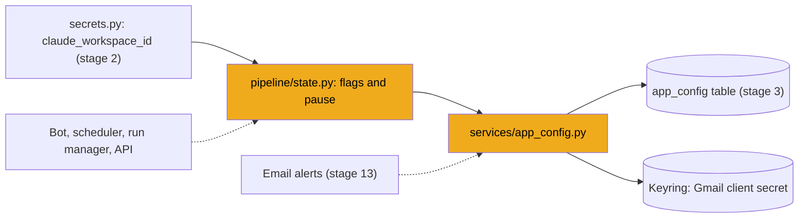

# Stage 5: Flags and app settings in the database

> **Goal:** Store small app-wide values in the database's `app_config` table: switches like "the agent is paused", and the Gmail app credentials that stage 13 needs.
>
> **By the end you will have:** `services/app_config.py` (read and write key/value rows, and find the Gmail credentials), `pipeline/state.py` (one-line flag helpers and the pause switch), and a passing test.

## Where this fits

Stage 2's `claude_workspace_id()` already imports `get_flag` from `pipeline/state.py`. This stage writes that file, so the import finally works. Many later parts use these helpers: the Telegram bot keeps its place in the message stream as a flag (stage 11), the daily scheduler remembers the day of its last search (stage 19), and the bot, the run manager and the web app all read or flip the pause switch (stages 11, 21, 22). Stage 13's email alerts use the Gmail helpers.



## New ideas in plain words

**Key/value store.** A table with two columns, `key` and `value`, works like a Python dict saved on disk: `app_config["agent_paused"] = "1"`. Stage 3 created it as the `AppConfig` model. Adding a new setting needs no migration: it's a new row, not a new column.

**Flag.** A small app-wide switch or remembered value, like `agent_paused = "1"` or `last_scheduled_search = "2026-10-22"`. Flags live in the database rather than in `.env` because the app changes them while it runs (you click Pause), and they must survive a restart.

**Everything is a string.** The `value` column is text, so `True` is stored as `"1"` and `False` as `"0"`. Code that reads a flag compares strings: `get_flag("agent_paused") == "1"`.

**Who commits?** Two styles appear in this stage, on purpose:

- A function that *receives* a session (`get_config_value(session, ...)`) doesn't commit. The caller decides when the basket goes to checkout, so it can group several changes into one transaction (stage 3).
- A function that *opens its own* session (`set_flag(...)`) commits before it closes it. Callers get a one-line helper with nothing to remember.

**Dataclass.** `@dataclass` above a class writes the boring parts for you (`__init__`, a readable `repr`, comparison) from its typed fields. `@dataclass(frozen=True)` also makes the object read-only after creation, which suits a bundle of credentials that nothing should change.

**Keyword-only arguments.** A `*` in a function's parameters means everything after it must be passed by name: `save_gmail_oauth_setup(session, client_id="...", client_secret="...")`. That stops anyone from swapping the ID and the secret by accident.

**OAuth app credentials (Gmail).** To let JobBee read your Gmail (optional, stage 13), Google needs to know which app is asking. Whoever installs JobBee registers an app with Google once and gets a *client ID* (not secret) and a *client secret* (secret). Stage 13 explains the sign-in flow. This stage only stores the two values, each in the right place.

## Build it, step by step

New files in this stage:

```text
backend/app/
  services/
    app_config.py        Step 1
  pipeline/
    __init__.py          Step 2
    state.py             Step 3
backend/tests/
  test_app_config.py     Check it works
```

### Step 1: The key/value helpers, `backend/app/services/app_config.py`

`backend/app/services/app_config.py` reads and writes rows of the `app_config` table, and knows where the Gmail app credentials live. Its docstring states the rule: plain settings go in the table, secret values go to the secret store (stage 2).

<!-- code: backend/app/services/app_config.py -->
**`backend/app/services/app_config.py`** (whole file, 73 lines)

```python
"""Local app-level config stored in SQLite (one-time setup the user does in the UI).

Secret values (the Gmail OAuth client secret) go to the secret store instead.
"""

from __future__ import annotations

from dataclasses import dataclass

from sqlalchemy import select
from sqlalchemy.orm import Session

from ..models import AppConfig
from .secrets import GMAIL_CLIENT_SECRET, get_secret_store

GMAIL_CLIENT_ID_KEY = "gmail_client_id"


def get_config_value(session: Session, key: str) -> str | None:
    row = session.get(AppConfig, key)
    if row is None:
        return None
    value = (row.value or "").strip()
    return value or None


def set_config_value(session: Session, key: str, value: str) -> None:
    cleaned = value.strip()
    row = session.get(AppConfig, key)
    if row is None:
        session.add(AppConfig(key=key, value=cleaned))
    else:
        row.value = cleaned


@dataclass(frozen=True)
class GmailOAuthCredentials:
    client_id: str
    client_secret: str
    redirect_uri: str


def resolve_gmail_credentials(session: Session) -> GmailOAuthCredentials | None:
    """Return OAuth app credentials from `.env` or the in-app setup wizard."""

    from ..config import get_settings

    settings = get_settings()
    client_id = settings.gmail_client_id.strip()
    client_secret = settings.gmail_client_secret.strip()

    if not client_id:
        client_id = get_config_value(session, GMAIL_CLIENT_ID_KEY) or ""
    if not client_secret:
        client_secret = (get_secret_store().get(GMAIL_CLIENT_SECRET) or "").strip()

    if not client_id or not client_secret:
        return None

    return GmailOAuthCredentials(
        client_id=client_id,
        client_secret=client_secret,
        redirect_uri=settings.gmail_oauth_redirect_uri.strip(),
    )


def save_gmail_oauth_setup(session: Session, *, client_id: str, client_secret: str) -> None:
    set_config_value(session, GMAIL_CLIENT_ID_KEY, client_id)
    get_secret_store().set(GMAIL_CLIENT_SECRET, client_secret.strip())


def gmail_oauth_configured(session: Session) -> bool:
    return resolve_gmail_credentials(session) is not None
```
<!-- /code -->

- **`get_config_value(session, key)`** looks a row up with `session.get(AppConfig, key)`. `session.get` finds a row by its primary key, the fastest lookup there is, and returns `None` if there's no such row. A blank value also comes back as `None`, so "unset" and "set to nothing" mean the same thing.
- **`set_config_value(session, key, value)`** trims spaces, then inserts a new row or updates the existing one. Doing "update if it exists, insert if not" in one step is often called an *upsert*. It doesn't commit; the caller does.
- **`GmailOAuthCredentials`** is a frozen dataclass bundling the client ID, the client secret and the *redirect URI* (the address Google sends you back to after you sign in).
- **`resolve_gmail_credentials(session)`** finds the Gmail app credentials, looking in two places:
  1. `.env` first (`GMAIL_CLIENT_ID` and `GMAIL_CLIENT_SECRET`, through the settings), for whoever installed JobBee.
  2. Otherwise, what was entered in the app: the client ID from the `app_config` row `gmail_client_id`, and the client secret from the secret store under `app:gmail_client_secret`.

  If either value is still missing, it returns `None`, meaning "Gmail sign-in isn't set up". Stage 13 calls it before it starts a Google sign-in and before it reads alert emails.
- **`save_gmail_oauth_setup(session, *, client_id, client_secret)`** stores what you enter in the app's Gmail setup (stage 13): the ID in the table, the secret in the keyring. Notice the difference in timing. The keyring write happens at once, but the table row waits for the caller's `commit()`.
- **`gmail_oauth_configured(session)`** is a yes/no wrapper around `resolve_gmail_credentials`. Stage 13's inbox status and email API use it.

Before migration `0003` (stage 3), the client secret sat in this table as a row called `gmail_client_secret`. Moving it out to the keyring is exactly what that migration did.

### Step 2: The pipeline package, `backend/app/pipeline/__init__.py`

Create the folder `backend/app/pipeline/` with this one-line `__init__.py`. The docstring names the stages of JobBee's job pipeline: discover → filter → screen → tailor → ask → apply. The folder fills up in stages 8 to 19. Its first file is the small one in Step 3.

<!-- code: backend/app/pipeline/__init__.py -->
**`backend/app/pipeline/__init__.py`** (whole file, 1 lines)

```python
"""The autonomous job pipeline: discover → filter → screen → tailor → ask → apply."""
```
<!-- /code -->

### Step 3: Flags and the pause switch, `backend/app/pipeline/state.py`

`backend/app/pipeline/state.py` wraps the two table helpers in their own short sessions, so any code can read or set a flag in one line, without a session of its own.

<!-- code: backend/app/pipeline/state.py -->
**`backend/app/pipeline/state.py`** (whole file, 27 lines)

```python
"""Small persisted agent flags (kept in the `app_config` key/value table)."""

from __future__ import annotations

from ..db import SessionLocal
from ..services.app_config import get_config_value, set_config_value

PAUSED_KEY = "agent_paused"


def get_flag(key: str) -> str | None:
    with SessionLocal() as session:
        return get_config_value(session, key)


def set_flag(key: str, value: str) -> None:
    with SessionLocal() as session:
        set_config_value(session, key, value)
        session.commit()


def is_paused() -> bool:
    return get_flag(PAUSED_KEY) == "1"


def set_paused(paused: bool) -> None:
    set_flag(PAUSED_KEY, "1" if paused else "0")
```
<!-- /code -->

- **`get_flag(key)`** opens a session, reads the value and closes the session (the `with` block closes it).
- **`set_flag(key, value)`** opens a session, writes the value, **commits** and closes it.
- **`PAUSED_KEY`** names the pause flag, `agent_paused`, in one place.
- **`is_paused()`** is true only when the flag is exactly `"1"`. A missing flag means "not paused", so a new install starts active.
- **`set_paused(paused)`** turns a Python `bool` into `"1"` or `"0"`.

The flags JobBee keeps in `app_config`:

| Key | Set by | Meaning |
|---|---|---|
| `agent_paused` | The Pause and Resume buttons (stage 22), the bot's `/pause` and `/resume` (stage 11) | `"1"` while you've paused the agent |
| `anthropic_workspace_id` | The setup API (stage 23) | The workspace for an organization-wide Claude key; read by `claude_workspace_id()` |
| `telegram_bot_username`, `telegram_offset` | The Telegram service (stage 11) | The bot's name, and the last Telegram update already handled |
| `last_scheduled_search` | The scheduler (stage 19) | The date of the last daily search, so it runs once a day |
| `gmail_client_id` | `save_gmail_oauth_setup` (stage 13) | The Gmail app's client ID |

What pausing does, once those stages exist: the scheduler skips the daily search (stage 19), the run manager stops starting queued applications (stage 21), and the home page and the bot show that the agent is paused (stages 22 and 11). Because the flag is in the database, a paused agent stays paused after a restart.

## Check it works

**1. Run the test.** From `backend`:

```powershell
.\.venv\Scripts\python.exe -m pytest -q tests/test_app_config.py
```

```text
.                                                                        [100%]
1 passed in 0.07s
```

The test, `test_save_and_resolve_gmail_credentials_from_db`, checks the "entered in the app" path of `resolve_gmail_credentials`:

1. `monkeypatch.setenv("GMAIL_CLIENT_ID", "")` and the same for the secret make sure your own `.env` can't supply them. A real environment variable, even an empty one, beats `.env` (stage 1). `monkeypatch` restores the environment when the test ends.
2. `get_settings.cache_clear()` throws away the cached settings, so the next `get_settings()` reads the patched environment. Without it, the test would see whatever settings an earlier test built.
3. It saves an ID and a secret with `save_gmail_oauth_setup`, commits, then checks that `resolve_gmail_credentials` returns both and that `gmail_oauth_configured` is true. The secret went into the memory store (stage 4's autouse fixture empties it afterwards); the ID went into the shared test database.
4. The last `get_settings.cache_clear()` makes sure later tests don't reuse the settings built with blank Gmail values.

<!-- code: backend/tests/test_app_config.py collapsed -->
<details>
<summary><code>backend/tests/test_app_config.py</code> (whole file, 31 lines)</summary>

```python
"""Tests for app-level config storage."""

from __future__ import annotations

from app.services.app_config import (
    gmail_oauth_configured,
    resolve_gmail_credentials,
    save_gmail_oauth_setup,
)
from app.config import get_settings
from app.db import SessionLocal


def test_save_and_resolve_gmail_credentials_from_db(monkeypatch) -> None:
    monkeypatch.setenv("GMAIL_CLIENT_ID", "")
    monkeypatch.setenv("GMAIL_CLIENT_SECRET", "")
    get_settings.cache_clear()
    with SessionLocal() as session:
        save_gmail_oauth_setup(
            session,
            client_id="stored-id.apps.googleusercontent.com",
            client_secret="stored-secret",
        )
        session.commit()

        creds = resolve_gmail_credentials(session)
        assert creds is not None
        assert creds.client_id == "stored-id.apps.googleusercontent.com"
        assert creds.client_secret == "stored-secret"
        assert gmail_oauth_configured(session)
    get_settings.cache_clear()
```

</details>
<!-- /code -->

**2. Run all tests so far.**

```powershell
.\.venv\Scripts\python.exe -m pytest -q
```

```text
........                                                                 [100%]
8 passed in 0.99s
```

**3. Watch the pause switch survive a restart.** Each command below is a separate Python process, like two runs of the server. The first pauses the agent:

```powershell
.\.venv\Scripts\python.exe -c "from app.db import init_db; init_db(); from app.pipeline.state import set_paused, is_paused; set_paused(True); print('paused:', is_paused())"
```

```text
paused: True
```

The second starts fresh, finds the flag still set, and resumes:

```powershell
.\.venv\Scripts\python.exe -c "from app.pipeline.state import is_paused, set_paused; print('still paused:', is_paused()); set_paused(False); print('paused:', is_paused())"
```

```text
still paused: True
paused: False
```

This writes one row (`agent_paused = "0"`) to your real `data/jobbee.db`. That's harmless: it's the "not paused" state.

**4. Stage 2's workspace helpers now work.**

```powershell
.\.venv\Scripts\python.exe -c "from app.services.secrets import claude_workspace_id, claude_headers; print(repr(claude_workspace_id()), claude_headers())"
```

```text
'' {}
```

No workspace is saved and `.env` has none, so the ID is empty and there are no extra headers. Before this stage, the same command failed with `No module named 'app.pipeline'`.

<!-- verify: backend | python -m pytest -q tests/test_app_config.py -->

## Common mistakes

- **Forgetting to commit after `set_config_value`.** It only puts the change in the session's basket. If the session closes without `session.commit()`, the change is lost. `set_flag` commits for you; `set_config_value` doesn't.
- **Passing a number or a bool to `set_flag`.** `set_flag("x", 1)` fails with `'int' object has no attribute 'strip'`. Convert first, as `set_paused` does with `"1" if paused else "0"`, and compare strings when you read.
- **Putting a secret in `app_config`.** The table is an ordinary part of the database file (stage 2 explains why that's not safe). `save_gmail_oauth_setup` shows the split: the ID to the table, the secret to the keyring.
- **Calling `set_flag` while your own session has an unsaved write.** `set_flag` opens a second session, and SQLite allows one writer at a time. If your session has already sent a write to the database but not committed it, `set_flag` waits 5 seconds (the `busy_timeout` from stage 3) and then fails with "database is locked". Commit first, or call `set_config_value` with your own session.
- **Clearing a flag with an empty string and expecting `""` back.** Blank values read back as `None`. That's deliberate: "unset" and "blank" mean the same.

## Recap

- The `app_config` table is a key/value store for small app-wide values. New keys need no migration.
- `get_config_value` and `set_config_value` take your session and leave the commit to you.
- `get_flag` and `set_flag` open their own short sessions, so any code can use a flag in one line.
- The pause switch is the `agent_paused` flag. It survives restarts because it lives in the database.
- `resolve_gmail_credentials` looks in `.env` first, then in the table (client ID) and the keyring (client secret). Stage 13 uses it.
- Stage 2's `claude_workspace_id()` works now that `pipeline/state.py` exists.

**Next:** [Stage 6: Talking to Claude](06-talking-to-claude.md)
