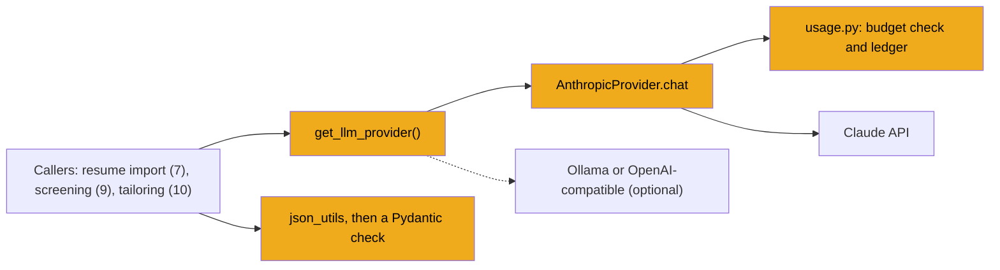
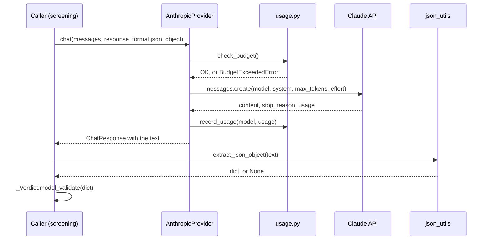

# Stage 6: Talking to Claude

> **Goal:** Build one safe door for every Claude call. It picks the right model for each task, asks for JSON, pulls the JSON out of messy text, records what each call costs, and refuses to spend past your budget.
>
> **By the end you will have:** the `backend/app/llm/` package (one provider interface, a Claude provider, two optional providers for other services, and a factory that keeps one provider alive), a spend ledger with a daily and monthly budget gate, a JSON extractor that survives cut-off answers, and three new endpoints (`/api/settings`, `/api/llm/test` and `/api/llm/ping`) that you can try from `/docs`.

## Where this fits

From stage 7 on, many parts of JobBee ask a model for something: read a resume, screen a job, tailor a CV. They all go through the code you write here. One door means one place to choose models, enforce budgets and handle errors.



## New ideas in plain words

This stage is your first contact with a large language model (LLM) API. Every idea below shows up in the code.

**An LLM API call.** Claude runs on Anthropic's servers. Your program sends it a request over HTTPS and gets one response back. You don't write the HTTP yourself: the `anthropic` package (an *SDK*, a software development kit) does it for you. You call `client.messages.create(...)` and get a Python object back.

**Messages and roles.** The request carries the conversation so far, as a list of messages. Each message has a **role** and some **content**:

| Role | Who is speaking |
|---|---|
| `user` | You (your program) |
| `assistant` | Claude, in earlier turns |

The model has no memory between calls. If you want it to see earlier turns, you send them again every time. JobBee's calls are mostly one question and one answer, so the list usually holds one `user` message.

**System prompt.** Standing instructions that frame the whole conversation, such as "You screen job postings for one candidate". The Claude API takes it as a separate `system` field, not as a message. JobBee's own message type allows a `system` role for convenience, and the Claude provider moves those messages into the `system` field.

**Tokens.** Models read and write text in chunks called *tokens*. A token is roughly three quarters of an English word. Everything is measured in tokens: how much you send (*input tokens*), how much comes back (*output tokens*) and what you pay.

**`max_tokens`.** The most output tokens Claude may produce for this call. It is a hard ceiling: if Claude reaches it, the answer is cut off mid-sentence. You only pay for tokens actually produced, so a high ceiling costs nothing extra.

**The response.** Three parts of it matter here:

- **`content`**: a list of *blocks*. The answer is in the blocks of type `text`. Other block types exist, such as thinking blocks (see below).
- **`stop_reason`**: why Claude stopped. `end_turn` means it finished normally. `max_tokens` means it hit the ceiling and the answer is cut off. `refusal` means it declined the request. (Stage 15 adds `tool_use`.)
- **`usage`**: how many tokens went in (`input_tokens`) and came out (`output_tokens`). This is what you pay for.

**Model tiers and cost.** Claude comes in sizes. Bigger models are stronger and cost more. Prices are quoted in US dollars per million tokens, and output costs more than input. These are the prices JobBee uses (from `apply/costs.py`, Step 2) and what it uses each model for (from `config.py`, stage 1):

| Model | Input per 1M tokens | Output per 1M tokens | JobBee uses it for |
|---|---|---|---|
| `claude-haiku-5-5` | $0.10 | $0.50 | Screening jobs, reading resumes, fact-checks |
| `claude-sonnet-5-5` | $2.00 | $10.00 | Tailoring CVs, web search for jobs |
| `claude-opus-5-5` | $4.00 | $20.00 | Filling application forms (stage 18) |

A worked example: a screening call that sends 3,000 tokens and gets 400 back on Haiku costs 3,000 × $0.10 / 1,000,000 + 400 × $0.50 / 1,000,000 = $0.0005. Two thousand of those cost one dollar. The rule JobBee follows: use the cheapest model that does the job well.

**Adaptive thinking and effort.** Current Claude models can *think* before they answer: they reason privately, then write the reply. With *adaptive* thinking, the model decides for itself how much to think. You steer it with an **effort** level (`low`, `medium`, `high`, `xhigh` or `max`), sent as `output_config={"effort": ...}`. Lower effort means less thinking, so faster and cheaper answers. Two consequences for your code:

- Thinking tokens are billed as **output tokens**, and they come out of the same `max_tokens` budget as the answer. A small `max_tokens` can be used up by thinking alone, leaving an empty or cut-off answer. That's why JobBee never sends a small one.
- **Temperature is not sent.** Older APIs had a `temperature` setting for randomness. Current Claude models reject it. JobBee's interface keeps the parameter because other providers use it, but the Claude provider never passes it on.

**JSON by instruction.** JobBee needs answers that code can read, so it asks for a JSON object. It does this with one sentence in the system prompt: "Respond with exactly one JSON object and nothing else". That works almost every time. Almost is not always.

**Why outputs are validated.** A model's answer is text, not a promise. It can wrap the JSON in a sentence or a code fence, miss a field, use the wrong type (`"7"` instead of `7`), add fields you never asked for, or stop halfway. Code that does `json.loads(text)["score"]` works for your first ten tries and crashes on the eleventh. JobBee's rule is **lenient extraction, strict validation**: find the JSON with a forgiving helper (Step 4), then check its shape with a strict Pydantic model (stage 4 introduced Pydantic). Anything that fails the check is treated as a failed call.

**Regular expressions.** `json_utils.py` searches text with *regular expressions* (regex), a small pattern language from Python's `re` module. `re.search(r'"name"\s*:\s*"', text)` finds the text `"name"`, optional spaces, a colon, optional spaces and a quote. `\s` means "any space or newline", `*` means "zero or more", `(...)` captures a part you can read back with `match.group(1)`, and the `re.DOTALL` flag lets `.` match newlines too. You don't need to write regex to follow this stage. Read each one as "find text shaped like this".

**`async` and `await`, a first look.** A call to Claude can take seconds or minutes. The provider methods are written `async def chat(...)`, and inside them the slow network call is written `await client.messages.create(...)`. For now, read `await` as "wait for this result, and let the server do other work meanwhile". Stage 8 explains async code properly, when you write your own.

**Abstract base class.** A class meant only as a template. `LLMProvider` inherits from `ABC` and marks `chat` with `@abstractmethod`. Python then refuses to create an object of any subclass that hasn't written its own `chat`. Stage 2's `SecretStore` was a `Protocol`, which only describes a shape. Here the providers inherit from the template on purpose, and Python checks that the method is there.

**ContextVar.** A variable whose value belongs to the current piece of work, not to the whole program. Think of a name badge: each request (or background task) wears its own, and code deep inside can read it without anyone passing it down through every function. JobBee uses one to label calls ("this is a screening call"). The provider reads the label to pick the model, and the ledger records it so you can see what the money was spent on.

**Singleton.** One shared object for the whole program. JobBee builds one provider and reuses it, because the provider holds an open network client. A *lock* (`threading.Lock`) makes sure two threads never build it at the same moment.

## Build it, step by step

### Step 1: The apply package, `backend/app/apply/__init__.py`

The `apply/` folder will hold the apply engine: the guarded browser driver (stage 17), the agent (stage 18) and the run manager (stage 21). You create it now for one reason: the price table in Step 2 lives there, and the spend ledger needs it. The file only marks the folder as a Python package, with a docstring saying what will live in it.

```text
backend/app/
├── apply/
│   ├── __init__.py     ← this step
│   └── costs.py        ← Step 2
└── llm/                ← Steps 3 to 10
```

<!-- code: backend/app/apply/__init__.py -->
**`backend/app/apply/__init__.py`** (whole file, 1 lines)

```python
"""Claude-driven apply engine (browser toolset driver, guards, run orchestration)."""
```
<!-- /code -->

### Step 2: The price table, `backend/app/apply/costs.py`

This file turns a response's `usage` block into dollars. It was first written to estimate the cost of an apply run, which is why it sits in `apply/`. The spend ledger (Step 5) reuses it for every call.

- **`PRICES`** maps each model to three prices per million tokens: input, output and *cache read*.
- **Prompt caching** lets Claude reuse the start of a long prompt it saw recently. Reading tokens from the cache is 10 to 20 times cheaper than fresh input. Writing them into the cache costs extra: 1.25 times the input price for a 5-minute cache, 2 times for a 1-hour cache. Only the apply agent (stage 18) uses caching. For the calls in this stage, the cache numbers are zero.
- **`FALLBACK_MODELS`** lists the models for which Anthropic's servers can retry a declined request on another model. The apply agent uses it in stage 18. Nothing in this stage reads it.
- **`usage_cost(model, usage)`** multiplies each kind of token by its price and divides by one million.

Three details in `usage_cost` are deliberate:

1. **An unknown model is priced as Opus**, the most expensive. `PRICES.get(model, PRICES["claude-opus-5-5"])` means that if you add a model and forget to list it, the ledger overestimates instead of underestimating.
2. **`getattr(usage, "input_tokens", 0) or 0`** reads a field if it exists and treats a missing field or a `None` as 0. The function then accepts the SDK's real usage object or a simple stand-in in a test.
3. **Two shapes for cache writes.** Newer responses split cache writes into `cache_creation.ephemeral_5m_input_tokens` and `ephemeral_1h_input_tokens`. Older ones only have one total, `cache_creation_input_tokens`. If `cache_creation` is missing, the function treats the total as 5-minute writes.

<!-- code: backend/app/apply/costs.py -->
**`backend/app/apply/costs.py`** (whole file, 35 lines)

```python
"""Rough per-call cost estimates for apply runs (USD, Anthropic first-party list prices)."""

from __future__ import annotations

from typing import Any

# Per million tokens: (input, output, cache read). Cache writes are 1.25x input
# for the 5-minute TTL and 2x for the 1-hour TTL.
PRICES: dict[str, tuple[float, float, float]] = {
    "claude-opus-5-5": (4.00, 20.00, 0.20),
    "claude-sonnet-5-5": (2.00, 10.00, 0.20),
    "claude-haiku-5-5": (0.10, 0.50, 0.01),
}

# Server-side refusal fallbacks ("default" form) are available for these.
FALLBACK_MODELS = {"claude-opus-5-5", "claude-sonnet-5-5"}


def usage_cost(model: str, usage: Any) -> float:
    """Estimate the cost of one Messages API response from its `usage` block."""

    inp, out, read = PRICES.get(model, PRICES["claude-opus-5-5"])
    cache_creation = getattr(usage, "cache_creation", None)
    write_1h = getattr(cache_creation, "ephemeral_1h_input_tokens", 0) or 0
    write_5m = getattr(cache_creation, "ephemeral_5m_input_tokens", 0) or 0
    if cache_creation is None:
        write_5m = getattr(usage, "cache_creation_input_tokens", 0) or 0
    tokens = (
        (getattr(usage, "input_tokens", 0) or 0) * inp
        + (getattr(usage, "output_tokens", 0) or 0) * out
        + (getattr(usage, "cache_read_input_tokens", 0) or 0) * read
        + write_5m * inp * 1.25
        + write_1h * inp * 2.0
    )
    return tokens / 1_000_000
```
<!-- /code -->

### Step 3: The shared types, `backend/app/llm/base.py`

Create the `backend/app/llm/` folder. `base.py` holds the types every caller uses, whichever model is behind them. It's the "one door".

- **`Role`** is a `Literal` type: a role can only be one of those four strings. `tool` is there for completeness; no provider in this stage sends it.
- **`strip_model_artifacts(text)`** cleans up output from other models. Claude never sends these wrappers, but some local models (Gemma on Ollama, for example) wrap their reasoning in `<thought>...</thought>` tags or start with a `Thinking:` header. The function works in order:
  1. If a JSON object sits inside a closed `<thought>` block, it returns that JSON. Some models put their real answer in there.
  2. If a `<thought>` tag opens on a JSON object and never closes, it returns everything from the `{` on.
  3. Otherwise it deletes every `<thought>` block and every `Thinking:` header, and returns what's left.
- **`ChatMessage`** is a `@dataclass`: Python writes `__init__` for you from the field list. `slots=True` makes each object a little smaller and stops typos like `msg.rol = ...` from silently adding a new attribute. `content` is either a string or a list of parts in OpenAI's style (`{"type": "text", ...}` or `{"type": "image_url", ...}`), so one message can carry text and images. `to_dict()` turns it into a plain dict for providers that send messages as-is.
- **`ChatResponse`** is what every provider returns: the answer as plain `content` text, the `model` that answered, the `provider` name, the full original response in `raw`, and the token counts if the provider reports them.
- **`LLMError`** is the error providers raise for their own failures: a bad key, a timeout, a refusal. Callers catch this one type instead of each library's own errors, and they raise it too when an answer has the wrong shape. (Step 6 points out two errors that still get past it.)
- **`LLMProvider`** is the abstract base class. `chat` is abstract, so every provider must write it. The `*` in the parameter list means everything after it must be passed by name (`max_tokens=300`, not a bare `300`), which keeps call sites readable. `aclose()` is not abstract: its body is only a docstring, so it does nothing unless a provider overrides it to close its network client.

The parameters of `chat` are the union of what all providers understand. Each provider uses the ones that make sense for it and ignores the rest.

<!-- code: backend/app/llm/base.py -->
**`backend/app/llm/base.py`** (whole file, 88 lines)

```python
"""Common types and the abstract `LLMProvider` interface."""

from __future__ import annotations

import re
from abc import ABC, abstractmethod
from dataclasses import dataclass
from typing import Any, Literal

Role = Literal["system", "user", "assistant", "tool"]

# Gemma / reasoning models may emit thinking blocks before (or instead of) the answer.
_THINKING_RE = re.compile(r"<thought>[\s\S]*?</thought>", re.IGNORECASE)
# Some models use markdown-style thinking headers.
_THINKING_HEADER_RE = re.compile(r"^thinking\s*:?\s*", re.IGNORECASE | re.MULTILINE)


def strip_model_artifacts(text: str) -> str:
    """Remove provider-specific wrappers (e.g. Gemma thinking blocks) from text.

    JSON payloads wrapped entirely in ``<thought>`` are preserved — some models
    place the structured answer inside a thinking block.
    """

    if not text:
        return ""

    stripped = text.strip()
    thought_json = re.search(r"<thought>\s*(\{[\s\S]*)\s*</thought>", stripped, re.IGNORECASE)
    if thought_json:
        return thought_json.group(1).strip()

    open_thought = re.search(r"<thought>\s*(\{[\s\S]*)", stripped, re.IGNORECASE)
    if open_thought:
        return open_thought.group(1).strip()

    stripped = _THINKING_RE.sub("", stripped)
    stripped = _THINKING_HEADER_RE.sub("", stripped)
    return stripped.strip()


@dataclass(slots=True)
class ChatMessage:
    role: Role
    content: str | list[dict[str, Any]]

    def to_dict(self) -> dict[str, Any]:
        return {"role": self.role, "content": self.content}


@dataclass(slots=True)
class ChatResponse:
    """Vendor-neutral chat result."""

    content: str
    model: str
    provider: str
    raw: dict[str, Any]
    prompt_tokens: int | None = None
    completion_tokens: int | None = None


class LLMError(RuntimeError):
    """Raised for any provider-side failure (HTTP error, timeout, bad payload)."""


class LLMProvider(ABC):
    """The single seam between agents and any concrete LLM backend."""

    name: str
    default_model: str

    @abstractmethod
    async def chat(
        self,
        messages: list[ChatMessage],
        *,
        model: str | None = None,
        temperature: float | None = None,
        max_tokens: int | None = None,
        response_format: dict[str, Any] | None = None,
        thinking: bool | None = None,
        timeout_s: float | None = None,
    ) -> ChatResponse:
        """Send a chat completion request and return the response."""

    async def aclose(self) -> None:
        """Release any underlying resources (HTTP clients, etc.)."""
```
<!-- /code -->

### Step 4: Finding JSON in model text, `backend/app/llm/json_utils.py`

This file finds a JSON object in whatever text a model sends back. It's built in layers because it was hardened against several models, including local ones that behave worse than Claude. With Claude and the JSON instruction, the first, simplest try nearly always works. The other layers are there for the bad days.

The idea in one sentence: try many places where the JSON might be, parse each one as strictly as possible, and fall back to repairs only when that fails.

#### Part 1: Reading one string field

The three patterns at the top find a Markdown code fence (```` ```json ... ``` ````), a closed `<thought>...</thought>` block, and a `<thought>` block that never closes.

- **`_unescape_json_string(raw)`** turns JSON escapes such as `\n` and `\"` into real characters. The trick: wrap the text in quotes and let `json.loads` read it as a JSON string. If that fails (for example, the text was cut off in the middle of an escape), it falls back to replacing the three common escapes by hand.
- **`salvage_string_field(text, key)`** reads one string field, even from a cut-off answer. It finds `"key": "` with a regex and takes everything after it. Then it walks that text one character at a time, looking for the closing quote. A backslash means "the next character is escaped", so `\"` inside the value doesn't end it. If no closing quote is found, the answer was cut off, and it keeps the rest of the text. An empty result becomes `None`.

<!-- code: backend/app/llm/json_utils.py lines=1-48 -->
**`backend/app/llm/json_utils.py`** (lines 1–48 of 222)

````python
"""Robust JSON extraction from LLM text (truncation, fences, thinking tags)."""

from __future__ import annotations

import json
import re
from typing import Any

from .base import strip_model_artifacts

_JSON_FENCE_RE = re.compile(r"```(?:json)?\s*(.*?)```", re.DOTALL | re.IGNORECASE)
_THOUGHT_BLOCK_RE = re.compile(r"<thought>([\s\S]*?)</thought>", re.IGNORECASE)
_THOUGHT_OPEN_RE = re.compile(r"<thought>([\s\S]*)", re.IGNORECASE)


def _unescape_json_string(raw: str) -> str:
    try:
        return json.loads(f'"{raw}"')
    except json.JSONDecodeError:
        return raw.replace('\\"', '"').replace("\\n", "\n").replace("\\t", "\t")


def salvage_string_field(text: str, key: str) -> str | None:
    """Read a JSON string field from complete or truncated model output."""

    chunk = text[text.find("{") :] if "{" in text else text
    match = re.search(rf'"{re.escape(key)}"\s*:\s*"(.*)', chunk, re.DOTALL)
    if not match:
        return None

    raw = match.group(1)
    end = 0
    escaped = False
    for i, ch in enumerate(raw):
        if escaped:
            escaped = False
            continue
        if ch == "\\":
            escaped = True
            continue
        if ch == '"':
            end = i
            break

    value = _unescape_json_string(raw[:end] if end else raw).strip()
    return value or None


````
<!-- /code -->

#### Part 2: Where to look, and closing cut-off JSON

**`_payloads_to_try(text)`** builds a list of candidate strings to parse, best first. The `add` helper skips empty and repeated candidates (the `seen` set). The order is:

1. the whole text;
2. the inside of each closed `<thought>` block;
3. the inside of an unclosed `<thought>` block;
4. the text with thinking wrappers removed (`strip_model_artifacts` from Step 3);
5. the inside of a code fence;
6. the inside of a code fence that never closes.

**`_close_truncated_json(chunk)`** repairs an answer that stopped mid-way. It starts at the first `{` and tries adding likely endings, one at a time, until `json.loads` accepts the result. For example, `{"name": "Linh", "summary": "QA Eng` plus `"}` is valid JSON. Only a dict counts as success. (One ending, `'"}]}'`, is listed twice. That's harmless: the second try fails the same way as the first.)

<!-- code: backend/app/llm/json_utils.py lines=49-114 -->
**`backend/app/llm/json_utils.py`** (lines 49–114 of 222)

````python
def _payloads_to_try(text: str) -> list[str]:
    """Candidate strings to parse, in priority order."""

    seen: set[str] = set()
    out: list[str] = []

    def add(candidate: str | None) -> None:
        if not candidate:
            return
        cleaned = candidate.strip()
        if cleaned and cleaned not in seen:
            seen.add(cleaned)
            out.append(cleaned)

    add(text)

    for match in _THOUGHT_BLOCK_RE.finditer(text):
        add(match.group(1))

    open_thought = _THOUGHT_OPEN_RE.search(text)
    if open_thought:
        add(open_thought.group(1))

    add(strip_model_artifacts(text))

    fence = _JSON_FENCE_RE.search(text)
    if fence:
        add(fence.group(1).strip())

    # Open code fence without a closing ```
    open_fence = re.search(r"```(?:json)?\s*([\s\S]*)", text, re.IGNORECASE)
    if open_fence:
        add(open_fence.group(1).strip())

    return out


def _close_truncated_json(chunk: str) -> dict[str, Any] | None:
    """Try closing an truncated object by appending quote/brace suffixes."""

    if "{" not in chunk:
        return None

    body = chunk[chunk.find("{") :]
    suffixes = (
        '"}',
        '"]}',
        '"]]}',
        '"}]}',
        '"}]}',
        "}",
        'null}',
        '""}',
        '"]',
        '"',
    )
    for suffix in suffixes:
        try:
            obj = json.loads(body + suffix)
            if isinstance(obj, dict):
                return obj
        except json.JSONDecodeError:
            continue
    return None


````
<!-- /code -->

#### Part 3: Field-by-field rescue

**`salvage_json_object`** is the last resort. It first tries `_close_truncated_json`. If that fails, it uses regexes to pull out the fields it can still read:

- string fields, through `salvage_string_field`;
- a number for `years_experience`;
- lists of strings;
- a `links` object of string values.

The default field names are resume fields (`name`, `headline`, `skills`, `links`…) because the resume importer in stage 7 was the first user of this helper. A caller can pass its own `string_fields` and `list_fields`. The result may be an empty dict, which callers treat as "nothing found".

<!-- code: backend/app/llm/json_utils.py lines=115-160 -->
**`backend/app/llm/json_utils.py`** (lines 115–160 of 222)

```python
def salvage_json_object(
    text: str,
    *,
    string_fields: tuple[str, ...] = (),
    list_fields: tuple[str, ...] = (),
) -> dict[str, Any]:
    """Field-by-field recovery when the payload is truncated or malformed."""

    closed = _close_truncated_json(text)
    if closed:
        return closed

    chunk = text[text.find("{") :] if "{" in text else text
    out: dict[str, Any] = {}

    keys = string_fields or (
        "name",
        "headline",
        "email",
        "location",
        "summary",
    )
    for key in keys:
        value = salvage_string_field(chunk, key)
        if value is not None:
            out[key] = value

    num = re.search(r'"years_experience"\s*:\s*(\d+(?:\.\d+)?)', chunk)
    if num:
        out["years_experience"] = float(num.group(1))

    for key in list_fields or ("target_roles", "skills"):
        match = re.search(rf'"{re.escape(key)}"\s*:\s*\[(.*?)\]', chunk, re.DOTALL)
        if match:
            out[key] = re.findall(r'"((?:[^"\\]|\\.)*)"', match.group(1))

    links_match = re.search(r'"links"\s*:\s*\{(.*?)\}', chunk, re.DOTALL)
    if links_match:
        links: dict[str, str] = {}
        for k, v in re.findall(r'"(\w+)"\s*:\s*"((?:[^"\\]|\\.)*)"', links_match.group(1)):
            links[k] = v.replace('\\"', '"')
        out["links"] = links

    return out


```
<!-- /code -->

#### Part 4: The main function

**`extract_json_object(text)`** is what callers use. For each candidate from Part 2, it tries four things in order and returns the first dict it gets:

1. **Parse the whole candidate** with `json.loads`.
2. **Parse the inside of a code fence**, if the candidate contains one. If that fails, salvage the inside of the fence (Part 3).
3. **Match braces.** Starting at the first `{`, it counts `{` as +1 and `}` as −1. When the count gets back to 0, that's where the first object ends, and it parses only that piece. This copes with text like `Sure! {"score": 80} Hope that helps.` and with two objects in a row. It doesn't know about braces inside strings, so a value like `"}"` can confuse it. In that case the parse fails and the next step takes over.
4. **Salvage** the candidate field by field (Part 3).

If no candidate gives a dict, it returns `None`, and the caller decides what that means.

**`json_looks_truncated(text)`** is a separate, simpler check: is there text, and does it end without a closing `}`? The resume importer (stage 7) uses it to decide whether to ask Claude again.

<!-- code: backend/app/llm/json_utils.py lines=161-222 -->
**`backend/app/llm/json_utils.py`** (lines 161–222 of 222)

```python
def extract_json_object(
    text: str,
    *,
    string_fields: tuple[str, ...] = (),
    list_fields: tuple[str, ...] = (),
) -> dict[str, Any] | None:
    """Best-effort parse of a JSON object from arbitrary LLM output."""

    for candidate in _payloads_to_try(text):
        try:
            result = json.loads(candidate)
            if isinstance(result, dict):
                return result
        except json.JSONDecodeError:
            pass

        fence = _JSON_FENCE_RE.search(candidate)
        if fence:
            inner = fence.group(1).strip()
            try:
                result = json.loads(inner)
                if isinstance(result, dict):
                    return result
            except json.JSONDecodeError:
                salvaged = salvage_json_object(
                    inner, string_fields=string_fields, list_fields=list_fields
                )
                if salvaged:
                    return salvaged

        start = candidate.find("{")
        if start == -1:
            continue

        depth = 0
        for i in range(start, len(candidate)):
            ch = candidate[i]
            if ch == "{":
                depth += 1
            elif ch == "}":
                depth -= 1
                if depth == 0:
                    fragment = candidate[start : i + 1]
                    try:
                        result = json.loads(fragment)
                        if isinstance(result, dict):
                            return result
                    except json.JSONDecodeError:
                        break

        salvaged = salvage_json_object(
            candidate, string_fields=string_fields, list_fields=list_fields
        )
        if salvaged:
            return salvaged

    return None


def json_looks_truncated(text: str) -> bool:
    stripped = text.strip()
    return bool(stripped) and not stripped.endswith("}")
```
<!-- /code -->

This file is the "lenient extraction" half of the rule. The "strict validation" half lives in each caller. Here is how screening (stage 9) uses it:

From [`backend/app/pipeline/screen.py`](../../backend/app/pipeline/screen.py):
```python
    data = extract_json_object(resp.content)
    try:
        verdict = _Verdict.model_validate(data or {})
    except ValidationError as e:
        raise LLMError(f"Screening returned an unexpected shape: {e.errors()[0]['msg']}") from e
```

`_Verdict` is a Pydantic model that lists the exact fields and types screening accepts. `data or {}` turns "no JSON found" (`None`) into an empty dict, which then fails validation with a clear "Field required" message. The `ValidationError` becomes an `LLMError`, so to the rest of JobBee a malformed answer is one more way a call can fail.

### Step 5: The spend ledger and budget gate, `backend/app/llm/usage.py`

Every Claude call costs money. This file makes sure you always know how much, and that JobBee stops on its own when a limit is reached. It does three jobs:

1. **Labels** each call with what it's for (`llm_task`).
2. **Records** each call as one row in the `llm_usage` table (`record_usage`).
3. **Refuses** new calls once today's or this month's spend reaches its limit (`check_budget`).

#### Part 1: Labels and the ledger row

- **`WEB_SEARCH_USD = 0.01`.** Web searches (stage 14) are billed per search, $10 per 1,000, on top of tokens.
- **`_current_task`** is the ContextVar. Its name is `"llm_task"` and its default is `"other"`, so an unlabelled call is recorded as `other`.
- **`BudgetExceededError`** is a subclass of `LLMError`. Code that already handles `LLMError` handles a used-up budget too. Discovery (stage 19) catches it by name to stop a search early.
- **`llm_task(name)`** is a *context manager*, something you use with `with`. The `@contextmanager` decorator turns a generator function into one: the code before `yield` runs when the `with` block starts, and the code after it runs when the block ends. A caller writes:

  ```python
  with llm_task("screen"):
      resp = await provider.chat(messages, max_tokens=1200)
  ```

  Inside the block, `current_task()` returns `"screen"`, even deep inside `chat()`. Outside it, the label is back to what it was. `set` returns a *token*, and `reset(token)` puts back exactly the previous value. That's why labels can nest. The `finally` makes sure the reset happens even if the call raises.
- **`record_usage(model, usage, ...)`** writes one row to the `llm_usage` table you created in stage 3. It works out the cost with `usage_cost` (Step 2), adds the web searches, and saves the token counts. It opens its own short session with `SessionLocal()` (stage 3) and commits straight away, so the row is saved even if the caller later fails. It returns the cost, which the apply agent (stage 18) adds to a per-run total. An explicit `task=` wins over the ContextVar label; web search and the apply agent pass one.

<!-- code: backend/app/llm/usage.py lines=1-78 -->
**`backend/app/llm/usage.py`** (lines 1–78 of 122)

```python
"""Claude spend ledger and budget gate.

Every Claude call records its tokens and estimated cost in `llm_usage`. Before a
call, `check_budget()` refuses to spend once today's or this month's total
passes the configured budget, or while the agent is paused for budget reasons.
Call sites label their work with `llm_task("match")` so spend can be broken down.
"""

from __future__ import annotations

from collections.abc import Iterator
from contextlib import contextmanager
from contextvars import ContextVar
from datetime import datetime, timedelta, timezone
from typing import Any

from sqlalchemy import func, select

from ..apply.costs import usage_cost
from ..config import get_settings
from ..db import SessionLocal
from ..models import LlmUsage
from .base import LLMError

WEB_SEARCH_USD = 0.01  # $10 per 1,000 searches

_current_task: ContextVar[str] = ContextVar("llm_task", default="other")


class BudgetExceededError(LLMError):
    """Spending more would pass the daily or monthly Claude budget."""


@contextmanager
def llm_task(name: str) -> Iterator[None]:
    token = _current_task.set(name)
    try:
        yield
    finally:
        _current_task.reset(token)


def current_task() -> str:
    return _current_task.get()


def record_usage(
    model: str,
    usage: Any,
    *,
    task: str | None = None,
    application_id: int | None = None,
    run_id: int | None = None,
) -> float:
    """Store one response's usage; returns its estimated cost in USD."""

    server_tools = getattr(usage, "server_tool_use", None)
    searches = getattr(server_tools, "web_search_requests", 0) or 0
    cost = usage_cost(model, usage) + searches * WEB_SEARCH_USD
    with SessionLocal() as session:
        session.add(
            LlmUsage(
                task=task or current_task(),
                model=model,
                input_tokens=getattr(usage, "input_tokens", 0) or 0,
                output_tokens=getattr(usage, "output_tokens", 0) or 0,
                cache_read_tokens=getattr(usage, "cache_read_input_tokens", 0) or 0,
                cache_write_tokens=getattr(usage, "cache_creation_input_tokens", 0) or 0,
                web_searches=searches,
                cost_usd=cost,
                application_id=application_id,
                run_id=run_id,
            )
        )
        session.commit()
    return cost


```
<!-- /code -->

#### Part 2: Adding up spend and the budget gate

- **`spend_since(since)`** asks the database for the sum of `cost_usd` since a moment in time. In SQL that's `SELECT COALESCE(SUM(cost_usd), 0.0) FROM llm_usage WHERE created_at >= ?`. `SUM` over no rows gives `NULL`, and `COALESCE` turns that into 0.
- **`_day_start` and `_month_start`** find the start of today and of this month on *your* clock. `now.astimezone()` converts to your computer's local time zone, `.replace(...)` moves to midnight, and the final `.astimezone(timezone.utc)` converts back to UTC, because the ledger stores UTC times. Without this, "today" would start at midnight UTC, which is mid-afternoon or early morning for many people.
- **`spend_summary()`** returns today's, this month's and the last seven days' spend, plus the two limits from settings (`daily_budget_usd` and `monthly_budget_usd`, stage 1). The home page (stage 22), the setup status (stage 23) and the Telegram bot (stage 11) show these numbers.
- **`check_budget()`** raises `BudgetExceededError` when today's spend has reached the daily limit or this month's has reached the monthly limit. A limit of `0` means "no limit": `if summary["daily_budget_usd"] and ...` skips the check when the limit is 0.

The budget is a gate in front of each call, not a meter that cuts a call off. That has two effects:

1. **It can overshoot.** `check_budget()` runs *before* a call and counts what's already recorded. If three screenings start at the same time, all three pass the check, and all three are recorded afterwards. The call that crosses the line also finishes. The limit stops the *next* call, not the one in flight.
2. **Long runs check once.** The apply agent (stage 18) checks the budget once, before it opens the browser. During the run, its own per-application cap (`apply_max_cost_usd`) is what stops it.

<!-- code: backend/app/llm/usage.py lines=79-122 -->
**`backend/app/llm/usage.py`** (lines 79–122 of 122)

```python
def spend_since(since: datetime) -> float:
    with SessionLocal() as session:
        total = session.execute(
            select(func.coalesce(func.sum(LlmUsage.cost_usd), 0.0)).where(
                LlmUsage.created_at >= since
            )
        ).scalar_one()
    return float(total or 0.0)


def _day_start(now: datetime) -> datetime:
    local = now.astimezone()
    return local.replace(hour=0, minute=0, second=0, microsecond=0).astimezone(timezone.utc)


def _month_start(now: datetime) -> datetime:
    local = now.astimezone()
    return local.replace(day=1, hour=0, minute=0, second=0, microsecond=0).astimezone(timezone.utc)


def spend_summary(now: datetime | None = None) -> dict[str, float]:
    now = now or datetime.now(timezone.utc)
    settings = get_settings()
    return {
        "today_usd": spend_since(_day_start(now)),
        "month_usd": spend_since(_month_start(now)),
        "last_7_days_usd": spend_since(now - timedelta(days=7)),
        "daily_budget_usd": settings.daily_budget_usd,
        "monthly_budget_usd": settings.monthly_budget_usd,
    }


def check_budget() -> None:
    """Raise BudgetExceededError if today's or this month's spend is at its limit."""

    summary = spend_summary()
    if summary["daily_budget_usd"] and summary["today_usd"] >= summary["daily_budget_usd"]:
        raise BudgetExceededError(
            f"Today's Claude budget (${summary['daily_budget_usd']:.2f}) is used up."
        )
    if summary["monthly_budget_usd"] and summary["month_usd"] >= summary["monthly_budget_usd"]:
        raise BudgetExceededError(
            f"This month's Claude budget (${summary['monthly_budget_usd']:.2f}) is used up."
        )
```
<!-- /code -->

### Step 6: The Claude provider, `backend/app/llm/anthropic_provider.py`

This is the `LLMProvider` that talks to Claude. Resume import, screening and tailoring all go through it. The docstring points out two things. First, the apply agent (stage 18) doesn't use this class: it needs browser tools, so it talks to the SDK directly. Second, current Claude models reject sampling settings and always think adaptively, so `temperature` is ignored and `thinking` only chooses the effort level.

#### Part 1: Constants and helpers

- **`_JSON_INSTRUCTION`** is the sentence added to the system prompt when a caller asks for JSON.
- **`_MIN_MAX_TOKENS = 4096`** is the floor for `max_tokens`. The comment says why: adaptive thinking shares the output budget.
- **`task_model(task)`** maps a call's label to the model setting for it. `task_model("tailor")` returns Sonnet. An unknown label, including the default `"other"`, returns `None`. Here is every label and where it's used:

  | `llm_task` label | Setting | Default model | Used in |
  |---|---|---|---|
  | `import` | `import_model` | Haiku | Reading your resume (stage 7) |
  | `screen` | `match_model` | Haiku | Screening a job (stage 9) |
  | `tailor` | `tailor_model` | Sonnet | Writing the tailored CV (stage 10) |
  | `fact_check` | `match_model` | Haiku | Checking the tailored CV (stage 10) |
  | `discover` | `discover_model` | Sonnet | Web search for jobs (stage 14) |
  | `match`, `chat` | `match_model`, `chat_model` | Haiku | No caller in JobBee today; a provider test in stage 11 uses `match` |

- **`_content_blocks(content)`** converts OpenAI-style message parts into Claude's format. A plain string passes through unchanged. A text part becomes `{"type": "text", ...}`. An image given as a *data URI* (`data:image/png;base64,....`, an image packed into a string) becomes Claude's image block with the media type and the base64 data split apart. Image parts that are ordinary web links are dropped, because only data URIs are handled.

<!-- code: backend/app/llm/anthropic_provider.py lines=1-61 -->
**`backend/app/llm/anthropic_provider.py`** (lines 1–61 of 137)

```python
"""Claude provider for the generic `LLMProvider` seam (import, matching, tailoring).

The browser apply agent talks to the SDK directly (app/apply/agent.py); this
provider covers the plain chat-style calls. Current Claude models reject
sampling parameters and always think adaptively, so `temperature` is ignored
and `thinking` maps to the effort level.
"""

from __future__ import annotations

from typing import Any

from anthropic import APIStatusError, APITimeoutError, AsyncAnthropic

from ..config import get_settings
from .base import ChatMessage, ChatResponse, LLMError, LLMProvider
from .usage import check_budget, current_task, record_usage

_JSON_INSTRUCTION = (
    "Respond with exactly one JSON object and nothing else: no prose, no code fences."
)
_MIN_MAX_TOKENS = 4096  # adaptive thinking shares the output budget


def task_model(task: str) -> str | None:
    """The model configured for a labelled task (see `llm_task`), if any."""

    settings = get_settings()
    return {
        "match": settings.match_model,
        "screen": settings.match_model,
        "import": settings.import_model,
        "tailor": settings.tailor_model,
        "discover": settings.discover_model,
        "fact_check": settings.match_model,
        "chat": settings.chat_model,
    }.get(task)


def _content_blocks(content: str | list[dict[str, Any]]) -> str | list[dict[str, Any]]:
    """Convert OpenAI-style multimodal parts to Anthropic content blocks."""

    if isinstance(content, str):
        return content
    blocks: list[dict[str, Any]] = []
    for part in content:
        if part.get("type") == "text":
            blocks.append({"type": "text", "text": part.get("text", "")})
        elif part.get("type") == "image_url":
            url = (part.get("image_url") or {}).get("url", "")
            if url.startswith("data:") and ";base64," in url:
                media_type, data = url[5:].split(";base64,", 1)
                blocks.append(
                    {
                        "type": "image",
                        "source": {"type": "base64", "media_type": media_type, "data": data},
                    }
                )
    return blocks


```
<!-- /code -->

#### Part 2: The provider class

**`__init__`** builds one `AsyncAnthropic` client, the SDK's async client, and keeps it for the provider's whole life.

- `api_key=api_key or None`: an empty string becomes `None`, which lets the SDK look for a key on its own, such as an `ANTHROPIC_API_KEY` environment variable. Building a client without any key works. The error only shows when you make a call.
- `base_url` is fixed to Anthropic's API.
- `timeout` is the longest a call may take, in seconds.
- `default_headers` adds an `anthropic-workspace-id` header to every request when you set a workspace. Organisation-wide API keys must name one. Stage 2's `claude_workspace_id()` supplies it.

**`chat()`** is the heart of the stage. It runs these steps, in this order:

1. **`check_budget()`** comes first. If a limit is used up, it raises before any money is spent.
2. **Pick the model.** An explicit `model=` wins. Otherwise the task label's model, through `task_model(current_task())`. Otherwise the provider's default. Callers rarely name a model. They label the task.
3. **Merge the system prompt.** Every `system` message is collected into `system_parts`. If the caller passed `response_format={"type": "json_object"}`, the JSON instruction is added at the end. The parts are joined with a blank line between them.
4. **Keep only `user` and `assistant` turns** for `messages`. `system` messages already went into `system_parts`, and `tool` messages are dropped. Each turn's content goes through `_content_blocks`.
5. **Raise `max_tokens` to at least 4096.** `max(max_tokens or 0, _MIN_MAX_TOKENS)` turns a caller's 160 into 4096. A caller asking for more, such as 8,000, keeps its number.
6. **Set the effort.** `thinking=True` means `medium`. Anything else means `low`. Tailoring asks for `thinking=True`; screening and resume import don't. `temperature` is accepted by the method and never put into `params`.
7. **Per-call timeout.** `with_options(timeout=...)` makes a copy of the client with a different time limit for this one call. Without `timeout_s`, the client's own limit applies.
8. **Send it.** `await client.messages.create(**params)`. The `**params` unpacks the dict into keyword arguments, as if you had written `model=..., max_tokens=..., ...` by hand. The SDK already retries some failures (rate limits, overloaded servers, dropped connections) twice before it gives up.
9. **Turn errors into `LLMError`.** A timeout (`APITimeoutError`) becomes "Claude timed out". Any error status from the API (`APIStatusError`: 401 for a bad key, 400 for a bad request or an empty credit balance, 529 when overloaded) becomes `LLMError` with the API's own message, dug out of the error body. Other SDK errors, such as `APIConnectionError` when there's no internet, are not caught here and reach the caller as they are.
10. **`record_usage` runs before anything looks at the answer.** Even a refused or useless answer was paid for, so it goes in the ledger.
11. **A refusal is an error.** When `stop_reason` is `"refusal"`, Claude declined. Any text in the response is not a real answer, so raising stops callers from treating it as one.
12. **Join the text blocks.** `content` can hold thinking blocks as well as text blocks. Only `text` blocks make up the answer. A `stop_reason` of `max_tokens` is *not* treated as an error: you get whatever text there is, possibly cut off. That's one reason the resume importer checks `json_looks_truncated`.
13. **Wrap it up** in a `ChatResponse`. `response.model_dump()` turns the SDK's response object into a plain dict for `raw`.

**`aclose()`** closes the SDK client's network connections.

<!-- code: backend/app/llm/anthropic_provider.py lines=62-137 -->
**`backend/app/llm/anthropic_provider.py`** (lines 62–137 of 137)

```python
class AnthropicProvider(LLMProvider):
    name = "anthropic"

    def __init__(
        self,
        *,
        api_key: str,
        default_model: str,
        timeout_s: float = 600.0,
        workspace_id: str = "",
    ) -> None:
        self.default_model = default_model
        self._api_key = api_key
        self._client = AsyncAnthropic(
            api_key=api_key or None,
            base_url="https://api.anthropic.com",
            timeout=timeout_s,
            default_headers={"anthropic-workspace-id": workspace_id} if workspace_id else None,
        )

    async def chat(
        self,
        messages: list[ChatMessage],
        *,
        model: str | None = None,
        temperature: float | None = None,
        max_tokens: int | None = None,
        response_format: dict[str, Any] | None = None,
        thinking: bool | None = None,
        timeout_s: float | None = None,
    ) -> ChatResponse:
        check_budget()
        model_id = model or task_model(current_task()) or self.default_model
        system_parts = [m.content for m in messages if m.role == "system"]
        if response_format and response_format.get("type") == "json_object":
            system_parts.append(_JSON_INSTRUCTION)
        turns = [
            {"role": m.role, "content": _content_blocks(m.content)}
            for m in messages
            if m.role in ("user", "assistant")
        ]
        params: dict[str, Any] = {
            "model": model_id,
            "max_tokens": max(max_tokens or 0, _MIN_MAX_TOKENS),
            "messages": turns,
            "output_config": {"effort": "medium" if thinking else "low"},
        }
        if system_parts:
            params["system"] = "\n\n".join(str(p) for p in system_parts)
        client = self._client.with_options(timeout=timeout_s) if timeout_s else self._client
        try:
            response = await client.messages.create(**params)
        except APITimeoutError as e:
            raise LLMError(f"Claude timed out: {e}") from e
        except APIStatusError as e:
            body = e.body if isinstance(e.body, dict) else {}
            detail = body.get("error", {}) if isinstance(body.get("error"), dict) else {}
            raise LLMError(
                f"Claude error {e.status_code}: {detail.get('message') or e.message}"
            ) from e

        record_usage(model_id, response.usage)
        if response.stop_reason == "refusal":
            raise LLMError("Claude declined this request.")
        text = "".join(block.text for block in response.content if block.type == "text")
        return ChatResponse(
            content=text.strip(),
            model=response.model,
            provider=self.name,
            raw=response.model_dump(),
            prompt_tokens=response.usage.input_tokens,
            completion_tokens=response.usage.output_tokens,
        )

    async def aclose(self) -> None:
        await self._client.close()
```
<!-- /code -->

Here is one call from start to finish, including the checking that happens back in the caller:



### Step 7: An optional local provider, `backend/app/llm/ollama.py`

JobBee is built around Claude, but resume import, screening and tailoring can also run on other models. [Ollama](https://ollama.com) is a free program that runs open models on your own PC. This provider talks to it at `http://localhost:11434`, using Ollama's native `/api/chat` endpoint. You don't need Ollama to follow this guide. The file is here because the factory (Step 9) imports it.

Keep in mind what other providers don't get:

- **No budget and no ledger.** They don't call `check_budget` or `record_usage`. Local models cost nothing, and the ledger's prices are Claude prices.
- **No task-based model choice.** `task_model` lives in the Claude provider. Other providers use one model for everything.
- **No applying.** The apply agent (stage 18) and web search (stage 14) always use Claude, through the SDK directly.

#### Part 1: Converting messages

Ollama's native chat endpoint wants each message as `{"role": ..., "content": "text"}`, with images in a separate `images` list of raw base64 strings.

- **`_extract_base64_image(url)`** strips a data-URI prefix: everything up to and including the first comma goes, leaving the raw base64.
- **`to_ollama_message(message)`** passes a string content through unchanged. For a list of parts, it joins the text parts with newlines and collects the images. If there's no text at all, it sends a single space, so the content is never empty.

<!-- code: backend/app/llm/ollama.py lines=1-64 -->
**`backend/app/llm/ollama.py`** (lines 1–64 of 146)

```python
"""Ollama provider.

Talks to a local Ollama daemon (default `http://localhost:11434`) via its
native `/api/chat` endpoint. We deliberately don't go through Ollama's
OpenAI-compat shim so we can pass through Ollama-specific options later.
"""

from __future__ import annotations

from typing import Any

import httpx

from .base import ChatMessage, ChatResponse, LLMError, LLMProvider


def _extract_base64_image(url: str) -> str:
    """Strip a data-URI prefix so Ollama receives raw base64."""

    if url.startswith("data:"):
        _, _, data = url.partition(",")
        return data.strip()
    return url.strip()


def to_ollama_message(message: ChatMessage) -> dict[str, Any]:
    """Convert a ChatMessage to Ollama's native /api/chat shape.

    OpenAI-style multimodal parts (text + image_url) become a string
    ``content`` plus an optional ``images`` list — required for vision models
    such as Gemma 4 on Ollama.
    """

    content = message.content
    if isinstance(content, str):
        return {"role": message.role, "content": content}

    if not isinstance(content, list):
        return {"role": message.role, "content": str(content)}

    text_parts: list[str] = []
    images: list[str] = []
    for part in content:
        if not isinstance(part, dict):
            continue
        part_type = part.get("type", "")
        if part_type == "text":
            text = part.get("text", "")
            if text:
                text_parts.append(str(text))
        elif part_type == "image_url":
            url = (part.get("image_url") or {}).get("url", "")
            if url:
                images.append(_extract_base64_image(str(url)))

    msg: dict[str, Any] = {
        "role": message.role,
        "content": "\n".join(text_parts) if text_parts else " ",
    }
    if images:
        msg["images"] = images
    return msg


```
<!-- /code -->

#### Part 2: The provider class

- **`httpx.AsyncClient`** is an HTTP client from the `httpx` library, the async kind. Stage 8 explains it in detail. Here, `await self._client.post(url, json=payload)` sends a POST request with a JSON body and waits for the reply.
- **The default timeout is two hours** (`7200.0` seconds). Local models on an ordinary PC can be very slow on a long resume.
- **The payload.** `temperature` and `max_tokens` go into `options` (Ollama calls the output limit `num_predict`). `"stream": False` asks for the whole answer in one reply instead of word by word. When JSON is requested, `"format": "json"` makes Ollama force JSON output. `thinking` is passed on as `think`.
- **Errors.** A network failure becomes an `LLMError` that asks "Is the Ollama daemon running?", the most common cause. An HTTP status of 400 or more becomes an `LLMError` with the first 500 characters of the reply. A reply without `message.content` is an error too.
- **Token counts** come from Ollama's own field names, `prompt_eval_count` and `eval_count`.

<!-- code: backend/app/llm/ollama.py lines=65-146 -->
**`backend/app/llm/ollama.py`** (lines 65–146 of 146)

```python
class OllamaProvider(LLMProvider):
    name = "ollama"

    def __init__(
        self,
        *,
        base_url: str = "http://localhost:11434",
        default_model: str = "llama3.1",
        timeout_s: float = 7200.0,
    ) -> None:
        self.base_url = base_url.rstrip("/")
        self.default_model = default_model
        self._timeout_s = timeout_s
        self._client = httpx.AsyncClient(timeout=timeout_s)

    async def chat(
        self,
        messages: list[ChatMessage],
        *,
        model: str | None = None,
        temperature: float | None = None,
        max_tokens: int | None = None,
        response_format: dict[str, Any] | None = None,
        thinking: bool | None = None,
        timeout_s: float | None = None,
    ) -> ChatResponse:
        options: dict[str, Any] = {}
        if temperature is not None:
            options["temperature"] = temperature
        if max_tokens is not None:
            # Ollama uses `num_predict` for max generation tokens.
            options["num_predict"] = max_tokens

        payload: dict[str, Any] = {
            "model": model or self.default_model,
            "messages": [to_ollama_message(m) for m in messages],
            "stream": False,
        }
        if options:
            payload["options"] = options
        if response_format is not None and response_format.get("type") == "json_object":
            # Ollama supports forced JSON via `format: "json"`.
            payload["format"] = "json"
        if thinking is not None:
            payload["think"] = thinking

        url = f"{self.base_url}/api/chat"
        effective_timeout = timeout_s if timeout_s is not None else self._timeout_s

        try:
            resp = await self._client.post(url, json=payload, timeout=effective_timeout)
        except httpx.HTTPError as e:
            detail = str(e).strip() or type(e).__name__
            if isinstance(e, httpx.TimeoutException):
                detail = f"timed out after {effective_timeout:.0f}s"
            raise LLMError(
                f"HTTP error calling Ollama at {url}: {detail}. "
                "Is the Ollama daemon running?"
            ) from e

        if resp.status_code >= 400:
            raise LLMError(
                f"Ollama call failed ({resp.status_code}): {resp.text[:500]}"
            )

        data = resp.json()
        try:
            content = data["message"]["content"] or ""
        except (KeyError, TypeError) as e:
            raise LLMError(f"Unexpected Ollama response: {data}") from e

        return ChatResponse(
            content=content,
            model=data.get("model", payload["model"]),
            provider=self.name,
            raw=data,
            prompt_tokens=data.get("prompt_eval_count"),
            completion_tokens=data.get("eval_count"),
        )

    async def aclose(self) -> None:
        await self._client.aclose()
```
<!-- /code -->

### Step 8: An optional cloud provider, `backend/app/llm/openai_compat.py`

Many AI services copy OpenAI's request format: `POST /chat/completions` with a list of messages. This provider works with any of them (OpenAI itself, OpenRouter, Groq and others). Like Ollama, it's optional, has no budget or ledger, and is only used for import, screening and tailoring.

How `chat()` works:

1. **No key, no call.** An empty `api_key` raises an `LLMError` that tells you where to set one.
2. **The payload** sends messages as-is with `m.to_dict()` (Step 3). This format accepts `system` messages and image parts directly. `temperature`, `max_tokens` and `response_format` are passed through when set.
3. **Headers.** `Authorization: Bearer <key>` is how these services read your key. For OpenRouter and AgentRouter, two extra headers (`HTTP-Referer` and `X-Title`) tell the service which app is calling.
4. **Retry on 429.** Status 429 means "too many requests, slow down". The loop tries up to three times. Before each retry it waits: 2 seconds by default, or the time the error text asks for ("retry in 7.5s"), but at least 1 second. `await asyncio.sleep(wait_s)` waits without blocking the rest of the server.
5. **Other errors** (status 400 or more) stop the loop with an `LLMError` holding the first 500 characters of the reply.
6. **The answer** is at `choices[0].message.content`, and token counts are under `usage`.

A third 429 has no retry left, so it's reported like any other error status. The generic "failed after retries" line at the very end is a fallback the loop never reaches in practice.

<!-- code: backend/app/llm/openai_compat.py -->
**`backend/app/llm/openai_compat.py`** (whole file, 121 lines)

```python
"""OpenAI-compatible provider.

Works against any endpoint that implements `POST /chat/completions` with the
OpenAI request/response shape: OpenAI itself, OpenRouter, Groq, Together,
Gemini's OpenAI-compat layer, etc.
"""

from __future__ import annotations

import asyncio
import re
from typing import Any

import httpx

from .base import ChatMessage, ChatResponse, LLMError, LLMProvider

_RETRY_IN_RE = re.compile(r"retry in ([\d.]+)s", re.IGNORECASE)
_MAX_429_RETRIES = 3


class OpenAICompatProvider(LLMProvider):
    name = "openai"

    def __init__(
        self,
        *,
        base_url: str,
        api_key: str,
        default_model: str,
        timeout_s: float = 60.0,
    ) -> None:
        self.base_url = base_url.rstrip("/")
        self.api_key = api_key
        self.default_model = default_model
        self._timeout_s = timeout_s
        self._client = httpx.AsyncClient(timeout=timeout_s)

    async def chat(
        self,
        messages: list[ChatMessage],
        *,
        model: str | None = None,
        temperature: float | None = None,
        max_tokens: int | None = None,
        response_format: dict[str, Any] | None = None,
        thinking: bool | None = None,
        timeout_s: float | None = None,
    ) -> ChatResponse:
        if not self.api_key:
            raise LLMError(
                "LLM_API_KEY is empty. Set it in backend/.env or via the Settings page."
            )

        payload: dict[str, Any] = {
            "model": model or self.default_model,
            "messages": [m.to_dict() for m in messages],
        }
        if temperature is not None:
            payload["temperature"] = temperature
        if max_tokens is not None:
            payload["max_tokens"] = max_tokens
        if response_format is not None:
            payload["response_format"] = response_format

        url = f"{self.base_url}/chat/completions"
        headers = {
            "Authorization": f"Bearer {self.api_key}",
            "Content-Type": "application/json",
        }
        if "openrouter.ai" in self.base_url:
            headers["HTTP-Referer"] = "http://localhost:5173"
            headers["X-Title"] = "JobBee"
        if "agentrouter" in self.base_url.lower():
            headers["HTTP-Referer"] = "http://localhost:5173"
            headers["X-Title"] = "JobBee"

        last_error: LLMError | None = None
        effective_timeout = timeout_s if timeout_s is not None else self._timeout_s
        for attempt in range(_MAX_429_RETRIES):
            try:
                resp = await self._client.post(
                    url, json=payload, headers=headers, timeout=effective_timeout
                )
            except httpx.HTTPError as e:
                raise LLMError(f"HTTP error calling {url}: {e}") from e

            if resp.status_code == 429 and attempt + 1 < _MAX_429_RETRIES:
                wait_s = 2.0
                match = _RETRY_IN_RE.search(resp.text)
                if match:
                    wait_s = max(float(match.group(1)), 1.0)
                await asyncio.sleep(wait_s)
                continue

            if resp.status_code >= 400:
                last_error = LLMError(
                    f"OpenAI-compat call failed ({resp.status_code}): {resp.text[:500]}"
                )
                break

            data = resp.json()
            try:
                content = data["choices"][0]["message"]["content"] or ""
            except (KeyError, IndexError, TypeError) as e:
                raise LLMError(f"Unexpected response shape: {data}") from e

            usage = data.get("usage") or {}
            return ChatResponse(
                content=content,
                model=data.get("model", payload["model"]),
                provider=self.name,
                raw=data,
                prompt_tokens=usage.get("prompt_tokens"),
                completion_tokens=usage.get("completion_tokens"),
            )

        raise last_error or LLMError("OpenAI-compat call failed after retries.")

    async def aclose(self) -> None:
        await self._client.aclose()
```
<!-- /code -->

### Step 9: One provider for the whole app, `backend/app/llm/factory.py`

Callers never build a provider themselves. They call `get_llm_provider()` and get the one that matches your settings. This file has two ways to get a provider:

- **`build_provider(...)`** builds a fresh one from explicit values. It picks the class by name: `anthropic`, `openai` or `ollama`. Anything else raises `LLMError`. Claude and Ollama get the long timeout (`llm_long_timeout_s`, two hours by default), because a call on a long input can take minutes. The `/api/llm/test` endpoint (Step 12) uses this to try settings you haven't saved yet.
- **`get_llm_provider()`** returns the shared singleton and rebuilds it when your settings change.

How the singleton knows when to rebuild:

1. **`_signature(settings)`** is a tuple of everything the provider was built from: provider name, URL, API key, model, both timeouts and workspace ID.
2. On every call, `get_llm_provider()` works out the signature again and compares it with the one saved when the provider was built. If anything differs, it builds a new provider. So when you save a new key, the next call uses it.
3. **`_api_key(s)` and `_workspace_id(s)`** use stage 2's `claude_api_key()` and `claude_workspace_id()` for Claude. The key comes from the OS keyring first, then from `.env`. The import sits inside the function, which is a common way to avoid import cycles and to load a module only when it's needed.
4. **The lock.** FastAPI runs plain `def` endpoints in several threads at once. `with _singleton_lock:` makes sure only one thread checks and rebuilds at a time.
5. **`global`** lets the function replace the module-level variables `_singleton` and `_singleton_signature` instead of creating local ones.

**`reset_llm_provider()`** throws the cached provider away on purpose. Why is it needed when the signature already notices changes? Because `get_settings()` is cached too (stage 1). A change written to `.env` stays invisible until that cache is cleared. The settings endpoint (Step 11) clears both caches together.

<!-- code: backend/app/llm/factory.py -->
**`backend/app/llm/factory.py`** (whole file, 115 lines)

```python
"""Provider factory.

`get_llm_provider()` returns a per-process singleton built from current
settings. `build_provider()` builds a fresh one from explicit args, used by
the `/api/llm/test` endpoint so the user can validate config edits before
saving them.
"""

from __future__ import annotations

from threading import Lock

from ..config import Settings, get_settings
from .anthropic_provider import AnthropicProvider
from .base import LLMError, LLMProvider
from .ollama import OllamaProvider
from .openai_compat import OpenAICompatProvider

_singleton_lock = Lock()
_singleton: LLMProvider | None = None
_singleton_signature: tuple | None = None


def build_provider(
    *,
    provider: str,
    base_url: str,
    api_key: str,
    model: str,
    timeout_s: float = 60.0,
    long_timeout_s: float | None = None,
    workspace_id: str = "",
) -> LLMProvider:
    """Construct a provider from explicit values (used for /llm/test)."""

    p = provider.lower().strip()
    if p == "anthropic":
        return AnthropicProvider(
            api_key=api_key,
            default_model=model,
            timeout_s=long_timeout_s or timeout_s,
            workspace_id=workspace_id,
        )
    if p == "openai":
        return OpenAICompatProvider(
            base_url=base_url,
            api_key=api_key,
            default_model=model,
            timeout_s=timeout_s,
        )
    if p == "ollama":
        return OllamaProvider(
            base_url=base_url,
            default_model=model,
            timeout_s=long_timeout_s or timeout_s,
        )
    raise LLMError(f"Unknown LLM provider: {provider!r}")


def _api_key(s: Settings) -> str:
    if s.llm_provider == "anthropic":
        from ..services.secrets import claude_api_key

        return claude_api_key()
    return s.resolved_llm_api_key()


def _workspace_id(s: Settings) -> str:
    if s.llm_provider == "anthropic":
        from ..services.secrets import claude_workspace_id

        return claude_workspace_id()
    return ""


def _signature(s: Settings) -> tuple:
    return (
        s.llm_provider,
        s.resolved_llm_base_url(),
        _api_key(s),
        s.resolved_llm_model(),
        s.llm_timeout_s,
        s.llm_long_timeout_s,
        _workspace_id(s),
    )


def get_llm_provider() -> LLMProvider:
    """Return the configured singleton provider, rebuilding if settings changed."""

    global _singleton, _singleton_signature
    settings = get_settings()
    sig = _signature(settings)
    with _singleton_lock:
        if _singleton is None or sig != _singleton_signature:
            _singleton = build_provider(
                provider=settings.llm_provider,
                base_url=settings.resolved_llm_base_url(),
                api_key=sig[2],
                workspace_id=sig[6],
                model=settings.resolved_llm_model(),
                timeout_s=settings.llm_timeout_s,
                long_timeout_s=settings.llm_long_timeout_s,
            )
            _singleton_signature = sig
        return _singleton


def reset_llm_provider() -> None:
    """Drop the cached singleton; next `get_llm_provider()` call rebuilds it."""

    global _singleton, _singleton_signature
    with _singleton_lock:
        _singleton = None
        _singleton_signature = None
```
<!-- /code -->

### Step 10: The package front door, `backend/app/llm/__init__.py`

This file makes the most-used names importable straight from the package: `from app.llm import ChatMessage, get_llm_provider`. `__all__` lists the public names, the ones `from app.llm import *` would bring in. Callers that don't care which provider is behind the door can import from here and never mention a vendor.

<!-- code: backend/app/llm/__init__.py -->
**`backend/app/llm/__init__.py`** (whole file, 17 lines)

```python
"""LLM abstraction layer.

One interface (`LLMProvider`) backed by multiple concrete providers. Agents
import the abstract types from here so they don't depend on a specific vendor.
"""

from .base import ChatMessage, ChatResponse, LLMError, LLMProvider
from .factory import build_provider, get_llm_provider

__all__ = [
    "ChatMessage",
    "ChatResponse",
    "LLMError",
    "LLMProvider",
    "build_provider",
    "get_llm_provider",
]
```
<!-- /code -->

### Step 11: Changing settings at runtime, `backend/app/api/settings.py`

This router lets the app read and change the model settings while it runs: which provider, which URL, which model, the temperature and the timeout. Changes are written to `backend/.env`, so they survive a restart. It also holds `save_env`, a small `.env` writer that the budget endpoint in stage 23 reuses.

**The `.env` writer.**

- **`_FIELD_TO_ENV`** maps each settings field to its `.env` key: `llm_model` becomes `LLM_MODEL`.
- **`_write_env(updates)`** *upserts* keys: it updates the ones already in the file and adds the rest at the end. It goes through the file line by line. Blank lines, comments (`#`) and lines without `=` are kept as they are. A line whose key is in `updates` is replaced with the new value, and the key is marked as `seen`. Afterwards, every key not seen is appended. Your comments and the order of the file survive.
- **`_refresh_settings()`** clears the cached settings (`get_settings.cache_clear()`, the `lru_cache` from stage 1) and drops the provider singleton (Step 9). The next request reads the new `.env` and builds a fresh provider.
- **`save_env(updates)`** makes sure the folder and the file exist, writes the updates, then refreshes. `.touch()` creates an empty file if there isn't one.

**The endpoints.**

- **`GET /api/settings`** returns the current settings as a `SettingsResponse` (stage 4's schemas). It never returns the API key. `has_api_key` only says whether one is set. For Claude, it checks `claude_api_key()`, which looks in the keyring and then `.env`. For Claude, the model shown is the resolved one: `LLM_MODEL` if it starts with `claude-`, otherwise the screening model.
- **`PUT /api/settings`** takes a `SettingsUpdate`, where every field is optional. `payload.model_dump(exclude_unset=True)` gives only the fields the client actually sent. Send `{"llm_model": "claude-sonnet-5-5"}` and only the model changes. (The loop also skips `None` values, as a second safety net.) Then each field is turned into its `.env` key, with one exception: **a Claude key never goes into `.env`.** When the provider is `anthropic`, the key goes into the OS keyring through stage 2's secret store, and the provider is reset so it picks up the new key. Keys for other providers are written to `.env`.

<!-- code: backend/app/api/settings.py -->
**`backend/app/api/settings.py`** (whole file, 119 lines)

```python
"""Read and update LLM settings at runtime.

Updates are persisted to `backend/.env` so they survive restarts. We then
clear the cached `Settings` and `LLMProvider` so subsequent calls pick up
the new values.
"""

from __future__ import annotations

from fastapi import APIRouter

from ..config import BACKEND_DIR, get_settings
from ..llm.factory import reset_llm_provider
from ..schemas import SettingsResponse, SettingsUpdate
from ..services.secrets import ANTHROPIC_API_KEY, claude_api_key, get_secret_store

router = APIRouter(prefix="/settings", tags=["settings"])

ENV_PATH = BACKEND_DIR / ".env"

# Map Pydantic field names to .env keys (uppercase, same name).
_FIELD_TO_ENV = {
    "llm_provider": "LLM_PROVIDER",
    "llm_base_url": "LLM_BASE_URL",
    "llm_api_key": "LLM_API_KEY",
    "llm_model": "LLM_MODEL",
    "llm_temperature": "LLM_TEMPERATURE",
    "llm_timeout_s": "LLM_TIMEOUT_S",
}


def _read_env_lines() -> list[str]:
    if not ENV_PATH.exists():
        return []
    return ENV_PATH.read_text(encoding="utf-8").splitlines()


def _write_env(updates: dict[str, str]) -> None:
    """Upsert keys into `backend/.env`, preserving existing comments/order."""

    lines = _read_env_lines()
    seen: set[str] = set()
    out: list[str] = []
    for line in lines:
        stripped = line.strip()
        if not stripped or stripped.startswith("#") or "=" not in stripped:
            out.append(line)
            continue
        key, _, _ = stripped.partition("=")
        key = key.strip()
        if key in updates:
            out.append(f"{key}={updates[key]}")
            seen.add(key)
        else:
            out.append(line)

    for key, value in updates.items():
        if key not in seen:
            out.append(f"{key}={value}")

    ENV_PATH.write_text("\n".join(out) + "\n", encoding="utf-8")


def _refresh_settings() -> None:
    """Drop cached settings + LLM singleton so the next request rebuilds them."""

    get_settings.cache_clear()
    reset_llm_provider()


def save_env(updates: dict[str, str]) -> None:
    """Persist settings to `backend/.env` and reload them."""

    ENV_PATH.parent.mkdir(parents=True, exist_ok=True)
    if not ENV_PATH.exists():
        ENV_PATH.touch()
    _write_env(updates)
    _refresh_settings()


def _to_response(s) -> SettingsResponse:
    return SettingsResponse(
        llm_provider=s.llm_provider,
        llm_base_url=s.llm_base_url,
        llm_model=s.resolved_llm_model() if s.llm_provider == "anthropic" else s.llm_model,
        llm_temperature=s.llm_temperature,
        llm_timeout_s=s.llm_timeout_s,
        has_api_key=bool(
            claude_api_key() if s.llm_provider == "anthropic" else s.resolved_llm_api_key()
        ),
    )


@router.get("", response_model=SettingsResponse)
def read_settings() -> SettingsResponse:
    return _to_response(get_settings())


@router.put("", response_model=SettingsResponse)
def update_settings(payload: SettingsUpdate) -> SettingsResponse:
    updates: dict[str, str] = {}
    data = payload.model_dump(exclude_unset=True)
    provider = data.get("llm_provider") or get_settings().llm_provider
    for field, value in data.items():
        env_key = _FIELD_TO_ENV.get(field)
        if env_key is None or value is None:
            continue
        if field == "llm_api_key" and provider == "anthropic":
            # Claude keys live in the OS keyring (see /api/setup/claude-key), never in .env.
            if str(value).strip():
                get_secret_store().set(ANTHROPIC_API_KEY, str(value).strip())
                reset_llm_provider()
            continue
        updates[env_key] = str(value)

    if updates:
        save_env(updates)

    return _to_response(get_settings())
```
<!-- /code -->

### Step 12: Trying the connection, `backend/app/api/llm.py`

Two endpoints that send a tiny prompt, so you can see whether your model setup works.

- **`POST /api/llm/test`** tests settings *before* you save them. Any of `provider`, `base_url`, `api_key` and `model` in the request overrides the saved value. Anything you leave out falls back to your settings. Look at `req.api_key if req.api_key is not None else ...`: it tells "no key sent" (`None`) apart from "an empty key sent" (`""`), so you can test what happens with no key. For Claude, a missing key comes from `claude_api_key()`, and a model name that doesn't start with `claude-` is replaced by the screening model. The endpoint builds a fresh provider with `build_provider` (not the singleton), sends the prompt, and returns `ok=True` with the answer or `ok=False` with the error. It never raises. `finally: await provider.aclose()` closes the throwaway provider's connections whatever happens.
- **`POST /api/llm/ping`** uses the shared provider from `get_llm_provider()`. It asks for "exactly one word: pong" with a system message that discourages thinking tags (for local models), and returns the same kind of result.

Both pass `temperature=0.0`, a small `max_tokens` and `thinking=False`. With Claude, the temperature is dropped, `max_tokens` is raised to 4096 and the effort is `low` (Step 6). Neither endpoint sets an `llm_task` label, so the Claude provider uses the provider's default model, and the ledger records the call as `other`. A ping on Haiku costs a tiny fraction of a cent.

<!-- code: backend/app/api/llm.py -->
**`backend/app/api/llm.py`** (whole file, 106 lines)

```python
"""LLM endpoints: connectivity test + simple chat passthrough."""

from __future__ import annotations

from fastapi import APIRouter

from ..config import get_settings
from ..llm.base import ChatMessage, LLMError, strip_model_artifacts
from ..llm.factory import build_provider, get_llm_provider
from ..schemas import LLMTestRequest, LLMTestResponse
from ..services.secrets import claude_api_key, claude_workspace_id

router = APIRouter(prefix="/llm", tags=["llm"])


@router.post("/test", response_model=LLMTestResponse)
async def llm_test(req: LLMTestRequest) -> LLMTestResponse:
    """Send a tiny prompt to validate provider config.

    Any of `provider/base_url/api_key/model` may be supplied to test a
    pending change without saving it. Anything omitted falls back to the
    persisted settings.
    """

    settings = get_settings()
    provider_name = req.provider or settings.llm_provider
    base_url = req.base_url or settings.resolved_llm_base_url()
    api_key = req.api_key if req.api_key is not None else settings.resolved_llm_api_key()
    model = req.model or settings.resolved_llm_model()
    if provider_name == "anthropic":
        if req.api_key is None:
            api_key = claude_api_key()
        if not model.startswith("claude-"):
            model = settings.match_model

    provider = build_provider(
        provider=provider_name,
        base_url=base_url,
        api_key=api_key,
        model=model,
        timeout_s=settings.llm_timeout_s,
        workspace_id=claude_workspace_id() if provider_name == "anthropic" else "",
    )

    try:
        resp = await provider.chat(
            [ChatMessage(role="user", content=req.prompt)],
            temperature=0.0,
            max_tokens=32,
            thinking=False,
        )
        return LLMTestResponse(
            ok=True,
            provider=resp.provider,
            model=resp.model,
            content=strip_model_artifacts(resp.content),
            prompt_tokens=resp.prompt_tokens,
            completion_tokens=resp.completion_tokens,
        )
    except LLMError as e:
        return LLMTestResponse(
            ok=False,
            provider=provider_name,
            model=model,
            error=str(e),
        )
    finally:
        await provider.aclose()


@router.post("/ping", response_model=LLMTestResponse)
async def llm_ping() -> LLMTestResponse:
    """Convenience: ping the currently-configured provider."""

    settings = get_settings()
    provider = get_llm_provider()
    try:
        resp = await provider.chat(
            [
                ChatMessage(
                    role="system",
                    content="Reply with plain text only. No thinking tags or reasoning blocks.",
                ),
                ChatMessage(role="user", content="Reply with exactly one word: pong"),
            ],
            temperature=0.0,
            max_tokens=64,
            thinking=False,
            timeout_s=settings.llm_timeout_s,
        )
        content = strip_model_artifacts(resp.content)
        return LLMTestResponse(
            ok=True,
            provider=resp.provider,
            model=resp.model,
            content=content,
            prompt_tokens=resp.prompt_tokens,
            completion_tokens=resp.completion_tokens,
        )
    except LLMError as e:
        return LLMTestResponse(
            ok=False,
            provider=settings.llm_provider,
            model=settings.resolved_llm_model(),
            error=str(e),
        )
```
<!-- /code -->

### Step 13: Temporary `backend/app/main.py`

Replace your `main.py` with this version. Compared with stage 4's version, two routers are new:

1. `from .api import settings as settings_router` and `from .api import llm` import them. The settings module is imported under another name because `create_app()` already has a local variable called `settings` (the result of `get_settings()`). Two things with the same name would clash.
2. `app.include_router(...)` mounts each one under `/api`, so the endpoints are `/api/settings`, `/api/llm/test` and `/api/llm/ping`.

Nothing else changes. Stage 23 replaces this file with the final one.

<!-- temp: backend/app/main.py -->
```python
"""FastAPI entry point.

Temporary version from stage 6. Stage 23 replaces it with the final file.
"""

from __future__ import annotations

import asyncio
import sys

# Playwright spawns a browser subprocess; uvicorn's default Windows loop cannot do that.
if sys.platform == "win32":
    asyncio.set_event_loop_policy(asyncio.WindowsProactorEventLoopPolicy())

from contextlib import asynccontextmanager

from fastapi import FastAPI
from fastapi.middleware.cors import CORSMiddleware

from . import __version__
from .api import health
from .api import settings as settings_router
from .api import llm
from .config import get_settings
from .db import init_db


@asynccontextmanager
async def lifespan(_: FastAPI):
    init_db()
    yield


def create_app() -> FastAPI:
    settings = get_settings()
    app = FastAPI(
        title="JobBee API",
        version=__version__,
        lifespan=lifespan,
    )

    # In dev the Vite proxy handles same-origin, but allow direct browser calls too.
    app.add_middleware(
        CORSMiddleware,
        allow_origins=["http://localhost:5173", "http://127.0.0.1:5173"]
        if settings.is_dev
        else [],
        allow_credentials=True,
        allow_methods=["*"],
        allow_headers=["*"],
    )

    app.include_router(health.router, prefix="/api")
    app.include_router(settings_router.router, prefix="/api")
    app.include_router(llm.router, prefix="/api")

    @app.get("/", include_in_schema=False)
    def root() -> dict:
        return {
            "name": "JobBee API",
            "version": __version__,
            "docs": "/docs",
            "health": "/api/health",
        }

    return app


app = create_app()
```
<!-- /temp -->

## Check it works

**1. Run this stage's tests.** From the `backend` folder:

```powershell
.\.venv\Scripts\python.exe -m pytest -q tests/test_llm_json_utils.py tests/test_ollama_provider.py
```

On macOS or Linux, use `.venv/bin/python` instead of `.\.venv\Scripts\python.exe`. You should see:

```text
.....                                                                    [100%]
5 passed
```

**2. Optional: talk to Claude for real.** This needs a Claude API key from the Anthropic Console, and it costs a tiny fraction of a cent. Skip it if you don't have a key yet; nothing later depends on it.

1. Start the server:

   ```powershell
   .\.venv\Scripts\python.exe -m uvicorn app.main:app --reload
   ```

2. Open http://127.0.0.1:8000/docs. You should see the new **settings** and **llm** sections.
3. Open `GET /api/settings`, click **Try it out**, then **Execute**. `has_api_key` is `false` (unless you put a key in `.env`).
4. Open `PUT /api/settings` and send `{"llm_api_key": "sk-ant-...your key..."}`. The key goes into your OS keyring, not into `.env`. The response now shows `"has_api_key": true`.
5. Open `POST /api/llm/ping` and execute it. You should see something like this:

   ```json
   {
     "ok": true,
     "provider": "anthropic",
     "model": "claude-haiku-5-5",
     "content": "pong",
     "error": null,
     "prompt_tokens": 32,
     "completion_tokens": 12
   }
   ```

   Your token counts will differ. `completion_tokens` includes Claude's thinking.
6. Try `POST /api/llm/test` with `{"api_key": "sk-ant-wrong"}`. You get `"ok": false` and `"error": "Claude error 401: invalid x-api-key"`, and your saved key is untouched.

Each successful call also wrote a row to the `llm_usage` table, with the task `other`. If you have a SQLite viewer such as DB Browser for SQLite, open `backend/data/jobbee.db` and look.

**What the tests prove.** Neither test calls a real model or the network.

- `test_llm_json_utils.py` feeds `extract_json_object` two hard cases. The first is a JSON object wrapped in a `<thought>` block, which `_payloads_to_try` finds. The second is an answer cut off in the middle of the `summary` string. Here `_close_truncated_json` adds `"}` and the parse succeeds, so `name`, `email` and the number `6.17` all come back.
- `test_ollama_provider.py` checks message conversion. The first two tests call `to_ollama_message` directly: a string passes through, and an OpenAI-style image part becomes raw base64 in `images`. The third test calls the real `chat()` method without a running Ollama. `patch.object(provider._client, "post", AsyncMock(...))` swaps the client's `post` method for a fake for the length of the `with` block. A `MagicMock` plays the HTTP response, with a status code and a `json()` method that returns a canned answer. An `AsyncMock` is a fake you can `await`. Afterwards, `post.await_args.kwargs["json"]` is the payload `chat()` tried to send, and the asserts check it: `format` is `json`, and the image went into `images`, not into the text. The `@pytest.mark.asyncio` marker lets pytest run an `async def` test. With `asyncio_mode = "auto"` in `pyproject.toml` (stage 1), the marker isn't strictly needed, but it does no harm.

<!-- code: backend/tests/test_llm_json_utils.py collapsed -->
<details>
<summary><code>backend/tests/test_llm_json_utils.py</code> (whole file, 28 lines)</summary>

```python
"""Tests for shared LLM JSON extraction."""

from __future__ import annotations

from app.llm.json_utils import extract_json_object


def test_extract_json_inside_closed_thought() -> None:
    payload = (
        '<thought>{"name":"Linh Hoang","email":"lin@example.com","skills":["python"]}</thought>'
    )
    parsed = extract_json_object(payload)
    assert parsed is not None
    assert parsed["name"] == "Linh Hoang"
    assert parsed["email"] == "lin@example.com"


def test_extract_truncated_gemma_style() -> None:
    truncated = (
        '{\n  "name": "Linh Hoang",\n  "headline": "Software QA Engineer & AI Developer",\n'
        '  "email": "pelinhoang.ce@gmail.com",\n  "years_experience": 6.17,\n'
        '  "summary": "QA Engineer with expertise in building automated test framework'
    )
    parsed = extract_json_object(truncated)
    assert parsed is not None
    assert parsed["name"] == "Linh Hoang"
    assert parsed["email"] == "pelinhoang.ce@gmail.com"
    assert parsed["years_experience"] == 6.17
```

</details>
<!-- /code -->

<!-- code: backend/tests/test_ollama_provider.py collapsed -->
<details>
<summary><code>backend/tests/test_ollama_provider.py</code> (whole file, 71 lines)</summary>

```python
"""Ollama provider tests."""

from __future__ import annotations

from unittest.mock import AsyncMock, MagicMock, patch

import pytest

from app.llm.base import ChatMessage
from app.llm.ollama import OllamaProvider, to_ollama_message


def test_to_ollama_message_string_content() -> None:
    msg = to_ollama_message(ChatMessage(role="system", content="You are helpful."))
    assert msg == {"role": "system", "content": "You are helpful."}


def test_to_ollama_message_openai_vision_parts() -> None:
    msg = to_ollama_message(
        ChatMessage(
            role="user",
            content=[
                {"type": "text", "text": "What should I click?"},
                {
                    "type": "image_url",
                    "image_url": {"url": "data:image/png;base64,abc123"},
                },
            ],
        )
    )
    assert msg["role"] == "user"
    assert msg["content"] == "What should I click?"
    assert msg["images"] == ["abc123"]


@pytest.mark.asyncio
async def test_ollama_chat_sends_native_vision_payload() -> None:
    provider = OllamaProvider(base_url="http://localhost:11434", default_model="gemma4")
    mock_resp = MagicMock()
    mock_resp.status_code = 200
    mock_resp.json.return_value = {
        "model": "gemma4",
        "message": {"role": "assistant", "content": '{"action":"scroll"}'},
    }

    with patch.object(provider._client, "post", AsyncMock(return_value=mock_resp)) as post:
        await provider.chat(
            [
                ChatMessage(role="system", content="Return JSON."),
                ChatMessage(
                    role="user",
                    content=[
                        {"type": "text", "text": "Next action?"},
                        {
                            "type": "image_url",
                            "image_url": {"url": "data:image/png;base64,imgdata"},
                        },
                    ],
                ),
            ],
            model="gemma4",
            response_format={"type": "json_object"},
        )

    payload = post.await_args.kwargs["json"]
    assert payload["model"] == "gemma4"
    assert payload["format"] == "json"
    user_msg = payload["messages"][1]
    assert user_msg["content"] == "Next action?"
    assert user_msg["images"] == ["imgdata"]
    assert "image_url" not in str(user_msg)
```

</details>
<!-- /code -->

<!-- verify: backend | python -m pytest -q tests/test_llm_json_utils.py tests/test_ollama_provider.py -->

## Common mistakes

- **Trusting raw model text.** `json.loads(resp.content)["score"]` works until the day Claude adds a sentence or the answer is cut off. Always go through `extract_json_object` and then a Pydantic model, and turn a `ValidationError` into an `LLMError`.
- **Forgetting `llm_task`.** The call still works, but it uses the provider's default model (Haiku) and the ledger records it as `other`. A tailoring call without its label would quietly get the cheaper model.
- **Expecting the budget to be exact.** `check_budget()` runs before each call and counts only what's already recorded. Parallel calls, and the call that crosses the line, can push spend a little past the limit. The limit stops the next call, not the one in flight.
- **Catching only `LLMError` and assuming nothing else escapes.** The Claude provider converts timeouts and API error statuses. A dropped internet connection (`APIConnectionError`) is not converted. And with no key at all, the SDK raises a `TypeError` ("Could not resolve authentication method"), so `POST /api/llm/ping` answers with a 500 error instead of `"ok": false`. Save a key first.
- **Treating `max_tokens` as the answer length.** With Claude, thinking comes out of the same budget, and the provider raises small values to 4096 for that reason. If you lower `_MIN_MAX_TOKENS` to save money, you save nothing (you pay for tokens produced, not for the ceiling) and you risk empty answers.
- **Thinking other providers are capped too.** Ollama and the OpenAI-compatible provider never call `check_budget` or `record_usage`. Their spend doesn't appear in the ledger, and your budget doesn't limit them.

## Recap

- A Claude call sends a system prompt, messages and `max_tokens`, and gets back content blocks, a `stop_reason` and token `usage`. You pay per token, and output costs more than input.
- Haiku, Sonnet and Opus trade cost for strength. JobBee labels each call with `llm_task`, and `task_model` picks the model for that label.
- `AnthropicProvider.chat` checks the budget, picks the model, merges the system prompt, raises `max_tokens` to make room for thinking, sets the effort, maps errors to `LLMError`, records the cost and rejects refusals.
- `extract_json_object` finds JSON leniently, even in cut-off answers. Callers then validate it strictly with Pydantic.
- Every Claude call lands in the `llm_usage` ledger, and `check_budget()` refuses new calls once a daily or monthly limit is reached.
- `get_llm_provider()` keeps one provider and rebuilds it when the key or settings change. `save_env` and `reset_llm_provider()` make saved settings take effect at once.
- Ollama and OpenAI-compatible services can stand in for import, screening and tailoring, without budget tracking. Applying always uses Claude.

**Next:** [Stage 7: Resume and profile](07-resume-and-profile.md)
