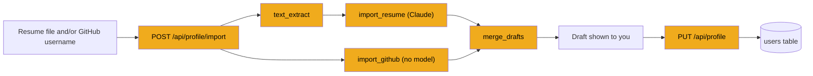

# Stage 7: Resume and profile

> **Goal:** Let the user drop in a resume (and, if they like, a GitHub username), have Claude turn it into a profile draft, and save the profile once they've checked it.
>
> **By the end you will have:** text extraction for PDF, Word and plain-text files, bookkeeping for the user's own ("base") resume, default answers for common application-form questions, three importers (resume through Claude, GitHub without a model, and a merger that combines them), and the `/api/profile` endpoints to read, update and import a profile.

## Where this fits

JobBee can only judge jobs once it knows who you are. This stage builds the profile: the first real use of the Claude door from stage 6.



## New ideas in plain words

**Uploading a file over HTTP (multipart).** So far every request body has been JSON. A file can't travel well as JSON, so browsers send uploads as `multipart/form-data`. The body is split into *parts*, each with a name. A part is either a plain form field (`github_username=lin`) or a file (a filename, a content type such as `application/pdf`, and the raw bytes). In FastAPI you declare each part as a parameter: `Form(...)` for a field, `File(...)` for a file. A file arrives as an `UploadFile`, which has `.filename`, `.content_type`, and `await .read()` to get the bytes. FastAPI needs the `python-multipart` package to read these bodies. It's already in your `pyproject.toml` from stage 1.

**Text extraction.** Claude reads text, not files. Before the resume can go to Claude, the bytes must become plain text:

| File type | How the text comes out |
|---|---|
| PDF | `pypdf` reads the text layer of each page. A scanned PDF is only pictures of pages, so it has no text layer and gives an empty result. |
| Word (`.docx`) | A `.docx` file is a zip of XML files. `python-docx` reads its paragraphs and table cells. |
| Plain text (`.txt`, `.md`) | The bytes are *decoded*: turned into characters using an *encoding*, the rule for which bytes mean which letters. |

**Base and tailored documents.** Your *base* resume is the one you uploaded, your own words. A *tailored* resume is a copy rewritten for one job (stage 10). Both live in the `documents` table from stage 3, told apart by `is_base`. You have at most one base resume. Replacing it must never touch the tailored copies, because those belong to specific applications.

**Drafts you review.** Claude's reading of your resume is a suggestion, not a fact. The import endpoint returns a *draft* and saves nothing to your profile. You check and edit the draft in the welcome flow (stage 25), and only then does a second request (`PUT /api/profile`) save it. The response also says which source each field came from ("resume" or "github"), so a screen could show where every value came from.

**One local user.** The database is designed for many users (every table has a `user_id`), but JobBee runs on your PC and never asks anyone to sign in. So "the user" is always the first row of the `users` table, created the first time anyone asks for it.

**Partial updates.** `PUT /api/profile` accepts any subset of the profile fields. You met `model_dump(exclude_unset=True)` in stage 6: it returns only the fields the client actually sent, so fields you leave out keep their saved values.

**JSON columns.** `users.application_defaults` is a JSON column (stage 3): one database cell holding a whole dict. SQLAlchemy only notices a change to such a cell when you assign a new object to the attribute. Changing the dict in place (`user.application_defaults["phone"] = ...`) goes unnoticed, and nothing is saved. That's why the code below copies the dict, changes the copy, and assigns the copy back.

**Async code, again.** The importers and the import endpoint are `async def`, because they wait on Claude and on GitHub. Keep reading `await` as "wait for this without blocking the server". The GitHub importer also uses `httpx.AsyncClient` to download data. Stage 8 explains both properly.

**HTTP status codes used here.** The import endpoint answers with a few error codes, each with a meaning the browser and the frontend understand:

| Code | Meaning | When JobBee sends it |
|---|---|---|
| 400 | Bad request | Neither a file nor a username, or an empty file |
| 413 | Too large | The file is over 10 MB |
| 415 | Unsupported media type | A file type JobBee can't read |
| 422 | Unprocessable | A file with no text in it, such as a scanned PDF |

**Logging.** `logger = logging.getLogger(__name__)` creates a logger named after the module. `logger.warning(...)` writes a line to the server's console. It's for you, the developer, when something odd happens. The user never sees it.

## Build it, step by step

### Step 1: From file to text, `backend/app/services/text_extract.py`

This file turns uploaded bytes into plain text. It lives in `backend/app/services/`, next to stage 2's `secrets.py`. It is *pure*: it doesn't touch the database or FastAPI. It takes a filename and bytes and returns text, or raises an error. The caller decides what to do with either. Pure code like this is easy to test and to reuse: the documents router in stage 10 uses it too.

- **`UnsupportedDocumentError`** is raised for anything that can't become text. It subclasses `ValueError`. The router turns it into a 415 answer.
- **The extension sets** (`_PDF_EXT`, `_DOCX_EXT`, `_TEXT_EXT`) decide which reader to use. `MIME_BY_EXT` maps each extension to its *MIME type*, the standard name for a file type that browsers and servers use (`application/pdf`).
- **`ExtractResult`** is a small dataclass with the text and the MIME type.
- **`_ext_of(filename)`** returns the lowercased extension with its dot (`"CV.PDF"` gives `".pdf"`), or `""` if there's none.
- **`_extract_pdf(data)`** wraps the bytes in `io.BytesIO`, which makes bytes in memory look like an open file, because `PdfReader` expects a file. A file `pypdf` can't open at all raises `UnsupportedDocumentError`. Then it extracts each page's text. If one page fails (an encrypted or scanned page), it skips that page, so a mostly good PDF still works. Pages are joined with a blank line, and empty ones are dropped.
- **`_extract_docx(data)`** imports `python-docx` inside the function, because the library is slow to import and only this function needs it. It keeps every non-empty paragraph, then adds the text of every table cell. Many resume templates lay out their content in tables, and without this step that text would be lost.
- **`_extract_text(data)`** tries four encodings in turn. `utf-8-sig` is UTF-8 that also strips the invisible *byte order mark* some Windows editors put at the start of a file. `cp1252` is what older Windows programs use. `latin-1` can decode any bytes at all, so in practice the error at the end is never reached.
- **`extract(filename, data)`** picks the reader by extension. A file with no extension is treated as plain text. Anything else raises an error that says which types are accepted.

<!-- code: backend/app/services/text_extract.py -->
**`backend/app/services/text_extract.py`** (whole file, 118 lines)

```python
"""Extract plain text from user-uploaded resumes / cover letters.

Supports `.pdf` (pypdf), `.docx` (python-docx), and plain text (`.txt`, `.md`,
anything else we can decode as UTF-8). Unsupported binary types raise
`UnsupportedDocumentError` so the caller can return a 415.

This module is pure; it doesn't touch the DB or FastAPI. The router decides
where the file is saved and how to surface errors.
"""

from __future__ import annotations

import io
from dataclasses import dataclass

from pypdf import PdfReader
from pypdf.errors import PdfReadError


class UnsupportedDocumentError(ValueError):
    """Raised when a file can't be turned into plain text."""


# (extension lowercased -> canonical mime we report back to the UI)
_PDF_EXT = {".pdf"}
_DOCX_EXT = {".docx"}
_TEXT_EXT = {".txt", ".md", ".markdown", ".rtf"}

MIME_BY_EXT: dict[str, str] = {
    ".pdf": "application/pdf",
    ".docx": "application/vnd.openxmlformats-officedocument.wordprocessingml.document",
    ".txt": "text/plain",
    ".md": "text/markdown",
    ".markdown": "text/markdown",
    ".rtf": "application/rtf",
}


@dataclass
class ExtractResult:
    text: str
    mime_type: str


def _ext_of(filename: str) -> str:
    if "." not in filename:
        return ""
    return "." + filename.rsplit(".", 1)[-1].lower()


def _extract_pdf(data: bytes) -> str:
    try:
        reader = PdfReader(io.BytesIO(data))
    except PdfReadError as e:  # malformed file
        raise UnsupportedDocumentError(f"PDF could not be parsed: {e}") from e
    parts: list[str] = []
    for page in reader.pages:
        try:
            parts.append(page.extract_text() or "")
        except Exception:
            # Some pages (scanned images, encrypted) can fail individually.
            # We swallow per-page failures so a mostly-good PDF still works.
            continue
    return "\n\n".join(p.strip() for p in parts if p.strip())


def _extract_docx(data: bytes) -> str:
    # python-docx is heavy to import; do it lazily so the rest of the API
    # is not delayed at startup.
    from docx import Document as DocxDocument  # type: ignore[import-not-found]

    try:
        doc = DocxDocument(io.BytesIO(data))
    except Exception as e:  # python-docx raises generic exceptions on bad files
        raise UnsupportedDocumentError(f"DOCX could not be parsed: {e}") from e

    paragraphs = [p.text for p in doc.paragraphs if p.text and p.text.strip()]
    for table in doc.tables:
        for row in table.rows:
            for cell in row.cells:
                if cell.text and cell.text.strip():
                    paragraphs.append(cell.text.strip())
    return "\n".join(paragraphs)


def _extract_text(data: bytes) -> str:
    # Try common encodings before giving up; resumes from Word sometimes export
    # as Windows-1252. Strip UTF-8 BOM so LLM prompts stay clean.
    for encoding in ("utf-8-sig", "utf-8", "cp1252", "latin-1"):
        try:
            return data.decode(encoding)
        except UnicodeDecodeError:
            continue
    raise UnsupportedDocumentError("Could not decode file as text.")


def extract(filename: str, data: bytes) -> ExtractResult:
    """Pick the right extractor based on the filename extension.

    Raises `UnsupportedDocumentError` if the extension isn't one we handle or
    the file is malformed beyond repair.
    """

    ext = _ext_of(filename)
    if ext in _PDF_EXT:
        return ExtractResult(text=_extract_pdf(data), mime_type=MIME_BY_EXT[ext])
    if ext in _DOCX_EXT:
        return ExtractResult(text=_extract_docx(data), mime_type=MIME_BY_EXT[ext])
    if ext in _TEXT_EXT or ext == "":
        # Empty extension: assume plain text (e.g. resume.txt renamed).
        return ExtractResult(
            text=_extract_text(data),
            mime_type=MIME_BY_EXT.get(ext, "text/plain"),
        )

    raise UnsupportedDocumentError(
        f"Unsupported file type {ext!r}. Upload .pdf, .docx, .txt, or .md."
    )
```
<!-- /code -->

### Step 2: Base resume bookkeeping, `backend/app/services/documents.py`

This file keeps track of the user's own resume and cover letter in the `documents` table (stage 3). Its main rule, from the docstring: one active base document per kind, and replacing it never touches the tailored copies that belong to applications.

#### Part 1: Small helpers and finding the base resume

- **`safe_filename(name)`** makes a user's filename safe to store on disk. Letters, digits, `.`, `-` and `_` are kept, and everything else becomes `_`. A name like `../../evil` can't escape the uploads folder, and odd characters can't trip up Windows. Leading and trailing dots and underscores are trimmed, an empty result becomes `upload`, and the name is cut to 160 characters.
- **`delete_file_if_present(path_str)`** deletes a stored file if it's there. If the file is already gone or locked, it does nothing: a leftover file on disk is better than a failed request.
- **`get_base_document(session, user_id, kind)`** returns the user's newest base document of one kind (resume or cover letter). The `where` keeps only rows with `is_base` true, so tailored copies are never returned. `.order_by(Document.id.desc()).limit(1)` takes the newest, and `scalar_one_or_none()` gives the row or `None`. The job flow (stage 12) and the home page (stage 22) use it.

<!-- code: backend/app/services/documents.py lines=1-61 -->
**`backend/app/services/documents.py`** (lines 1–61 of 137)

```python
"""Base vs. tailored document bookkeeping.

A user has at most one active *base* document per kind (their own resume /
cover letter). Tailored documents are per-application copies owned by that
application; replacing a base document must never touch them.
"""

from __future__ import annotations

import re
import secrets
import zipfile
from pathlib import Path

from pypdf import PdfReader
from pypdf.errors import PdfReadError
from sqlalchemy import select
from sqlalchemy.orm import Session

from ..db import get_uploads_dir
from ..models import Document, DocumentKind


def safe_filename(name: str) -> str:
    keep = []
    for ch in name:
        if ch.isalnum() or ch in (".", "-", "_"):
            keep.append(ch)
        else:
            keep.append("_")
    cleaned = "".join(keep).strip("._") or "upload"
    return cleaned[:160]


def delete_file_if_present(path_str: str | None) -> None:
    if not path_str:
        return
    p = Path(path_str)
    try:
        if p.is_file():
            p.unlink()
    except OSError:
        # Don't fail the request because the file vanished or is locked;
        # we'll just orphan the bytes.
        pass


def get_base_document(session: Session, user_id: int, kind: DocumentKind) -> Document | None:
    """Newest base document of this kind, ignoring per-application tailored copies."""

    return session.execute(
        select(Document)
        .where(
            Document.user_id == user_id,
            Document.kind == kind,
            Document.is_base.is_(True),
        )
        .order_by(Document.id.desc())
        .limit(1)
    ).scalar_one_or_none()

```
<!-- /code -->

#### Part 2: Page budget and replacing the base resume

**`page_budget(doc)`** answers "how many pages is the user's own resume?". The tailored CV in stage 10 gets the same number of pages. It tries, in order:

1. a PDF: count its pages;
2. a `.docx`: Word saves the page count inside the zip, in `docProps/app.xml`, as `<Pages>2</Pages>`, and a regex reads it;
3. otherwise, estimate from the word count: up to 750 words is one page, more is two.

The answer is always between 1 and 3. Any error while reading the file falls through to the estimate.

**`replace_base_document(...)`** swaps the user's base document of one kind:

1. It finds every existing base document of that kind, deletes its file from disk, and deletes the row. Tailored copies don't match the query (`is_base` is false for them), so they survive.
2. If raw bytes were given, it saves them under `data/uploads/<user_id>/` with a name like `resume_3fa9c1d2e4b5_My_CV.pdf`. `secrets.token_hex(6)` adds 12 random hex characters, so two uploads with the same name never overwrite each other. (This `secrets` is Python's standard module for random tokens, not stage 2's `services/secrets.py`.)
3. It adds a new `Document` row with the extracted text in `content` and the file's path in `file_path`.
4. `session.flush()` sends the INSERT to the database without committing, so `doc.id` gets a value. The docstring says "The caller commits": the caller decides when the whole change is final.

<!-- code: backend/app/services/documents.py lines=62-137 -->
**`backend/app/services/documents.py`** (lines 62–137 of 137)

```python

def page_budget(doc: Document | None) -> int:
    """How many pages the user's own resume runs to; tailored CVs get the same budget.

    Read from the uploaded PDF (or the page count Word saved in a .docx), else
    estimated from the word count.
    """

    path = Path(doc.file_path) if doc is not None and doc.file_path else None
    try:
        if path is not None and path.suffix.lower() == ".pdf":
            return max(1, min(3, len(PdfReader(path).pages)))
        if path is not None and path.suffix.lower() == ".docx":
            with zipfile.ZipFile(path) as archive:
                found = re.search(rb"<Pages>(\d+)</Pages>", archive.read("docProps/app.xml"))
            if found:
                return max(1, min(3, int(found.group(1))))
    except (OSError, KeyError, ValueError, zipfile.BadZipFile, PdfReadError):
        pass
    words = len(((doc.content if doc is not None else None) or "").split())
    return 1 if words <= 750 else 2


def replace_base_document(
    session: Session,
    user_id: int,
    kind: DocumentKind,
    *,
    text: str,
    label: str,
    raw: bytes | None = None,
    filename: str | None = None,
    mime_type: str | None = None,
) -> Document:
    """Swap the user's base document of `kind`, keeping tailored copies intact.

    Saves `raw` under the user's uploads dir when given. The caller commits.
    """

    existing = (
        session.execute(
            select(Document).where(
                Document.user_id == user_id,
                Document.kind == kind,
                Document.is_base.is_(True),
            )
        )
        .scalars()
        .all()
    )
    for old in existing:
        delete_file_if_present(old.file_path)
        session.delete(old)

    saved_path: Path | None = None
    if raw is not None:
        user_uploads = get_uploads_dir() / str(user_id)
        user_uploads.mkdir(parents=True, exist_ok=True)
        unique = secrets.token_hex(6)
        saved_path = user_uploads / f"{kind.value}_{unique}_{safe_filename(filename or 'upload')}"
        saved_path.write_bytes(raw)

    doc = Document(
        user_id=user_id,
        kind=kind,
        label=label,
        content=text,
        file_path=str(saved_path) if saved_path else None,
        original_filename=filename if raw is not None else None,
        mime_type=mime_type,
        byte_size=len(raw) if raw is not None else len(text.encode("utf-8")),
        is_base=True,
    )
    session.add(doc)
    session.flush()
    return doc
```
<!-- /code -->

### Step 3: Default form answers, `backend/app/services/application_defaults.py`

Application forms ask the same questions again and again: "Are you legally authorized to work in Canada?", "Will you require sponsorship?", "How did you hear about us?". This file holds sensible default answers to those questions, and the helpers to recognise a question and pick a matching option.

The answers are stored in the user's `application_defaults` JSON column. They're used later by screening (stage 9), the apply agent's dossier (stage 18) and the saved-answers memory (stage 21). The profile endpoints in Step 9 read and write them.

#### Part 1: The lookup tables

- **`_LABEL_RULES`** maps phrases found in form questions to a *canonical key*, one standard name for the question. A question containing "authorized to work" or "right to work" is the `work_authorization` question, whatever the exact wording. Rules are checked in order, and the first match wins.
- **`WORK_AUTH_PHRASES`** lists, for each stored work-authorization value, the option texts a form might show for it. `yes_no_restrictions` might appear as "Yes, with no restrictions" or plain "Yes".
- **`BINARY_PHRASES`** does the same for yes/no questions.

<!-- code: backend/app/services/application_defaults.py lines=1-51 -->
**`backend/app/services/application_defaults.py`** (lines 1–51 of 191)

```python
"""Canonical application-form answers and label → value matching."""

from __future__ import annotations

import re
from typing import Any

_LABEL_RULES: tuple[tuple[tuple[str, ...], str], ...] = (
    (
        ("legally authorized", "authorized to work", "eligible to work", "right to work"),
        "work_authorization",
    ),
    (
        ("require sponsorship", "need sponsorship", "visa sponsorship", "immigration sponsorship"),
        "requires_sponsorship",
    ),
    (
        ("how did you hear", "where did you hear", "how you heard", "source of referral"),
        "referral_source",
    ),
    (
        ("willing to relocate", "open to relocation", "willing to move"),
        "willing_to_relocate",
    ),
    (
        ("years of experience", "years experience", "total experience"),
        "years_experience",
    ),
    (("phone", "mobile number", "cell phone", "telephone"), "phone"),
)

WORK_AUTH_PHRASES: dict[str, tuple[str, ...]] = {
    "yes_no_restrictions": (
        "Yes, with no restrictions",
        "Yes - I am authorized to work",
        "Yes, I am authorized",
        "Yes",
    ),
    "yes_with_restrictions": (
        "Yes, with restrictions",
        "Yes with restrictions",
    ),
    "no": ("No", "Not authorized"),
}

BINARY_PHRASES: dict[str, tuple[str, ...]] = {
    "yes": ("Yes",),
    "no": ("No",),
}


```
<!-- /code -->

#### Part 2: Reading labels and locations

- **`normalize_label(text)`** removes `*` (the "required" star on many forms), squeezes runs of spaces and newlines into one space, and lowercases. `"Phone  Number *"` becomes `"phone number"`.
- **`fingerprint(label)`** is the normalised label cut to 120 characters. It's the key under which a saved answer is stored, so the same question asked by two companies with the same wording matches.
- **`resolve_canonical_key(label)`** returns the canonical key for a question, or `None`.
- **`infer_country(location)`** guesses the country from a location string. Canada if it mentions Canada or ends in a common province code (`, ON`, `, BC`, `, AB`, `, QC`), the United States if it says so or ends in `, us`, `, usa` or any other two letters (`Austin, TX`). Otherwise `None`.
- **`infer_city_province(location)`** splits `"Toronto, ON"` into `("Toronto", "ON")`. Only the first word of the second part is kept, so `"Toronto, ON M5V"` also gives `"ON"`.

These guesses are deliberately simple. They only fill *defaults* that the user can see and change in Settings (stage 28).

<!-- code: backend/app/services/application_defaults.py lines=52-97 -->
**`backend/app/services/application_defaults.py`** (lines 52–97 of 191)

```python
def normalize_label(text: str) -> str:
    text = re.sub(r"\*", "", text)
    text = re.sub(r"\s+", " ", text).strip().lower()
    return text


def fingerprint(label: str) -> str:
    return normalize_label(label)[:120]


def resolve_canonical_key(label: str) -> str | None:
    low = normalize_label(label)
    if not low:
        return None
    for hints, key in _LABEL_RULES:
        if any(h in low for h in hints):
            return key
    return None


def infer_country(location: str | None) -> str | None:
    if not location:
        return None
    low = location.lower()
    if "canada" in low or ", on" in low or ", bc" in low or ", ab" in low or ", qc" in low:
        return "Canada"
    if "united states" in low or ", us" in low or ", usa" in low:
        return "United States"
    if re.search(r",\s*[a-z]{2}$", low):
        return "United States"
    return None


def infer_city_province(location: str | None) -> tuple[str | None, str | None]:
    if not location:
        return None, None
    parts = [part.strip() for part in location.split(",") if part.strip()]
    if not parts:
        return None, None
    city = parts[0]
    province = parts[1] if len(parts) > 1 else None
    if province:
        province = province.split()[0].strip() or None
    return city, province


```
<!-- /code -->

#### Part 3: Defaults, merging and saved answers

- **`default_application_defaults(location=...)`** returns the starting answers: authorized to work with no restrictions, no sponsorship needed, heard about the job on LinkedIn. With a location, it adds the city, province and country it can infer.
- **`merge_application_defaults(stored, location=...)`** starts from those defaults and lays the user's stored answers on top. A stored value wins when it's a non-empty string. `None` and blank values are skipped, so they never wipe out a default. The `saved_answers` entry is skipped too, because it holds a different kind of data (see the next point). Screening (stage 9) uses this to tell Claude whether the user needs sponsorship, and the apply dossier (stage 18) hands it to the apply agent.
- **`saved_answers(stored)`** returns the user's saved answers to specific questions: a dict from question fingerprint to answer, kept inside `application_defaults` under the key `saved_answers`. When you answer a question the apply agent asks you during a run, stage 21's `answers.py` saves it here, so the next form that asks the same question gets the same answer.

<!-- code: backend/app/services/application_defaults.py lines=98-143 -->
**`backend/app/services/application_defaults.py`** (lines 98–143 of 191)

```python
def default_application_defaults(*, location: str | None = None) -> dict[str, str]:
    defaults: dict[str, str] = {
        "work_authorization": "yes_no_restrictions",
        "requires_sponsorship": "no",
        "referral_source": "LinkedIn Job Posting",
    }
    if location:
        defaults["location"] = location
    city, province = infer_city_province(location)
    if city:
        defaults["city"] = city
    if province:
        defaults["province"] = province
    country = infer_country(location)
    if country:
        defaults["work_country"] = country
        defaults["country"] = country
    return defaults


def merge_application_defaults(
    stored: dict[str, Any] | None,
    *,
    location: str | None = None,
) -> dict[str, str]:
    merged = default_application_defaults(location=location)
    if not stored:
        return merged
    for key, value in stored.items():
        if key == "saved_answers" or value is None:
            continue
        text = str(value).strip()
        if text:
            merged[key] = text
    return merged


def saved_answers(stored: dict[str, Any] | None) -> dict[str, str]:
    if not stored:
        return {}
    raw = stored.get("saved_answers")
    if not isinstance(raw, dict):
        return {}
    return {str(k): str(v) for k, v in raw.items() if v is not None and str(v).strip()}


```
<!-- /code -->

#### Part 4: Picking an answer and matching an option

These three functions go from a question to a choice on the form.

- **`resolve_value(key, defaults=..., saved=..., label=...)`** picks the answer for one question. A saved answer for this exact question (by fingerprint) wins. Then `years_experience` comes from the profile, written without `.0` when it's a whole number. Then a LinkedIn job with no referral source gets "LinkedIn Job Posting". Otherwise the default for the key, or `None`.
- **`answer_candidates(key, canonical_value)`** turns a stored value into the option texts to look for: `yes_no_restrictions` becomes the list from `WORK_AUTH_PHRASES`.
- **`match_option(options, candidates)`** finds which of a dropdown's options to pick. First it looks for an exact match after normalising. Then it accepts an option that contains a candidate, or is contained in one.

In today's JobBee, the apply agent reads the merged defaults and saved answers from its dossier and decides for itself how to fill each field. These matching helpers are kept and tested (see the tests below), but no other file calls them yet.

<!-- code: backend/app/services/application_defaults.py lines=144-191 -->
**`backend/app/services/application_defaults.py`** (lines 144–191 of 191)

```python
def resolve_value(
    key: str,
    *,
    defaults: dict[str, str],
    saved: dict[str, str],
    label: str,
    years_experience: float | None = None,
    job_url: str | None = None,
) -> str | None:
    fp = fingerprint(label)
    if fp in saved:
        return saved[fp]

    raw = defaults.get(key)
    if key == "years_experience" and years_experience is not None:
        if years_experience == int(years_experience):
            return str(int(years_experience))
        return str(years_experience)

    if key == "referral_source" and not raw and job_url and "linkedin.com" in job_url.lower():
        raw = "LinkedIn Job Posting"

    if raw is None or not str(raw).strip():
        return None
    return str(raw).strip()


def answer_candidates(key: str, canonical_value: str) -> list[str]:
    if key == "work_authorization":
        return list(WORK_AUTH_PHRASES.get(canonical_value, (canonical_value,)))
    if key in ("requires_sponsorship", "willing_to_relocate"):
        return list(BINARY_PHRASES.get(canonical_value, (canonical_value,)))
    return [canonical_value]


def match_option(options: list[str], candidates: list[str]) -> str | None:
    norm_opts = [(orig, normalize_label(orig)) for orig in options if orig.strip()]
    for cand in candidates:
        target = normalize_label(cand)
        for orig, opt in norm_opts:
            if opt == target:
                return orig
    for cand in candidates:
        target = normalize_label(cand)
        for orig, opt in norm_opts:
            if target in opt or opt in target:
                return orig
    return None
```
<!-- /code -->

### Step 4: The draft type, `backend/app/importers/base.py`

Create the `backend/app/importers/` folder. An *importer* takes something you point it at (a resume, a GitHub username) and produces a **draft**: a partial profile plus a label saying where it came from.

```text
backend/app/importers/
├── __init__.py   ← Step 8
├── base.py       ← this step
├── github.py     ← Step 5
├── merge.py      ← Step 6
└── resume.py     ← Step 7
```

- **`ImporterError`** means "this importer couldn't produce anything useful". The import endpoint catches it per importer, so one bad source (a typo in the GitHub name) doesn't stop the other (the resume).
- **`Draft`** has a `source` ("github", or "resume (cv.pdf)") and a `data` dict whose keys match the profile fields (`name`, `skills`, `links`...). Using the same names as `ProfileUpdate` (stage 4) means no translation is needed later.
- **`field(default_factory=dict)`** gives each `Draft` its own new dict. A plain `= {}` would share one dict between every draft, a classic Python trap that dataclasses refuse to allow.
- **`Draft.set(key, value)`** stores a value but skips `None`, blank strings and empty lists or dicts. Importers can call `set` with whatever they found, and empty values never reach the draft. That matters for merging: an empty value from one source must not block a real value from another.

<!-- code: backend/app/importers/base.py -->
**`backend/app/importers/base.py`** (whole file, 41 lines)

```python
"""Shared types for the importer pipeline.

A `Draft` is everything an importer can contribute to a profile, plus the
source label we'll show in the review UI ("from resume", "from github",
etc). `data` mirrors `ProfileUpdate` field names so the merge layer doesn't
have to do any translation.

Importers are intentionally async so a future URL importer (or anything that
fans out HTTP) can run alongside the LLM call without blocking the request
loop.
"""

from __future__ import annotations

from dataclasses import dataclass, field
from typing import Any


class ImporterError(RuntimeError):
    """Raised when an importer can't produce any useful data.

    The router catches this and surfaces it to the user without aborting
    other importers; one bad source shouldn't take down the whole import.
    """


@dataclass(slots=True)
class Draft:
    source: str
    data: dict[str, Any] = field(default_factory=dict)

    def set(self, key: str, value: Any) -> None:
        """Set a field but skip empty strings / empty containers / None."""

        if value is None:
            return
        if isinstance(value, str) and not value.strip():
            return
        if isinstance(value, (list, dict)) and len(value) == 0:
            return
        self.data[key] = value
```
<!-- /code -->

### Step 5: The GitHub importer, `backend/app/importers/github.py`

This importer builds a draft from a GitHub username. It uses no model at all, on purpose: GitHub's API already returns structured JSON, and counting languages is plain arithmetic. That keeps it fast, free and predictable. It's a good reminder that not every problem needs Claude.

#### Part 1: Constants and the request helper

- **`GITHUB_API`** is the base address of GitHub's REST API. **`USER_AGENT`** names the program making the requests; GitHub asks every client to send one.
- **`_TOPIC_SKILLS`** is a list of repository *topics* (tags people put on their repos) that count as real skills. Topics are free-form, so only known ones are trusted.
- **`_LANGUAGE_BLOCKLIST`** lists languages GitHub reports that aren't skills worth showing: shell scripts, Dockerfiles, HTML and CSS, Makefiles and so on.
- **`_normalize_lang(name)`** lowercases a name and maps spelling variants together: `JS` becomes `javascript`, `C++` becomes `cpp`, `C#` becomes `csharp`.
- **`_get_json(client, url, token)`** sends one GET request and returns the parsed JSON. The headers ask for GitHub's JSON format and API version. A personal access token, if given, goes in the `Authorization` header and raises GitHub's rate limit. Error statuses become `ImporterError` with a message a person can act on: 404 means the user doesn't exist, and 403 usually means GitHub's limit of anonymous requests per hour was reached.

<!-- code: backend/app/importers/github.py lines=1-81 -->
**`backend/app/importers/github.py`** (lines 1–81 of 167)

```python
"""Pull profile data from GitHub's public REST API.

We avoid an LLM here on purpose -- GitHub's user and repo JSON is already
structured, and deriving skills from `languages_url` is deterministic.
This keeps the importer fast and free.

If the user supplies a personal access token we attach it for higher rate
limits and access to private-repo language stats.
"""

from __future__ import annotations

from collections import Counter
from typing import Any

import httpx

from .base import Draft, ImporterError

GITHUB_API = "https://api.github.com"
USER_AGENT = "JobBee/0.1 (+local-agent)"

# GitHub "topic" tags we recognize as concrete skills. Topic naming is a
# free-form mess otherwise.
_TOPIC_SKILLS = {
    "python", "typescript", "javascript", "rust", "go", "golang", "java",
    "kotlin", "swift", "ruby", "php", "c", "cpp", "csharp", "scala", "elixir",
    "haskell", "react", "nextjs", "vue", "svelte", "angular", "nodejs",
    "django", "flask", "fastapi", "rails", "spring", "express", "graphql",
    "rest", "postgres", "postgresql", "mysql", "sqlite", "redis", "mongodb",
    "kafka", "rabbitmq", "elasticsearch", "kubernetes", "k8s", "docker",
    "terraform", "ansible", "aws", "gcp", "azure", "linux", "ml", "llm",
    "ai", "pytorch", "tensorflow", "playwright", "selenium", "wasm",
}

# Languages we never want to surface as a "skill" because they're config /
# tooling-only. The GitHub language stats include these.
_LANGUAGE_BLOCKLIST = {
    "shell", "dockerfile", "makefile", "html", "css", "scss", "vim script",
    "batchfile", "powershell", "nix", "cmake", "smarty", "jinja",
}


def _normalize_lang(name: str) -> str:
    lower = name.lower().strip()
    if lower in {"javascript", "js"}:
        return "javascript"
    if lower in {"typescript", "ts"}:
        return "typescript"
    if lower in {"c++", "cpp"}:
        return "cpp"
    if lower in {"c#", "csharp"}:
        return "csharp"
    return lower


async def _get_json(
    client: httpx.AsyncClient, url: str, token: str | None
) -> Any:
    headers = {
        "Accept": "application/vnd.github+json",
        "User-Agent": USER_AGENT,
        "X-GitHub-Api-Version": "2022-11-28",
    }
    if token:
        headers["Authorization"] = f"Bearer {token}"
    resp = await client.get(url, headers=headers, follow_redirects=True)
    if resp.status_code == 404:
        raise ImporterError(f"GitHub user not found at {url}.")
    if resp.status_code == 403:
        raise ImporterError(
            "GitHub rate-limited the request. Add a personal access token in"
            " the import form (or wait an hour and try again)."
        )
    if resp.status_code >= 400:
        raise ImporterError(
            f"GitHub returned {resp.status_code} for {url}: {resp.text[:200]}"
        )
    return resp.json()


```
<!-- /code -->

#### Part 2: Building the draft

**`import_github(username, token=...)`** works in three steps:

1. **Fetch.** It cleans the name (`"@lin "` becomes `"lin"`), then opens an `httpx.AsyncClient` with a 15-second timeout and makes two requests: the user's profile, and up to 100 of their own repositories, most recently updated first. `async with` closes the client's connections when the block ends, even on an error.
2. **Profile fields.** The name and location are copied. A short bio (up to 120 characters) becomes the headline, and a longer one becomes the summary. The `links` dict gets the GitHub profile URL, plus the user's website as `portfolio`, with `https://` added if it's missing.
3. **Skills.** Every repository that isn't a *fork* (a copy of someone else's repo) votes for its main language and its known topics. Each vote is worth `1 + stars`, so a popular repo counts more. (The code comment also mentions language bytes, but only stars are used.) A `Counter` adds up the votes, and `most_common(12)` takes the top 12. If there was no long bio, the summary is built from the descriptions of the three most-starred repos, so the review screen has something to show.

<!-- code: backend/app/importers/github.py lines=82-167 -->
**`backend/app/importers/github.py`** (lines 82–167 of 167)

```python
async def import_github(username: str, *, token: str | None = None) -> Draft:
    """Build a profile draft from a GitHub username.

    Sources used:
      - `GET /users/{u}` for bio, blog, location, name, hireable
      - `GET /users/{u}/repos?per_page=100` for top languages, topics, and
        a short summary of the user's most-starred recent work

    Returns an empty `Draft` (with `source="github"`) if the user has no
    public footprint at all.
    """

    username = username.strip().lstrip("@")
    if not username:
        raise ImporterError("GitHub username is empty.")

    async with httpx.AsyncClient(timeout=15.0) as client:
        user = await _get_json(client, f"{GITHUB_API}/users/{username}", token)
        repos: list[dict[str, Any]] = await _get_json(
            client,
            f"{GITHUB_API}/users/{username}/repos?per_page=100&type=owner&sort=updated",
            token,
        )

    draft = Draft(source="github")

    name = (user.get("name") or "").strip()
    draft.set("name", name)

    bio = (user.get("bio") or "").strip()
    if bio:
        # Use bio as headline if it's short, otherwise as summary.
        if len(bio) <= 120:
            draft.set("headline", bio)
        else:
            draft.set("summary", bio)

    location = (user.get("location") or "").strip()
    draft.set("location", location)

    links: dict[str, str] = {"github": user.get("html_url", f"https://github.com/{username}")}
    blog = (user.get("blog") or "").strip()
    if blog:
        url = blog if blog.startswith(("http://", "https://")) else f"https://{blog}"
        links["portfolio"] = url
    draft.set("links", links)

    # Skills from repos: weighted by stars + language bytes when available.
    skill_score: Counter[str] = Counter()
    for r in repos:
        if r.get("fork"):
            continue
        stars = int(r.get("stargazers_count") or 0)
        weight = 1 + stars

        lang = r.get("language")
        if lang:
            normalized = _normalize_lang(lang)
            if normalized not in _LANGUAGE_BLOCKLIST:
                skill_score[normalized] += weight

        for topic in r.get("topics") or []:
            tnorm = _normalize_lang(topic)
            if tnorm in _TOPIC_SKILLS:
                skill_score[tnorm] += weight

    top_skills = [s for s, _ in skill_score.most_common(12)]
    draft.set("skills", top_skills)

    # If we never got a summary from bio, build a short auto-summary from the
    # top non-fork repos so the review UI has *something* to show.
    if "summary" not in draft.data:
        top_repos = sorted(
            (r for r in repos if not r.get("fork") and (r.get("description") or "").strip()),
            key=lambda r: int(r.get("stargazers_count") or 0),
            reverse=True,
        )[:3]
        if top_repos:
            descs = [
                f"{r['name']}: {r['description'].strip()}"
                for r in top_repos
                if r.get("description")
            ]
            draft.set("summary", " | ".join(descs))

    return draft
```
<!-- /code -->

### Step 6: Combining drafts, `backend/app/importers/merge.py`

When you give both a resume and a GitHub name, two drafts come back. `merge_drafts(drafts)` combines them into one. The caller passes the drafts in priority order, highest first. The import endpoint puts the resume first, because a resume you wrote describes you better than repository statistics.

Each field is merged according to its kind:

| Kind | Fields | Rule |
|---|---|---|
| Scalar (one value) | `name`, `email`, `headline`, `location`, `years_experience`, `min_salary`, `summary` | The first draft that has it wins |
| List | `target_roles`, `target_locations`, `work_modes`, `skills` | A union: the higher-priority draft's items first, then new items from the others |
| Dict | `links` | Key by key; the higher-priority value wins on a clash |

A few details:

- **Case-insensitive de-duplication for lists.** The `seen` set holds lowercased strings, so `TypeScript` from the resume and `typescript` from GitHub count as one skill. The first spelling is kept.
- **`MergedDraft.sources`** records, for each field, which draft it came from. For lists and dicts, that's the first draft that added anything. The import endpoint returns it next to the draft. Today's web app doesn't display it, but the tests check it.
- **Unknown keys are ignored.** A field that isn't in any of the three sets can't reach the profile.

<!-- code: backend/app/importers/merge.py -->
**`backend/app/importers/merge.py`** (whole file, 91 lines)

```python
"""Combine multiple `Draft`s into one normalized profile draft.

Strategy:
- Scalar fields (name, headline, email, location, ...) take the first
  non-empty value in the priority order the caller passed in.
- List fields (target_roles, skills, ...) union across drafts, preserving
  the order of the higher-priority draft. The source recorded is the *first*
  draft that contributed any element.
- Dict fields (links) merge key-by-key, higher priority wins on conflict.

The returned `MergedDraft` carries a per-field source map so the UI can
show a "from <source>" pill on each pre-filled input.
"""

from __future__ import annotations

from dataclasses import dataclass, field
from typing import Any

from .base import Draft

_SCALAR_FIELDS = {
    "name",
    "email",
    "headline",
    "location",
    "years_experience",
    "min_salary",
    "summary",
}

_LIST_FIELDS = {
    "target_roles",
    "target_locations",
    "work_modes",
    "skills",
}

_DICT_FIELDS = {"links"}


@dataclass(slots=True)
class MergedDraft:
    data: dict[str, Any] = field(default_factory=dict)
    sources: dict[str, str] = field(default_factory=dict)


def merge_drafts(drafts: list[Draft]) -> MergedDraft:
    """Merge drafts in caller-supplied priority order (highest first)."""

    merged = MergedDraft()

    for draft in drafts:
        for key, value in draft.data.items():
            if key in _SCALAR_FIELDS:
                if key not in merged.data:
                    merged.data[key] = value
                    merged.sources[key] = draft.source
            elif key in _LIST_FIELDS:
                existing: list[Any] = merged.data.get(key, [])
                # Deduplicate case-insensitively for strings; otherwise by value.
                seen = {
                    (item.lower() if isinstance(item, str) else item)
                    for item in existing
                }
                added = False
                for item in value:
                    key_item = item.lower() if isinstance(item, str) else item
                    if key_item in seen:
                        continue
                    existing.append(item)
                    seen.add(key_item)
                    added = True
                if existing:
                    merged.data[key] = existing
                    if added and key not in merged.sources:
                        merged.sources[key] = draft.source
            elif key in _DICT_FIELDS:
                existing_dict: dict[str, Any] = merged.data.get(key, {})
                added_any = False
                for k, v in value.items():
                    if k not in existing_dict and v:
                        existing_dict[k] = v
                        added_any = True
                if existing_dict:
                    merged.data[key] = existing_dict
                    if added_any and key not in merged.sources:
                        merged.sources[key] = draft.source
            # Anything else: ignore — schema mismatch with profile.

    return merged
```
<!-- /code -->

### Step 7: The resume importer, `backend/app/importers/resume.py`

This is where Claude reads your resume. The importer receives plain text (Step 1 already did the extraction), asks the model for a JSON object with the profile fields, checks the answer, and returns a `Draft`. It's built to survive bad answers: a cut-off reply gets one retry, and a partly wrong reply keeps its good fields.

It takes the provider as a parameter (`provider: LLMProvider`) instead of calling `get_llm_provider()` itself. That's what makes it easy to test: the tests pass in a fake provider that returns a fixed string.

#### Part 1: The accepted shape

- **`_MAX_RESUME_CHARS = 20_000`** caps how much resume text is sent. Twenty thousand characters is several pages, more than any normal resume, and the cap keeps a giant file from becoming a giant bill.
- **`_MEANINGFUL_FIELDS`** are the fields that make an answer worth keeping. An answer with only a location isn't enough.
- **`_ResumeFields`** is the strict half of "lenient extraction, strict validation" (stage 6). It's a Pydantic model listing exactly what JobBee accepts from Claude. Every field is optional, because a resume might not have an email or links. `years_experience` must be a number between 0 and 80. Pydantic ignores fields that aren't listed, so anything extra the model invents is dropped.

<!-- code: backend/app/importers/resume.py lines=1-53 -->
**`backend/app/importers/resume.py`** (lines 1–53 of 241)

```python
"""Extract structured profile data from a resume's plain text.

The pipeline:

  1. Caller has already turned the uploaded file into plain text (via
     `app.services.text_extract`).
  2. We hand that text to the configured `LLMProvider` with a JSON-only
     prompt and `response_format={"type": "json_object"}`. The Ollama
     provider translates that to `format: "json"` natively.
  3. We parse + validate the response with `pydantic`, drop any fields the
     model invented, and return a `Draft`.

The prompt is intentionally narrow: we only ask for fields that fit the
profile schema. Anything the LLM hallucinates beyond that is discarded by
the Pydantic validator.

Resilience: truncated or partially invalid JSON still yields whatever fields
we could salvage — the user can fill any gap by hand. We retry once when
the first response looks truncated.
"""

from __future__ import annotations

import logging
from typing import Any

from pydantic import BaseModel, Field, ValidationError

from ..config import get_settings
from ..llm.base import ChatMessage, LLMError, LLMProvider
from ..llm.json_utils import extract_json_object, json_looks_truncated
from .base import Draft, ImporterError

logger = logging.getLogger(__name__)

_MAX_RESUME_CHARS = 20_000
_MEANINGFUL_FIELDS = ("name", "email", "headline", "summary", "skills", "target_roles")


class _ResumeFields(BaseModel):
    """The shape we accept back from the LLM. All fields optional."""

    name: str | None = None
    headline: str | None = None
    email: str | None = None
    location: str | None = None
    years_experience: float | None = Field(default=None, ge=0, le=80)
    summary: str | None = None
    target_roles: list[str] = Field(default_factory=list)
    skills: list[str] = Field(default_factory=list)
    links: dict[str, str] = Field(default_factory=dict)


```
<!-- /code -->

#### Part 2: The prompts

- **`_PROMPT_SYSTEM`** tells Claude its job and the output rules: one minified JSON object (no extra spaces or line breaks), no prose, no code fences, no `<thought>` tags, and a summary under 240 characters. Short output is cheaper and less likely to be cut off.
- **`_PROMPT_USER_TEMPLATE`** shows the exact JSON shape wanted, with a hint for each field, then a few rules ("skills: lowercase, no soft skills"), then the resume text. Showing the shape is the most reliable way to get it back. The doubled braces `{{` and `}}` are how you write a literal `{` or `}` inside a string used with `.format()`. A single `{resume_text}` is the one placeholder that gets filled in.
- **`_RETRY_USER_TEMPLATE`** is a second, stricter prompt used only when the first answer looks cut off. It asks for compact JSON and a shorter summary (160 characters), so the answer fits.

<!-- code: backend/app/importers/resume.py lines=54-93 -->
**`backend/app/importers/resume.py`** (lines 54–93 of 241)

```python
_PROMPT_SYSTEM = (
    "You extract structured candidate-profile data from a resume. "
    "Reply with a single minified JSON object ONLY. No prose, no code fences, "
    "no commentary, and no <thought> tags. Keep summary under 240 characters."
)

_PROMPT_USER_TEMPLATE = """\
Extract these fields from the resume below. Output one JSON object matching this shape (omit fields you can't fill):

{{
  "name": "Full name",
  "headline": "One-line professional title",
  "email": "Primary email if present",
  "location": "City, region/country if present",
  "years_experience": <number>,
  "summary": "<=240 chars: strengths and target next role",
  "target_roles": ["2-4 plausible next job titles"],
  "skills": ["lowercased hard skills only"],
  "links": {{ "linkedin": "...", "github": "...", "portfolio": "..." }}
}}

Rules:
- skills: lowercase, deduplicated, no soft skills.
- target_roles: title-cased, search-friendly.
- Output ONLY the JSON object. Do not wrap it in markdown or thinking tags.

Resume:
{resume_text}
"""

_RETRY_USER_TEMPLATE = """\
The previous response was truncated. Return ONLY a compact JSON object (no extra whitespace) with as many of these fields as you can fit:

{{"name":"","headline":"","email":"","location":"","years_experience":0,"summary":"","target_roles":[],"skills":[],"links":{{}}}}

Keep summary <=160 characters. Resume:
{resume_text}
"""


```
<!-- /code -->

#### Part 3: Field-by-field validation and helpers

**`_fields_from_parsed(parsed)`** validates the dict from Claude. It first tries the whole dict at once. If that fails, it doesn't throw everything away. It logs a warning, then checks each known field on its own (`_ResumeFields.model_validate({key: value})`) and keeps only the fields that pass. So `{"name": "Lin", "years_experience": "not-a-number"}` still gives you the name. One bad field costs one field, not the whole import.

The other helpers:

- **`_has_meaningful_fields(parsed)`** is true if at least one meaningful field holds a non-blank string or a non-empty list.
- **`_parse_llm_content(content)`** calls stage 6's `extract_json_object` and tells its salvage step which fields to look for in a broken answer.
- **`_draft_from_fields(fields, source=...)`** copies the validated fields into a `Draft`. Roles are trimmed. Skills are trimmed and lowercased. Both are de-duplicated without caring about case, keeping the first spelling, by `_dedupe_preserve_order` at the bottom of the file. Links with empty values are dropped. Because it goes through `Draft.set`, empty fields never enter the draft.

<!-- code: backend/app/importers/resume.py lines=94-154 -->
**`backend/app/importers/resume.py`** (lines 94–154 of 241)

```python
def _fields_from_parsed(parsed: dict[str, Any]) -> _ResumeFields:
    try:
        return _ResumeFields.model_validate(parsed)
    except ValidationError as e:
        logger.warning("Resume LLM returned partially invalid JSON: %s", e)
        safe: dict[str, Any] = {}
        for key, value in parsed.items():
            if key not in _ResumeFields.model_fields:
                continue
            try:
                _ResumeFields.model_validate({key: value})
                safe[key] = value
            except ValidationError:
                continue
        return _ResumeFields.model_validate(safe)


def _has_meaningful_fields(parsed: dict[str, Any]) -> bool:
    for key in _MEANINGFUL_FIELDS:
        value = parsed.get(key)
        if isinstance(value, str) and value.strip():
            return True
        if isinstance(value, list) and any(str(v).strip() for v in value):
            return True
    return False


def _parse_llm_content(content: str) -> dict[str, Any] | None:
    return extract_json_object(
        content,
        string_fields=(
            "name",
            "headline",
            "email",
            "location",
            "summary",
        ),
        list_fields=("target_roles", "skills"),
    )


def _draft_from_fields(fields: _ResumeFields, *, source: str) -> Draft:
    draft = Draft(source=source)
    draft.set("name", fields.name)
    draft.set("headline", fields.headline)
    draft.set("email", fields.email)
    draft.set("location", fields.location)
    draft.set("years_experience", fields.years_experience)
    draft.set("summary", fields.summary)
    draft.set(
        "target_roles",
        _dedupe_preserve_order([r.strip() for r in fields.target_roles if r.strip()]),
    )
    draft.set(
        "skills",
        _dedupe_preserve_order([s.strip().lower() for s in fields.skills if s.strip()]),
    )
    draft.set("links", {k: v for k, v in fields.links.items() if v})
    return draft


```
<!-- /code -->

#### Part 4: The import, with one retry

**`import_resume(text, provider=..., label=...)`** runs the whole thing:

1. **Check the input.** Empty text raises `ImporterError`. Text over the cap is cut.
2. **First call.** It sends the system prompt and the filled-in template with `response_format={"type": "json_object"}` (so the Claude provider adds its JSON instruction, and Ollama forces JSON) and `thinking=False` (effort `low`: reading a resume is extraction, not deep reasoning). It uses the long timeout from settings, because local models can be slow on a long resume. An `LLMError` from the provider becomes an `ImporterError`.
3. **Parse.** `_parse_llm_content` finds the JSON.
4. **Retry once if it looks cut off.** If the parse found nothing meaningful *and* the text doesn't end with `}`, it asks again with the compact retry prompt and a larger `max_tokens` (8192). If the retry fails with an `LLMError`, that's only logged, and the first answer stands. The retry's answer is used only if it's better.
5. **Give up clearly.** If there's still nothing meaningful, it raises an `ImporterError` that suggests another model or filling the form by hand.
6. **Validate and build.** A still-truncated answer gets a log line saying how many fields were salvaged. Then `_fields_from_parsed` validates field by field, and `_draft_from_fields` builds the draft.

Notice what's missing: no `llm_task("import")` here. The importer doesn't know or care which model runs it. The *endpoint* that calls it sets the label (Step 9), so the Claude provider picks `import_model`, Haiku by default.

<!-- code: backend/app/importers/resume.py lines=155-241 -->
**`backend/app/importers/resume.py`** (lines 155–241 of 241)

```python
async def import_resume(
    text: str,
    *,
    provider: LLMProvider,
    label: str = "resume",
) -> Draft:
    """Run the LLM extraction and return a `Draft` sourced from the resume."""

    text = (text or "").strip()
    if not text:
        raise ImporterError("Resume is empty after text extraction.")
    if len(text) > _MAX_RESUME_CHARS:
        text = text[:_MAX_RESUME_CHARS]

    settings = get_settings()
    messages = [
        ChatMessage(role="system", content=_PROMPT_SYSTEM),
        ChatMessage(role="user", content=_PROMPT_USER_TEMPLATE.format(resume_text=text)),
    ]

    try:
        resp = await provider.chat(
            messages,
            temperature=0.1,
            max_tokens=4096,
            response_format={"type": "json_object"},
            thinking=False,
            timeout_s=settings.llm_long_timeout_s,
        )
    except LLMError as e:
        raise ImporterError(f"LLM extraction failed: {e}") from e

    content = resp.content or ""
    parsed = _parse_llm_content(content)

    if (not parsed or not _has_meaningful_fields(parsed)) and json_looks_truncated(content):
        logger.info("Resume LLM output looks truncated; retrying with compact JSON prompt.")
        try:
            retry = await provider.chat(
                [
                    ChatMessage(role="system", content=_PROMPT_SYSTEM),
                    ChatMessage(
                        role="user",
                        content=_RETRY_USER_TEMPLATE.format(resume_text=text),
                    ),
                ],
                temperature=0.0,
                max_tokens=8192,
                response_format={"type": "json_object"},
                thinking=False,
                timeout_s=settings.llm_long_timeout_s,
            )
        except LLMError as e:
            logger.warning("Resume LLM retry failed: %s", e)
        else:
            retry_parsed = _parse_llm_content(retry.content or "")
            if retry_parsed and _has_meaningful_fields(retry_parsed):
                parsed = retry_parsed
                content = retry.content or content

    if not parsed or not _has_meaningful_fields(parsed):
        logger.warning("Resume LLM returned non-JSON: %r", content[:300])
        raise ImporterError(
            "The model didn't return JSON we could parse. "
            "Try a different model in Settings, or fill the profile manually."
        )

    if json_looks_truncated(content):
        logger.warning(
            "Resume LLM JSON looks truncated; salvaged %d field(s) from partial output.",
            len(parsed),
        )

    fields = _fields_from_parsed(parsed)
    return _draft_from_fields(fields, source=label)


def _dedupe_preserve_order(items: list[str]) -> list[str]:
    seen: set[str] = set()
    out: list[str] = []
    for item in items:
        key = item.lower()
        if key in seen:
            continue
        seen.add(key)
        out.append(item)
    return out
```
<!-- /code -->

### Step 8: The importers package, `backend/app/importers/__init__.py`

The package's front door, like `llm/__init__.py` in stage 6. It re-exports the five names the endpoint needs, so it can write `from ..importers import import_resume, merge_drafts`. The docstring states the package's promise: importers never save anything to the database. Saving is the job of `PUT /api/profile`, after you've reviewed the draft.

<!-- code: backend/app/importers/__init__.py -->
**`backend/app/importers/__init__.py`** (whole file, 24 lines)

```python
"""Profile importers.

Each importer takes some user-supplied pointer (a resume file, a GitHub
username, eventually a URL) and produces a `Draft` -- a partial profile plus
a per-field source label. `merge.merge_drafts()` combines drafts with a
priority order and returns one normalized draft for the UI to review.

Importers never persist to the DB; the `/api/profile/import` endpoint
returns the draft so the user can edit before committing via
`PUT /api/profile`.
"""

from .base import Draft, ImporterError
from .github import import_github
from .merge import merge_drafts
from .resume import import_resume

__all__ = [
    "Draft",
    "ImporterError",
    "import_github",
    "import_resume",
    "merge_drafts",
]
```
<!-- /code -->

### Step 9: The profile endpoints, `backend/app/api/profile.py`

This router ties the stage together. It has three endpoints:

| Endpoint | What it does |
|---|---|
| `GET /api/profile` | Returns your profile, creating the user row the first time |
| `PUT /api/profile` | Saves the fields you send and leaves the rest alone |
| `POST /api/profile/import` | Reads a resume and/or a GitHub profile and returns a draft, without saving it to your profile |

It also defines `get_or_create_local_user`, which most later routers import.

#### Part 1: Imports and constants

- **`router = APIRouter(prefix="/profile", ...)`** puts every endpoint here under `/profile`. With `main.py`'s `/api` prefix, that's `/api/profile`.
- **`_MAX_BYTES`** is 10 MB, the largest resume accepted.
- **`_COMPLETION_FIELDS`** are the fields that make a profile usable for a job search: a name, a headline, target roles and work modes.

<!-- code: backend/app/api/profile.py lines=1-51 -->
**`backend/app/api/profile.py`** (lines 1–51 of 285)

```python
"""Single-user profile endpoints.

`GET /api/profile` returns (and lazily creates) the local user's profile.
`PUT /api/profile` does a partial update; passing `mark_onboarded=true` stamps
`onboarded_at` so the UI knows to stop showing the wizard.
`POST /api/profile/import` runs the resume + GitHub importers and returns a
draft for the review screen (without persisting it).

We model multi-user in the schema (per `docs/architecture.md`) but JobBee only
runs locally and we never sign anyone in, so "the local user" is always
`users.id == 1`. If the row doesn't exist yet, we create it on the first GET.
"""

from __future__ import annotations

import logging
from datetime import datetime, timezone

from fastapi import APIRouter, Depends, File, Form, HTTPException, UploadFile
from sqlalchemy import select
from sqlalchemy.orm import Session

from ..db import get_session
from ..importers import ImporterError, import_github, import_resume, merge_drafts
from ..llm.factory import get_llm_provider
from ..llm.usage import llm_task
from ..models import DocumentKind, User
from ..schemas import (
    ApplicationDefaults,
    ProfileDraft,
    ProfileImportResponse,
    ProfileResponse,
    ProfileUpdate,
)
from ..services.application_defaults import merge_application_defaults
from ..services.documents import replace_base_document
from ..services.text_extract import UnsupportedDocumentError, extract

logger = logging.getLogger(__name__)

router = APIRouter(prefix="/profile", tags=["profile"])

# Same cap as the documents router; we save the resume the user dropped so
# they don't have to upload it again before applying.
_MAX_BYTES = 10 * 1024 * 1024


# Fields whose presence (non-empty / non-default) signals a usable profile.
_COMPLETION_FIELDS = ("name", "headline", "target_roles", "work_modes")


```
<!-- /code -->

#### Part 2: Building responses and finding the user

- **`_application_defaults_response(user)`** builds the `ApplicationDefaults` part of the response. It shows the merged answers (stored values laid over the defaults from Step 3), so the user sees what JobBee *would* answer, even for questions they never filled in. It also copies the saved answers, as strings.
- **`_to_response(user)`** turns the `User` row into a `ProfileResponse` (stage 4). `list(...)` and `dict(...)` make plain copies of the JSON columns, and `or []` turns a missing value into an empty list.
- **`_is_complete(user)`** says whether the profile is usable. A user who finished onboarding is complete. Otherwise every field in `_COMPLETION_FIELDS` must be filled. (The web app decides whether to show the welcome flow from `onboarded_at`, through the setup status in stage 22, so `is_complete` is extra information.)
- **`get_or_create_local_user(session)`** returns the single local user: the row with the lowest `id`. If the table is empty, it creates a user with an empty name, commits, and `refresh`es it to load the new `id` from the database. Many routers in later stages import this function instead of repeating the logic.

<!-- code: backend/app/api/profile.py lines=52-125 -->
**`backend/app/api/profile.py`** (lines 52–125 of 285)

```python
def _application_defaults_response(user: User) -> ApplicationDefaults:
    merged = merge_application_defaults(user.application_defaults, location=user.location)
    stored = dict(user.application_defaults or {})
    saved = stored.get("saved_answers")
    saved_answers = saved if isinstance(saved, dict) else {}
    return ApplicationDefaults(
        phone=merged.get("phone") or stored.get("phone"),
        phone_extension=merged.get("phone_extension") or stored.get("phone_extension"),
        phone_device_type=merged.get("phone_device_type") or stored.get("phone_device_type"),
        country_phone_code=merged.get("country_phone_code") or stored.get("country_phone_code"),
        address_line1=merged.get("address_line1") or stored.get("address_line1"),
        address_line2=merged.get("address_line2") or stored.get("address_line2"),
        city=merged.get("city") or stored.get("city"),
        province=merged.get("province") or stored.get("province"),
        postal_code=merged.get("postal_code") or stored.get("postal_code"),
        country=merged.get("country") or stored.get("country"),
        work_country=merged.get("work_country") or stored.get("work_country"),
        work_authorization=merged.get("work_authorization"),  # type: ignore[arg-type]
        requires_sponsorship=merged.get("requires_sponsorship"),  # type: ignore[arg-type]
        referral_source=merged.get("referral_source") or stored.get("referral_source"),
        willing_to_relocate=merged.get("willing_to_relocate") or stored.get("willing_to_relocate"),  # type: ignore[arg-type]
        saved_answers={str(k): str(v) for k, v in saved_answers.items()},
    )


def _to_response(user: User) -> ProfileResponse:
    return ProfileResponse(
        id=user.id,
        name=user.name,
        email=user.email,
        headline=user.headline,
        location=user.location,
        years_experience=user.years_experience,
        min_salary=user.min_salary,
        summary=user.summary,
        target_roles=list(user.target_roles or []),
        target_locations=list(user.target_locations or []),
        work_modes=list(user.work_modes or []),
        skills=list(user.skills or []),
        links=dict(user.links or {}),
        application_defaults=_application_defaults_response(user),
        approval_top_n=user.approval_top_n,
        onboarded_at=user.onboarded_at,
        is_complete=_is_complete(user),
    )


def _is_complete(user: User) -> bool:
    if user.onboarded_at is not None:
        return True
    # Soft completion: enough fields filled that the agent could realistically search.
    for field in _COMPLETION_FIELDS:
        value = getattr(user, field, None)
        if value is None:
            return False
        if isinstance(value, str) and not value.strip():
            return False
        if isinstance(value, (list, dict)) and len(value) == 0:
            return False
    return True


def get_or_create_local_user(session: Session) -> User:
    """Return the single local-user row, creating it on first call."""

    user = session.execute(select(User).order_by(User.id).limit(1)).scalar_one_or_none()
    if user is None:
        user = User(name="")
        session.add(user)
        session.commit()
        session.refresh(user)
    return user


```
<!-- /code -->

#### Part 3: Reading and updating the profile

**`GET /api/profile`** gets (or creates) the user and returns the response. `session: Session = Depends(get_session)` asks FastAPI for a database session from stage 3's `get_session` dependency.

**`PUT /api/profile`** is a partial update:

1. `payload.model_dump(exclude_unset=True)` keeps only the fields the client sent. Pydantic has already checked their types and limits (a `work_modes` value of `"telepathy"` gets a 422 before this code runs).
2. Two keys need special handling, so they're `pop`ped out of `data` first: `mark_onboarded` and `application_defaults`.
3. Every other field is copied onto the user with `setattr(user, field, value)`, which is `user.<field> = value` with the field name in a variable.
4. **Application defaults are merged, not replaced.** The code copies the stored dict (`dict(...)`), applies the patch key by key, and assigns the copy back to `user.application_defaults`. A value of `None` deletes that key. Saved answers are merged into the existing ones, and empty answers are skipped. The copy-then-assign pattern is what makes SQLAlchemy notice the change to the JSON column.
5. `mark_onboarded: true` stamps `onboarded_at` with the current time. `false` clears it. Leaving it out changes nothing.
6. Commit, refresh, and return the new profile.

<!-- code: backend/app/api/profile.py lines=126-169 -->
**`backend/app/api/profile.py`** (lines 126–169 of 285)

```python
@router.get("", response_model=ProfileResponse)
def read_profile(session: Session = Depends(get_session)) -> ProfileResponse:
    user = get_or_create_local_user(session)
    return _to_response(user)


@router.put("", response_model=ProfileResponse)
def update_profile(
    payload: ProfileUpdate,
    session: Session = Depends(get_session),
) -> ProfileResponse:
    user = get_or_create_local_user(session)
    data = payload.model_dump(exclude_unset=True)

    mark_onboarded = data.pop("mark_onboarded", None)
    app_defaults_patch = data.pop("application_defaults", None)

    for field, value in data.items():
        setattr(user, field, value)

    if app_defaults_patch is not None:
        existing = dict(user.application_defaults or {})
        saved_patch = app_defaults_patch.pop("saved_answers", None)
        for key, value in app_defaults_patch.items():
            if value is None:
                existing.pop(key, None)
            else:
                existing[key] = value
        if saved_patch is not None:
            saved = dict(existing.get("saved_answers") or {})
            saved.update({str(k): str(v) for k, v in saved_patch.items() if v})
            existing["saved_answers"] = saved
        user.application_defaults = existing

    if mark_onboarded:
        user.onboarded_at = datetime.now(timezone.utc)
    elif mark_onboarded is False:
        user.onboarded_at = None

    session.commit()
    session.refresh(user)
    return _to_response(user)


```
<!-- /code -->

#### Part 4: The import endpoint

**`POST /api/profile/import`** runs the importers and returns a draft. It's `async def` because it waits on Claude and on GitHub. Its parameters are multipart parts: two form fields and one optional file.

1. **At least one source.** Without a file or a username, it answers 400.
2. **The resume.** `await resume_file.read()` gets the bytes. An empty file is a 400, and one over 10 MB a 413. `extract` turns the bytes into text, and an unsupported type becomes a 415. No text at all (a scanned PDF) is a 422 that suggests pasting the text instead.
3. **Save the file first.** `replace_base_document` stores the resume as the new base document, and the session commits straight away. The file is kept even if Claude fails, so you don't have to upload it again before applying. This is the only thing the endpoint saves.
4. **Read it with Claude.** `get_llm_provider()` (stage 6) gets the provider, and `with llm_task("import"):` labels the call, so the Claude provider uses `import_model` and the ledger records the cost as `import`. An `ImporterError` becomes a *warning* in the response, not an error: the request still succeeds, and the GitHub draft (if any) still comes back.
5. **GitHub.** The same pattern, with no label because there's no model call.
6. **Merge and check.** `merge_drafts` combines the drafts, resume first. `ProfileDraft.model_validate(...)` checks the merged result against the draft schema. If that ever failed, it would be a bug in JobBee, so the answer is a 500.
7. **Answer.** The response holds the draft, the per-field sources, the new document's `id` and any warnings. **The `User` row is not touched.** Your profile only changes when the frontend sends `PUT /api/profile` after you've reviewed the draft.

<!-- code: backend/app/api/profile.py lines=170-285 -->
**`backend/app/api/profile.py`** (lines 170–285 of 285)

```python
@router.post("/import", response_model=ProfileImportResponse)
async def import_profile(
    github_username: str | None = Form(default=None),
    github_token: str | None = Form(default=None),
    resume_file: UploadFile | None = File(default=None),
    session: Session = Depends(get_session),
) -> ProfileImportResponse:
    """Run the resume + GitHub importers and return a non-persisted draft.

    At least one of `resume_file` / `github_username` must be provided. We
    persist the resume `Document` as a side effect (so the user keeps the
    bytes for later applications), but we deliberately do NOT touch the
    `User` profile row -- that happens only when the user clicks Confirm
    in the review screen, via `PUT /api/profile`.
    """

    if resume_file is None and not (github_username or "").strip():
        raise HTTPException(
            status_code=400,
            detail="Provide at least one of: resume_file, github_username.",
        )

    user = get_or_create_local_user(session)
    drafts = []  # priority order: highest first
    warnings: list[str] = []
    document_id: int | None = None

    # --- 1. Resume (LLM) ---
    if resume_file is not None:
        raw = await resume_file.read()
        if not raw:
            raise HTTPException(status_code=400, detail="Empty resume file.")
        if len(raw) > _MAX_BYTES:
            raise HTTPException(
                status_code=413,
                detail=f"Resume too large (max {_MAX_BYTES // (1024 * 1024)} MB).",
            )
        filename = resume_file.filename or "resume"
        try:
            extracted = extract(filename, raw)
        except UnsupportedDocumentError as e:
            raise HTTPException(status_code=415, detail=str(e)) from e
        if not extracted.text.strip():
            raise HTTPException(
                status_code=422,
                detail=(
                    "No text could be extracted from the resume. If it's a"
                    " scanned PDF, paste the text into the manual form instead."
                ),
            )

        # Persist the bytes immediately so the user can come back to them.
        doc = replace_base_document(
            session,
            user.id,
            DocumentKind.resume,
            text=extracted.text,
            label=filename,
            raw=raw,
            filename=filename,
            mime_type=resume_file.content_type or extracted.mime_type,
        )
        session.commit()
        document_id = doc.id

        provider = get_llm_provider()
        try:
            with llm_task("import"):
                resume_draft = await import_resume(
                    extracted.text,
                    provider=provider,
                    label=f"resume ({filename})",
                )
            drafts.append(resume_draft)
            if not resume_draft.data:
                warnings.append(
                    "Resume was read but the model did not extract any profile fields. "
                    "Try again or fill the form manually."
                )
        except ImporterError as e:
            warnings.append(f"Resume extraction failed: {e}")
            logger.warning("Resume import failed: %s", e)

    # --- 2. GitHub (no LLM) ---
    if github_username and github_username.strip():
        try:
            gh_draft = await import_github(
                github_username.strip(), token=(github_token or "").strip() or None
            )
            drafts.append(gh_draft)
        except ImporterError as e:
            warnings.append(f"GitHub import failed: {e}")
            logger.warning("GitHub import failed: %s", e)

    if not drafts and not warnings:
        # Both inputs were missing or empty after validation (shouldn't get
        # here because of the guard above, but belt-and-suspenders).
        raise HTTPException(status_code=400, detail="No importers ran.")

    merged = merge_drafts(drafts)

    try:
        draft = ProfileDraft.model_validate(merged.data)
    except Exception as e:  # pragma: no cover - safety net
        logger.exception("ProfileDraft validation failed")
        raise HTTPException(
            status_code=500,
            detail=f"Merged draft failed schema validation: {e}",
        ) from e

    return ProfileImportResponse(
        draft=draft,
        sources=merged.sources,
        document_id=document_id,
        warnings=warnings,
    )
```
<!-- /code -->

### Step 10: Temporary `backend/app/main.py`

Replace `main.py` with this version. The only change since stage 6 is the profile router: one import line (`from .api import profile as profile_router`) and one `app.include_router(profile_router.router, prefix="/api")`. Stage 23 replaces this file with the final one.

<!-- temp: backend/app/main.py -->
```python
"""FastAPI entry point.

Temporary version from stage 7. Stage 23 replaces it with the final file.
"""

from __future__ import annotations

import asyncio
import sys

# Playwright spawns a browser subprocess; uvicorn's default Windows loop cannot do that.
if sys.platform == "win32":
    asyncio.set_event_loop_policy(asyncio.WindowsProactorEventLoopPolicy())

from contextlib import asynccontextmanager

from fastapi import FastAPI
from fastapi.middleware.cors import CORSMiddleware

from . import __version__
from .api import health
from .api import settings as settings_router
from .api import llm
from .api import profile as profile_router
from .config import get_settings
from .db import init_db


@asynccontextmanager
async def lifespan(_: FastAPI):
    init_db()
    yield


def create_app() -> FastAPI:
    settings = get_settings()
    app = FastAPI(
        title="JobBee API",
        version=__version__,
        lifespan=lifespan,
    )

    # In dev the Vite proxy handles same-origin, but allow direct browser calls too.
    app.add_middleware(
        CORSMiddleware,
        allow_origins=["http://localhost:5173", "http://127.0.0.1:5173"]
        if settings.is_dev
        else [],
        allow_credentials=True,
        allow_methods=["*"],
        allow_headers=["*"],
    )

    app.include_router(health.router, prefix="/api")
    app.include_router(settings_router.router, prefix="/api")
    app.include_router(llm.router, prefix="/api")
    app.include_router(profile_router.router, prefix="/api")

    @app.get("/", include_in_schema=False)
    def root() -> dict:
        return {
            "name": "JobBee API",
            "version": __version__,
            "docs": "/docs",
            "health": "/api/health",
        }

    return app


app = create_app()
```
<!-- /temp -->

## Check it works

**1. Run this stage's tests.** From the `backend` folder:

```powershell
.\.venv\Scripts\python.exe -m pytest -q tests/test_importers.py tests/test_profile.py tests/test_profile_import.py tests/test_application_defaults.py
```

On macOS or Linux, use `.venv/bin/python`. You should see `29 passed`.

**2. Try the endpoints by hand.** Start the server (`.\.venv\Scripts\python.exe -m uvicorn app.main:app --reload`) and open http://127.0.0.1:8000/docs.

1. `GET /api/profile`: you get a profile with `"id": 1`, an empty `name` and `"is_complete": false`. The user row was created by this request.
2. `PUT /api/profile` with:

   ```json
   {"name": "Your Name", "headline": "QA Engineer", "target_roles": ["QA Engineer"], "work_modes": ["remote"]}
   ```

   The response shows your fields and `"is_complete": true`. Call `GET` again: the values are saved.
3. `POST /api/profile/import` with only `github_username` filled in (your own, or any public account). No Claude key is needed. You get a `draft` with a name, links and skills, and `"sources": {"name": "github", ...}`. Call `GET /api/profile` again: your saved profile has **not** changed. The draft is only a suggestion.
4. If you saved a Claude key in stage 6: call `POST /api/profile/import` again and pick your resume file in the `resume_file` field. After a few seconds you get a draft filled from your resume, a `document_id`, and an empty `warnings` list. The file is now in `backend/data/uploads/1/`, and the call shows up in the `llm_usage` table with the task `import`.

**What the tests prove.** None of them calls a real model or GitHub.

- **`test_importers.py`** tests each importer on its own.
  - `_StubLLM` is a fake provider: a subclass of stage 6's `LLMProvider` whose `chat` returns a fixed string and remembers what it was sent. Because `import_resume` takes the provider as a parameter, the tests pass the fake straight in.
  - The merge tests check the three rules: first scalar wins, lists are unions with case-insensitive de-duplication, and links merge key by key.
  - The GitHub tests use `httpx.MockTransport`, a fake network layer that answers requests with a function instead of the internet. `monkeypatch.setattr("app.importers.github.httpx.AsyncClient", _patched)` replaces the client class the importer uses with one that always uses the fake transport. The happy path checks that the bio became the headline, the blog got `https://`, and the forked Go repo didn't add `go`. The 404 test checks that an unknown user raises `ImporterError`.
  - The resume tests feed the importer clean JSON, JSON in a code fence, JSON cut off mid-string, JSON inside `<thought>` tags, a reply that gets one retry (`_RetryLLM` answers differently on its second call, and `stub.calls == 2` proves the retry happened), plain refusal text (which must raise `ImporterError`), and a reply with one invalid field (which must keep the other fields).
- **`test_profile.py`** goes through the real endpoints with FastAPI's `TestClient` (stage 4): the user row is created on the first `GET`, `PUT` changes only what you send, `mark_onboarded` stamps a time, application defaults are saved and returned, and an unknown work mode gets a 422.
- **`test_profile_import.py`** tests `POST /api/profile/import` from end to end. Its fixture replaces `get_llm_provider` *inside the profile module* (`monkeypatch.setattr(profile_router, "get_llm_provider", ...)`), because `profile.py` imported the function by name, so that's the name the endpoint looks up. It also fakes GitHub with a mock transport. The tests check the 400 for no input, a resume-only import (with a saved `document_id`), a GitHub-only import (no document), and both together, where the resume's `"Toronto, ON"` beats GitHub's `"Toronto"` and the skills are a union. Files are sent with `files={"resume_file": (name, bytes, content_type)}`, which makes `TestClient` build a multipart body.
- **`test_application_defaults.py`** checks the label rules (the work-authorization, sponsorship and referral questions), the country guesses (`"Toronto, ON"` is Canada, `"Austin, TX"` is the United States), the merged defaults, the fuzzy option match, and that a saved answer beats a default.

<!-- code: backend/tests/test_importers.py collapsed -->
<details>
<summary><code>backend/tests/test_importers.py</code> (whole file, 282 lines)</summary>

````python
"""Unit tests for the importer pipeline.

These cover the per-importer logic; the `/api/profile/import` HTTP route is
exercised in `test_profile_import.py`.
"""

from __future__ import annotations

from typing import Any

import httpx
import pytest

from app.importers import import_github, merge_drafts
from app.importers.base import Draft
from app.importers.resume import import_resume
from app.llm.base import ChatMessage, ChatResponse, LLMProvider


class _StubLLM(LLMProvider):
    """A fake LLMProvider that returns a fixed string for `chat()`."""

    name = "stub"
    default_model = "stub-1"

    def __init__(self, content: str) -> None:
        self.content = content
        self.last_messages: list[ChatMessage] | None = None
        self.last_thinking: bool | None = None

    async def chat(  # type: ignore[override]
        self,
        messages: list[ChatMessage],
        *,
        model: str | None = None,
        temperature: float | None = None,
        max_tokens: int | None = None,
        response_format: dict[str, Any] | None = None,
        thinking: bool | None = None,
        timeout_s: float | None = None,
    ) -> ChatResponse:
        self.last_messages = messages
        self.last_thinking = thinking
        return ChatResponse(
            content=self.content,
            model=model or self.default_model,
            provider=self.name,
            raw={},
        )


# --- merge_drafts -----------------------------------------------------------


def test_merge_scalar_first_non_empty_wins() -> None:
    higher = Draft(source="resume", data={"name": "Lin", "headline": "Engineer"})
    lower = Draft(source="github", data={"name": "Lin Hong", "location": "Toronto"})
    merged = merge_drafts([higher, lower])
    assert merged.data["name"] == "Lin"
    assert merged.sources["name"] == "resume"
    assert merged.data["headline"] == "Engineer"
    assert merged.data["location"] == "Toronto"
    assert merged.sources["location"] == "github"


def test_merge_lists_union_preserving_priority_order() -> None:
    higher = Draft(source="resume", data={"skills": ["python", "TypeScript"]})
    lower = Draft(source="github", data={"skills": ["typescript", "rust", "python"]})
    merged = merge_drafts([higher, lower])
    # Resume's "TypeScript" wins for ordering; "rust" is appended from github;
    # github's "typescript" / "python" are deduped case-insensitively.
    assert merged.data["skills"] == ["python", "TypeScript", "rust"]
    assert merged.sources["skills"] == "resume"


def test_merge_dict_links_merges_with_priority() -> None:
    higher = Draft(source="resume", data={"links": {"linkedin": "u1"}})
    lower = Draft(source="github", data={"links": {"github": "g1", "linkedin": "u2"}})
    merged = merge_drafts([higher, lower])
    assert merged.data["links"] == {"linkedin": "u1", "github": "g1"}


# --- import_github ----------------------------------------------------------


def _mock_transport(routes: dict[str, tuple[int, Any]]) -> httpx.MockTransport:
    def handler(request: httpx.Request) -> httpx.Response:
        key = f"{request.method} {request.url.path}"
        if key not in routes:
            return httpx.Response(404, json={"message": "no mock for " + key})
        status, body = routes[key]
        return httpx.Response(status, json=body)

    return httpx.MockTransport(handler)


@pytest.mark.asyncio
async def test_import_github_happy_path(monkeypatch: pytest.MonkeyPatch) -> None:
    user_body = {
        "login": "lin",
        "name": "Lin Hong",
        "bio": "Senior software engineer",
        "location": "Toronto, ON",
        "blog": "lin.dev",
        "html_url": "https://github.com/lin",
    }
    repos_body = [
        {
            "name": "platform",
            "description": "Internal platform tooling",
            "language": "Python",
            "topics": ["python", "fastapi", "kubernetes"],
            "stargazers_count": 42,
            "fork": False,
        },
        {
            "name": "ui",
            "description": "TS app",
            "language": "TypeScript",
            "topics": ["typescript", "react"],
            "stargazers_count": 10,
            "fork": False,
        },
        {
            "name": "fork-of-something",
            "description": "ignored",
            "language": "Go",
            "topics": [],
            "stargazers_count": 100,
            "fork": True,
        },
    ]
    transport = _mock_transport(
        {
            "GET /users/lin": (200, user_body),
            "GET /users/lin/repos": (200, repos_body),
        }
    )

    real_async_client = httpx.AsyncClient

    def _patched(*args: Any, **kwargs: Any) -> httpx.AsyncClient:
        kwargs["transport"] = transport
        return real_async_client(*args, **kwargs)

    monkeypatch.setattr("app.importers.github.httpx.AsyncClient", _patched)

    draft = await import_github("lin")
    assert draft.source == "github"
    assert draft.data["name"] == "Lin Hong"
    assert draft.data["headline"] == "Senior software engineer"
    assert draft.data["location"] == "Toronto, ON"
    assert draft.data["links"]["github"] == "https://github.com/lin"
    assert draft.data["links"]["portfolio"] == "https://lin.dev"

    skills = draft.data["skills"]
    assert "python" in skills
    assert "typescript" in skills
    assert "fastapi" in skills
    # Fork shouldn't contribute "go".
    assert "go" not in skills
    assert "golang" not in skills


@pytest.mark.asyncio
async def test_import_github_404(monkeypatch: pytest.MonkeyPatch) -> None:
    transport = _mock_transport({})  # everything 404s
    real = httpx.AsyncClient
    monkeypatch.setattr(
        "app.importers.github.httpx.AsyncClient",
        lambda *a, **kw: real(*a, transport=transport, **kw),
    )
    from app.importers.base import ImporterError

    with pytest.raises(ImporterError):
        await import_github("does-not-exist-xyz-42")


# --- import_resume ----------------------------------------------------------


@pytest.mark.asyncio
async def test_import_resume_parses_clean_json() -> None:
    payload = (
        '{"name":"Lin Hong","headline":"Senior software engineer",'
        '"location":"Toronto, ON","years_experience":7,'
        '"summary":"Builds platform tooling and llm-powered agents.",'
        '"target_roles":["Software engineer","Platform engineer"],'
        '"skills":["python","typescript","postgres"],'
        '"links":{"linkedin":"https://www.linkedin.com/in/lin/"}}'
    )
    stub = _StubLLM(payload)
    draft = await import_resume(
        "Lin Hong, senior engineer.", provider=stub, label="resume (lin.pdf)"
    )
    assert draft.source == "resume (lin.pdf)"
    assert draft.data["name"] == "Lin Hong"
    assert draft.data["years_experience"] == 7
    assert draft.data["target_roles"] == ["Software engineer", "Platform engineer"]
    assert draft.data["skills"] == ["python", "typescript", "postgres"]
    assert draft.data["links"]["linkedin"].startswith("https://")
    assert stub.last_thinking is False


@pytest.mark.asyncio
async def test_import_resume_strips_code_fences() -> None:
    fenced = '```json\n{"name":"Lin","skills":["python"]}\n```'
    stub = _StubLLM(fenced)
    draft = await import_resume("Resume text.", provider=stub)
    assert draft.data["name"] == "Lin"
    assert draft.data["skills"] == ["python"]


@pytest.mark.asyncio
async def test_import_resume_recovers_truncated_json() -> None:
    truncated = (
        '{\n  "name": "Linh Hoang",\n  "headline": "Software QA Engineer",\n'
        '  "email": "pelinhoang.ce@gmail.com",\n  "location": "",\n'
        '  "years_experience": 4,\n  "summary": "QA Engineer specializing in Playwright, '
    )
    stub = _StubLLM(truncated)
    draft = await import_resume("Resume text.", provider=stub)
    assert draft.data["name"] == "Linh Hoang"
    assert draft.data["email"] == "pelinhoang.ce@gmail.com"
    assert draft.data["years_experience"] == 4


@pytest.mark.asyncio
async def test_import_resume_recovers_json_inside_thought_tags() -> None:
    payload = (
        '<thought>{"name":"Linh Hoang","email":"lin@example.com","skills":["python"]}</thought>'
    )
    stub = _StubLLM(payload)
    draft = await import_resume("Resume text.", provider=stub)
    assert draft.data["name"] == "Linh Hoang"
    assert draft.data["skills"] == ["python"]


@pytest.mark.asyncio
async def test_import_resume_retries_when_truncated() -> None:
    truncated = '{"location": "Toronto'
    complete = (
        '{"name":"Lin","email":"lin@example.com","summary":"Short summary",'
        '"skills":["python"],"target_roles":["Engineer"]}'
    )

    class _RetryLLM(_StubLLM):
        def __init__(self) -> None:
            super().__init__(truncated)
            self.calls = 0

        async def chat(self, messages, **kwargs):  # type: ignore[override]
            self.calls += 1
            if self.calls == 1:
                return await super().chat(messages, **kwargs)
            self.content = complete
            return await super().chat(messages, **kwargs)

    stub = _RetryLLM()
    draft = await import_resume("Resume text.", provider=stub)
    assert stub.calls == 2
    assert draft.data["skills"] == ["python"]


@pytest.mark.asyncio
async def test_import_resume_rejects_garbage() -> None:
    stub = _StubLLM("sorry I can't help with that")
    from app.importers.base import ImporterError

    with pytest.raises(ImporterError):
        await import_resume("Resume text.", provider=stub)


@pytest.mark.asyncio
async def test_import_resume_recovers_partial_validation() -> None:
    # `years_experience` is bogus -> validator should drop it but keep the rest.
    payload = '{"name":"Lin","years_experience":"not-a-number","skills":["python"]}'
    stub = _StubLLM(payload)
    draft = await import_resume("Resume.", provider=stub)
    assert draft.data["name"] == "Lin"
    assert "years_experience" not in draft.data
    assert draft.data["skills"] == ["python"]
````

</details>
<!-- /code -->

<!-- code: backend/tests/test_profile.py collapsed -->
<details>
<summary><code>backend/tests/test_profile.py</code> (whole file, 94 lines)</summary>

```python
"""Profile round-trip tests."""

from __future__ import annotations

from fastapi.testclient import TestClient

from app.main import app


def test_get_profile_lazy_creates_user() -> None:
    with TestClient(app) as client:
        resp = client.get("/api/profile")
    assert resp.status_code == 200
    body = resp.json()
    assert body["id"] >= 1
    assert isinstance(body["name"], str)
    assert isinstance(body["target_roles"], list)


def test_put_profile_partial_update() -> None:
    with TestClient(app) as client:
        # Seed
        client.get("/api/profile")
        resp = client.put(
            "/api/profile",
            json={
                "name": "Lin",
                "headline": "Senior software engineer",
                "target_roles": ["Software engineer", "Platform engineer"],
                "work_modes": ["remote", "hybrid"],
                "skills": ["python", "typescript"],
                "links": {"linkedin": "https://www.linkedin.com/in/lin/"},
            },
        )
    assert resp.status_code == 200, resp.text
    body = resp.json()
    assert body["name"] == "Lin"
    assert body["headline"] == "Senior software engineer"
    assert body["target_roles"] == ["Software engineer", "Platform engineer"]
    assert body["work_modes"] == ["remote", "hybrid"]
    assert "linkedin" in body["links"]
    assert body["is_complete"] is True


def test_put_profile_mark_onboarded_stamps_timestamp() -> None:
    with TestClient(app) as client:
        client.put("/api/profile", json={"name": "Lin"})
        resp = client.put("/api/profile", json={"mark_onboarded": True})
    assert resp.status_code == 200
    body = resp.json()
    assert body["onboarded_at"] is not None


def test_put_profile_application_defaults() -> None:
    with TestClient(app) as client:
        client.get("/api/profile")
        resp = client.put(
            "/api/profile",
            json={
                "application_defaults": {
                    "phone": "+1 416 555 0100",
                    "phone_device_type": "Mobile",
                    "country_phone_code": "Canada (+1)",
                    "address_line1": "123 Main St",
                    "address_line2": "Unit 4",
                    "city": "Toronto",
                    "province": "ON",
                    "postal_code": "M5V 1A1",
                    "country": "Canada",
                    "work_authorization": "yes_no_restrictions",
                    "requires_sponsorship": "no",
                    "referral_source": "LinkedIn Job Posting",
                },
            },
        )
    assert resp.status_code == 200, resp.text
    body = resp.json()
    assert body["application_defaults"]["phone"] == "+1 416 555 0100"
    assert body["application_defaults"]["phone_device_type"] == "Mobile"
    assert body["application_defaults"]["country_phone_code"] == "Canada (+1)"
    assert body["application_defaults"]["address_line1"] == "123 Main St"
    assert body["application_defaults"]["address_line2"] == "Unit 4"
    assert body["application_defaults"]["city"] == "Toronto"
    assert body["application_defaults"]["province"] == "ON"
    assert body["application_defaults"]["postal_code"] == "M5V 1A1"
    assert body["application_defaults"]["country"] == "Canada"
    assert body["application_defaults"]["requires_sponsorship"] == "no"
    assert body["application_defaults"]["referral_source"] == "LinkedIn Job Posting"


def test_put_profile_rejects_invalid_work_mode() -> None:
    with TestClient(app) as client:
        resp = client.put("/api/profile", json={"work_modes": ["telepathy"]})
    assert resp.status_code == 422
```

</details>
<!-- /code -->

<!-- code: backend/tests/test_profile_import.py collapsed -->
<details>
<summary><code>backend/tests/test_profile_import.py</code> (whole file, 160 lines)</summary>

```python
"""End-to-end test for POST /api/profile/import.

We stub the LLM provider so the resume importer is deterministic, and we
stub `httpx.AsyncClient` in the GitHub importer so it doesn't touch the
network. The actual route logic (file save, merge, response shape) is
exercised for real.
"""

from __future__ import annotations

from typing import Any

import httpx
import pytest
from fastapi.testclient import TestClient

from app.llm.base import ChatMessage, ChatResponse, LLMProvider
from app.main import app


_RESUME_PAYLOAD = (
    '{"name":"Lin Hong",'
    '"headline":"Senior software engineer",'
    '"location":"Toronto, ON",'
    '"years_experience":7,'
    '"summary":"Backend + llm tooling.",'
    '"target_roles":["Software engineer","Platform engineer"],'
    '"skills":["python","typescript","postgres"],'
    '"links":{"linkedin":"https://www.linkedin.com/in/lin/"}}'
)


class _StubLLM(LLMProvider):
    name = "stub"
    default_model = "stub-1"

    async def chat(  # type: ignore[override]
        self,
        messages: list[ChatMessage],
        *,
        model: str | None = None,
        temperature: float | None = None,
        max_tokens: int | None = None,
        response_format: dict[str, Any] | None = None,
        thinking: bool | None = None,
        timeout_s: float | None = None,
    ) -> ChatResponse:
        return ChatResponse(
            content=_RESUME_PAYLOAD,
            model=model or self.default_model,
            provider=self.name,
            raw={},
        )


@pytest.fixture
def stub_llm_and_github(monkeypatch: pytest.MonkeyPatch) -> None:
    # 1) Stub the LLM provider singleton so resume extraction is deterministic.
    import app.api.profile as profile_router

    monkeypatch.setattr(profile_router, "get_llm_provider", lambda: _StubLLM())

    # 2) Stub httpx.AsyncClient inside the github importer.
    def handler(request: httpx.Request) -> httpx.Response:
        path = request.url.path
        if path.endswith("/users/lin"):
            return httpx.Response(
                200,
                json={
                    "login": "lin",
                    "name": "Lin Hong",
                    "bio": "Loves platform work",
                    "location": "Toronto",
                    "blog": "https://lin.dev",
                    "html_url": "https://github.com/lin",
                },
            )
        if path.endswith("/users/lin/repos"):
            return httpx.Response(
                200,
                json=[
                    {
                        "name": "core",
                        "description": "core platform",
                        "language": "Python",
                        "topics": ["python", "fastapi"],
                        "stargazers_count": 5,
                        "fork": False,
                    }
                ],
            )
        return httpx.Response(404, json={"message": "no mock"})

    transport = httpx.MockTransport(handler)
    real = httpx.AsyncClient
    monkeypatch.setattr(
        "app.importers.github.httpx.AsyncClient",
        lambda *a, **kw: real(*a, transport=transport, **kw),
    )


def test_import_requires_at_least_one_source(stub_llm_and_github: None) -> None:
    with TestClient(app) as client:
        resp = client.post("/api/profile/import", data={})
    # No file and no username -> 400.
    assert resp.status_code == 400


def test_import_resume_only(stub_llm_and_github: None) -> None:
    with TestClient(app) as client:
        resp = client.post(
            "/api/profile/import",
            files={"resume_file": ("resume.txt", b"Lin Hong, senior engineer.", "text/plain")},
        )
    assert resp.status_code == 200, resp.text
    body = resp.json()
    assert body["draft"]["name"] == "Lin Hong"
    assert body["draft"]["years_experience"] == 7
    assert body["draft"]["target_roles"] == ["Software engineer", "Platform engineer"]
    assert body["document_id"] is not None
    # Provenance pill should attribute everything to the resume.
    assert body["sources"]["name"].startswith("resume")
    assert body["sources"]["skills"].startswith("resume")
    assert body["warnings"] == []


def test_import_github_only(stub_llm_and_github: None) -> None:
    with TestClient(app) as client:
        resp = client.post(
            "/api/profile/import",
            data={"github_username": "lin"},
        )
    assert resp.status_code == 200, resp.text
    body = resp.json()
    assert body["draft"]["name"] == "Lin Hong"
    assert body["draft"]["location"] == "Toronto"
    assert body["sources"]["name"] == "github"
    assert body["document_id"] is None


def test_import_resume_and_github_resume_wins_scalars(stub_llm_and_github: None) -> None:
    with TestClient(app) as client:
        resp = client.post(
            "/api/profile/import",
            files={"resume_file": ("resume.txt", b"Lin Hong, senior engineer.", "text/plain")},
            data={"github_username": "lin"},
        )
    assert resp.status_code == 200, resp.text
    body = resp.json()

    # Resume's "Toronto, ON" should beat GitHub's "Toronto".
    assert body["draft"]["location"] == "Toronto, ON"
    assert body["sources"]["location"].startswith("resume")
    # GitHub-only fields still come through.
    assert "github" in body["draft"]["links"]
    # Skills should be a union with case-insensitive dedupe.
    skills = body["draft"]["skills"]
    assert "python" in skills
    assert "typescript" in skills
    assert "fastapi" in skills
```

</details>
<!-- /code -->

<!-- code: backend/tests/test_application_defaults.py collapsed -->
<details>
<summary><code>backend/tests/test_application_defaults.py</code> (whole file, 70 lines)</summary>

```python
"""Application defaults matching tests."""

from __future__ import annotations

from app.services.application_defaults import (
    answer_candidates,
    default_application_defaults,
    infer_country,
    match_option,
    merge_application_defaults,
    resolve_canonical_key,
    resolve_value,
)


def test_resolve_canonical_key_work_auth() -> None:
    assert resolve_canonical_key("Are you legally authorized to work in Canada? *") == "work_authorization"


def test_resolve_canonical_key_sponsorship() -> None:
    assert (
        resolve_canonical_key("Do you, now or in the future, require sponsorship to work in Canada?")
        == "requires_sponsorship"
    )


def test_resolve_canonical_key_referral() -> None:
    assert resolve_canonical_key("How did you hear about PocketHealth?") == "referral_source"


def test_infer_country_from_location() -> None:
    assert infer_country("Toronto, ON") == "Canada"
    assert infer_country("Austin, TX") == "United States"


def test_merge_application_defaults_fills_sensible_defaults() -> None:
    merged = merge_application_defaults(None, location="Toronto, ON")
    assert merged["work_authorization"] == "yes_no_restrictions"
    assert merged["requires_sponsorship"] == "no"
    assert merged["work_country"] == "Canada"
    assert merged["country"] == "Canada"
    assert merged["city"] == "Toronto"
    assert merged["province"] == "ON"


def test_match_option_fuzzy() -> None:
    options = ["Yes, with no restrictions", "No"]
    picked = match_option(options, answer_candidates("work_authorization", "yes_no_restrictions"))
    assert picked == "Yes, with no restrictions"


def test_resolve_value_uses_saved_answer() -> None:
    value = resolve_value(
        "referral_source",
        defaults={"referral_source": "Other"},
        saved={"how did you hear about pockethealth?": "LinkedIn Job Posting"},
        label="How did you hear about PocketHealth?",
    )
    assert value == "LinkedIn Job Posting"


def test_resolve_value_linkedin_referral_fallback() -> None:
    value = resolve_value(
        "referral_source",
        defaults={},
        saved={},
        label="How did you hear about us?",
        job_url="https://www.linkedin.com/jobs/view/123",
    )
    assert value == "LinkedIn Job Posting"
```

</details>
<!-- /code -->

<!-- verify: backend | python -m pytest -q tests/test_importers.py tests/test_profile.py tests/test_profile_import.py tests/test_application_defaults.py -->

## Common mistakes

- **Changing a JSON column in place.** `user.application_defaults["phone"] = "..."` changes the dict in memory, but SQLAlchemy doesn't notice, and the commit saves nothing. Copy the dict, change the copy, and assign it back, as `update_profile` does.
- **Dropping `exclude_unset=True`.** Without it, `model_dump()` returns every field, and the ones you didn't send come back as `None`. The loop would then set them all to `None` on the user. That would wipe your saved fields, and here the commit even fails, because `name` may not be `NULL` in the database.
- **Saving the import straight into the profile.** It's tempting to skip the review step. Don't: Claude can misread a resume, and a wrong target role or location would quietly steer every job search afterwards. The import returns a draft; only `PUT /api/profile` saves.
- **Patching the wrong name in tests.** `monkeypatch.setattr("app.llm.factory.get_llm_provider", ...)` has no effect on the import endpoint, because `profile.py` already holds its own reference to the function. Patch the name where it's *used*: `app.api.profile.get_llm_provider`.
- **Uploading a scanned PDF.** It's only pictures, so `pypdf` finds no text and the endpoint answers 422. Export the resume as a real PDF or `.docx` from your word processor.
- **Importing a resume without a Claude key.** As stage 6 showed, the SDK then raises a `TypeError`, not an `LLMError`, so the import fails with a 500 instead of a warning. Save a key first. The GitHub import works without one.

## Recap

- Uploads arrive as multipart form data. FastAPI reads files with `File(...)` into an `UploadFile`, and form fields with `Form(...)`.
- `text_extract.extract` turns PDF, Word and text files into plain text, page by page and cell by cell, without touching the database.
- `replace_base_document` keeps one base resume per user and never touches tailored copies. `page_budget` tells stage 10 how long a tailored CV may be.
- `application_defaults.py` holds default answers to common form questions, merged with what the user stored. Screening, the dossier and saved answers use it later.
- Importers produce `Draft`s. The resume importer asks Claude for JSON, retries once if the answer is cut off, and validates field by field. The GitHub importer uses no model. `merge_drafts` combines them by priority.
- `POST /api/profile/import` saves the uploaded file but returns the profile as a draft. `PUT /api/profile` saves only the fields you send.
- There is one local user, found or created by `get_or_create_local_user`, which later routers reuse.

**Next:** [Stage 8: Reading job postings](08-reading-job-postings.md)
