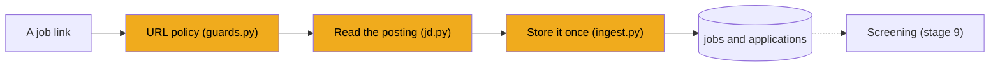
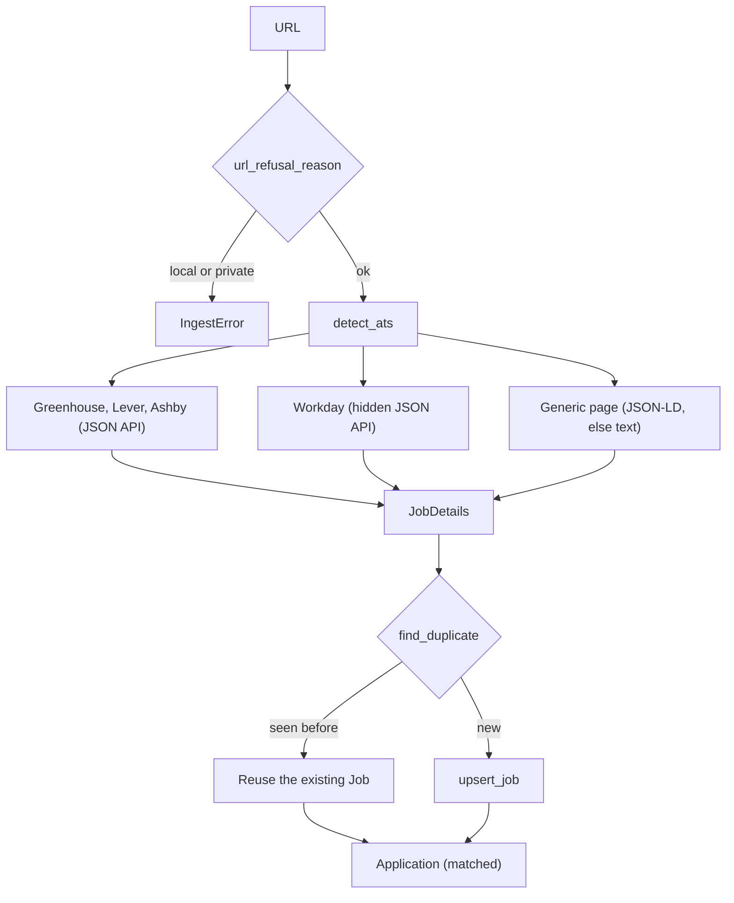

# Stage 8: Reading job postings

> **Goal:** Turn a job link into clean, structured posting details, and store each posting only once.
>
> **By the end you will have:** a `fetch_job_details` function that reads Greenhouse, Lever, Ashby, Workday and ordinary career pages, a URL policy that refuses local and private addresses, and an `ingest_url` function that saves a posting as a `Job` plus an `Application` with status `matched`, without duplicates.

## Where this fits

Every job enters JobBee as a link. You paste it (stage 12), the daily search finds it (stages 14 and 19), or an alert email brings it (stage 13). This stage is the front door: it reads the link and stores what it finds, ready for screening in stage 9.



## New ideas in plain words

**Waiting is most of the work.** Reading a posting means asking a server somewhere else and waiting, often half a second or more, for the answer. For a computer that's a very long time. If the program sits idle during every wait, fetching 40 postings one after another takes 20 seconds or more, and the web server can't answer anyone else in the meantime.

**`async` and `await`.** Stages 6 and 7 asked you to read `await` as "wait without blocking". Here is what that really means. Think of one cook in a kitchen with several pots. The cook puts pasta on to boil and, while the water heats, chops onions for the sauce. The cook never stands staring at a pot. In Python:

- `async def` marks a function that may wait. Calling it doesn't run it. It gives you a *coroutine*: a recipe card, not a meal.
- `await` runs a coroutine and marks the place where it may wait: "the water is heating; go do something else and come back when it boils".
- The **event loop** is the cook. It runs one coroutine until it reaches an `await` on something slow, then switches to another coroutine that's ready to continue. When the slow thing finishes, the first one picks up where it stopped.

Here is a toy example you can run with Python on its own. It isn't part of JobBee:

```python
import asyncio
import time


async def boil(name: str, seconds: float) -> str:
    await asyncio.sleep(seconds)  # a pretend network wait
    return f"{name} done"


async def main() -> None:
    start = time.perf_counter()
    results = await asyncio.gather(boil("pasta", 1), boil("sauce", 1), boil("tea", 1))
    print(results, f"{time.perf_counter() - start:.1f}s")  # about 1.0s, not 3.0s


asyncio.run(main())
```

`asyncio.gather` starts all three and waits for all of them. They wait *at the same time*, so the total is about one second. Four rules to remember:

1. You can only `await` inside an `async def`.
2. Calling an async function without `await` does nothing useful. You get a coroutine object back, and the code inside never runs.
3. `asyncio.run(main())` starts an event loop in a script. FastAPI already runs one, so an `async def` endpoint can `await` directly.
4. Never run slow *blocking* code (such as `time.sleep(5)`, or an HTTP library without async support) inside async code. The cook freezes and every pot boils over. Use async libraries, or move blocking work to a thread (stage 13 shows `asyncio.to_thread`).

**`httpx.AsyncClient`.** `httpx` is an HTTP library with an async client. `resp = await client.get(url)` downloads a page and gives you `resp.status_code` (200 for OK, 404 for not found...), `resp.text` (the body as text), `resp.json()` (the body parsed as JSON) and `resp.url` (the final address, after any redirects). JobBee sets three options on its client:

| Option | Why |
|---|---|
| `timeout=15.0` | Give up after 15 seconds instead of waiting forever on a dead server |
| `follow_redirects=True` | Many job links redirect: an old URL to a new one, or a short link to the full page |
| a `User-Agent` header | Some sites refuse requests that don't say which browser or program they come from |

A client keeps connections open, so later requests to the same site are faster. Close it when you're done, with `await client.aclose()` or by using it in an `async with` block (as stage 7's GitHub importer does).

**HTML pages and JSON APIs.** A normal web page is HTML: text mixed with layout tags, menus, scripts and cookie banners. Pulling the job description out of it is guesswork. Some sites also offer a JSON API: a URL that returns only the data, like `{"title": "Backend Engineer", "content": "..."}`. When an API exists, prefer it.

**ATS.** An *applicant tracking system* is the software a company uses to post jobs and collect applications: Greenhouse, Lever, Ashby, Workday and others. Thousands of companies share each one, so all their postings follow the same URL pattern. Most have a public JSON API, because companies embed their job lists on their own careers pages. JobBee reads postings through those APIs when it can.

**schema.org JSON-LD.** Many career pages hide a small block of JSON inside the HTML, so that Google can show the job in search results:

```html
<script type="application/ld+json">
{"@type": "JobPosting", "title": "Backend Engineer",
 "hiringOrganization": {"name": "Acme"}, "description": "<p>...</p>",
 "datePosted": "2026-10-01", "jobLocationType": "TELECOMMUTE"}
</script>
```

`JobPosting` is a shared vocabulary from schema.org. When a page has it, JobBee gets clean data even from sites it has never seen before.

**URL canonicalisation.** The same posting can arrive under many URLs: with `?utm_source=linkedin` on the end, with a trailing slash, with `#apply`, or with capital letters in the host. *Canonicalising* means rewriting a URL into one standard form, so the same posting always gets the same key.

**Content hash.** A *hash function* turns any text into a short, fixed-length fingerprint, such as `3f9a...` (64 hexadecimal characters for SHA-256). The same text always gives the same fingerprint, and different texts almost never do. JobBee fingerprints the company, the title and the start of the description. If the same posting shows up under a completely different URL, the fingerprints still match.

**Deduplication.** Making sure one real posting becomes one row, however many times and ways it arrives. Without it, you'd screen (and pay for) the same job three times.

**SSRF.** *Server-side request forgery.* JobBee fetches any URL it's handed. If someone could make it fetch `http://localhost:8000/api/...` or `http://192.168.1.1/admin`, your own backend would read private pages that are only reachable from your PC or home network. A program that fetches URLs it didn't choose must refuse local and private addresses. JobBee runs only on your PC, but links also arrive from emails and web search, which you don't control.

**Job and Application.** Two tables from stage 3. A `Job` is the posting itself, shared by everyone. An `Application` is *your* relationship to that posting: its status moves from `matched` ("found, not judged yet") through screening and approval to `submitted`.

## Build it, step by step

### Step 1: Recognise the ATS, `backend/app/apply/ats.py`

This small helper looks at a URL and says which applicant tracking system is behind it. It lives in the `apply/` folder you created in stage 6, because the apply engine uses it too: the apply prompt (stage 18) loads a playbook for each ATS in `KNOWN_ATS`, and the run manager (stage 21) detects the ATS of each job it fills.

- **`urlsplit(url).hostname`** pulls the host out of a URL: `jobs.lever.co`, already lowercased and without the port.
- **`_HOST_SUFFIXES`** pairs a host ending with an ATS name. A tuple of pairs (not a dict) keeps the order, and the first match wins.
- **`host == suffix or host.endswith("." + suffix)`** matches `lever.co` and `jobs.lever.co`, but not `notlever.co`. A plain `endswith("lever.co")` would accept that look-alike.
- **`KNOWN_ATS`** is the set of every name `detect_ats` can return, including `"generic"` for anything unknown. A set comprehension collects the names, and `|` joins two sets.

<!-- code: backend/app/apply/ats.py -->
**`backend/app/apply/ats.py`** (whole file, 26 lines)

```python
"""Recognise the applicant tracking system behind a job URL."""

from __future__ import annotations

from urllib.parse import urlsplit

_HOST_SUFFIXES: tuple[tuple[str, str], ...] = (
    ("myworkdayjobs.com", "workday"),
    ("myworkdaysite.com", "workday"),
    ("workday.com", "workday"),
    ("greenhouse.io", "greenhouse"),
    ("lever.co", "lever"),
    ("ashbyhq.com", "ashby"),
    ("icims.com", "icims"),
    ("linkedin.com", "linkedin_easy_apply"),
)

KNOWN_ATS = {name for _, name in _HOST_SUFFIXES} | {"generic"}


def detect_ats(url: str | None) -> str:
    host = (urlsplit(url or "").hostname or "").lower()
    for suffix, name in _HOST_SUFFIXES:
        if host == suffix or host.endswith("." + suffix):
            return name
    return "generic"
```
<!-- /code -->

### Step 2: The URL policy, `backend/app/apply/guards.py`

`guards.py` holds the apply agent's safety rules: no clicking a final Submit button, no typing passwords or ID numbers, no visiting local addresses. Most of it only makes sense once you know how a browser is driven, so **stage 16 explains the rest of the file**. You type the whole file now, because this stage's `ingest.py` needs one function from it: `url_refusal_reason`. Type it from the collapsed box below, and read only the URL policy for now.

From [`backend/app/apply/guards.py`](../../backend/app/apply/guards.py):
```python
_ALLOWED_SCHEMES = {"http", "https"}
_BLOCKED_HOSTS = {"localhost", "127.0.0.1", "0.0.0.0", "::1", "[::1]"}


def url_refusal_reason(url: str) -> str | None:
    """Why `navigate` must not open this URL, or None if it may."""

    raw = url.strip()
    if raw in {"back", "forward", "reload", "about:blank"}:
        return None
    # Resolve exactly as the driver does: only a scheme-less URL gets https://.
    effective = raw if urlsplit(raw).scheme else f"https://{raw}"
    parts = urlsplit(effective)
    if parts.scheme.lower() not in _ALLOWED_SCHEMES:
        return f"scheme {parts.scheme!r} is not allowed"
    host = (parts.hostname or "").lower()
    if not host:
        return "URL has no host"
    if host in _BLOCKED_HOSTS or host.endswith(".local") or host.endswith(".internal"):
        return "local and internal hosts are not allowed"
    octets = host.split(".")
    if len(octets) == 4 and all(o.isdigit() for o in octets):
        a, b = int(octets[0]), int(octets[1])
        if (
            a in {10, 127, 0}
            or (a == 169 and b == 254)
            or (a == 172 and 16 <= b <= 31)
            or (a == 192 and b == 168)
        ):
            return "private network addresses are not allowed"
    return None
```

This is JobBee's defence against SSRF. It returns a **reason string**, or `None` when the URL may be opened. A reason is more useful than `False`: it can go into a log or an error message.

1. **Browser words pass.** `back`, `forward`, `reload` and `about:blank` are commands for the apply agent's `navigate` tool (stage 17), not addresses. The docstring mentions `navigate` because one rule protects both the link reader and the agent.
2. **A missing scheme gets `https://`**, exactly as the browser driver does, so both see the same address. `jobs.lever.co/acme/1` is checked as `https://jobs.lever.co/acme/1`.
3. **Only `http` and `https`.** `file:///C:/Users/...` would read files from your disk, and `ftp://` is never a job posting.
4. **No host, no visit.**
5. **Local names are refused**: `localhost`, `127.0.0.1`, `0.0.0.0`, the IPv6 loopback `::1`, and any name ending in `.local` or `.internal`.
6. **Private IPv4 ranges are refused.** If the host is four numbers separated by dots, the first two numbers are checked against the private blocks: `10.x.x.x`, `127.x.x.x`, `0.x.x.x`, `172.16.x.x` to `172.31.x.x`, `192.168.x.x`, and `169.254.x.x` (*link-local*, which cloud servers use for their secret metadata service).

The check reads the URL as text. It doesn't look up which address a host name points to, and other spellings of a local address slip through: `http://127.1` means `127.0.0.1` to most programs, but it isn't four numbers, so it passes. Redirects that `httpx` follows aren't checked again either. Stage 29 comes back to this as an idea for improvement.

<!-- code: backend/app/apply/guards.py collapsed -->
<details>
<summary><code>backend/app/apply/guards.py</code> (whole file, 441 lines)</summary>

```python
"""Code-enforced "never submit" guard for the apply agent.

The browser driver runs `CONTROL_PROBE_JS` against the element a click (or a
key press) would hit and passes the facts it returns to
`final_submit_reason()`. A non-empty reason means the action would submit an
application, so the driver refuses it and the human clicks Submit instead.

The rules fail closed for submit-like labels inside application-looking
containers, and stay out of the way for search boxes, login/sign-up forms and
wizard navigation ("Next", "Continue", "Review").
"""

from __future__ import annotations

import re
from typing import TypedDict
from urllib.parse import urlsplit

BLOCKED_SUBMIT_MESSAGE = (
    "Blocked by JobBee: '{label}' looks like the final application submit ({reason}). "
    "JobBee never submits applications; the human does. If every field is filled, call "
    "`finish` with status 'ready_for_review'. If this control is really an intermediate "
    "step (e.g. it saves a page or signs in), call `request_human_action` with "
    "kind 'blocked_click' and explain, and the human will click it."
)


class ControlFacts(TypedDict, total=False):
    """What `CONTROL_PROBE_JS` reports about a target element and its container."""

    found: bool
    tag: str
    type: str
    role: str
    label: str
    is_clickable: bool
    in_form: bool
    container: str  # "form" | "dialog" | "page"
    container_is_search: bool
    container_file_inputs: int
    container_fillable: int
    container_password_inputs: int
    container_textareas: int


# "Submit application", "Send my application", "Complete application" ... never safe.
_STRONG_FINAL_LABEL = re.compile(
    r"""^\s*(?:submit|send|finish|complete|confirm)(?:\s+and)?
        (?:\s+(?:my|your|the|this))?\s+(?:job\s+)?(?:application|applicaton|candidacy)
        (?:\s+now)?\s*[!.]?\s*$""",
    re.IGNORECASE | re.VERBOSE,
)
# Bare "Submit" / "Send" / "Finish" ... final unless the container is a search,
# newsletter or sign-in form.
_WEAK_FINAL_LABEL = re.compile(
    r"^\s*(?:submit|send|finish|complete|confirm)(?:\s+now)?\s*[!.]?\s*$", re.IGNORECASE
)
_APPLY_LABEL = re.compile(r"^\s*(?:apply|apply\s+now|apply\s+for\s+this\s+job)\s*[!.]?\s*$", re.I)
_NAVIGATION_WORDS = re.compile(r"\b(next|continue|save|review|back|upload|add|sign|log)\b", re.I)
_SUBMIT_LIKE_TYPES = {"submit", "image"}


def _is_application_container(facts: ControlFacts) -> bool:
    return (
        facts.get("container_file_inputs", 0) > 0
        or facts.get("container_textareas", 0) > 0
        or facts.get("container_fillable", 0) >= 5
    )


def _is_account_or_search_container(facts: ControlFacts) -> bool:
    if facts.get("container_is_search"):
        return True
    fillable = facts.get("container_fillable", 0)
    no_application_inputs = (
        facts.get("container_file_inputs", 0) == 0 and facts.get("container_textareas", 0) == 0
    )
    if not no_application_inputs:
        return False
    if facts.get("container_password_inputs", 0) > 0 and fillable <= 4:
        return True  # sign-in / create-account form
    # A single text box in its own form: site search, newsletter, job alerts.
    return facts.get("container") == "form" and fillable == 1


def final_submit_reason(facts: ControlFacts | None) -> str | None:
    """Return why the control would submit an application, or None if it is safe to click."""

    if not facts or not facts.get("found") or not facts.get("is_clickable"):
        return None
    label = " ".join((facts.get("label") or "").split())
    control_type = (facts.get("type") or "").lower()

    if label and _STRONG_FINAL_LABEL.match(label) and not facts.get("container_is_search"):
        return "submit-application label"
    if _is_account_or_search_container(facts):
        return None
    if label and _WEAK_FINAL_LABEL.match(label):
        return "submit-style label"
    if label and _APPLY_LABEL.match(label) and _is_application_container(facts):
        return "'Apply' button inside a filled-in application form"
    if (
        control_type in _SUBMIT_LIKE_TYPES
        and facts.get("in_form")
        and _is_application_container(facts)
        and not _NAVIGATION_WORDS.search(label)
    ):
        return "form submit button of an application form"
    return None


def key_would_submit(keys: str, facts: ControlFacts | None) -> str | None:
    """Enter/Space on a submit control, or Enter in a single-line field of an application form."""

    chords = [chord.lower() for chord in keys.split()]
    presses_enter = any(chord.split("+")[-1] in {"enter", "return"} for chord in chords)
    presses_space = any(chord.split("+")[-1] in {"space", " "} for chord in chords)
    if not (presses_enter or presses_space) or not facts or not facts.get("found"):
        return None
    if facts.get("cross_origin_frame") and presses_enter:
        return "focus is inside an embedded frame JobBee cannot inspect; click instead of Enter"
    reason = final_submit_reason(facts)
    if reason:
        return reason
    tag = (facts.get("tag") or "").upper()
    control_type = (facts.get("type") or "text").lower()
    single_line = tag == "INPUT" and control_type not in {
        "checkbox",
        "radio",
        "file",
        "button",
        "submit",
        "reset",
        "image",
        "hidden",
    }
    if (
        presses_enter
        and single_line
        and facts.get("in_form")
        and _is_application_container(facts)
        and not _is_account_or_search_container(facts)
    ):
        return "Enter in a field submits the application form"
    return None


# Facts about one element (runs in the element's own frame, so it also works
# for refs inside iframes via Runtime.callFunctionOn).
_ELEMENT_FACTS_JS = r"""
(el) => {
  if (el.tagName === 'LABEL' && el.control) el = el.control;
  const clickable = el.closest(
    'button, input[type=submit], input[type=image], input[type=button], ' +
    '[role=button], a[href], [role=link]'
  );
  const target = clickable || el;
  const text = (s) => (s || '').replace(/\s+/g, ' ').trim();
  const label = text(
    target.getAttribute('aria-label') ||
    (target.tagName === 'INPUT' ? target.value : '') ||
    target.innerText || target.textContent || target.getAttribute('title')
  ).slice(0, 120);
  const form = target.form || target.closest('form');
  const dialog = target.closest('[role=dialog], dialog, [aria-modal=true]');
  const container = form || dialog || target.ownerDocument.body;
  const visible = (e) => {
    const r = e.getBoundingClientRect();
    const st = e.ownerDocument.defaultView.getComputedStyle(e);
    return r.width > 0 && r.height > 0 && st.visibility !== 'hidden' && st.display !== 'none';
  };
  const fields = Array.from(container.querySelectorAll('input, select, textarea')).filter((f) =>
    !['hidden', 'submit', 'button', 'reset', 'image'].includes((f.type || '').toLowerCase())
  );
  const shown = fields.filter((f) => f.type === 'file' || visible(f));
  const searchForm = form && (
    form.getAttribute('role') === 'search' || form.querySelector('input[type=search]')
  );
  const isSearch = !!(searchForm || target.closest('[role=search]'));
  return {
    found: true,
    tag: target.tagName,
    // A <button> with no type attribute submits its form.
    type: (target.getAttribute('type') || (target.tagName === 'BUTTON' ? 'submit' : ''))
      .toLowerCase(),
    role: target.getAttribute('role') || '',
    label,
    is_clickable: !!clickable || target.tagName === 'INPUT',
    in_form: !!form,
    container: form ? 'form' : dialog ? 'dialog' : 'page',
    container_is_search: isSearch,
    container_file_inputs: shown.filter((f) => f.type === 'file').length,
    container_fillable: shown.filter((f) => f.type !== 'file').length,
    container_password_inputs: shown.filter((f) => f.type === 'password').length,
    container_textareas: shown.filter((f) => f.tagName === 'TEXTAREA').length,
  };
}
"""

# Runs in the top document. `point` is {x, y} in viewport coordinates (probe the
# element under it) or null (probe the focused element). Descends into
# same-origin iframes and shadow roots; reports `cross_origin_frame` when the
# target sits inside a frame it cannot read.
CONTROL_PROBE_JS = (
    r"""
(point) => {
  const facts = """
    + _ELEMENT_FACTS_JS.strip()
    + r""";
  const frameDoc = (f) => { try { return f.contentDocument; } catch (e) { return null; } };
  const isFrame = (e) => e && (e.tagName === 'IFRAME' || e.tagName === 'FRAME');
  let el = null;
  if (point) {
    let x = point.x, y = point.y;
    el = document.elementFromPoint(x, y);
    while (isFrame(el)) {
      const inner = frameDoc(el);
      if (!inner) return { found: true, cross_origin_frame: true };
      const r = el.getBoundingClientRect();
      x -= r.left + el.clientLeft; y -= r.top + el.clientTop;
      const next = inner.elementFromPoint(x, y);
      if (!next) break;
      el = next;
    }
    while (el && el.shadowRoot) {
      const next = el.shadowRoot.elementFromPoint(x, y);
      if (!next || next === el) break;
      el = next;
    }
  } else {
    el = document.activeElement;
    while (el) {
      if (isFrame(el)) {
        const inner = frameDoc(el);
        if (!inner) return { found: true, cross_origin_frame: true };
        if (!inner.activeElement) break;
        el = inner.activeElement;
      } else if (el.shadowRoot && el.shadowRoot.activeElement) {
        el = el.shadowRoot.activeElement;
      } else break;
    }
  }
  if (!el) return { found: false };
  return facts(el);
}
"""
)

# For Runtime.callFunctionOn with the resolved element as `this`.
ELEMENT_PROBE_FUNCTION = "function() { return (" + _ELEMENT_FACTS_JS.strip() + ")(this); }"

# Every visible clickable control in the page and its same-origin frames, with
# facts. The elements are kept on `window` so `CANDIDATE_POINT_JS(i)` can scroll
# to one and return its viewport centre for a real (trusted) mouse click.
SUBMIT_CANDIDATES_JS = (
    r"""
() => {
  const facts = """
    + _ELEMENT_FACTS_JS.strip()
    + r""";
  const selector = 'button, input[type=submit], input[type=image], input[type=button], ' +
    '[role=button], a[href]';
  const els = [];
  const out = [];
  const visit = (doc) => {
    for (const el of doc.querySelectorAll(selector)) {
      const r = el.getBoundingClientRect();
      const st = el.ownerDocument.defaultView.getComputedStyle(el);
      if (!r.width || !r.height || st.visibility === 'hidden' || st.display === 'none') continue;
      if (el.disabled) continue;
      els.push(el);
      out.push(facts(el));
    }
    for (const frame of doc.querySelectorAll('iframe, frame')) {
      let inner = null;
      try { inner = frame.contentDocument; } catch (e) { inner = null; }
      if (inner) visit(inner);
    }
  };
  visit(document);
  window.__jobbeeSubmitCandidates = els;
  return out;
}
"""
)

CANDIDATE_POINT_JS = r"""
(i) => {
  const el = (window.__jobbeeSubmitCandidates || [])[i];
  if (!el || !el.isConnected) return null;
  el.scrollIntoView({block: 'center', inline: 'center', behavior: 'instant'});
  const r = el.getBoundingClientRect();
  let x = r.left + r.width / 2, y = r.top + r.height / 2, w = el.ownerDocument.defaultView;
  while (w !== w.top) {
    const f = w.frameElement;
    if (!f) return null;
    const b = f.getBoundingClientRect();
    x += b.left + f.clientLeft; y += b.top + f.clientTop; w = w.parent;
  }
  return {x, y};
}
"""

CONFIRMATION_RE = re.compile(
    r"thank(s| you) for (applying|your (application|interest))|application (has been |was )?"
    r"(submitted|received|sent)|we('ve| have) received your application|your application "
    r"(has been |was )?(sent|submitted|received)|successfully (applied|submitted)",
    re.IGNORECASE,
)


def pick_final_submit(candidates: list[ControlFacts]) -> tuple[int | None, str]:
    """Choose the one control that submits the application.

    Returns (index, "") or (None, why-not). Several identical copies of the same
    label (e.g. a sticky header and footer button) count as one.
    """

    matches = [(i, f) for i, f in enumerate(candidates) if final_submit_reason(f)]
    strong = [
        (i, f)
        for i, f in matches
        if _STRONG_FINAL_LABEL.match(" ".join(f.get("label", "").split()))
    ]
    pool = strong or matches
    labels = {" ".join(f.get("label", "").split()).lower() for _, f in pool}
    if not pool:
        return None, "no final submit button found"
    if len(labels) > 1:
        return None, "several different submit buttons: " + ", ".join(sorted(labels))[:120]
    return pool[0][0], ""


# --- URL policy ---------------------------------------------------------------

_ALLOWED_SCHEMES = {"http", "https"}
_BLOCKED_HOSTS = {"localhost", "127.0.0.1", "0.0.0.0", "::1", "[::1]"}


def url_refusal_reason(url: str) -> str | None:
    """Why `navigate` must not open this URL, or None if it may."""

    raw = url.strip()
    if raw in {"back", "forward", "reload", "about:blank"}:
        return None
    # Resolve exactly as the driver does: only a scheme-less URL gets https://.
    effective = raw if urlsplit(raw).scheme else f"https://{raw}"
    parts = urlsplit(effective)
    if parts.scheme.lower() not in _ALLOWED_SCHEMES:
        return f"scheme {parts.scheme!r} is not allowed"
    host = (parts.hostname or "").lower()
    if not host:
        return "URL has no host"
    if host in _BLOCKED_HOSTS or host.endswith(".local") or host.endswith(".internal"):
        return "local and internal hosts are not allowed"
    octets = host.split(".")
    if len(octets) == 4 and all(o.isdigit() for o in octets):
        a, b = int(octets[0]), int(octets[1])
        if (
            a in {10, 127, 0}
            or (a == 169 and b == 254)
            or (a == 172 and 16 <= b <= 31)
            or (a == 192 and b == 168)
        ):
            return "private network addresses are not allowed"
    return None


# --- sensitive fields ----------------------------------------------------------

# Things JobBee never types into a form, whoever asks.
SENSITIVE_RE = re.compile(
    r"\b(sin|ssn|social (security|insurance)( number)?|bank|routing number|account number|"
    r"credit card|card number|cvv|password|passport number|driver'?s licen[cs]e number)\b",
    re.IGNORECASE,
)

# What a form field is called (labels, aria, placeholder, name, id) and its type.
# For Runtime.callFunctionOn with the field, or a label for it, as `this`.
FIELD_FACTS_FUNCTION = r"""function () {
  const el = this.tagName === 'LABEL' && this.control ? this.control : this;
  const text = (s) => (s || '').replace(/\s+/g, ' ').trim();
  const doc = el.ownerDocument;
  const labelled = (el.getAttribute('aria-labelledby') || '').split(/\s+/).map((id) => {
    const node = id && doc.getElementById(id);
    return node ? text(node.innerText) : '';
  });
  const labels = el.labels ? [...el.labels].map((l) => text(l.innerText)) : [];
  return {
    type: (el.type || '').toLowerCase(),
    autocomplete: (el.getAttribute('autocomplete') || '').toLowerCase(),
    name: [el.getAttribute('aria-label'), ...labelled, ...labels, el.getAttribute('placeholder'),
           el.getAttribute('name'), el.id].filter(Boolean).map(text).join(' | ').slice(0, 300),
  };
}"""

# The same facts for the focused field, through same-origin frames and shadow roots.
FOCUSED_FIELD_JS = (
    r"""(() => {
  let el = document.activeElement;
  while (el) {
    if (el.tagName === 'IFRAME' || el.tagName === 'FRAME') {
      let inner = null;
      try { inner = el.contentDocument; } catch (e) {}
      if (!inner || !inner.activeElement) break;
      el = inner.activeElement;
    } else if (el.shadowRoot && el.shadowRoot.activeElement) {
      el = el.shadowRoot.activeElement;
    } else break;
  }
  return el ? ("""
    + FIELD_FACTS_FUNCTION
    + r""").call(el) : null;
})()"""
)

PASSWORD_FIELD_MESSAGE = (
    "Blocked by JobBee: that's a password field. Sign-in and sign-up passwords are filled "
    "only by `site_account`; never type one yourself."
)
SENSITIVE_FIELD_MESSAGE = (
    "Blocked by JobBee: this field asks for {what}, which JobBee never fills in. If the form "
    "can't go on without it, call `request_human_action` with kind 'other' and name the field."
)


def sensitive_field_message(field: dict | None) -> str | None:
    """Why the agent may not type into this field, or None if it may."""

    if not field:
        return None
    if field.get("type") == "password" or "password" in (field.get("autocomplete") or ""):
        return PASSWORD_FIELD_MESSAGE
    if (field.get("autocomplete") or "").startswith("cc-"):
        return SENSITIVE_FIELD_MESSAGE.format(what="card details")
    match = SENSITIVE_RE.search(field.get("name") or "")
    if match is None:
        return None
    if match.group(0).lower() == "password":
        return PASSWORD_FIELD_MESSAGE
    return SENSITIVE_FIELD_MESSAGE.format(what=match.group(0).lower())
```

</details>
<!-- /code -->

### Step 3: Reading a posting, `backend/app/pipeline/jd.py`

This file turns a job URL into a `JobDetails` object. "JD" is short for *job description*. It sits in `backend/app/pipeline/`, the folder you created in stage 5.

The plan, from the docstring: Greenhouse, Lever and Ashby postings come from their public JSON APIs. Workday has a hidden JSON API too. Anything else is downloaded as HTML and read from its JSON-LD block when it has one, or from the page title and visible text when it doesn't. The docstring also sets a safety rule: text from job pages is *untrusted*. Anyone can write anything in a posting, so this text is only ever passed to model calls that have no tools and whose answers are checked (stage 9 explains why).

#### Part 1: Constants and the two errors

- **`MAX_DESCRIPTION_CHARS = 12_000`** caps a description. That's several pages of text: enough for any real posting, and it keeps the prompts in stages 9 and 10 (and their cost) bounded.
- **`_USER_AGENT`** looks like a normal Windows browser, with `JobBee/1.0` added, so sites that refuse unknown programs still answer.
- **`_LOGIN_URL_HINTS` and `_LOGIN_TEXT_HINTS`** are words that give away a "please sign in" page instead of a posting (Part 2 uses them).
- **Two errors, on purpose.** `JobFetchError` means "I couldn't read it right now": a timeout, a server error. `PostingClosedError` means "the board says it's gone". They need different handling. A network hiccup is worth trying again later, but a closed posting never is. Because `PostingClosedError` is a subclass of `JobFetchError`, code that only cares about "any failure" can catch `JobFetchError` and get both. Its `__init__` gives it a ready-made message.
- **`_CLOSED_HINTS`** are phrases that sites show on a removed posting while still answering `200 OK` ("no longer accepting applications", "page not found").

<!-- code: backend/app/pipeline/jd.py lines=1-65 -->
**`backend/app/pipeline/jd.py`** (lines 1–65 of 426)

```python
"""Turn a job URL into structured posting details.

Greenhouse, Lever and Ashby postings come from their public JSON APIs. Anything
else is fetched over HTTP and read from schema.org `JobPosting` JSON-LD when the
page has it (most career sites, Workday and LinkedIn guest pages included),
falling back to the page title and visible text. Content from job pages is
untrusted: it is only ever passed to tool-less, schema-checked model calls.
"""

from __future__ import annotations

import hashlib
import html
import json
import re
from dataclasses import dataclass
from datetime import datetime
from html.parser import HTMLParser
from urllib.parse import parse_qs, urlsplit, urlunsplit

import httpx

from ..apply.ats import detect_ats

MAX_DESCRIPTION_CHARS = 12_000
_WHITESPACE_RE = re.compile(r"\s+")
_USER_AGENT = "Mozilla/5.0 (Windows NT 10.0; Win64; x64) JobBee/1.0"

_LOGIN_URL_HINTS = ("login", "authwall", "checkpoint", "signin", "sign-in", "uas/")
_LOGIN_TEXT_HINTS = (
    "sign in to linkedin",
    "join linkedin",
    "log in to continue",
    "sign in to view",
    "create an account",
    "verify your identity",
    "security verification",
)


class JobFetchError(RuntimeError):
    pass


class PostingClosedError(JobFetchError):
    """The board says the posting is gone (removed, filled or no longer accepting applications)."""

    def __init__(self, message: str = "That posting is closed or was taken down.") -> None:
        super().__init__(message)


_CLOSED_HINTS = (
    "no longer available",
    "no longer accepting applications",
    "no longer open",
    "position has been filled",
    "job has expired",
    "posting has expired",
    "this job is closed",
    "job you are looking for",
    "page you are looking for",
    "page not found",
)


```
<!-- /code -->

#### Part 2: The result type, login walls and canonical URLs

**`JobDetails`** is a dataclass holding everything JobBee reads from a posting. Only the URL fields and the ATS name are required. Everything else may be missing on some sites, so it defaults to `None`.

**`content_hash`** is a *property*: a method you read like an attribute (`details.content_hash`, no brackets), computed fresh each time. It hashes the lowercased company, the lowercased title and the first 2,000 characters of the description with SHA-256. Using only the start of the description means a small edit at the bottom of a posting doesn't change the fingerprint. No description means no hash.

**`looks_like_login_wall(page_url, body_text)`** spots pages that want you to sign in before showing the job (LinkedIn does this to visitors who aren't logged in). It checks the final URL for words like `authwall` or `login`, and the first 2,000 characters of text for **two** phrases such as "sign in to view" and "join linkedin". Requiring two phrases avoids false alarms on a real posting that happens to say "create an account" once.

**`canonicalize_url(url)`** builds the standard form of a URL:

1. Query parameters that start with `utm_`, or are known tracking names (`source`, `ref`, `trk`...), are dropped.
2. Of the rest, only parameters that identify a job are kept (`gh_jid`, `token`, `for`, `jobid`, `id`...). `lever-source` is on that list but is filtered out again by the `if` inside, so in effect it's dropped too. Any other parameter is dropped.
3. The kept parameters are sorted, so their order in the original link doesn't matter.
4. The host is lowercased, a trailing `/` is removed, the `#fragment` is dropped, and the scheme is always `https`.

```text
https://Job-Boards.greenhouse.io/acme/jobs/123/?utm_source=linkedin&gh_jid=123#apply
  -> https://job-boards.greenhouse.io/acme/jobs/123?gh_jid=123
```

<!-- code: backend/app/pipeline/jd.py lines=66-118 -->
**`backend/app/pipeline/jd.py`** (lines 66–118 of 426)

```python
@dataclass
class JobDetails:
    url: str
    canonical_url: str
    ats: str
    title: str | None = None
    company: str | None = None
    location: str | None = None
    description: str | None = None
    work_mode: str | None = None  # remote | hybrid | onsite
    salary_text: str | None = None
    posted_at: datetime | None = None
    login_wall: bool = False

    @property
    def content_hash(self) -> str | None:
        if not self.description:
            return None
        basis = (
            f"{(self.company or '').lower()}|{(self.title or '').lower()}|{self.description[:2000]}"
        )
        return hashlib.sha256(basis.encode("utf-8")).hexdigest()


def normalize_text(raw: str) -> str:
    return _WHITESPACE_RE.sub(" ", raw).strip()


def looks_like_login_wall(page_url: str, body_text: str) -> bool:
    url_low = page_url.lower()
    if any(hint in url_low for hint in _LOGIN_URL_HINTS):
        return True
    text_low = body_text.lower()[:2_000]
    return sum(1 for hint in _LOGIN_TEXT_HINTS if hint in text_low) >= 2


def canonicalize_url(url: str) -> str:
    """Strip tracking params and fragments so the same posting dedupes."""

    parts = urlsplit(url.strip())
    keep = []
    for key, values in parse_qs(parts.query, keep_blank_values=False).items():
        low = key.lower()
        if low.startswith("utm_") or low in {"source", "src", "ref", "refid", "trk", "trackingid"}:
            continue
        if low in {"gh_jid", "token", "for", "currentjobid", "jobid", "id", "lever-source"}:
            keep.extend(f"{key}={v}" for v in values if key.lower() != "lever-source")
    query = "&".join(sorted(keep))
    host = (parts.hostname or "").lower()
    path = parts.path.rstrip("/") or "/"
    return urlunsplit(("https", host, path, query, ""))


```
<!-- /code -->

#### Part 3: HTML to text, and small helpers

Python's built-in `HTMLParser` reads HTML and calls a method for every opening tag (`handle_starttag`), closing tag (`handle_endtag`) and piece of text between tags (`handle_data`). You subclass it and fill in those methods. `_TextExtractor` collects three things in one pass: the visible text, any JSON-LD blocks, and the page `<title>`.

- **JSON-LD.** An opening `<script type="application/ld+json">` starts a new entry in `json_ld`, and text is added to it until the closing `</script>`.
- **Skipped tags.** Text inside `script`, `style`, `nav`, `footer` and similar tags is code or menus, not the job, so it's skipped. `_skip_depth` is a counter, not a yes/no flag, because skipped tags can sit inside each other.
- **Line breaks.** Block tags like `<p>`, `<li>` and `<h2>` add a line break, so paragraphs stay apart.
- **`convert_charrefs=True`** turns HTML entities such as `&amp;` back into `&`.

**`html_to_text(markup)`** runs the parser, splits the collected text into lines, squeezes the spaces in each line (`normalize_text`), and drops empty lines.

Three helpers clean the values:

- **`_parse_date`** reads an ISO date like `2026-10-01T12:00:00Z`. Older Python versions' `fromisoformat` rejected the trailing `Z` (which means UTC), so it's replaced with `+00:00`, which every version reads. Anything unreadable gives `None` instead of an error.
- **`_clip`** strips and cuts a description to `MAX_DESCRIPTION_CHARS`.
- **`_mode_from_text`** looks for "hybrid", then "remote" or "telecommute", then "on-site", "onsite" or "in office", in whatever text it's given (often the location and the title). Hybrid is checked first because a hybrid posting often mentions "remote" too.

<!-- code: backend/app/pipeline/jd.py lines=119-195 -->
**`backend/app/pipeline/jd.py`** (lines 119–195 of 426)

```python
class _TextExtractor(HTMLParser):
    _SKIP = {"script", "style", "noscript", "svg", "head", "nav", "footer"}
    _BREAK = {"p", "br", "li", "div", "h1", "h2", "h3", "h4", "tr", "section", "ul", "ol"}

    def __init__(self) -> None:
        super().__init__(convert_charrefs=True)
        self.parts: list[str] = []
        self._skip_depth = 0
        self.json_ld: list[str] = []
        self._in_ld = False
        self.title: str | None = None
        self._in_title = False

    def handle_starttag(self, tag, attrs):
        if tag == "script" and dict(attrs).get("type", "").lower() == "application/ld+json":
            self._in_ld = True
            self.json_ld.append("")
            return
        if tag == "title":
            self._in_title = True
        if tag in self._SKIP:
            self._skip_depth += 1
        elif tag in self._BREAK:
            self.parts.append("\n")

    def handle_endtag(self, tag):
        if tag == "script" and self._in_ld:
            self._in_ld = False
            return
        if tag == "title":
            self._in_title = False
        if tag in self._SKIP and self._skip_depth:
            self._skip_depth -= 1

    def handle_data(self, data):
        if self._in_ld:
            self.json_ld[-1] += data
        elif self._in_title:
            self.title = (self.title or "") + data
        elif not self._skip_depth:
            self.parts.append(data)


def html_to_text(markup: str) -> str:
    parser = _TextExtractor()
    parser.feed(markup)
    lines = [normalize_text(line) for line in "".join(parser.parts).split("\n")]
    return "\n".join(line for line in lines if line)


def _parse_date(value: str | None) -> datetime | None:
    if not value:
        return None
    try:
        return datetime.fromisoformat(value.replace("Z", "+00:00"))
    except ValueError:
        return None


def _clip(text: str | None) -> str | None:
    if not text:
        return None
    text = text.strip()
    return text[:MAX_DESCRIPTION_CHARS]


def _mode_from_text(*values: str | None) -> str | None:
    blob = " ".join(v for v in values if v).lower()
    if "hybrid" in blob:
        return "hybrid"
    if "remote" in blob or "telecommute" in blob:
        return "remote"
    if "on-site" in blob or "onsite" in blob or "in office" in blob:
        return "onsite"
    return None


```
<!-- /code -->

#### Part 4: Greenhouse, Lever and Ashby

All the API readers share **`_get_json`**, which turns HTTP status codes into the right error. `404 Not Found` and `410 Gone` mean the posting was removed: `PostingClosedError`. Any other error code (400 or more) is a `JobFetchError`.

Each reader receives the shared client, the `JobDetails` to fill in, and the ids pulled from the URL. Each one fills in the fields and returns the same object.

- **`_greenhouse`.** A posting page like `boards.greenhouse.io/acme/jobs/4012345` has its data at `boards-api.greenhouse.io/v1/boards/acme/jobs/4012345`. `data.get("title")` instead of `data["title"]` gives `None` for a missing field instead of a crash. Greenhouse sends the description as *escaped* HTML (`&lt;p&gt;` instead of `<p>`), so `html.unescape` restores the tags before `html_to_text` removes them. If the company name is missing, the board name is used: `acme-corp` becomes `Acme Corp`.
- **`_lever`.** The API is `api.lever.co/v0/postings/<company>/<id>`. The description is built from three parts: the plain description, each titled list (responsibilities, requirements...), and the closing text. Lever states the work type directly (`workplaceType`), and a dict lookup maps it to JobBee's three words. A salary range becomes text like `CAD 140,000–160,000` followed by Lever's pay interval: the `:,` format adds thousands separators. `createdAt` is a time in milliseconds since 1970, hence the `/ 1000`.
- **`_ashby`.** Ashby's public API returns the company's *whole* job board, not one posting. `next(...)` walks through the jobs and returns the first whose `id`, or the last part of its `jobUrl`, matches the id from the link, or `None` if there's none. A job that isn't on the board any more is closed. The long `"remote" if ... else "hybrid" if ... else ...` expression is a chain of conditional expressions: read it top to bottom, and the first true condition wins.

<!-- code: backend/app/pipeline/jd.py lines=196-280 -->
**`backend/app/pipeline/jd.py`** (lines 196–280 of 426)

```python
async def _get_json(client: httpx.AsyncClient, url: str) -> dict | list:
    resp = await client.get(url)
    if resp.status_code in (404, 410):
        raise PostingClosedError()
    if resp.status_code >= 400:
        raise JobFetchError(f"{urlsplit(url).hostname} returned {resp.status_code}")
    return resp.json()


async def _greenhouse(client, details: JobDetails, board: str, job_id: str) -> JobDetails:
    data = await _get_json(
        client, f"https://boards-api.greenhouse.io/v1/boards/{board}/jobs/{job_id}"
    )
    details.title = data.get("title")
    details.company = data.get("company_name") or board.replace("-", " ").title()
    details.location = (data.get("location") or {}).get("name")
    details.description = _clip(html_to_text(html.unescape(data.get("content") or "")))
    details.posted_at = _parse_date(data.get("first_published") or data.get("updated_at"))
    details.work_mode = _mode_from_text(details.location, details.title)
    return details


async def _lever(client, details: JobDetails, company: str, posting_id: str) -> JobDetails:
    data = await _get_json(client, f"https://api.lever.co/v0/postings/{company}/{posting_id}")
    categories = data.get("categories") or {}
    details.title = data.get("text")
    details.company = company.replace("-", " ").title()
    details.location = categories.get("location") or ", ".join(categories.get("allLocations") or [])
    sections = [data.get("descriptionPlain") or ""]
    for block in data.get("lists") or []:
        sections.append(f"{block.get('text', '')}\n{html_to_text(block.get('content') or '')}")
    sections.append(data.get("additionalPlain") or "")
    details.description = _clip("\n\n".join(s for s in sections if s))
    workplace = data.get("workplaceType")
    details.work_mode = {
        "remote": "remote",
        "hybrid": "hybrid",
        "on-site": "onsite",
        "onsite": "onsite",
    }.get((workplace or "").lower()) or _mode_from_text(details.location)
    salary = data.get("salaryRange") or {}
    if salary.get("min") and salary.get("max"):
        currency, interval = salary.get("currency", ""), salary.get("interval", "")
        details.salary_text = f"{currency} {salary['min']:,}–{salary['max']:,} {interval}".strip()
    if data.get("createdAt"):
        details.posted_at = datetime.fromtimestamp(data["createdAt"] / 1000).astimezone()
    return details


async def _ashby(client, details: JobDetails, org: str, job_id: str) -> JobDetails:
    data = await _get_json(
        client, f"https://api.ashbyhq.com/posting-api/job-board/{org}?includeCompensation=true"
    )
    job = next(
        (
            j
            for j in data.get("jobs", [])
            if job_id in (j.get("id"), j.get("jobUrl", "").rsplit("/", 1)[-1])
        ),
        None,
    )
    if job is None:
        raise PostingClosedError("That posting isn't on the company's Ashby job board any more.")
    details.title = (job.get("title") or "").strip() or None
    details.company = org.replace("-", " ").title()
    details.location = job.get("location")
    details.description = _clip(
        job.get("descriptionPlain") or html_to_text(job.get("descriptionHtml") or "")
    )
    workplace = (job.get("workplaceType") or "").lower()
    details.work_mode = (
        "remote"
        if job.get("isRemote") or workplace == "remote"
        else "hybrid"
        if workplace == "hybrid"
        else "onsite"
        if workplace in ("onsite", "on-site")
        else None
    )
    compensation = job.get("compensation") or {}
    details.salary_text = compensation.get("compensationTierSummary") or None
    details.posted_at = _parse_date(job.get("publishedAt"))
    return details


```
<!-- /code -->

#### Part 5: Workday's hidden JSON

Workday posting pages are built by JavaScript in the browser, so the HTML that `httpx` downloads holds almost nothing. But every page has a hidden JSON twin, and **`workday_api_url`** works out its address:

```text
https://acme.wd1.myworkdayjobs.com/en-US/Ext/job/Toronto-ON-CAN/QA-Engineer_R1
  -> https://acme.wd1.myworkdayjobs.com/wday/cxs/acme/Ext/job/Toronto-ON-CAN/QA-Engineer_R1
```

It finds the `job` segment of the path. The segments before it, minus a language code like `en-US` (the `re.fullmatch` pattern), name the *site* (`Ext`). The first part of the host is the *tenant*, the company (`acme`). The rest of the path is kept as it is. A URL without `job` in its path returns `None`.

**`_workday`** uses that address, or falls back to the generic reader if there isn't one. Workday answers `404` for removed postings and `403` for unlisted ones, so both count as closed. The posting is also closed if the JSON has no posting info, says `canApply` is false, or says `posted` is false.

<!-- code: backend/app/pipeline/jd.py lines=281-321 -->
**`backend/app/pipeline/jd.py`** (lines 281–321 of 426)

```python
def workday_api_url(url: str) -> str | None:
    """The public JSON endpoint behind a myworkdayjobs.com posting page."""

    parts = urlsplit(url)
    host = parts.hostname or ""
    segments = [s for s in parts.path.split("/") if s]
    if "job" not in segments:
        return None
    i = segments.index("job")
    site = [s for s in segments[:i] if not re.fullmatch(r"[a-z]{2}-[A-Z]{2}", s)]
    if not site or i + 1 >= len(segments):
        return None
    tenant = host.split(".")[0]
    return f"https://{host}/wday/cxs/{tenant}/{site[-1]}/" + "/".join(segments[i:])


async def _workday(client, details: JobDetails) -> JobDetails:
    api = workday_api_url(details.url)
    if api is None:
        return await _generic(client, details)
    resp = await client.get(api, headers={"Accept": "application/json"})
    # Workday answers 404 for removed postings and 403 for unlisted ones.
    if resp.status_code in (403, 404, 410):
        raise PostingClosedError()
    if resp.status_code >= 400:
        raise JobFetchError(f"Workday returned {resp.status_code}")
    data = resp.json()
    info = data.get("jobPostingInfo") or {}
    if not info or not info.get("canApply", True) or info.get("posted") is False:
        raise PostingClosedError("That Workday posting is no longer taking applications.")
    org = data.get("hiringOrganization") or {}
    details.title = info.get("title")
    tenant = (urlsplit(details.url).hostname or "").split(".")[0]
    details.company = org.get("name") or tenant.title()
    details.location = info.get("location")
    details.description = _clip(html_to_text(info.get("jobDescription") or ""))
    details.posted_at = _parse_date(info.get("startDate"))
    details.work_mode = _mode_from_text(info.get("remoteType"), details.location, details.title)
    return details


```
<!-- /code -->

#### Part 6: Reading JSON-LD

**`_from_json_ld(details, blocks)`** tries each JSON-LD block found by the parser and returns `True` as soon as it has read a `JobPosting`.

- A block that isn't valid JSON is skipped.
- The posting can sit at the top level, in a list, or inside a `@graph` list. `data if isinstance(data, list) else data.get("@graph", [data])` turns all three cases into one list to loop over.
- `"JobPosting" not in str(item.get("@type"))` accepts both `"JobPosting"` and a list like `["JobPosting", "Thing"]`.
- `details.title or item.get("title")` keeps a value that's already set, and only fills empty fields.
- Locations can be one dict or a list of dicts. Each address becomes `"City, Region, Country"`, skipping missing parts, and several locations are joined with `; `.
- `jobLocationType` of `TELECOMMUTE` is schema.org's word for remote.
- The salary can be a single value or a range, read from `baseSalary.value`.

Most of the function's length is careful handling of fields that can be a dict, a list, a string or missing. Pages in the wild fill in schema.org data in many ways.

<!-- code: backend/app/pipeline/jd.py lines=322-373 -->
**`backend/app/pipeline/jd.py`** (lines 322–373 of 426)

```python
def _from_json_ld(details: JobDetails, blocks: list[str]) -> bool:
    for raw in blocks:
        try:
            data = json.loads(raw.strip())
        except json.JSONDecodeError:
            continue
        candidates = data if isinstance(data, list) else data.get("@graph", [data])
        for item in candidates:
            if not isinstance(item, dict) or "JobPosting" not in str(item.get("@type")):
                continue
            details.title = details.title or item.get("title")
            org = item.get("hiringOrganization") or {}
            details.company = details.company or (
                org.get("name") if isinstance(org, dict) else None
            )
            locations = item.get("jobLocation") or []
            if isinstance(locations, dict):
                locations = [locations]
            names = []
            for loc in locations:
                address = (loc or {}).get("address") or {}
                if isinstance(address, dict):
                    names.append(
                        ", ".join(
                            p
                            for p in (
                                address.get("addressLocality"),
                                address.get("addressRegion"),
                                address.get("addressCountry")
                                if isinstance(address.get("addressCountry"), str)
                                else None,
                            )
                            if p
                        )
                    )
            details.location = details.location or "; ".join(n for n in names if n) or None
            details.description = _clip(html_to_text(html.unescape(item.get("description") or "")))
            if str(item.get("jobLocationType", "")).upper() == "TELECOMMUTE":
                details.work_mode = "remote"
            details.posted_at = _parse_date(item.get("datePosted"))
            salary = item.get("baseSalary") or {}
            value = salary.get("value") if isinstance(salary, dict) else None
            if isinstance(value, dict) and (value.get("minValue") or value.get("value")):
                low = value.get("minValue") or value.get("value")
                high = value.get("maxValue")
                unit = value.get("unitText", "")
                span = f"{low}–{high}" if high else f"{low}"
                details.salary_text = f"{salary.get('currency', '')} {span} {unit}".strip()
            return True
    return False


```
<!-- /code -->

#### Part 7: Any other page, and picking the reader

**`_generic(client, details)`** reads any web page:

1. It downloads the page. A network error becomes `JobFetchError`. `from None` hides the original error from the traceback, so the message stays short.
2. `404` and `410` mean closed; other error codes are a `JobFetchError`.
3. It reads only the first 2 million characters, so a huge page can't eat your memory.
4. It tries JSON-LD first. Without it, the page `<title>` and the visible text are the fallback.
5. **Login walls.** `str(resp.url)` is the URL *after* redirects. A LinkedIn link that redirects to `/authwall` is caught here, and `login_wall` is set.
6. **Closed pages that answer 200.** If the first 1,500 characters of the description contain a closed hint, the posting is closed. Only the top is searched, so a sentence deep in a real posting doesn't trigger it. Login-wall pages are exempt, because their text isn't the posting at all.
7. If the work mode is still unknown, it guesses from the location and title.

**`fetch_job_details(url, client=None)`** is the function the rest of JobBee calls:

- It builds a `JobDetails` with the URL, its canonical form and the ATS name, and splits the path into segments.
- **The optional `client`** is for tests. A test passes in a client with a fake network (stage 14 does exactly that). Normal callers pass nothing, and the function makes its own client, which `finally` closes whatever happens. `own_client` remembers which case applies, so a client passed in by the caller is never closed here.
- **The path segments pick out the ids.** In `/acme/jobs/4012345`, the segment before `jobs` is the board and the one after is the job id. Greenhouse's embed links use `?for=acme&token=4012345` instead. Lever and Ashby put the company first and the id second.
- **An ATS URL that doesn't fit the expected shape** falls through to `_generic`. The page might still have JSON-LD.
- **The `except` turns library errors into `JobFetchError`.** `ValueError` covers a reply that isn't valid JSON. Callers then only need to know JobBee's two error types. `PostingClosedError` isn't an `httpx.HTTPError` or a `ValueError`, so it passes through unchanged.

<!-- code: backend/app/pipeline/jd.py lines=374-426 -->
**`backend/app/pipeline/jd.py`** (lines 374–426 of 426)

```python
async def _generic(client: httpx.AsyncClient, details: JobDetails) -> JobDetails:
    try:
        resp = await client.get(details.url)
    except httpx.HTTPError as e:
        raise JobFetchError(f"Couldn't open the page ({e.__class__.__name__}).") from None
    if resp.status_code in (404, 410):
        raise PostingClosedError()
    if resp.status_code >= 400:
        raise JobFetchError(f"The page returned HTTP {resp.status_code}.")
    markup = resp.text[:2_000_000]
    parser = _TextExtractor()
    parser.feed(markup)
    if not _from_json_ld(details, parser.json_ld):
        text = html_to_text(markup)
        details.title = details.title or normalize_text(html.unescape(parser.title or "")) or None
        details.description = _clip(text)
    details.login_wall = looks_like_login_wall(str(resp.url), details.description or "")
    opening = (details.description or "")[:1500].lower()
    if not details.login_wall and any(hint in opening for hint in _CLOSED_HINTS):
        raise PostingClosedError()
    details.work_mode = details.work_mode or _mode_from_text(details.location, details.title)
    return details


async def fetch_job_details(url: str, *, client: httpx.AsyncClient | None = None) -> JobDetails:
    details = JobDetails(url=url, canonical_url=canonicalize_url(url), ats=detect_ats(url))
    parts = urlsplit(url)
    segments = [s for s in parts.path.split("/") if s]
    query = parse_qs(parts.query)
    own_client = client is None
    client = client or httpx.AsyncClient(
        timeout=15.0, follow_redirects=True, headers={"User-Agent": _USER_AGENT}
    )
    try:
        if details.ats == "greenhouse":
            if "jobs" in segments and segments.index("jobs") >= 1:
                i = segments.index("jobs")
                if i + 1 < len(segments):
                    return await _greenhouse(client, details, segments[i - 1], segments[i + 1])
            if query.get("for") and query.get("token"):
                return await _greenhouse(client, details, query["for"][0], query["token"][0])
        if details.ats == "lever" and len(segments) >= 2:
            return await _lever(client, details, segments[0], segments[1])
        if details.ats == "ashby" and len(segments) >= 2:
            return await _ashby(client, details, segments[0], segments[1])
        if details.ats == "workday":
            return await _workday(client, details)
        return await _generic(client, details)
    except (httpx.HTTPError, ValueError) as e:
        raise JobFetchError(f"Couldn't read the posting ({e.__class__.__name__}).") from None
    finally:
        if own_client:
            await client.aclose()
```
<!-- /code -->

### Step 4: Saving a job and its application, `backend/app/services/job_ingest.py`

These two helpers are the only code that creates `Job` and `Application` rows from a listing. Every way a job can arrive (a pasted link, a job board, an alert email, a web search) ends up here, through `store_details` in Step 5.

- **`JobListingLike`** is a `Protocol` (stage 2): "any object with these attributes will do". Each source can pass its own kind of object, as long as it has a `source`, an `external_id`, a `url`, a `title` and so on.
- **`upsert_job(session, listing)`** means "update if it exists, insert if not". The key is `(source, external_id)`, which has a unique constraint on the `jobs` table (stage 3). When updating, a longer description wins, so a short email snippet never replaces a full posting. When inserting, `session.flush()` sends the new row to the database without committing, so `job.id` gets filled in. The caller commits later. It returns the job and whether it was just created.
- **`ensure_application(session, user, job)`** adds an `Application` for this user and job if there isn't one yet, with status `matched`. If one exists, whatever its status, it leaves it alone. So a job you skipped last week doesn't come back as new.

<!-- code: backend/app/services/job_ingest.py -->
**`backend/app/services/job_ingest.py`** (whole file, 71 lines)

```python
"""Shared helpers to persist listings and link them to the user's applications."""

from __future__ import annotations

from typing import Protocol

from sqlalchemy import select
from sqlalchemy.orm import Session

from ..models import Application, ApplicationStatus, Job, User


class JobListingLike(Protocol):
    source: str
    external_id: str
    url: str
    title: str
    company: str | None
    location: str | None
    description: str | None


def upsert_job(session: Session, listing: JobListingLike) -> tuple[Job, bool]:
    """Return (job, created)."""

    existing = session.execute(
        select(Job).where(
            Job.source == listing.source,
            Job.external_id == listing.external_id,
        )
    ).scalar_one_or_none()

    if existing:
        existing.url = listing.url
        existing.title = listing.title
        existing.company = listing.company
        existing.location = listing.location
        if listing.description and len(listing.description) > len(existing.description or ""):
            existing.description = listing.description
        return existing, False

    job = Job(
        source=listing.source,
        external_id=listing.external_id,
        url=listing.url,
        title=listing.title,
        company=listing.company,
        location=listing.location,
        description=listing.description,
    )
    session.add(job)
    session.flush()
    return job, True


def ensure_application(session: Session, user: User, job: Job) -> None:
    exists = session.execute(
        select(Application).where(
            Application.user_id == user.id,
            Application.job_id == job.id,
        )
    ).scalar_one_or_none()
    if exists:
        return
    session.add(
        Application(
            user_id=user.id,
            job_id=job.id,
            status=ApplicationStatus.matched,
        )
    )
```
<!-- /code -->

### Step 5: Adding a posting without duplicates, `backend/app/pipeline/ingest.py`

This file adds a posting to your pipeline. It has three functions, from small to large.

**`find_duplicate(session, details)`** looks for a job you already have. It tries, from strict to loose:

1. **The same canonical URL, or the same content hash.** `or_(*clauses)` builds `WHERE canonical_url = ? OR content_hash = ?`. The `*` unpacks the list into separate arguments. If there's no description, there's no hash, and only the URL is compared. These two matches have no time limit.
2. **The same company and title, ignoring case, seen in the last 45 days.** `func.lower(...)` asks the database to lowercase the column before comparing. This catches a company re-posting the same role under a new URL with a slightly edited description. After 45 days (`_DUPLICATE_WINDOW`), a job with the same title counts as new, because it may really be a new opening. This step is skipped if the company or the title is unknown.

**`store_details(session, user, details, source=...)`** saves details that were already fetched:

- If a duplicate exists, that job is reused.
- Otherwise it builds a listing with `SimpleNamespace`, which makes a quick object with whatever attributes you give it. That's enough to satisfy `JobListingLike`.
  - **The external id is a SHA-1 hash of the canonical URL**, cut to 20 characters. Pasted links have no id of their own, so this gives them a stable one.
  - **The title falls back** to the host name, then to "Job posting", because the column can't be empty.
  - **`[:255]` trims values to the column size.** `(x or None) and x[:255]` keeps `None` as `None` instead of crashing on `None[:255]`: if the left side is `None`, `and` returns it without evaluating the right side.
  - After `upsert_job`, the pipeline columns (`canonical_url`, `content_hash`, `work_mode`, `salary_text`, `posted_at`) and `discovered_via` (where the job came from) are set on the new job.
- `ensure_application` makes sure you have an application for the job. Then it flushes, reads the application back, commits, and returns an **`IngestResult`**: the application id, the job id, the status and whether it was a duplicate.

Discovery (stage 19) fetches many postings at once and calls `store_details` for each one.

**`ingest_url(user_id, url, source=...)`** is the whole path for one link:

1. **Check the URL before fetching anything.** Only `http` and `https`, and nothing `url_refusal_reason` refuses.
2. **Fetch.** A `JobFetchError` (closed postings included) becomes an `IngestError`.
3. **Refuse what can't be read**: a login wall with no text, or a page with neither a title nor a description.
4. **Store.** Only now does it open a database session, with `SessionLocal()` (stage 3), and call `store_details`.

Every problem becomes an `IngestError` with a sentence you could show a user. The job flow (stage 12) calls `ingest_url` when you paste a link, and the endpoint in stage 22 turns an `IngestError` into a 400 answer. Notice that the slow network wait happens *before* the session opens, so the database is only held for the fast part.

Here is the whole path from a link to a stored job:



<!-- code: backend/app/pipeline/ingest.py -->
**`backend/app/pipeline/ingest.py`** (whole file, 108 lines)

```python
"""Add a posting (from a link, a board, an email or web search) to the user's pipeline."""

from __future__ import annotations

import hashlib
from dataclasses import dataclass
from datetime import datetime, timedelta, timezone
from types import SimpleNamespace
from urllib.parse import urlsplit

from sqlalchemy import func, or_, select
from sqlalchemy.orm import Session

from ..apply.guards import url_refusal_reason
from ..db import SessionLocal
from ..models import Application, ApplicationStatus, Job, User
from ..services.job_ingest import ensure_application, upsert_job
from .jd import JobDetails, JobFetchError, fetch_job_details

_DUPLICATE_WINDOW = timedelta(days=45)


class IngestError(RuntimeError):
    pass


@dataclass
class IngestResult:
    application_id: int
    job_id: int
    status: ApplicationStatus
    duplicate: bool


def find_duplicate(session: Session, details: JobDetails) -> Job | None:
    """Same canonical URL, same content, or same company+title seen recently."""

    clauses = [Job.canonical_url == details.canonical_url]
    if details.content_hash:
        clauses.append(Job.content_hash == details.content_hash)
    existing = session.execute(select(Job).where(or_(*clauses)).limit(1)).scalar_one_or_none()
    if existing is not None or not (details.company and details.title):
        return existing
    since = datetime.now(timezone.utc) - _DUPLICATE_WINDOW
    return session.execute(
        select(Job)
        .where(
            func.lower(Job.company) == details.company.lower(),
            func.lower(Job.title) == details.title.lower(),
            Job.created_at >= since,
        )
        .limit(1)
    ).scalar_one_or_none()


def store_details(
    session: Session, user: User, details: JobDetails, *, source: str
) -> IngestResult:
    """Upsert the job + application for already-fetched details."""

    duplicate = find_duplicate(session, details)
    if duplicate is not None:
        job = duplicate
    else:
        listing = SimpleNamespace(
            source=source,
            external_id=hashlib.sha1(details.canonical_url.encode("utf-8")).hexdigest()[:20],
            url=details.url,
            title=(details.title or urlsplit(details.url).hostname or "Job posting")[:255],
            company=(details.company or None) and details.company[:255],
            location=(details.location or None) and details.location[:255],
            description=details.description,
        )
        job, _ = upsert_job(session, listing)
        job.canonical_url = details.canonical_url
        job.content_hash = details.content_hash
        job.work_mode = details.work_mode
        job.salary_text = (details.salary_text or None) and details.salary_text[:255]
        job.posted_at = details.posted_at
        job.discovered_via = source
    ensure_application(session, user, job)
    session.flush()
    app = session.execute(
        select(Application).where(Application.user_id == user.id, Application.job_id == job.id)
    ).scalar_one()
    session.commit()
    return IngestResult(
        application_id=app.id, job_id=job.id, status=app.status, duplicate=duplicate is not None
    )


async def ingest_url(user_id: int, url: str, *, source: str = "chat") -> IngestResult:
    url = url.strip()
    if urlsplit(url).scheme.lower() not in {"http", "https"} or url_refusal_reason(url):
        raise IngestError("That doesn't look like a public job posting link.")
    try:
        details = await fetch_job_details(url)
    except JobFetchError as e:
        raise IngestError(str(e)) from e
    if details.login_wall and not details.description:
        raise IngestError("That page needs a login, so I can't read the posting.")
    if not details.title and not details.description:
        raise IngestError("I couldn't find a job posting on that page.")
    with SessionLocal() as session:
        user = session.get(User, user_id)
        if user is None:
            raise IngestError("No JobBee profile yet.")
        return store_details(session, user, details, source=source)
```
<!-- /code -->

## Check it works

**1. A quick offline check.** From the `backend` folder, run this one line. It imports the new modules and tries three of the functions:

```powershell
.\.venv\Scripts\python.exe -c "from app.pipeline.jd import canonicalize_url; from app.apply.guards import url_refusal_reason; from app.apply.ats import detect_ats; import app.pipeline.ingest; print(canonicalize_url('https://boards.greenhouse.io/acme/jobs/1?utm_source=x'), url_refusal_reason('http://localhost:8000'), detect_ats('https://jobs.lever.co/acme/1'))"
```

On macOS or Linux, use `.venv/bin/python` instead. You should see:

```text
https://boards.greenhouse.io/acme/jobs/1 local and internal hosts are not allowed lever
```

The tracking tag is gone from the URL, `localhost` is refused with a reason, and the Lever link is recognised. If you get an `ImportError` instead, a file is missing or misnamed.

**2. Optional: read a real posting.** This practice script is **not part of JobBee**. It needs an internet connection but no API key. Create a `practice` folder next to `backend` and `frontend`, and save this as `practice/try_fetch.py`:

<!-- practice: practice/try_fetch.py -->
```python
"""Fetch one public job posting and print what JobBee reads from it.

A practice script for stage 8, not part of JobBee. No API key needed.
"""

import asyncio
import sys
from pathlib import Path

# Let `import app` work although this file lives outside backend/.
sys.path.insert(0, str(Path(__file__).resolve().parent.parent / "backend"))

from app.pipeline.jd import JobFetchError, PostingClosedError, fetch_job_details  # noqa: E402


async def main(url: str) -> None:
    try:
        details = await fetch_job_details(url)
    except PostingClosedError as e:  # check the subclass first
        print("Closed:", e)
        return
    except JobFetchError as e:
        print("Couldn't read it:", e)
        return
    print("ATS:        ", details.ats)
    print("Title:      ", details.title)
    print("Company:    ", details.company)
    print("Location:   ", details.location)
    print("Work mode:  ", details.work_mode)
    print("Salary:     ", details.salary_text)
    print("Posted:     ", details.posted_at)
    print("Login wall: ", details.login_wall)
    print("Canonical:  ", details.canonical_url)
    print("Description:", len(details.description or ""), "characters")
    print((details.description or "")[:300])


if len(sys.argv) != 2:
    sys.exit("Usage: python try_fetch.py <job posting URL>")
asyncio.run(main(sys.argv[1]))
```
<!-- /practice -->

The `sys.path.insert` line lets Python find the `app` package in `backend/`, although the script lives elsewhere.

Find a current posting: search the web for `job-boards.greenhouse.io` or `jobs.lever.co` plus a job title, and copy the link of one job. Then, from the `backend` folder:

```powershell
.\.venv\Scripts\python.exe ..\practice\try_fetch.py "https://job-boards.greenhouse.io/<company>/jobs/<number>"
```

On macOS or Linux: `.venv/bin/python ../practice/try_fetch.py "<link>"`. You should see something like this (your values will differ):

```text
ATS:         greenhouse
Title:       Senior Backend Engineer
Company:     Acme
Location:    Toronto, Canada
Work mode:   None
Salary:      None
Posted:      2026-10-01 14:03:11-04:00
Login wall:  False
Canonical:   https://job-boards.greenhouse.io/acme/jobs/4012345
Description: 5821 characters
About the role ...
```

Try a Lever link and a company's own careers page too, then an old link to a posting that was taken down: you should see `Closed: ...`.

**Tests come later.** Real websites change all the time, so JobBee's tests for this code use `httpx.MockTransport`, a fake network where a function decides every answer. They arrive in stage 14 (`test_sources.py`, which passes a fake client into `fetch_job_details`) and stage 23 (`test_pipeline.py`, which checks the deduplication). There's no endpoint for pasting a link yet either: `POST /api/jobs/link` comes in stage 22, once the job flow (stage 12) can screen and tailor what it reads.

<!-- verify: backend | python -c "from app.pipeline.jd import canonicalize_url; from app.apply.guards import url_refusal_reason; from app.apply.ats import detect_ats; import app.pipeline.ingest; print(canonicalize_url('https://boards.greenhouse.io/acme/jobs/1?utm_source=x'), url_refusal_reason('http://localhost:8000'), detect_ats('https://jobs.lever.co/acme/1'))" -->

## Common mistakes

- **Forgetting `await`.** `details = fetch_job_details(url)` doesn't fetch anything. `details` is a coroutine object, and the next line fails with something like `'coroutine' object has no attribute 'title'`. Python also warns "coroutine ... was never awaited". Add `await`.
- **Blocking calls in async code.** Using `requests.get` or `time.sleep` inside an `async def` freezes the whole server, not only your function. Use `httpx.AsyncClient` and `asyncio.sleep`.
- **No timeout.** Without one, a server that never answers keeps the request open forever, and that one posting holds up a whole search. Always set `timeout=` on the client.
- **Treating a closed posting like a network error.** If both count as "failed", you either retry dead postings forever or give up on live ones after one hiccup. Keep `PostingClosedError` separate, and catch it before `JobFetchError` (it's the subclass).
- **Comparing raw URLs.** `.../jobs/123` and `.../jobs/123/?utm_source=linkedin` would become two jobs, two screenings and two cards. Always compare `canonical_url`.
- **Trusting LinkedIn links.** LinkedIn often sends visitors who aren't logged in to a sign-in page that still answers `200`. `looks_like_login_wall` sets `details.login_wall`, but `ingest_url` only refuses such a page when it found no text at all. When a LinkedIn link gives poor results, paste the company's own posting link instead.

## Recap

- Network calls are slow, so JobBee uses `async` and `await`: one event loop juggles many waits, like one cook with many pots. `httpx.AsyncClient` is the async way to make HTTP requests.
- `detect_ats` recognises Greenhouse, Lever, Ashby, Workday, iCIMS and LinkedIn from the host name.
- `url_refusal_reason` refuses non-web schemes, local hosts and private network addresses, JobBee's defence against SSRF. It's a text check, so some spellings slip through. Stage 16 explains the rest of `guards.py`.
- `fetch_job_details` uses public JSON APIs for Greenhouse, Lever, Ashby and Workday, and JSON-LD or the visible text for everything else.
- Closed postings raise `PostingClosedError`, a separate case from "couldn't read it right now".
- `canonicalize_url`, `content_hash` and a 45-day company-and-title check keep one posting as one `Job`.
- `ingest_url` checks the link, fetches it, and stores a `Job` plus an `Application` with status `matched`, ready for screening.

**Next:** [Stage 9: Screening](09-screening.md)
