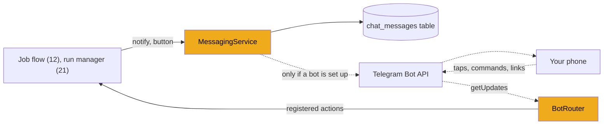
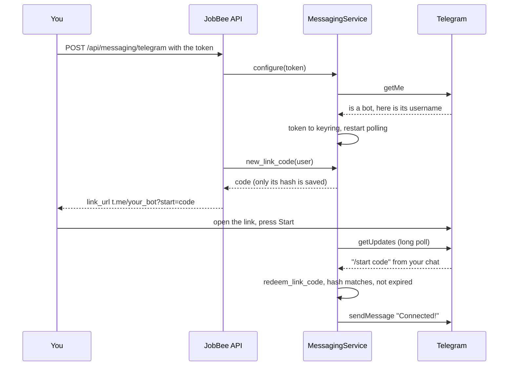

# Stage 11: Messages and Telegram

> **Goal:** Give JobBee one way to send you messages and receive your answers, and (if you want) connect it to your own Telegram bot so cards and buttons reach your phone.
>
> **By the end you will have:** the `backend/app/messaging/` package, with `MessagingService` (send and log messages, pair a chat, one-time buttons, listen for updates), `BotRouter` (commands, button taps and links), a small Telegram client, and the `/api/messaging` endpoints to connect a bot.
>
> **Optional to use, required to type.** You can skip creating a Telegram bot. The code is still required, because the job flow (stage 12), the daily search (stage 19) and the run manager (stage 21) import it. Without a bot, every message JobBee "sends" is only written to the `chat_messages` table.

## Where this fits

From the next stage on, JobBee wants to tell you things ("here's a match", "the form is ready") and offer you choices (Apply, Skip, Submit). Those parts call `messaging.notify` and `messaging.button`. This stage builds that service, plus the code that turns your replies and taps back into calls.



## New ideas in plain words

**A Telegram bot and its token.** A *bot* is a Telegram account run by a program instead of a person. You create one by chatting with **@BotFather**, Telegram's bot for making bots. It gives you a **token** like `123456789:AAH...`. The token is the bot's username and password in one: **anyone who has it controls the bot**. They can read what people send it and send messages as it. So JobBee stores it in the OS keyring ([stage 2](02-secrets.md)), never in `.env` or the database, and never prints it.

**The Bot API.** Your program talks to Telegram over plain HTTP. Every call is a `POST` to `https://api.telegram.org/bot<token>/<method>`, for example `.../sendMessage`, with a JSON body. Every answer looks like `{"ok": true, "result": ...}` or `{"ok": false, "description": "Unauthorized"}`. Note that the token is part of every URL. That fact shapes the error handling in Step 2.

**Long polling.** Telegram can deliver messages to a bot in two ways. With a *webhook*, Telegram calls a public URL on your server, which a home PC usually doesn't have. With *long polling*, your program asks Telegram "anything new?" with the `getUpdates` method, and Telegram holds the request open for up to 25 seconds until something arrives. When you tap a button, the answer comes back at once, and JobBee asks again. No public URL and no open port are needed.

**Offsets, saved before handling.** Each *update* (a message or a tap) has a growing number, its `update_id`. Telegram keeps resending an update until you confirm it. You confirm by asking for the next ones with `offset = last update_id + 1`. JobBee saves that offset in the `app_config` table ([stage 5](05-flags-and-app-config.md)'s `set_flag`) **before** it handles the update. Suppose JobBee crashed halfway through handling a Submit tap and the offset wasn't saved yet: on the next start Telegram would deliver the same tap again, and JobBee would act on it twice. Saving first means a tap is acted on at most once. The cost is that an update being handled during a crash is lost, which is the safer failure for a button like Submit.

**Inline keyboards and callback data.** Buttons under a message are an *inline keyboard*. When you tap one, Telegram sends the bot the button's *callback data*: a string of at most **64 bytes**. That's too small for "submit run 12 for user 1 with these options". It also comes back from the phone, so it can't be trusted. JobBee puts a short random **nonce** (a number used once) in it instead: `t:` plus 12 characters. The nonce points to a row in the `callback_tokens` table (stage 3) that holds the real action, the target id and any extra data.

**One-time buttons in groups.** Each nonce works once. Buttons that are alternatives (Apply and Skip on one card) share a *group*: spending one spends them all. Tapping Apply also kills that card's Skip, and a double tap does nothing the second time.

**Pairing with a hashed one-time code.** Your bot is public: anyone who finds its username can message it. So JobBee must learn which chat is yours. It makes a random code, stores only its **hash** (the one-way fingerprint from [stage 8](08-reading-job-postings.md), SHA-256 here), and gives you a *deep link*: `https://t.me/<your_bot>?start=<code>`. Opening it and pressing **Start** makes Telegram send `/start <code>` from your chat. JobBee hashes what arrived, finds the matching row, and remembers your chat. The code works once and expires after 10 minutes. Because only the hash is stored, someone who reads the database still can't use a code that hasn't been redeemed yet.

**Chat id and sender id.** Every Telegram message has a *chat* (where it was posted) and a *sender* (who posted it). In a private chat they're the same number. If the bot were added to a group, every member would share the group's chat id. JobBee acts on a message or tap only when **both** ids match the paired ones, so only you can drive it.

**Background tasks.** Some work takes a long time: reading a posting and tailoring a CV takes a minute. You can't make everything else wait for it. `asyncio.get_running_loop().create_task(coro)` starts a coroutine (an `async def` call, [stage 8](08-reading-job-postings.md)) running *alongside* everything else and returns a `Task` object at once. Two catches:

1. **Keep a reference.** The event loop holds only a weak reference to a task. If your code doesn't keep one too, Python's garbage collector may delete the task halfway through.
2. **Log its errors.** If a task crashes and nobody waits for it, the error is easy to miss: at best a "Task exception was never retrieved" line much later.

JobBee's `spawn` method (Step 4) does both. Handlers of incoming messages must return quickly, so anything slow goes through `spawn`.

**Backoff.** When a network call keeps failing (your Wi-Fi is down), retrying in a tight loop wastes power and floods the log. *Backoff* means waiting longer after each failure: 2 seconds, then 4, 8, 16, up to a limit.

## Build it, step by step

The messaging code lives in a new folder, `backend/app/messaging/`:

```text
backend/app/messaging/
  base.py       Step 1: buttons and what a channel must offer
  telegram.py   Step 2: talking to the Telegram Bot API
  bot.py        Step 3: handling what comes in
  service.py    Step 4: the service the rest of the app uses
```

This folder has no `__init__.py`, unlike the others. Python 3 still imports it: a folder without that file is a *namespace package*. You can add an empty `__init__.py` if you prefer; the real repo doesn't have one.

### Step 1: Buttons and channels, `backend/app/messaging/base.py`

These types don't know anything about Telegram, so another chat app could use them later.

<!-- code: backend/app/messaging/base.py -->
**`backend/app/messaging/base.py`** (whole file, 51 lines)

```python
"""Channel-neutral messaging types. Telegram implements them today; WhatsApp later."""

from __future__ import annotations

from dataclasses import dataclass
from pathlib import Path
from typing import Protocol


@dataclass(frozen=True)
class Button:
    """A tap target: `data` (handled by the bot) or `url` (opens a link)."""

    text: str
    data: str | None = None
    url: str | None = None


Keyboard = list[list[Button]]


class Channel(Protocol):
    name: str

    async def send_text(
        self, chat_id: str, text: str, buttons: Keyboard | None = None, *, html: bool = False
    ) -> str: ...

    async def send_document(
        self,
        chat_id: str,
        path: Path,
        caption: str = "",
        buttons: Keyboard | None = None,
        *,
        html: bool = False,
    ) -> str: ...

    async def send_photo(
        self,
        chat_id: str,
        path: Path,
        caption: str = "",
        buttons: Keyboard | None = None,
        *,
        html: bool = False,
    ) -> str: ...

    async def clear_buttons(self, chat_id: str, message_id: str) -> None: ...

    async def answer_callback(self, callback_id: str, text: str | None = None) -> None: ...
```
<!-- /code -->

- **`Button`** is one tap target. A button has either `data` (the bot handles the tap) or `url` (the phone opens a link, like the "Posting" button on a job card). `frozen=True` makes it read-only once made.
- **`Keyboard`** is rows of buttons: `[[apply, skip], [posting]]` is two buttons on top and one below.
- **`Channel`** is a `Protocol`, the same idea as stage 2's `SecretStore`: a list of methods any messaging channel must offer, without code. `TelegramChannel` (Step 2) fits it, and so does the tests' `FakeChannel`. Every send method returns the new message's id, so its buttons can be removed later with `clear_buttons`.

### Step 2: The Telegram client, `backend/app/messaging/telegram.py`

A small client for the few Bot API methods JobBee needs, built on `httpx` (stage 8).

#### Part 1: Limits and keyboards

<!-- code: backend/app/messaging/telegram.py lines=1-45 -->
**`backend/app/messaging/telegram.py`** (lines 1–45 of 186)

```python
"""Minimal Telegram Bot API client over httpx (long polling; no public webhook needed).

The bot token is part of every request URL, so errors raised from here never
include the URL or the underlying httpx exception text.
"""

from __future__ import annotations

import json
import mimetypes
from pathlib import Path
from typing import Any

import httpx

from .base import Keyboard

API_ROOT = "https://api.telegram.org"
TEXT_LIMIT = 4096
CAPTION_LIMIT = 1024


class TelegramError(RuntimeError):
    pass


def _markup(buttons: Keyboard | None) -> dict | None:
    if not buttons:
        return None
    rows = []
    for row in buttons:
        cells = []
        for b in row:
            if b.url:
                cells.append({"text": b.text, "url": b.url})
            else:
                cells.append({"text": b.text, "callback_data": b.data or "noop"})
        rows.append(cells)
    return {"inline_keyboard": rows}


def _clip(text: str, limit: int) -> str:
    return text if len(text) <= limit else text[: limit - 1] + "…"


```
<!-- /code -->

- **`TEXT_LIMIT` and `CAPTION_LIMIT`** are Telegram's own limits: 4096 characters for a message, 1024 for the caption under a file. `_clip` cuts longer text and adds "…", so a long message is shortened instead of refused.
- **`_markup`** turns a `Keyboard` into Telegram's format: `{"inline_keyboard": [[{"text": ..., "callback_data": ...}]]}`. A button with a `url` becomes a link button. Telegram requires every other button to have callback data, so a button with neither gets `"noop"`.

#### Part 2: One method for every call

<!-- code: backend/app/messaging/telegram.py lines=46-102 -->
**`backend/app/messaging/telegram.py`** (lines 46–102 of 186)

```python
class TelegramChannel:
    name = "telegram"

    def __init__(self, token: str, *, client: httpx.AsyncClient | None = None) -> None:
        self._base = f"{API_ROOT}/bot{token}"
        self._client = client or httpx.AsyncClient(timeout=httpx.Timeout(40.0, connect=10.0))

    async def _call(
        self,
        method: str,
        *,
        data: dict[str, Any] | None = None,
        files: dict[str, Any] | None = None,
        timeout: float | None = None,
    ) -> Any:
        kwargs: dict[str, Any] = {}
        if files:
            form = {
                k: json.dumps(v) if isinstance(v, (dict, list)) else str(v)
                for k, v in (data or {}).items()
                if v is not None
            }
            kwargs.update(data=form, files=files)
        else:
            kwargs["json"] = {k: v for k, v in (data or {}).items() if v is not None}
        if timeout is not None:
            kwargs["timeout"] = timeout
        try:
            resp = await self._client.post(f"{self._base}/{method}", **kwargs)
        except httpx.HTTPError as e:
            raise TelegramError(
                f"Telegram {method}: network error ({e.__class__.__name__})"
            ) from None
        try:
            payload = resp.json()
        except ValueError:
            raise TelegramError(f"Telegram {method}: HTTP {resp.status_code}") from None
        if not payload.get("ok"):
            raise TelegramError(
                f"Telegram {method}: {payload.get('description') or resp.status_code}"
            )
        return payload.get("result")

    async def get_me(self) -> dict:
        return await self._call("getMe")

    async def get_updates(self, offset: int | None, timeout: int = 25) -> list[dict]:
        return await self._call(
            "getUpdates",
            data={
                "offset": offset,
                "timeout": timeout,
                "allowed_updates": ["message", "callback_query"],
            },
            timeout=timeout + 15,
        )

```
<!-- /code -->

- **`self._base`** is `https://api.telegram.org/bot<token>`. The token lives only here, inside the URL.
- **`client`** can be passed in. The tests pass an `httpx.AsyncClient` with a fake network, so no request ever leaves your PC. Otherwise the client waits up to 40 seconds for an answer (10 to connect).
- **`_call` sends JSON, or a multipart form when there's a file.** Files go as multipart, the same format browsers use for uploads (stage 10). In a form every field must be text, so dicts and lists (like the keyboard) are turned into JSON strings first. In both cases fields that are `None` are left out, so Telegram never sees `"parse_mode": null`.
- **Errors never include the token.** An httpx error's message often contains the full URL, token included. If `_call` passed that message on, the token could end up in a log, an API response or a pop-up. So `_call` builds its own message from the method name, the *class* of the error (`ConnectError`) and Telegram's `description`. `from None` also drops the original exception from the traceback, because it would show the URL too.
- **Three ways to fail**, one error type: a network error, an answer that isn't JSON (`HTTP 502`), or `"ok": false` with Telegram's reason. All become `TelegramError`.
- **`get_me`** asks "who am I?". It's the cheapest way to check a token, and it returns the bot's username.
- **`get_updates`** is the long poll. `timeout=25` asks Telegram to hold the request up to 25 seconds. The HTTP timeout for this call is 15 seconds longer (40), so the client never gives up before Telegram answers. `allowed_updates` asks only for messages and button taps.

#### Part 3: Sending, and cleaning up buttons

<!-- code: backend/app/messaging/telegram.py lines=103-186 -->
**`backend/app/messaging/telegram.py`** (lines 103–186 of 186)

```python
    async def send_text(
        self, chat_id: str, text: str, buttons: Keyboard | None = None, *, html: bool = False
    ) -> str:
        result = await self._call(
            "sendMessage",
            data={
                "chat_id": chat_id,
                "text": _clip(text, TEXT_LIMIT),
                "parse_mode": "HTML" if html else None,
                "reply_markup": _markup(buttons),
                "link_preview_options": {"is_disabled": True},
            },
        )
        return str(result["message_id"])

    async def _send_file(
        self,
        method: str,
        field: str,
        chat_id: str,
        path: Path,
        caption: str,
        buttons: Keyboard | None,
        html: bool,
    ) -> str:
        mime = mimetypes.guess_type(path.name)[0] or "application/octet-stream"
        result = await self._call(
            method,
            data={
                "chat_id": chat_id,
                "caption": _clip(caption, CAPTION_LIMIT) if caption else None,
                "parse_mode": "HTML" if html and caption else None,
                "reply_markup": _markup(buttons),
            },
            files={field: (path.name, path.read_bytes(), mime)},
            timeout=120,
        )
        return str(result["message_id"])

    async def send_document(
        self,
        chat_id: str,
        path: Path,
        caption: str = "",
        buttons: Keyboard | None = None,
        *,
        html: bool = False,
    ) -> str:
        return await self._send_file(
            "sendDocument", "document", chat_id, path, caption, buttons, html
        )

    async def send_photo(
        self,
        chat_id: str,
        path: Path,
        caption: str = "",
        buttons: Keyboard | None = None,
        *,
        html: bool = False,
    ) -> str:
        return await self._send_file("sendPhoto", "photo", chat_id, path, caption, buttons, html)

    async def clear_buttons(self, chat_id: str, message_id: str) -> None:
        try:
            await self._call(
                "editMessageReplyMarkup",
                data={
                    "chat_id": chat_id,
                    "message_id": int(message_id),
                    "reply_markup": {"inline_keyboard": []},
                },
            )
        except TelegramError as e:
            if "not modified" not in str(e) and "not found" not in str(e):
                raise

    async def answer_callback(self, callback_id: str, text: str | None = None) -> None:
        await self._call(
            "answerCallbackQuery", data={"callback_query_id": callback_id, "text": text}
        )

    async def aclose(self) -> None:
        await self._client.aclose()
```
<!-- /code -->

- **`send_text`** sends a message. `parse_mode: "HTML"` (only when `html=True`) tells Telegram to read a few tags like `<b>` as formatting. Text sent this way must have its `<`, `>` and `&` escaped, which is why the job card (stage 12) and `status_text` (Step 3) escape what they insert. `link_preview_options` turns off the preview box Telegram would otherwise show under links.
- **`_send_file`** is shared by `send_document` (the CV PDF on a job card) and `send_photo` (the screenshot of a filled form, stage 21). `mimetypes.guess_type` works out the file type from its name. File uploads get a 120-second timeout.
- **`clear_buttons`** replaces a message's keyboard with an empty one, so old buttons disappear once a card is handled. Telegram answers "message is not modified" if the buttons are already gone, or "not found" if the message was deleted. Neither is a real problem, so both are ignored.
- **`answer_callback`** must be called for every tap. Until it is, Telegram shows a loading spinner on the button. The optional `text` appears as a small pop-up, like "This button has expired."
- **`aclose`** closes the HTTP client and its connections.

### Step 3: Handling what comes in, `backend/app/messaging/bot.py`

The router receives every update from the poll loop (Step 4) and decides what it means. Other files tell it what to do with each kind of button by registering a handler.

#### Part 1: The help text and the router's memory

<!-- code: backend/app/messaging/bot.py lines=1-62 -->
**`backend/app/messaging/bot.py`** (lines 1–62 of 242)

```python
"""Inbound Telegram handling: pairing, commands, button taps and free-text replies.

Only the linked chat (both chat id and sender id) is acted on. Buttons carry an
opaque, single-use nonce (`t:<nonce>`) resolved through `callback_tokens`;
other modules register what each action does with `register_action`.
"""

from __future__ import annotations

import html
import logging
import re
from collections.abc import Awaitable, Callable
from dataclasses import dataclass
from datetime import datetime, timedelta, timezone
from typing import TYPE_CHECKING

from sqlalchemy import exists, func, select
from sqlalchemy.orm import aliased

from ..db import SessionLocal
from ..llm.usage import spend_summary
from ..models import Application, ApplicationStatus, ApplyRun, CallbackToken
from ..pipeline.state import is_paused, set_paused

if TYPE_CHECKING:
    from .service import MessagingService

logger = logging.getLogger(__name__)

URL_RE = re.compile(r"https?://[^\s<>\"']+", re.IGNORECASE)

HELP_TEXT = (
    "🐝 <b>JobBee</b> finds jobs, tailors your CV and applies after you approve.\n\n"
    "/status — what's going on\n"
    "/pause — stop searching and applying\n"
    "/resume — start again\n"
    "/help — this message\n\n"
    "Send me a job link any time and I'll check it for you."
)


@dataclass
class ActionContext:
    user_id: int
    token: CallbackToken
    chat_id: str
    message_id: str | None


ActionHandler = Callable[[ActionContext], Awaitable[None]]
TextHandler = Callable[[int, str], Awaitable[None]]


class BotRouter:
    def __init__(self, service: MessagingService) -> None:
        self._service = service
        self._actions: dict[str, ActionHandler] = {}
        self._reply_waiters: dict[int, TextHandler] = {}
        self._url_handler: Callable[[int, str], Awaitable[None]] | None = None
        self._text_handler: TextHandler | None = None

```
<!-- /code -->

- **`if TYPE_CHECKING:`** is a block that type checkers read but Python skips at run time. `bot.py` needs the name `MessagingService` only for type hints. Together with the import inside `MessagingService.__init__` (Step 4), this keeps the two files from importing each other while they load.
- **`URL_RE`** finds the first web address in a message: `http` or `https`, then everything up to a space, `<`, `>` or a quote.
- **`HELP_TEXT`** uses `<b>`, so it's sent with `html=True`.
- **`ActionContext`** is what a button handler receives: who tapped, the token row (with `action`, `target_id` and `payload`), and which chat and message the tap came from (handy for clearing that card's buttons).
- **`ActionHandler` and `TextHandler`** are type aliases: "an async function that takes an `ActionContext`" and "an async function that takes a user id and some text".
- **The router remembers four kinds of handler:** one per button action, one waiting reply per user, one for links, and one for other free text.

#### Part 2: Registering handlers, and checking who's talking

<!-- code: backend/app/messaging/bot.py lines=63-100 -->
**`backend/app/messaging/bot.py`** (lines 63–100 of 242)

```python
    # --- registration ------------------------------------------------------------------

    def register_action(self, action: str, handler: ActionHandler) -> None:
        self._actions[action] = handler

    def expect_reply(self, user_id: int, handler: TextHandler) -> None:
        """The next free-text message from this user goes to `handler` (e.g. an agent question)."""

        self._reply_waiters[user_id] = handler

    def cancel_reply(self, user_id: int, handler: TextHandler | None = None) -> None:
        if handler is None or self._reply_waiters.get(user_id) is handler:
            self._reply_waiters.pop(user_id, None)

    def set_url_handler(self, handler: Callable[[int, str], Awaitable[None]]) -> None:
        self._url_handler = handler

    def set_text_handler(self, handler: TextHandler) -> None:
        self._text_handler = handler

    # --- dispatch -----------------------------------------------------------------------

    async def handle_update(self, update: dict) -> None:
        if "callback_query" in update:
            await self._on_callback(update["callback_query"])
        elif "message" in update:
            await self._on_message(update["message"])

    def _linked_user(self, chat_id: str, from_id: str) -> int | None:
        link = self._service.linked()
        if link is None or link.chat_id != chat_id or link.from_id != from_id:
            return None
        return link.user_id

    async def _reply(self, chat_id: str, text: str) -> None:
        if self._service.channel is not None:
            await self._service.channel.send_text(chat_id, text, html=True)

```
<!-- /code -->

- **`register_action("apply", handler)`** says "when a token with action `apply` is tapped, call this". The job flow registers `apply`, `skip` and `skip_reason` in stage 12. The run manager registers its own in stage 21.
- **`expect_reply`** makes the *next* free-text message from this user go to one handler. The run manager uses it when the apply agent asks you a question (stage 21). `cancel_reply` removes it, but only if it's still the same handler.
- **`set_url_handler`** decides what happens to a pasted link (stage 12 sets it). **`set_text_handler`** is spare: nothing registers one yet.
- **`handle_update`** sends a tap (`callback_query`) to `_on_callback` and a message to `_on_message`. Anything else is ignored.
- **`_linked_user`** is the identity check from "New ideas". It returns the user id only if **both** the chat id and the sender id match the paired chat.
- **`_reply`** answers a chat that isn't (or isn't yet) linked, like a stranger's. It doesn't log, because there's no user to log it for.

#### Part 3: Messages and commands

<!-- code: backend/app/messaging/bot.py lines=101-160 -->
**`backend/app/messaging/bot.py`** (lines 101–160 of 242)

```python
    async def _on_message(self, message: dict) -> None:
        chat_id = str(message.get("chat", {}).get("id", ""))
        from_id = str(message.get("from", {}).get("id", ""))
        text = (message.get("text") or "").strip()
        if not chat_id or not text:
            return

        if text.startswith("/start"):
            parts = text.split(maxsplit=1)
            if len(parts) == 2:
                user_id = self._service.redeem_link_code(
                    parts[1].strip(), chat_id=chat_id, from_id=from_id
                )
                if user_id is not None:
                    self._service.log(user_id, "in", text, kind="command")
                    await self._service.notify(
                        user_id,
                        "✅ Connected! I'll message you here when I find jobs worth your time, "
                        "and before anything is sent.\n\n" + HELP_TEXT,
                        html=True,
                        kind="welcome",
                    )
                    return
            if self._linked_user(chat_id, from_id) is None:
                await self._reply(
                    chat_id, "To connect, use the <b>Open Telegram</b> button in JobBee's setup."
                )
                return

        user_id = self._linked_user(chat_id, from_id)
        if user_id is None:
            await self._reply(chat_id, "This is a private JobBee assistant.")
            return

        self._service.log(user_id, "in", text, kind="command" if text.startswith("/") else "text")
        command = text.split()[0].split("@")[0].lower() if text.startswith("/") else None
        if command in ("/start", "/help"):
            await self._service.notify(user_id, HELP_TEXT, html=True, kind="help")
        elif command == "/status":
            await self._service.notify(user_id, status_text(), html=True, kind="status")
        elif command == "/pause":
            set_paused(True)
            await self._service.notify(
                user_id, "⏸ Paused. I won't search or apply until you send /resume.", kind="status"
            )
        elif command == "/resume":
            set_paused(False)
            await self._service.notify(user_id, "▶️ Back to work.", kind="status")
        elif command is not None:
            await self._service.notify(user_id, HELP_TEXT, html=True, kind="help")
        elif user_id in self._reply_waiters:
            handler = self._reply_waiters.pop(user_id)
            await handler(user_id, text)
        elif (match := URL_RE.search(text)) and self._url_handler is not None:
            await self._url_handler(user_id, match.group(0).rstrip(".,);]"))
        elif self._text_handler is not None:
            await self._text_handler(user_id, text)
        else:
            await self._service.notify(user_id, HELP_TEXT, html=True, kind="help")

```
<!-- /code -->

Telegram's ids are numbers; JobBee turns them into strings (`str(...)`) because the database stores them as text. A message is handled in a fixed order:

1. **`/start <code>` comes first**, because it's the only thing a stranger's chat may do. If the code is valid, the chat is paired, and you get "✅ Connected!" with the help text. A `/start` from an unknown chat without a good code gets a pointer to JobBee's setup.
2. **Everyone else must be the paired chat and sender.** Strangers get one polite line, "This is a private JobBee assistant.", and nothing happens.
3. **Every accepted message is logged** in `chat_messages`, as a `command` or as `text`.
4. **Commands.** `text.split()[0].split("@")[0].lower()` takes the first word and cuts off a bot name, so `/status@your_bot` becomes `/status`. `/help` sends the help text, `/status` sends `status_text()` (Part 5), `/pause` and `/resume` flip stage 5's pause flag. An unknown command gets the help text.
5. **A waiting reply.** If something called `expect_reply` for you, your text goes there. `pop` removes the waiter, so only one message is taken.
6. **A link** goes to the URL handler, the chat version of pasting a link into the app. `rstrip(".,);]")` drops punctuation stuck to the end, so "look at https://jobs.lever.co/acme/123." gives a clean link.
7. **Other text** goes to the text handler if there is one, otherwise you get the help text.

A known quirk for later: from stage 22 on, the web app's Resume endpoint also wakes the apply queue (stage 21's `run_manager.kick()`), but `/resume` here only clears the pause flag. Applications already queued wait until something else wakes the queue.

#### Part 4: Button taps

<!-- code: backend/app/messaging/bot.py lines=161-191 -->
**`backend/app/messaging/bot.py`** (lines 161–191 of 242)

```python
    async def _on_callback(self, query: dict) -> None:
        callback_id = str(query.get("id", ""))
        message = query.get("message") or {}
        chat_id = str(message.get("chat", {}).get("id", ""))
        from_id = str(query.get("from", {}).get("id", ""))
        message_id = str(message["message_id"]) if "message_id" in message else None
        data = query.get("data") or ""
        channel = self._service.channel

        user_id = self._linked_user(chat_id, from_id)
        if user_id is None or not data.startswith("t:"):
            if channel is not None:
                await channel.answer_callback(callback_id, "Not available.")
            return

        token = self._service.consume(data[2:], user_id)
        handler = self._actions.get(token.action) if token is not None else None
        if token is None or handler is None:
            if channel is not None:
                await channel.answer_callback(callback_id, "This button has expired.")
            await self._service.clear_buttons(user_id, message_id)
            return

        if channel is not None:
            await channel.answer_callback(callback_id)
        self._service.log(user_id, "in", f"[tap] {token.action}", kind="tap")
        await handler(
            ActionContext(user_id=user_id, token=token, chat_id=chat_id, message_id=message_id)
        )


```
<!-- /code -->

1. **Same identity check.** A tap from anyone but you, or with data that doesn't start with `t:`, gets "Not available." and nothing else.
2. **`consume`** (Step 4) spends the token, in one atomic step. It returns `None` if the token was already used, expired, or belongs to someone else.
3. **An expired token or an unknown action** gets "This button has expired.", and the stale buttons are removed from the message.
4. **Otherwise** the tap is answered (no pop-up), logged as `[tap] apply` or similar, and the registered handler runs with an `ActionContext`.

The handler is awaited right here, inside the poll loop. That's why handlers must be quick and hand slow work to `spawn`.

#### Part 5: The `/status` reply

<!-- code: backend/app/messaging/bot.py lines=192-242 -->
**`backend/app/messaging/bot.py`** (lines 192–242 of 242)

```python
def status_text() -> str:
    week_ago = datetime.now(timezone.utc) - timedelta(days=7)
    with SessionLocal() as session:
        counts = dict(
            session.execute(
                select(Application.status, func.count()).group_by(Application.status)
            ).all()
        )
        applied_week = session.execute(
            select(func.count())
            .select_from(Application)
            .where(
                Application.status == ApplicationStatus.submitted,
                Application.submitted_at >= week_ago,
            )
        ).scalar_one()
        waiting_runs = session.execute(
            select(func.count())
            .select_from(ApplyRun)
            .where(ApplyRun.status.in_(["needs_user", "needs_human", "awaiting_submit"]))
        ).scalar_one()
        newer = aliased(ApplyRun)
        set_aside = session.execute(
            select(func.count())
            .select_from(ApplyRun)
            .join(Application, Application.id == ApplyRun.application_id)
            .where(
                ApplyRun.status == "needs_you",
                Application.status == ApplicationStatus.approved,
                ~exists().where(
                    newer.application_id == ApplyRun.application_id, newer.id > ApplyRun.id
                ),
            )
        ).scalar_one()
    spend = spend_summary()
    state = "⏸ <b>Paused</b> — send /resume to restart" if is_paused() else "🐝 <b>Active</b>"
    lines = [
        state,
        f"• Waiting for your approval: {counts.get(ApplicationStatus.awaiting_approval, 0)}",
        f"• Waiting on you mid-application: {waiting_runs}",
        f"• Set aside for when you're at your PC: {set_aside}",
        f"• Approved, in the apply queue: {counts.get(ApplicationStatus.approved, 0)}",
        f"• Applied in the last 7 days: {applied_week}",
        (
            f"• Claude spend: ${spend['today_usd']:.2f} today "
            f"(budget ${spend['daily_budget_usd']:.0f}) · ${spend['month_usd']:.2f} this month"
        ),
    ]
    return "\n".join(
        html.escape(line, quote=False) if "<b>" not in line else line for line in lines
    )
```
<!-- /code -->

`status_text` builds a short report from the database:

- `select(Application.status, func.count()).group_by(Application.status)` counts applications per status in one query, like `{awaiting_approval: 3, approved: 1}`. The cards waiting for you and the approved ones come from it.
- Applications submitted in the last 7 days, and apply runs that are waiting for you (statuses from stage 21).
- "Set aside" runs: runs with status `needs_you` whose application is still approved, and which are the newest run for that application. `aliased(ApplyRun)` makes a second name for the same table, so the query can compare a run with other runs. `~exists().where(newer.id > ApplyRun.id ...)` means "there is no newer run for the same application".
- Today's and this month's Claude spend from stage 6's `spend_summary`.

Each line is escaped for Telegram's HTML mode, except the ones that contain JobBee's own `<b>` tags. Before stage 21 there are no apply runs, so those counts are 0.

### Step 4: The service, `backend/app/messaging/service.py`

This is the object the rest of JobBee uses. There is one shared instance, `messaging`, at the bottom of the file.

#### Part 1: Names, helpers and the service's state

<!-- code: backend/app/messaging/service.py lines=1-56 -->
**`backend/app/messaging/service.py`** (lines 1–56 of 364)

```python
"""Messaging service: the long-poll loop, outbound notifications, pairing and button tokens.

One process-wide instance (`messaging`) is started from the FastAPI lifespan.
Inbound updates go to `BotRouter` (bot.py). Handlers must return quickly; slow
work goes through `spawn()` so polling never stalls.
"""

from __future__ import annotations

import asyncio
import hashlib
import logging
import secrets
from collections.abc import Coroutine
from datetime import datetime, timedelta, timezone
from pathlib import Path
from typing import Any

from sqlalchemy import select, update

from ..db import SessionLocal
from ..models import CallbackToken, ChatMessage, MessagingLink, User
from ..pipeline.state import get_flag, set_flag
from ..services.secrets import get_secret_store
from .base import Button, Keyboard
from .telegram import TelegramChannel, TelegramError

logger = logging.getLogger(__name__)

CHANNEL = "telegram"
BOT_TOKEN_SECRET = "app:telegram_bot_token"
BOT_USERNAME_KEY = "telegram_bot_username"
OFFSET_KEY = "telegram_offset"
LINK_CODE_TTL = timedelta(minutes=10)
BUTTON_TTL = timedelta(days=3)


def _now() -> datetime:
    return datetime.now(timezone.utc)


def _hash(code: str) -> str:
    return hashlib.sha256(code.encode("utf-8")).hexdigest()


class MessagingService:
    def __init__(self) -> None:
        from .bot import BotRouter

        self.channel: TelegramChannel | None = None
        self.router = BotRouter(self)
        self._poller: asyncio.Task | None = None
        self._tasks: set[asyncio.Task] = set()
        self.last_poll_ok: datetime | None = None
        self.last_error: str | None = None

```
<!-- /code -->

- **Where things are stored.** The token goes in the keyring under `app:telegram_bot_token`. The bot's username and the poll offset aren't secret, so they go in `app_config` through stage 5's flags.
- **`LINK_CODE_TTL`** (10 minutes) is how long a pairing code works. **`BUTTON_TTL`** (3 days) is how long a button works by default. TTL means "time to live".
- **`_hash`** is SHA-256 from Python's `hashlib`, written as 64 hex characters.
- **`__init__`** sets up the state: no channel and no poller until `start()`, the router, the set of spawned tasks, the time of the last good poll (recorded, but nothing reads it yet) and the last error (the status endpoint in Step 5 reports it).

#### Part 2: Connecting and forgetting a bot

<!-- code: backend/app/messaging/service.py lines=57-93 -->
**`backend/app/messaging/service.py`** (lines 57–93 of 364)

```python
    # --- configuration ----------------------------------------------------------

    @staticmethod
    def bot_token() -> str | None:
        token = get_secret_store().get(BOT_TOKEN_SECRET)
        return token.strip() if token and token.strip() else None

    @staticmethod
    def bot_username() -> str | None:
        return get_flag(BOT_USERNAME_KEY)

    async def configure(self, token: str) -> str:
        """Validate a bot token with getMe, store it in the keyring, restart polling."""

        probe = TelegramChannel(token)
        try:
            me = await probe.get_me()
        finally:
            await probe.aclose()
        username = me.get("username")
        if not username or not me.get("is_bot"):
            raise TelegramError("That token doesn't belong to a bot.")
        get_secret_store().set(BOT_TOKEN_SECRET, token)
        set_flag(BOT_USERNAME_KEY, username)
        set_flag(OFFSET_KEY, "0")
        await self.restart()
        return username

    async def forget(self) -> None:
        await self.stop()
        get_secret_store().delete(BOT_TOKEN_SECRET)
        with SessionLocal() as session:
            session.execute(
                update(MessagingLink).values(chat_id=None, from_id=None, linked_at=None)
            )
            session.commit()

```
<!-- /code -->

- **`configure(token)` checks before it saves.** It makes a throwaway `TelegramChannel`, calls `getMe`, and closes it again (`finally`). A typo fails here with Telegram's reason. A token that works but isn't a bot's is refused too.
- Then it stores the token, the username and an offset of `"0"`. A new bot starts fresh: offset 0 means "no offset", so Telegram sends everything it has kept for that bot. Last, it restarts polling with the new token.
- **`forget()`** stops polling, deletes the token, and clears the pairing from every link row. The bot itself still exists in Telegram; JobBee only stops using it.

#### Part 3: Starting, stopping, spawning and polling

<!-- code: backend/app/messaging/service.py lines=94-158 -->
**`backend/app/messaging/service.py`** (lines 94–158 of 364)

```python
    # --- lifecycle --------------------------------------------------------------------

    async def start(self) -> None:
        token = self.bot_token()
        if token is None or self._poller is not None:
            return
        self.channel = TelegramChannel(token)
        self._poller = asyncio.get_running_loop().create_task(self._poll_loop())

    async def stop(self) -> None:
        if self._poller is not None:
            self._poller.cancel()
            await asyncio.gather(self._poller, return_exceptions=True)
            self._poller = None
        for task in list(self._tasks):
            task.cancel()
        if self._tasks:
            await asyncio.gather(*self._tasks, return_exceptions=True)
        if self.channel is not None:
            await self.channel.aclose()
            self.channel = None

    async def restart(self) -> None:
        await self.stop()
        await self.start()

    @property
    def polling(self) -> bool:
        return self._poller is not None and not self._poller.done()

    def spawn(self, coro: Coroutine[Any, Any, Any]) -> asyncio.Task:
        task = asyncio.get_running_loop().create_task(coro)
        self._tasks.add(task)

        def _done(t: asyncio.Task) -> None:
            self._tasks.discard(t)
            if not t.cancelled() and t.exception() is not None:
                logger.error("Messaging task failed", exc_info=t.exception())

        task.add_done_callback(_done)
        return task

    async def _poll_loop(self) -> None:
        backoff = 2.0
        offset = int(get_flag(OFFSET_KEY) or 0) or None
        while True:
            try:
                updates = await self.channel.get_updates(offset)
                self.last_poll_ok = _now()
                self.last_error = None
                backoff = 2.0
            except TelegramError as e:
                self.last_error = str(e)
                logger.warning("Telegram polling failed: %s", e)
                await asyncio.sleep(backoff)
                backoff = min(backoff * 2, 60.0)
                continue
            for item in updates:
                offset = int(item["update_id"]) + 1
                set_flag(OFFSET_KEY, str(offset))  # before handling: never replay a tap
                try:
                    await self.router.handle_update(item)
                except Exception:
                    logger.exception("Handling Telegram update failed")

```
<!-- /code -->

- **`start()`** does nothing without a token, or if a poller is already running. Otherwise it creates the channel and starts `_poll_loop` as a background task. `main.py` calls it when the server starts (Step 6).
- **`stop()`** cancels the poller and waits for it to finish (`gather` with `return_exceptions=True`, so the cancellation error doesn't stop the shutdown). Then it cancels every spawned task, and closes the HTTP client.
- **`polling`** is true while the poller task is alive.
- **`spawn(coro)`** is the background-task pattern from "New ideas". It starts the task, keeps it in `self._tasks`, and adds a *done callback*: a function asyncio calls when the task ends. The callback removes the task from the set and logs any exception. Stage 12's job flow uses `spawn` for every slow job.

**`_poll_loop`** runs for as long as the server does:

1. **Read the saved offset.** `int(get_flag(OFFSET_KEY) or 0) or None` turns a missing or `"0"` offset into `None`.
2. **Ask for updates.** On success, remember the time and reset the backoff to 2 seconds.
3. **On a `TelegramError`**, remember it in `last_error`, log a warning, wait, and double the wait (2, 4, 8, … up to 60 seconds).
4. **For each update, save the next offset first, then handle it.** This is the "save before handling" rule.
5. **One bad update can't kill the loop.** Any exception from a handler is logged with its traceback, and the loop moves on.

#### Part 4: Pairing a chat

<!-- code: backend/app/messaging/service.py lines=159-211 -->
**`backend/app/messaging/service.py`** (lines 159–211 of 364)

```python
    # --- pairing ---------------------------------------------------------------------

    def new_link_code(self, user_id: int) -> str:
        code = secrets.token_urlsafe(12)
        with SessionLocal() as session:
            link = session.execute(
                select(MessagingLink).where(
                    MessagingLink.user_id == user_id, MessagingLink.channel == CHANNEL
                )
            ).scalar_one_or_none()
            if link is None:
                link = MessagingLink(user_id=user_id, channel=CHANNEL)
                session.add(link)
            link.link_code_hash = _hash(code)
            link.link_expires_at = _now() + LINK_CODE_TTL
            session.commit()
        return code

    def link_url(self, code: str) -> str | None:
        username = self.bot_username()
        return f"https://t.me/{username}?start={code}" if username else None

    def redeem_link_code(self, code: str, *, chat_id: str, from_id: str) -> int | None:
        """Bind a chat to the user that owns `code`; returns the user id or None."""

        with SessionLocal() as session:
            link = session.execute(
                select(MessagingLink).where(
                    MessagingLink.channel == CHANNEL,
                    MessagingLink.link_code_hash == _hash(code),
                    MessagingLink.link_expires_at > _now(),
                )
            ).scalar_one_or_none()
            if link is None:
                return None
            link.chat_id = chat_id
            link.from_id = from_id
            link.linked_at = _now()
            link.link_code_hash = None
            link.link_expires_at = None
            session.commit()
            return link.user_id

    @staticmethod
    def linked(user_id: int | None = None) -> MessagingLink | None:
        with SessionLocal() as session:
            stmt = select(MessagingLink).where(
                MessagingLink.channel == CHANNEL, MessagingLink.chat_id.is_not(None)
            )
            if user_id is not None:
                stmt = stmt.where(MessagingLink.user_id == user_id)
            return session.execute(stmt.order_by(MessagingLink.id)).scalars().first()

```
<!-- /code -->

- **`new_link_code`** makes the code with `secrets.token_urlsafe(12)`: 16 random characters that are safe inside a URL. The `secrets` module makes values nobody can guess, unlike `random`. There's one `MessagingLink` row per user and channel (a unique constraint in stage 3's models); the code's hash and expiry are written into it. A new code replaces any older unused one.
- **`link_url`** builds `https://t.me/<username>?start=<code>`. It returns `None` if no bot is set up yet.
- **`redeem_link_code`** looks for a row whose hash matches **and** whose code hasn't expired. If it finds one, it saves the chat id and sender id, and **clears the hash and expiry**, so the same code can never pair a second chat.
- **`linked(user_id)`** returns the paired link, or `None`. The router calls it without a user id, because JobBee has one local user: "is any chat paired, and which?". The home endpoint (stage 22) reports it, so the home page (stage 27) can hide its "Connect Telegram" hint once you pair.

#### Part 5: Buttons that work once

<!-- code: backend/app/messaging/service.py lines=212-275 -->
**`backend/app/messaging/service.py`** (lines 212–275 of 364)

```python
    # --- buttons -----------------------------------------------------------------------

    def button(
        self,
        user_id: int,
        text: str,
        action: str,
        *,
        target_id: int | None = None,
        payload: dict | None = None,
        group: str | None = None,
        ttl: timedelta = BUTTON_TTL,
    ) -> Button:
        nonce = secrets.token_urlsafe(9)
        with SessionLocal() as session:
            session.add(
                CallbackToken(
                    nonce=nonce,
                    user_id=user_id,
                    action=action,
                    target_id=target_id,
                    payload=payload or {},
                    group=group,
                    expires_at=_now() + ttl,
                )
            )
            session.commit()
        return Button(text=text, data=f"t:{nonce}")

    @staticmethod
    def new_group() -> str:
        return secrets.token_urlsafe(9)

    @staticmethod
    def consume(nonce: str, user_id: int) -> CallbackToken | None:
        """Spend a button token exactly once (and its whole group). None if used/expired."""

        now = _now()
        with SessionLocal() as session:
            result = session.execute(
                update(CallbackToken)
                .where(
                    CallbackToken.nonce == nonce,
                    CallbackToken.user_id == user_id,
                    CallbackToken.used_at.is_(None),
                    CallbackToken.expires_at > now,
                )
                .values(used_at=now)
            )
            if result.rowcount != 1:
                session.rollback()
                return None
            token = session.get(CallbackToken, nonce)
            if token.group:
                session.execute(
                    update(CallbackToken)
                    .where(CallbackToken.group == token.group, CallbackToken.used_at.is_(None))
                    .values(used_at=now)
                )
            session.commit()
            session.refresh(token)
            session.expunge(token)
            return token

```
<!-- /code -->

- **`button(...)`** saves a `CallbackToken` row and returns a `Button` whose data is `t:` plus a 12-character nonce (`token_urlsafe(9)`). That's 14 bytes, far under the 64-byte limit. The row holds what the tap means: `action` (which handler), `target_id` (usually an application or run id), `payload` (extras such as a skip reason), the `group` and the expiry.
- **`new_group()`** is one more random string. Buttons made with the same group are spent together.
- **`consume`** spends a token with an atomic *compare-and-set*. The `UPDATE` changes the row only if it matches this nonce **and** this user **and** is unused **and** hasn't expired. The database runs one such update at a time. If two taps race, the first changes one row and the second changes none. `rowcount` says how many rows changed: `1` means "this tap won", anything else means "already handled". Then every other unused token in the same group is marked used too. `refresh` reloads the row, and `expunge` detaches it from the session, so the handler can read it after the session closes. Stage 12 uses the same compare-and-set move for Apply and Skip.

#### Part 6: Sending, and always logging

<!-- code: backend/app/messaging/service.py lines=276-364 -->
**`backend/app/messaging/service.py`** (lines 276–364 of 364)

```python
    # --- outbound ------------------------------------------------------------------------

    @staticmethod
    def log(
        user_id: int,
        direction: str,
        text: str,
        *,
        kind: str = "text",
        external_id: str | None = None,
        application_id: int | None = None,
        run_id: int | None = None,
    ) -> None:
        with SessionLocal() as session:
            session.add(
                ChatMessage(
                    user_id=user_id,
                    channel=CHANNEL,
                    direction=direction,
                    kind=kind,
                    text=text[:4000],
                    external_id=external_id,
                    application_id=application_id,
                    run_id=run_id,
                )
            )
            session.commit()

    async def notify(
        self,
        user_id: int,
        text: str,
        *,
        buttons: Keyboard | None = None,
        document: Path | None = None,
        photo: Path | None = None,
        html: bool = False,
        kind: str = "info",
        application_id: int | None = None,
        run_id: int | None = None,
    ) -> str | None:
        """Send to the user's linked chat (logged either way); returns the message id."""

        link = self.linked(user_id)
        message_id: str | None = None
        if link is not None and self.channel is not None:
            try:
                if document is not None:
                    message_id = await self.channel.send_document(
                        link.chat_id, document, text, buttons, html=html
                    )
                elif photo is not None:
                    message_id = await self.channel.send_photo(
                        link.chat_id, photo, text, buttons, html=html
                    )
                else:
                    message_id = await self.channel.send_text(
                        link.chat_id, text, buttons, html=html
                    )
            except TelegramError as e:
                logger.warning("Telegram send failed: %s", e)
                self.last_error = str(e)
        self.log(
            user_id,
            "out",
            text,
            kind=kind,
            external_id=message_id,
            application_id=application_id,
            run_id=run_id,
        )
        return message_id

    async def clear_buttons(self, user_id: int, message_id: str | None) -> None:
        link = self.linked(user_id)
        if link is None or self.channel is None or not message_id:
            return
        try:
            await self.channel.clear_buttons(link.chat_id, message_id)
        except TelegramError as e:
            logger.debug("Could not clear buttons: %s", e)

    @staticmethod
    def first_user_id() -> int | None:
        with SessionLocal() as session:
            return session.execute(select(User.id).order_by(User.id)).scalars().first()


messaging = MessagingService()
```
<!-- /code -->

- **`log`** writes one `ChatMessage` row (stage 3): which user, `in` or `out`, what kind (`approval_card`, `status`, `tap`…), the text (cut to 4000 characters), Telegram's message id, and the application or run it was about. Don't confuse this `ChatMessage` model with stage 6's `llm.base.ChatMessage`; they're unrelated.
- **`notify`** is what the rest of JobBee calls. It sends only if a chat is paired **and** polling has started (`self.channel`). It picks the right method: a document, a photo, or plain text. A send error is logged and saved in `last_error`, never raised: an apply run must not fail because your phone is offline. **It always logs**, sent or not. That's why JobBee works without a bot: the message lands in `chat_messages` and nowhere else.
- **`notify` returns Telegram's message id** (or `None`). Callers store it, for example as `card_message_id` in stage 12, so they can remove that card's buttons later.
- **`clear_buttons`** does that removal. It quietly does nothing without a pairing, a channel or a message id, and only logs errors at debug level.
- **`first_user_id`** is a spare helper; nothing calls it.
- **`messaging = MessagingService()`** creates the one shared instance that everything imports.

### Step 5: The setup API, `backend/app/api/messaging.py`

These endpoints connect a bot. The Settings page (stage 28) calls them; for now you can use `/docs`.

<!-- code: backend/app/api/messaging.py -->
**`backend/app/api/messaging.py`** (whole file, 95 lines)

```python
"""Connect the user's messaging channel (Telegram).

GET    /api/messaging/status
POST   /api/messaging/telegram         {token} → validates, stores in keyring, returns link
POST   /api/messaging/telegram/link    → fresh one-time pairing link
POST   /api/messaging/test             → sends a test message to the linked chat
DELETE /api/messaging/telegram         → forget the bot and the pairing
"""

from __future__ import annotations

from fastapi import APIRouter, Depends, HTTPException, status
from pydantic import BaseModel, Field
from sqlalchemy.orm import Session

from ..db import get_session
from ..messaging.service import messaging
from ..messaging.telegram import TelegramError
from ..pipeline.state import is_paused
from .profile import get_or_create_local_user

router = APIRouter(prefix="/messaging", tags=["messaging"])


class TelegramSetupRequest(BaseModel):
    token: str = Field(min_length=20, max_length=200)


class MessagingStatusResponse(BaseModel):
    channel: str = "telegram"
    bot_configured: bool
    bot_username: str | None = None
    linked: bool
    linked_at: str | None = None
    polling: bool
    last_error: str | None = None
    paused: bool


class LinkResponse(BaseModel):
    bot_username: str
    link_url: str


@router.get("/status", response_model=MessagingStatusResponse)
def messaging_status(session: Session = Depends(get_session)) -> MessagingStatusResponse:
    user = get_or_create_local_user(session)
    link = messaging.linked(user.id)
    return MessagingStatusResponse(
        bot_configured=messaging.bot_token() is not None,
        bot_username=messaging.bot_username(),
        linked=link is not None,
        linked_at=link.linked_at.isoformat() if link and link.linked_at else None,
        polling=messaging.polling,
        last_error=messaging.last_error,
        paused=is_paused(),
    )


@router.post("/telegram", response_model=LinkResponse)
async def setup_telegram(
    payload: TelegramSetupRequest, session: Session = Depends(get_session)
) -> LinkResponse:
    user = get_or_create_local_user(session)
    try:
        username = await messaging.configure(payload.token.strip())
    except TelegramError as e:
        raise HTTPException(status_code=400, detail=f"Telegram rejected the token: {e}") from e
    code = messaging.new_link_code(user.id)
    return LinkResponse(bot_username=username, link_url=messaging.link_url(code))


@router.post("/telegram/link", response_model=LinkResponse)
def new_telegram_link(session: Session = Depends(get_session)) -> LinkResponse:
    user = get_or_create_local_user(session)
    username = messaging.bot_username()
    if messaging.bot_token() is None or not username:
        raise HTTPException(status_code=400, detail="Add your Telegram bot token first.")
    code = messaging.new_link_code(user.id)
    return LinkResponse(bot_username=username, link_url=messaging.link_url(code))


@router.post("/test", status_code=status.HTTP_204_NO_CONTENT)
async def send_test_message(session: Session = Depends(get_session)) -> None:
    user = get_or_create_local_user(session)
    if messaging.linked(user.id) is None:
        raise HTTPException(status_code=400, detail="Telegram isn't connected yet.")
    sent = await messaging.notify(user.id, "👋 Test message from JobBee.", kind="test")
    if sent is None:
        raise HTTPException(status_code=502, detail=messaging.last_error or "Send failed.")


@router.delete("/telegram", status_code=status.HTTP_204_NO_CONTENT)
async def forget_telegram() -> None:
    await messaging.forget()
```
<!-- /code -->

| Endpoint | What it does |
|---|---|
| `GET /api/messaging/status` | Whether a bot is saved, its username, whether a chat is paired, whether polling runs, the last error, and the pause flag |
| `POST /api/messaging/telegram` `{token}` | `configure`, then a fresh pairing link; `400` with Telegram's reason if the token is refused |
| `POST /api/messaging/telegram/link` | A new pairing link for the saved bot (the old one expired) |
| `POST /api/messaging/test` | Sends "👋 Test message from JobBee."; `400` if no chat is paired, `502` with the reason if sending failed |
| `DELETE /api/messaging/telegram` | `forget`: drop the token and the pairing |

- **`TelegramSetupRequest`** requires 20 to 200 characters. That catches an empty or half-pasted token before Telegram is even asked.
- **The token never appears in a response.** `status` only says whether one is saved (`bot_configured`).
- **`send_test_message`** uses `notify`'s return value: `None` means nothing was sent, so it answers `502` ("bad gateway": the service behind JobBee failed) with the saved error.

Here is the whole pairing flow, across this step and the last two:



### Step 6: Update the temporary `backend/app/main.py`

<!-- temp: backend/app/main.py -->
```python
"""FastAPI entry point.

Temporary version from stage 11. Stage 23 replaces it with the final file.
"""

from __future__ import annotations

import asyncio
import sys

# Playwright spawns a browser subprocess; uvicorn's default Windows loop cannot do that.
if sys.platform == "win32":
    asyncio.set_event_loop_policy(asyncio.WindowsProactorEventLoopPolicy())

from contextlib import asynccontextmanager

from fastapi import FastAPI
from fastapi.middleware.cors import CORSMiddleware

from . import __version__
from .api import health
from .api import settings as settings_router
from .api import llm
from .api import profile as profile_router
from .api import documents as documents_router
from .api import messaging as messaging_router
from .api import preferences as preferences_router
from .config import get_settings
from .db import init_db
from .messaging.service import messaging


@asynccontextmanager
async def lifespan(_: FastAPI):
    init_db()
    await messaging.start()
    yield
    await messaging.stop()


def create_app() -> FastAPI:
    settings = get_settings()
    app = FastAPI(
        title="JobBee API",
        version=__version__,
        lifespan=lifespan,
    )

    # In dev the Vite proxy handles same-origin, but allow direct browser calls too.
    app.add_middleware(
        CORSMiddleware,
        allow_origins=["http://localhost:5173", "http://127.0.0.1:5173"]
        if settings.is_dev
        else [],
        allow_credentials=True,
        allow_methods=["*"],
        allow_headers=["*"],
    )

    app.include_router(health.router, prefix="/api")
    app.include_router(settings_router.router, prefix="/api")
    app.include_router(llm.router, prefix="/api")
    app.include_router(profile_router.router, prefix="/api")
    app.include_router(documents_router.router, prefix="/api")
    app.include_router(messaging_router.router, prefix="/api")
    app.include_router(preferences_router.router, prefix="/api")

    @app.get("/", include_in_schema=False)
    def root() -> dict:
        return {
            "name": "JobBee API",
            "version": __version__,
            "docs": "/docs",
            "health": "/api/health",
        }

    return app


app = create_app()
```
<!-- /temp -->

Three things changed since the stage 10 version:

1. **The messaging router** is imported and mounted under `/api`, like the others.
2. **`from .messaging.service import messaging`** brings in the shared service.
3. **The lifespan** (stage 3) now calls `await messaging.start()` after `init_db()`, and `await messaging.stop()` after `yield`. Code after `yield` runs when the server shuts down. Without a saved token, `start()` does nothing, so the server starts as before. With one, polling begins as soon as the server is up, and `stop()` cancels it cleanly on shutdown.

Stage 23 replaces this file with the final one.

## Check it works

### 1. Run the tests

From the `backend` folder:

```powershell
.\.venv\Scripts\python.exe -m pytest -q tests/test_messaging.py
```

On Mac or Linux, use `.venv/bin/python`. You should see:

```text
..........                                                               [100%]
10 passed
```

### 2. Look at the status without a bot

Start the server and open http://127.0.0.1:8000/docs:

```powershell
.\.venv\Scripts\python.exe -m uvicorn app.main:app --reload
```

- **`GET /api/messaging/status`** returns `"bot_configured": false`, `"linked": false`, `"polling": false`.
- **`POST /api/messaging/test`** returns `400` with `"Telegram isn't connected yet."`

That's the state most people keep, and everything later works in it.

### 3. Connect a real bot (optional)

1. In Telegram, open **@BotFather** and send `/newbot`. Pick a display name, then a username that ends in `bot`. BotFather replies with the token. Treat it like a password.
2. In `/docs`, call **`POST /api/messaging/telegram`** with `{"token": "<your token>"}`. You get your bot's username and a `link_url`. A wrong token gives `400` with `"Telegram rejected the token: Telegram getMe: Unauthorized"` (or `Not Found` for a badly mangled one).
3. Open the `link_url` (on your phone or in Telegram Desktop) and press **Start**. Within a few seconds the bot answers "✅ Connected!" with the help text. Your console may show nothing at all; that's normal.
4. **`GET /api/messaging/status`** now shows `"linked": true` and `"polling": true`. **`POST /api/messaging/test`** returns `204`, and "👋 Test message from JobBee." arrives.
5. Send the bot `/status`, then `/pause`, `/status` again (it says Paused), and `/resume`.
6. Send the bot a job link. For now you get the help text, because nothing has registered a link handler yet. Stage 12 does that.

Every message from steps 3 to 6 was logged. To see the log, run this from the `backend` folder:

```powershell
.\.venv\Scripts\python.exe -c "from app.db import SessionLocal; from app.models import ChatMessage; s = SessionLocal(); [print(m.direction, m.kind, m.text[:50]) for m in s.query(ChatMessage).order_by(ChatMessage.id)]"
```

### The tests

[`tests/test_messaging.py`](../../backend/tests/test_messaging.py) never talks to Telegram. It uses two kinds of fake:

- **The client tests** give `TelegramChannel` an `httpx.MockTransport`: a fake network that answers every request from a Python function. The function records what was sent, so the test can check the URL and body.
- **The router tests** give `MessagingService` a `FakeChannel` that records what would have been sent, and feed hand-made update dicts straight into `service.router.handle_update`, exactly as the poll loop would.

What they prove:

- **`test_send_text_with_buttons_builds_inline_keyboard`** and **`test_send_document_is_multipart`**: the keyboard format, no `parse_mode` when it isn't asked for, and files sent as multipart.
- **`test_errors_never_leak_the_token`**: a `401` from Telegram, and a network error whose own message contains the full URL. Both `TelegramError`s carry the reason, and neither contains the token.
- **`test_pairing_is_one_time_and_strangers_are_ignored`**: the code pairs chat 500. The same code from chat 600 changes nothing. `/pause` from chat 600 gets "private" and doesn't pause. `/pause` from chat 500 but sender 999 (a group member) doesn't pause either.
- **`test_expired_link_code_does_not_pair`**: a code past its 10 minutes is refused.
- **`test_commands_status_pause_resume`**: the commands work for the paired chat.
- **`test_button_taps_are_single_use_and_group_scoped`**: buttons A and B share a group. Tapping A runs the handler; tapping A again and then B both get "This button has expired." A valid token tapped from a stranger's chat does nothing. It also checks that the button data fits in 64 bytes.
- **`test_replies_and_links_are_routed`**: with `expect_reply` set, "CA$140k" goes to the reply handler; a message with a Lever link goes to the URL handler with the trailing full stop removed.

The file's last two tests cover stage 6's code: the spend ledger and budget check (`monkeypatch` lowers the daily budget to force `BudgetExceededError`), and the Claude provider picking Haiku for the `match` task with a fake client.

<!-- code: backend/tests/test_messaging.py collapsed -->
<details>
<summary><code>backend/tests/test_messaging.py</code> (whole file, 350 lines)</summary>

```python
"""Telegram client, bot router, pairing, button tokens, spend ledger and the Claude provider."""

from __future__ import annotations

import json
from datetime import datetime, timedelta, timezone
from pathlib import Path
from types import SimpleNamespace

import httpx
import pytest
from sqlalchemy import delete

from app.api.profile import get_or_create_local_user
from app.db import SessionLocal
from app.messaging.base import Button
from app.messaging.service import MessagingService
from app.messaging.telegram import TelegramChannel, TelegramError
from app.models import CallbackToken, ChatMessage, LlmUsage, MessagingLink
from app.pipeline.state import is_paused, set_paused

TOKEN = "123456:SECRET-token-value-for-tests"


# --- Telegram client -------------------------------------------------------------------


def _client(handler) -> TelegramChannel:
    return TelegramChannel(TOKEN, client=httpx.AsyncClient(transport=httpx.MockTransport(handler)))


@pytest.mark.asyncio
async def test_send_text_with_buttons_builds_inline_keyboard() -> None:
    seen: dict = {}

    def handler(request: httpx.Request) -> httpx.Response:
        seen["path"] = request.url.path
        seen["body"] = json.loads(request.content)
        return httpx.Response(200, json={"ok": True, "result": {"message_id": 42}})

    channel = _client(handler)
    message_id = await channel.send_text(
        "99",
        "Hello",
        [[Button("Apply", data="t:abc"), Button("Posting", url="https://x.test/job")]],
    )
    assert message_id == "42"
    assert seen["path"].endswith("/sendMessage")
    keyboard = seen["body"]["reply_markup"]["inline_keyboard"]
    assert keyboard == [
        [
            {"text": "Apply", "callback_data": "t:abc"},
            {"text": "Posting", "url": "https://x.test/job"},
        ]
    ]
    assert "parse_mode" not in seen["body"]


@pytest.mark.asyncio
async def test_send_document_is_multipart(tmp_path: Path) -> None:
    pdf = tmp_path / "cv.pdf"
    pdf.write_bytes(b"%PDF-1.4 test")
    seen: dict = {}

    def handler(request: httpx.Request) -> httpx.Response:
        seen["content_type"] = request.headers["content-type"]
        seen["body"] = request.content
        return httpx.Response(200, json={"ok": True, "result": {"message_id": 7}})

    channel = _client(handler)
    assert await channel.send_document("99", pdf, "Your CV", [[Button("Apply", data="t:x")]]) == "7"
    assert seen["content_type"].startswith("multipart/form-data")
    assert b"%PDF-1.4 test" in seen["body"]
    assert b"inline_keyboard" in seen["body"]


@pytest.mark.asyncio
async def test_errors_never_leak_the_token() -> None:
    def failing(request: httpx.Request) -> httpx.Response:
        return httpx.Response(401, json={"ok": False, "description": "Unauthorized"})

    with pytest.raises(TelegramError) as info:
        await _client(failing).get_me()
    assert "Unauthorized" in str(info.value)
    assert TOKEN not in str(info.value)

    def offline(request: httpx.Request) -> httpx.Response:
        raise httpx.ConnectError(f"cannot reach {request.url}")

    with pytest.raises(TelegramError) as info:
        await _client(offline).get_me()
    assert TOKEN not in str(info.value)


# --- router ------------------------------------------------------------------------------


class FakeChannel:
    name = "telegram"

    def __init__(self) -> None:
        self.sent: list[dict] = []
        self.answers: list[tuple[str, str | None]] = []
        self.cleared: list[str] = []

    async def send_text(self, chat_id, text, buttons=None, *, html=False):
        self.sent.append({"chat_id": chat_id, "text": text, "buttons": buttons})
        return str(len(self.sent))

    async def send_document(self, chat_id, path, caption="", buttons=None, *, html=False):
        self.sent.append(
            {"chat_id": chat_id, "text": caption, "document": path, "buttons": buttons}
        )
        return str(len(self.sent))

    async def send_photo(self, chat_id, path, caption="", buttons=None, *, html=False):
        self.sent.append({"chat_id": chat_id, "text": caption, "photo": path, "buttons": buttons})
        return str(len(self.sent))

    async def clear_buttons(self, chat_id, message_id):
        self.cleared.append(message_id)

    async def answer_callback(self, callback_id, text=None):
        self.answers.append((callback_id, text))

    async def aclose(self):
        pass


@pytest.fixture
def service():
    with SessionLocal() as session:
        session.execute(delete(MessagingLink))
        session.execute(delete(CallbackToken))
        session.commit()
    set_paused(False)
    svc = MessagingService()
    svc.channel = FakeChannel()
    return svc


def _user_id() -> int:
    with SessionLocal() as session:
        return get_or_create_local_user(session).id


def _message(text: str, chat: int = 500, sender: int = 500) -> dict:
    return {
        "message": {"message_id": 1, "chat": {"id": chat}, "from": {"id": sender}, "text": text}
    }


def _tap(data: str, chat: int = 500, sender: int = 500) -> dict:
    return {
        "callback_query": {
            "id": "cb1",
            "from": {"id": sender},
            "data": data,
            "message": {"message_id": 77, "chat": {"id": chat}},
        }
    }


async def _pair(service: MessagingService) -> int:
    user_id = _user_id()
    code = service.new_link_code(user_id)
    await service.router.handle_update(_message(f"/start {code}"))
    return user_id


@pytest.mark.asyncio
async def test_pairing_is_one_time_and_strangers_are_ignored(service) -> None:
    user_id = _user_id()
    code = service.new_link_code(user_id)
    await service.router.handle_update(_message(f"/start {code}"))
    assert service.linked(user_id).chat_id == "500"
    assert "Connected" in service.channel.sent[-1]["text"]

    # The same code can't pair a second chat.
    await service.router.handle_update(_message(f"/start {code}", chat=600, sender=600))
    assert service.linked(user_id).chat_id == "500"

    # Strangers get a polite refusal and nothing happens.
    set_paused(False)
    await service.router.handle_update(_message("/pause", chat=600, sender=600))
    assert not is_paused()
    assert service.channel.sent[-1]["chat_id"] == "600"
    assert "private" in service.channel.sent[-1]["text"]

    # Same chat, different sender (e.g. a group) is also refused.
    await service.router.handle_update(_message("/pause", chat=500, sender=999))
    assert not is_paused()


@pytest.mark.asyncio
async def test_expired_link_code_does_not_pair(service) -> None:
    user_id = _user_id()
    code = service.new_link_code(user_id)
    with SessionLocal() as session:
        link = session.query(MessagingLink).filter_by(user_id=user_id).one()
        link.link_expires_at = datetime.now(timezone.utc) - timedelta(minutes=1)
        session.commit()
    await service.router.handle_update(_message(f"/start {code}"))
    assert service.linked(user_id) is None


@pytest.mark.asyncio
async def test_commands_status_pause_resume(service) -> None:
    await _pair(service)
    await service.router.handle_update(_message("/status"))
    assert "Active" in service.channel.sent[-1]["text"]
    await service.router.handle_update(_message("/pause"))
    assert is_paused()
    await service.router.handle_update(_message("/status"))
    assert "Paused" in service.channel.sent[-1]["text"]
    await service.router.handle_update(_message("/resume"))
    assert not is_paused()


@pytest.mark.asyncio
async def test_button_taps_are_single_use_and_group_scoped(service) -> None:
    user_id = await _pair(service)
    calls: list[tuple[str, int | None, dict]] = []

    async def handler(ctx):
        calls.append((ctx.token.action, ctx.token.target_id, ctx.token.payload))

    service.router.register_action("pick", handler)
    group = service.new_group()
    a = service.button(user_id, "A", "pick", target_id=1, payload={"v": "a"}, group=group)
    b = service.button(user_id, "B", "pick", target_id=1, payload={"v": "b"}, group=group)
    assert len(a.data) <= 64

    await service.router.handle_update(_tap(a.data))
    await service.router.handle_update(_tap(a.data))  # double tap
    await service.router.handle_update(_tap(b.data))  # sibling already spent
    assert calls == [("pick", 1, {"v": "a"})]
    assert service.channel.answers[-1][1] == "This button has expired."

    # A stranger can't use a valid token.
    c = service.button(user_id, "C", "pick", target_id=2)
    await service.router.handle_update(_tap(c.data, chat=600, sender=600))
    assert len(calls) == 1
    await service.router.handle_update(_tap(c.data))
    assert calls[-1][1] == 2


@pytest.mark.asyncio
async def test_replies_and_links_are_routed(service) -> None:
    user_id = await _pair(service)
    got: list[tuple[str, str]] = []

    async def on_reply(uid, text):
        got.append(("reply", text))

    async def on_url(uid, url):
        got.append(("url", url))

    service.router.set_url_handler(on_url)
    service.router.expect_reply(user_id, on_reply)
    await service.router.handle_update(_message("CA$140k"))
    await service.router.handle_update(_message("look at https://jobs.lever.co/acme/123."))
    assert got == [("reply", "CA$140k"), ("url", "https://jobs.lever.co/acme/123")]

    with SessionLocal() as session:
        kinds = [m.kind for m in session.query(ChatMessage).filter_by(user_id=user_id)]
    assert "text" in kinds


# --- spend ledger + budget ------------------------------------------------------------------


def test_usage_ledger_and_budget(monkeypatch) -> None:
    from app.config import get_settings
    from app.llm.usage import BudgetExceededError, check_budget, record_usage, spend_summary

    with SessionLocal() as session:
        session.execute(delete(LlmUsage))
        session.commit()
    usage = SimpleNamespace(
        input_tokens=1_000_000,
        output_tokens=0,
        cache_read_input_tokens=0,
        cache_creation_input_tokens=0,
        cache_creation=None,
        server_tool_use=SimpleNamespace(web_search_requests=3),
    )
    cost = record_usage("claude-haiku-5-5", usage, task="screen")
    assert cost == pytest.approx(0.10 + 0.03)
    assert spend_summary()["today_usd"] == pytest.approx(0.13)

    settings = get_settings()
    monkeypatch.setattr(settings, "daily_budget_usd", 0.10)
    with pytest.raises(BudgetExceededError):
        check_budget()
    monkeypatch.setattr(settings, "daily_budget_usd", 10.0)
    check_budget()


# --- Claude provider ---------------------------------------------------------------------------


@pytest.mark.asyncio
async def test_anthropic_provider_routes_task_model_and_records_usage(monkeypatch) -> None:
    from app.llm.anthropic_provider import AnthropicProvider
    from app.llm.base import ChatMessage as LlmMessage
    from app.llm.usage import llm_task

    captured: dict = {}

    class FakeMessages:
        async def create(self, **params):
            captured.update(params)
            return SimpleNamespace(
                content=[SimpleNamespace(type="text", text='{"score": 80}')],
                model=params["model"],
                stop_reason="end_turn",
                usage=SimpleNamespace(
                    input_tokens=100,
                    output_tokens=20,
                    cache_read_input_tokens=0,
                    cache_creation_input_tokens=0,
                    cache_creation=None,
                    server_tool_use=None,
                ),
                model_dump=lambda: {},
            )

    provider = AnthropicProvider(api_key="sk-test", default_model="claude-opus-5-5")
    monkeypatch.setattr(provider, "_client", SimpleNamespace(messages=FakeMessages()))
    with SessionLocal() as session:
        session.execute(delete(LlmUsage))
        session.commit()

    with llm_task("match"):
        resp = await provider.chat(
            [LlmMessage("system", "Score it."), LlmMessage("user", "Job...")],
            temperature=0.1,
            max_tokens=160,
            response_format={"type": "json_object"},
        )
    assert resp.content == '{"score": 80}'
    assert captured["model"] == "claude-haiku-5-5"
    assert "temperature" not in captured
    assert captured["max_tokens"] >= 4096
    assert "JSON object" in captured["system"]
    assert captured["messages"] == [{"role": "user", "content": "Job..."}]
    with SessionLocal() as session:
        row = session.query(LlmUsage).one()
    assert (row.task, row.model) == ("match", "claude-haiku-5-5")
```

</details>
<!-- /code -->

<!-- verify: backend | python -m pytest -q tests/test_messaging.py -->

## Common mistakes

- **Logging the token.** It's inside every request URL. JobBee's own errors leave the URL out, but a library may not: httpx logs every request's full URL at `INFO` level. If you turn on `logging.basicConfig(level=logging.INFO)` while debugging, set the `httpx` logger to `WARNING`, or your token ends up in the log.
- **Saving the offset after handling, or not at all.** Without a saved offset, every restart replays every update Telegram still holds, taps included. Saved after handling, a crash in the middle replays the tap that caused it.
- **Checking only the chat id.** The bot's username is public. Without the chat *and* sender check, anyone could `/pause` your agent, and in a group every member could tap your buttons. Check both ids on every message and every tap.
- **Slow work inside a handler.** `handle_update` is awaited inside the poll loop, so a handler that takes 20 seconds stops JobBee from hearing anything else for 20 seconds. Answer quickly, then `spawn` the slow part.
- **Real data in callback data.** It's capped at 64 bytes and comes back from the phone, so it can be forged. Store the action in the database and send a nonce.
- **Two backends with the same bot.** Telegram allows one long poll per bot. If you run JobBee twice (say, two terminals), one of them keeps failing, and `last_error` shows `Conflict: terminated by other getUpdates request`. Stop the extra copy.

## Recap

- `MessagingService.notify` is how JobBee talks to you. It sends to Telegram when a chat is paired, and always logs to `chat_messages`, so everything works without a bot.
- A Telegram bot is controlled by its token, so JobBee keeps it in the keyring and builds its own error messages that never contain the URL.
- Long polling with `getUpdates` needs no public URL. The offset is saved before each update is handled, so a tap is never acted on twice.
- Buttons carry a short nonce; the real action lives in `callback_tokens`. Tokens are single-use, spent with an atomic compare-and-set, and a group of alternatives is spent together.
- Pairing uses a hashed, one-time, 10-minute code in a `t.me/<bot>?start=<code>` link. After that, only messages whose chat id *and* sender id match are obeyed.
- Handlers run inside the poll loop and must be quick; `spawn` runs slow work as a background task that is kept alive and has its errors logged.

**Next:** [Stage 12: The job flow](12-the-job-flow.md)
