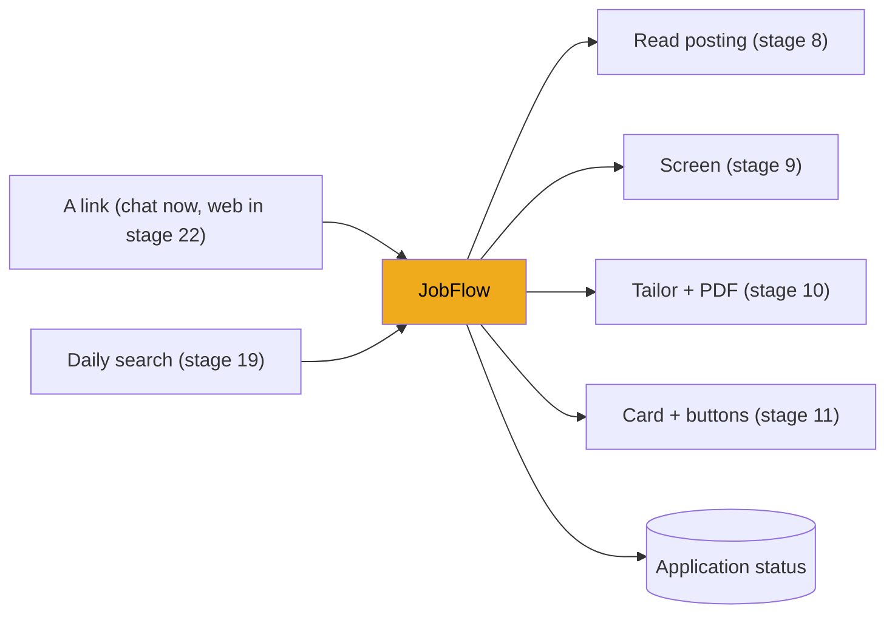
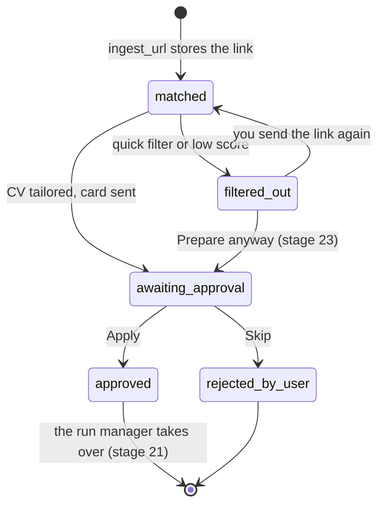
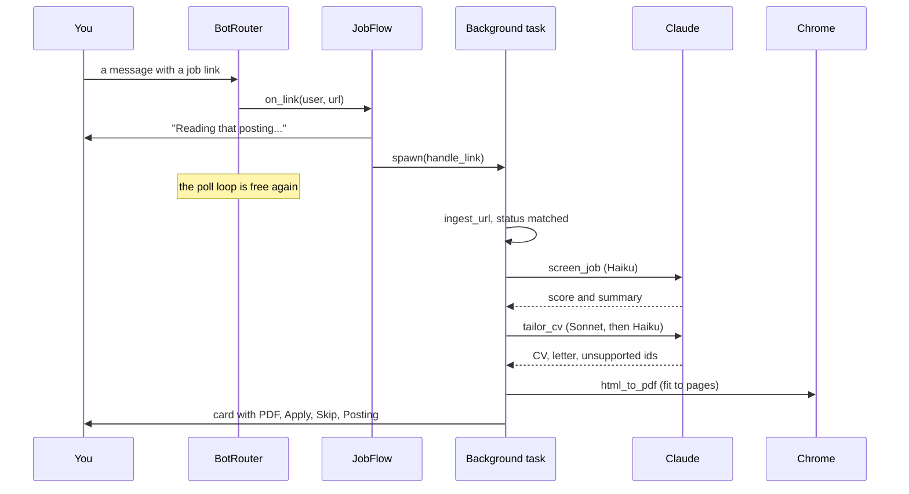

# Stage 12: The job flow

> **Goal:** Tie reading, screening and tailoring into one step-by-step flow per job, run it in the background, and let you decide on the result with Apply or Skip, so that only one decision can ever win.
>
> **By the end you will have:** `backend/app/pipeline/flow.py`, with the `JobFlow` class and its one shared instance, `job_flow`. It runs a job from link to approval card, remembers what's in progress and what went wrong, moves application statuses safely, and answers the Apply, Skip and skip-reason buttons. If you connected a Telegram bot in stage 11, sending it a job link now gets you a card with a tailored PDF.

## Where this fits

Stages 8 to 11 built the parts: read a posting, screen it, tailor a CV, send a message. This stage is the conductor that runs them in order for one job and handles your decision. Links reach it from the chat now; the web app's link box and its Apply and Skip endpoints arrive in stages 22 and 23, and the daily search in stage 19.



## New ideas in plain words

**A state machine.** An application is always in exactly one *status*, and only some moves between statuses are allowed. `awaiting_approval` can become `approved` or `rejected_by_user`, but `rejected_by_user` can never become `approved`. Writing the allowed moves down, and checking them in code, stops impossible histories like "skipped, then applied anyway". These are the moves the job flow makes (the statuses come from stage 3's `ApplicationStatus`):



**Slow work in the background.** Screening and tailoring take a minute. A chat handler must answer at once (stage 11), and later a web request shouldn't hang for a minute either: browsers give up, and you'd stare at a spinner. So the flow starts the slow part as a background task with stage 11's `spawn` and returns right away. The web endpoint in stage 22 answers `202 Accepted` ("got it, working on it"), and the page asks for news every few seconds.

**Saved state and in-memory state.** Some facts are saved in the database: the status of each application. They survive a restart. Others live only in Python objects: "application 12 is being tailored right now", or "the last attempt failed because your budget ran out". They're fast and simple, but they vanish when the server stops. JobBee keeps these two lists in memory on purpose (`stages` and `notices`): after a restart nothing is in progress anyway. The cost is that an error notice is lost on restart too.

**Don't hold a database session across a slow call.** A session holds a database connection. Once it has written something, SQLite keeps the whole file locked for writing until the session commits. SQLite allows one writer at a time; others wait up to 5 seconds (the `busy_timeout` from stage 3) and then fail with "database is locked". A Claude call can take a minute. Rows you loaded also go stale while you wait: you might click Skip in the meantime. So the flow works in three moves: read what it needs and close the session; `await` the slow call with no session open; then open a *new* session and load the rows again by id before writing.

**Compare-and-set.** Picture this. A job card is on your laptop and on your phone. You click **Apply** on the laptop, and a moment later tap **Apply** on the phone. If the code read the status, saw `awaiting_approval` both times, and then wrote `approved` both times, JobBee would fill in the same application twice. The fix is to let the database check and change in one step:

```sql
UPDATE applications SET status = 'approved'
WHERE id = 12 AND user_id = 1 AND status = 'awaiting_approval';
```

The database runs one such `UPDATE` at a time. The first changes one row. The second finds no row whose status is still `awaiting_approval`, and changes zero rows. The code looks at the number of changed rows (`rowcount`): `1` means "you won", `0` means "someone already handled it". This is *compare-and-set*: change it only if it's still what I expect. You saw the same move in stage 11's `consume`. It also makes Apply on one device and Skip on the other safe: exactly one of them wins.

**An import inside a function.** Normally imports sit at the top of a file and run when the file is loaded. An import written inside a function runs only when the function is first called. `approve` uses this for the run manager, which you write in stage 21. Step 1, Part 10 explains what that means for you until then.

## Build it, step by step

### Step 1: The flow, `backend/app/pipeline/flow.py`

This file sits in `backend/app/pipeline/` with `ingest.py` (stage 8), `screen.py` (stage 9) and `tailor.py` (stage 10). The same methods serve the chat (Telegram buttons) and, from stage 22, the web app. That's why the decisions live here and not in the HTTP handlers.

#### Part 1: Imports and names

<!-- code: backend/app/pipeline/flow.py lines=1-58 -->
**`backend/app/pipeline/flow.py`** (lines 1–58 of 623)

```python
"""Per-job flow: filter → screen → tailor CV → approval card (tap 1) → Apply/Skip.

The same methods serve the web UI (HTTP routes) and the chat (Telegram buttons):
`screen` and `prepare_card` do the work, `approve` and `skip` are the user's
decision on a card. Chat notifications are a silent no-op when no chat is
linked. Slow work runs in background tasks; `stages` says what is in flight so
the UI can show it, and `notices` keeps recent problems for the UI's inbox.
"""

from __future__ import annotations

import itertools
import logging
from dataclasses import dataclass, field
from datetime import datetime, timezone
from html import escape
from pathlib import Path

from sqlalchemy import select, update

from ..config import BACKEND_DIR
from ..db import SessionLocal
from ..documents.render_pdf import (
    cover_letter_html,
    file_stem,
    get_style,
    html_to_pdf,
    resume_html,
)
from ..llm.base import LLMError
from ..llm.factory import get_llm_provider
from ..messaging.base import Button
from ..messaging.bot import ActionContext
from ..messaging.service import MessagingService, messaging
from ..models import Application, ApplicationStatus, Document, DocumentKind, Job, User
from ..services.documents import delete_file_if_present, get_base_document, page_budget
from .ingest import IngestError, IngestResult, ingest_url
from .prefs import load_preferences, save_preferences
from .screen import hard_filter_reason, screen_job
from .tailor import StructuredCv, cv_to_text, tailor_cv

logger = logging.getLogger(__name__)

DOCS_DIR = BACKEND_DIR / "data" / "documents"

SKIP_REASONS = {
    "not_interested": "Not interested",
    "level": "Wrong level",
    "location": "Location",
    "salary": "Salary",
    "company": "This company",
}

STAGE_SCREENING = "screening"
STAGE_TAILORING = "tailoring"
_MAX_NOTICES = 20


```
<!-- /code -->

- **The imports show what this file ties together**: the printer from stage 10 (`html_to_pdf`, `resume_html` and friends), the model factory from stage 6, buttons and the messaging service from stage 11, reading and storing a link from stage 8, preferences and screening from stage 9, and the tailor from stage 10.
- **`from ..messaging.bot import ActionContext`** is why stage 11 had to come first. This file can't even be imported without the messaging package.
- **`DOCS_DIR`** is `backend/data/documents`, where tailored PDFs go, one folder per application.
- **`SKIP_REASONS`** maps the reason codes stored in the database to the button labels you see.
- **`STAGE_SCREENING` and `STAGE_TAILORING`** are the two "in progress" labels the home endpoint reports (stage 22).

#### Part 2: Errors, notices and the card's text

<!-- code: backend/app/pipeline/flow.py lines=59-111 -->
**`backend/app/pipeline/flow.py`** (lines 59–111 of 623)

```python
class FlowError(RuntimeError):
    """A user-facing reason an action can't happen (already handled, missing resume…)."""


@dataclass
class Notice:
    id: int
    user_id: int
    text: str
    level: str = "error"  # error | info
    application_id: int | None = None
    retry: bool = False
    created_at: datetime = field(default_factory=lambda: datetime.now(timezone.utc))


_notice_ids = itertools.count(1)


def _short(text: str | None, limit: int) -> str:
    text = " ".join((text or "").split())
    return escape(text if len(text) <= limit else text[: limit - 1] + "…")


def job_label(job: Job) -> str:
    return f"{job.title} at {job.company}" if job.company else job.title


def approval_caption(job: Job, app: Application) -> str:
    screen = app.screen or {}
    tailoring = app.tailoring or {}
    where = " · ".join(p for p in (job.location, job.work_mode) if p)
    lines = [
        f"<b>{_short(job.title, 90)}</b>",
        f"🏢 {_short(job.company or 'Unknown company', 60)}",
    ]
    if where:
        lines.append(f"📍 {_short(where, 80)}")
    if job.salary_text:
        lines.append(f"💰 {_short(job.salary_text, 60)}")
    if screen.get("score") is not None:
        lines.append(f"🎯 Match {int(screen['score'])}/100 — {_short(screen.get('summary'), 180)}")
    if screen.get("decision") == "drop":
        lines.append("⚠️ Probably not a fit, but you sent it, so here it is.")
    if screen.get("gaps"):
        lines.append("Gaps: " + "; ".join(_short(g, 70) for g in screen["gaps"][:2]))
    if tailoring.get("changes"):
        lines.append("✍️ CV: " + "; ".join(_short(c, 80) for c in tailoring["changes"][:2]))
    if tailoring.get("removed_claims"):
        lines.append(f"🧹 Removed {len(tailoring['removed_claims'])} claim(s) I couldn't verify.")
    lines.append("\nApply? I'll fill the form and show it to you before submitting.")
    return "\n".join(lines)


```
<!-- /code -->

- **`FlowError`** carries a sentence meant for you, such as "That one was already handled." The chat sends it as a message; the web endpoints (stage 23) turn it into a `409 Conflict` response.
- **`Notice`** is one problem or remark for the home page's inbox: its text, `error` or `info`, which application it's about, and whether a **Retry** button makes sense. `field(default_factory=...)` gives each notice its own creation time.
- **`_notice_ids = itertools.count(1)`** hands out 1, 2, 3… each time `next()` is called, so every notice gets a unique id.
- **`_short`** collapses spaces, cuts long text with "…", and escapes it.
- **`approval_caption`** writes the text of the job card in Telegram's HTML mode (stage 11): the title in bold, then company, location, salary, the match score and summary, the main gaps, two CV changes, and how many claims were removed. **Every value from the posting or the model goes through `_short`, which escapes it.** If you sent the link yourself and the model said "drop", the card says so: "Probably not a fit, but you sent it, so here it is."

#### Part 3: The flow's memory and its chat handlers

<!-- code: backend/app/pipeline/flow.py lines=112-156 -->
**`backend/app/pipeline/flow.py`** (lines 112–156 of 623)

```python
class JobFlow:
    def __init__(self, messaging: MessagingService) -> None:
        self.messaging = messaging
        self.stages: dict[int, str] = {}
        self.notices: list[Notice] = []

    # --- registration --------------------------------------------------------------

    def register(self) -> None:
        router = self.messaging.router
        router.set_url_handler(self.on_link)
        router.register_action("apply", self.on_apply)
        router.register_action("skip", self.on_skip)
        router.register_action("skip_reason", self.on_skip_reason)

    # --- notices (shown in the UI inbox) ----------------------------------------------

    def add_notice(
        self,
        user_id: int,
        text: str,
        *,
        level: str = "error",
        application_id: int | None = None,
        retry: bool = False,
    ) -> Notice:
        if application_id is not None:
            self.dismiss_for(application_id)
        notice = Notice(
            id=next(_notice_ids),
            user_id=user_id,
            text=text,
            level=level,
            application_id=application_id,
            retry=retry,
        )
        self.notices = [notice, *self.notices][:_MAX_NOTICES]
        return notice

    def dismiss_notice(self, notice_id: int) -> None:
        self.notices = [n for n in self.notices if n.id != notice_id]

    def dismiss_for(self, application_id: int) -> None:
        self.notices = [n for n in self.notices if n.application_id != application_id]

```
<!-- /code -->

- **`JobFlow` receives the messaging service** instead of importing it inside its methods. The real app passes the shared `messaging`; the tests pass their own service with a fake channel.
- **`stages`** maps an application id to what's happening right now, like `{12: "tailoring"}`. The home endpoint (stage 22) turns these into "preparing" cards. It's also a lock: the flow refuses to start a second run for an id that's already in it.
- **`notices`** is the short list of recent problems.
- **`register`** tells stage 11's `BotRouter` what to do with a pasted link and with the `apply`, `skip` and `skip_reason` buttons. The handlers are at the end of the file (Part 11). `main.py` calls `register()` when the server starts (Step 2).
- **`add_notice`** first removes older notices for the same application (one notice per job), then puts the new one at the front and keeps the newest 20. **`dismiss_notice`** and **`dismiss_for`** remove notices; the dismiss endpoint in stage 22 uses the first.

Both `stages` and `notices` are plain Python objects, so they're empty after a restart. That's a known quirk.

#### Part 4: Links, and starting work in the background

<!-- code: backend/app/pipeline/flow.py lines=157-211 -->
**`backend/app/pipeline/flow.py`** (lines 157–211 of 623)

```python
    # --- links (chat and UI) -----------------------------------------------------------

    async def on_link(self, user_id: int, url: str) -> None:
        await self.messaging.notify(user_id, "🔎 Reading that posting…", kind="progress")
        self.messaging.spawn(self.handle_link(user_id, url))

    async def handle_link(self, user_id: int, url: str) -> None:
        """Chat entry point: ingest the link, then screen and prepare it."""

        try:
            result = await self.add_link(user_id, url, source="chat")
        except IngestError as e:
            await self.messaging.notify(user_id, f"🤔 {e}", kind="error")
            return
        if not self.needs_processing(result):
            label = result.status.value.replace("_", " ")
            await self.messaging.notify(
                user_id, f"You already have this one ({label}).", kind="info"
            )
            return
        await self.process(result.application_id, user_requested=True)

    async def add_link(self, user_id: int, url: str, *, source: str = "link") -> IngestResult:
        return await ingest_url(user_id, url, source=source)

    @staticmethod
    def needs_processing(result: IngestResult) -> bool:
        return not result.duplicate or result.status in (
            ApplicationStatus.matched,
            ApplicationStatus.filtered_out,
        )

    def start(self, application_id: int, *, user_requested: bool) -> None:
        """Process in the background (the HTTP request returns right away)."""

        self.stages.setdefault(application_id, STAGE_SCREENING)
        self.messaging.spawn(self._process_started(application_id, user_requested))

    async def _process_started(self, application_id: int, user_requested: bool) -> None:
        self.stages.pop(application_id, None)
        await self.process(application_id, user_requested=user_requested)

    def start_prepare(self, application_id: int) -> None:
        """Tailor a shortlisted job in the background."""

        self.stages.setdefault(application_id, STAGE_TAILORING)
        self.messaging.spawn(self._prepare_started(application_id))

    async def _prepare_started(self, application_id: int) -> None:
        self.stages.pop(application_id, None)
        try:
            await self.prepare_card(application_id)
        except LLMError as e:
            await self._failed(application_id, e, notify_chat=False)

```
<!-- /code -->

- **`on_link`** is the chat's link handler. It must return quickly, because it runs inside stage 11's poll loop. So it sends "🔎 Reading that posting…" and hands the real work to `spawn`.
- **`handle_link`** is that real work. It reads and stores the posting (`add_link`). A bad link becomes a friendly chat message with stage 8's explanation. A job you already have gets "You already have this one (awaiting approval)". Otherwise it runs the whole pipeline with `user_requested=True`.
- **`user_requested`** means "you picked this job yourself". Such a job skips the quick filters except your own excluded companies (stage 9's `hard_filter_reason`), and is kept whatever its score.
- **`add_link`** is a thin wrapper around stage 8's `ingest_url`. The web link endpoint in stage 22 calls it too.
- **`needs_processing`** decides whether a stored link needs work. A new link always does. A duplicate does only if it never got past screening (`matched` or `filtered_out`). If it's already a card, or applied, there's nothing to do.
- **`start`** is a plain `def`, not `async`: it returns at once. It marks the job as "screening" *before* the task starts, so a page that loads a moment later already shows it as in progress. Then `spawn` runs `_process_started` in the background.
- **`_process_started`** removes that mark right before calling `process`, because `process` would otherwise see the id in `stages` and answer `"busy"`. There's no `await` between the `pop` and `process` setting the mark again, so no other task can slip in between.
- **`start_prepare`** and **`_prepare_started`** do the same for tailoring only, for a job that was already screened. The web app's **Prepare** button uses them (stage 23). A tailoring error becomes a notice.

#### Part 5: The pipeline for one job

<!-- code: backend/app/pipeline/flow.py lines=212-273 -->
**`backend/app/pipeline/flow.py`** (lines 212–273 of 623)

```python
    # --- the per-job pipeline ------------------------------------------------------------

    async def process(self, application_id: int, *, user_requested: bool) -> str:
        """Filter, screen, tailor and send the approval card. Returns the outcome."""

        if application_id in self.stages:
            return "busy"
        self.stages[application_id] = STAGE_SCREENING
        try:
            outcome = await self._screen(application_id, user_requested=user_requested)
            if outcome != "kept":
                return outcome
            await self._prepare_card(application_id)
            return "card_sent"
        except LLMError as e:
            await self._failed(application_id, e, notify_chat=user_requested)
            return "error"
        finally:
            self.stages.pop(application_id, None)

    async def screen(self, application_id: int, *, user_requested: bool = False) -> str:
        """Hard filters + Haiku screening: "filtered" | "screened_out" | "kept" | "busy"."""

        if application_id in self.stages:
            return "busy"
        self.stages[application_id] = STAGE_SCREENING
        try:
            return await self._screen(application_id, user_requested=user_requested)
        finally:
            self.stages.pop(application_id, None)

    async def prepare_card(self, application_id: int) -> str:
        """Tailor the CV and put the card in front of the user: "card_sent" | "busy"."""

        if application_id in self.stages:
            return "busy"
        self.stages[application_id] = STAGE_TAILORING
        try:
            await self._prepare_card(application_id)
            return "card_sent"
        finally:
            self.stages.pop(application_id, None)

    async def _failed(self, application_id: int, error: Exception, *, notify_chat: bool) -> None:
        logger.warning("Processing application %s failed: %s", application_id, error)
        with SessionLocal() as session:
            app = session.get(Application, application_id)
            if app is None:
                return
            label = job_label(session.get(Job, app.job_id))
            user_id = app.user_id
        self.add_notice(
            user_id,
            f"Couldn't prepare {label}: {error}",
            application_id=application_id,
            retry=True,
        )
        if notify_chat:
            await self.messaging.notify(
                user_id, f"⚠️ I couldn't finish that one: {error}", kind="error"
            )

```
<!-- /code -->

`process` runs the whole thing:

1. **If the id is already in `stages`**, someone else is working on it: return `"busy"`.
2. **Screen** (Part 6). Unless the job is kept, stop and return why: `"filtered"` or `"screened_out"`.
3. **Tailor and send the card** (Parts 7 to 9), and return `"card_sent"`.
4. **Any `LLMError` becomes a notice** through `_failed` instead of a crash. That includes stage 6's "budget used up" and this file's "Upload your resume in JobBee first."
5. **`finally` always removes the id from `stages`**, success or not. Without it, one crash would leave the job "busy" until the next restart.

`screen` and `prepare_card` run only step 2 or only step 3, with the same lock. The daily search (stage 19) uses them: it screens many jobs first, then tailors only the best ones.

`_failed` logs the error, adds an error notice with `retry=True` (so the home page can offer **Retry**), and, if you sent the link yourself, tells you in the chat as well. It reads the job's name in a short session and closes it before sending anything.

#### Part 6: Screening, without holding a session

<!-- code: backend/app/pipeline/flow.py lines=274-321 -->
**`backend/app/pipeline/flow.py`** (lines 274–321 of 623)

```python
    async def _screen(self, application_id: int, *, user_requested: bool) -> str:
        with SessionLocal() as session:
            app = session.get(Application, application_id)
            job = session.get(Job, app.job_id)
            user = session.get(User, app.user_id)
            base = get_base_document(session, user.id, DocumentKind.resume)
            if base is None or not (base.content or "").strip():
                raise LLMError("Upload your resume in JobBee first.")
            base_text = base.content
            prefs = load_preferences(user)
            reason = hard_filter_reason(user, job, prefs, user_requested=user_requested)
            if reason:
                app.status = ApplicationStatus.filtered_out
                app.stage_reason = reason
                session.commit()
                if user_requested:
                    self.add_notice(
                        user.id,
                        f"Not preparing {job_label(job)}: {reason}",
                        level="info",
                        application_id=application_id,
                    )
                    await self.messaging.notify(
                        user.id, f"Not preparing this one: {reason}", kind="filtered"
                    )
                return "filtered"
            session.expunge_all()

        verdict = await screen_job(get_llm_provider(), user, job, base_text)
        keep = user_requested or (
            verdict.decision == "keep" and verdict.score >= prefs.min_match_score
        )
        with SessionLocal() as session:
            app = session.get(Application, application_id)
            job_row = session.get(Job, app.job_id)
            app.screen = verdict.as_dict()
            job_row.match_score = float(verdict.score)
            job_row.match_reason = verdict.summary
            job_row.match_source = "llm"
            if keep:
                app.status = ApplicationStatus.matched
                app.stage_reason = None
            else:
                app.status = ApplicationStatus.filtered_out
                app.stage_reason = f"Screened out ({verdict.score}/100): {verdict.summary}"
            session.commit()
        return "kept" if keep else "screened_out"

```
<!-- /code -->

This is the "three moves" rule in action.

1. **First session: read and filter.** It loads the application, job and user. It checks that you have a base resume with text (stage 7's `get_base_document`). It runs the quick filters from stage 9. A filtered job is saved as `filtered_out` with the reason, and the function returns with no model call. If you sent the link yourself, you also get an info notice and a chat message saying why. Otherwise `session.expunge_all()` detaches `user` and `job` from the session, so they stay usable as plain data after the `with` block closes it.
2. **The slow call, with no session open.** `screen_job` (stage 9) asks Haiku.
3. **Second session: load again by id, then write.** `session.get(Application, application_id)` fetches fresh rows. The verdict is saved on the application (`app.screen`), and the score and summary are copied onto the job. A kept job becomes `matched`; a dropped one becomes `filtered_out` with "Screened out (45/100): …".

`keep` is where stage 9's threshold lives: the job is kept if the model said `keep` **and** the score reaches your `min_match_score`. A link you sent yourself is always kept.

#### Part 7: Tailoring, and restyling without Claude

<!-- code: backend/app/pipeline/flow.py lines=322-371 -->
**`backend/app/pipeline/flow.py`** (lines 322–371 of 623)

```python
    async def _prepare_card(self, application_id: int) -> None:
        self.stages[application_id] = STAGE_TAILORING
        await self.prepare_documents(application_id)
        await self.send_approval_card(application_id)
        self.dismiss_for(application_id)

    async def prepare_documents(self, application_id: int) -> None:
        with SessionLocal() as session:
            app = session.get(Application, application_id)
            job = session.get(Job, app.job_id)
            user = session.get(User, app.user_id)
            base = get_base_document(session, user.id, DocumentKind.resume)
            if base is None or not (base.content or "").strip():
                raise LLMError("Upload your resume in JobBee first.")
            base_text = base.content
            pages = page_budget(base)
            style = (app.tailoring or {}).get("style") or load_preferences(user).document_style
            session.expunge_all()

        cv = await tailor_cv(get_llm_provider(), user, job, base_text, pages)
        await self._write_documents(
            application_id,
            cv.resume,
            cv.cover_letter,
            style,
            {
                "changes": cv.changes,
                "removed_claims": cv.removed_claims[:10],
                "prepared_at": datetime.now(timezone.utc).isoformat(),
            },
        )

    async def restyle(self, application_id: int, style: str) -> None:
        """Render the same tailored CV and letter again in another style (no Claude call)."""

        with SessionLocal() as session:
            tailoring = dict(session.get(Application, application_id).tailoring or {})
        if not tailoring.get("cv"):
            raise FlowError("This CV was made before styles existed.")
        kept = {
            k: tailoring[k] for k in ("changes", "removed_claims", "prepared_at") if k in tailoring
        }
        await self._write_documents(
            application_id,
            StructuredCv.model_validate(tailoring["cv"]),
            tailoring.get("cover_letter") or "",
            style,
            kept,
        )

```
<!-- /code -->

- **`_prepare_card`** switches the stage label to "tailoring", writes the documents, sends the card, and clears any old notice for this job.
- **`prepare_documents`** follows the same three moves. The first session reads your base resume's text, its page count (stage 7's `page_budget`) and the style: the style this card already had, else your preference. Then `tailor_cv` (stage 10) runs with no session open. Its notes go into a small `tailoring` dict: the change notes, up to 10 removed claims, and the time.
- **`restyle`** prints the same CV again in another style, with no Claude call. It rebuilds the `StructuredCv` from the JSON saved in `app.tailoring["cv"]` (Part 8). The web app's style switch uses it (stage 23). A CV made before styles existed has no saved CV, hence the `FlowError`.

#### Part 8: Writing the PDFs and the document rows

<!-- code: backend/app/pipeline/flow.py lines=372-451 -->
**`backend/app/pipeline/flow.py`** (lines 372–451 of 623)

```python
    async def _write_documents(
        self,
        application_id: int,
        resume: StructuredCv,
        letter: str,
        style: str,
        tailoring: dict,
    ) -> None:
        style = get_style(style).id
        with SessionLocal() as session:
            app = session.get(Application, application_id)
            job = session.get(Job, app.job_id)
            user = session.get(User, app.user_id)
            pages = page_budget(get_base_document(session, user.id, DocumentKind.resume))
            session.expunge_all()

        stem = file_stem(resume.name or user.name or "Candidate")
        out_dir = DOCS_DIR / str(application_id)
        resume_pdf = out_dir / f"{stem}_Resume.pdf"
        await html_to_pdf(lambda fit: resume_html(resume, style, fit), resume_pdf, pages)
        cover_pdf = None
        if letter:
            cover_pdf = out_dir / f"{stem}_Cover_Letter.pdf"
            await html_to_pdf(
                lambda fit: cover_letter_html(resume, letter, job.company, job.title, style, fit),
                cover_pdf,
            )

        with SessionLocal() as session:
            app = session.get(Application, application_id)
            old = session.execute(
                select(Document).where(
                    Document.application_id == application_id, Document.is_base.is_(False)
                )
            ).scalars()
            keep_paths = {str(resume_pdf), str(cover_pdf)}
            for doc in old:
                if doc.pdf_path not in keep_paths:
                    delete_file_if_present(doc.pdf_path)
                session.delete(doc)
            title = job.title[:80]
            resume_doc = Document(
                user_id=app.user_id,
                kind=DocumentKind.resume,
                label=f"Tailored resume — {title}",
                content=cv_to_text(resume),
                pdf_path=str(resume_pdf),
                mime_type="application/pdf",
                byte_size=resume_pdf.stat().st_size,
                is_base=False,
                application_id=application_id,
            )
            session.add(resume_doc)
            cover_doc = None
            if cover_pdf is not None:
                cover_doc = Document(
                    user_id=app.user_id,
                    kind=DocumentKind.cover_letter,
                    label=f"Cover letter — {title}",
                    content=letter,
                    pdf_path=str(cover_pdf),
                    mime_type="application/pdf",
                    byte_size=cover_pdf.stat().st_size,
                    is_base=False,
                    application_id=application_id,
                )
                session.add(cover_doc)
            session.flush()
            app.resume_doc_id = resume_doc.id
            app.cover_doc_id = cover_doc.id if cover_doc else None
            app.tailoring = {
                **tailoring,
                "resume_pdf": str(resume_pdf),
                "cover_pdf": str(cover_pdf) if cover_pdf else None,
                "cv": resume.model_dump(mode="json"),
                "cover_letter": letter,
                "style": style,
            }
            session.commit()

```
<!-- /code -->

1. **Normalise the style** with `get_style(style).id`, so an unknown style becomes `modern`.
2. **A short session** reads the job, the user and the page budget, then detaches them.
3. **Print, with no session open.** PDFs go in `backend/data/documents/<application id>/`, named like `Lin_Ho_Resume.pdf` (stage 10's `file_stem`). The resume must fit your page budget. The cover letter uses `html_to_pdf`'s default budget of one page. Each `lambda fit: ...` is the `build` function from stage 10: it captures the CV and style, and returns the HTML for a given fit level.
4. **A second session writes the rows.** It deletes older tailored documents for this application, and their files, except a file at the same path as one it has printed this time (`keep_paths`). Then it adds new `Document` rows with `is_base=False` and the application's id: the resume, whose `content` is `cv_to_text(resume)` (stage 10), and the cover letter.
5. **`session.flush()`** sends the new rows to the database without committing, so they get their ids. Those ids go into `app.resume_doc_id` and `app.cover_doc_id`.
6. **`app.tailoring` keeps everything needed to reprint**: the change notes and removed claims, the PDF paths, the structured CV as JSON (`model_dump(mode="json")`), the letter and the style. That's what makes `restyle` and the style previews (stage 10) possible without a new Claude call.

#### Part 9: The approval card

<!-- code: backend/app/pipeline/flow.py lines=452-486 -->
**`backend/app/pipeline/flow.py`** (lines 452–486 of 623)

```python
    async def send_approval_card(self, application_id: int) -> None:
        with SessionLocal() as session:
            app = session.get(Application, application_id)
            job = session.get(Job, app.job_id)
            caption = approval_caption(job, app)
            resume_pdf = (app.tailoring or {}).get("resume_pdf")
            user_id, url = app.user_id, job.url
            app.status = ApplicationStatus.awaiting_approval
            session.commit()
        group = self.messaging.new_group()
        buttons = [
            [
                self.messaging.button(
                    user_id, "✅ Apply", "apply", target_id=application_id, group=group
                ),
                self.messaging.button(
                    user_id, "⏭ Skip", "skip", target_id=application_id, group=group
                ),
            ],
            [Button("🔗 Posting", url=url)],
        ]
        message_id = await self.messaging.notify(
            user_id,
            caption,
            buttons=buttons,
            document=Path(resume_pdf) if resume_pdf else None,
            html=True,
            kind="approval_card",
            application_id=application_id,
        )
        with SessionLocal() as session:
            app = session.get(Application, application_id)
            app.card_message_id = message_id
            session.commit()

```
<!-- /code -->

- **Setting `awaiting_approval` is what puts the job in your inbox.** The web app (stages 22 and 27) shows a card for every application in that status, whether or not a chat message was sent.
- **The buttons.** Apply and Skip are made with stage 11's `button` and share one group, so tapping one spends both. The third button opens the posting's URL.
- **`notify`** sends the caption with the resume PDF attached. With no bot paired, it only logs the card in `chat_messages` and returns `None`.
- **`card_message_id`** saves the returned message id, so the buttons can be removed when you decide (Part 10), even if you decide in the web app.

Here is the whole path for a link you send in the chat:



#### Part 10: Your decision: Apply or Skip

<!-- code: backend/app/pipeline/flow.py lines=487-574 -->
**`backend/app/pipeline/flow.py`** (lines 487–574 of 623)

```python
    # --- the user's decision on a card (UI and chat) ---------------------------------------

    @staticmethod
    def _transition(application_id: int, user_id: int, src, dst) -> bool:
        with SessionLocal() as session:
            result = session.execute(
                update(Application)
                .where(
                    Application.id == application_id,
                    Application.user_id == user_id,
                    Application.status == src,
                )
                .values(status=dst)
            )
            session.commit()
            return result.rowcount == 1

    @staticmethod
    def _card(application_id: int) -> tuple[str | None, str]:
        with SessionLocal() as session:
            app = session.get(Application, application_id)
            job = session.get(Job, app.job_id)
            return app.card_message_id, job.company or "the company"

    async def approve(self, application_id: int, user_id: int) -> int:
        """Apply: queue the agent. Returns the run id."""

        from ..apply.runs import RunConflictError, run_manager

        if not self._transition(
            application_id,
            user_id,
            ApplicationStatus.awaiting_approval,
            ApplicationStatus.approved,
        ):
            raise FlowError("That one was already handled.")
        card_id, company = self._card(application_id)
        await self.messaging.clear_buttons(user_id, card_id)
        try:
            run_id = run_manager.enqueue(application_id)
        except (RunConflictError, ValueError, LookupError) as e:
            raise FlowError(str(e)) from e
        await self.messaging.notify(
            user_id,
            f"👍 On it. I'll fill in the {company} application and show it to you before "
            "anything is submitted.",
            kind="approved",
            application_id=application_id,
        )
        return run_id

    async def skip(self, application_id: int, user_id: int, reason: str | None = None) -> str:
        """Skip a card, optionally saying why. Returns a short confirmation."""

        if not self._transition(
            application_id,
            user_id,
            ApplicationStatus.awaiting_approval,
            ApplicationStatus.rejected_by_user,
        ):
            raise FlowError("That one was already handled.")
        card_id, _ = self._card(application_id)
        await self.messaging.clear_buttons(user_id, card_id)
        self.dismiss_for(application_id)
        if reason:
            return self.record_skip_reason(application_id, user_id, reason)
        with SessionLocal() as session:
            session.get(Application, application_id).stage_reason = "Skipped"
            session.commit()
        return "Skipped."

    @staticmethod
    def record_skip_reason(application_id: int, user_id: int, reason: str) -> str:
        reply = "Thanks, noted."
        with SessionLocal() as session:
            app = session.get(Application, application_id)
            job = session.get(Job, app.job_id)
            user = session.get(User, user_id)
            app.stage_reason = f"Skipped: {SKIP_REASONS.get(reason, reason)}"
            prefs = load_preferences(user)
            prefs.skip_reasons[reason] = prefs.skip_reasons.get(reason, 0) + 1
            if reason == "company" and job.company and not prefs.excludes(job.company):
                prefs.excluded_companies.append(job.company)
                reply = f"Got it — I won't send {job.company} jobs again."
            save_preferences(user, prefs)
            session.commit()
        return reply

```
<!-- /code -->

**`_transition`** is the compare-and-set from "New ideas", written with SQLAlchemy's `update()`. `Application.status == src` in the `WHERE` is the "compare"; `.values(status=dst)` is the "set"; `rowcount == 1` means this call made the change. It also checks `user_id`, so nobody can move someone else's application.

**`_card`** returns the card's chat message id and the company name.

**`approve`** is what Apply does:

1. **The import comes first.** `from ..apply.runs import RunConflictError, run_manager` runs when `approve` is called, not when this file loads. `runs.py` pulls in the whole apply engine (the browser driver and the agent), so `flow.py` stays light to import.
2. **The transition** from `awaiting_approval` to `approved`. If it fails, someone already decided: `FlowError("That one was already handled.")`.
3. **The chat card's buttons are removed**, and the job is queued with `run_manager.enqueue`, which returns the id of the new apply run. If the run manager refuses (stage 21 explains when), its reason becomes a `FlowError`; the status has already moved to `approved` by then.
4. **A short confirmation** goes to the chat, and the run id is returned.

**What happens before stage 21.** `backend/app/apply/runs.py` doesn't exist until stage 21. Because the import is the first line of `approve`, calling it now raises `ModuleNotFoundError: No module named 'app.apply.runs'` **before** `_transition` runs, so the status stays `awaiting_approval`. Nothing in your app calls `approve` yet except the chat's Apply button. If you tap Apply on a Telegram card before stage 21, the card's buttons disappear (the tap spent them, and `on_apply` clears them first), the server console shows "Handling Telegram update failed" with that error, and the job stays waiting. It can still be applied to later, through the Apply endpoint (stage 23) or the web inbox (stage 27). So for now, try Skip instead.

**`skip`** is the same move to a different status: `awaiting_approval` to `rejected_by_user`. Because Apply and Skip both start from `awaiting_approval`, whichever runs first wins, and the other gets `FlowError`. Then it removes the card's buttons and any notice. With a reason, it calls `record_skip_reason`; without one, it sets the reason to "Skipped".

**`record_skip_reason`** saves why you skipped and learns from it:

- `stage_reason` becomes, for example, "Skipped: Salary".
- The reason is counted in your preferences (`prefs.skip_reasons`, stage 9), so JobBee keeps a tally of why you say no.
- The reason `company` adds the company to `excluded_companies`, so the quick filters (stage 9) drop its jobs from now on. The reply says "Got it — I won't send Acme jobs again."

#### Part 11: The chat buttons, and the shared instance

<!-- code: backend/app/pipeline/flow.py lines=575-623 -->
**`backend/app/pipeline/flow.py`** (lines 575–623 of 623)

```python
    # --- chat buttons ----------------------------------------------------------------------

    async def on_apply(self, ctx: ActionContext) -> None:
        await self.messaging.clear_buttons(ctx.user_id, ctx.message_id)
        try:
            await self.approve(ctx.token.target_id, ctx.user_id)
        except FlowError as e:
            await self.messaging.notify(ctx.user_id, str(e))

    async def on_skip(self, ctx: ActionContext) -> None:
        app_id = ctx.token.target_id
        await self.messaging.clear_buttons(ctx.user_id, ctx.message_id)
        try:
            await self.skip(app_id, ctx.user_id)
        except FlowError as e:
            await self.messaging.notify(ctx.user_id, str(e))
            return
        group = self.messaging.new_group()
        keys = list(SKIP_REASONS)
        buttons = [
            [
                self.messaging.button(
                    ctx.user_id,
                    SKIP_REASONS[k],
                    "skip_reason",
                    target_id=app_id,
                    payload={"reason": k},
                    group=group,
                )
                for k in keys[i : i + 3]
            ]
            for i in range(0, len(keys), 3)
        ]
        await self.messaging.notify(
            ctx.user_id,
            "Skipped. Why? (It helps me pick better ones.)",
            buttons=buttons,
            kind="skip",
            application_id=app_id,
        )

    async def on_skip_reason(self, ctx: ActionContext) -> None:
        reason = (ctx.token.payload or {}).get("reason", "not_interested")
        await self.messaging.clear_buttons(ctx.user_id, ctx.message_id)
        reply = self.record_skip_reason(ctx.token.target_id, ctx.user_id, reason)
        await self.messaging.notify(ctx.user_id, reply, kind="info")


job_flow = JobFlow(messaging)
```
<!-- /code -->

- **`on_apply`** removes the tapped card's buttons, then calls the very same `approve` as the web app's Apply endpoint (stage 23). A `FlowError` becomes a chat message, so a late tap after you applied on your PC gets "That one was already handled." That's "whichever side acts first wins" in a few lines.
- **`on_skip`** calls `skip`, then asks why with five reason buttons in a new group, three per row. `keys[i : i + 3]` slices the list of reasons into rows of three.
- **`on_skip_reason`** reads the reason from the token's `payload` (stage 11), records it, and replies.
- **`job_flow = JobFlow(messaging)`** creates the one shared instance. The home and agent endpoints (stage 22), the application endpoints (stage 23) and the daily search (stage 19) all import it.

### Step 2: Update the temporary `backend/app/main.py`

<!-- temp: backend/app/main.py -->
```python
"""FastAPI entry point.

Temporary version from stage 12. Stage 23 replaces it with the final file.
"""

from __future__ import annotations

import asyncio
import sys

# Playwright spawns a browser subprocess; uvicorn's default Windows loop cannot do that.
if sys.platform == "win32":
    asyncio.set_event_loop_policy(asyncio.WindowsProactorEventLoopPolicy())

from contextlib import asynccontextmanager

from fastapi import FastAPI
from fastapi.middleware.cors import CORSMiddleware

from . import __version__
from .api import health
from .api import settings as settings_router
from .api import llm
from .api import profile as profile_router
from .api import documents as documents_router
from .api import messaging as messaging_router
from .api import preferences as preferences_router
from .config import get_settings
from .db import init_db
from .messaging.service import messaging
from .pipeline.flow import job_flow


@asynccontextmanager
async def lifespan(_: FastAPI):
    init_db()
    job_flow.register()
    await messaging.start()
    yield
    await messaging.stop()


def create_app() -> FastAPI:
    settings = get_settings()
    app = FastAPI(
        title="JobBee API",
        version=__version__,
        lifespan=lifespan,
    )

    # In dev the Vite proxy handles same-origin, but allow direct browser calls too.
    app.add_middleware(
        CORSMiddleware,
        allow_origins=["http://localhost:5173", "http://127.0.0.1:5173"]
        if settings.is_dev
        else [],
        allow_credentials=True,
        allow_methods=["*"],
        allow_headers=["*"],
    )

    app.include_router(health.router, prefix="/api")
    app.include_router(settings_router.router, prefix="/api")
    app.include_router(llm.router, prefix="/api")
    app.include_router(profile_router.router, prefix="/api")
    app.include_router(documents_router.router, prefix="/api")
    app.include_router(messaging_router.router, prefix="/api")
    app.include_router(preferences_router.router, prefix="/api")

    @app.get("/", include_in_schema=False)
    def root() -> dict:
        return {
            "name": "JobBee API",
            "version": __version__,
            "docs": "/docs",
            "health": "/api/health",
        }

    return app


app = create_app()
```
<!-- /temp -->

Two lines changed since the stage 11 version: the import of `job_flow`, and `job_flow.register()` in the lifespan. It runs **before** `messaging.start()`, so the link handler and the Apply and Skip buttons are registered before the first update can arrive. Stage 23 replaces this file with the final one.

## Check it works

The HTTP endpoints for links, Apply and Skip arrive in stages 22 and 23, and the full flow tests (`tests/test_pipeline.py`) run in [stage 23](23-api-actions-and-setup.md), once the run manager they need exists. For now, check that the app starts with the flow, then try the flow directly.

### 1. The app starts with the flow registered

From the `backend` folder, start the server **without** `--reload`:

```powershell
.\.venv\Scripts\python.exe -m uvicorn app.main:app
```

Open http://127.0.0.1:8000/api/health. You should see `"status": "ok"`, and the console should show no import errors. (The hidden check for this stage does the same with `TestClient`.)

Why no `--reload`? With it, every saved file restarts the server, and a restart cancels running background tasks, such as a job halfway through tailoring.

### 2. Run one link through the flow

This practice script is **not part of JobBee**. It runs one link through `job_flow` without the web app or Telegram. It needs your Claude key (stage 6), your imported resume (stage 7) and a browser for printing. One job costs a few cents. Create `practice/try_flow.py`:

<!-- practice: practice/try_flow.py -->
```python
"""Practice, not part of JobBee: run one job link through the job flow, without the web app.

Needs your Claude key (stage 6), your imported resume (stage 7) and Chrome or Edge.
Costs a few cents. Run it from the project folder with the backend's Python and a link.
"""

import asyncio
import sys
from pathlib import Path

sys.path.insert(0, str(Path(__file__).resolve().parent.parent / "backend"))

from app.api.profile import get_or_create_local_user  # noqa: E402
from app.db import SessionLocal, init_db  # noqa: E402
from app.models import Application  # noqa: E402
from app.pipeline.flow import job_flow  # noqa: E402
from app.pipeline.ingest import IngestError  # noqa: E402


async def main(url: str) -> None:
    init_db()
    with SessionLocal() as session:
        user_id = get_or_create_local_user(session).id
    try:
        result = await job_flow.add_link(user_id, url, source="link")
    except IngestError as e:
        print("Couldn't use that link:", e)
        return
    print(f"Application {result.application_id}: {result.status.value}")
    if not job_flow.needs_processing(result):
        print("You already have this one, so there's nothing to do.")
        return
    print("Screening and tailoring, about a minute...")
    print("Outcome:", await job_flow.process(result.application_id, user_requested=True))
    with SessionLocal() as session:
        app = session.get(Application, result.application_id)
        tailoring = app.tailoring or {}
        print("Status:", app.status.value, app.stage_reason or "")
        for note in tailoring.get("changes", []):
            print("  changed:", note)
        for claim in tailoring.get("removed_claims", []):
            print("  removed:", claim)
        print("Resume PDF:", tailoring.get("resume_pdf"))
    for notice in job_flow.notices:
        print("Notice:", notice.text)


asyncio.run(main(sys.argv[1]))
```
<!-- /practice -->

Run it from the project folder (the one that holds `backend/` and `practice/`) with a real posting link, for example a Greenhouse or Lever job:

```powershell
backend\.venv\Scripts\python.exe practice\try_flow.py "https://jobs.lever.co/<company>/<job-id>"
```

On Mac or Linux, use `backend/.venv/bin/python practice/try_flow.py "..."`. After about a minute you should see something like:

```text
Application 3: matched
Screening and tailoring, about a minute...
Outcome: card_sent
Status: awaiting_approval
  changed: Moved the FastAPI work to the top of the Acme entry
  changed: Mirrored the posting's wording for API design
Resume PDF: C:\...\backend\data\documents\3\Lin_Ho_Resume.pdf
```

Open the PDF. If something went wrong, you see `Outcome: error` and a `Notice:` line instead, such as "Couldn't prepare Backend Engineer at Acme: Upload your resume in JobBee first." Run the script again with the same link: it says you already have this one.

### 3. Send a link to your bot (optional)

If you connected Telegram in stage 11, keep the server running and send your bot a job link:

1. The bot answers "🔎 Reading that posting…" at once.
2. About a minute later the card arrives: the PDF, the match score and notes, and **✅ Apply**, **⏭ Skip** and **🔗 Posting**.
3. Tap **Skip**. The bot asks "Skipped. Why?" with five reason buttons. Tap **Salary**: it answers "Thanks, noted."
4. Don't tap **Apply** yet: see Part 10. It works from stage 21.

Without Telegram, the same card is still recorded. The stage 11 one-liner that prints `chat_messages` shows an `out approval_card` line for each card.

### The tests come later

`tests/test_pipeline.py` (in stage 23) checks this file without a real model, a real browser or Telegram. A scripted fake model answers the screening, tailoring and fact-check prompts; a fake printer writes a tiny file instead of a PDF; and a fake channel records the messages. Its flow tests send a link through `handle_link` and check that the card has the PDF and the score, that Claude was called in the order screen, tailor, fact_check, that tapping Apply queues exactly one run, and that Skip on the same card is then refused. Another taps Skip and **This company** and checks that the company lands in `excluded_companies`. You'll run them once the run manager exists.

<!-- verify: backend | SECRET_STORE=memory python -c "from fastapi.testclient import TestClient; from app.main import app; c = TestClient(app).__enter__(); print(c.get('/api/health').json())" -->

## Common mistakes

- **Read the status, then write the new one.** Two requests (or a phone and a laptop) can both read `awaiting_approval` and both write `approved`. Use `_transition`'s single `UPDATE ... WHERE status = <expected>` and check that `rowcount == 1`.
- **Holding a session across a Claude call.** A `with SessionLocal()` block wrapped around `await screen_job(...)` keeps a connection open for a minute, and a write lock if anything was written. Other requests then fail with "database is locked". Read, close, await, then open a new session and reload by id.
- **Expecting notices and progress to survive a restart.** `job_flow.stages` and `job_flow.notices` live in memory. After a restart, a job that was being tailored is plain `matched` again, with no notice. Send the link again (or, from stage 23, use **Prepare**).
- **Running with `--reload` while testing a job.** Every saved file restarts the server and cancels running tasks. Fine while you write code, not while a one-minute job runs.
- **Expecting every failure to become a notice.** Only `LLMError` does (Claude errors, budget, missing resume). Anything else, such as `RuntimeError: No Chrome/Edge available to render PDFs.`, ends up only in the server log through `spawn`'s callback, and the job stays `matched`. If a link seems to vanish, read the console.
- **Tapping Apply before stage 21.** `approve` needs `app/apply/runs.py`. Until it exists, Apply fails with `ModuleNotFoundError` and the card loses its buttons. Use Skip to try the buttons.

## Recap

- An application moves through a small state machine: `matched`, then `filtered_out` or `awaiting_approval`, then `approved` or `rejected_by_user`.
- `JobFlow.process` runs filter, screen, tailor and card in order. `stages` stops two runs of the same job; `LLMError`s become notices. Both lists live in memory.
- Slow work runs in background tasks started with stage 11's `spawn`, so chat handlers (and, later, web requests) answer at once.
- Database sessions are closed before every slow `await`, and rows are reloaded by id afterwards.
- Apply and Skip use an atomic compare-and-set, so only one can ever win; the loser gets `FlowError("That one was already handled.")`.
- `register()` connects the chat's links and buttons to the same methods the web app uses from stage 22 on.
- `approve` imports the run manager lazily; until stage 21 it fails before changing anything.

**Next:** [Stage 13: Email alerts](13-email-alerts.md)
