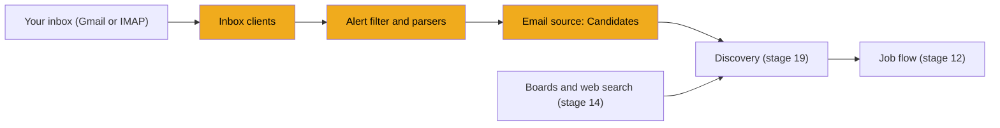
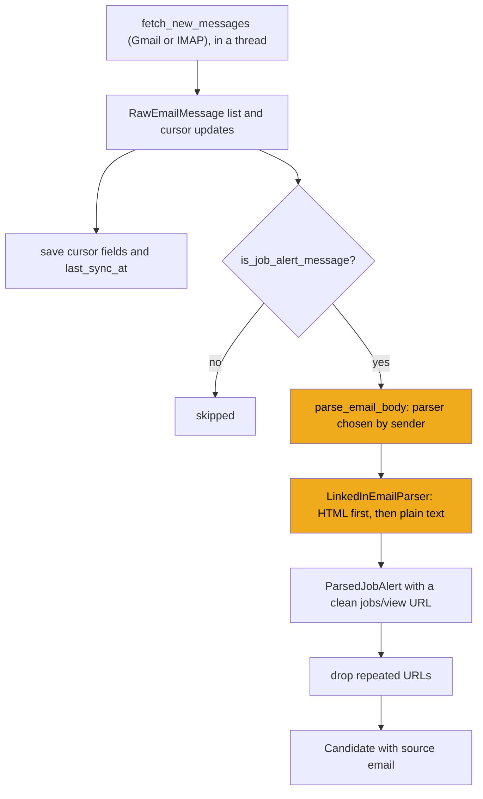
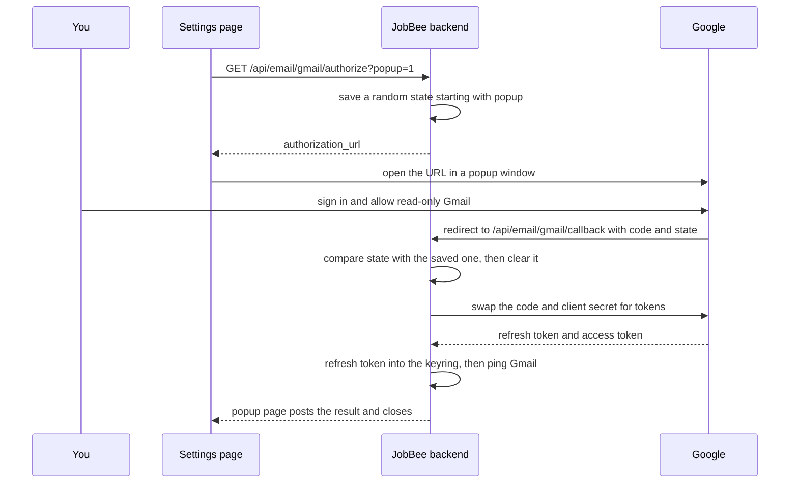

# Stage 13: Email alerts

> **Goal:** Turn the LinkedIn job-alert emails in your inbox into job leads, using plain code and no model, so the daily search (stage 19) can use them.
>
> **By the end you will have:** inbox clients for Gmail (through "Sign in with Google") and for any IMAP mailbox, a parser that pulls jobs out of LinkedIn alert emails, the email source that discovery calls, the shared `Candidate` type that every job source returns, and the `/api/email` endpoints.
>
> **Optional to use:** you can skip connecting Gmail or IMAP, and you can skip the one-time Google setup (Steps 14 and 15). JobBee works without an inbox. The code is still required: discovery (stage 19), the site-account email reader (stage 18), the run manager (stage 21) and the home endpoint (stage 22) all import it.

## Where this fits

Stage 12 gave each job a life from link to Apply. Stages 13 and 14 add the places those links come from. This stage reads the alert emails LinkedIn already sends you and turns each job in them into a *candidate*: a link plus what the email says about it.



## New ideas in plain words

This stage talks to Google and to mail servers, so there are more new words than usual. Each one shows up in the code.

**Job-alert emails.** On LinkedIn you can save a search, such as "Python Developer in Toronto". LinkedIn then emails you new matches every day or week. Each email holds several job links, each with a title, a company and a location. JobBee reads these emails as one more source of job links.

**OAuth 2, the valet key.** Some cars come with a valet key: it starts the car but can't open the boot. OAuth gives apps the same kind of key. Instead of typing your Google password into JobBee, you sign in on Google's own page and approve one narrow permission, "read your Gmail". That permission is called a *scope*; JobBee asks for `gmail.readonly`. Google then gives JobBee a key that can do only that. You can take it back at any time in your Google account settings. JobBee never sees your password.

**Client ID, client secret and redirect URI.** Google needs to know which app is asking. The person installing JobBee registers it once in Google Cloud Console and gets two values. The *client ID* is public, like a username. The *client secret* is private, like a password. They identify the app, not you. The registration also lists a *redirect URI*: the address Google sends your browser back to after you approve. Google refuses any other address, so a stranger can't receive your approval.

**Codes and tokens.** After you approve, Google sends your browser back to JobBee with a one-time *authorization code*. The backend swaps that code, together with the client secret, for two tokens:

| Thing | Lifetime | Used for |
|---|---|---|
| Authorization code | Short, and only once | Swapping for the two tokens below |
| Access token | About an hour | Calling the Gmail API: "list my messages" |
| Refresh token | Until you revoke it | Getting a new access token when the old one expires |

JobBee keeps only the refresh token, in the keyring ([stage 2](02-secrets.md)). Each sync starts by trading it for a fresh access token.

**The `state` value.** Before sending you to Google, JobBee makes up a random value and saves it. Google passes it back unchanged with the code. If the value that comes back doesn't match, the sign-in didn't start from your own click. Someone may be trying to attach *their* Gmail to *your* JobBee by making your browser open a crafted link. JobBee refuses it.

**Gmail API vs IMAP.** JobBee can read mail in two ways:

| | Gmail API | IMAP |
|---|---|---|
| What it is | Google's web API for Gmail: HTTPS requests with JSON answers | The decades-old standard way mail programs read a mailbox |
| Works with | Gmail only | Almost every provider (Outlook, Yahoo, Fastmail, Gmail…) |
| How you log in | OAuth (the valet key) | Your address plus an *app password* |
| Finding alerts | Gmail's own search language, like the Gmail search box | Simple searches, such as "unread messages" |

An *app password* is a separate password you create in your mail account's security settings for one app. It isn't your normal password, and you can delete it without changing anything else. Most providers require one for IMAP.

**Cursors.** A *cursor* is a bookmark: it remembers where the last sync stopped, so the next sync reads only newer mail.

- Gmail has a **history id**: a counter that goes up with every change in the mailbox. JobBee asks "what was added since history 9912345?".
- IMAP gives each message in a folder a **UID** (unique id), a number that only goes up. JobBee asks for "UIDs above 5120". A server may renumber a folder now and then. When it does, it changes the folder's **UIDVALIDITY** number. If UIDVALIDITY changed, the saved UID means nothing, and JobBee starts again from the beginning.

**What an email looks like inside.** An email is text: *headers* such as `From:`, `Subject:` and `Date:`, a blank line, then the body. Most emails today are *multipart*: the same message twice, once as plain text and once as HTML (the web-page version with links and layout). Parts are often encoded to survive old mail systems, for example as *base64* (binary data written with 64 safe characters). A subject with accents may arrive as `=?UTF-8?B?...?=`. Python's built-in `email` package undoes all of this. The Gmail API returns the same tree of parts as JSON.

**Deterministic parsing.** *Deterministic* means "same input, same output, every time". JobBee finds jobs in an alert email with plain code: an HTML parser and regular expressions. No model is involved. That's free, instant and testable. It also means the text of your emails never reaches a model at this step, so an email can't smuggle instructions to one.

**More regular expressions.** [Stage 6](06-talking-to-claude.md) introduced regex. The parsers use a few more symbols:

| Pattern | Means |
|---|---|
| `[^<]` | any one character except `<` |
| `{2,120}` | the thing before, between 2 and 120 times |
| `+?` and `*?` | as few repeats as possible (stop at the first chance) |
| `(?:...)` | a group that isn't captured, used for "one of these" |
| `(?P<title>...)` | a captured group with a name, read back with `match.group("title")` |
| `\d+` | one or more digits |
| `re.IGNORECASE` | upper and lower case match each other |

**Tracking links.** Emails rarely link straight to the job. They link to a *tracking link* such as `https://click.linkedin.com/redirect?url=https%3A%2F%2Fwww.linkedin.com%2Fjobs%2Fview%2F42`. Clicking it counts your click and then forwards you to the real page. The real address is inside the `url=` part, *percent-encoded*: `%3A` is `:` and `%2F` is `/`. *Unwrapping* means reading the real address out of that parameter, without visiting the link.

**A parser registry.** A *registry* is a list that pieces of code add themselves to. Each email parser says which senders it handles. To parse an email, JobBee asks the registry "who handles this sender?". Support for another site (Indeed, say) means writing one parser class and registering it. Nothing else changes.

**Blocking code and `asyncio.to_thread`.** The event loop ([stage 8](08-reading-job-postings.md)) is like one cook watching many pots. Some libraries can't be awaited: `imaplib` and `httpx.Client` (the non-async client) *block*. The cook stands at one pot until it boils, and every other request to the server waits. `await asyncio.to_thread(func, ...)` hands that pot to a helper: it runs `func` in a separate *thread* (a second line of work inside the same program). The cook keeps serving other requests and picks up the result when it's ready. FastAPI does the same thing on its own for endpoints written with plain `def` instead of `async def`: it runs them in a pool of helper threads.

**Popups and `postMessage`.** An *origin* is the scheme, host and port of a page, such as `http://localhost:5173`. Pages from different origins can't read each other. Gmail sign-in runs in a small popup window, and when it ends, the popup's page must tell the main page how it went. `window.opener.postMessage(data, targetOrigin)` sends a message to the window that opened the popup. The browser delivers it only if that window is at `targetOrigin`. The receiver checks where the message came from (`event.origin`) before trusting it; you'll write that side in stage 28.

## Build it, step by step

Here is where this stage's files go. Follow the steps in order: each file imports only files that already exist.

```text
backend/
├── app/
│   ├── agents/
│   │   ├── email_agent.py           ← Step 9
│   │   └── email_parsers/
│   │       ├── __init__.py          ← Step 8
│   │       ├── base.py              ← Step 6
│   │       └── linkedin.py          ← Step 7
│   ├── api/
│   │   └── email.py                 ← Step 13
│   ├── pipeline/
│   │   └── sources/
│   │       ├── __init__.py          ← Step 10
│   │       ├── base.py              ← Step 11
│   │       └── email_alerts.py      ← Step 12
│   └── services/
│       ├── email_sync.py            ← Step 1
│       ├── email_connection.py      ← Step 2
│       ├── email_client.py          ← Step 3
│       ├── gmail_oauth.py           ← Step 4
│       └── gmail_oauth_ui.py        ← Step 5
├── scripts/
│   ├── setup_gmail_oauth.py         ← Step 14
│   └── setup_gmail_oauth.ps1        ← Step 15
└── tests/
    └── fixtures/emails/             ← Check it works
```

The database table already exists. Stage 3's `models.py` has `EmailSyncState` (table `email_sync_states`): one row per user with the provider (`gmail`, `imap` or empty), the connected address, the cursors (`gmail_history_id`, `imap_uid_validity`, `imap_last_uid`), the IMAP host, user and folder, and the pending OAuth `state`. The secrets are not in it. The Gmail refresh token and the IMAP app password go to the keyring, through stage 2's `get_user_secret` and `set_user_secret`.

### Step 1: The sync row, `backend/app/services/email_sync.py`

Every email feature starts by loading the user's `EmailSyncState` row. This helper returns it, creating it the first time. `scalar_one_or_none()` returns the one matching row, or `None` when there is none. A new row is committed and refreshed straight away, so it has its `id` and its defaults (such as `imap_folder="INBOX"`) before anyone uses it. The column `user_id` is unique, so there can never be two rows for one user.

<!-- code: backend/app/services/email_sync.py -->
**`backend/app/services/email_sync.py`** (whole file, 22 lines)

```python
"""Helpers for persisting email inbox sync cursors."""

from __future__ import annotations

from sqlalchemy import select
from sqlalchemy.orm import Session

from ..models import EmailSyncState


def get_or_create_email_sync_state(session: Session, user_id: int) -> EmailSyncState:
    """Return the user's email sync row, creating it on first call."""

    state = session.execute(
        select(EmailSyncState).where(EmailSyncState.user_id == user_id)
    ).scalar_one_or_none()
    if state is None:
        state = EmailSyncState(user_id=user_id)
        session.add(state)
        session.commit()
        session.refresh(state)
    return state
```
<!-- /code -->

### Step 2: Saving and loading a connection, `backend/app/services/email_connection.py`

This file knows what "connected" means and how to save or forget a connection. It joins two stores: the database row (Step 1) and the keyring (stage 2). None of its functions commit; the caller commits when it's ready.

#### Part 1: Reading a connection

- **`UserEmailConnection`** is a snapshot of everything an inbox client needs, secrets included. `frozen=True` makes it read-only after creation, so nobody can change it on the way.
- **`user_is_connected(state)`** asks for both halves. For Gmail, the row says `gmail` **and** a refresh token is in the keyring. For IMAP, the row has a host and a user **and** an app password is in the keyring. Why check both? The keyring is written at once, while row changes wait for a commit. If one of the two writes didn't happen, JobBee reports "not connected" instead of failing later with a half-saved connection. `"disabled"` is the word the API uses for "no inbox".
- **`connection_from_state(state)`** builds the snapshot, or returns `None`. The `assert` only tells type checkers that `provider` is now `gmail` or `imap`. An empty folder name becomes `INBOX`, the standard name for the main folder.

<!-- code: backend/app/services/email_connection.py lines=1-59 -->
**`backend/app/services/email_connection.py`** (lines 1–59 of 126)

```python
"""Per-user inbox connection helpers.

Connection metadata lives in SQLite; the Gmail refresh token and IMAP app
password live in the secret store (`services/secrets.py`).
"""

from __future__ import annotations

from dataclasses import dataclass
from datetime import datetime, timezone

from sqlalchemy.orm import Session

from ..config import Settings
from ..models import EmailSyncState
from .app_config import gmail_oauth_configured
from .secrets import GMAIL_REFRESH_TOKEN, IMAP_APP_PASSWORD, get_user_secret, set_user_secret


@dataclass(frozen=True)
class UserEmailConnection:
    provider: str
    connected_email: str | None
    gmail_refresh_token: str | None = None
    imap_host: str | None = None
    imap_user: str | None = None
    imap_app_password: str | None = None
    imap_folder: str = "INBOX"


def user_is_connected(state: EmailSyncState) -> bool:
    if not state.provider or state.provider == "disabled":
        return False
    if state.provider == "gmail":
        return get_user_secret(state.user_id, GMAIL_REFRESH_TOKEN) is not None
    if state.provider == "imap":
        return bool(
            (state.imap_host or "").strip()
            and (state.imap_user or "").strip()
            and get_user_secret(state.user_id, IMAP_APP_PASSWORD) is not None
        )
    return False


def connection_from_state(state: EmailSyncState) -> UserEmailConnection | None:
    if not user_is_connected(state):
        return None
    assert state.provider in ("gmail", "imap")
    return UserEmailConnection(
        provider=state.provider,
        connected_email=state.connected_email,
        gmail_refresh_token=get_user_secret(state.user_id, GMAIL_REFRESH_TOKEN),
        imap_host=state.imap_host,
        imap_user=state.imap_user,
        imap_app_password=get_user_secret(state.user_id, IMAP_APP_PASSWORD),
        imap_folder=(state.imap_folder or "INBOX").strip() or "INBOX",
    )


```
<!-- /code -->

#### Part 2: Saving and clearing

- **`clear_email_connection(state)`** forgets everything: provider, address, both secrets (stage 2's `set_user_secret(..., None)` deletes a secret), both cursors and any pending OAuth `state`.
- **`save_gmail_connection` and `save_imap_connection`** always clear first. Switching from IMAP to Gmail can't leave an old app password or an IMAP cursor behind. For IMAP, the connected address is the login name.
- **`mailbox_label`** is shown on the status endpoint: `"me"` for Gmail (the Gmail API calls the signed-in user `me`), or the IMAP folder.
- **`status_provider`** returns the provider only while it's really connected, otherwise `"disabled"`.
- **`gmail_oauth_ready`** says whether "Sign in with Google" can work on this install. It's true when the client ID and secret are in `.env` (stage 1's `Settings.gmail_oauth_available`) or were saved in the app (stage 5's `gmail_oauth_configured`).

<!-- code: backend/app/services/email_connection.py lines=60-126 -->
**`backend/app/services/email_connection.py`** (lines 60–126 of 126)

```python
def clear_email_connection(state: EmailSyncState) -> None:
    state.provider = None
    state.connected_email = None
    state.connected_at = None
    set_user_secret(state.user_id, GMAIL_REFRESH_TOKEN, None)
    state.gmail_history_id = None
    state.imap_host = None
    state.imap_user = None
    set_user_secret(state.user_id, IMAP_APP_PASSWORD, None)
    state.imap_folder = "INBOX"
    state.imap_uid_validity = None
    state.imap_last_uid = None
    state.oauth_state = None


def save_gmail_connection(
    state: EmailSyncState,
    *,
    refresh_token: str,
    connected_email: str | None,
) -> None:
    clear_email_connection(state)
    state.provider = "gmail"
    set_user_secret(state.user_id, GMAIL_REFRESH_TOKEN, refresh_token)
    state.connected_email = connected_email
    state.connected_at = datetime.now(timezone.utc)


def save_imap_connection(
    state: EmailSyncState,
    *,
    host: str,
    user: str,
    app_password: str,
    folder: str = "INBOX",
) -> None:
    clear_email_connection(state)
    state.provider = "imap"
    state.imap_host = host.strip()
    state.imap_user = user.strip()
    set_user_secret(state.user_id, IMAP_APP_PASSWORD, app_password)
    state.imap_folder = folder.strip() or "INBOX"
    state.connected_email = state.imap_user
    state.connected_at = datetime.now(timezone.utc)


def mailbox_label(state: EmailSyncState) -> str | None:
    if state.provider == "gmail":
        return "me"
    if state.provider == "imap":
        return state.imap_folder or "INBOX"
    return None


def status_provider(state: EmailSyncState) -> str:
    if user_is_connected(state):
        assert state.provider
        return state.provider
    return "disabled"


def gmail_oauth_ready(settings: Settings, session: Session | None = None) -> bool:
    if settings.gmail_oauth_available():
        return True
    if session is not None:
        return gmail_oauth_configured(session)
    return False
```
<!-- /code -->

### Step 3: The inbox clients, `backend/app/services/email_client.py`

This file talks to the mail servers. It has one client for Gmail and one for IMAP, both with the same three methods. It's long, so it comes in five parts.

#### Part 1: Shared types and the client factory

- **`GMAIL_JOB_ALERT_QUERY`** is written in Gmail's own search language, the same you'd type into the Gmail search box: mail from the last 14 days (`newer_than:14d`), from one of LinkedIn's or Indeed's alert senders, or with an alert-like subject. JobBee never downloads your other mail on a first sync.
- **`EmailClientError`** covers every inbox failure. **`EmailNotConfiguredError`** is the special case "something needed is missing", such as the Google client secret. Because it's a subclass, code that catches `EmailClientError` catches both.
- **`RawEmailMessage`** is one email, cut down to what JobBee needs: the server's id for it, subject, sender, date, a short snippet and the body.
- **`EmailClient`** is a `Protocol` (the "shape" idea from stage 2) with three methods. `ping()` checks the login works. `fetch_new_messages(cursor=...)` returns new messages **and** a dict of cursor updates. `search_recent(...)` finds recent mail from given sender domains; stage 18 uses it to find account-confirmation emails from job sites, and it never touches the job-alert cursor.
- **Why return cursor updates instead of saving them?** The client knows nothing about database sessions. The caller saves the new cursor only after it has handled the messages. If anything fails in between, the old cursor stays, and the next sync reads the same mail again. Nothing is lost.
- **`build_email_client(connection, ...)`** picks the client. Gmail needs the app's client ID and secret (passed in, or from `.env`) plus the user's refresh token. Anything missing raises `EmailNotConfiguredError` with a message the Settings page can show.

<!-- code: backend/app/services/email_client.py lines=1-105 -->
**`backend/app/services/email_client.py`** (lines 1–105 of 506)

```python
"""Thin inbox clients for Gmail (REST + OAuth) and IMAP."""

from __future__ import annotations

import base64
import email
import imaplib
import re
from dataclasses import dataclass
from datetime import datetime, timezone
from email.header import decode_header, make_header
from email.utils import parsedate_to_datetime
from typing import Protocol

import httpx

from ..config import Settings
from ..models import EmailSyncState
from .email_connection import UserEmailConnection

GMAIL_API_BASE = "https://gmail.googleapis.com/gmail/v1"
OAUTH_TOKEN_URL = "https://oauth2.googleapis.com/token"
DEFAULT_MAX_MESSAGES = 50
SNIPPET_MAX_LEN = 200
# Job-alert senders only — excludes LinkedIn DMs, surveys, customer service, etc.
GMAIL_JOB_ALERT_QUERY = (
    "newer_than:14d ("
    "from:jobs-listings@linkedin.com OR "
    "from:jobalerts-noreply@linkedin.com OR "
    "from:jobs@linkedin.com OR "
    "from:alert@indeed.com OR "
    'subject:"jobs matching" OR '
    'subject:"new jobs for" OR '
    'subject:"job alert"'
    ")"
)


class EmailClientError(Exception):
    """Base error for inbox connectivity or API failures."""


class EmailNotConfiguredError(EmailClientError):
    """Raised when the provider is set but required credentials are missing."""


@dataclass
class RawEmailMessage:
    provider_message_id: str
    subject: str
    sender: str
    received_at: datetime | None
    snippet: str
    body: str = ""


class EmailClient(Protocol):
    def ping(self) -> None:
        """Verify credentials and connectivity."""

    def fetch_new_messages(
        self,
        *,
        cursor: EmailSyncState,
        max_messages: int = DEFAULT_MAX_MESSAGES,
    ) -> tuple[list[RawEmailMessage], dict[str, object]]:
        """Return new messages and cursor field updates for the caller to persist."""

    def search_recent(
        self, *, senders: list[str], since: datetime, max_messages: int = 10
    ) -> list[RawEmailMessage]:
        """Messages from any of these sender domains received after `since`, newest first.

        Leaves the job-alert cursor alone.
        """


def build_email_client(
    connection: UserEmailConnection,
    *,
    app_settings: Settings,
    gmail_client_id: str | None = None,
    gmail_client_secret: str | None = None,
) -> EmailClient:
    """Instantiate an inbox client from the user's saved connection."""

    if connection.provider == "gmail":
        client_id = (gmail_client_id or app_settings.gmail_client_id).strip()
        client_secret = (gmail_client_secret or app_settings.gmail_client_secret).strip()
        if not client_id or not client_secret:
            raise EmailNotConfiguredError(
                "Gmail connect is not set up yet. Complete the one-time Google setup in Settings."
            )
        if not (connection.gmail_refresh_token or "").strip():
            raise EmailNotConfiguredError("Gmail is not connected for this user.")
        return GmailClient(
            client_id=client_id,
            client_secret=client_secret,
            refresh_token=connection.gmail_refresh_token or "",
        )
    if connection.provider == "imap":
        return ImapClient(connection)
    raise EmailClientError(f"Unsupported email provider: {connection.provider}")


```
<!-- /code -->

#### Part 2: Decoding helpers

These turn raw email into plain strings. Each one falls back to something harmless instead of raising, because one strange email must not stop a sync.

- **`_decode_header_value`** turns an encoded header like `=?UTF-8?B?...?=` into readable text with `decode_header` and `make_header`. If decoding fails, it returns the header as it came.
- **`_parse_email_date`** reads a date like `Thu, 01 Jan 2026 12:00:00 +0000`. A date without a time zone is treated as UTC. Garbage gives `None`.
- **`_truncate_snippet`** squeezes all whitespace to single spaces and cuts the text to 200 characters, ending in `...`. (`_extract_snippet_from_message` wraps it but has no caller today.)
- **`_decode_part_payload`** undoes the transfer encoding (`get_payload(decode=True)` gives bytes), then turns bytes into text with the charset the part declares. `errors="replace"` puts a replacement mark (`�`) in place of bad bytes instead of crashing. An unknown charset name raises `LookupError`, and UTF-8 is used instead.
- **`_extract_body_from_message`** walks the parts of an IMAP message and keeps the first HTML part and the first plain-text part. It returns the HTML if there is one. LinkedIn's HTML version holds the job titles inside the links, which makes it easier to parse.
- **`_decode_gmail_body_data`** decodes Gmail's body data. Gmail uses *base64url* (base64 with `-` and `_`) and drops the `=` padding at the end. Python's decoder wants the length to be a multiple of 4, so `"=" * (-len(data) % 4)` adds back the 0 to 3 missing characters.
- **`_extract_body_from_gmail_payload`** does the same walk as the IMAP version, over Gmail's JSON tree of parts (`mimeType`, `body.data`, `parts`). The inner `walk` function calls itself for nested parts. That's *recursion*.

<!-- code: backend/app/services/email_client.py lines=106-201 -->
**`backend/app/services/email_client.py`** (lines 106–201 of 506)

```python
def _decode_header_value(value: str | None) -> str:
    if not value:
        return ""
    try:
        return str(make_header(decode_header(value)))
    except (email.errors.HeaderParseError, UnicodeError, TypeError, ValueError):
        return value


def _parse_email_date(value: str | None) -> datetime | None:
    if not value:
        return None
    try:
        dt = parsedate_to_datetime(value)
        if dt.tzinfo is None:
            dt = dt.replace(tzinfo=timezone.utc)
        return dt
    except (TypeError, ValueError, IndexError):
        return None


def _truncate_snippet(text: str, limit: int = SNIPPET_MAX_LEN) -> str:
    cleaned = " ".join(text.split())
    if len(cleaned) <= limit:
        return cleaned
    return cleaned[: limit - 3] + "..."


def _extract_snippet_from_message(msg: email.message.Message) -> str:
    return _truncate_snippet(_extract_body_from_message(msg))


def _decode_part_payload(part: email.message.Message) -> str:
    payload = part.get_payload(decode=True)
    if not payload:
        return ""
    charset = part.get_content_charset() or "utf-8"
    try:
        return payload.decode(charset, errors="replace")
    except LookupError:
        return payload.decode("utf-8", errors="replace")


def _extract_body_from_message(msg: email.message.Message) -> str:
    """Prefer HTML (better for LinkedIn alerts), fall back to plain text."""

    html = ""
    plain = ""
    if msg.is_multipart():
        for part in msg.walk():
            if part.get_content_maintype() == "multipart":
                continue
            content_type = part.get_content_type()
            if content_type == "text/html" and not html:
                html = _decode_part_payload(part)
            elif content_type == "text/plain" and not plain:
                plain = _decode_part_payload(part)
    else:
        text = _decode_part_payload(msg)
        if msg.get_content_type() == "text/html":
            html = text
        else:
            plain = text
    return html or plain


def _decode_gmail_body_data(data: str) -> str:
    padded = data + "=" * (-len(data) % 4)
    return base64.urlsafe_b64decode(padded).decode("utf-8", errors="replace")


def _extract_body_from_gmail_payload(payload: dict) -> str:
    html_parts: list[str] = []
    plain_parts: list[str] = []

    def walk(part: dict) -> None:
        mime = part.get("mimeType") or ""
        body = part.get("body") or {}
        data = body.get("data")
        if data:
            text = _decode_gmail_body_data(data)
            if mime == "text/html":
                html_parts.append(text)
            elif mime == "text/plain":
                plain_parts.append(text)
        for sub in part.get("parts") or []:
            walk(sub)

    walk(payload)
    if html_parts:
        return html_parts[0]
    if plain_parts:
        return plain_parts[0]
    return ""


```
<!-- /code -->

#### Part 3: The Gmail client

`GmailClient` uses `httpx.Client`, the **non-async** version of the HTTP client you met in stage 8. Every call blocks until Google answers. Step 12 shows how JobBee keeps that off the event loop.

- **`_refresh_access_token`** posts the refresh token to Google's token URL with `grant_type=refresh_token` and keeps the access token it gets back. On failure, the error message includes Google's reply text. That matters later: Google's reply contains words like `invalid_grant`, and Step 12 looks for them.
- **`_auth_headers`** fetches an access token the first time it's needed and sends it as `Authorization: Bearer <token>`, the standard way to present a token.
- **`_request`** makes one Gmail API call. A `401 Unauthorized` usually means the access token expired, so it forgets the token, gets a fresh one and tries exactly once more. Any other error status raises `EmailClientError` with the path, the status and Google's answer.
- **`_profile_history_id`** reads the mailbox's current history id from `/users/me/profile`. `ping` calls the same endpoint as a cheap "does this login work?".
- **`_list_job_alert_message_ids`** runs the alert search and returns message ids, up to 50. (The `unread_only` option is never switched on today.)
- **`_history_message_ids`** asks Gmail what was added since a history id. The answer comes in *pages*: when there is more, it includes a `nextPageToken`, and the loop asks again with it. If the saved history id is too old, Gmail answers `404`, because it keeps history only for a limited time. The method then returns an empty list.
- **`_fetch_message`** downloads one full message, turns the header list into a lowercase dict, and builds a `RawEmailMessage`.
- **`search_recent`** builds a query like `after:1767225600 from:(myworkday.com OR workday.com)`. `after:` takes a Unix timestamp (seconds since 1970).
- **`fetch_new_messages`** ties it together. With a saved history id, it asks what was added since. With none (the first sync), or when the history has nothing new, it runs the 14-day alert search instead. Then it downloads each message and reads the new history id to return as the cursor update.

Two things to notice. History returns *every* new message, not only alerts, and the client downloads each one; the filter in Step 9 drops the rest. And when nothing new arrived, the fallback search lists the last 14 days of alerts again. That costs a few extra Gmail calls, and discovery (stage 19) throws away links that are already in the database, so you don't get duplicate jobs.

<!-- code: backend/app/services/email_client.py lines=202-352 -->
**`backend/app/services/email_client.py`** (lines 202–352 of 506)

```python
class GmailClient:
    """Gmail REST client using OAuth refresh token + httpx."""

    def __init__(
        self,
        *,
        client_id: str,
        client_secret: str,
        refresh_token: str,
    ) -> None:
        self._client_id = client_id.strip()
        self._client_secret = client_secret.strip()
        self._refresh_token = refresh_token.strip()
        self._http = httpx.Client(timeout=30.0)
        self._access_token: str | None = None

    def _refresh_access_token(self) -> str:
        resp = self._http.post(
            OAUTH_TOKEN_URL,
            data={
                "client_id": self._client_id,
                "client_secret": self._client_secret,
                "refresh_token": self._refresh_token,
                "grant_type": "refresh_token",
            },
        )
        if resp.status_code != 200:
            raise EmailClientError(f"Gmail token refresh failed: {resp.status_code} {resp.text}")
        data = resp.json()
        token = data.get("access_token")
        if not token:
            raise EmailClientError("Gmail token refresh returned no access_token")
        self._access_token = token
        return token

    def _auth_headers(self) -> dict[str, str]:
        if not self._access_token:
            self._refresh_access_token()
        assert self._access_token
        return {"Authorization": f"Bearer {self._access_token}"}

    def _request(self, method: str, path: str, *, params: dict | None = None) -> dict:
        url = f"{GMAIL_API_BASE}{path}"
        resp = self._http.request(method, url, headers=self._auth_headers(), params=params)
        if resp.status_code == 401:
            self._access_token = None
            resp = self._http.request(method, url, headers=self._auth_headers(), params=params)
        if resp.status_code >= 400:
            raise EmailClientError(f"Gmail API {path} failed: {resp.status_code} {resp.text}")
        if resp.status_code == 204 or not resp.content:
            return {}
        return resp.json()

    def ping(self) -> None:
        self._request("GET", "/users/me/profile")

    def _profile_history_id(self) -> str:
        profile = self._request("GET", "/users/me/profile")
        history_id = profile.get("historyId")
        if not history_id:
            raise EmailClientError("Gmail profile missing historyId")
        return str(history_id)

    def _list_job_alert_message_ids(self, *, max_messages: int, unread_only: bool = False) -> list[str]:
        query = GMAIL_JOB_ALERT_QUERY
        if unread_only:
            query = f"is:unread {query}"
        data = self._request(
            "GET",
            "/users/me/messages",
            params={"q": query, "maxResults": max_messages},
        )
        return [m["id"] for m in data.get("messages", []) if m.get("id")]

    def _history_message_ids(self, start_history_id: str, *, max_messages: int) -> list[str]:
        ids: list[str] = []
        page_token: str | None = None
        while len(ids) < max_messages:
            params: dict[str, str | int] = {
                "startHistoryId": start_history_id,
                "historyTypes": "messageAdded",
                "maxResults": min(max_messages - len(ids), 100),
            }
            if page_token:
                params["pageToken"] = page_token
            try:
                data = self._request("GET", "/users/me/history", params=params)
            except EmailClientError as e:
                if "404" in str(e):
                    return []
                raise
            for record in data.get("history", []):
                for added in record.get("messagesAdded", []):
                    msg = added.get("message", {})
                    msg_id = msg.get("id")
                    if msg_id and msg_id not in ids:
                        ids.append(msg_id)
            page_token = data.get("nextPageToken")
            if not page_token:
                break
        return ids[:max_messages]

    def _fetch_message(self, message_id: str) -> RawEmailMessage:
        data = self._request(
            "GET",
            f"/users/me/messages/{message_id}",
            params={"format": "full"},
        )
        payload = data.get("payload") or {}
        headers = {h["name"].lower(): h["value"] for h in payload.get("headers", [])}
        snippet = data.get("snippet") or ""
        body = _extract_body_from_gmail_payload(payload)
        return RawEmailMessage(
            provider_message_id=message_id,
            subject=_decode_header_value(headers.get("subject")),
            sender=_decode_header_value(headers.get("from")),
            received_at=_parse_email_date(headers.get("date")),
            snippet=_truncate_snippet(snippet or body),
            body=body,
        )

    def search_recent(
        self, *, senders: list[str], since: datetime, max_messages: int = 10
    ) -> list[RawEmailMessage]:
        query = f"after:{int(since.timestamp())} from:({' OR '.join(senders)})"
        data = self._request(
            "GET", "/users/me/messages", params={"q": query, "maxResults": max_messages}
        )
        return [self._fetch_message(m["id"]) for m in data.get("messages", []) if m.get("id")]

    def fetch_new_messages(
        self,
        *,
        cursor: EmailSyncState,
        max_messages: int = DEFAULT_MAX_MESSAGES,
    ) -> tuple[list[RawEmailMessage], dict[str, object]]:
        updates: dict[str, object] = {"provider": "gmail"}
        message_ids: list[str] = []

        if cursor.gmail_history_id:
            message_ids = self._history_message_ids(cursor.gmail_history_id, max_messages=max_messages)
            if not message_ids:
                message_ids = self._list_job_alert_message_ids(max_messages=max_messages)
        else:
            message_ids = self._list_job_alert_message_ids(max_messages=max_messages)

        messages = [self._fetch_message(mid) for mid in message_ids]
        updates["gmail_history_id"] = self._profile_history_id()
        return messages, updates


```
<!-- /code -->

#### Part 4: The IMAP client: connecting and searching by sender

`ImapClient` uses Python's built-in `imaplib`.

- **`_connect`** opens `IMAP4_SSL`, an encrypted connection (port 993), and logs in with the address and app password. A refused login (`imaplib.IMAP4.error`) and a network problem (`OSError`) both become `EmailClientError` with a clear message.
- **`ping`** logs in, sends `NOOP` ("do nothing", a harmless command) and logs out. The `finally` block logs out even if `NOOP` failed.
- **`search_recent`** (for stage 18) builds an IMAP search. IMAP's `SINCE` only takes a date like `22-Oct-2026`, not a time, so the exact cut-off is checked after fetching. IMAP's `OR` takes exactly two conditions, so several senders are nested: three senders become `OR FROM "c" OR FROM "b" FROM "a"`. `conn.select(folder, readonly=True)` opens the folder read-only. `conn.uid("search", ...)` searches by UID, and `conn.uid("fetch", uid, "(RFC822)")` downloads the whole raw message (RFC 822 is the name of the email format's standard).

<!-- code: backend/app/services/email_client.py lines=353-428 -->
**`backend/app/services/email_client.py`** (lines 353–428 of 506)

```python
class ImapClient:
    """IMAP client using stdlib imaplib."""

    def __init__(self, connection: UserEmailConnection) -> None:
        self._host = (connection.imap_host or "").strip()
        self._user = (connection.imap_user or "").strip()
        self._password = (connection.imap_app_password or "").strip()
        self._folder = connection.imap_folder.strip() or "INBOX"

    def _connect(self) -> imaplib.IMAP4_SSL:
        try:
            conn = imaplib.IMAP4_SSL(self._host)
            conn.login(self._user, self._password)
            return conn
        except imaplib.IMAP4.error as e:
            raise EmailClientError(f"IMAP login failed: {e}") from e
        except OSError as e:
            raise EmailClientError(f"IMAP connection failed: {e}") from e

    def ping(self) -> None:
        conn = self._connect()
        try:
            conn.noop()
        finally:
            try:
                conn.logout()
            except imaplib.IMAP4.error:
                pass

    def search_recent(
        self, *, senders: list[str], since: datetime, max_messages: int = 10
    ) -> list[RawEmailMessage]:
        # IMAP SINCE is a whole day; the exact cut-off is applied after fetching.
        day = since.astimezone(timezone.utc).strftime("%d-%b-%Y")
        criteria = f'FROM "{senders[0]}"'
        for sender in senders[1:]:
            criteria = f'OR FROM "{sender}" {criteria}'
        conn = self._connect()
        messages: list[RawEmailMessage] = []
        try:
            status, _ = conn.select(self._folder, readonly=True)
            if status != "OK":
                raise EmailClientError(f"IMAP SELECT {self._folder} failed: {status}")
            status, data = conn.uid("search", None, f"SINCE {day} {criteria}")
            if status != "OK":
                raise EmailClientError(f"IMAP UID SEARCH failed: {status}")
            uids = sorted(int(u) for u in (data[0].split() if data and data[0] else []))
            for uid in reversed(uids[-max_messages:]):
                status, fetch_data = conn.uid("fetch", str(uid), "(RFC822)")
                if status != "OK" or not fetch_data or fetch_data[0] is None:
                    continue
                raw_bytes = fetch_data[0][1]
                if not isinstance(raw_bytes, bytes):
                    continue
                msg = email.message_from_bytes(raw_bytes)
                received = _parse_email_date(msg.get("Date"))
                if received is not None and received < since:
                    continue
                body = _extract_body_from_message(msg)
                messages.append(
                    RawEmailMessage(
                        provider_message_id=str(uid),
                        subject=_decode_header_value(msg.get("Subject")),
                        sender=_decode_header_value(msg.get("From")),
                        received_at=received,
                        snippet=_truncate_snippet(body),
                        body=body,
                    )
                )
        finally:
            try:
                conn.logout()
            except imaplib.IMAP4.error:
                pass
        return messages

```
<!-- /code -->

#### Part 5: The IMAP client: new messages since the cursor

`fetch_new_messages` follows the cursor rules from "New ideas":

1. **Open the folder read-only.** A read-only folder can't change, so fetching a message doesn't mark it as read. JobBee never changes your mailbox.
2. **Read UIDVALIDITY** with `conn.status(folder, "(UIDVALIDITY)")`. The answer looks like `INBOX (UIDVALIDITY 42)`, and a regex pulls out the number.
3. **Throw the saved UID away if UIDVALIDITY changed.** The old numbers point at nothing now.
4. **Search.** With a saved UID: `UNSEEN UID 5121:*`, meaning "unread, with UID 5121 up to the newest" (`*` is the highest UID). Without one: all `UNSEEN` (unread) messages. Note that IMAP only looks at **unread** mail. If you open an alert in your mail program before JobBee syncs, JobBee skips it.
5. **Take the oldest 50 first.** The UIDs are sorted and cut to `max_messages`. Anything left over is picked up by the next sync, because the cursor only moves up to the last UID fetched.
6. **Fetch, parse and remember the highest UID.** `imap_last_uid` moves forward only if something newer was fetched.

<!-- code: backend/app/services/email_client.py lines=429-506 -->
**`backend/app/services/email_client.py`** (lines 429–506 of 506)

```python
    def fetch_new_messages(
        self,
        *,
        cursor: EmailSyncState,
        max_messages: int = DEFAULT_MAX_MESSAGES,
    ) -> tuple[list[RawEmailMessage], dict[str, object]]:
        updates: dict[str, object] = {"provider": "imap"}
        conn = self._connect()
        messages: list[RawEmailMessage] = []
        try:
            status, _ = conn.select(self._folder, readonly=True)
            if status != "OK":
                raise EmailClientError(f"IMAP SELECT {self._folder} failed: {status}")

            uid_validity: int | None = None
            status_typ, status_data = conn.status(self._folder, "(UIDVALIDITY)")
            if status_typ == "OK" and status_data:
                match = re.search(r"UIDVALIDITY\s+(\d+)", status_data[0].decode())
                if match:
                    uid_validity = int(match.group(1))

            last_uid = cursor.imap_last_uid
            if (
                cursor.imap_uid_validity is not None
                and uid_validity is not None
                and cursor.imap_uid_validity != uid_validity
            ):
                last_uid = None

            updates["imap_uid_validity"] = uid_validity

            if last_uid:
                status, data = conn.uid("search", None, f"UNSEEN UID {last_uid + 1}:*")
            else:
                status, data = conn.uid("search", None, "UNSEEN")

            if status != "OK":
                raise EmailClientError(f"IMAP UID SEARCH failed: {status}")

            uid_bytes = data[0].split() if data and data[0] else []
            uids = [int(u.decode()) for u in uid_bytes if u.isdigit()]
            uids.sort()
            uids = uids[:max_messages]

            max_fetched_uid = last_uid or 0
            for uid in uids:
                status, fetch_data = conn.uid("fetch", str(uid), "(RFC822)")
                if status != "OK" or not fetch_data or fetch_data[0] is None:
                    continue
                raw_bytes = fetch_data[0][1]
                if not isinstance(raw_bytes, bytes):
                    continue
                msg = email.message_from_bytes(raw_bytes)
                body = _extract_body_from_message(msg)
                messages.append(
                    RawEmailMessage(
                        provider_message_id=str(uid),
                        subject=_decode_header_value(msg.get("Subject")),
                        sender=_decode_header_value(msg.get("From")),
                        received_at=_parse_email_date(msg.get("Date")),
                        snippet=_truncate_snippet(body),
                        body=body,
                    )
                )
                max_fetched_uid = max(max_fetched_uid, uid)

            if max_fetched_uid > (last_uid or 0):
                updates["imap_last_uid"] = max_fetched_uid
            elif last_uid is not None:
                updates["imap_last_uid"] = last_uid

        finally:
            try:
                conn.logout()
            except imaplib.IMAP4.error:
                pass

        return messages, updates
```
<!-- /code -->

### Step 4: The OAuth helpers, `backend/app/services/gmail_oauth.py`

This file builds Google's sign-in link and swaps the code for tokens.

- **`import secrets`** here is Python's standard-library `secrets` module, which makes unguessable random values. It is not JobBee's `services/secrets.py`, even though both live in the same folder: a plain `import secrets` always means the standard library.
- **The three console links** (`GOOGLE_CLOUD_CONSOLE`, `GMAIL_API_ENABLE_URL`, `GOOGLE_OAUTH_CLIENTS_URL`) are for the in-app setup instructions in Step 13.
- **`new_oauth_state`** makes the random `state`: 24 random bytes, written as URL-safe text. A `popup:` prefix records that the sign-in runs in a popup, so the callback knows how to finish. `oauth_state_is_popup` reads that prefix back.
- **`build_authorization_url`** builds the address of Google's sign-in page. `urlencode` turns the dict into `?key=value&...`, escaping special characters. The parameters:

  | Parameter | Why |
  |---|---|
  | `client_id`, `redirect_uri` | Which app is asking, and where to send you back |
  | `response_type=code` | "Give me an authorization code" |
  | `scope=.../gmail.readonly` | The narrowest scope that can read mail. JobBee can't send, delete or change anything. |
  | `access_type=offline` | Ask for a refresh token, so JobBee can sync while you're not there |
  | `prompt=consent` | Show the approval screen every time. Google hands out a refresh token only on that screen, so a second connect would otherwise come back without one. |
  | `state` | The random value from above |

- **`exchange_authorization_code`** posts the code, the client ID and secret, and the same redirect URI to Google's token URL (`OAUTH_TOKEN_URL` from Step 3) with `grant_type=authorization_code`. A missing refresh token is an error with advice on how to fix it. The access token is used once, to look up your Gmail address for display, and then thrown away. The function returns `(refresh_token, email_address)`.

<!-- code: backend/app/services/gmail_oauth.py -->
**`backend/app/services/gmail_oauth.py`** (whole file, 84 lines)

```python
"""Gmail OAuth helpers for in-app user connect flow."""

from __future__ import annotations

import secrets
from urllib.parse import urlencode

import httpx

from .app_config import GmailOAuthCredentials
from .email_client import EmailClientError, OAUTH_TOKEN_URL

GMAIL_AUTH_URL = "https://accounts.google.com/o/oauth2/v2/auth"
GMAIL_SCOPE = "https://www.googleapis.com/auth/gmail.readonly"
GOOGLE_CLOUD_CONSOLE = "https://console.cloud.google.com/"
GMAIL_API_ENABLE_URL = (
    "https://console.cloud.google.com/apis/library/gmail.googleapis.com"
)
GOOGLE_OAUTH_CLIENTS_URL = (
    "https://console.cloud.google.com/apis/credentials/oauthclient"
)


def new_oauth_state(*, popup: bool = False) -> str:
    token = secrets.token_urlsafe(24)
    return f"popup:{token}" if popup else token


def oauth_state_is_popup(state: str | None) -> bool:
    return bool(state and state.startswith("popup:"))


def build_authorization_url(credentials: GmailOAuthCredentials, *, state: str) -> str:
    params = {
        "client_id": credentials.client_id,
        "redirect_uri": credentials.redirect_uri,
        "response_type": "code",
        "scope": GMAIL_SCOPE,
        "access_type": "offline",
        "prompt": "consent",
        "state": state,
    }
    return f"{GMAIL_AUTH_URL}?{urlencode(params)}"


def exchange_authorization_code(
    credentials: GmailOAuthCredentials,
    code: str,
) -> tuple[str, str | None]:
    """Exchange auth code for tokens. Returns (refresh_token, email_address)."""

    with httpx.Client(timeout=30.0) as client:
        resp = client.post(
            OAUTH_TOKEN_URL,
            data={
                "client_id": credentials.client_id,
                "client_secret": credentials.client_secret,
                "code": code,
                "grant_type": "authorization_code",
                "redirect_uri": credentials.redirect_uri,
            },
        )
        if resp.status_code != 200:
            raise EmailClientError(f"Gmail OAuth token exchange failed: {resp.status_code} {resp.text}")

        data = resp.json()
        refresh_token = data.get("refresh_token")
        access_token = data.get("access_token")
        if not refresh_token:
            raise EmailClientError(
                "Google did not return a refresh token. Try disconnecting the app in your "
                "Google Account permissions and connect again."
            )

        email_address: str | None = None
        if access_token:
            profile_resp = client.get(
                "https://gmail.googleapis.com/gmail/v1/users/me/profile",
                headers={"Authorization": f"Bearer {access_token}"},
            )
            if profile_resp.status_code == 200:
                email_address = profile_resp.json().get("emailAddress")

        return refresh_token, email_address
```
<!-- /code -->

### Step 5: The popup's last page, `backend/app/services/gmail_oauth_ui.py`

When sign-in ran in a popup, the callback (Step 13) answers with this small HTML page. It shows "Gmail connected" or "Gmail connect failed", tells the main window the result, and closes itself.

- **`payload`** is the message for the main window: `{"type": "jobbee:gmail-oauth", "ok": ..., "message": ...}`. The `type` lets the receiver ignore messages from anything else.
- **`html.escape(message)`** makes the message safe to show inside the HTML: `<` becomes `&lt;` and so on, so text can't turn into tags.
- **`json.dumps(target_origin)`** writes the origin as a JavaScript string, quotes included.
- **The script** checks that the opening window still exists (`window.opener`), posts the payload to it with `postMessage(payload, origin)`, and closes the popup after 600 milliseconds. `target_origin` is the web app's address (`FRONTEND_URL`), so the browser delivers the message only to JobBee's own page. The `try` block ignores errors, so the popup still closes.
- **The doubled braces** `{{` and `}}` are how you write a literal `{` or `}` inside a Python f-string. CSS and JavaScript need many of them.

<!-- code: backend/app/services/gmail_oauth_ui.py -->
**`backend/app/services/gmail_oauth_ui.py`** (whole file, 58 lines)

```python
"""HTML helpers for Gmail OAuth popup completion."""

from __future__ import annotations

import html
import json


def oauth_popup_result_html(*, ok: bool, message: str, target_origin: str = "*") -> str:
    payload = json.dumps({"type": "jobbee:gmail-oauth", "ok": ok, "message": message})
    safe_message = html.escape(message)
    safe_origin = json.dumps(target_origin)
    title = "Gmail connected" if ok else "Gmail connect failed"
    return f"""<!DOCTYPE html>
<html lang="en">
<head>
  <meta charset="utf-8" />
  <title>{html.escape(title)}</title>
  <style>
    body {{
      font-family: system-ui, sans-serif;
      background: #0b0d12;
      color: #e6e8ee;
      display: grid;
      place-items: center;
      min-height: 100vh;
      margin: 0;
      padding: 24px;
    }}
    .card {{
      max-width: 420px;
      padding: 24px;
      border: 1px solid #232838;
      border-radius: 12px;
      background: #11141b;
      text-align: center;
    }}
  </style>
</head>
<body>
  <div class="card">
    <h1>{html.escape(title)}</h1>
    <p>{safe_message}</p>
    <p class="muted">You can close this window.</p>
  </div>
  <script>
    (function () {{
      var payload = {payload};
      try {{
        if (window.opener && !window.opener.closed) {{
          window.opener.postMessage(payload, {safe_origin});
        }}
      }} catch (err) {{}}
      setTimeout(function () {{ window.close(); }}, 600);
    }})();
  </script>
</body>
</html>"""
```
<!-- /code -->

### Step 6: Parser basics, `backend/app/agents/email_parsers/base.py`

The `email_parsers` package holds the code that reads alert emails. It sits in `agents/` next to stage 9's `match_fit.py`, although no model is involved here. `base.py` holds the shared types, the helpers every parser uses, and the registry.

#### Part 1: Types and the sender address

- **`LINKEDIN_JOB_URL_RE`** matches a LinkedIn job link: `http` or `https`, any subdomains (`(?:[\w-]+\.)*` matches `www.`), `linkedin.com/`, an optional `comm/`, then `jobs/view/` and the job's number, captured by `(\d+)`. That number is LinkedIn's job id.
- **`SENDER_EMAIL_RE`** finds an email address inside a `From` header such as `LinkedIn Job Alerts <jobs-listings@linkedin.com>`.
- **`SKIP_LINK_TEXT`** lists link texts that are not job titles: "View job", "Apply", "Unsubscribe" and so on. A `frozenset` is a set that can't be changed.
- **`ParsedJobAlert`** is one job found in an email. `slots=True` makes each object a little smaller and stops a typo from creating a new attribute by accident.
- **`EmailParser`** is the `Protocol` every parser fits: an `alert_source` label, `matches_sender(sender)` and `parse(subject=..., body=...)`.
- **`extract_sender_address`** returns the bare address, lowercased. Without a match, it returns the whole header lowercased.

<!-- code: backend/app/agents/email_parsers/base.py lines=1-59 -->
**`backend/app/agents/email_parsers/base.py`** (lines 1–59 of 185)

```python
"""Shared types and utilities for job-alert email parsers."""

from __future__ import annotations

import html
import re
from dataclasses import dataclass
from html.parser import HTMLParser
from typing import Protocol
from urllib.parse import parse_qs, unquote, urlparse

LINKEDIN_JOB_URL_RE = re.compile(
    r"https?://(?:[\w-]+\.)*linkedin\.com/(?:comm/)?jobs/view/(\d+)",
    re.IGNORECASE,
)
SENDER_EMAIL_RE = re.compile(r"[\w.+-]+@[\w.-]+\.\w+")
SKIP_LINK_TEXT = frozenset(
    {
        "",
        "view job",
        "apply",
        "see job",
        "see all",
        "manage alerts",
        "unsubscribe",
        "learn more",
    }
)


@dataclass(slots=True)
class ParsedJobAlert:
    """Structured job listing extracted from an alert email."""

    url: str
    title: str
    company: str | None = None
    location: str | None = None
    snippet: str | None = None
    alert_source: str = ""


class EmailParser(Protocol):
    alert_source: str

    def matches_sender(self, sender: str) -> bool:
        """Return True when this parser handles the given From header."""

    def parse(self, *, subject: str, body: str) -> list[ParsedJobAlert]:
        """Extract zero or more job alerts from the message body."""


def extract_sender_address(sender: str) -> str:
    """Pull the bare email address from a RFC5322 From header."""

    match = SENDER_EMAIL_RE.search(sender or "")
    return match.group(0).lower() if match else (sender or "").strip().lower()


```
<!-- /code -->

#### Part 2: Unwrapping links and finding them in HTML

- **`unwrap_tracking_url`** recognises LinkedIn's tracking links: the host ends in `click.linkedin.com`, or the path contains `/redir/redirect`. `parse_qs` splits the query part into a dict of lists (`{"url": ["https://..."]}`) and already decodes the percent-encoding. `unquote` decodes once more, which helps when a link was encoded twice. Any other link comes back unchanged.
- **`canonical_linkedin_job_url`** gives every LinkedIn job one clean address, `https://www.linkedin.com/jobs/view/<id>`. Tracking parameters, `comm/` and wrappers disappear, so the same job from two emails is the same URL, and stage 8's canonical-URL dedupe sees one job.
- **`extract_linkedin_job_id`** unwraps first, then reads the number.
- **`_LinkExtractor`** is built on Python's `HTMLParser`. You *feed* it HTML, and it calls your methods as it reads: `handle_starttag` for each opening tag, `handle_data` for text, `handle_endtag` for each closing tag. This class remembers the `href` of the current `<a>` link, collects the text until `</a>`, then saves the pair with spaces tidied. Text inside nested tags, like `<a><strong>Title</strong></a>`, still lands in the link's text.
- **`extract_html_links`** returns every `(href, text)` pair in the document.

<!-- code: backend/app/agents/email_parsers/base.py lines=60-132 -->
**`backend/app/agents/email_parsers/base.py`** (lines 60–132 of 185)

```python
def unwrap_tracking_url(url: str) -> str:
    """Resolve click/redirect wrappers to the destination URL."""

    cleaned = (url or "").strip()
    if not cleaned:
        return cleaned

    parsed = urlparse(cleaned)
    host = parsed.netloc.lower()

    if host.endswith("click.linkedin.com") or "/redir/redirect" in parsed.path:
        wrapped = parse_qs(parsed.query).get("url", [None])[0]
        if wrapped:
            return unquote(wrapped)

    return cleaned


def canonical_linkedin_job_url(job_id: str) -> str:
    return f"https://www.linkedin.com/jobs/view/{job_id}"


def extract_linkedin_job_id(url: str) -> str | None:
    resolved = unwrap_tracking_url(url)
    match = LINKEDIN_JOB_URL_RE.search(resolved)
    return match.group(1) if match else None


@dataclass(slots=True)
class _HtmlLink:
    href: str
    text: str


class _LinkExtractor(HTMLParser):
    def __init__(self) -> None:
        super().__init__()
        self.links: list[_HtmlLink] = []
        self._current_href: str | None = None
        self._text_parts: list[str] = []

    def handle_starttag(self, tag: str, attrs: list[tuple[str, str | None]]) -> None:
        if tag.lower() != "a":
            return
        for name, value in attrs:
            if name.lower() == "href" and value:
                self._current_href = value
                self._text_parts = []
                break

    def handle_data(self, data: str) -> None:
        if self._current_href is not None:
            self._text_parts.append(data)

    def handle_endtag(self, tag: str) -> None:
        if tag.lower() != "a" or self._current_href is None:
            return
        text = " ".join("".join(self._text_parts).split())
        self.links.append(_HtmlLink(href=self._current_href, text=text))
        self._current_href = None
        self._text_parts = []


def extract_html_links(html: str) -> list[tuple[str, str]]:
    parser = _LinkExtractor()
    try:
        parser.feed(html)
        parser.close()
    except HTMLParser.HTMLParseError:
        return []
    return [(link.href, link.text) for link in parser.links]


```
<!-- /code -->

#### Part 3: Text helpers and the registry

- **`clean_text`** turns HTML entities back into characters (`&amp;` into `&`, `&middot;` into `·`) and squeezes whitespace.
- **`strip_html_to_text`** makes rough plain text out of HTML for the regex fallbacks and snippets. It removes `<script>` and `<style>` blocks with their content first (`\1` means "the same tag name the first group matched"), then every remaining tag. `re.S` lets `.` match newlines.
- **`split_company_location`** splits `Acme Corp · San Francisco, CA` into `("Acme Corp", "San Francisco, CA")`. It tries the separators ` · `, ` | `, ` - ` and ` — ` in that order. With no separator, the whole text is the company.
- **`is_meaningful_link_text`** is true when a link's text could be a title.
- **The registry** is the module-level list `_PARSERS`. `register_parser` adds to it. `get_parser_for_sender` returns the first parser that accepts the sender. `parse_email_body` is what callers use: pick the parser, run it, or return an empty list for an unknown sender.

<!-- code: backend/app/agents/email_parsers/base.py lines=133-185 -->
**`backend/app/agents/email_parsers/base.py`** (lines 133–185 of 185)

```python
def clean_text(text: str) -> str:
    """Decode HTML entities and normalize whitespace."""

    return " ".join(html.unescape(text).split())


def strip_html_to_text(html_str: str) -> str:
    """Best-effort plain text for regex fallbacks."""

    without_tags = re.sub(r"<(script|style)[^>]*>.*?</\1>", " ", html_str, flags=re.I | re.S)
    without_tags = re.sub(r"<[^>]+>", " ", without_tags)
    return clean_text(unquote(without_tags))


def split_company_location(value: str) -> tuple[str | None, str | None]:
    """Parse 'Acme Corp · San Francisco, CA' style fragments."""

    cleaned = clean_text(value.replace("&middot;", "·"))
    if not cleaned:
        return None, None

    for sep in (" · ", " | ", " - ", " — "):
        if sep in cleaned:
            company, location = cleaned.split(sep, 1)
            return company.strip() or None, location.strip() or None

    return cleaned, None


def is_meaningful_link_text(text: str) -> bool:
    normalized = " ".join(text.split()).lower()
    return bool(normalized) and normalized not in SKIP_LINK_TEXT


_PARSERS: list[EmailParser] = []


def register_parser(parser: EmailParser) -> None:
    _PARSERS.append(parser)


def get_parser_for_sender(sender: str) -> EmailParser | None:
    for parser in _PARSERS:
        if parser.matches_sender(sender):
            return parser
    return None


def parse_email_body(*, sender: str, subject: str, body: str) -> list[ParsedJobAlert]:
    parser = get_parser_for_sender(sender)
    if parser is None:
        return []
    return parser.parse(subject=subject, body=body)
```
<!-- /code -->

### Step 7: The LinkedIn parser, `backend/app/agents/email_parsers/linkedin.py`

This is the only parser JobBee has. LinkedIn's emails change shape now and then, so the parser tries several ways to find the title, company and location, and fills gaps from one method with another. The fixture tests at the end of this stage pin down what it must get right.

#### Part 1: Senders, patterns and the two parsing paths

- **`LINKEDIN_JOB_ALERT_SENDERS`** are the three addresses LinkedIn sends job alerts from. LinkedIn messages from other people come from other addresses, so they're never parsed as jobs.
- **`COMPANY_LOCATION_AFTER_LINK_RE`** looks for "a title, then the end of a link (`</a>`), bold text (`</strong>`) or a line, then a short line of 2 to 120 characters". In a LinkedIn email, that short line is usually "Company · Location".
- **`PLAIN_JOB_BLOCK_RE`** looks for the plain-text layout: a title line, a "Company · Location" line, then a LinkedIn job link.
- **`parse`** returns nothing for an empty body. If the body contains both `<` and `>`, it's probably HTML, so `_parse_html` goes first. If that finds nothing, `_parse_plain` gets a turn.
- **`_parse_html`** makes two passes and keeps the results in `by_id`, a dict keyed by job id. An email often links the same job two or three times (title, logo, "View job"), and the dict keeps one entry per job; a later link to the same job replaces the earlier result.
  1. **Pass 1: every link.** A link to a job id with meaningful text uses that text as the title, and `_metadata_near_link` reads the company and location just after the link. A link with text like "View job" has no title, so `_metadata_near_url` looks *before* the link for a title link and its metadata. If there's still no title, the subject line or `LinkedIn job <id>` stands in. Then `_enrich_company_location` fills any gaps.
  2. **Pass 2: the regex.** `_regex_blocks` finds "title, then a short line" blocks around job links. For a job already found, it only fills a missing company or location. A job pass 1 missed is added.

<!-- code: backend/app/agents/email_parsers/linkedin.py lines=1-113 -->
**`backend/app/agents/email_parsers/linkedin.py`** (lines 1–113 of 294)

```python
"""LinkedIn job-alert email parser (deterministic, no LLM)."""

from __future__ import annotations

import html
import re

from .base import (
    EmailParser,
    ParsedJobAlert,
    canonical_linkedin_job_url,
    clean_text,
    extract_html_links,
    extract_linkedin_job_id,
    extract_sender_address,
    is_meaningful_link_text,
    register_parser,
    split_company_location,
    strip_html_to_text,
    unwrap_tracking_url,
)

LINKEDIN_JOB_ALERT_SENDERS = frozenset(
    {
        "jobs-listings@linkedin.com",
        "jobalerts-noreply@linkedin.com",
        "jobs@linkedin.com",
    }
)

COMPANY_LOCATION_AFTER_LINK_RE = re.compile(
    r"(?P<title>[^<\n]+?)\s*(?:</a>|</strong>|\n)\s*"
    r"(?P<meta>[^<\n]{2,120}?)\s*(?:<|$|\n)",
    re.IGNORECASE,
)
PLAIN_JOB_BLOCK_RE = re.compile(
    r"(?P<title>[A-Za-z0-9][^\n]{4,120})\s*\n\s*"
    r"(?P<meta>[^\n]{2,120})\s*\n\s*"
    r"(?P<url>https?://(?:[\w-]+\.)*linkedin\.com/(?:comm/)?jobs/view/\d+[^\s]*)",
    re.IGNORECASE,
)


class LinkedInEmailParser:
    alert_source = "email_linkedin"

    def matches_sender(self, sender: str) -> bool:
        return extract_sender_address(sender) in LINKEDIN_JOB_ALERT_SENDERS

    def parse(self, *, subject: str, body: str) -> list[ParsedJobAlert]:
        if not body.strip():
            return []

        if "<" in body and ">" in body:
            alerts = self._parse_html(body, subject=subject)
            if alerts:
                return alerts

        return self._parse_plain(body, subject=subject)

    def _parse_html(self, html_str: str, *, subject: str) -> list[ParsedJobAlert]:
        by_id: dict[str, ParsedJobAlert] = {}
        plain = strip_html_to_text(html_str)

        for href, text in extract_html_links(html_str):
            job_id = extract_linkedin_job_id(href)
            if not job_id:
                continue

            title = text if is_meaningful_link_text(text) else None
            company: str | None = None
            location: str | None = None

            if title is None:
                title, company, location = self._metadata_near_url(html_str, href)
            else:
                company, location = self._metadata_near_link(html_str, href, title)

            if not title:
                title = self._title_from_subject_or_fallback(plain, job_id, subject=subject)

            alert = ParsedJobAlert(
                url=canonical_linkedin_job_url(job_id),
                title=title,
                company=company,
                location=location,
                snippet=self._snippet_for_job(plain, title, company),
                alert_source=self.alert_source,
            )
            self._enrich_company_location(alert, plain, subject)
            by_id[job_id] = alert

        for job_id, title, company, location in self._regex_blocks(html_str):
            if job_id in by_id:
                existing = by_id[job_id]
                if not existing.company and company:
                    existing.company = company
                if not existing.location and location:
                    existing.location = location
                continue
            alert = ParsedJobAlert(
                url=canonical_linkedin_job_url(job_id),
                title=title,
                company=company,
                location=location,
                snippet=self._snippet_for_job(plain, title, company),
                alert_source=self.alert_source,
            )
            self._enrich_company_location(alert, plain, subject)
            by_id[job_id] = alert

        return list(by_id.values())

```
<!-- /code -->

#### Part 2: Plain text and filling gaps

- **`_parse_plain`** first looks for the three-line blocks. If it finds none, it falls back to every job link in the text, with a title from the subject line.
- **`_enrich_company_location`** fills only what's missing. A subject like "Machine Learning Engineer at Northwind Analytics" gives the company. Then `_company_location_from_plain` (Part 4) looks for "Title Company · Location" in the plain text. Finally the snippet is tidied.

<!-- code: backend/app/agents/email_parsers/linkedin.py lines=114-168 -->
**`backend/app/agents/email_parsers/linkedin.py`** (lines 114–168 of 294)

```python
    def _parse_plain(self, body: str, *, subject: str) -> list[ParsedJobAlert]:
        by_id: dict[str, ParsedJobAlert] = {}

        for match in PLAIN_JOB_BLOCK_RE.finditer(body):
            url = unwrap_tracking_url(match.group("url"))
            job_id = extract_linkedin_job_id(url)
            if not job_id:
                continue
            title = match.group("title").strip()
            company, location = split_company_location(match.group("meta").strip())
            by_id[job_id] = ParsedJobAlert(
                url=canonical_linkedin_job_url(job_id),
                title=title,
                company=company,
                location=location,
                snippet=self._snippet_for_job(body, title, company),
                alert_source=self.alert_source,
            )
            self._enrich_company_location(by_id[job_id], body, subject)

        if by_id:
            return list(by_id.values())

        for raw_url in re.findall(
            r"https?://(?:[\w-]+\.)*linkedin\.com/(?:comm/)?jobs/view/\d+[^\s<>\"']*",
            body,
            flags=re.IGNORECASE,
        ):
            url = unwrap_tracking_url(raw_url)
            job_id = extract_linkedin_job_id(url)
            if not job_id or job_id in by_id:
                continue
            title = self._title_from_subject_or_fallback(body, job_id, subject=subject)
            alert = ParsedJobAlert(
                url=canonical_linkedin_job_url(job_id),
                title=title,
                snippet=self._snippet_for_job(body, title, None),
                alert_source=self.alert_source,
            )
            self._enrich_company_location(alert, body, subject)
            by_id[job_id] = alert

        return list(by_id.values())

    def _enrich_company_location(self, alert: ParsedJobAlert, plain: str, subject: str) -> None:
        if not alert.company:
            alert.company = _company_from_subject(subject)
        company, location = _company_location_from_plain(plain, alert.title)
        if company and not alert.company:
            alert.company = company
        if location and not alert.location:
            alert.location = location
        if alert.snippet:
            alert.snippet = clean_text(alert.snippet)

```
<!-- /code -->

#### Part 3: Looking around a link

- **`_metadata_near_link`** finds the link in the HTML (by its unwrapped address, then by its raw `href`) and looks at the next 400 characters. The first text after `</a>`, skipping any tags, is the metadata. If that text contains the title itself, it isn't metadata, and nothing is returned.
- **`_metadata_near_url`** looks at a window from 250 characters before the link to 120 after, for a `>title</a>` followed by a metadata line. This is how a "View job" link still gets a title.
- **`_regex_blocks`** runs `COMPANY_LOCATION_AFTER_LINK_RE` over the HTML and keeps the blocks that contain a job link, as `(job_id, title, company, location)`.

<!-- code: backend/app/agents/email_parsers/linkedin.py lines=169-237 -->
**`backend/app/agents/email_parsers/linkedin.py`** (lines 169–237 of 294)

```python
    def _metadata_near_link(
        self,
        html: str,
        href: str,
        title: str,
    ) -> tuple[str | None, str | None]:
        resolved = unwrap_tracking_url(href)
        idx = html.lower().find(resolved.lower())
        if idx < 0:
            idx = html.lower().find(href.lower())
        if idx < 0:
            return None, None

        window = html[idx : idx + 400]
        meta_match = re.search(
            r"</a>\s*(?:<[^>]+>\s*)*(?P<meta>[^<]{2,120})",
            window,
            flags=re.IGNORECASE,
        )
        if not meta_match:
            return None, None
        meta = meta_match.group("meta").strip()
        if title.lower() in meta.lower():
            return None, None
        return split_company_location(meta)

    def _metadata_near_url(
        self,
        html: str,
        href: str,
    ) -> tuple[str | None, str | None, str | None]:
        resolved = unwrap_tracking_url(href)
        idx = html.lower().find(resolved.lower())
        if idx < 0:
            idx = html.lower().find(href.lower())
        if idx < 0:
            return None, None, None

        start = max(0, idx - 250)
        window = html[start:idx + 120]
        title_match = re.search(
            r">(?P<title>[^<]{4,120})</a>\s*(?:<[^>]+>\s*)*(?P<meta>[^<]{2,120})",
            window,
            flags=re.IGNORECASE,
        )
        if not title_match:
            return None, None, None
        title = title_match.group("title").strip()
        company, location = split_company_location(title_match.group("meta").strip())
        return title, company, location

    def _regex_blocks(self, html: str) -> list[tuple[str, str, str | None, str | None]]:
        rows: list[tuple[str, str, str | None, str | None]] = []
        for match in COMPANY_LOCATION_AFTER_LINK_RE.finditer(html):
            block = match.group(0)
            url_match = re.search(
                r"https?://(?:[\w-]+\.)*linkedin\.com/(?:comm/)?jobs/view/(\d+)",
                block,
                flags=re.IGNORECASE,
            )
            if not url_match:
                continue
            job_id = url_match.group(1)
            title = match.group("title").strip()
            company, location = split_company_location(match.group("meta").strip())
            if title:
                rows.append((job_id, title, company, location))
        return rows

```
<!-- /code -->

#### Part 4: Titles, snippets and registration

- **`_title_from_subject_or_fallback`** strips "New jobs matching" or "Job alert:" from the subject. A subject that's only "LinkedIn" or "Your job alert" isn't a title, so the last resort is `LinkedIn job <id>`.
- **`_snippet_for_job`** takes the 200 characters that start at the title (or at the company name) in the text. Discovery (stage 19) uses this snippet as the job's description when the LinkedIn page itself can't be read.
- **`_company_from_subject`** reads the company from a subject ending in "at Company".
- **`_company_location_from_plain`** builds a regex around the title. `re.escape(title)` makes characters like `+` or `(` in a title match literally. It captures the company up to `·` or `|`, then the location up to a marker such as "Actively recruiting", the start of the next job title, or the end. A trailing "(Hybrid)" is removed from this fallback.
- **`register_parser(LinkedInEmailParser())`** runs once, when the module is first imported. That line is what puts the parser in the registry.

<!-- code: backend/app/agents/email_parsers/linkedin.py lines=238-294 -->
**`backend/app/agents/email_parsers/linkedin.py`** (lines 238–294 of 294)

```python
    def _title_from_subject_or_fallback(
        self,
        body: str,
        job_id: str,
        *,
        subject: str = "",
    ) -> str:
        if subject:
            cleaned = re.sub(r"^(new jobs matching|job alert:?)\s*", "", subject, flags=re.I).strip()
            if cleaned and cleaned.lower() not in {"linkedin", "your job alert"}:
                return cleaned
        return f"LinkedIn job {job_id}"

    def _snippet_for_job(
        self,
        text: str,
        title: str,
        company: str | None,
    ) -> str | None:
        needle = title
        idx = text.lower().find(needle.lower())
        if idx < 0:
            if company:
                idx = text.lower().find(company.lower())
            if idx < 0:
                return None
        snippet = clean_text(text[idx : idx + 200].strip())
        return snippet or None


def _company_from_subject(subject: str) -> str | None:
    match = re.search(r"\s+at\s+([^|:]+?)\s*$", (subject or "").strip(), re.IGNORECASE)
    return match.group(1).strip() if match else None


def _company_location_from_plain(plain: str, title: str) -> tuple[str | None, str | None]:
    """Parse 'Title Company · Location' blocks common in LinkedIn digest emails."""

    cleaned = html.unescape(plain)
    pattern = re.compile(
        re.escape(title) + r"\s+(?P<company>[^·|]+?)\s*[·|]\s*(?P<location>.{2,100}?)"
        r"(?:\s+\d+\s+school|\s+Actively recruiting|\s+[A-Z][a-z]+ (?:Engineer|Developer|Manager)\b|\s*$)",
        re.IGNORECASE,
    )
    match = pattern.search(cleaned)
    if not match:
        return None, None
    location = match.group("location").strip()
    location = re.sub(r"\s*\([^)]*\)\s*$", "", location).strip()
    location = re.split(
        r"\s+(?=[A-Z][a-z]+(?:\s+[A-Z][a-z]+)*\s+(?:Engineer|Developer|Manager|Analyst)\b)",
        location,
    )[0].strip()
    return match.group("company").strip(), location or None


register_parser(LinkedInEmailParser())
```
<!-- /code -->

### Step 8: The package door, `backend/app/agents/email_parsers/__init__.py`

This file re-exports the names other code needs, so callers can write `from app.agents.email_parsers import parse_email_body`. It has a second, quieter job: importing `.linkedin` here runs its `register_parser` line. Anything that imports the package gets a registry with the LinkedIn parser in it. Code that imported only `email_parsers.base` would find the registry empty.

<!-- code: backend/app/agents/email_parsers/__init__.py -->
**`backend/app/agents/email_parsers/__init__.py`** (whole file, 19 lines)

```python
"""Deterministic parsers for job-alert emails (LinkedIn, Indeed, etc.)."""

from .base import (
    EmailParser,
    ParsedJobAlert,
    extract_sender_address,
    get_parser_for_sender,
    parse_email_body,
)
from .linkedin import LinkedInEmailParser

__all__ = [
    "EmailParser",
    "LinkedInEmailParser",
    "ParsedJobAlert",
    "extract_sender_address",
    "get_parser_for_sender",
    "parse_email_body",
]
```
<!-- /code -->

### Step 9: From messages to job alerts, `backend/app/agents/email_agent.py`

The inbox clients return any mail; the parsers expect alert emails. This file sits between them. It decides which messages are job alerts, runs the parsers on those, and drops repeats.

#### Part 1: Rules and result types

- **`JOB_ALERT_SENDERS`** are LinkedIn's three alert addresses plus Indeed's `alert@indeed.com`.
- **`SKIP_SUBJECT_RE`** catches subjects that are clearly not job alerts, even from a LinkedIn address: "messaged you", "survey", "viewed your profile" and so on.
- **`JOB_SUBJECT_HINT_RE`** catches subjects that look like alerts: "jobs matching", "job alert", "recommended jobs".
- **`SyncedJobAlert`** is a parsed job plus the subject and sender of its email.
- **`EmailSyncResult`** collects the outcome: how many alert emails were scanned, the jobs, and up to 5 warnings (`MAX_WARNINGS`). `field(default_factory=list)` gives every result its own new list. A plain `= []` default would be shared by all objects, and dataclasses refuse it.
- **`external_id_from_alert`** gives an alert a short stable id: LinkedIn's job id, or the first 16 hex characters of a SHA-256 hash of the URL. (A *hash* turns any text into a fixed-length fingerprint.) The tests use it; no app code calls it today.

<!-- code: backend/app/agents/email_agent.py lines=1-63 -->
**`backend/app/agents/email_agent.py`** (lines 1–63 of 129)

```python
"""Parse inbox messages into structured job alerts (a source for discovery)."""

from __future__ import annotations

import hashlib
import re
from dataclasses import dataclass, field

from ..agents.email_parsers import parse_email_body
from ..agents.email_parsers.base import extract_linkedin_job_id, extract_sender_address
from ..services.email_client import RawEmailMessage

JOB_ALERT_SENDERS = frozenset(
    {
        "jobs-listings@linkedin.com",
        "jobalerts-noreply@linkedin.com",
        "jobs@linkedin.com",
        "alert@indeed.com",
    }
)

SKIP_SUBJECT_RE = re.compile(
    r"messaged you|waiting for your response|survey|customer service|chat session|"
    r"invitation to connect|accepted your|viewed your profile|liked your",
    re.IGNORECASE,
)

JOB_SUBJECT_HINT_RE = re.compile(
    r"jobs matching|new jobs|job alert|recommended jobs|job recommendations",
    re.IGNORECASE,
)

MAX_WARNINGS = 5


@dataclass(slots=True)
class SyncedJobAlert:
    title: str
    company: str | None
    location: str | None
    url: str
    snippet: str | None
    alert_source: str
    email_subject: str
    email_sender: str


@dataclass(slots=True)
class EmailSyncResult:
    messages_scanned: int = 0
    jobs_found: int = 0
    jobs: list[SyncedJobAlert] = field(default_factory=list)
    warnings: list[str] = field(default_factory=list)


def external_id_from_alert(alert: SyncedJobAlert) -> str:
    if alert.alert_source == "email_linkedin":
        job_id = extract_linkedin_job_id(alert.url)
        if job_id:
            return job_id
    return hashlib.sha256(alert.url.encode()).hexdigest()[:16]


```
<!-- /code -->

#### Part 2: The filter and the parse loop

**`is_job_alert_message(message)`** checks, in order:

1. A known alert sender passes, unless the subject matches `SKIP_SUBJECT_RE`.
2. Any Indeed address containing "alert" passes.
3. An unknown sender passes only if the subject looks like an alert **and** the body contains a job link (`jobs/view` or `indeed.com/viewjob`).
4. Everything else is skipped.

**`parse_inbox_messages(messages)`** runs `parse_email_body` on each message that passes the filter. An empty body or an email with no jobs adds a warning like "Could not parse jobs from: …". The `seen_urls` set drops a job that appeared in an earlier email of the same batch.

Indeed alerts pass the filter, but there is no Indeed parser in the registry yet. They end up as "Could not parse" warnings. Writing that parser is a good exercise once you've finished the guide.

<!-- code: backend/app/agents/email_agent.py lines=64-129 -->
**`backend/app/agents/email_agent.py`** (lines 64–129 of 129)

```python
def is_job_alert_message(message: RawEmailMessage) -> bool:
    """Skip LinkedIn DMs, surveys, and other non-job mail before parsing."""

    sender = extract_sender_address(message.sender)
    if sender in JOB_ALERT_SENDERS:
        return not SKIP_SUBJECT_RE.search(message.subject or "")

    if sender.endswith("@indeed.com") and "alert" in sender:
        return True

    subject = message.subject or ""
    if JOB_SUBJECT_HINT_RE.search(subject) and not SKIP_SUBJECT_RE.search(subject):
        body = (message.body or message.snippet or "").lower()
        return "jobs/view" in body or "indeed.com/viewjob" in body

    return False


def parse_inbox_messages(messages: list[RawEmailMessage]) -> EmailSyncResult:
    """Turn fetched inbox rows into deduplicated job alerts."""

    result = EmailSyncResult()
    seen_urls: set[str] = set()

    for message in messages:
        if not is_job_alert_message(message):
            continue

        result.messages_scanned += 1
        body = (message.body or message.snippet or "").strip()
        if not body:
            if len(result.warnings) < MAX_WARNINGS:
                result.warnings.append(f"Empty job alert email: {message.subject[:80]}")
            continue

        alerts = parse_email_body(
            sender=message.sender,
            subject=message.subject,
            body=body,
        )
        if not alerts:
            if len(result.warnings) < MAX_WARNINGS:
                result.warnings.append(
                    f"Could not parse jobs from: {message.subject[:80] or '(no subject)'}"
                )
            continue

        for alert in alerts:
            if alert.url in seen_urls:
                continue
            seen_urls.add(alert.url)
            result.jobs.append(
                SyncedJobAlert(
                    title=alert.title,
                    company=alert.company,
                    location=alert.location,
                    url=alert.url,
                    snippet=alert.snippet,
                    alert_source=alert.alert_source,
                    email_subject=message.subject,
                    email_sender=message.sender,
                )
            )

    result.jobs_found = len(result.jobs)
    return result
```
<!-- /code -->

### Step 10: The sources package, `backend/app/pipeline/sources/__init__.py`

`pipeline/sources/` holds every place discovery can find job links: alert emails (this stage), company job boards and Claude web search (stage 14). The file is one docstring, which marks the folder as a Python package.

<!-- code: backend/app/pipeline/sources/__init__.py -->
**`backend/app/pipeline/sources/__init__.py`** (whole file, 1 lines)

```python
"""Where the agent finds postings: company job boards, Claude web search, alert emails."""
```
<!-- /code -->

### Step 11: What every source returns, `backend/app/pipeline/sources/base.py`

Two small types that every source shares.

- **`Candidate`** is one lead: a URL, which source found it (`watchlist`, `web_search` or `email`), and whatever the listing already says (title, company, location, a snippet, a posting date). A candidate is only a lead. Discovery fetches and screens the real posting before trusting any of it (stage 19).
- **`SourceError`** means "this source couldn't be read this time". Discovery shows it as a warning and carries on with the other sources. One broken source never stops the daily search.

Stage 14's board source raises `SourceError` and returns `Candidate`s too, and stage 14's web search returns `Candidate`s.

<!-- code: backend/app/pipeline/sources/base.py -->
**`backend/app/pipeline/sources/base.py`** (whole file, 21 lines)

```python
"""What a source hands to discovery: a posting URL plus whatever the listing already says."""

from __future__ import annotations

from dataclasses import dataclass
from datetime import datetime


@dataclass
class Candidate:
    url: str
    source: str  # watchlist | web_search | email
    title: str | None = None
    company: str | None = None
    location: str | None = None
    snippet: str | None = None
    posted_at: datetime | None = None


class SourceError(RuntimeError):
    """A source couldn't be read this time (shown as a warning, never fatal)."""
```
<!-- /code -->

### Step 12: The email source, `backend/app/pipeline/sources/email_alerts.py`

This is the piece discovery calls: "give me new job alerts since last time". It also holds three helpers other stages reuse.

- **`_CURSOR_FIELDS`** names the cursor updates the clients may return. Only these are copied onto the row.
- **`_DEAD_CONNECTION`** lists Google error codes that no retry can fix. `invalid_grant` means you revoked JobBee's access (or the refresh token expired). `deleted_client` means the Google Cloud sign-in app was deleted. `unauthorized_client` and `invalid_client` mean the app's ID or secret are no longer accepted.
- **`inbox_connected`** answers "is an inbox connected?". The run manager (stage 21) and the home endpoint (stage 22) use it.
- **`disconnect_if_dead`** checks an error for those codes. If one is there, it clears the connection, commits, and returns a message telling you to reconnect. Otherwise it returns `None`. Without this, every daily search would fail with the same error until you noticed. Stage 18's email reader uses it too.
- **`inbox_client`** builds the right client from the saved connection and the Google credentials (stage 5's `resolve_gmail_credentials`), or returns `(None, state)` when nothing is connected. Stage 18 reuses it.

**`fetch_alerts(session, user)`** does one sync:

1. Load the sync row. It's loaded before the `try`, so `disconnect_if_dead` has it even when building the client fails.
2. No inbox connected: return an empty list. That's not an error.
3. **`await asyncio.to_thread(client.fetch_new_messages, cursor=state)`** runs the blocking client in a helper thread (see "New ideas"). Called directly, it would freeze the whole server for the length of the sync.
4. Any `EmailClientError` becomes a `SourceError`: the "disconnected" message for a dead connection, or `Inbox: <error>` otherwise. `from None` hides the chain of earlier errors; the message is all you need.
5. Only after a successful fetch: copy the cursor fields onto the row, set `last_sync_at`, commit.
6. Parse the messages (Step 9) and turn each job into a `Candidate` with `source="email"`, keeping its title, company, location and snippet.

The parse result's warnings are not passed on; only the jobs are used.

Here is the whole path of one sync:



<!-- code: backend/app/pipeline/sources/email_alerts.py -->
**`backend/app/pipeline/sources/email_alerts.py`** (whole file, 92 lines)

```python
"""LinkedIn / Indeed job-alert emails from the connected inbox (Gmail or IMAP)."""

from __future__ import annotations

import asyncio
from datetime import datetime, timezone

from sqlalchemy.orm import Session

from ...agents.email_agent import parse_inbox_messages
from ...config import get_settings
from ...models import User
from ...services.app_config import resolve_gmail_credentials
from ...services.email_client import EmailClientError, build_email_client
from ...services.email_connection import (
    clear_email_connection,
    connection_from_state,
    user_is_connected,
)
from ...services.email_sync import get_or_create_email_sync_state
from .base import Candidate, SourceError

_CURSOR_FIELDS = ("provider", "gmail_history_id", "imap_uid_validity", "imap_last_uid")
_DEAD_CONNECTION = ("deleted_client", "invalid_grant", "unauthorized_client", "invalid_client")


def inbox_connected(session: Session, user: User) -> bool:
    return user_is_connected(get_or_create_email_sync_state(session, user.id))


def disconnect_if_dead(session: Session, state, error: EmailClientError) -> str | None:
    """Drop a connection Google no longer accepts; returns the message to show, else None."""

    if not any(marker in str(error) for marker in _DEAD_CONNECTION):
        return None
    # The grant or the Google sign-in app is gone for good: stop retrying.
    email = state.connected_email or "your inbox"
    clear_email_connection(state)
    session.commit()
    return (
        f"Disconnected {email}: Google no longer accepts JobBee's sign-in "
        "(the sign-in app was deleted or access was revoked). Reconnect it in "
        "Settings → Where to look."
    )


def inbox_client(session: Session, user_id: int):
    """(client, sync state) for the user's connected inbox, or (None, state)."""

    state = get_or_create_email_sync_state(session, user_id)
    connection = connection_from_state(state) if user_is_connected(state) else None
    if connection is None:
        return None, state
    credentials = resolve_gmail_credentials(session)
    client = build_email_client(
        connection,
        app_settings=get_settings(),
        gmail_client_id=credentials.client_id if credentials else None,
        gmail_client_secret=credentials.client_secret if credentials else None,
    )
    return client, state


async def fetch_alerts(session: Session, user: User) -> list[Candidate]:
    """New job alerts since the last sync; advances the inbox cursor."""

    state = get_or_create_email_sync_state(session, user.id)
    try:
        client, state = inbox_client(session, user.id)
        if client is None:
            return []
        # The Gmail and IMAP clients are synchronous; keep them off the event loop.
        messages, updates = await asyncio.to_thread(client.fetch_new_messages, cursor=state)
    except EmailClientError as e:
        raise SourceError(disconnect_if_dead(session, state, e) or f"Inbox: {e}") from None
    for key in _CURSOR_FIELDS:
        if key in updates:
            setattr(state, key, updates[key])
    state.last_sync_at = datetime.now(timezone.utc)
    session.commit()

    return [
        Candidate(
            url=alert.url,
            source="email",
            title=alert.title,
            company=alert.company,
            location=alert.location,
            snippet=alert.snippet,
        )
        for alert in parse_inbox_messages(messages).jobs
    ]
```
<!-- /code -->

### Step 13: The email API, `backend/app/api/email.py`

These endpoints let the Settings page (stage 28) show the inbox status, connect Gmail or IMAP, and disconnect. The router's prefix is `/email`, and `main.py` adds `/api`, so every path starts with `/api/email`. All of them are plain `def` functions, so FastAPI runs them in helper threads, and the blocking `ping()` calls inside don't freeze the server.

#### Part 1: Imports and helpers

- **`_mask_history_id`** shows only the last 6 characters of the history id on the status endpoint. It's not secret, but nobody needs all of it.
- **`_gmail_credentials_or_503`** answers `503 Service Unavailable` when Gmail sign-in isn't set up on this install. The other two helpers, `_apply_cursor_updates` and `_build_email_client_for_state`, have no caller in the current code.

<!-- code: backend/app/api/email.py lines=1-92 -->
**`backend/app/api/email.py`** (lines 1–92 of 291)

```python
"""Email inbox connection and sync — user credentials in SQLite, Gmail OAuth in-app."""

from __future__ import annotations

from fastapi import APIRouter, Depends, HTTPException, Query
from fastapi.responses import HTMLResponse, RedirectResponse
from sqlalchemy.orm import Session

from ..config import get_settings
from ..db import get_session
from ..schemas import (
    EmailConnectRequest,
    EmailConnectResponse,
    EmailDisconnectResponse,
    EmailGmailAuthorizeResponse,
    EmailGmailSetupRequest,
    EmailGmailSetupResponse,
    EmailGmailSetupSaveResponse,
    EmailStatusResponse,
)
from ..services.app_config import (
    get_config_value,
    gmail_oauth_configured,
    resolve_gmail_credentials,
    save_gmail_oauth_setup,
)
from ..services.email_client import (
    EmailClientError,
    EmailNotConfiguredError,
    build_email_client,
)
from ..services.email_connection import (
    clear_email_connection,
    connection_from_state,
    gmail_oauth_ready,
    mailbox_label,
    save_gmail_connection,
    save_imap_connection,
    status_provider,
    user_is_connected,
)
from ..services.email_sync import get_or_create_email_sync_state
from ..services.gmail_oauth import (
    GMAIL_API_ENABLE_URL,
    GOOGLE_CLOUD_CONSOLE,
    GOOGLE_OAUTH_CLIENTS_URL,
    build_authorization_url,
    exchange_authorization_code,
    new_oauth_state,
    oauth_state_is_popup,
)
from ..services.gmail_oauth_ui import oauth_popup_result_html
from .profile import get_or_create_local_user

router = APIRouter(prefix="/email", tags=["email"])


def _mask_history_id(value: str | None) -> str | None:
    if not value:
        return None
    if len(value) <= 6:
        return value
    return f"...{value[-6:]}"


def _apply_cursor_updates(state, updates: dict[str, object]) -> None:
    for key in ("provider", "gmail_history_id", "imap_uid_validity", "imap_last_uid"):
        if key in updates:
            setattr(state, key, updates[key])


def _gmail_credentials_or_503(session: Session):
    credentials = resolve_gmail_credentials(session)
    if credentials is None:
        raise HTTPException(
            status_code=503,
            detail="Gmail sign-in is not available on this install.",
        )
    return credentials


def _build_email_client_for_state(session: Session, sync_state):
    settings = get_settings()
    credentials = resolve_gmail_credentials(session)
    return build_email_client(
        connection_from_state(sync_state),  # type: ignore[arg-type]
        app_settings=settings,
        gmail_client_id=credentials.client_id if credentials else None,
        gmail_client_secret=credentials.client_secret if credentials else None,
    )


```
<!-- /code -->

#### Part 2: Status and the in-app Google setup

- **`GET /api/email/status`** reports whether an inbox is connected, which provider, which address, whether Gmail sign-in is available, when the last sync ran, and the cursors. It never returns a secret.
- **`GET /api/email/gmail/setup`** returns the setup steps and Google Cloud links for someone who'd rather paste the Google client ID and secret in the app than run the script in Step 14. `has_client_id` says whether one is already known.
- **`POST /api/email/gmail/setup`** saves them with stage 5's `save_gmail_oauth_setup`: the ID goes to the `app_config` table and the secret to the keyring. `EmailGmailSetupRequest` (stage 4) requires each value to be 8 to 512 characters.

<!-- code: backend/app/api/email.py lines=93-158 -->
**`backend/app/api/email.py`** (lines 93–158 of 291)

```python
@router.get("/status", response_model=EmailStatusResponse)
def email_status(session: Session = Depends(get_session)) -> EmailStatusResponse:
    settings = get_settings()
    user = get_or_create_local_user(session)
    sync_state = get_or_create_email_sync_state(session, user.id)
    connected = user_is_connected(sync_state)
    return EmailStatusResponse(
        connected=connected,
        provider=status_provider(sync_state),  # type: ignore[arg-type]
        configured=connected,
        connected_email=sync_state.connected_email,
        gmail_oauth_available=gmail_oauth_ready(settings, session),
        last_sync_at=sync_state.last_sync_at,
        gmail_history_id=_mask_history_id(sync_state.gmail_history_id),
        imap_last_uid=sync_state.imap_last_uid,
        mailbox=mailbox_label(sync_state),
    )


@router.get("/gmail/setup", response_model=EmailGmailSetupResponse)
def gmail_setup(session: Session = Depends(get_session)) -> EmailGmailSetupResponse:
    """One-time OAuth app setup info for Continue with Google."""

    settings = get_settings()
    configured = gmail_oauth_configured(session)
    redirect_uri = settings.gmail_oauth_redirect_uri.strip()
    has_client_id = bool(
        settings.gmail_client_id.strip() or get_config_value(session, "gmail_client_id")
    )
    return EmailGmailSetupResponse(
        configured=configured,
        redirect_uri=redirect_uri,
        has_client_id=has_client_id,
        setup_steps=[
            "Open Google Cloud Console and create or pick a project.",
            "Enable the Gmail API for that project.",
            "Create an OAuth client (type: Web application).",
            f"Add this authorized redirect URI: {redirect_uri}",
            "Paste the Client ID and Client Secret below, then connect Gmail.",
        ],
        google_cloud_console_url=GOOGLE_CLOUD_CONSOLE,
        gmail_api_enable_url=GMAIL_API_ENABLE_URL,
        oauth_clients_url=GOOGLE_OAUTH_CLIENTS_URL,
    )


@router.post("/gmail/setup", response_model=EmailGmailSetupSaveResponse)
def save_gmail_setup(
    payload: EmailGmailSetupRequest,
    session: Session = Depends(get_session),
) -> EmailGmailSetupSaveResponse:
    """Save OAuth app credentials from the in-app setup wizard."""

    save_gmail_oauth_setup(
        session,
        client_id=payload.client_id.strip(),
        client_secret=payload.client_secret.strip(),
    )
    session.commit()
    return EmailGmailSetupSaveResponse(
        ok=True,
        configured=True,
        message="Google setup saved. You can now connect Gmail.",
    )


```
<!-- /code -->

#### Part 3: Gmail sign-in

Sign-in is two endpoints. This is the whole flow. The Settings page is the one you'll build in stage 28:



**`GET /api/email/gmail/authorize`** makes a new `state` (with the `popup:` prefix when `popup` is true), saves it on the row, commits, and returns Google's sign-in URL. It answers `503` when no Google credentials are set up.

**`GET /api/email/gmail/callback`** is the redirect URI: Google sends your browser here with `?code=...&state=...`, or with `?error=...` if you cancelled. `include_in_schema=False` hides it from `/docs`, because only Google should call it. Step by step:

1. **`finish`** is a small function defined inside the endpoint, so it can see `popup` and `frontend`. For a popup sign-in, it returns the HTML page from Step 5. Otherwise it redirects your browser to the web app's Settings page with `?email_connected=gmail` or `?email_error=...`.
2. **Cancelled or missing code:** finish with a failure.
3. **The `state` check.** No saved state, or a different one, means this callback didn't start from your click. It's refused.
4. **The state is cleared at once**, so the same link can't be used twice.
5. **Swap and save.** `exchange_authorization_code` gets the refresh token, `save_gmail_connection` stores it, and a real client makes one `ping()`. A broken connection then fails now, while you're watching, and not during tomorrow's search.
6. **Errors.** The `503` from `_gmail_credentials_or_503` is caught as `HTTPException`. Inbox errors become a failure message of at most 180 characters. Either way, the cleared state is committed. Note that if the token swap worked but the ping failed, the Gmail connection stays saved; the IMAP endpoint below clears it instead.

<!-- code: backend/app/api/email.py lines=159-239 -->
**`backend/app/api/email.py`** (lines 159–239 of 291)

```python
@router.get("/gmail/authorize", response_model=EmailGmailAuthorizeResponse)
def gmail_authorize(
    session: Session = Depends(get_session),
    popup: bool = Query(default=False),
) -> EmailGmailAuthorizeResponse:
    """Start Gmail OAuth — returns a URL the user opens to grant inbox read access."""

    user = get_or_create_local_user(session)
    sync_state = get_or_create_email_sync_state(session, user.id)
    credentials = _gmail_credentials_or_503(session)

    state = new_oauth_state(popup=popup)
    sync_state.oauth_state = state
    session.commit()

    url = build_authorization_url(credentials, state=state)
    return EmailGmailAuthorizeResponse(authorization_url=url)


@router.get("/gmail/callback", include_in_schema=False)
def gmail_callback(
    session: Session = Depends(get_session),
    code: str | None = Query(default=None),
    state: str | None = Query(default=None),
    error: str | None = Query(default=None),
):
    """OAuth redirect target — exchanges code, saves tokens, completes popup or Settings redirect."""

    settings = get_settings()
    frontend = settings.frontend_url.rstrip("/")
    user = get_or_create_local_user(session)
    sync_state = get_or_create_email_sync_state(session, user.id)
    popup = oauth_state_is_popup(state)

    def finish(*, ok: bool, message: str, redirect_query: str) -> HTMLResponse | RedirectResponse:
        if popup:
            return HTMLResponse(
                oauth_popup_result_html(ok=ok, message=message, target_origin=frontend)
            )
        if ok:
            return RedirectResponse(f"{frontend}/settings?email_connected=gmail")
        return RedirectResponse(f"{frontend}/settings?email_error={redirect_query}")

    if error:
        return finish(ok=False, message=f"Google sign-in was cancelled ({error}).", redirect_query=error)

    if not code or not state:
        return finish(ok=False, message="Missing authorization code from Google.", redirect_query="missing_code")

    if not sync_state.oauth_state or state != sync_state.oauth_state:
        return finish(ok=False, message="Invalid OAuth state. Please try again.", redirect_query="invalid_state")

    sync_state.oauth_state = None

    try:
        credentials = _gmail_credentials_or_503(session)
        refresh_token, email_address = exchange_authorization_code(credentials, code)
        save_gmail_connection(sync_state, refresh_token=refresh_token, connected_email=email_address)
        connection = connection_from_state(sync_state)
        if connection is None:
            raise EmailClientError("Failed to save Gmail connection.")
        client = build_email_client(
            connection,
            app_settings=settings,
            gmail_client_id=credentials.client_id,
            gmail_client_secret=credentials.client_secret,
        )
        client.ping()
    except HTTPException as e:
        session.commit()
        return finish(ok=False, message=str(e.detail), redirect_query="setup_required")
    except (EmailClientError, EmailNotConfiguredError) as e:
        session.commit()
        detail = str(e)[:180]
        return finish(ok=False, message=detail, redirect_query=detail)

    session.commit()
    label = sync_state.connected_email or "your Gmail account"
    return finish(ok=True, message=f"Connected {label}.", redirect_query="")


```
<!-- /code -->

#### Part 4: IMAP and disconnecting

**`POST /api/email/connect/imap`** takes host, user, app password and folder (`EmailConnectRequest`, stage 4), saves them, and pings the server. If the ping fails, it clears the connection again and answers `400` (something missing) or `502 Bad Gateway` (the mail server refused or couldn't be reached). Only a working connection stays saved. On success it returns "IMAP inbox connected." with the address. The password never appears in a response.

**`POST /api/email/disconnect`** clears the connection and commits.

<!-- code: backend/app/api/email.py lines=240-291 -->
**`backend/app/api/email.py`** (lines 240–291 of 291)

```python
@router.post("/connect/imap", response_model=EmailConnectResponse)
def connect_imap(
    payload: EmailConnectRequest,
    session: Session = Depends(get_session),
) -> EmailConnectResponse:
    """Connect an IMAP inbox; credentials are stored for the local user only."""

    settings = get_settings()
    user = get_or_create_local_user(session)
    sync_state = get_or_create_email_sync_state(session, user.id)

    save_imap_connection(
        sync_state,
        host=payload.imap_host,
        user=payload.imap_user,
        app_password=payload.imap_app_password,
        folder=payload.imap_folder,
    )

    connection = connection_from_state(sync_state)
    if connection is None:
        raise HTTPException(status_code=500, detail="Failed to save IMAP connection.")

    try:
        client = build_email_client(connection, app_settings=settings)
        client.ping()
    except EmailNotConfiguredError as e:
        clear_email_connection(sync_state)
        session.commit()
        raise HTTPException(status_code=400, detail=str(e)) from e
    except EmailClientError as e:
        clear_email_connection(sync_state)
        session.commit()
        raise HTTPException(status_code=502, detail=str(e)) from e

    session.commit()
    session.refresh(sync_state)
    return EmailConnectResponse(
        ok=True,
        provider="imap",
        message="IMAP inbox connected.",
        connected_email=sync_state.connected_email,
    )


@router.post("/disconnect", response_model=EmailDisconnectResponse)
def disconnect_email(session: Session = Depends(get_session)) -> EmailDisconnectResponse:
    user = get_or_create_local_user(session)
    sync_state = get_or_create_email_sync_state(session, user.id)
    clear_email_connection(sync_state)
    session.commit()
    return EmailDisconnectResponse()
```
<!-- /code -->

### Step 14: The one-time Google setup script, `backend/scripts/setup_gmail_oauth.py`

"Sign in with Google" needs the client ID and secret from "New ideas". This script is for the person *installing* JobBee, not for its users, and you run it once. Skip it if you'll only use IMAP or no inbox at all. The `scripts/` folder holds helper scripts that aren't part of the server.

When you run it, it prints five steps and then asks for the two values:

1. Open Google Cloud Console.
2. Create or select a project, then enable the Gmail API (the script prints the link).
3. Create OAuth credentials of type **Web application**, with the authorized redirect URI `http://127.0.0.1:8000/api/email/gmail/callback`, copied exactly.
4. On the OAuth consent screen, add the Gmail address you'll sign in with as a **test user**. While the app is unverified, only test users can connect. For personal use, no Google review is needed.
5. Paste the client ID and client secret.

How the code does it:

- **`getpass.getpass`** reads the secret without showing it on screen.
- **`set_env_line(path, key, value)`** updates `backend/.env`: it replaces an existing `KEY=...` line or adds one at the end, and leaves every other line alone. `re.escape(key)` makes the key match literally.
- It writes `GMAIL_CLIENT_ID`, `GMAIL_CLIENT_SECRET`, `GMAIL_OAUTH_REDIRECT_URI` and `FRONTEND_URL`, the settings stage 1's `config.py` reads.
- **Restart the backend afterwards.** `get_settings()` is cached (stage 1), so a running server doesn't see the new values.
- `raise SystemExit(main())` turns `main`'s return value into the script's exit code: 0 for success, 1 for a missing value.

Run it from `backend/`:

```powershell
cd backend
.\.venv\Scripts\python.exe scripts\setup_gmail_oauth.py
```

On Mac or Linux: `.venv/bin/python scripts/setup_gmail_oauth.py`.

<!-- code: backend/scripts/setup_gmail_oauth.py -->
**`backend/scripts/setup_gmail_oauth.py`** (whole file, 86 lines)

```python
#!/usr/bin/env python3
"""One-time Gmail OAuth setup for JobBee INSTALLERS (not end users).

End users only see "Sign in with Google" in the app.
Run this once, then restart the backend.

Usage:
    cd backend
    .\\.venv\\Scripts\\python.exe scripts\\setup_gmail_oauth.py
"""

from __future__ import annotations

import getpass
import re
import sys
from pathlib import Path

BACKEND_DIR = Path(__file__).resolve().parent.parent
ENV_FILE = BACKEND_DIR / ".env"
REDIRECT_URI = "http://127.0.0.1:8000/api/email/gmail/callback"
FRONTEND_URL = "http://localhost:5173"


def set_env_line(path: Path, key: str, value: str) -> None:
    lines = path.read_text(encoding="utf-8").splitlines() if path.exists() else []
    pattern = re.compile(rf"^\s*{re.escape(key)}\s*=")
    new_line = f"{key}={value}"
    out: list[str] = []
    found = False
    for line in lines:
        if pattern.match(line):
            out.append(new_line)
            found = True
        else:
            out.append(line)
    if not found:
        out.append(new_line)
    path.write_text("\n".join(out) + "\n", encoding="utf-8")


def main() -> int:
    print()
    print("JobBee Gmail OAuth — installer setup (one time only)")
    print("End users will never see this. They only click 'Sign in with Google'.")
    print()
    print("1. Open Google Cloud Console:")
    print("   https://console.cloud.google.com/")
    print()
    print("2. Create or select a project, then enable Gmail API:")
    print("   https://console.cloud.google.com/apis/library/gmail.googleapis.com")
    print()
    print("3. Create OAuth credentials (Web application):")
    print("   https://console.cloud.google.com/apis/credentials/oauthclient")
    print("   Authorized redirect URI (copy exactly):")
    print(f"   {REDIRECT_URI}")
    print()
    print("4. OAuth consent screen — add yourself as a test user (required while app is in Testing):")
    print("   https://console.cloud.google.com/apis/credentials/consent")
    print("   → Audience (or Test users) → Add users → add the Gmail address you'll sign in with")
    print("   While the app is unverified, ONLY those test users can connect. No Google review needed for personal use.")
    print()
    print("5. Paste your credentials below.")
    print()

    client_id = input("Client ID: ").strip()
    client_secret = getpass.getpass("Client Secret: ").strip()

    if not client_id or not client_secret:
        print("Both Client ID and Client Secret are required.", file=sys.stderr)
        return 1

    set_env_line(ENV_FILE, "GMAIL_CLIENT_ID", client_id)
    set_env_line(ENV_FILE, "GMAIL_CLIENT_SECRET", client_secret)
    set_env_line(ENV_FILE, "GMAIL_OAUTH_REDIRECT_URI", REDIRECT_URI)
    set_env_line(ENV_FILE, "FRONTEND_URL", FRONTEND_URL)

    print()
    print(f"Saved to {ENV_FILE}")
    print("Restart the backend, then users can click Sign in with Google.")
    print()
    return 0


if __name__ == "__main__":
    raise SystemExit(main())
```
<!-- /code -->

### Step 15: The same script for PowerShell, `backend/scripts/setup_gmail_oauth.ps1`

This does exactly what Step 14 does, in PowerShell, with coloured output. The comment at the top recommends the Python version, because Windows may refuse to run `.ps1` files under its default *execution policy* (the setting that decides which scripts may run). If you want the PowerShell one anyway:

```powershell
cd backend
powershell -ExecutionPolicy Bypass -File .\scripts\setup_gmail_oauth.ps1
```

`Read-Host -AsSecureString` hides the secret as you type, and the two `Marshal` lines turn it back into plain text so it can be written to `.env`. `Set-EnvLine` is the PowerShell twin of `set_env_line`.

<!-- code: backend/scripts/setup_gmail_oauth.ps1 -->
**`backend/scripts/setup_gmail_oauth.ps1`** (whole file, 88 lines)

```powershell
# One-time Gmail OAuth setup for JobBee INSTALLERS (not end users).
#
# End users only see "Sign in with Google" in the app — like any normal product.
# You (the person deploying JobBee) run this once, then every user gets one-click connect.
#
# Prerequisites: Google account, ~5 minutes.
#
# Steps this script walks you through:
#   1. Create a Google Cloud project (or reuse one)
#   2. Enable Gmail API
#   3. Create OAuth "Web application" credentials
#   4. Add redirect URI: http://127.0.0.1:8000/api/email/gmail/callback
#   5. Write GMAIL_CLIENT_ID and GMAIL_CLIENT_SECRET to backend/.env
#
# Usage (recommended — works on Windows without changing execution policy):
#   cd backend
#   .\.venv\Scripts\python.exe scripts\setup_gmail_oauth.py
#
# Alternative (PowerShell; if blocked, use: powershell -ExecutionPolicy Bypass -File .\scripts\setup_gmail_oauth.ps1):
#   .\scripts\setup_gmail_oauth.ps1

$ErrorActionPreference = "Stop"
$BackendDir = Split-Path -Parent $PSScriptRoot
$EnvFile = Join-Path $BackendDir ".env"
$RedirectUri = "http://127.0.0.1:8000/api/email/gmail/callback"

Write-Host ""
Write-Host "JobBee Gmail OAuth — installer setup (one time only)" -ForegroundColor Cyan
Write-Host "End users will never see this. They only click 'Sign in with Google'." -ForegroundColor DarkGray
Write-Host ""

Write-Host "1. Open Google Cloud Console:" -ForegroundColor Yellow
Write-Host "   https://console.cloud.google.com/" -ForegroundColor White
Write-Host ""
Write-Host "2. Create or select a project, then enable Gmail API:" -ForegroundColor Yellow
Write-Host "   https://console.cloud.google.com/apis/library/gmail.googleapis.com" -ForegroundColor White
Write-Host ""
Write-Host "3. Create OAuth credentials (Web application):" -ForegroundColor Yellow
Write-Host "   https://console.cloud.google.com/apis/credentials/oauthclient" -ForegroundColor White
Write-Host "   Authorized redirect URI (copy exactly):" -ForegroundColor DarkGray
Write-Host "   $RedirectUri" -ForegroundColor Green
Write-Host ""
Write-Host "4. OAuth consent screen - add test users (required while app is in Testing):" -ForegroundColor Yellow
Write-Host "   https://console.cloud.google.com/apis/credentials/consent" -ForegroundColor White
Write-Host "   Audience / Test users -> Add users -> add the Gmail you'll sign in with" -ForegroundColor DarkGray
Write-Host "   Unverified apps can only sign in test users (fine for personal JobBee use)." -ForegroundColor DarkGray
Write-Host ""
Write-Host "5. Paste your credentials below." -ForegroundColor Yellow
Write-Host ""

$ClientId = Read-Host "Client ID"
$ClientSecret = Read-Host "Client Secret" -AsSecureString
$ClientSecretPlain = [Runtime.InteropServices.Marshal]::PtrToStringAuto(
    [Runtime.InteropServices.Marshal]::SecureStringToBSTR($ClientSecret)
)

if (-not $ClientId.Trim() -or -not $ClientSecretPlain.Trim()) {
    Write-Host "Both Client ID and Client Secret are required." -ForegroundColor Red
    exit 1
}

function Set-EnvLine {
    param([string]$Path, [string]$Key, [string]$Value)
    $lines = if (Test-Path $Path) { Get-Content $Path } else { @() }
    $pattern = "^\s*$([regex]::Escape($Key))\s*="
    $newLine = "$Key=$Value"
    $found = $false
    $out = foreach ($line in $lines) {
        if ($line -match $pattern) {
            $found = $true
            $newLine
        } else {
            $line
        }
    }
    if (-not $found) { $out += $newLine }
    $out | Set-Content -Path $Path -Encoding utf8
}

Set-EnvLine -Path $EnvFile -Key "GMAIL_CLIENT_ID" -Value $ClientId.Trim()
Set-EnvLine -Path $EnvFile -Key "GMAIL_CLIENT_SECRET" -Value $ClientSecretPlain.Trim()
Set-EnvLine -Path $EnvFile -Key "GMAIL_OAUTH_REDIRECT_URI" -Value $RedirectUri
Set-EnvLine -Path $EnvFile -Key "FRONTEND_URL" -Value "http://localhost:5173"

Write-Host ""
Write-Host "Saved to $EnvFile" -ForegroundColor Green
Write-Host "Restart the backend, then users can click Sign in with Google." -ForegroundColor Green
Write-Host ""
```
<!-- /code -->

### Step 16: Temporary `backend/app/main.py`

Two lines changed since stage 12: the import of the email router and the `include_router` call that mounts it under `/api`. The router is imported as `email_router` so the name isn't confused with Python's own `email` package. Nothing else changes. Stage 23 replaces this file with the final version.

<!-- temp: backend/app/main.py -->
```python
"""FastAPI entry point.

Temporary version from stage 13. Stage 23 replaces it with the final file.
"""

from __future__ import annotations

import asyncio
import sys

# Playwright spawns a browser subprocess; uvicorn's default Windows loop cannot do that.
if sys.platform == "win32":
    asyncio.set_event_loop_policy(asyncio.WindowsProactorEventLoopPolicy())

from contextlib import asynccontextmanager

from fastapi import FastAPI
from fastapi.middleware.cors import CORSMiddleware

from . import __version__
from .api import health
from .api import settings as settings_router
from .api import llm
from .api import profile as profile_router
from .api import documents as documents_router
from .api import email as email_router
from .api import messaging as messaging_router
from .api import preferences as preferences_router
from .config import get_settings
from .db import init_db
from .messaging.service import messaging
from .pipeline.flow import job_flow


@asynccontextmanager
async def lifespan(_: FastAPI):
    init_db()
    job_flow.register()
    await messaging.start()
    yield
    await messaging.stop()


def create_app() -> FastAPI:
    settings = get_settings()
    app = FastAPI(
        title="JobBee API",
        version=__version__,
        lifespan=lifespan,
    )

    # In dev the Vite proxy handles same-origin, but allow direct browser calls too.
    app.add_middleware(
        CORSMiddleware,
        allow_origins=["http://localhost:5173", "http://127.0.0.1:5173"]
        if settings.is_dev
        else [],
        allow_credentials=True,
        allow_methods=["*"],
        allow_headers=["*"],
    )

    app.include_router(health.router, prefix="/api")
    app.include_router(settings_router.router, prefix="/api")
    app.include_router(llm.router, prefix="/api")
    app.include_router(profile_router.router, prefix="/api")
    app.include_router(documents_router.router, prefix="/api")
    app.include_router(email_router.router, prefix="/api")
    app.include_router(messaging_router.router, prefix="/api")
    app.include_router(preferences_router.router, prefix="/api")

    @app.get("/", include_in_schema=False)
    def root() -> dict:
        return {
            "name": "JobBee API",
            "version": __version__,
            "docs": "/docs",
            "health": "/api/health",
        }

    return app


app = create_app()
```
<!-- /temp -->

## Check it works

**1. Run the tests.** The tests need three sample emails. They're in the collapsed boxes below: create the folder `backend/tests/fixtures/emails/` and the three files in it, then the three test files.

```powershell
cd backend
.\.venv\Scripts\python.exe -m pytest -q tests/test_email_parsers.py tests/test_email_agent.py tests/test_email_client.py
```

On Mac or Linux, use `.venv/bin/python` instead. You should see:

```text
........................                                                 [100%]
24 passed
```

**2. Check the status endpoint.** Start the server:

```powershell
.\.venv\Scripts\python.exe -m uvicorn app.main:app --host 127.0.0.1 --port 8000
```

Open http://127.0.0.1:8000/docs, find `GET /api/email/status` and click "Try it out", then "Execute". With nothing connected you get:

```json
{
  "connected": false,
  "provider": "disabled",
  "configured": false,
  "connected_email": null,
  "gmail_oauth_available": false,
  "last_sync_at": null,
  "gmail_history_id": null,
  "imap_last_uid": null,
  "mailbox": null
}
```

`gmail_oauth_available` is `true` if you ran the setup script and restarted.

**3. Connect a real inbox (optional).**

- **IMAP:** in `/docs`, call `POST /api/email/connect/imap` with your provider's IMAP host (for example `imap.gmail.com` or `outlook.office365.com`), your address, an app password and `"INBOX"`. You get `"IMAP inbox connected."`, or a `502` with the server's error.
- **Gmail:** after Step 14, call `GET /api/email/gmail/authorize` (leave `popup` false) and open the `authorization_url` in your browser. Approve read-only access. Google sends you back to the backend, which then redirects you to `http://localhost:5173/settings`. The web app doesn't exist until stage 24, so that page won't load, but the connection is already saved.

Call `GET /api/email/status` again: `"connected": true` and your address.

**4. Peek at what JobBee would read (optional).** Discovery reads your alerts automatically from stage 19 on. To see the result now, here is a practice script. It's **not part of JobBee**. It fetches and parses, but never saves the cursor, so your next real sync still sees the same mail. It adds `backend/` to Python's import path so it can import `app` from the `practice/` folder.

<!-- practice: practice/peek_inbox.py -->
```python
"""Not part of JobBee: print the job alerts JobBee would read, without moving the cursor."""

import sys
from pathlib import Path

sys.path.insert(0, str(Path(__file__).resolve().parent.parent / "backend"))

from app.agents.email_agent import parse_inbox_messages  # noqa: E402
from app.api.profile import get_or_create_local_user  # noqa: E402
from app.db import SessionLocal  # noqa: E402
from app.pipeline.sources.email_alerts import inbox_client  # noqa: E402

with SessionLocal() as session:
    user = get_or_create_local_user(session)
    client, state = inbox_client(session, user.id)
    if client is None:
        print("No inbox connected.")
    else:
        messages, _updates = client.fetch_new_messages(cursor=state)
        result = parse_inbox_messages(messages)
        print(f"{len(messages)} messages, {result.messages_scanned} alerts, {result.jobs_found} jobs")
        for job in result.jobs:
            print("-", job.title, "|", job.company, "|", job.location, "|", job.url)
        for warning in result.warnings:
            print("warning:", warning)
```
<!-- /practice -->

Run it from the project folder (the one that holds `backend/` and `practice/`):

```powershell
backend\.venv\Scripts\python.exe practice\peek_inbox.py
```

You should see something like `12 messages, 3 alerts, 17 jobs` and one line per job. Remember that IMAP only looks at unread mail.

### The test data and the tests

**The three fixture files** are anonymised LinkedIn alerts. A *fixture* is fixed sample data that tests read.

- `linkedin_digest.html` is a digest with three jobs. Two links point straight at `comm/jobs/view/<id>` with tracking parameters, one is a `click.linkedin.com` wrapper, and a "See all" link is not a job. Company and location sit in the table row under each link.
- `linkedin_plain.txt` is the plain-text layout: title line, "Company · Location" line (one uses `|` instead), job link.
- `linkedin_single_tracking.html` is a single job whose title link is a tracking wrapper with an encoded `?refId=...`, followed by a "View job" link to the same job.

<!-- code: backend/tests/fixtures/emails/linkedin_digest.html collapsed -->
<details>
<summary><code>backend/tests/fixtures/emails/linkedin_digest.html</code> (whole file, 33 lines)</summary>

```html
<!DOCTYPE html>
<html>
<body>
  <p>Hi Alex, here are new jobs matching your alert for <strong>Python Developer</strong>.</p>
  <table>
    <tr>
      <td>
        <a href="https://www.linkedin.com/comm/jobs/view/4100000001?tracking=abc123">
          Senior Python Developer
        </a>
      </td>
    </tr>
    <tr><td>Redacted Corp · Remote</td></tr>
    <tr>
      <td>
        <a href="https://click.linkedin.com/redirect?url=https%3A%2F%2Fwww.linkedin.com%2Fjobs%2Fview%2F4100000002">
          Backend Engineer
        </a>
      </td>
    </tr>
    <tr><td>Example Industries · Austin, TX</td></tr>
    <tr>
      <td>
        <a href="https://www.linkedin.com/comm/jobs/view/4100000003?tracking=def456">
          Staff Software Engineer
        </a>
      </td>
    </tr>
    <tr><td>Sample Labs · San Francisco, CA</td></tr>
  </table>
  <p><a href="https://www.linkedin.com/jobs/">See all</a></p>
</body>
</html>
```

</details>
<!-- /code -->

<!-- code: backend/tests/fixtures/emails/linkedin_plain.txt collapsed -->
<details>
<summary><code>backend/tests/fixtures/emails/linkedin_plain.txt</code> (whole file, 11 lines)</summary>

```text
Your job alert for python developer

Senior Python Developer
Redacted Corp · Remote
https://www.linkedin.com/comm/jobs/view/4300000001?tracking=plain1

Backend Engineer
Example Industries | Austin, TX
https://www.linkedin.com/jobs/view/4300000002

Manage your job alerts: https://www.linkedin.com/jobs/alerts
```

</details>
<!-- /code -->

<!-- code: backend/tests/fixtures/emails/linkedin_single_tracking.html collapsed -->
<details>
<summary><code>backend/tests/fixtures/emails/linkedin_single_tracking.html</code> (whole file, 14 lines)</summary>

```html
<!DOCTYPE html>
<html>
<body>
  <p>We found a job you might like.</p>
  <h2>
    <a href="https://click.linkedin.com/redirect?url=https%3A%2F%2Fwww.linkedin.com%2Fjobs%2Fview%2F4200000001%3FrefId%3Ddigest">
      Machine Learning Engineer
    </a>
  </h2>
  <p>Northwind Analytics · Boston, MA (Hybrid)</p>
  <p>Build production ML pipelines and deploy models at scale.</p>
  <a href="https://www.linkedin.com/jobs/view/4200000001">View job</a>
</body>
</html>
```

</details>
<!-- /code -->

**`test_email_parsers.py`** tests the parsers with no database and no network. It checks sender extraction, unwrapping a `click.linkedin.com` link, reading the id from a `comm/` link, and that the LinkedIn parser accepts its three senders but not `messages-noreply@linkedin.com` or Indeed. The fixture tests check the exact results: three jobs with the right clean URLs, titles, companies and locations from the digest; title, company, location (with "(Hybrid)") and a snippet from the single-job email; two titles from the plain text. The last two tests check that an unknown sender gives nothing, that a company can come from the subject or the text, and that a "View job" link doesn't create a second job.

<!-- code: backend/tests/test_email_parsers.py collapsed -->
<details>
<summary><code>backend/tests/test_email_parsers.py</code> (whole file, 158 lines)</summary>

```python
"""Unit tests for deterministic job-alert email parsers."""

from __future__ import annotations

from pathlib import Path

import pytest

from app.agents.email_parsers import (
    LinkedInEmailParser,
    extract_sender_address,
    get_parser_for_sender,
    parse_email_body,
)
from app.agents.email_parsers.base import (
    canonical_linkedin_job_url,
    extract_linkedin_job_id,
    unwrap_tracking_url,
)

FIXTURES = Path(__file__).resolve().parent / "fixtures" / "emails"


def _read_fixture(name: str) -> str:
    return (FIXTURES / name).read_text(encoding="utf-8")


def test_extract_sender_address() -> None:
    assert extract_sender_address("LinkedIn Job Alerts <jobs-listings@linkedin.com>") == (
        "jobs-listings@linkedin.com"
    )
    assert extract_sender_address("jobs-listings@linkedin.com") == "jobs-listings@linkedin.com"


def test_unwrap_click_linkedin_tracking_url() -> None:
    wrapped = (
        "https://click.linkedin.com/redirect?"
        "url=https%3A%2F%2Fwww.linkedin.com%2Fjobs%2Fview%2F4200000001"
    )
    assert unwrap_tracking_url(wrapped) == "https://www.linkedin.com/jobs/view/4200000001"


def test_extract_linkedin_job_id_from_comm_url() -> None:
    url = "https://www.linkedin.com/comm/jobs/view/4100000001?tracking=abc"
    assert extract_linkedin_job_id(url) == "4100000001"
    assert canonical_linkedin_job_url("4100000001") == (
        "https://www.linkedin.com/jobs/view/4100000001"
    )


def test_linkedin_parser_matches_known_senders() -> None:
    parser = LinkedInEmailParser()
    assert parser.matches_sender("jobs-listings@linkedin.com")
    assert parser.matches_sender("LinkedIn <jobalerts-noreply@linkedin.com>")
    assert not parser.matches_sender("messages-noreply@linkedin.com")
    assert not parser.matches_sender("alert@indeed.com")


def test_get_parser_for_sender_returns_linkedin() -> None:
    parser = get_parser_for_sender("jobs-listings@linkedin.com")
    assert parser is not None
    assert parser.alert_source == "email_linkedin"


def test_parse_linkedin_digest_fixture() -> None:
    body = _read_fixture("linkedin_digest.html")
    alerts = parse_email_body(
        sender="jobs-listings@linkedin.com",
        subject="New jobs matching Python Developer",
        body=body,
    )

    assert len(alerts) == 3
    urls = {alert.url for alert in alerts}
    assert urls == {
        "https://www.linkedin.com/jobs/view/4100000001",
        "https://www.linkedin.com/jobs/view/4100000002",
        "https://www.linkedin.com/jobs/view/4100000003",
    }

    by_title = {alert.title: alert for alert in alerts}
    assert by_title["Senior Python Developer"].company == "Redacted Corp"
    assert by_title["Senior Python Developer"].location == "Remote"
    assert by_title["Backend Engineer"].company == "Example Industries"
    assert by_title["Backend Engineer"].location == "Austin, TX"
    assert all(alert.alert_source == "email_linkedin" for alert in alerts)


def test_parse_linkedin_single_tracking_fixture() -> None:
    body = _read_fixture("linkedin_single_tracking.html")
    alerts = parse_email_body(
        sender="jobs-listings@linkedin.com",
        subject="Machine Learning Engineer at Northwind Analytics",
        body=body,
    )

    assert len(alerts) == 1
    alert = alerts[0]
    assert alert.url == "https://www.linkedin.com/jobs/view/4200000001"
    assert alert.title == "Machine Learning Engineer"
    assert alert.company == "Northwind Analytics"
    assert alert.location == "Boston, MA (Hybrid)"
    assert alert.snippet is not None
    assert "ML pipelines" in alert.snippet


def test_parse_linkedin_plain_text_fixture() -> None:
    body = _read_fixture("linkedin_plain.txt")
    alerts = parse_email_body(
        sender="jobalerts-noreply@linkedin.com",
        subject="Your job alert for python developer",
        body=body,
    )

    assert len(alerts) == 2
    titles = {alert.title for alert in alerts}
    assert titles == {"Senior Python Developer", "Backend Engineer"}
    assert all(alert.url.startswith("https://www.linkedin.com/jobs/view/") for alert in alerts)


def test_parse_email_body_unknown_sender_returns_empty() -> None:
    assert (
        parse_email_body(
            sender="newsletter@example.com",
            subject="Weekly news",
            body="<a href='https://www.linkedin.com/jobs/view/1'>Job</a>",
        )
        == []
    )


def test_company_from_subject_and_plain_text() -> None:
    body = (
        "Agentic AI Engineer D3 Security · Greater Vancouver, BC (On-site) "
        '<a href="https://www.linkedin.com/jobs/view/999">Agentic AI Engineer</a>'
    )
    alerts = parse_email_body(
        sender="jobs-listings@linkedin.com",
        subject="Software Engineer - Data and AI Platforms at lululemon",
        body=body,
    )
    assert len(alerts) == 1
    assert alerts[0].company in {"D3 Security", "lululemon"}
    assert alerts[0].location and "Greater Vancouver" in alerts[0].location
    body = """
    <a href="https://www.linkedin.com/jobs/view/5000000001">Platform Engineer</a>
    <p>Contoso · Remote</p>
    <a href="https://click.linkedin.com/redirect?url=https%3A%2F%2Fwww.linkedin.com%2Fjobs%2Fview%2F5000000001">
      View job
    </a>
    """
    alerts = parse_email_body(
        sender="jobs-listings@linkedin.com",
        subject="Platform Engineer",
        body=body,
    )
    assert len(alerts) == 1
    assert alerts[0].title == "Platform Engineer"
```

</details>
<!-- /code -->

**`test_email_agent.py`** tests `fetch_alerts` without a real inbox. It uses two tools from Python's `unittest.mock`:

- A **`MagicMock`** is a fake object that accepts any method call. `client.fetch_new_messages.return_value = (...)` says what that method returns. `side_effect = EmailClientError(...)` makes it raise instead.
- **`patch("app.pipeline.sources.email_alerts.build_email_client", return_value=client)`** replaces `build_email_client` *inside the `email_alerts` module* for the length of the `with` block. You patch the name where it's used, not where it's defined, because `email_alerts` imported its own reference to it.

The first async test saves a Gmail connection (the refresh token goes into the memory secret store that `conftest.py` sets up), runs `fetch_alerts`, and checks one email candidate with the clean URL and title, plus the saved history id and `last_sync_at`. The second makes the fake client fail with `deleted_client`. The first call must raise `SourceError` with "Disconnected u@gmail.com", and the second call must return `[]` because the connection is gone.

<!-- code: backend/tests/test_email_agent.py collapsed -->
<details>
<summary><code>backend/tests/test_email_agent.py</code> (whole file, 86 lines)</summary>

```python
"""Job-alert emails: parsing and the inbox source used by job search."""

from __future__ import annotations

from datetime import datetime, timezone
from unittest.mock import MagicMock, patch

import pytest

from app.agents.email_agent import SyncedJobAlert, external_id_from_alert
from app.api.profile import get_or_create_local_user
from app.db import SessionLocal
from app.models import EmailSyncState
from app.pipeline.sources.email_alerts import fetch_alerts
from app.services.email_client import RawEmailMessage
from app.services.email_connection import save_gmail_connection
from app.services.email_sync import get_or_create_email_sync_state


def test_external_id_from_linkedin_alert() -> None:
    alert = SyncedJobAlert(
        title="Backend Engineer",
        company="Acme",
        location="Remote",
        url="https://www.linkedin.com/jobs/view/5000000001",
        snippet="Python role",
        alert_source="email_linkedin",
        email_subject="New jobs",
        email_sender="jobs-listings@linkedin.com",
    )
    assert external_id_from_alert(alert) == "5000000001"


@pytest.mark.asyncio
async def test_inbox_source_returns_alerts_and_advances_cursor() -> None:
    message = RawEmailMessage(
        provider_message_id="abc",
        subject="New jobs matching Python",
        sender="jobs-listings@linkedin.com",
        received_at=datetime.now(timezone.utc),
        snippet="Role at Acme",
        body=(
            '<a href="https://www.linkedin.com/jobs/view/5000000001">Backend Engineer</a>'
            "<p>Acme Corp · Remote</p>"
        ),
    )
    client = MagicMock()
    client.fetch_new_messages.return_value = (
        [message],
        {"provider": "gmail", "gmail_history_id": "9912345"},
    )
    with SessionLocal() as session:
        user = get_or_create_local_user(session)
        state = get_or_create_email_sync_state(session, user.id)
        save_gmail_connection(state, refresh_token="tok", connected_email="u@gmail.com")
        session.commit()
        with patch("app.pipeline.sources.email_alerts.build_email_client", return_value=client):
            found = await fetch_alerts(session, user)
        assert [c.source for c in found] == ["email"]
        assert found[0].url == "https://www.linkedin.com/jobs/view/5000000001"
        assert found[0].title == "Backend Engineer"
        state = session.query(EmailSyncState).filter_by(user_id=user.id).one()
        assert state.gmail_history_id == "9912345" and state.last_sync_at is not None
        state.provider = None
        state.connected_email = None
        session.commit()


@pytest.mark.asyncio
async def test_dead_google_sign_in_disconnects_instead_of_failing_every_search() -> None:
    from app.pipeline.sources.base import SourceError
    from app.services.email_client import EmailClientError

    client = MagicMock()
    client.fetch_new_messages.side_effect = EmailClientError(
        'Gmail token refresh failed: 401 {"error": "deleted_client"}'
    )
    with SessionLocal() as session:
        user = get_or_create_local_user(session)
        state = get_or_create_email_sync_state(session, user.id)
        save_gmail_connection(state, refresh_token="tok", connected_email="u@gmail.com")
        session.commit()
        with patch("app.pipeline.sources.email_alerts.build_email_client", return_value=client):
            with pytest.raises(SourceError, match="Disconnected u@gmail.com"):
                await fetch_alerts(session, user)
            assert await fetch_alerts(session, user) == []  # no longer connected: skipped
```

</details>
<!-- /code -->

**`test_email_client.py`** covers the clients and the API.

- **Gmail:** `patch.object(client._http, "request", side_effect=fake_request)` replaces the HTTP client's `request` method on that one object. httpx's `post` calls `request` too, so the token refresh goes through the fake as well. `fake_request` answers by URL: a token, a list of two message ids, a message, and a profile with `historyId`. The test checks two messages and the new history id.
- **IMAP:** `imaplib.IMAP4_SSL` is patched to return a `MagicMock` connection. `uid.side_effect` is a list, so each call returns the next item: the search result `11 12`, then two raw messages. The test checks `imap_last_uid == 12` and that UIDVALIDITY 42 was kept.
- **API:** with `TestClient` (stage 4), it checks the default status, that saving the Google setup makes Gmail sign-in available, that `authorize` returns a Google URL, IMAP connect (with a fake client whose `ping` must be called once) and disconnect, the popup page, and the sign-in URL's contents.
- **The last test** proves the IMAP password goes to the secret store only. It isn't in any response, and the `email_sync_states` table has no column for it (checked with SQLAlchemy's `inspect`).

<!-- code: backend/tests/test_email_client.py collapsed -->
<details>
<summary><code>backend/tests/test_email_client.py</code> (whole file, 284 lines)</summary>

```python
"""Tests for Gmail OAuth setup and user-centric email inbox (mocked — no real network)."""

from __future__ import annotations

from unittest.mock import MagicMock, patch

import httpx
import pytest
from fastapi.testclient import TestClient

from app.config import Settings
from app.main import app
from app.models import EmailSyncState
from app.services.email_client import (
    EmailNotConfiguredError,
    GmailClient,
    ImapClient,
    build_email_client,
)
from app.services.email_connection import (
    UserEmailConnection,
)
from app.services.gmail_oauth import build_authorization_url, oauth_state_is_popup
from app.services.gmail_oauth_ui import oauth_popup_result_html


def _app_settings() -> Settings:
    return Settings(
        gmail_client_id="cid",
        gmail_client_secret="secret",
        gmail_oauth_redirect_uri="http://127.0.0.1:8000/api/email/gmail/callback",
    )


def _gmail_connection() -> UserEmailConnection:
    return UserEmailConnection(
        provider="gmail",
        connected_email="user@gmail.com",
        gmail_refresh_token="refresh",
    )


def _imap_connection() -> UserEmailConnection:
    return UserEmailConnection(
        provider="imap",
        connected_email="user@example.com",
        imap_host="imap.example.com",
        imap_user="user@example.com",
        imap_app_password="app-pass",
        imap_folder="INBOX",
    )


def test_build_email_client_gmail_requires_credentials() -> None:
    empty_settings = Settings.model_validate({"gmail_client_id": "", "gmail_client_secret": ""})
    with pytest.raises(EmailNotConfiguredError):
        build_email_client(_gmail_connection(), app_settings=empty_settings)


def test_gmail_fetch_new_messages() -> None:
    client = GmailClient(client_id="cid", client_secret="secret", refresh_token="refresh")
    cursor = EmailSyncState(user_id=1, gmail_history_id=None)

    token_resp = httpx.Response(
        200,
        json={"access_token": "atoken", "expires_in": 3600},
        request=httpx.Request("POST", "https://oauth2.googleapis.com/token"),
    )
    list_resp = httpx.Response(
        200,
        json={"messages": [{"id": "msg1"}, {"id": "msg2"}]},
        request=httpx.Request("GET", "https://gmail.googleapis.com/gmail/v1/users/me/messages"),
    )
    msg_resp = httpx.Response(
        200,
        json={
            "snippet": "Backend role at Acme",
            "payload": {
                "headers": [
                    {"name": "From", "value": "jobs@linkedin.com"},
                    {"name": "Subject", "value": "New jobs"},
                    {"name": "Date", "value": "Thu, 01 Jan 2026 12:00:00 +0000"},
                ],
                "mimeType": "text/html",
                "body": {
                    "data": "PGJPRz5CYWNrZW5kIGF0IEFjbWU8L0JPRz4=",
                },
            },
        },
        request=httpx.Request("GET", "https://gmail.googleapis.com/gmail/v1/users/me/messages/msg1"),
    )
    profile_resp = httpx.Response(
        200,
        json={"historyId": "99999"},
        request=httpx.Request("GET", "https://gmail.googleapis.com/gmail/v1/users/me/profile"),
    )

    def fake_request(method, url, **kwargs):
        url_str = str(url)
        if "oauth2.googleapis.com/token" in url_str:
            return token_resp
        if url_str.endswith("/users/me/messages") and method == "GET":
            return list_resp
        if "/users/me/messages/msg" in url_str:
            return msg_resp
        if url_str.endswith("/users/me/profile"):
            return profile_resp
        raise AssertionError(f"Unexpected request: {method} {url_str}")

    with patch.object(client._http, "request", side_effect=fake_request):
        messages, updates = client.fetch_new_messages(cursor=cursor, max_messages=10)

    assert len(messages) == 2
    assert messages[0].provider_message_id == "msg1"
    assert updates["gmail_history_id"] == "99999"


def test_imap_fetch_advances_uid_cursor() -> None:
    client = ImapClient(_imap_connection())
    cursor = EmailSyncState(user_id=1, imap_last_uid=10, imap_uid_validity=42)

    mock_conn = MagicMock()
    mock_conn.select.return_value = ("OK", [b"1"])
    mock_conn.status.return_value = ("OK", [b"INBOX (UIDVALIDITY 42)"])
    mock_conn.uid.side_effect = [
        ("OK", [b"11 12"]),
        (
            "OK",
            [
                (
                    b"11 (RFC822)",
                    b"From: alert@indeed.com\r\nSubject: New job\r\n\r\nPython dev role",
                ),
            ],
        ),
        (
            "OK",
            [
                (
                    b"12 (RFC822)",
                    b"From: jobs@linkedin.com\r\nSubject: LinkedIn jobs\r\n\r\nEngineer opening",
                ),
            ],
        ),
    ]

    with patch("app.services.email_client.imaplib.IMAP4_SSL", return_value=mock_conn):
        messages, updates = client.fetch_new_messages(cursor=cursor, max_messages=10)

    assert len(messages) == 2
    assert updates["imap_last_uid"] == 12
    assert updates["imap_uid_validity"] == 42


def test_email_status_default() -> None:
    with TestClient(app) as client:
        resp = client.get("/api/email/status")
    assert resp.status_code == 200
    body = resp.json()
    assert body["connected"] is False
    assert body["provider"] == "disabled"


def test_gmail_setup_save_enables_oauth() -> None:
    with TestClient(app) as client:
        setup = client.get("/api/email/gmail/setup")
        assert setup.status_code == 200
        was_configured = setup.json()["configured"]

        saved = client.post(
            "/api/email/gmail/setup",
            json={"client_id": "test-client-id.apps.googleusercontent.com", "client_secret": "test-secret"},
        )
        assert saved.status_code == 200
        assert saved.json()["configured"] is True

        status = client.get("/api/email/status")
        assert status.json()["gmail_oauth_available"] is True
        assert was_configured in (True, False)


def test_gmail_authorize_returns_url() -> None:
    with TestClient(app) as client:
        client.post(
            "/api/email/gmail/setup",
            json={"client_id": "test-client-id.apps.googleusercontent.com", "client_secret": "test-secret"},
        )
        resp = client.get("/api/email/gmail/authorize?popup=1")
    assert resp.status_code == 200
    assert "accounts.google.com" in resp.json()["authorization_url"]


def test_connect_imap_saves_user_credentials() -> None:
    mock_client = MagicMock()

    with patch("app.api.email.build_email_client", return_value=mock_client):
        with TestClient(app) as client:
            resp = client.post(
                "/api/email/connect/imap",
                json={
                    "imap_host": "imap.example.com",
                    "imap_user": "u@example.com",
                    "imap_app_password": "secret",
                    "imap_folder": "INBOX",
                },
            )

    assert resp.status_code == 200
    assert resp.json()["provider"] == "imap"
    mock_client.ping.assert_called_once()

    with TestClient(app) as client:
        status = client.get("/api/email/status")
    assert status.json()["connected"] is True
    assert status.json()["connected_email"] == "u@example.com"


def test_disconnect_clears_connection() -> None:
    mock_client = MagicMock()
    with patch("app.api.email.build_email_client", return_value=mock_client):
        with TestClient(app) as client:
            client.post(
                "/api/email/connect/imap",
                json={
                    "imap_host": "imap.example.com",
                    "imap_user": "u@example.com",
                    "imap_app_password": "secret",
                },
            )
            client.post("/api/email/disconnect")
            status = client.get("/api/email/status")
    assert status.json()["connected"] is False


def test_oauth_popup_state_and_html() -> None:
    assert oauth_state_is_popup("popup:abc123")
    assert not oauth_state_is_popup("abc123")
    html = oauth_popup_result_html(ok=True, message="Connected user@gmail.com.")
    assert "jobbee:gmail-oauth" in html
    assert "Connected user@gmail.com." in html


def test_build_authorization_url_uses_credentials() -> None:
    from app.services.app_config import GmailOAuthCredentials

    creds = GmailOAuthCredentials(
        client_id="abc.apps.googleusercontent.com",
        client_secret="secret",
        redirect_uri="http://127.0.0.1:8000/api/email/gmail/callback",
    )
    url = build_authorization_url(creds, state="popup:token")
    assert "client_id=abc.apps.googleusercontent.com" in url
    assert "gmail.readonly" in url


def test_imap_password_goes_to_secret_store_not_database_or_responses() -> None:
    from sqlalchemy import inspect as sa_inspect

    from app.api.profile import get_or_create_local_user
    from app.db import SessionLocal, engine
    from app.services.secrets import IMAP_APP_PASSWORD, get_user_secret

    mock_client = MagicMock()
    with patch("app.api.email.build_email_client", return_value=mock_client):
        with TestClient(app) as client:
            resp = client.post(
                "/api/email/connect/imap",
                json={
                    "imap_host": "imap.example.com",
                    "imap_user": "u@example.com",
                    "imap_app_password": "super-secret-pass",
                },
            )
            status = client.get("/api/email/status")

    assert resp.status_code == 200
    assert status.json()["connected"] is True
    assert "super-secret-pass" not in resp.text
    assert "super-secret-pass" not in status.text
    columns = {c["name"] for c in sa_inspect(engine).get_columns("email_sync_states")}
    assert "imap_app_password" not in columns
    with SessionLocal() as session:
        user = get_or_create_local_user(session)
        assert get_user_secret(user.id, IMAP_APP_PASSWORD) == "super-secret-pass"
```

</details>
<!-- /code -->

<!-- verify: backend | python -m pytest -q tests/test_email_parsers.py tests/test_email_agent.py tests/test_email_client.py -->

## Common mistakes

- **`redirect_uri_mismatch` from Google.** The redirect URI registered in Google Cloud must match `GMAIL_OAUTH_REDIRECT_URI` character for character. To Google, `http://localhost:8000/...` and `http://127.0.0.1:8000/...` are different addresses.
- **"Access blocked" or "Google did not return a refresh token".** While the Google app is in testing, only the test users you added on the consent screen can sign in (Step 14, point 4). If Google skips the refresh token, remove JobBee's access in your Google account's security settings and connect again, as the error message says.
- **IMAP finds nothing.** Many providers refuse your normal password for IMAP; create an app password. And IMAP only reads **unread** mail: an alert you already opened in your mail program is skipped.
- **Calling an inbox client straight from async code.** `GmailClient` and `ImapClient` block. Called directly inside an `async def`, they freeze every other request for the whole sync. Go through `asyncio.to_thread`, as `fetch_alerts` does.
- **Importing only `email_parsers.base`.** The registry is filled when `email_parsers/linkedin.py` is imported, which the package's `__init__.py` does. Code that skips the package gets an empty registry and parses no jobs, without any error.
- **Putting text inside a `<script>` tag.** `json.dumps` doesn't escape `</script>`, so a message containing it would end the popup page's script early. The message can include Google's `error` value from the callback URL. Keep that in mind if you change the popup page; a common fix is to replace `<` with `<` in the JSON before inserting it.

## Recap

- OAuth gives JobBee a read-only Gmail key without your password. Only the refresh token is stored, in the keyring, and a random `state` protects the callback.
- IMAP works with almost any provider through an app password, and reads unread mail without ever marking it read.
- Cursors (Gmail's history id, IMAP's UID checked against UIDVALIDITY) make each sync read only new mail. Clients return cursor updates, and the caller saves them only after a successful fetch.
- Alerts are parsed with plain code: tracking links are unwrapped, every job becomes `linkedin.com/jobs/view/<id>`, and a parser registry makes new senders easy to add.
- `fetch_alerts` runs the blocking clients with `asyncio.to_thread`, returns `Candidate`s, and disconnects a dead Google connection once instead of failing every search.
- `Candidate` and `SourceError` are the shared language of every job source; stage 14 adds two more sources.

**Next:** [Stage 14: Job sources: company boards and web search](14-job-sources.md)
