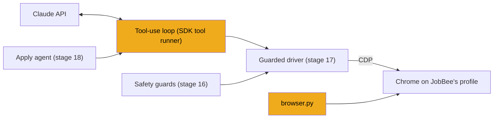
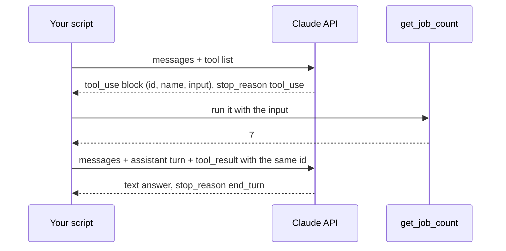

# Stage 15: Tool use and browsers

> **Goal:** Learn how Claude asks your code to do things (tool use), what turns that into an agent, and how Python drives a real Chrome window.
>
> **By the end you will have:** `backend/app/apply/browser.py`, which finds Google Chrome and prepares a browser session on JobBee's own Chrome profile. You can also try three short practice scripts (not part of JobBee): two in which Claude calls a pretend tool, and one that opens Chrome on JobBee's profile.

## Where this fits

This is the first of four stages that build the apply engine, the part of JobBee that fills in application forms. This stage covers the two foundations: the loop in which Claude asks for actions and your code carries them out, and the remote control that lets Python drive Chrome.



## New ideas in plain words

### Tool use

Picture a manager on the phone with an assistant. The manager is smart but can't touch anything in the office. So they say: "Please look up how many jobs Acme has posted, and tell me." The assistant does it and reports back: "Seven." The manager thinks, then either asks for something else or gives the final answer.

Claude is the manager. Your code is the assistant. In API terms ([stage 6](06-talking-to-claude.md) showed you a plain Claude call) it works like this:

1. **You describe your tools.** Each tool has a `name`, a `description` in plain words, and an `input_schema`. The schema is a small JSON document that says which inputs the tool takes and their types, for example "`company`: a string, required". This format is called *JSON Schema*.
2. **Claude replies with a request instead of an answer.** The reply contains a `tool_use` block with an `id`, the tool `name` and the `input`, such as `{"company": "Acme"}`. The reply's `stop_reason` is `"tool_use"`, which means "I'm waiting for a result".
3. **Your code runs the function.** Claude never runs anything itself. It only writes a request. Your code decides what to do with it.
4. **You send back a `tool_result`.** It carries the same `id`, so Claude knows which request it answers, and the output as text.
5. **Repeat** until Claude stops asking. Then the `stop_reason` is `"end_turn"` and the reply holds the final answer.

Step 3 matters most for this guide. Every "action" Claude takes is a request that passes through Python you wrote. That gives you a place to check each request before anything happens. Stages 16 and 17 put JobBee's safety checks exactly there.

**Try it: a tool-use loop written by hand.** This practice script is **not part of JobBee**. Create a folder `practice/` next to `backend/` and `frontend/`, and save this as `practice/try_tools.py`. It gives Claude one harmless tool and runs the loop by hand, so you can see every `tool_use` and `tool_result`. It uses Haiku, the cheapest model, and the Claude key you saved in stage 2.

<!-- practice: practice/try_tools.py -->
```python
"""Practice (not part of JobBee): one tool, and the tool-use loop written out by hand."""

import json
import sys
from pathlib import Path

import anthropic

# Make `import app` work from the practice/ folder: put backend/ on Python's import path.
sys.path.insert(0, str(Path(__file__).resolve().parent.parent / "backend"))
from app.services.secrets import claude_api_key

MODEL = "claude-haiku-5-5"  # the cheapest model is plenty for a toy
MAX_TURNS = 5  # a hard stop, in case the model never stops asking

TOOLS = [
    {
        "name": "get_job_count",
        "description": "How many open jobs a company has posted right now.",
        "input_schema": {
            "type": "object",
            "properties": {
                "company": {"type": "string", "description": "Company name, e.g. Acme"},
            },
            "required": ["company"],
        },
    }
]


def get_job_count(company: str) -> int:
    """A pretend tool: always the same answer, so it's harmless."""
    return 7


def run_tool(name: str, args: dict) -> str:
    if name == "get_job_count":
        return str(get_job_count(**args))
    raise ValueError(f"Unknown tool {name!r}")


def main() -> None:
    client = anthropic.Anthropic(api_key=claude_api_key())
    messages = [{"role": "user", "content": "How many jobs does Acme have open right now?"}]

    for turn in range(1, MAX_TURNS + 1):
        response = client.messages.create(
            model=MODEL, max_tokens=2048, tools=TOOLS, messages=messages
        )
        print(f"--- turn {turn}, stop_reason = {response.stop_reason}")
        for block in response.content:
            if block.type == "text":
                print("Claude says:", block.text)
            elif block.type == "tool_use":
                print("Claude asks:", block.name, json.dumps(block.input))

        if response.stop_reason != "tool_use":
            return  # Claude answered; the loop is over

        # 1. Keep Claude's turn (with its tool_use blocks) in the conversation.
        messages.append({"role": "assistant", "content": response.content})
        # 2. Run every requested tool and collect one tool_result per tool_use.
        results = []
        for block in response.content:
            if block.type != "tool_use":
                continue
            try:
                output, failed = run_tool(block.name, block.input), False
            except Exception as e:
                output, failed = f"Error: {e}", True
            print("We reply:", output)
            results.append(
                {
                    "type": "tool_result",
                    "tool_use_id": block.id,  # must match the request it answers
                    "content": output,
                    "is_error": failed,
                }
            )
        # 3. Send the results back as the next "user" message.
        messages.append({"role": "user", "content": results})

    print(f"Stopped after {MAX_TURNS} turns without a final answer.")


if __name__ == "__main__":
    main()
```
<!-- /practice -->

Read it block by block:

- **The `sys.path.insert` line** puts `backend/` on Python's import path, so `from app.services.secrets import claude_api_key` works even though the script lives in `practice/`. JobBee's own scripts use the same trick.
- **`TOOLS`** is the description Claude reads. The `description` matters: it's how Claude decides when the tool is useful.
- **`run_tool`** is your *dispatcher*. It maps a tool name to a Python function. An unknown name raises an error instead of guessing.
- **The API is stateless.** It doesn't remember earlier calls. So every call sends the whole conversation so far in `messages`, and the list grows each turn.
- **`for turn in range(...)`** is the iteration cap. A `while True` loop would have no stop condition of its own.
- **`response.content`** is a list of *blocks*. The script prints `text` and `tool_use` blocks. If the model thinks first, the reply also holds `thinking` blocks; the script sends them back unchanged with the rest of `response.content`, which is what the API expects.
- **The order of messages is fixed.** First the assistant turn that contains the `tool_use` blocks, then a user turn that contains one `tool_result` for each of them, matched by `tool_use_id`.
- **Errors go back to Claude too.** If a tool fails, the script sends the error text with `"is_error": True`. Claude can then try different input or explain the problem. Crashing the script would waste the whole conversation.

Run it from `backend/` (it costs a fraction of a cent):

```powershell
.\.venv\Scripts\python.exe ..\practice\try_tools.py
```

On Mac or Linux: `.venv/bin/python ../practice/try_tools.py`. You should see two turns. The wording will differ:

```text
--- turn 1, stop_reason = tool_use
Claude asks: get_job_count {"company": "Acme"}
We reply: 7
--- turn 2, stop_reason = end_turn
Claude says: Acme currently has 7 open jobs.
```

Claude may also say a sentence before its tool call. Then change the question to one the tool can't answer, such as "What's the weather in Paris?". Claude should answer in one turn without calling the tool.

The diagram shows the two round trips the script makes:



### Agents

An *agent* is that loop plus a goal plus stop conditions. The model looks at the situation, picks a tool, reads the result, and repeats until the goal is met or a limit is hit.

| Part | In the practice script | In JobBee's apply agent (stage 18) |
|---|---|---|
| Goal | Answer "how many jobs does Acme have?" | Fill in one job application |
| Tools | `get_job_count` | The browser, plus `finish`, `request_human_action`, `site_account` and `check_inbox` |
| Stop conditions | Claude answers, or 5 turns pass | Claude finishes, refuses, or hits the cost cap or the step cap |

Without stop conditions, a confused model could loop forever and keep spending money. Every agent needs them.

### The SDK's tool runner

Writing the loop by hand is good for learning, but it's repetitive. The Anthropic Python SDK has a helper, `client.beta.messages.tool_runner(...)`, that runs the loop for you: it calls the API, runs the tools Claude asks for, sends the results back, and repeats. You loop over it with `for` (or `async for`) and get one item per Claude reply.

You turn a Python function into a tool with the `@beta_async_tool` decorator (or `@beta_tool` for a normal `def`). A *decorator* is the `@name` line above a function; it wraps the function in something else. This one reads the function to build the tool description:

- the function name becomes the tool name;
- the first lines of the docstring become the description, and the `Args:` section describes each input;
- the type hints become the JSON Schema; `Literal["all", "remote"]` becomes a list of allowed values (an `enum`), so Claude can only pick one of those;
- if the function raises `ToolError("...")`, the runner sends that text back as an error result (`is_error: true`). Claude reads it and can try something else.

"Beta" means Anthropic may still change these helpers between SDK releases. That is one reason JobBee pins exact versions (see Common mistakes).

**Try it: the same tool with the tool runner.** Save this second practice script (also **not part of JobBee**) as `practice/try_tool_runner.py`. It uses the async client, `AsyncAnthropic`, because JobBee's agent is async: it waits on Chrome and the network while the server keeps working. You met `async`/`await` in earlier stages.

<!-- practice: practice/try_tool_runner.py -->
```python
"""Practice (not part of JobBee): the same tool, with the SDK's tool runner doing the loop."""

import asyncio
import json
import sys
from pathlib import Path
from typing import Literal

from anthropic import AsyncAnthropic, beta_async_tool
from anthropic.tools import ToolError

sys.path.insert(0, str(Path(__file__).resolve().parent.parent / "backend"))
from app.services.secrets import claude_api_key


@beta_async_tool
async def get_job_count(company: str, kind: Literal["all", "remote"] = "all") -> str:
    """How many open jobs a company has posted right now.

    Args:
        company: Company name, e.g. "Acme".
        kind: Count "all" jobs, or only "remote" ones.
    """
    if not company.strip():
        raise ToolError("Pass a company name.")
    return "3" if kind == "remote" else "7"


async def main() -> None:
    print("Schema sent to Claude:")
    print(json.dumps(get_job_count.to_dict(), indent=2))

    client = AsyncAnthropic(api_key=claude_api_key())
    runner = client.beta.messages.tool_runner(
        model="claude-haiku-5-5",
        max_tokens=2048,
        max_iterations=5,
        tools=[get_job_count],
        messages=[{"role": "user", "content": "How many remote jobs does Acme have?"}],
    )
    async for message in runner:  # one item per Claude reply
        for block in message.content:
            if block.type == "tool_use":
                print("Claude asks:", block.name, json.dumps(block.input))
            elif block.type == "text":
                print("Claude says:", block.text)


if __name__ == "__main__":
    asyncio.run(main())
```
<!-- /practice -->

- **`@beta_async_tool`** wraps the function in a tool object. `get_job_count.to_dict()` shows what it built. Look at the printed schema: `kind` has `"enum": ["all", "remote"]`, and each input has the description from the `Args:` section.
- **`max_iterations=5`** is the runner's iteration cap. It replaces your `for turn in range(...)`.
- **The loop ends by itself** when Claude's reply asks for no more tools.
- **`raise ToolError(...)`** is how a tool says "no". The runner turns it into an error `tool_result` whose text is your message. Any other exception also becomes an error result, but its text is a raw Python error, which helps Claude much less. So when a tool refuses something on purpose, raise `ToolError` with a clear explanation. JobBee's guards do exactly that.

Run it from `backend/`:

```powershell
.\.venv\Scripts\python.exe ..\practice\try_tool_runner.py
```

You see the schema first, then a line like `Claude asks: get_job_count {"company": "Acme", "kind": "remote"}`, then an answer with 3 jobs.

Here is where JobBee's real agent starts the same runner. You'll type this file in [stage 18](18-apply-agent.md):

From [`backend/app/apply/agent.py`](../../backend/app/apply/agent.py):
```python
    stats = RunStats()
    runner = client.beta.messages.tool_runner(
        **request_params(config.model, config.effort, system_prompt(ats)),
        max_iterations=config.max_iterations,
        tools=[driver, *make_tools(stats, hooks, driver)],
        messages=[{"role": "user", "content": task}],
    )
    try:
        async for message in runner:
            stats.iterations += 1
```

It's the same shape as your practice script. Two differences:

- `tools` mixes two kinds of things. `driver` is a whole browser *toolset* (see below). `make_tools(...)` returns four functions decorated with `@beta_async_tool`, such as `finish` and `request_human_action`.
- `request_params(...)` adds the model, thinking settings, caching and more. Stage 18 explains each one.

### Server-side tools and client-side tools

In [stage 14](14-job-sources.md) you gave Claude the `web_search` tool. You never wrote a search function: Anthropic's servers ran the searches and put the results into the reply. That's a *server-side* tool. The tools in this part of the guide are *client-side* tools: Claude asks, and code on **your PC** does it.

| | Server-side tool | Client-side tool |
|---|---|---|
| Example in JobBee | `web_search` (stage 14) | the browser toolset, `finish` |
| Who runs it | Anthropic's servers | your Python code |
| Can you check each call first? | No | Yes, and JobBee does |

### The browser toolset

Instead of writing every browser tool yourself, you can put one entry, `{"type": "browser_toolset_20260801"}`, in the tool list. It stands for a whole family of browser tools, called *members*. Claude already knows how to use them. Your code must implement them. These are the ones the apply agent uses most:

| Member | What it does |
|---|---|
| `read_page` | Returns the page as text: one line per element, each with a short ID such as `[ref_12]` |
| `find` | Looks for elements that match a few words, such as "email field" |
| `form_input` | Sets the value of a text box, checkbox, radio button or dropdown, by ref |
| `left_click` | Clicks an element by ref, or at an x/y position on the screen |
| `key` | Presses keys, such as `Enter`, `Tab` or `ctrl+a` |
| `type` | Types text into whatever has the focus |
| `navigate` | Opens a URL, or goes back, forward or reloads |
| `screenshot` | Takes a picture of the visible page |
| `file_upload` | Puts a file from your disk into the page's file input |
| `get_page_text` | Returns the page's visible text |

There are 31 members in total, including tab management (`new_tab`, `switch_tab`, …), scrolling and waiting. Some are risky, such as `javascript_exec` (run any JavaScript in the page). A toolset takes a `configs` setting that switches members on and off; stage 17 switches the risky ones off.

A line from `read_page` looks something like `[ref_12] button "Submit application"`. A **ref** names one element. A **coordinate** is a spot on the screen, like (640, 480). Refs are more precise, but Claude can use either. A safety check has to handle both.

**How this differs from computer use.** Anthropic also offers a *computer use* toolset. It works on your whole desktop: Claude sees screenshots and moves the real mouse and keyboard, in any program. The browser toolset only works inside the browser's tabs. It can read the page's structure as text, which is cheaper than pictures and more precise. Most importantly for JobBee, each action targets a known page element. Before a click happens, your code can ask "which element is this click going to hit?" Stage 16 is built on that question.

### CDP, Chrome's remote control

*CDP* (the Chrome DevTools Protocol) is Chrome's remote control. When you press F12 in Chrome, the developer tools talk to the page through CDP. A program can connect to Chrome over a local connection and send it JSON commands, such as "run this JavaScript in the page" (`Runtime.evaluate`), "press the mouse here", or "put this file in that file input" (`DOM.setFileInputFiles`). Chrome sends back results and events, like "a request was sent" or "a file picker opened".

### Browser Use

*Browser Use* is an open-source library that drives Chrome over CDP. Its `BrowserSession` class starts Chrome and keeps the connection. Its `BrowserUse` class implements all 31 browser-toolset members on top of that session. So the work is split three ways:

- the Anthropic SDK defines the toolset and runs the loop;
- Browser Use turns each member call into CDP commands;
- JobBee subclasses Browser Use's class to add its safety checks (stage 17).

### A dedicated Chrome profile

A Chrome *profile* is a folder that holds cookies, saved logins and history. JobBee starts Chrome with its own profile folder, `backend/data/browser-chrome/`. Two benefits:

- **Logins persist.** Sign in to LinkedIn or Workday once in JobBee's Chrome, and it stays signed in for later runs.
- **Your personal browser stays separate.** The agent never sees your personal tabs, bookmarks or other accounts, and it can't disturb them.

Two more words you'll see in this stage:

- **Headed and headless.** A *headed* browser shows a normal window. A *headless* one runs with no window at all. JobBee runs headed, so you can watch and step in. The tests run headless.
- **HAR file.** A HAR file ("HTTP Archive") is a recording of the network requests a browser made, saved as JSON. JobBee's terminal test script records one per run.

## Build it, step by step

### Step 1: Find Chrome and prepare a session, `backend/app/apply/browser.py`

This file lives in the `apply` package next to `costs.py` (stage 6), `ats.py` and `guards.py` (stage 8):

```text
backend/app/apply/
├── __init__.py
├── ats.py
├── browser.py      <- new
├── costs.py
└── guards.py
```

It has two jobs: find the real Google Chrome on this PC, and build a Browser Use `BrowserSession` with JobBee's settings. Read it top to bottom:

- **`PROFILE_DIR`** is JobBee's own Chrome profile folder, `backend/data/browser-chrome`. `BACKEND_DIR` comes from `config.py` (stage 1). The folder lives under `backend/data/`, which `.gitignore` keeps out of git. It will hold your login cookies, so it must never be committed.
- **`ChromeNotFoundError`** is a custom error class. Callers can show a clear message ("install Chrome") instead of a confusing crash later. It subclasses `RuntimeError`, so code that catches `RuntimeError` catches it too.
- **`find_chrome`** checks three usual install folders in order and returns the first `chrome.exe` that exists. `%LOCALAPPDATA%` is where Chrome goes when it's installed for one Windows user only; the two `Program Files` folders hold a machine-wide install. **It only knows Windows paths.** See the note after the code.
- **`new_browser_session`** builds the session object:
  - **The import is inside the function.** Browser Use is a large library. Importing it only when a browser is needed keeps `apply/browser.py` cheap to import, for example in tests that never open Chrome.
  - **The `*` in the signature** makes every argument keyword-only: you must write `new_browser_session(headless=True)`, never `new_browser_session(path, None, True)`. That prevents mixed-up arguments.
  - **`headless=False`** (the default) shows a real window. You can watch the agent work and take over when it asks.
  - **`user_data_dir`** is the profile folder. This is what makes logins persist between runs.
  - **`highlight_elements=False`** turns off Browser Use's coloured boxes around elements. They would get in the way of screenshots and of you.
  - **`window_size`** fixes the window at 1280×960, so pages lay out the same way in every run.
  - **`har_path`** is optional. When it's given, `options.update(...)` adds two settings: where to save the HAR recording, and `record_har_content="omit"`, which leaves out response bodies to keep the file small. The comment records a limit of Browser Use: it records HTTPS traffic only, and only the first tab. `**options` then passes these extra settings on, or nothing when `options` is empty.
  - The function returns the session **without starting it**. The caller starts it with `await session.start()` and must also stop it.

<!-- code: backend/app/apply/browser.py -->
**`backend/app/apply/browser.py`** (whole file, 45 lines)

```python
"""The user's own Chrome, launched headed on JobBee's dedicated profile."""

from __future__ import annotations

import os
from pathlib import Path

from ..config import BACKEND_DIR

PROFILE_DIR = BACKEND_DIR / "data" / "browser-chrome"


class ChromeNotFoundError(RuntimeError):
    pass


def find_chrome() -> str:
    candidates = [
        Path(os.environ.get("LOCALAPPDATA", "")) / "Google/Chrome/Application/chrome.exe",
        Path("C:/Program Files/Google/Chrome/Application/chrome.exe"),
        Path("C:/Program Files (x86)/Google/Chrome/Application/chrome.exe"),
    ]
    for path in candidates:
        if path.is_file():
            return str(path)
    raise ChromeNotFoundError("Google Chrome not found; install it to use the apply agent.")


def new_browser_session(
    *, profile_dir: Path = PROFILE_DIR, har_path: Path | None = None, headless: bool = False
):
    from browser_use.browser.session import BrowserSession

    options: dict = {}
    if har_path is not None:
        # browser-use records HTTPS only, and only the first tab; bodies are omitted.
        options.update(record_har_path=str(har_path), record_har_content="omit")
    return BrowserSession(
        executable_path=find_chrome(),
        headless=headless,
        user_data_dir=str(profile_dir),
        highlight_elements=False,
        window_size={"width": 1280, "height": 960},
        **options,
    )
```
<!-- /code -->

**On Mac or Linux**, none of the three paths exists, so `find_chrome` raises `ChromeNotFoundError`. Add your Chrome's path to the `candidates` list on your own machine:

```python
        Path("/Applications/Google Chrome.app/Contents/MacOS/Google Chrome"),  # macOS
        Path("/usr/bin/google-chrome"),  # Linux (Debian/Ubuntu package)
        Path("/usr/bin/google-chrome-stable"),  # Linux (some distributions)
```

On Linux, `which google-chrome` prints the right path if you're unsure. This is a local change for your PC: nothing else in the guide depends on the exact list.

**Who uses this file:** the run manager (`runs.py`, [stage 21](21-run-manager.md)) calls `new_browser_session()` to open the Chrome window that fills applications, and the terminal test script (`scripts/apply_spike.py`, also stage 21) calls it with a HAR path and lets you pick another profile folder.

## Check it works

**1. The file imports and knows its profile folder.** From `backend/`:

```powershell
.\.venv\Scripts\python.exe -c "import app.apply.browser as b; print(b.PROFILE_DIR)"
```

You should see the full path of the profile folder, ending in `backend\data\browser-chrome` (or `backend/data/browser-chrome` on Mac/Linux). The folder doesn't exist yet; Chrome creates it on first start.

**2. Chrome is found.**

```powershell
.\.venv\Scripts\python.exe -c "from app.apply.browser import find_chrome; print(find_chrome())"
```

You should see a path to `chrome.exe`. A `ChromeNotFoundError` means Chrome isn't installed in a usual folder (or you're on Mac/Linux and haven't added your path yet).

**3. Optional: open Chrome on JobBee's profile.** This third practice script is **not part of JobBee**. Save it as `practice/try_chrome.py`:

<!-- practice: practice/try_chrome.py -->
```python
"""Practice (not part of JobBee): open JobBee's Chrome profile, visit a page, close it."""

import asyncio
import sys
from pathlib import Path

sys.path.insert(0, str(Path(__file__).resolve().parent.parent / "backend"))
from app.apply.browser import PROFILE_DIR, new_browser_session


async def main() -> None:
    session = new_browser_session()
    await session.start()  # launches Chrome and connects over CDP
    try:
        await session.navigate_to("https://example.com")
        print("Now at:", await session.get_current_page_url())
        print("Profile folder:", PROFILE_DIR)
        # input() would freeze async code; run it in a thread instead.
        await asyncio.to_thread(input, "Chrome is open. Press Enter to close it...")
    finally:
        await session.kill()  # closes Chrome, even if something above failed


if __name__ == "__main__":
    asyncio.run(main())
```
<!-- /practice -->

- `session.start()` launches Chrome with the profile folder and opens the CDP connection.
- `try`/`finally` makes sure Chrome closes even if navigation fails. Otherwise a stray Chrome window would keep the profile folder locked.
- `session.kill()` closes the browser. (`session.stop()` exists too, but it only disconnects and leaves Chrome running.)
- `asyncio.to_thread(input, ...)` waits for your Enter key in a separate thread. A plain `input()` would block the event loop, and Browser Use's background work would stall.

Run it from `backend/`:

```powershell
.\.venv\Scripts\python.exe ..\practice\try_chrome.py
```

A Chrome window opens on example.com, and the terminal prints the URL and the profile folder. While it's open, sign in to any site you like. Press Enter to close it, run the script again, and visit the same site: you're still signed in. That's the profile at work. Your everyday Chrome doesn't show that login, because it uses a different profile.

<!-- verify: backend | python -c "import app.apply.browser as b; print(b.PROFILE_DIR)" -->

## Common mistakes

- **Forgetting to send back a `tool_result`.** If Claude's last turn had a `tool_use` and your next message doesn't answer it, the API rejects the request with a 400 error about a `tool_use` without a matching `tool_result`. Every `tool_use` needs exactly one result, with the same id, in the very next user message. Send all results of one turn together in that one message.
- **Sending results without the assistant turn.** The `tool_result` must come right after the assistant message that holds the `tool_use`. Append `response.content` first, then the results.
- **No iteration cap.** A `while True:` loop runs until the model stops asking. If the model gets confused, that's never, and every turn costs money. Always cap turns (`max_iterations` with the runner), and in a real agent cap the cost too (stage 18).
- **Letting the versions float.** Look at `backend/pyproject.toml` from stage 1: `browser-use[core]==0.13.11` and `anthropic==1.15.0` are pinned with `==` ("exactly this version"), while most packages use `>=`. Browser Use 0.13.11 was written against a pre-release of the Anthropic SDK. It imports three names (`BetaBrowserScreenshotResult`, `BrowserState` and `ToolError`) from `anthropic.tools.browser`, and SDK 1.15.0 doesn't have them there. So `from browser_use.integrations.anthropic import BrowserUse` on its own fails with an `ImportError`. Stage 17's driver fixes that with a small *shim* that adds the old names before importing Browser Use. A shim only works for the exact versions it was written for, so upgrade both packages together, on purpose, and run the tests afterwards. (`try_chrome.py` works without the shim because it only imports `BrowserSession`.)
- **`ChromeNotFoundError` on Mac or Linux.** `find_chrome` only knows Windows paths. Add yours as shown in Step 1.
- **A leftover Chrome window.** Two Chrome processes can't share one profile folder. If a script crashed and left a JobBee Chrome window open, close it before the next run.
- **Blocking `input()` in async code.** It freezes the event loop. Use `await asyncio.to_thread(input, "...")`.

## Recap

- With tool use, Claude writes a request (`tool_use`), your code runs it, and you send back a `tool_result` with the same id. The loop repeats until Claude stops asking.
- An agent is that loop plus a goal plus stop conditions. Always cap iterations.
- The SDK's tool runner runs the loop. `@beta_async_tool` builds a tool from a function's signature and docstring, and `ToolError` sends a refusal back to Claude.
- `web_search` runs on Anthropic's servers. The browser toolset runs on your PC, so your code sees and can check every action.
- Browser Use implements the browser toolset's 31 members over CDP, Chrome's remote control.
- `apply/browser.py` finds Chrome (Windows paths only) and prepares a headed session on JobBee's own profile folder, so logins persist and your personal browser stays separate.

**Next:** [Stage 16: Safety guards](16-safety-guards.md)
