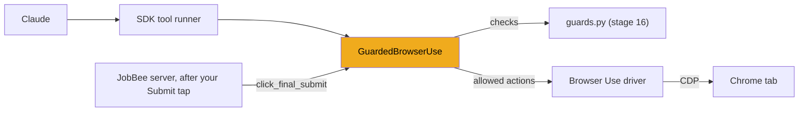
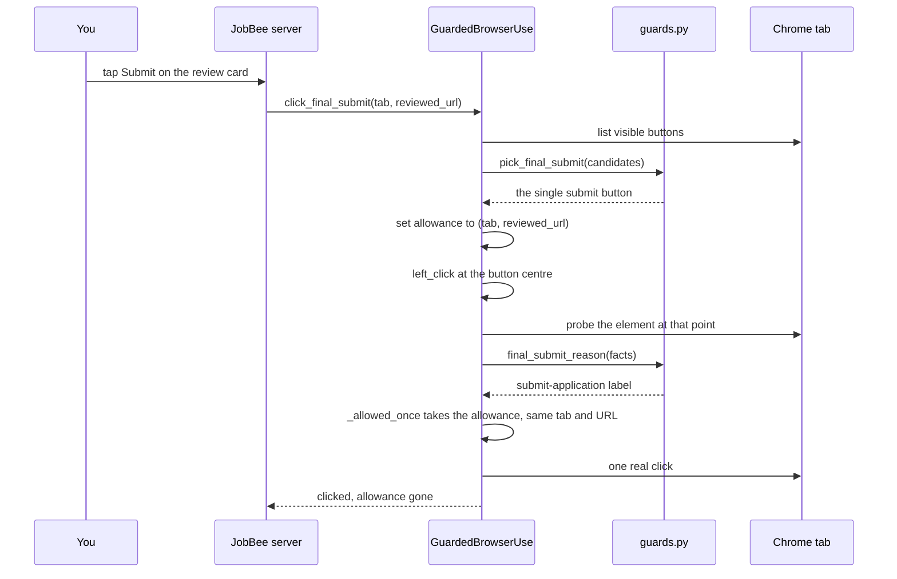
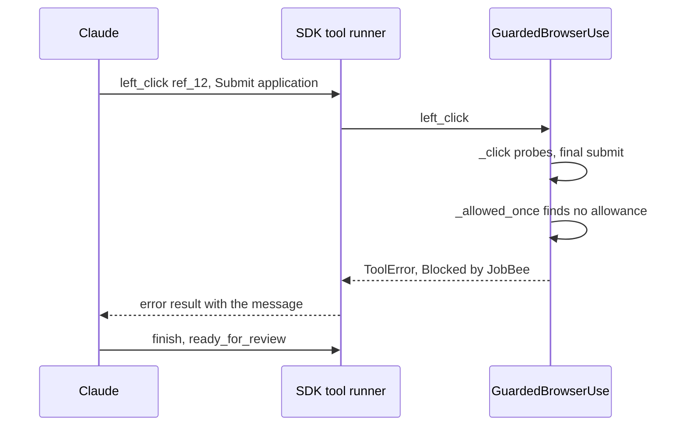

# Stage 17: The guarded driver

> **Goal:** Wrap Browser Use's browser driver so that every click, key press, typed text and upload passes through stage 16's rules, and only JobBee's server, never the model, can release a single submit click.
>
> **By the end you will have:** `backend/app/apply/spike_driver.py` with the `GuardedBrowserUse` class, and (on a PC with Google Chrome) three browser tests that prove the agent can't submit, can't open the system file dialog, and can't type passwords.

## Where this fits

[Stage 15](15-tool-use-and-browsers.md) introduced Browser Use, which turns Claude's browser requests into Chrome commands. [Stage 16](16-safety-guards.md) explained the rules that decide what's safe. This stage connects them: a driver that runs the rules before every action, and refuses the action when a rule says so.



Notice the two arrows into the driver. Claude comes in through the SDK's tool runner. The server comes in through a separate Python method. That split is the whole safety design of this stage.

## New ideas in plain words

**Subclassing to wrap behaviour.** Think of a building with a bouncer at every door. The rooms don't change; the bouncer only decides who goes in. In Python, you get a bouncer by *subclassing*: `GuardedBrowserUse` inherits everything from Browser Use's `BrowserUse` class and *overrides* (replaces) a few methods. Each override checks first, then calls `super()` (the original method) only if the check passes. As an illustration (not JobBee code):

```python
class Guarded(Original):
    async def key(self, context, input):
        if looks_dangerous(input):
            raise ToolError("Blocked by JobBee: ...")
        return await super().key(context, input)  # the original behaviour
```

The order matters: check, *then* act. A check after `super()` would be too late, because the click would already have happened.

**Removing a capability versus guarding it.** There are two ways to stop something. You can put a guard on it (a bouncer at the door), or you can remove it (brick up the door). Bricking up is stronger: there's nothing to get wrong. JobBee does both:

- **Remove** what the agent never needs. Running JavaScript, pressing and releasing the mouse button separately, dragging and holding keys are switched off. Those members aren't even offered to Claude.
- **Guard** what the agent does need. It must click, press keys and type, so those go through the rules.

**The SDK's front door.** When Claude asks for a browser action, the request doesn't call your driver's methods directly. It goes through the SDK's toolset *pipeline*. The pipeline looks the name up in the fixed list of 31 members, refuses disabled ones, checks the URL policy (for `navigate`) and the file policy (for `file_upload`), asks the `confirm` callback, and only then calls the member method, such as `left_click`. A name that isn't on the list is refused. So a Python method on the driver that isn't a member, such as `click_final_submit`, is out of the model's reach, however it phrases its request.

**A one-shot permission.** A hotel key card can be set up to open one door, once. JobBee's submit allowance works like that:

- it's set only by the server, after you tap Submit;
- it opens one door: the same tab, on the same page you reviewed;
- it's used up at the first check, whether or not that check lets the click through.

**Tab isolation.** JobBee can *park* several filled forms, each in its own tab, while they wait for your decision (stage 21). An agent working on application B must not touch application A's tab. The driver remembers which tabs belonged to others when it started, and refuses every action on them.

**Why file pickers are intercepted.** Clicking "Upload resume" on a web page usually opens your operating system's file dialog. Claude can't see or use that window, because it's outside the web page. In an unattended run nobody is at the PC either, so the dialog would sit there forever. So during each agent action, the driver tells Chrome not to show the dialog, notes which file input wanted a file, and tells Claude to use `file_upload` instead. Between actions the dialog works normally, so you can still upload by hand.

**Handles to page elements.** Python can't hold a page element directly; it lives inside Chrome. CDP gives you two kinds of ID for one:

- a **remote object id** (`objectId`): a temporary handle to a JavaScript object, such as an element. You can run a function with it (`Runtime.callFunctionOn`). Chrome keeps the object in memory until you release the handle.
- a **backend node id** (`backendNodeId`): Chrome's own number for an element in the page. It stays the same while the page lives, and some commands, such as "put files in this input" (`DOM.setFileInputFiles`), take it.

A Browser Use *ref* like `ref_12` is a name for one backend node id in one tab.

**Coroutine objects.** Calling an `async def` function without `await` doesn't run it. It returns a *coroutine object*: the work, packed up, waiting to be started. `await` starts it. This lets one function hand an unstarted action to another, which can do some setup, `await` the action, and clean up afterwards. The upload code uses this.

**Patching a module.** In Python, a module is an object, and you can add names to it with `setattr(module, "name", value)`. Any code that imports that name afterwards gets your value. A *shim* uses this to make two libraries fit together.

## Build it, step by step

### Step 1: The driver, `backend/app/apply/spike_driver.py`

This file sits in the `apply` package next to `guards.py` (stage 8) and `browser.py` (stage 15). "Spike" means a quick experiment: this driver was first written to test whether Claude can fill real forms at all, and the name stuck. It's long (496 lines), so it comes in eight parts.

What uses it: stage 18's `agent.py` builds it (`guarded_driver`) and hands it to the tool runner. Stage 21's run manager calls its server-only methods: `pin_to_tab`, `screenshot_png`, `network_mark`, `click_final_submit`, `requests_since` and `page_text`.

#### Part 1: Imports and the version shim

The docstring is honest about the file's status: it's the "Phase 1" driver, built on Browser Use to measure what the model can do. It names what a future driver (JobBee's own, built on Playwright) could add: enforcing the guard at the network layer and inside cross-origin frames. That future driver isn't part of this project.

Then the shim. As stage 15 explained, Browser Use 0.13.11 imports three names from `anthropic.tools.browser` that SDK 1.15.0 calls something else:

| Browser Use imports | SDK 1.15.0 calls it |
|---|---|
| `BetaBrowserScreenshotResult` | `BetaScreenshotResult` |
| `BrowserState` | `BetaBrowserState` |
| `ToolError` | lives in `anthropic.tools` |

- `import anthropic.tools.browser as _sdk_browser` gets the module object itself, so it can be patched.
- The `for` loop adds each old name to the SDK module as an alias (`setattr`), *before* Browser Use is imported. When Browser Use then runs `from anthropic.tools.browser import BrowserState`, the name is there.
- `if not hasattr(...)` makes the shim harmless if a future SDK has the old names again.
- `# noqa: E402` tells the linter "yes, this import isn't at the top of the file, on purpose". It can't be at the top, because the shim must run first.
- This trick only works for these exact versions, which is why `pyproject.toml` (stage 1) pins both with `==`.

After the shim come the names the driver needs from the SDK: `BetaToolsetCallContext` (the *context* object every member receives) and three input models. A member's input is a Pydantic model, such as `BetaBrowserLeftClickInput`. Claude's requests arrive already parsed into these. JobBee builds them itself when its own code calls a member: a left click for the approved submit, a form fill for site passwords, and a navigation for links from your inbox. The last import brings in every rule and probe from stage 16.

<!-- code: backend/app/apply/spike_driver.py lines=1-51 -->
**`backend/app/apply/spike_driver.py`** (lines 1–51 of 496)

```python
"""Phase 1 spike driver: Browser Use's Claude toolset driver plus JobBee's submit guard.

This exists to measure model capability quickly. The production driver
(Phase 2) is JobBee's own Playwright driver, which can also enforce the guard
at the network layer and inside cross-origin frames.
"""

from __future__ import annotations

import asyncio
import json
from collections.abc import Callable
from typing import Any
from urllib.parse import urlsplit

import anthropic.tools.browser as _sdk_browser
from anthropic.tools import ToolError
from anthropic.tools.browser import BetaBrowserState, BetaScreenshotResult

# browser-use 0.13.11 was written against a pre-release Anthropic SDK that used
# these older names for the same types (same fields). Alias them until
# browser-use catches up; drop this when its driver imports cleanly.
for _old, _new in (
    ("BetaBrowserScreenshotResult", BetaScreenshotResult),
    ("BrowserState", BetaBrowserState),
    ("ToolError", ToolError),
):
    if not hasattr(_sdk_browser, _old):
        setattr(_sdk_browser, _old, _new)

from anthropic.tools.browser import BetaToolsetCallContext  # noqa: E402
from anthropic.types.beta import (  # noqa: E402
    BetaBrowserFormInputInput,
    BetaBrowserLeftClickInput,
    BetaBrowserNavigateInput,
)
from browser_use.integrations.anthropic import BrowserUse  # noqa: E402

from .guards import (  # noqa: E402
    BLOCKED_SUBMIT_MESSAGE,
    CANDIDATE_POINT_JS,
    CONTROL_PROBE_JS,
    ELEMENT_PROBE_FUNCTION,
    FIELD_FACTS_FUNCTION,
    FOCUSED_FIELD_JS,
    SUBMIT_CANDIDATES_JS,
    final_submit_reason,
    key_would_submit,
    pick_final_submit,
    sensitive_field_message,
)
```
<!-- /code -->

#### Part 2: Switched-off members, upload helpers and messages

`DISABLED_MEMBERS` lists the members the agent never gets:

| Member | Why it's off |
|---|---|
| `left_mouse_down`, `left_mouse_up` | Pressing and releasing separately is a click that never passes through the click check |
| `left_click_drag` | Also presses and releases the mouse outside the click check |
| `hold_key` | Holding Enter would bypass the key check |
| `javascript_exec` | A script could call `form.submit()` or read anything on the page |
| `read_console`, `read_network` | The agent doesn't need them, and they can expose page data |

The SDK already switches three of these off by default (`javascript_exec`, `read_console` and `read_network`). Listing them again makes the intent explicit, and protects you if a default ever changes. (`file_upload` is off by default too; stage 18 switches it on, with a policy.)

`EventSink` is a *type alias*: a short name for "a function that takes a string and a dict and returns nothing". The driver reports what happens ("guard_block", "file_picker_blocked", …) through such a function.

Next, two pieces of JavaScript for uploads. Sites often hide the real `<input type="file">` behind a styled "Select files" button, a link or a drop zone.

- **`FIND_FILE_INPUT_FUNCTION`** runs with a control as `this` and finds the file input it stands for. With `levels` 0 it checks the control itself, the field its `<label>` points to, and a single file input inside the control. With `levels` 4 it also walks up to four enclosing elements, nearest first (`parentElement`, or out of a shadow root via `getRootNode().host`). It gives up (`return null`) at the first one that holds *several* file inputs: guessing between "Resume" and "Cover letter" would be worse than asking.
- **`UPLOAD_LIKE_FUNCTION`** says whether a control *looks like* an upload control: its text, `aria-label`, title or value contains "upload", "attach", "browse", "choose", "select", "drop", "file(s)", "résumé"/"resume", "cv" or "cover". Only such controls get clicked to find their input (Part 7).

`FILE_PICKER_NOTE` and `NO_FILE_INPUT_MESSAGE` are written for the model, like stage 16's messages: what happened, and what to do instead. The two wait times are in seconds: how long the driver waits for a file picker after an action (Part 7).

`_same_page` compares two URLs without the `#fragment` and without a trailing `/`. A fragment only scrolls within a page (`.../apply#questions`), so it shouldn't count as a different page. The path and the query string (`?step=3`) still count, because they can mean a different page. The submit allowance uses it (Part 4).

<!-- code: backend/app/apply/spike_driver.py lines=52-113 -->
**`backend/app/apply/spike_driver.py`** (lines 52–113 of 496)

```python

# Members the apply agent never needs; fewer ways around the guard.
DISABLED_MEMBERS = (
    "left_mouse_down",
    "left_mouse_up",
    "left_click_drag",
    "hold_key",
    "javascript_exec",
    "read_console",
    "read_network",
)

EventSink = Callable[[str, dict[str, Any]], None]

# Sites hide the real file input behind a styled button, link or drop zone. This finds
# the input a control stands for. Levels: 0 is the control itself, its label's control,
# or the one file input inside it; 4 also looks in the enclosing elements up to four
# levels out, nearest first, giving up at one that holds several file inputs.
FIND_FILE_INPUT_FUNCTION = """function (levels) {
  const usable = (el) => !!el && el.tagName === 'INPUT' && el.type === 'file' && !el.disabled;
  if (usable(this)) return this;
  const label = this.closest ? this.closest('label') : null;
  if (label && usable(label.control)) return label.control;
  let node = this;
  for (let depth = 0; node && depth <= levels; depth++) {
    if (node.querySelectorAll) {
      const inputs = [...node.querySelectorAll('input[type=file]')].filter(usable);
      if (inputs.length === 1) return inputs[0];
      if (inputs.length > 1) return null;
    }
    node = node.parentElement || (node.getRootNode && node.getRootNode().host) || null;
  }
  return null;
}"""
# Only controls that look like uploads get clicked to see which file input they open.
UPLOAD_LIKE_FUNCTION = r"""function () {
  const text = [this.innerText, this.getAttribute('aria-label'), this.title, this.value]
    .filter((t) => typeof t === 'string').join(' ').slice(0, 200);
  return /upload|attach|browse|choose|select|drop|\bfiles?\b|r[ée]sum[ée]|\bcv\b|cover/i
    .test(text);
}"""

FILE_PICKER_NOTE = (
    "That opened a file picker. JobBee kept the system file dialog closed because nobody is at "
    "the computer to use it. To upload, call `file_upload` on this same control (or the file "
    "input) with the file's path from the dossier."
)
NO_FILE_INPUT_MESSAGE = (
    "No file input found behind that control, and clicking it didn't open a file picker JobBee "
    "can fill. Target the upload button, the drop zone or the file input itself (read_page with "
    "filter 'all' shows hidden inputs). If there's really no way, call `request_human_action` "
    "with kind 'other' and ask the human to upload the file."
)
# How long a click may take to open a file picker: longer when the page has a file input.
CHOOSER_WAIT = 0.05
CHOOSER_WAIT_WITH_INPUT = 0.25


def _same_page(a: str, b: str) -> bool:
    return a.split("#", 1)[0].rstrip("/") == b.split("#", 1)[0].rstrip("/")


```
<!-- /code -->

#### Part 3: The class, its state, and tab isolation

The class docstring states the one way past the guard: `click_final_submit()`, which the server calls after you tap Submit.

**`__init__`** takes the same arguments as `BrowserUse` (passed on through `*args` and `**kwargs`), plus a keyword-only `on_event`:

- **`configs`** is the toolset's on/off list for members (stage 15). `kwargs.pop("configs", None)` takes the caller's `configs` out of `kwargs`, `dict(...)` copies it so the caller's dict isn't changed, and the loop adds `{"enabled": False}` for each disabled member. `setdefault` keeps any setting the caller passed explicitly. That's how JobBee's own `guarded_driver` (stage 18) switches `file_upload` *on*. It also means JobBee's own code could switch a disabled member back on, but the model can't: it never gets to call the constructor.
- **`self._on_event`** is the event callback. If nobody passes one, a do-nothing `lambda` is used, so the rest of the code never has to check for `None`. The terminal script prints these events; the server stores them.
- **Counters:** `guard_trips` counts refusals and `uninspected_clicks` counts clicks into frames the probe couldn't read. Both end up in the run's statistics (stage 18).
- **Tab isolation:** `_foreign_tabs` and `home_tab`.
- **The allowance:** `_allowance` is the one-shot permission (a `(tab, url)` pair), empty at the start. `_allowance_refused` remembers why it was refused, and `submit_used` records whether it ever released a click.
- **Uploads:** `_choosers` maps a tab to the file picker the last action opened; `_page_domain` and `_chooser_observer` are bookkeeping for Part 7.

**`pin_to_tab`** takes a snapshot: every tab open *now*, except the agent's own, is foreign. `self._tabs()` is Browser Use's list of open tabs. The `{...} - {tab_id}` is a set difference. Tabs the application opens later (some sites open the form in a new tab) are allowed. The run manager calls this before each run (stage 21).

**`_page`** is the method Browser Use calls at the start of almost every member, including `read_page`, clicks, `switch_tab` and `close_tab`, to find the tab to act on. `page._target_id` is the tab's id. Overriding this one method guards all of those members at once. This is the bouncer idea again: find the one door everyone must pass, and stand there.

<!-- code: backend/app/apply/spike_driver.py lines=114-155 -->
**`backend/app/apply/spike_driver.py`** (lines 114–155 of 496)

```python
class GuardedBrowserUse(BrowserUse):
    """Refuses clicks and key presses that would submit an application.

    The only way past the guard is `click_final_submit()`, which JobBee's server
    calls after the user taps Submit: it grants a one-shot allowance bound to
    this tab and the exact page the user reviewed. The model can't reach it.
    """

    def __init__(self, *args: Any, on_event: EventSink | None = None, **kwargs: Any) -> None:
        configs = dict(kwargs.pop("configs", None) or {})
        for name in DISABLED_MEMBERS:
            configs.setdefault(name, {"enabled": False})
        super().__init__(*args, configs=configs, **kwargs)
        self._on_event = on_event or (lambda kind, data: None)
        self.guard_trips = 0
        self.uninspected_clicks = 0
        self._foreign_tabs: set[str] = set()
        self.home_tab: str | None = None
        self._allowance: tuple[str, str] | None = None
        self._allowance_refused: str | None = None
        self.submit_used = False
        self._choosers: dict[str, dict] = {}  # tab -> file picker the last action opened
        self._page_domain: set[str] = set()  # observer sessions with the Page domain on
        self._chooser_observer = None

    # --- tab isolation ------------------------------------------------------------------

    def pin_to_tab(self, tab_id: str) -> None:
        """Tabs open right now (other applications' parked forms) are off-limits."""

        self.home_tab = tab_id
        self._foreign_tabs = {t["tab_id"] for t in self._tabs()} - {tab_id}

    async def _page(self, tab_id=None):
        page = await super()._page(tab_id)
        if page._target_id in self._foreign_tabs:
            raise ToolError(
                "That tab belongs to another application JobBee is working on. Use switch_tab "
                f"to go back to your tab ({self.home_tab}) and stay there."
            )
        return page

```
<!-- /code -->

#### Part 4: The submit allowance, screenshots and network marks

This part holds the methods only JobBee's own code calls. None of them is a toolset member, so the model can't reach them.

**`_allowed_once(page)`** is asked by the click guard (Part 5) when a click would submit:

- `allowance, self._allowance = self._allowance, None` reads the allowance and clears it in one line. From this moment it's gone, whatever happens next. That's "used up at the first check": a refused attempt can't be retried with the same allowance.
- **Same tab:** `page._target_id` must be the tab the server named.
- **Same page:** `_same_page` (Part 2) compares the current URL with the one you reviewed.
- On a mismatch it reports `submit_refused` and remembers the reason for the server. On success it sets `submit_used` and reports `submit_released`.

**`screenshot_png(tab_id, path)`** takes a picture of the visible part of the tab with Browser Use's `_screenshot` helper (it returns a Pillow image, which has a `.save` method), saves it as a PNG file, and returns the tab's URL at that moment. The run manager uses that URL as the "reviewed URL", and the picture for the review card (stage 21).

**`click_final_submit(tab_id, reviewed_url)`** is the only way past the guard. Step by step:

1. List every visible button with stage 16's `SUBMIT_CANDIDATES_JS`, and let `pick_final_submit` choose the single final-submit button. No single button means no click, and the reason goes back to the server.
2. `CANDIDATE_POINT_JS` scrolls that button into view and returns its centre on screen.
3. Set the allowance to this tab and the URL you reviewed.
4. Click through the **normal guarded path**, `self.left_click`, with a context and input it builds itself. The click is probed like any other. The probe finds a submit button, `_allowed_once` checks the tab and URL, and one real click happens. Nothing is bypassed: the allowance is the only difference.
5. `finally` clears the allowance even if something went wrong, so it can never linger.
6. `submit_used` tells whether the allowance really released a click. If the point no longer hit a submit-like control, the click happened but `_allowed_once` never ran, so JobBee reports failure and the run manager asks you to check.

It returns a pair: `(True, label)` on success, or `(False, why)`.



**`page_text(tab_id)`** returns the tab's URL and visible text (`document.body.innerText`). After the submit click, the run manager looks for stage 16's `CONFIRMATION_RE` in it.

**`network_mark` and `requests_since`.** Browser Use keeps a log of each tab's completed network requests in `self._network`: a dict from tab id to a list of JSON strings, one per request, with its method, URL and status. `network_mark()` is a bookmark: the length of each tab's log right now. `requests_since(mark)` returns the requests that came after the bookmark, keeping only the methods that send data (POST, PUT, PATCH). `list(rows)` copies the log first, because Browser Use stores it in a `deque` (a list with a maximum length), which can't be sliced. The default `methods` is a `frozenset`, an unchangeable set, which is safe as a default argument.

JobBee sets a mark when the agent stops, and reads the requests after the human submits. That shows exactly which request each job site sends on submit. Stage 18's `scorecard.py` keeps that list; a future network-level guard could use it.

<!-- code: backend/app/apply/spike_driver.py lines=156-231 -->
**`backend/app/apply/spike_driver.py`** (lines 156–231 of 496)

```python
    # --- the one-shot submit allowance -------------------------------------------------------

    async def _allowed_once(self, page) -> bool:
        allowance, self._allowance = self._allowance, None
        if allowance is None:
            return False
        tab, url = allowance
        current = await page.get_url()
        if page._target_id != tab or not _same_page(current, url):
            self._on_event(
                "submit_refused", {"reason": "page changed since review", "url": current}
            )
            self._allowance_refused = "the page changed since you reviewed it"
            return False
        self.submit_used = True
        self._on_event("submit_released", {"url": current})
        return True

    async def screenshot_png(self, tab_id: str, path) -> str:
        page = await self._page(tab_id)
        image = await self._screenshot(page)
        image.save(path, format="PNG")
        return await page.get_url()

    async def click_final_submit(self, tab_id: str, reviewed_url: str) -> tuple[bool, str]:
        """Click the page's single final-submit control once. Returns (clicked, detail)."""

        page = await self._page(tab_id)
        candidates = await self._eval(page, f"({SUBMIT_CANDIDATES_JS})()")
        index, why = pick_final_submit(candidates or [])
        if index is None:
            return False, why
        point = await self._eval(page, f"({CANDIDATE_POINT_JS})({index})")
        if not point:
            return False, "the submit button disappeared"
        self._allowance = (tab_id, reviewed_url)
        self._allowance_refused = None
        try:
            await self.left_click(
                BetaToolsetCallContext(),
                BetaBrowserLeftClickInput(
                    target={"type": "coordinate", "x": round(point["x"]), "y": round(point["y"])},
                    tab_id=tab_id,
                ),
            )
        except ToolError as e:
            return False, self._allowance_refused or str(e)
        finally:
            self._allowance = None
        if not self.submit_used:
            return False, "the page changed since you reviewed it"
        return True, candidates[index].get("label", "Submit")

    async def page_text(self, tab_id: str) -> tuple[str, str]:
        page = await self._page(tab_id)
        text = await self._eval(page, "document.body ? document.body.innerText : ''")
        return await page.get_url(), text or ""

    def network_mark(self) -> dict[str, int]:
        """Position in each observed tab's request log; pass to `requests_since` later."""

        return {tab: len(rows) for tab, rows in self._network.items()}

    def requests_since(
        self, mark: dict[str, int], methods: frozenset[str] = frozenset({"POST", "PUT", "PATCH"})
    ) -> list[dict]:
        """Completed requests (method/url/status) logged after `mark`, across every tab."""

        out = []
        for tab, rows in self._network.items():
            for line in list(rows)[mark.get(tab, 0) :]:
                row = json.loads(line)
                if row.get("method") in methods:
                    out.append({"tab": tab, **row})
        return out

```
<!-- /code -->

#### Part 5: Probing before every click and key press

**`_facts_at_point`** runs stage 16's `CONTROL_PROBE_JS` for a click at a screen position. `self._eval` (from Browser Use) sends a JavaScript expression to Chrome with `Runtime.evaluate` and returns the result as a Python dict. The expression is `(function)(argument)`: the probe function, called right away. `json.dumps({'x': x, 'y': y})` writes the point as `{"x": 640, "y": 480}`, which is also valid JavaScript.

**`_facts_for_ref`** handles a click on a ref. `self._resolve` turns a ref like `ref_12` into a remote object id for the real element (it raises a `ToolError` if the ref is stale), and `self._call_node` runs `ELEMENT_PROBE_FUNCTION` with that element as `this`. `finally` releases the handle even if the probe fails, so Chrome doesn't keep it in memory.

**`_refuse`** counts the block, reports it, and raises `ToolError` with stage 16's `BLOCKED_SUBMIT_MESSAGE`. Claude reads that message as the result of its action. It's typed `-> None`, but it never returns normally.

**`_click`** is the method to guard. In Browser Use, `left_click`, `double_click`, `triple_click`, `right_click` and `middle_click` all call `_click`. If you guarded only `left_click`, a `double_click` on "Submit application" would go straight through. Guard the funnel, not one of the pipes into it. Read the body in order:

1. Find the tab (`self._page` refuses foreign tabs).
2. For the left button only (right and middle clicks don't submit forms): probe the target, by ref or by coordinate, whichever Claude used.
3. If the target is inside a cross-origin iframe, the probe saw nothing. Count it and report it (`model_dump()` turns the target into a dict for the event). Stage 16 explained why such clicks can't be blocked.
4. Ask `final_submit_reason`. If it gives a reason, the only way through is the one-shot allowance. `reason and not await self._allowed_once(page)`: Python only runs the right-hand side when there is a reason, so the allowance is consumed only by a click that needs it.
5. Do the real click, wrapped in `_without_file_dialog` (Part 7). `super()._click(...)` is passed *unstarted*, as a coroutine object.

**`key`** probes the *focused* element (`CONTROL_PROBE_JS` with `null`), because that's where a key press lands, and `key_would_submit` decides. There's no allowance here: JobBee's own submit always uses a click, so a key press never needs one. After the key press (Space on an upload button opens a picker too) it returns `FILE_PICKER_NOTE` if a picker was caught. Returning nothing lets the SDK send its standard reply, such as "Pressed Tab.".

**`left_click`** adds one thing to Browser Use's version: the same file-picker note. `super().left_click(...)` calls Browser Use's `left_click`, which calls `self._click`, and that is JobBee's guarded `_click`, because Python looks methods up on the actual object.

One more layer comes free from the SDK. When one browser action in Claude's reply fails, the tool runner doesn't run the *later* browser actions from that same reply; it answers them with "not executed". So after a refused click, a "press Enter" that Claude had queued behind it never runs either.

<!-- code: backend/app/apply/spike_driver.py lines=232-278 -->
**`backend/app/apply/spike_driver.py`** (lines 232–278 of 496)

```python
    async def _facts_at_point(self, page, x: float, y: float) -> dict:
        return await self._eval(page, f"({CONTROL_PROBE_JS})({json.dumps({'x': x, 'y': y})})")

    async def _facts_for_ref(self, page, ref: str) -> dict:
        _, object_id = await self._resolve(page, ref)
        try:
            return await self._call_node(page, object_id, ELEMENT_PROBE_FUNCTION)
        finally:
            await self._release_object(page, object_id)

    def _refuse(self, action: str, facts: dict, reason: str) -> None:
        self.guard_trips += 1
        label = facts.get("label") or "this control"
        self._on_event("guard_block", {"action": action, "label": label, "reason": reason})
        raise ToolError(BLOCKED_SUBMIT_MESSAGE.format(label=label, reason=reason))

    async def _click(self, input, button, count=1):
        page = await self._page(input.tab_id)
        if button == "left":
            if input.target.type == "ref":
                facts = await self._facts_for_ref(page, input.target.ref)
            else:
                facts = await self._facts_at_point(page, input.target.x, input.target.y)
            if facts.get("cross_origin_frame"):
                self.uninspected_clicks += 1
                self._on_event("guard_uninspected", {"target": input.target.model_dump()})
            reason = final_submit_reason(facts)
            if reason and not await self._allowed_once(page):
                self._refuse("click", facts, reason)
        return await self._without_file_dialog(page, super()._click(input, button, count))

    async def key(self, context, input):
        page = await self._page(input.tab_id)
        facts = await self._eval(page, f"({CONTROL_PROBE_JS})(null)")
        reason = key_would_submit(input.text, facts)
        if reason:
            self._refuse(f"key {input.text!r}", facts, reason)
        await self._without_file_dialog(page, super().key(context, input))
        if page._target_id in self._choosers:
            return FILE_PICKER_NOTE

    async def left_click(self, context, input):
        await super().left_click(context, input)
        page = await self._page(input.tab_id)
        if page._target_id in self._choosers:
            return FILE_PICKER_NOTE

```
<!-- /code -->

Here is the agent trying to submit on its own, next to the server's path from Part 4:



Why is this safe? Claude can only reach the driver through the SDK's member list, and `click_final_submit` isn't on it. The allowance is set only inside `click_final_submit`, and the server calls that method only after your Submit tap, when the agent's loop has already ended (stage 21). So there's no moment when Claude could use an allowance.

#### Part 6: Sensitive fields and site passwords

**`_field_facts`** runs stage 16's `FIELD_FACTS_FUNCTION` on a field named by ref, the same way `_facts_for_ref` runs the click probe. `or {}` turns a `None` result into an empty dict.

**`_refuse_sensitive`** asks stage 16's `sensitive_field_message`. If there's a message, it reports `sensitive_blocked` (with the field's name cut to 120 characters, never the value) and raises `ToolError`.

**`tab_host`** returns the host of a tab's current URL (`acme.wd5.myworkdayjobs.com`), and **`ref_host`** the host of the tab a ref belongs to. `self._refs` is Browser Use's table of refs; each entry remembers its tab. Stage 18's `site_account` and `check_inbox` tools use these to decide which site's account or email is meant: the answer comes from the page, never from what the model says.

**`fill_credentials`** types a site account's login and password into a sign-in or create-account form. It's used by the `site_account` tool in stage 18; the accounts themselves (generated passwords kept in your OS keyring) come in the optional [stage 20](20-site-accounts.md). Claude never sees the password. The checks are the important part:

- **`fills`** is a list of `(ref, value, is_secret)` triples: one per password field, plus the login field at the front if there is one.
- **Same host.** Each field must still be on the host the password belongs to. If a redirect moved the tab to another site, nothing is typed. A password for `acme.wd5.myworkdayjobs.com` can never land on `evil.example.com`.
- **Right kind of field.** `secret != (field.get("type") == "password")` is true when a secret is headed for a non-password field, or the login for a password field. Either way it refuses. A page can't trick the driver into putting the password in a plain text box, where the next screenshot or `read_page` would show it to Claude. Browsers show password inputs as dots.
- **Check everything, then fill.** The first loop only checks and the second only types. A form never ends up half-filled.
- **`super().form_input`** calls Browser Use's plain fill, skipping JobBee's own `form_input` override (Part 8). That override refuses password fields, which is right for the model but not for this trusted path.

**`open_url`** opens a link in the agent's active tab by calling the `navigate` member directly. Calling it from Python skips the SDK pipeline, including the URL policy, so the docstring tells the caller to check the URL first. Stage 18's `check_inbox` tool does, with `url_refusal_reason`, before it opens a verification link from your inbox.

<!-- code: backend/app/apply/spike_driver.py lines=279-349 -->
**`backend/app/apply/spike_driver.py`** (lines 279–349 of 496)

```python
    # --- sensitive fields and site passwords ------------------------------------------------

    async def _field_facts(self, page, ref: str) -> dict:
        _, object_id = await self._resolve(page, ref)
        try:
            return await self._call_node(page, object_id, FIELD_FACTS_FUNCTION) or {}
        finally:
            await self._release_object(page, object_id)

    def _refuse_sensitive(self, field: dict | None) -> None:
        message = sensitive_field_message(field)
        if message:
            self._on_event("sensitive_blocked", {"field": (field or {}).get("name", "")[:120]})
            raise ToolError(message)

    async def tab_host(self, tab_id: str | None = None) -> str:
        page = await self._page(tab_id)
        return (urlsplit(await page.get_url()).hostname or "").lower()

    async def ref_host(self, ref: str) -> str:
        """Host of the page an element ref belongs to."""

        reference = self._refs.get(ref)
        if reference is None:
            raise ToolError(f"{ref} is stale or unknown. Call read_page or find again.")
        return await self.tab_host(reference.tab)

    async def fill_credentials(
        self,
        host: str,
        *,
        login_ref: str | None,
        login: str,
        password_refs: list[str],
        password: str,
    ) -> None:
        """Type a site account's login and password into the page; the model never sees them.

        Only while the page is still on `host`, and the password only into real
        password inputs, so a page can't steer it into a field it could read back.
        Every field is checked before any is filled.
        """

        fills = [(ref, password, True) for ref in password_refs]
        if login_ref:
            fills.insert(0, (login_ref, login, False))
        for ref, _, secret in fills:
            if await self.ref_host(ref) != host:
                raise ToolError(
                    "The page is no longer on the site this account belongs to; re-read the page."
                )
            field = await self._field_facts(await self._page(self._refs[ref].tab), ref)
            if secret != (field.get("type") == "password"):
                raise ToolError(
                    f"{ref} isn't a password field."
                    if secret
                    else f"{ref} is a password field; pass the email or username field."
                )
        for ref, value, _ in fills:
            await super().form_input(
                BetaToolsetCallContext(),
                BetaBrowserFormInputInput(
                    target={"type": "ref", "ref": ref}, value=value, tab_id=self._refs[ref].tab
                ),
            )

    async def open_url(self, url: str) -> None:
        """Open a link in the agent's active tab (the caller has applied the URL policy)."""

        await self.navigate(BetaToolsetCallContext(), BetaBrowserNavigateInput(url=url))

```
<!-- /code -->

#### Part 7: Catching file pickers

Browser Use keeps a second CDP connection to Chrome, the *observer*, that listens for events (network requests, console messages, new tabs). JobBee adds one more listener to it.

- **`_ensure_observer`** first lets Browser Use set up its observer, then registers `_on_file_chooser` for Chrome's `Page.fileChooserOpened` event. The check against `_chooser_observer` makes sure the listener is registered once per observer: if Browser Use ever replaces the observer, the new one gets the listener too.
- **`_on_file_chooser`** runs when Chrome reports a file picker. CDP events arrive per *session* (one per tab), so `self._session_tabs` maps the session back to a tab. The event names the file input that asked, by its `backendNodeId`. The handler stores the whole event in `_choosers` under that tab and reports `file_picker_blocked`.
- **`_intercept_file_dialog(tab, enabled)`** switches interception on or off for one tab with the CDP command `Page.setInterceptFileChooserDialog`. While it's on, Chrome doesn't show the dialog; it sends the event instead. CDP groups commands and events into *domains* (`Page`, `Network`, `Runtime`, …), and a domain's events only flow after `Page.enable`, so the method enables it once per session (remembered in `_page_domain`). It returns `False` instead of raising if anything fails, so an upload problem never breaks an ordinary click.
- **`_without_file_dialog(page, action)`** runs one agent action with interception on. It clears the tab's old picker record, switches interception on, starts the action with `await action`, waits briefly for a picker, and in `finally` switches interception off again, even if the action failed. If it stayed on, your own clicks on an upload button during a hand-off would silently do nothing.
- **`_wait_for_chooser`** waits for a picker event, because the page's JavaScript may open the picker slightly after the click. It waits 0.25 s if the page has a file input and 0.05 s if not, checking every 20 ms. `loop.time()` is a clock that only moves forward, which is safer for deadlines than the wall clock. If the action navigated away, the check for a file input fails, and the short wait is used.
- **`_file_input_near(page, ref, levels)`** runs `FIND_FILE_INPUT_FUNCTION` on the control. It calls CDP's `Runtime.callFunctionOn` itself instead of `_call_node`, because it wants a *handle* to the input it found, not a copy of its value. `DOM.describeNode` then turns that handle into the input's `backendNodeId`. Both handles are released in `finally` blocks. `self._raise_js(result)` turns a JavaScript error into a `ToolError`.
- **`_file_input_opened_by(page, input)`** first asks `UPLOAD_LIKE_FUNCTION` whether the control looks like an upload control. Only then does it click it, through the guarded `_click`, so the click is probed like any other and the dialog is caught. The picker event says which input the page opened, even one a script created on the fly.

<!-- code: backend/app/apply/spike_driver.py lines=350-454 -->
**`backend/app/apply/spike_driver.py`** (lines 350–454 of 496)

```python
    # --- uploads without the system file dialog ----------------------------------------------

    async def _ensure_observer(self):
        await super()._ensure_observer()
        if self._observer is not None and self._observer is not self._chooser_observer:
            self._chooser_observer = self._observer
            self._observer.register.Page.fileChooserOpened(self._on_file_chooser)

    def _on_file_chooser(self, event, session_id=None) -> None:
        tab = self._session_tabs.get(session_id)
        if tab:
            self._choosers[tab] = dict(event)
            self._on_event("file_picker_blocked", {"mode": event.get("mode")})

    async def _intercept_file_dialog(self, tab: str, enabled: bool) -> bool:
        """Catch file pickers in this tab instead of showing them; False if that failed."""

        sid = self._observer_sessions.get(tab)
        if self._observer is None or sid is None:
            return False
        try:
            if sid not in self._page_domain:
                await self._observer.send.Page.enable(session_id=sid)
                self._page_domain.add(sid)
            await self._observer.send.Page.setInterceptFileChooserDialog(
                params={"enabled": enabled}, session_id=sid
            )
        except Exception:
            return False
        return True

    async def _without_file_dialog(self, page, action):
        """Run one agent click or key press with file pickers caught, not shown.

        Nobody is at the computer to use the system file dialog, so a picker the
        action opens is recorded in `_choosers` instead. Between the agent's
        actions the dialog works as usual, so the human can upload by hand during
        a hand-off or the review.
        """

        tab = page._target_id
        self._choosers.pop(tab, None)
        intercepting = await self._intercept_file_dialog(tab, True)
        try:
            result = await action
            if intercepting:
                await self._wait_for_chooser(page)
            return result
        finally:
            if intercepting:
                await self._intercept_file_dialog(tab, False)

    async def _wait_for_chooser(self, page) -> dict | None:
        tab = page._target_id
        try:
            has_input = await self._eval(page, "!!document.querySelector('input[type=file]')")
        except Exception:  # the action navigated away
            has_input = False
        loop = asyncio.get_running_loop()
        deadline = loop.time() + (CHOOSER_WAIT_WITH_INPUT if has_input else CHOOSER_WAIT)
        while tab not in self._choosers and loop.time() < deadline:
            await asyncio.sleep(0.02)
        return self._choosers.get(tab)

    async def _file_input_near(self, page, ref: str, levels: int) -> int | None:
        """Backend node id of the file input `ref` stands for (see FIND_FILE_INPUT_FUNCTION)."""

        _, object_id = await self._resolve(page, ref)
        try:
            result = await self._cdp.send.Runtime.callFunctionOn(
                params={
                    "objectId": object_id,
                    "functionDeclaration": FIND_FILE_INPUT_FUNCTION,
                    "arguments": [{"value": levels}],
                },
                session_id=await page.session_id,
            )
            self._raise_js(result)
            found = result.get("result", {}).get("objectId")
            if not found:
                return None
            try:
                node = await self._cdp.send.DOM.describeNode(
                    params={"objectId": found}, session_id=await page.session_id
                )
                return node["node"]["backendNodeId"]
            finally:
                await self._release_object(page, found)
        finally:
            await self._release_object(page, object_id)

    async def _file_input_opened_by(self, page, input) -> int | None:
        """Click an upload-looking control with the dialog caught; the input it opened."""

        _, object_id = await self._resolve(page, input.target.ref)
        try:
            upload_like = await self._call_node(page, object_id, UPLOAD_LIKE_FUNCTION)
        finally:
            await self._release_object(page, object_id)
        if not upload_like:
            return None
        click = BetaBrowserLeftClickInput(target=input.target.model_dump(), tab_id=input.tab_id)
        await self._click(click, "left")
        return (self._choosers.get(page._target_id) or {}).get("backendNodeId")

```
<!-- /code -->

#### Part 8: Uploads, typing and form filling

**`file_upload`** is JobBee's own version of the member. Browser Use's version only accepts the file input itself, by ref. JobBee's searches, in the order its docstring gives:

1. `_file_input_near(page, ref, 0)`: the control is, or contains, the file input.
2. `_file_input_opened_by(page, input)`: clicking the control opens a picker for an input.
3. `_file_input_near(page, ref, 4)`: one input close by.

`a or b or c` tries each search in turn and stops at the first that finds an input. Clicking comes before looking around, so a cover-letter button never lands its file in the resume input next to it. If nothing is found, Claude gets `NO_FILE_INPUT_MESSAGE`.

- Uploads by *document id* (a Files API feature) are refused: JobBee only uploads files by path.
- `DOM.setFileInputFiles` is the CDP command that puts files into a file input directly, the same as if a person had picked them in the dialog. It's sent by `backendNodeId`, because an input a script made on the fly isn't in the page, and Browser Use's ref check would refuse it.
- **Which files are allowed?** The comment says "Paths were vetted by the file policy". In stage 18, `guarded_driver` passes `file_policy=BetaLocalFilePolicy(upload_roots=[uploads_dir])`. The SDK checks every path *before* this method runs. It refuses any path containing `..`, resolves shortcuts (symbolic links) to the real file, and accepts only files inside the run's own staging folder, which holds a copy of your resume. So a page that talks Claude into "uploading" `C:\Users\you\Documents\tax-return.pdf` gets a refusal from the SDK, and this method never sees the request.

**`type`** sends text to the focused field, so it describes the focused field with `FOCUSED_FIELD_JS` and refuses ID numbers, bank and card details, and passwords.

**`form_input`** names its field by ref. It runs the same sensitive check with `_field_facts`, then the submit check: if the target is a button, a link or a submit-type input that looks like a final submit, it's refused. Browser Use's own `form_input` already refuses buttons. The extra check is a second lock in case a future Browser Use version starts "filling" a button by clicking it.

<!-- code: backend/app/apply/spike_driver.py lines=455-496 -->
**`backend/app/apply/spike_driver.py`** (lines 455–496 of 496)

```python
    async def file_upload(self, context, input):
        """Upload through the file input or the button, link or drop zone in front of it.

        In order: the input the control is or contains; the input the page opens
        when the control is clicked (system dialog caught); one input close by.
        Clicking comes before looking around, so a cover letter button never
        lands its file in the resume input next to it.
        """

        if input.document_ids or not input.paths:
            raise ToolError("Upload by path: use the file paths listed in the dossier.")
        page = await self._page(input.tab_id)
        ref = input.target.ref
        backend = (
            await self._file_input_near(page, ref, 0)
            or await self._file_input_opened_by(page, input)
            or await self._file_input_near(page, ref, 4)
        )
        if backend is None:
            raise ToolError(NO_FILE_INPUT_MESSAGE)
        # Set directly: an input a script made on the fly isn't in the page, which
        # the base driver's ref check would refuse. Paths were vetted by the file policy.
        await self._cdp.send.DOM.setFileInputFiles(
            params={"files": list(input.paths), "backendNodeId": backend},
            session_id=await page.session_id,
        )

    async def type(self, context, input):
        page = await self._page(input.tab_id)
        self._refuse_sensitive(await self._eval(page, FOCUSED_FIELD_JS))
        return await super().type(context, input)

    async def form_input(self, context, input):
        page = await self._page(input.tab_id)
        self._refuse_sensitive(await self._field_facts(page, input.target.ref))
        facts = await self._facts_for_ref(page, input.target.ref)
        reason = final_submit_reason(facts)
        if reason and (
            facts.get("tag") in {"BUTTON", "A"} or facts.get("type") in {"submit", "image"}
        ):
            self._refuse("form_input", facts, reason)
        return await super().form_input(context, input)
```
<!-- /code -->

## Check it works

**1. The module imports.** This proves the shim works: Browser Use's driver imports cleanly with SDK 1.15.0. From `backend/`:

```powershell
.\.venv\Scripts\python.exe -c "from app.apply.spike_driver import GuardedBrowserUse, DISABLED_MEMBERS; print(DISABLED_MEMBERS)"
```

You should see the tuple of seven disabled member names.

**2. Stage 16's rule tests still pass.** They're your fastest check that no rule broke:

```powershell
.\.venv\Scripts\python.exe -m pytest tests/test_apply_guards.py -q
```

**3. The driver's own tests.** They start a real, headless Google Chrome and need it at a usual Windows path:

```powershell
.\.venv\Scripts\python.exe -m pytest tests/test_spike_driver.py -v
```

On Windows with Chrome installed you want `3 passed`, not `3 skipped`. A skip says `Google Chrome not installed`.

**On Mac or Linux** the tests always skip, because the test file's `_chrome_path()` only lists Windows paths, like `find_chrome` in stage 15. To run them on your machine, add your Chrome path to the `candidates` list in `_chrome_path()` (a local change; the hidden checks don't need it):

```python
        Path("/Applications/Google Chrome.app/Contents/MacOS/Google Chrome"),  # macOS
        Path("/usr/bin/google-chrome"),  # Linux
```

**How the tests work.** A pytest *fixture* called `form_server` writes three small HTML pages into a temporary folder and serves them from a tiny web server on `127.0.0.1` (Python's built-in `http.server`), running on a background thread. Each test starts a headless `BrowserSession` on a throwaway profile, opens a page, and enters `async with GuardedBrowserUse(session, on_event=...)`. The `on_event` lambda collects events in a list, so the test can check exactly what the driver reported. The tests then call the driver's members directly, with input models such as `BetaBrowserLeftClickInput`, and read the page's state with `driver._eval(...)`. The test pages write to `document.title` when something happens (the form submits, "Next" is clicked, a file arrives), so reading the title shows what happened; the sign-up test reads the fields' values instead. `finally: await session.kill()` closes Chrome even when a test fails.

| Test | What it proves |
|---|---|
| `test_guarded_driver_blocks_submit_but_allows_navigation` | Clicking "Submit application" by ref and by coordinate is refused, and so is Enter in a text field; the form is never submitted; "Next" still works; there are exactly three `guard_block` events; a POST made after `network_mark()` shows up in `requests_since`; `click_final_submit` refuses when the reviewed URL differs, clicks exactly once on the reviewed page, and afterwards the agent is blocked again |
| `test_uploads_never_open_the_system_file_dialog` | Clicking "Select files" opens no dialog and returns `FILE_PICKER_NOTE`; `file_upload` on that button finds the hidden input; `file_upload` on "Attach cover letter" reaches an input the page creates on the fly, without touching the resume input; a plain mouse click between agent actions is not intercepted |
| `test_site_passwords_go_only_into_password_fields_on_their_site` | `fill_credentials` refuses the wrong site and a text field posing as a password field, before typing anything; the real fill works and the password never appears in `read_page` or `get_page_text`; the agent's own `form_input` and `type` into password fields are refused, while an ordinary text field still works |

Notice that the tests call `driver.left_click(...)` and the other members directly. That skips the SDK's pipeline (URL policy, file policy, confirm). That's fine here, because the tests check the driver's own guards. It's also why a page served from `127.0.0.1` works, even though the URL policy would refuse that address.

<!-- code: backend/tests/test_spike_driver.py collapsed -->
<details>
<summary><code>backend/tests/test_spike_driver.py</code> (whole file, 342 lines)</summary>

```python
"""The guarded Browser Use driver refuses final submits in a real (headless) Chrome.

Skipped when Google Chrome isn't installed.
"""

from __future__ import annotations

import asyncio
import os
import re
import threading
from functools import partial
from http.server import SimpleHTTPRequestHandler, ThreadingHTTPServer
from pathlib import Path

import pytest

pytest.importorskip("browser_use.integrations.anthropic")

from anthropic.tools import ToolError  # noqa: E402
from anthropic.tools.browser import BetaToolsetCallContext  # noqa: E402
from anthropic.types.beta import (  # noqa: E402
    BetaBrowserFileUploadInput,
    BetaBrowserFormInputInput,
    BetaBrowserGetPageTextInput,
    BetaBrowserKeyInput,
    BetaBrowserLeftClickInput,
    BetaBrowserReadPageInput,
    BetaBrowserTypeInput,
)
from browser_use.browser.session import BrowserSession  # noqa: E402

from app.apply.spike_driver import FILE_PICKER_NOTE, GuardedBrowserUse  # noqa: E402

FORM_PAGE = """<!doctype html><html><body>
<form id="app" onsubmit="document.title='SUBMITTED'; return false;">
  <label>First name <input name="first" id="first"></label>
  <label>Last name <input name="last"></label>
  <label>Email <input name="email" type="email"></label>
  <label>Resume <input type="file" name="resume"></label>
  <label>Why us? <textarea name="why"></textarea></label>
  <button id="next" type="button" onclick="document.title='NEXT'">Next</button>
  <button id="submit">Submit application</button>
</form>
</body></html>"""

SIGNUP_PAGE = """<!doctype html><html><body>
<form onsubmit="return false;">
  <label>Email Address <input id="email" type="email"></label>
  <label>Password <input id="pw" type="password"></label>
  <label>Verify New Password <input id="pw2" type="password"></label>
  <label>Website <input id="site" type="text"></label>
  <button type="button">Create Account</button>
</form>
</body></html>"""

# Workday-style: the resume input is hidden behind "Select files"; the cover letter
# button makes its input on the fly, so it's never in the page.
UPLOAD_PAGE = """<!doctype html><html><body>
<section><h3>Resume/CV</h3>
  <div class="drop-zone"><p>Drop files here</p><span>or</span>
    <button type="button" onclick="document.getElementById('resume').click()">Select files</button>
    <input type="file" id="resume" multiple style="display:none"
           onchange="document.title = 'RESUME:' + this.files[0].name">
  </div>
</section>
<section><h3>Cover letter</h3>
  <button type="button" onclick="const i = document.createElement('input'); i.type = 'file';
    i.onchange = () => { document.title = 'COVER:' + i.files[0].name }; window.cover = i;
    i.click();">Attach cover letter</button>
</section>
<button type="button" onclick="document.title = 'NEXT'">Next</button>
</body></html>"""


def _chrome_path() -> str | None:
    candidates = [
        Path(os.environ.get("LOCALAPPDATA", "")) / "Google/Chrome/Application/chrome.exe",
        Path("C:/Program Files/Google/Chrome/Application/chrome.exe"),
        Path("C:/Program Files (x86)/Google/Chrome/Application/chrome.exe"),
    ]
    return next((str(p) for p in candidates if p.is_file()), None)


@pytest.fixture
def form_server(tmp_path: Path):
    (tmp_path / "form.html").write_text(FORM_PAGE, encoding="utf-8")
    (tmp_path / "upload.html").write_text(UPLOAD_PAGE, encoding="utf-8")
    (tmp_path / "signup.html").write_text(SIGNUP_PAGE, encoding="utf-8")
    handler = partial(SimpleHTTPRequestHandler, directory=str(tmp_path))
    server = ThreadingHTTPServer(("127.0.0.1", 0), handler)
    thread = threading.Thread(target=server.serve_forever, daemon=True)
    thread.start()
    yield f"http://127.0.0.1:{server.server_address[1]}/form.html"
    server.shutdown()


@pytest.mark.asyncio
async def test_guarded_driver_blocks_submit_but_allows_navigation(form_server, tmp_path) -> None:
    chrome = _chrome_path()
    if chrome is None:
        pytest.skip("Google Chrome not installed")

    session = BrowserSession(
        executable_path=chrome,
        headless=True,
        user_data_dir=str(tmp_path / "profile"),
        highlight_elements=False,
    )
    await session.start()
    events: list[tuple[str, dict]] = []
    try:
        await session.navigate_to(form_server)
        async with GuardedBrowserUse(
            session, on_event=lambda k, d: events.append((k, d))
        ) as driver:
            ctx = BetaToolsetCallContext()
            page = await driver._page()

            tree = await driver.read_page(ctx, BetaBrowserReadPageInput(filter="interactive"))
            submit_ref = re.search(r"\[(ref_\d+)\][^\n]*Submit application", tree).group(1)
            next_ref = re.search(r"\[(ref_\d+)\][^\n]*Next", tree).group(1)

            with pytest.raises(ToolError, match="Blocked by JobBee"):
                await driver.left_click(
                    ctx,
                    BetaBrowserLeftClickInput(target={"type": "ref", "ref": submit_ref}),
                )

            box = await driver._eval(
                page,
                "(() => { const r = document.querySelector('#submit').getBoundingClientRect();"
                " return {x: r.left + r.width / 2, y: r.top + r.height / 2}; })()",
            )
            with pytest.raises(ToolError, match="Blocked by JobBee"):
                await driver.left_click(
                    ctx,
                    BetaBrowserLeftClickInput(
                        target={"type": "coordinate", "x": round(box["x"]), "y": round(box["y"])}
                    ),
                )

            await driver._eval(page, "document.querySelector('#first').focus()")
            with pytest.raises(ToolError, match="Blocked by JobBee"):
                await driver.key(ctx, BetaBrowserKeyInput(text="Enter"))

            assert await driver._eval(page, "document.title") != "SUBMITTED"

            await driver.left_click(
                ctx, BetaBrowserLeftClickInput(target={"type": "ref", "ref": next_ref})
            )
            assert await driver._eval(page, "document.title") == "NEXT"
            assert driver.guard_trips == 3
            assert [kind for kind, _ in events] == ["guard_block"] * 3

            # After the agent stops, the human's submit request is captured for endpoint learning.
            mark = driver.network_mark()
            await driver._eval(page, "fetch('/apply', {method: 'POST', body: 'x'}).catch(() => 0)")
            for _ in range(50):
                captured = driver.requests_since(mark)
                if captured:
                    break
                await asyncio.sleep(0.1)
            assert [(r["method"], r["url"].rsplit("/", 1)[-1]) for r in captured] == [
                ("POST", "apply")
            ]

            # The server-side submit path: refused if the page changed since review...
            tab = page._target_id
            clicked, detail = await driver.click_final_submit(tab, form_server + "?other")
            assert not clicked and "changed" in detail
            assert await driver._eval(page, "document.title") != "SUBMITTED"

            # ...allowed exactly once on the reviewed page...
            clicked, label = await driver.click_final_submit(tab, form_server)
            assert clicked and label == "Submit application"
            assert await driver._eval(page, "document.title") == "SUBMITTED"

            # ...and the agent still can't submit afterwards.
            await driver._eval(page, "document.title = 'reset'")
            with pytest.raises(ToolError, match="Blocked by JobBee"):
                await driver.left_click(
                    ctx, BetaBrowserLeftClickInput(target={"type": "ref", "ref": submit_ref})
                )
            assert await driver._eval(page, "document.title") == "reset"
    finally:
        await session.kill()


def _ref(tree: str, label: str) -> str:
    return re.search(rf"\[(ref_\d+)\][^\n]*{label}", tree).group(1)


@pytest.mark.asyncio
async def test_uploads_never_open_the_system_file_dialog(form_server, tmp_path) -> None:
    chrome = _chrome_path()
    if chrome is None:
        pytest.skip("Google Chrome not installed")

    resume = tmp_path / "resume.pdf"
    resume.write_bytes(b"%PDF-1.4 resume")
    letter = tmp_path / "letter.pdf"
    letter.write_bytes(b"%PDF-1.4 letter")
    session = BrowserSession(
        executable_path=chrome,
        headless=True,
        user_data_dir=str(tmp_path / "profile"),
        highlight_elements=False,
    )
    await session.start()
    events: list[str] = []
    try:
        await session.navigate_to(form_server.replace("form.html", "upload.html"))
        async with GuardedBrowserUse(session, on_event=lambda k, d: events.append(k)) as driver:
            ctx = BetaToolsetCallContext()
            page = await driver._page()
            tree = await driver.read_page(ctx, BetaBrowserReadPageInput(filter="interactive"))
            select, cover, next_ = (_ref(tree, x) for x in ("Select files", "cover letter", "Next"))

            # Clicking an upload button opens no dialog; the agent is told to use file_upload.
            note = await driver.left_click(
                ctx, BetaBrowserLeftClickInput(target={"type": "ref", "ref": select})
            )
            assert note == FILE_PICKER_NOTE and events == ["file_picker_blocked"]
            assert await driver.left_click(
                ctx, BetaBrowserLeftClickInput(target={"type": "ref", "ref": next_})
            ) is None

            # file_upload on the button finds the hidden input behind it...
            await driver.file_upload(
                ctx,
                BetaBrowserFileUploadInput(
                    target={"type": "ref", "ref": select}, paths=[str(resume)]
                ),
            )
            assert await driver._eval(page, "document.title") == "RESUME:resume.pdf"

            # ...and the one a script creates when the button is clicked.
            await driver.file_upload(
                ctx,
                BetaBrowserFileUploadInput(
                    target={"type": "ref", "ref": cover}, paths=[str(letter)]
                ),
            )
            assert await driver._eval(page, "document.title") == "COVER:letter.pdf"
            names = "[...document.getElementById('resume').files].map(f => f.name)"
            assert await driver._eval(page, names) == ["resume.pdf"]

            assert events == ["file_picker_blocked"] * 3

            # Between the agent's actions the dialog is left alone, so the human can upload.
            box = await driver._eval(
                page,
                "(() => { const r = [...document.querySelectorAll('button')][0]"
                ".getBoundingClientRect(); return {x: r.left + 5, y: r.top + 5}; })()",
            )
            for kind in ("mousePressed", "mouseReleased"):
                await driver._mouse(page, kind, box["x"], box["y"], button="left", count=1)
            await asyncio.sleep(0.5)
            assert events == ["file_picker_blocked"] * 3
    finally:
        await session.kill()


@pytest.mark.asyncio
async def test_site_passwords_go_only_into_password_fields_on_their_site(form_server, tmp_path):
    chrome = _chrome_path()
    if chrome is None:
        pytest.skip("Google Chrome not installed")

    session = BrowserSession(
        executable_path=chrome,
        headless=True,
        user_data_dir=str(tmp_path / "profile"),
        highlight_elements=False,
    )
    await session.start()
    secret = "Zq8!pW2r#Tx5mN7a@Lk3"
    events: list[str] = []
    try:
        await session.navigate_to(form_server.replace("form.html", "signup.html"))
        async with GuardedBrowserUse(session, on_event=lambda k, d: events.append(k)) as driver:
            ctx = BetaToolsetCallContext()
            page = await driver._page()
            tree = await driver.read_page(ctx, BetaBrowserReadPageInput(filter="interactive"))
            email, pw, pw2, site = (
                _ref(tree, label)
                for label in ("Email Address", '"Password', "Verify New Password", "Website")
            )
            value = "(id) => document.getElementById(id).value"

            # Checked before anything is typed: wrong site, or a text field posing as one.
            with pytest.raises(ToolError, match="no longer on the site"):
                await driver.fill_credentials(
                    "acme.wd5.myworkdayjobs.com",
                    login_ref=email,
                    login="lin@example.com",
                    password_refs=[pw],
                    password=secret,
                )
            with pytest.raises(ToolError, match="isn't a password field"):
                await driver.fill_credentials(
                    "127.0.0.1",
                    login_ref=email,
                    login="lin@example.com",
                    password_refs=[pw, site],
                    password=secret,
                )
            assert await driver._eval(page, f"({value})('email')") == ""
            assert await driver._eval(page, f"({value})('site')") == ""

            assert await driver.ref_host(pw) == "127.0.0.1"
            await driver.fill_credentials(
                "127.0.0.1",
                login_ref=email,
                login="lin@example.com",
                password_refs=[pw, pw2],
                password=secret,
            )
            assert await driver._eval(page, f"({value})('email')") == "lin@example.com"
            assert await driver._eval(page, f"({value})('pw')") == secret
            assert await driver._eval(page, f"({value})('pw2')") == secret
            tree = await driver.read_page(ctx, BetaBrowserReadPageInput(filter="all"))
            text = await driver.get_page_text(ctx, BetaBrowserGetPageTextInput())
            assert secret not in tree and secret not in (text or "")

            # The agent itself can't type into password or ID fields.
            with pytest.raises(ToolError, match="password field"):
                await driver.form_input(
                    ctx,
                    BetaBrowserFormInputInput(target={"type": "ref", "ref": pw}, value="guess"),
                )
            await driver._eval(page, "document.getElementById('pw2').focus()")
            with pytest.raises(ToolError, match="password field"):
                await driver.type(ctx, BetaBrowserTypeInput(text="guess"))
            await driver.form_input(
                ctx, BetaBrowserFormInputInput(target={"type": "ref", "ref": site}, value="x.dev")
            )
            assert await driver._eval(page, f"({value})('site')") == "x.dev"
            assert events == ["sensitive_blocked", "sensitive_blocked"]
    finally:
        await session.kill()
```

</details>
<!-- /code -->

<!-- verify: backend | python -m pytest -q tests/test_spike_driver.py -->

## Common mistakes

- **Letting the agent call privileged methods.** `click_final_submit` must never be wrapped as a tool, not even "for testing". If the model can call it, the whole guard is decoration. The same goes for `fill_credentials`, `pin_to_tab` and `network_mark`: they are for JobBee's own code.
- **Guarding the wrong method.** Overriding `left_click` instead of `_click` leaves `double_click` and `triple_click` unguarded. Find the method every path goes through.
- **Acting before checking.** Calling `super()._click(...)` first and probing afterwards checks a click that already happened.
- **Comparing URLs carelessly.** An exact string comparison refuses your submit when the page only added `#section` to its URL. Comparing only the host is far too loose: any page on the same site would pass. `_same_page` drops the fragment and a trailing slash and compares everything else.
- **Leaving the file chooser intercepted.** If interception stays on between actions, your own clicks on "Upload" during a hand-off silently do nothing. `_without_file_dialog` switches it off in `finally`.
- **Upgrading one of the pinned packages.** A new `anthropic` without a matching `browser-use` (or the other way round) can break the shim. Change both on purpose and run the tests.

Two limits worth knowing: clicks inside a cross-origin frame are counted (`uninspected_clicks`), not judged. And "same page" means same tab and same URL, not identical content: a single-page app can change what's on screen without changing the URL. The `pick_final_submit` step (exactly one submit button) narrows that further, and nothing is ever sent without your tap.

## Recap

- `GuardedBrowserUse` subclasses Browser Use's driver. Each override checks first and calls `super()` only if the check passes.
- A small shim lets Browser Use 0.13.11 import with SDK 1.15.0, which is why both versions are pinned.
- Members the agent doesn't need (raw mouse events, JavaScript, held keys, console and network logs) are switched off. Members it needs (clicks, keys, typing, form filling, uploads) are guarded.
- `_page` keeps the agent out of other applications' tabs, and `_click` guards every left-button click, by ref or by coordinate.
- File pickers are caught during each agent action and released between actions. `file_upload` finds hidden inputs and sets files over CDP, and the SDK's file policy confines uploads to the run's folder.
- `fill_credentials` types site passwords only into real password fields on the right site; the model never sees them.
- The submit allowance is set only by `click_final_submit`, which the model can't reach. It's tied to one tab and one URL, and it's used up at the first check.

**Next:** [Stage 18: The apply agent](18-apply-agent.md)
