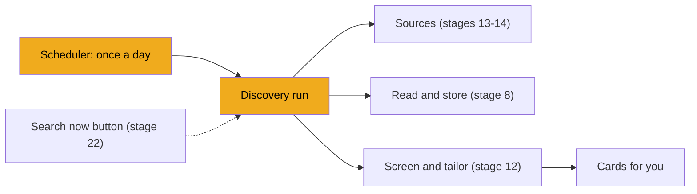
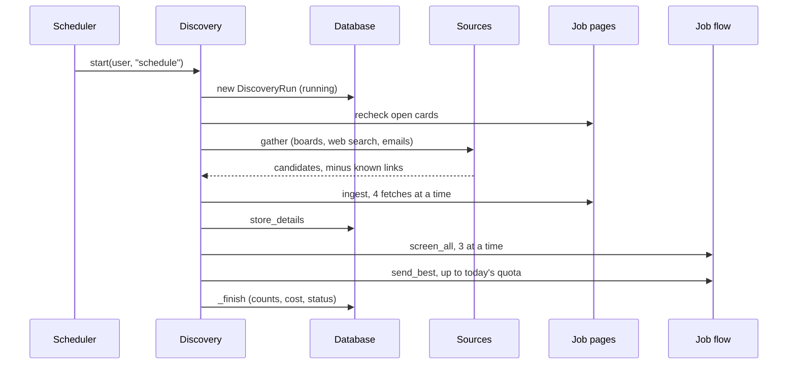
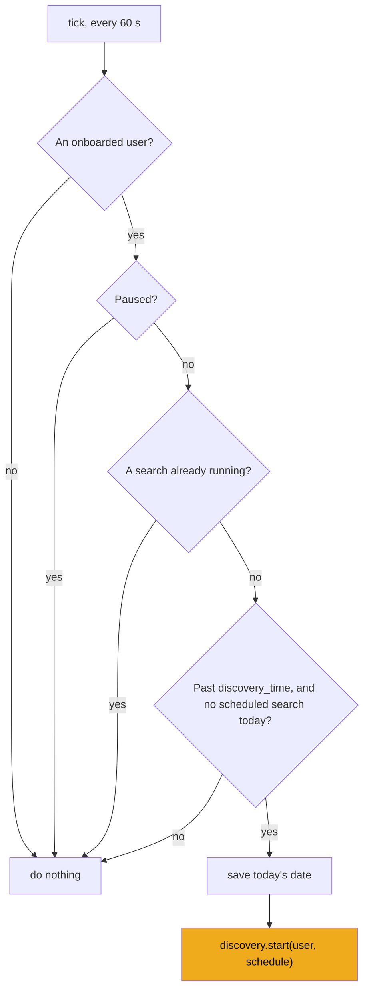

# Stage 19: Discovery and the scheduler

> **Goal:** Let JobBee look for jobs by itself once a day: collect postings from all your sources, read and screen them, and prepare cards for the best few.
>
> **By the end you will have:** `pipeline/discovery.py`, which runs one complete job search and records it as a row in `discovery_runs`, and `pipeline/scheduler.py`, a background loop that starts that search once a day after your chosen time, even if your PC was asleep at that moment. The server starts the scheduler by itself.

## Where this fits

You already have every piece of a search. Stages 13 and 14 built the *sources* that suggest job links, stage 8 reads and stores a posting, and stage 12's job flow screens a job and tailors your CV for it. This stage joins them into one search, and adds a clock that starts it every day.



**Why does this come after the apply agent?** Claude's web search (stage 14) needs an Anthropic SDK client. JobBee makes every SDK client with one function, `make_client`, which lives in `apply/agent.py` from [stage 18](18-apply-agent.md). `discovery.py` imports it, so it can only be typed now. Nothing else here depends on the apply engine.

The HTTP endpoints that start a search by hand (`POST /api/agent/search` and "Prepare more") come in [stage 22](22-api-home-and-agent.md). Until then the scheduler is the only thing that starts a search, and you can start one from a terminal to test it.

## New ideas in plain words

**A search run.** One pass of "collect, read, screen, prepare". JobBee runs at most one at a time. Each run gets a row in the `discovery_runs` table (built in [stage 3](03-database.md)). Its columns form a funnel, so you can see afterwards what happened:

| Column | Meaning |
|---|---|
| `trigger` | Who started it: `schedule`, `manual` or `more` |
| `found` | Candidates the sources suggested, after removing known and repeated links |
| `new` | Postings stored for the first time |
| `screened` | Jobs that went through screening |
| `kept` | Jobs that screening kept |
| `sent` | Cards prepared for you |
| `sources` | Counts per source, such as `{"watchlist": 12, "web_search": 9}` |
| `status` | `running`, then `done`, `stopped` or `failed` |
| `cost_usd` | What the Claude calls cost while it ran |

**A semaphore: "only N at a time".** Picture a bouncer at a club door with one rule: at most four people inside. When someone leaves, the next person in the line goes in. `asyncio.Semaphore(4)` is that bouncer. Code that runs `async with gate:` waits at the door until there's room. You met `asyncio.gather` in [stage 8](08-reading-job-postings.md): it starts many coroutines and waits for all of them. Put a semaphore inside each one and you get "do all of these, but only four at once". Discovery fetches four postings at a time and screens three at a time. Without a limit, sixty candidates would mean sixty requests to one job board in the same second (which looks like an attack) and sixty Claude calls at once.

**A daily quota and a shortlist.** You don't want forty cards a day. The preference `jobs_per_day` (5 by default, from [stage 9](09-screening.md)) caps how many cards JobBee prepares per day, counting links you pasted yourself. Jobs that pass screening beyond the quota aren't thrown away. They stay `matched`, with a `keep` verdict from screening. That pile is the *shortlist*. "Prepare more" (stage 22) turns the next best ones into cards.

**A warning is not an error.** A company renames its job board, or the web search times out. That source failed, but the others still work. Discovery writes a *warning* and carries on. Only a real stop (the budget ran out, or the server is shutting down) ends the search early.

**A polling scheduler instead of cron.** *Cron* is the classic Unix tool that runs a command at fixed times. Python also has scheduling libraries, such as *APScheduler*. JobBee uses neither. It runs a small loop inside the server: wake up every 60 seconds and ask "is a search due?". That needs no extra software, and the loop can check things only the app knows: is the agent paused, is a search already running, has the user finished setup?

**Catching up after sleep.** JobBee runs on your PC, which may be asleep at 9:00. A rule like "run when the clock says exactly 9:00" would skip that day. JobBee's rule is "run once a day, at any time *after* 9:00, if today's search hasn't run yet". Wake the PC at 15:00, and within a minute today's search starts.

**Local time and UTC.** JobBee stores times in UTC, the world's reference clock. But your daily search time and the word "today" mean *your* time zone. `datetime.now()` gives a time with no time zone attached, and `.astimezone()` attaches your PC's zone (or converts a UTC time to it). The code below converts back and forth.

## Build it, step by step

### Step 1: One search, `backend/app/pipeline/discovery.py`

This file sits next to `flow.py` in `backend/app/pipeline/`. It holds one `Discovery` object, shared by the whole server, that runs at most one search at a time. It's about 500 lines, so it comes in nine parts.

#### Part 1: Imports and limits

The docstring lists the four steps of a search. The imports show how much this file reuses: the job flow (stage 12), `store_details` and the posting reader (stage 8), preferences (stage 9), the three sources (stages 13 and 14), the spend ledger (stage 6), messaging (stage 11) and `make_client` (stage 18).

The constants are the knobs:

- `_FETCH_CONCURRENCY = 4` and `_SCREEN_CONCURRENCY = 3` are the semaphore sizes.
- `_RECENT_UNSCREENED`: jobs from the last 14 days that never got screened are picked up too (Part 8).
- `MIN_DESCRIPTION_CHARS = 300`: a page with less text than that wasn't really read.
- `STAGES` gives each step a friendly name. While a search runs, the home page in stage 22 shows, for example, "Reading postings".

<!-- code: backend/app/pipeline/discovery.py lines=1-56 -->
**`backend/app/pipeline/discovery.py`** (lines 1–56 of 506)

```python
"""Find jobs: gather postings from every source, screen them, send the best as cards.

One search at a time. A search:
  1. collects candidates from the company watchlist, Claude web search and alert emails;
  2. drops known postings, excluded companies and (for whole job boards) unrelated titles;
  3. fetches and stores up to `max_screens_per_run` postings, then filters and screens them;
  4. prepares tailored-CV cards for the best kept jobs, up to `jobs_per_day` per day.
Kept jobs beyond today's quota stay shortlisted; `more()` prepares the next ones.
"""

from __future__ import annotations

import asyncio
import logging
from dataclasses import dataclass, field
from datetime import datetime, timedelta, timezone
from urllib.parse import urlsplit

from sqlalchemy import select

from ..apply.agent import make_client
from ..db import SessionLocal
from ..llm.base import LLMError
from ..llm.usage import BudgetExceededError, spend_since
from ..messaging.service import messaging
from ..models import Application, ApplicationStatus, DiscoveryRun, Job, User, WatchlistCompany
from ..services.secrets import claude_api_key
from .flow import JobFlow, job_flow
from .ingest import store_details
from .jd import (
    JobDetails,
    JobFetchError,
    PostingClosedError,
    canonicalize_url,
    fetch_job_details,
)
from .prefs import load_preferences
from .sources.ats_boards import list_board, role_relevance
from .sources.base import Candidate, SourceError
from .sources.email_alerts import fetch_alerts
from .sources.web_search import search_postings

logger = logging.getLogger(__name__)

_FETCH_CONCURRENCY = 4
_SCREEN_CONCURRENCY = 3
_RECENT_UNSCREENED = timedelta(days=14)
MIN_DESCRIPTION_CHARS = 300
STAGES = {
    "sources": "Looking for new postings",
    "reading": "Reading postings",
    "screening": "Checking which ones fit",
    "preparing": "Tailoring your CV for the best ones",
}


```
<!-- /code -->

#### Part 2: Today's quota and the shortlist

- **`local_day_start`** finds your local midnight and returns it in UTC. `(now or _now()).astimezone()` converts a UTC time to your zone, `replace(hour=0, ...)` moves it to midnight, and `.astimezone(timezone.utc)` converts it back. The `now` parameter lets tests pick any time.
- **`prepared_today`** counts the cards prepared since that midnight. When stage 12's flow tailors a CV, it saves a `prepared_at` time stamp (ISO text such as `2026-10-22T07:31:00+00:00`) in the application's `tailoring` JSON. This function reads every `tailoring` value and counts the stamps after midnight. Links you pasted also go through the flow, so they use up the quota too. Cards withdrawn because the posting closed (`filtered_out`) don't count. A stamp that can't be read raises `ValueError` and is skipped.
- **`shortlist`** returns the kept jobs that don't have a card yet, best score first. It selects `matched` applications that have a screening result, keeps those whose `decision` is `"keep"` and whose score reaches `min_score`, and sorts them by score. The query lists the newest first, and Python's `sorted` keeps that order between equal scores, so a newer job wins a tie.

<!-- code: backend/app/pipeline/discovery.py lines=57-110 -->
**`backend/app/pipeline/discovery.py`** (lines 57–110 of 506)

```python
def _now() -> datetime:
    return datetime.now(timezone.utc)


def local_day_start(now: datetime | None = None) -> datetime:
    local = (now or _now()).astimezone()
    return local.replace(hour=0, minute=0, second=0, microsecond=0).astimezone(timezone.utc)


def prepared_today(user_id: int, now: datetime | None = None) -> int:
    """Cards prepared since local midnight (links the user sent included)."""

    start = local_day_start(now)
    with SessionLocal() as session:
        rows = session.execute(
            select(Application.tailoring).where(
                Application.user_id == user_id,
                Application.tailoring.is_not(None),
                # Cards withdrawn because the posting closed don't use up the day's quota.
                Application.status != ApplicationStatus.filtered_out,
            )
        ).scalars()
        count = 0
        for tailoring in rows:
            stamp = (tailoring or {}).get("prepared_at")
            try:
                if stamp and datetime.fromisoformat(stamp) >= start:
                    count += 1
            except ValueError:
                continue
        return count


def shortlist(user_id: int, min_score: int) -> list[int]:
    """Kept-but-not-sent applications, best first."""

    with SessionLocal() as session:
        rows = session.execute(
            select(Application.id, Application.screen)
            .where(
                Application.user_id == user_id,
                Application.status == ApplicationStatus.matched,
                Application.screen.is_not(None),
            )
            .order_by(Application.id.desc())
        ).all()
    kept = [
        (app_id, int(screen.get("score", 0)))
        for app_id, screen in rows
        if screen and screen.get("decision") == "keep" and screen.get("score", 0) >= min_score
    ]
    return [app_id for app_id, _ in sorted(kept, key=lambda r: r[1], reverse=True)]


```
<!-- /code -->

#### Part 3: Withdraw cards whose posting closed

Before looking for new jobs, discovery checks the old ones. A card you haven't answered yet, or a shortlisted job, may point to a posting the company has since taken down. `recheck_open_postings` fetches each of them again with stage 8's `fetch_job_details`:

1. The query joins `Application` with `Job` to get each URL. It keeps cards (`awaiting_approval`) and shortlisted jobs (`matched` with a `keep` decision).
2. `closed(url)` fetches one posting inside the semaphore. `PostingClosedError` (stage 8) means the board says the job is gone. Any other `JobFetchError` means "couldn't reach it right now", which is *not* proof that it closed. Withdrawing a card because of a network hiccup would lose a good job.
3. `asyncio.gather` runs all the checks, four at a time. Its results come back in the same order as its inputs, so `zip(..., strict=True)` pairs each result with its application. `strict=True` raises an error if the two lists ever differ in length.
4. Closed ones become `filtered_out` with the reason "The posting was taken down."

<!-- code: backend/app/pipeline/discovery.py lines=111-153 -->
**`backend/app/pipeline/discovery.py`** (lines 111–153 of 506)

```python
async def recheck_open_postings(user_id: int) -> list[int]:
    """Withdraw cards and shortlisted jobs whose posting has since closed. Returns their ids."""

    with SessionLocal() as session:
        rows = session.execute(
            select(Application.id, Application.status, Application.screen, Job.url)
            .join(Job, Job.id == Application.job_id)
            .where(
                Application.user_id == user_id,
                Application.status.in_(
                    (ApplicationStatus.awaiting_approval, ApplicationStatus.matched)
                ),
            )
        ).all()
    open_ids = [
        (app_id, url)
        for app_id, status, screen, url in rows
        if status == ApplicationStatus.awaiting_approval or (screen or {}).get("decision") == "keep"
    ]
    gate = asyncio.Semaphore(_FETCH_CONCURRENCY)

    async def closed(url: str) -> bool:
        async with gate:
            try:
                await fetch_job_details(url)
            except PostingClosedError:
                return True
            except JobFetchError:
                return False  # unreachable right now; don't withdraw on a hiccup
        return False

    results = await asyncio.gather(*(closed(url) for _, url in open_ids))
    gone = [app_id for (app_id, _), is_closed in zip(open_ids, results, strict=True) if is_closed]
    if gone:
        with SessionLocal() as session:
            for app_id in gone:
                app = session.get(Application, app_id)
                app.status = ApplicationStatus.filtered_out
                app.stage_reason = "The posting was taken down."
            session.commit()
    return gone


```
<!-- /code -->

#### Part 4: The `Discovery` object and its background task

`SearchSummary` is a small dataclass that collects a run's counters and warnings while it runs. `field(default_factory=dict)` gives each summary its own empty dict. A plain `= {}` would share one dict between all summaries.

`Discovery` keeps three things in memory: `_task` (the running search), and `stage` and `started_at` (the home page shows them in stage 22).

- **`running`** is true while the task exists and hasn't finished.
- **`start`** returns `False` when a search is already running. Otherwise it starts a background task with `create_task`, as the Telegram poller did in [stage 11](11-messages-and-telegram.md), and returns `True`. Storing the task in `self._task` keeps a reference to it, so Python can't garbage-collect it halfway through. The scheduler calls `start`, and so do stage 22's "Search now" endpoint (which turns `False` into "409: A search is already running.") and stage 23's "finish setup" endpoint.
- **`start_more`** does the same for "prepare more" (Part 5).
- **`stop`** cancels a running search at shutdown and waits for it to end. `gather(..., return_exceptions=True)` waits without raising the `CancelledError` the task ends with.
- **`_guarded`** wraps the search. A crash in a task nobody awaits would otherwise go unnoticed; here it's logged with its traceback. `finally` clears `stage` and `started_at`, so the home page never shows a search stuck halfway.

<!-- code: backend/app/pipeline/discovery.py lines=154-205 -->
**`backend/app/pipeline/discovery.py`** (lines 154–205 of 506)

```python
@dataclass
class SearchSummary:
    found: int = 0
    new: int = 0
    screened: int = 0
    kept: int = 0
    sent: int = 0
    sources: dict[str, int] = field(default_factory=dict)
    warnings: list[str] = field(default_factory=list)


class Discovery:
    def __init__(self, flow: JobFlow) -> None:
        self.flow = flow
        self._task: asyncio.Task | None = None
        self.stage: str | None = None
        self.started_at: datetime | None = None

    @property
    def running(self) -> bool:
        return self._task is not None and not self._task.done()

    def start(self, user_id: int, trigger: str = "manual") -> bool:
        if self.running:
            return False
        self._task = asyncio.get_running_loop().create_task(
            self._guarded(self.run(user_id, trigger))
        )
        return True

    def start_more(self, user_id: int, count: int = 3) -> bool:
        if self.running:
            return False
        self._task = asyncio.get_running_loop().create_task(
            self._guarded(self.more(user_id, count))
        )
        return True

    async def stop(self) -> None:
        if self.running:
            self._task.cancel()
            await asyncio.gather(self._task, return_exceptions=True)

    async def _guarded(self, coro) -> None:
        try:
            await coro
        except Exception:
            logger.exception("Job search failed")
        finally:
            self.stage = None
            self.started_at = None

```
<!-- /code -->

#### Part 5: The search in order, and "prepare more"

`run` is the whole search. It first inserts the `DiscoveryRun` row with status `running` and keeps its id. Then, inside `try`:

1. Load the user and the preferences. `session.expunge(user)` takes the `User` object out of the session. It keeps the values already loaded, and no database session stays open during the long search.
2. `recheck_open_postings` (Part 3).
3. `gather` collects candidates from every source (Part 7). `summary.found` is how many survived the duplicate filter.
4. `ingest` fetches and stores postings (Part 8) and returns the ids of new `matched` applications.
5. `_with_recent_unscreened` adds leftovers, and `[: prefs.max_screens_per_run]` cuts the list to 30 by default. That caps the Claude calls of one search.
6. `screen_all` screens them, three at a time (Part 9).
7. `send_best` prepares cards up to what's left of today's quota: `max(prefs.jobs_per_day - prepared_today(user_id), 0)`. The `max(..., 0)` stops the quota going below zero when you pasted more links than `jobs_per_day`.

Each step sets `self.stage` first, so the home page can show where the search is.

The `except` lines decide the final status:

| What happened | `status` | `error` |
|---|---|---|
| Everything ran | `done` | the first three warnings, if any |
| `BudgetExceededError` (stage 6) | `stopped` | the budget message |
| Another `LLMError` | `failed` | its message |
| `CancelledError` (the server is shutting down) | `stopped` | "Stopped." |

Running out of budget is `stopped`, not a crash: everything screened so far is saved. The `CancelledError` branch sets the status and then raises the error again, because a cancelled task must end cancelled. `finally` runs either way. If a source failed (a warning) and nothing at all was found, a `done` run becomes `failed`: the search didn't really happen. Then `_finish` saves the row (Part 6). `_digest` sits after `finally`, so it only runs when the search wasn't cancelled.

`more` is "prepare more" without a new search. It records a run with trigger `more` and calls `send_best` with the count you asked for, instead of the daily quota. Unlike `run`, it has no `CancelledError` branch, so a `more` run cut short by shutdown is saved as `done` with whatever it sent.

<!-- code: backend/app/pipeline/discovery.py lines=206-272 -->
**`backend/app/pipeline/discovery.py`** (lines 206–272 of 506)

```python
    # --- a full search -------------------------------------------------------------------

    async def run(self, user_id: int, trigger: str = "manual") -> int:
        self.started_at = _now()
        self.stage = "sources"
        with SessionLocal() as session:
            row = DiscoveryRun(user_id=user_id, trigger=trigger, status="running", sources={})
            session.add(row)
            session.commit()
            run_id = row.id
        summary = SearchSummary()
        status, error = "done", None
        try:
            with SessionLocal() as session:
                user = session.get(User, user_id)
                prefs = load_preferences(user)
                session.expunge(user)
            await recheck_open_postings(user_id)
            candidates = await self.gather(user, prefs, summary)
            summary.found = len(candidates)
            self.stage = "reading"
            app_ids = await self.ingest(user, candidates, summary)
            app_ids = self._with_recent_unscreened(user_id, app_ids)[: prefs.max_screens_per_run]
            self.stage = "screening"
            await self.screen_all(app_ids, summary)
            self.stage = "preparing"
            quota = max(prefs.jobs_per_day - prepared_today(user_id), 0)
            summary.sent = await self.send_best(user_id, prefs.min_match_score, quota)
        except BudgetExceededError as e:
            status, error = "stopped", str(e)
        except LLMError as e:
            status, error = "failed", str(e)
        except asyncio.CancelledError:
            status, error = "stopped", "Stopped."
            raise
        finally:
            if summary.warnings and error is None:
                error = " · ".join(summary.warnings[:3])
                if status == "done" and summary.found == 0:
                    status = "failed"  # every source failed; nothing was searched
            self._finish(run_id, summary, status, error)
        await self._digest(user_id, summary, status, error)
        return run_id

    async def more(self, user_id: int, count: int) -> int:
        """Prepare cards for the next best shortlisted jobs (no new search)."""

        self.started_at = _now()
        self.stage = "preparing"
        with SessionLocal() as session:
            row = DiscoveryRun(user_id=user_id, trigger="more", status="running", sources={})
            session.add(row)
            session.commit()
            run_id = row.id
            prefs = load_preferences(session.get(User, user_id))
        summary = SearchSummary()
        status, error = "done", None
        try:
            summary.sent = await self.send_best(user_id, prefs.min_match_score, count)
        except BudgetExceededError as e:
            status, error = "stopped", str(e)
        except LLMError as e:
            status, error = "failed", str(e)
        finally:
            self._finish(run_id, summary, status, error)
        return run_id

```
<!-- /code -->

#### Part 6: Save the result and send a one-line digest

`_finish` copies the summary into the row. `cost_usd` comes from stage 6's spend ledger: `spend_since(started)` adds up every Claude call recorded since the run started. That includes calls made at the same time by other work, such as a link you pasted during the search, so treat it as an estimate. SQLite gives times back without a time zone, so `replace(tzinfo=timezone.utc)` marks `started_at` as the UTC time it is. Comparing a time with a zone and one without raises a `TypeError`.

`_digest` turns the result into one short message, such as "🐝 Found 14 · kept 4 · sent you 1 new match." It goes through `messaging.notify` from [stage 11](11-messages-and-telegram.md): to Telegram if you linked a chat, and into the message log either way.

<!-- code: backend/app/pipeline/discovery.py lines=273-305 -->
**`backend/app/pipeline/discovery.py`** (lines 273–305 of 506)

```python
    def _finish(self, run_id: int, summary: SearchSummary, status: str, error: str | None) -> None:
        with SessionLocal() as session:
            row = session.get(DiscoveryRun, run_id)
            row.status = status
            row.error = error
            row.found, row.new = summary.found, summary.new
            row.screened, row.kept, row.sent = summary.screened, summary.kept, summary.sent
            row.sources = summary.sources
            started = (
                row.started_at
                if row.started_at.tzinfo
                else row.started_at.replace(tzinfo=timezone.utc)
            )
            row.cost_usd = round(spend_since(started), 4)
            row.finished_at = _now()
            session.commit()

    async def _digest(
        self, user_id: int, summary: SearchSummary, status: str, error: str | None
    ) -> None:
        if status != "done":
            text = f"⚠️ Job search stopped: {error}"
        elif summary.sent:
            text = (
                f"🐝 Found {summary.found} · kept {summary.kept} · sent you {summary.sent} new "
                f"match{'es' if summary.sent != 1 else ''}."
            )
        else:
            text = (
                f"🐝 Found {summary.found} · kept {summary.kept}. Nothing new worth sending today."
            )
        await messaging.notify(user_id, text, kind="digest")

```
<!-- /code -->

#### Part 7: Collect candidates from every source

`gather` asks each source in turn. A `Candidate` (stage 13) is only a lead: a URL plus whatever the listing says.

1. **The watchlist** (stage 14). It loads your companies, then calls `list_board` for each. A `SourceError` becomes a warning, and the board's row records `last_polled_at` and `last_error`, so Settings can show "couldn't read this board". A board can list hundreds of jobs, so `role_relevance` scores each title against your target roles. A score of 0 means unrelated, and that posting is dropped. The rest are sorted, most relevant first.
2. **Claude web search** (stage 14), only when `web_search_enabled` is on and a Claude key is set. The hosts of your watchlist careers pages are added to the allowed domains. `make_client()` builds the SDK client. A web search failure (`LLMError`) becomes a warning, but `BudgetExceededError` is re-raised, so the whole search stops.
3. **Alert emails** (stage 13). `fetch_alerts` returns an empty list when no inbox is connected.

`session.expunge_all()` detaches the loaded boards, so they can be used after the session closes.

`_dedupe` then removes three kinds of candidate: links already in the database (compared by stage 8's canonical URL, so tracking parameters don't fool it), repeats within this search, and companies you excluded (`prefs.excludes`, stage 9).

<!-- code: backend/app/pipeline/discovery.py lines=306-392 -->
**`backend/app/pipeline/discovery.py`** (lines 306–392 of 506)

```python
    # --- steps ------------------------------------------------------------------------------

    async def gather(self, user: User, prefs, summary: SearchSummary) -> list[Candidate]:
        """Candidates from every enabled source; a failing source is a warning, not an error."""

        candidates: list[Candidate] = []

        with SessionLocal() as session:
            boards = (
                session.execute(select(WatchlistCompany).where(WatchlistCompany.user_id == user.id))
                .scalars()
                .all()
            )
            session.expunge_all()
        board_hits: list[tuple[int, Candidate]] = []
        for board in boards:
            try:
                listed = await list_board(board.ats, board.slug, board.name)
                error = None
            except SourceError as e:
                listed, error = [], str(e)
                summary.warnings.append(str(e))
            with SessionLocal() as session:
                row = session.get(WatchlistCompany, board.id)
                row.last_polled_at, row.last_error = _now(), error
                session.commit()
            for c in listed:
                score = role_relevance(c.title, user.target_roles or [])
                if score:
                    board_hits.append((score, c))
        board_hits.sort(key=lambda hit: hit[0], reverse=True)
        candidates += [c for _, c in board_hits]
        if boards:
            summary.sources["watchlist"] = len(board_hits)

        if prefs.web_search_enabled and claude_api_key():
            domains = sorted(
                {
                    host
                    for b in boards
                    if b.careers_url and (host := (urlsplit(b.careers_url).hostname or ""))
                }
            )
            try:
                found = await search_postings(
                    make_client(),
                    user,
                    excluded=prefs.excluded_companies,
                    max_age_days=prefs.max_job_age_days,
                    extra_domains=domains,
                )
                candidates += found
                summary.sources["web_search"] = len(found)
            except BudgetExceededError:
                raise
            except LLMError as e:
                summary.warnings.append(f"Web search: {e}")

        try:
            with SessionLocal() as session:
                found = await fetch_alerts(session, session.get(User, user.id))
            candidates += found
            if found:
                summary.sources["email"] = len(found)
        except SourceError as e:
            summary.warnings.append(str(e))

        return self._dedupe(candidates, prefs)

    @staticmethod
    def _dedupe(candidates: list[Candidate], prefs) -> list[Candidate]:
        seen: set[str] = set()
        with SessionLocal() as session:
            known = set(
                session.execute(select(Job.canonical_url).where(Job.canonical_url.is_not(None)))
                .scalars()
                .all()
            )
        out = []
        for c in candidates:
            key = canonicalize_url(c.url)
            if key in seen or key in known or prefs.excludes(c.company):
                continue
            seen.add(key)
            out.append(c)
        return out

```
<!-- /code -->

#### Part 8: Read and store the postings

`ingest` fetches each candidate's real page. A search result or a board listing can be stale, so a job is only kept when its own page was read.

- **At most twice the screening cap** is fetched (`prefs_limit * 2`, so 60 by default), because some fetches fail or turn out to be duplicates.
- **`async with gate:`** lets four fetches run at once.
- **`PostingClosedError`** drops the candidate. Other fetch errors leave `details` empty.
- **"Readable" means** fetched, not behind a login wall, and at least 300 characters of description.
- **The one exception** is a LinkedIn alert email (`source == "email"`) whose page is behind a login wall. The email itself is the evidence, so a bare `JobDetails` is built and filled from the email's title and snippet.
- Missing fields are filled in from the candidate (`details.title or c.title`). A posting with no title at all is dropped.

When every fetch has finished, one session stores the results with `store_details` (stage 8). A new posting adds 1 to `summary.new`. Only applications that come back `matched` go on to screening. `list(dict.fromkeys(app_ids))` removes repeated ids but keeps their order, because a dict remembers insertion order.

`_with_recent_unscreened` adds `matched` applications from the last 14 days that were never screened, such as a pasted link whose screening failed. They go after the new ones, so new jobs get the screening slots first.

<!-- code: backend/app/pipeline/discovery.py lines=393-463 -->
**`backend/app/pipeline/discovery.py`** (lines 393–463 of 506)

```python
    async def ingest(
        self, user: User, candidates: list[Candidate], summary: SearchSummary
    ) -> list[int]:
        """Fetch each posting (bounded) and store it; returns new applications to screen."""

        prefs_limit = load_preferences(user).max_screens_per_run
        todo = candidates[: prefs_limit * 2]  # some fetches fail or turn out to be duplicates
        gate = asyncio.Semaphore(_FETCH_CONCURRENCY)

        async def fetch(c: Candidate) -> JobDetails | None:
            """The posting as the job board shows it now, or None if it isn't a live posting.

            Search results and listings can be stale, so a job is only kept when its page
            was read. The one exception is a LinkedIn alert email behind a login wall:
            the email itself is the evidence, so its snippet stands in for the page.
            """

            async with gate:
                try:
                    details = await fetch_job_details(c.url)
                except PostingClosedError:
                    return None
                except JobFetchError:
                    details = None
            readable = (
                details is not None
                and not details.login_wall
                and len(details.description or "") >= MIN_DESCRIPTION_CHARS
            )
            if not readable:
                if c.source != "email" or not c.title:
                    return None
                details = JobDetails(url=c.url, canonical_url=canonicalize_url(c.url), ats="")
            details.title = details.title or c.title
            details.company = details.company or c.company
            details.location = details.location or c.location
            details.description = details.description or c.snippet
            details.posted_at = details.posted_at or c.posted_at
            return details if details.title else None

        fetched = await asyncio.gather(*(fetch(c) for c in todo))
        app_ids: list[int] = []
        with SessionLocal() as session:
            db_user = session.get(User, user.id)
            for c, details in zip(todo, fetched):
                if details is None:
                    continue
                result = store_details(session, db_user, details, source=c.source)
                if not result.duplicate:
                    summary.new += 1
                if result.status == ApplicationStatus.matched:
                    app_ids.append(result.application_id)
        return list(dict.fromkeys(app_ids))

    @staticmethod
    def _with_recent_unscreened(user_id: int, app_ids: list[int]) -> list[int]:
        """Also screen leftovers (links that failed, email syncs) from the last two weeks."""

        since = _now() - _RECENT_UNSCREENED
        with SessionLocal() as session:
            rows = session.execute(
                select(Application.id).where(
                    Application.user_id == user_id,
                    Application.status == ApplicationStatus.matched,
                    Application.screen.is_(None),
                    Application.created_at >= since,
                )
            ).scalars()
            leftovers = [i for i in rows if i not in app_ids]
        return app_ids + leftovers

```
<!-- /code -->

#### Part 9: Screen, then prepare the best

`screen_all` calls stage 12's `self.flow.screen(app_id)` for each job, three at a time. The `budget_error` list works as a shared flag. The inner function can append to a list that belongs to the outer function; assigning `budget_error = True` inside it would create a new local variable instead. Once one call hits the budget, the others see the flag and skip, both before and after waiting at the gate. At the end the first budget error is raised again, so `run` records `stopped`. Other `LLMError`s are logged, and that one job is skipped.

`send_best` walks the shortlist, best first, and calls `self.flow.prepare_card` until it has sent `count` cards. `prepare_card` (stage 12) tailors the CV and returns `"card_sent"`, or `"busy"` if that job is already being worked on. A failed tailoring marks that job failed (`_failed`, stage 12), and the loop moves on to the next one. A budget stop is raised again.

The last line creates the one shared instance, `discovery`, the way stage 12 created `job_flow`.

<!-- code: backend/app/pipeline/discovery.py lines=464-506 -->
**`backend/app/pipeline/discovery.py`** (lines 464–506 of 506)

```python
    async def screen_all(self, app_ids: list[int], summary: SearchSummary) -> None:
        gate = asyncio.Semaphore(_SCREEN_CONCURRENCY)
        budget_error: list[BudgetExceededError] = []

        async def one(app_id: int) -> None:
            if budget_error:
                return
            async with gate:
                if budget_error:
                    return
                try:
                    outcome = await self.flow.screen(app_id)
                except BudgetExceededError as e:
                    budget_error.append(e)
                    return
                except LLMError as e:
                    logger.warning("Screening application %s failed: %s", app_id, e)
                    return
            summary.screened += 1
            if outcome == "kept":
                summary.kept += 1

        await asyncio.gather(*(one(i) for i in app_ids))
        if budget_error:
            raise budget_error[0]

    async def send_best(self, user_id: int, min_score: int, count: int) -> int:
        sent = 0
        for app_id in shortlist(user_id, min_score):
            if sent >= count:
                break
            try:
                if await self.flow.prepare_card(app_id) == "card_sent":
                    sent += 1
            except BudgetExceededError:
                raise
            except LLMError as e:
                logger.warning("Preparing application %s failed: %s", app_id, e)
                await self.flow._failed(app_id, e, notify_chat=False)
        return sent


discovery = Discovery(job_flow)
```
<!-- /code -->

Here is one search from start to finish:



### Step 2: The daily clock, `backend/app/pipeline/scheduler.py`

This file also lives in `backend/app/pipeline/`. It's short, but it has two clear halves.

#### Part 1: Small functions you can test with any time

- **`parse_time`** turns `"09:00"` from your preferences into a `time` object. A bad value falls back to 09:00, and `hour % 24` and `minute % 60` wrap odd numbers, so `"25:70"` can't crash it.
- **`is_due`** is the catch-up rule in one line: it's past your chosen time, *and* the last scheduled search wasn't today.
- **`next_search_at`** answers "when is the next search?" for the home page (stage 22): now if one is due, today at your time if that's still ahead, otherwise tomorrow.
- **`last_search_day`** reads the date of the last scheduled search from the `app_config` table (`get_flag`, [stage 5](05-flags-and-app-config.md)). It's stored there, not in memory, so a restart doesn't forget it.
- **`scheduled_user`** returns the first user who finished setup (`onboarded_at` is set). Stage 7's `PUT /api/profile` sets it when it receives `"mark_onboarded": true`. Later, the welcome flow in [stage 25](25-welcome-flow.md) sets it for you through stage 23's `POST /api/setup/finish`, which also starts your first search. Before then, there's nobody to search for.

`is_due` and `next_search_at` take the current time as a parameter (`now_local`) instead of reading the clock. Their answer depends only on their inputs, so a test can ask "is a search due at 15:00 if the last one was yesterday?" without waiting for 15:00.

<!-- code: backend/app/pipeline/scheduler.py lines=1-65 -->
**`backend/app/pipeline/scheduler.py`** (lines 1–65 of 103)

```python
"""Daily job search at the user's chosen time, caught up after the PC was asleep or off."""

from __future__ import annotations

import asyncio
import logging
from datetime import date, datetime, time, timedelta

from sqlalchemy import select

from ..db import SessionLocal
from ..models import User
from .discovery import Discovery, discovery
from .prefs import load_preferences
from .state import get_flag, is_paused, set_flag

logger = logging.getLogger(__name__)

LAST_SEARCH_KEY = "last_scheduled_search"
TICK_S = 60.0


def parse_time(value: str | None) -> time:
    try:
        hour, minute = (int(p) for p in (value or "09:00").split(":", 1))
        return time(hour % 24, minute % 60)
    except ValueError:
        return time(9, 0)


def is_due(now_local: datetime, at: time, last_day: date | None) -> bool:
    """Due once a day, from `at` onwards (so a late wake-up still catches up)."""

    return now_local.time() >= at and last_day != now_local.date()


def next_search_at(now_local: datetime, at: time, last_day: date | None) -> datetime:
    if is_due(now_local, at, last_day):
        return now_local
    today_at = datetime.combine(now_local.date(), at, tzinfo=now_local.tzinfo)
    if now_local < today_at and last_day != now_local.date():
        return today_at
    return today_at + timedelta(days=1)


def last_search_day() -> date | None:
    value = get_flag(LAST_SEARCH_KEY)
    try:
        return date.fromisoformat(value) if value else None
    except ValueError:
        return None


def scheduled_user() -> User | None:
    with SessionLocal() as session:
        user = (
            session.execute(select(User).where(User.onboarded_at.is_not(None)).order_by(User.id))
            .scalars()
            .first()
        )
        if user is not None:
            session.expunge(user)
        return user


```
<!-- /code -->

#### Part 2: The loop that ticks every minute

- **`start`** creates the loop task, unless one is already running.
- **`stop`** cancels it and waits for it to end.
- **`_loop`** never dies. A failing tick is logged, and the loop sleeps 60 seconds (`TICK_S`) and tries again. `asyncio.sleep` lets the rest of the server run while it waits.
- **`tick`** makes the decision. It takes an optional `now_local`, so a test can say "pretend it's 10:00". `datetime.now().astimezone()` is the current time in your zone. `tick` returns `False` without starting anything when there's no onboarded user, the agent is paused (`is_paused`, stage 5) or a search is already running. Then it checks `is_due`.
- **It saves today's date *before* starting the search.** So a search that fails isn't retried every minute for the rest of the day.
- Only `tick` writes that date. A search you start by hand doesn't count as today's scheduled one.

The file ends with `scheduler = Scheduler(discovery)`, the one shared instance.

<!-- code: backend/app/pipeline/scheduler.py lines=66-103 -->
**`backend/app/pipeline/scheduler.py`** (lines 66–103 of 103)

```python
class Scheduler:
    def __init__(self, search: Discovery) -> None:
        self.search = search
        self._task: asyncio.Task | None = None

    def start(self) -> None:
        if self._task is None or self._task.done():
            self._task = asyncio.get_running_loop().create_task(self._loop())

    async def stop(self) -> None:
        if self._task is not None:
            self._task.cancel()
            await asyncio.gather(self._task, return_exceptions=True)
            self._task = None

    async def _loop(self) -> None:
        while True:
            try:
                self.tick()
            except Exception:
                logger.exception("Scheduler tick failed")
            await asyncio.sleep(TICK_S)

    def tick(self, now_local: datetime | None = None) -> bool:
        """Start today's search if it's due. Returns True when one was started."""

        now_local = now_local or datetime.now().astimezone()
        user = scheduled_user()
        if user is None or is_paused() or self.search.running:
            return False
        at = parse_time(load_preferences(user).discovery_time)
        if not is_due(now_local, at, last_search_day()):
            return False
        set_flag(LAST_SEARCH_KEY, now_local.date().isoformat())
        return self.search.start(user.id, "schedule")


scheduler = Scheduler(discovery)
```
<!-- /code -->

One tick as a picture:



### Step 3: Start the scheduler with the server, temporary `backend/app/main.py`

Replace `backend/app/main.py` with this version. Compared with stage 14's, three things changed:

1. Two new imports: `discovery` and `scheduler`.
2. At startup, `scheduler.start()` runs, but only when `app_env` isn't `"test"`. The tests set `APP_ENV=test` ([stage 4](04-api-shapes-health-and-tests.md)). A search starting in the middle of a test would make it slow and unpredictable.
3. At shutdown, things stop in a safe order: first the scheduler (so no new search starts), then any running search (`discovery.stop()` cancels it, and its row is saved as `stopped`), then messaging.

Stage 21 changes this file again, and stage 23 replaces it with the final version.

<!-- temp: backend/app/main.py -->
```python
"""FastAPI entry point.

Temporary version from stage 19. Stage 23 replaces it with the final file.
"""

from __future__ import annotations

import asyncio
import sys

# Playwright spawns a browser subprocess; uvicorn's default Windows loop cannot do that.
if sys.platform == "win32":
    asyncio.set_event_loop_policy(asyncio.WindowsProactorEventLoopPolicy())

from contextlib import asynccontextmanager

from fastapi import FastAPI
from fastapi.middleware.cors import CORSMiddleware

from . import __version__
from .api import health
from .api import settings as settings_router
from .api import llm
from .api import profile as profile_router
from .api import documents as documents_router
from .api import email as email_router
from .api import messaging as messaging_router
from .api import preferences as preferences_router
from .api import watchlist as watchlist_router
from .config import get_settings
from .db import init_db
from .messaging.service import messaging
from .pipeline.discovery import discovery
from .pipeline.flow import job_flow
from .pipeline.scheduler import scheduler


@asynccontextmanager
async def lifespan(_: FastAPI):
    init_db()
    job_flow.register()
    await messaging.start()
    if get_settings().app_env != "test":
        scheduler.start()
    yield
    await scheduler.stop()
    await discovery.stop()
    await messaging.stop()


def create_app() -> FastAPI:
    settings = get_settings()
    app = FastAPI(
        title="JobBee API",
        version=__version__,
        lifespan=lifespan,
    )

    # In dev the Vite proxy handles same-origin, but allow direct browser calls too.
    app.add_middleware(
        CORSMiddleware,
        allow_origins=["http://localhost:5173", "http://127.0.0.1:5173"]
        if settings.is_dev
        else [],
        allow_credentials=True,
        allow_methods=["*"],
        allow_headers=["*"],
    )

    app.include_router(health.router, prefix="/api")
    app.include_router(settings_router.router, prefix="/api")
    app.include_router(llm.router, prefix="/api")
    app.include_router(profile_router.router, prefix="/api")
    app.include_router(documents_router.router, prefix="/api")
    app.include_router(email_router.router, prefix="/api")
    app.include_router(messaging_router.router, prefix="/api")
    app.include_router(preferences_router.router, prefix="/api")
    app.include_router(watchlist_router.router, prefix="/api")

    @app.get("/", include_in_schema=False)
    def root() -> dict:
        return {
            "name": "JobBee API",
            "version": __version__,
            "docs": "/docs",
            "health": "/api/health",
        }

    return app


app = create_app()
```
<!-- /temp -->

## Check it works

**1. The server still starts, with the scheduler inside.** From `backend/`:

```powershell
cd backend
.\.venv\Scripts\python.exe -c "from fastapi.testclient import TestClient; from app.main import app; c = TestClient(app).__enter__(); print(c.get('/api/health').json())"
```

On Mac or Linux, use `.venv/bin/python` instead of `.\.venv\Scripts\python.exe`. `__enter__()` runs the startup code, so this also starts the scheduler. You should see a dict that begins with `{'status': 'ok', ...}`.

**2. The catch-up rule, free and offline:**

```powershell
.\.venv\Scripts\python.exe -c "from datetime import datetime, time; from app.pipeline.scheduler import is_due, next_search_at; now = datetime(2026, 10, 22, 15, 0).astimezone(); print(is_due(now, time(9, 0), None)); print(next_search_at(now, time(9, 0), now.date()))"
```

```text
True
2026-10-23 09:00:00+02:00
```

The `+02:00` at the end is your own time zone, so yours may differ. The first line says: at 15:00, with no search yet today, a 9:00 search is due. The second says: once today's search has run, the next one is tomorrow at 9:00.

**3. Optional: run one real search from the terminal.** This costs a little money: Haiku screens up to 30 jobs (a few cents in total), and Sonnet tailors each card (a few cents each). Web search adds up to about $0.10 per search run (at most 10 searches at $0.01 each) plus Sonnet tokens, so turn it off for a first try.

1. Start the server (`.\.venv\Scripts\python.exe -m uvicorn app.main:app --host 127.0.0.1 --port 8000`) and open http://127.0.0.1:8000/docs.
2. Call `PUT /api/preferences` with `{"jobs_per_day": 1, "web_search_enabled": false}`. Check that your profile has target roles (`GET /api/profile`): they decide which board postings count as relevant.
3. Call `POST /api/watchlist` (stage 14) with a company that uses Greenhouse, such as `{"company": "https://boards.greenhouse.io/<company>"}`.
4. Stop the server with Ctrl+C, then run one search. The `1` is your user id (the local user):

   ```powershell
   .\.venv\Scripts\python.exe -c "import asyncio; from app.pipeline.discovery import discovery; print('run', asyncio.run(discovery.run(1, 'manual')))"
   ```

5. Print the newest `discovery_runs` row:

   ```powershell
   .\.venv\Scripts\python.exe -c "from app.db import SessionLocal; from app.models import DiscoveryRun as R; s = SessionLocal(); r = s.query(R).order_by(R.id.desc()).first(); print(r.trigger, r.status, r.found, r.new, r.screened, r.kept, r.sent, round(r.cost_usd, 3), r.sources, r.error)"
   ```

   ```text
   manual done 14 14 14 4 1 0.071 {'watchlist': 14} None
   ```

   Your numbers will differ. `sent` is at most 1, because of `jobs_per_day`. With an empty watchlist you get `manual done 0 0 0 0 0 0.0 {} None`: an empty search is still a finished search.

**4. Optional: watch the scheduler start a search.** Call `PUT /api/profile` with `{"mark_onboarded": true}` if you haven't yet. Then set `discovery_time` to two minutes from now with `PUT /api/preferences`, for example `{"discovery_time": "15:42"}`. Restart the server *without* `--reload` (a reload restart cancels a running search). Within a minute of that time, print the newest row again: its `trigger` is `schedule`. It won't run a second time today. If your `discovery_time` is already past when the server starts, and no scheduled search ran today, the first tick starts one straight away. That's the catch-up rule at work.

The tests for this stage, `tests/test_discovery.py`, arrive in [stage 23](23-api-actions-and-setup.md) together with the API they also use. They fake the sources and the fetcher, then check that only the best two of four jobs become cards with `jobs_per_day=2`, that "prepare more" sends the next one, that a budget stop is saved as `stopped`, that closed postings are withdrawn, and that the 15:00 catch-up works.

<!-- verify: backend | SECRET_STORE=memory python -c "from fastapi.testclient import TestClient; from app.main import app; c = TestClient(app).__enter__(); print(c.get('/api/health').json())" -->

## Common mistakes

- **Letting one failing source crash the search.** A company renames its board, and the whole daily search fails. Catch `SourceError` per source, record a warning, and carry on. The run is marked `failed` only when a source failed *and* nothing at all was found.
- **Surprise at a `stopped` run.** When the daily or monthly budget runs out mid-search, the run stops with status `stopped` and the budget message in `error`. That's working as intended: what was screened is saved. Also, `check_budget` runs *before* each call, so three screenings running at once can each pass the check and push the total slightly over the limit.
- **Unbounded concurrency.** `asyncio.gather` over sixty fetches with no semaphore hits one job board sixty times at once and may get you blocked, and sixty parallel Claude calls can overshoot the budget badly. Put a semaphore around the slow part.
- **The scheduler never runs.** Check four things: your profile is onboarded (`onboarded_at` is set), the agent isn't paused, a scheduled search hasn't already run today, and your `.env` doesn't say `APP_ENV=test`.
- **Expecting more cards than `jobs_per_day`.** Pasted links count towards the quota too. The kept jobs beyond it wait on the shortlist for "Prepare more" (stage 22).
- **Mixing times with and without a time zone.** SQLite returns times without one. Comparing such a time with `datetime.now(timezone.utc)` raises `TypeError: can't compare offset-naive and offset-aware datetimes`. `_finish` adds `tzinfo=timezone.utc` first for exactly this reason.

## Recap

- A discovery run rechecks open cards, gathers candidates from every source, removes known links, fetches four at a time, screens three at a time, and prepares the best cards up to `jobs_per_day`.
- Every run is recorded in `discovery_runs` with its funnel of counts, its status and its cost.
- A failing source is a warning. A budget stop is `stopped`, and everything done so far is kept.
- Kept jobs beyond the daily quota stay on the shortlist, best first.
- The scheduler is a 60-second loop inside the server, not cron. It starts one search a day after your chosen time, so it catches up after the PC was asleep.
- The server starts the scheduler unless `APP_ENV=test`, and stops it before cancelling a running search.
- Discovery comes after the apply agent only because it imports `make_client`.

**Next:** [Stage 20: Site accounts](20-site-accounts.md)
