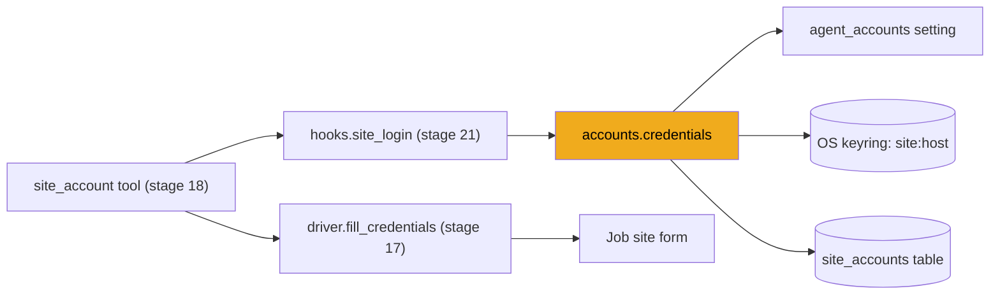
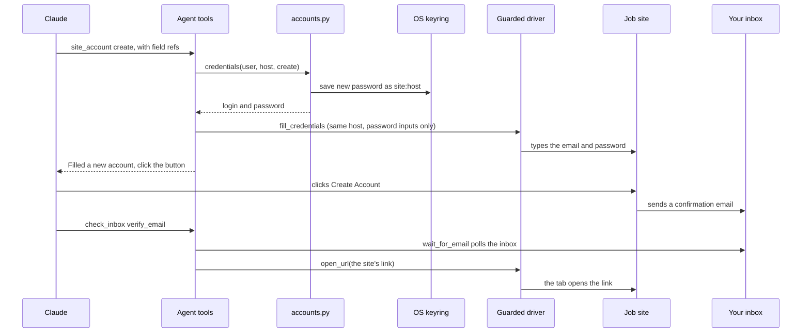

# Stage 20: Site accounts

> **Goal:** Give the apply agent a safe way to create and sign in to job-site accounts, without Claude ever seeing a password.
>
> **By the end you will have:** `apply/accounts.py`. It makes strong passwords with `secrets`, keeps them in your OS keyring, lists each account in the `site_accounts` table, and decides what each action of the agent's `site_account` tool may do, including "never retry a password the site refused".
>
> **What you can skip:** letting the agent use accounts. If you'd rather make job-site accounts yourself, switch off **Create and sign in to job-site accounts** in Settings ([stage 28](28-settings-page.md)), which is the `agent_accounts` preference. It's on by default. With it off, the agent sets those applications aside for you. You still type this file: the run manager ([stage 21](21-run-manager.md)) and the terminal script import it.

## Where this fits

In [stage 18](18-apply-agent.md) you built the agent's `site_account` tool. It asks its *hooks* for a login and a password (`hooks.site_login`), then has the driver type them (`fill_credentials`, [stage 17](17-guarded-driver.md)). The hooks themselves arrive in stage 21. This stage writes the code they call: `accounts.credentials`.



## New ideas in plain words

**Why job sites want accounts.** Big applicant tracking systems such as Workday and iCIMS make you register before you can apply. Workday is the hardest case: every company runs its own copy, called a *tenant*, at its own address such as `acme.wd5.myworkdayjobs.com`, and each tenant wants its own account. So JobBee keeps **one account per host**. The *host* is the part of a URL between `https://` and the next `/`.

**`secrets`, not `random`.** Python's `random` module is made for games and simulations. Its numbers come from a formula, and someone who sees enough of them can predict the next ones. The `secrets` module asks the operating system for unpredictable numbers, the same kind used for encryption keys. Use `secrets` for anything a stranger must not guess: passwords, tokens, pairing codes.

**The keyring holds the password; the database holds the index.** You met the keyring in [stage 2](02-secrets.md): your operating system's password vault, reached through `set_user_secret` and `get_user_secret`. It can store and fetch a secret by name, but it can't list what it holds. So JobBee also writes a row in the `site_accounts` table from [stage 3](03-database.md). The Settings page lists accounts from that table. The password itself never goes into the database.

| Where | What it holds | Example |
|---|---|---|
| OS keyring | the password | entry `user:1:site:acme.wd5.myworkdayjobs.com` |
| `site_accounts` table | host, login (your email), status, `last_used_at` | one row per user and host |

**The model never sees a password.** The *context* is everything Claude reads: the prompt, tool results, screenshots, page text. Anything in it could end up in a log, a summary or a reply. Earlier stages already built the walls; this file fits inside them:

1. Claude calls `site_account` with element refs, never with text. The tool answers with a sentence, never the password (stage 18).
2. JobBee's own code, the driver, types the password, and only into real password inputs on the right host (stage 17). Browsers show password inputs as dots, so screenshots and page text don't reveal it.
3. Claude can't type into a password field itself: the guard refuses ([stage 16](16-safety-guards.md)).
4. Events record the host and login, never the password (stage 21).

**Account statuses.** Each row has one:

| Status | Meaning | Set by |
|---|---|---|
| `created` | JobBee made the account and saved its password | `credentials(..., "create")` |
| `verified` | The site's confirmation email was found | the run hooks in stage 21 |
| `reset` | JobBee set a new password through the site's "Forgot password" flow | `credentials(..., "set_new_password")` |
| `rejected` | The site refused the saved password | `credentials(..., "rejected")` |

**"Rejected" means: never retry until reset.** Many sites lock an account after a few wrong passwords, sometimes for hours. A common cause is that you made the account yourself years ago, so JobBee's password is wrong. Trying again would only lock you out. So after one refusal, signing in is refused *in code*. The only way forward is a password reset.

## Build it, step by step

### Step 1: `backend/app/apply/accounts.py`

This file lives in `backend/app/apply/`, next to `agent.py`. It comes in three parts.

#### Part 1: Names and passwords

- The docstring sums up the design. Its last lines matter most: the driver types the password itself, "and only while the tab is on that same host".
- `ToolError` comes from the Anthropic SDK. When a tool raises it, the agent loop sends its message back to Claude as the tool's result (stage 18). So the error messages in Part 3 are written *for Claude*: each one says what to do next.
- **`secret_name`** turns a host into a keyring name: `Acme.wd5.myworkdayjobs.com` becomes `site:acme.wd5.myworkdayjobs.com`. Lowercasing means `ACME.com` and `acme.com` share one entry. `set_user_secret` then puts `user:<id>:` in front.
- **`generate_password`** builds a 20-character password. Sites have rules like "at least one capital, one digit and one symbol". Picking one of each first guarantees every rule is met. The other 16 characters come from the whole alphabet. Then `secrets.SystemRandom().shuffle` mixes them, so the capital isn't always first. `SystemRandom` is a shuffler that uses the operating system's unpredictable source.
- `_SYMBOLS` is a short, safe set. Some sites reject quotes, spaces or backslashes.

<!-- code: backend/app/apply/accounts.py lines=1-46 -->
**`backend/app/apply/accounts.py`** (lines 1–46 of 138)

```python
"""Job-site accounts the apply agent makes and signs in with, one per host.

Each Workday company (tenant), iCIMS portal and so on wants its own account.
JobBee makes it with the applicant's email and a generated password, keeps the
password in the OS keyring (`site:<host>`) and indexes it in `site_accounts`.
Passwords never go to the model: the driver types them into the page itself,
and only while the tab is on that same host.
"""

from __future__ import annotations

import secrets
import string
from datetime import datetime, timezone

from anthropic.tools import ToolError
from sqlalchemy import select
from sqlalchemy.orm import Session

from ..db import SessionLocal
from ..models import SiteAccount, User
from ..pipeline.prefs import load_preferences
from ..services.secrets import get_user_secret, set_user_secret

_SYMBOLS = "!@#$%&*"
_ALPHABET = string.ascii_letters + string.digits + _SYMBOLS


def secret_name(host: str) -> str:
    return f"site:{host.lower()}"


def generate_password(length: int = 20) -> str:
    """Random, with upper, lower, digit and symbol so any site's rules accept it."""

    required = [
        secrets.choice(string.ascii_uppercase),
        secrets.choice(string.ascii_lowercase),
        secrets.choice(string.digits),
        secrets.choice(_SYMBOLS),
    ]
    chars = required + [secrets.choice(_ALPHABET) for _ in range(length - len(required))]
    secrets.SystemRandom().shuffle(chars)
    return "".join(chars)


```
<!-- /code -->

#### Part 2: Read and write one account

- **`get_account`** finds the row for one user and host. `scalar_one_or_none()` returns the row or `None`. (It would raise if there were two, but the table's unique constraint on `(user_id, host)` prevents that.)
- **`account_password`** reads the password from the keyring. `or None` turns an empty value into `None`.
- **`new_password`** makes a fresh password, saves it in the keyring, then creates or updates the row with the login and a status (`created` or `reset`). "Create" and "reset" share it, because both mean "a new password for this host".
- **`mark`** updates the status and `last_used_at`. It does nothing when there's no row, so callers don't have to check first.

These helpers don't open sessions of their own: the ones that touch the database take a `session` from their caller, and `account_password` only touches the keyring.

<!-- code: backend/app/apply/accounts.py lines=47-82 -->
**`backend/app/apply/accounts.py`** (lines 47–82 of 138)

```python
def get_account(session: Session, user_id: int, host: str) -> SiteAccount | None:
    return session.execute(
        select(SiteAccount).where(SiteAccount.user_id == user_id, SiteAccount.host == host.lower())
    ).scalar_one_or_none()


def account_password(user_id: int, host: str) -> str | None:
    return get_user_secret(user_id, secret_name(host)) or None


def new_password(session: Session, user_id: int, host: str, login: str, *, status: str) -> str:
    """Generate and store a password for this host (a new account or a reset)."""

    password = generate_password()
    set_user_secret(user_id, secret_name(host), password)
    account = get_account(session, user_id, host)
    if account is None:
        account = SiteAccount(user_id=user_id, host=host.lower(), login=login)
        session.add(account)
    account.login = login
    account.status = status
    account.last_used_at = datetime.now(timezone.utc)
    session.commit()
    return password


def mark(session: Session, user_id: int, host: str, *, status: str | None = None) -> None:
    account = get_account(session, user_id, host)
    if account is None:
        return
    if status:
        account.status = status
    account.last_used_at = datetime.now(timezone.utc)
    session.commit()


```
<!-- /code -->

#### Part 3: What each action may do, and forgetting an account

`credentials(user_id, host, action)` is the function the hooks call. It opens its own session and returns `(login, password, event kind)`, or raises `ToolError` with advice for Claude. Read it from the top:

1. **Permission first.** If `agent_accounts` is off, nothing else runs. The message tells Claude to call `finish` with `needs_you`, so the application is set aside for you.
2. **An email is required.** Your profile email is the login for every new account.
3. **`rejected`** records the refusal with `mark(..., status="rejected")`. It returns an empty password, because there's nothing to type.
4. **`sign_in`** returns the saved password, unless there's no account or no saved password ("create one"), or the account is `rejected`. That second refusal is the lockout rule, enforced in code. Its message tells Claude the safe path: "Forgot password", then `check_inbox`, then `set_new_password`.
5. **`create`** uses your profile email and a fresh password, with status `created`.
6. **The last line handles `set_new_password`.** The tool's type hint in stage 18 (`Literal[...]`) only allows these four actions, so nothing else can reach it. It keeps the existing login, stores a new password and sets the status to `reset`, which makes `sign_in` work again.

The third value returned is an event kind: `account_created`, `account_signed_in`, `password_reset` or `account_rejected`. The hooks record it with the host and login, so the run's history can say what the agent did.

**`forget`** deletes the keyring entry (`set_user_secret` with an empty value deletes it) and then the row. Stage 23's `DELETE /api/site-accounts/{id}` calls it. The account on the job site itself stays; JobBee only forgets it.

<!-- code: backend/app/apply/accounts.py lines=83-138 -->
**`backend/app/apply/accounts.py`** (lines 83–138 of 138)

```python
def credentials(user_id: int, host: str, action: str) -> tuple[str, str, str]:
    """(login, password, event kind) for the agent's `site_account` call on `host`.

    "create" and "set_new_password" make and store a new password first. "rejected"
    records that the site refused the saved password (no password returned): it isn't
    tried again until it's reset, since repeated failures lock accounts. Raises
    ToolError, worded for the agent, when it isn't allowed or there's no account.
    """

    with SessionLocal() as session:
        user = session.get(User, user_id)
        if not load_preferences(user).agent_accounts:
            raise ToolError(
                "The applicant hasn't allowed JobBee to create or use job-site accounts. "
                "Call `finish` with status 'needs_you' and say the site needs an account."
            )
        if not user.email:
            raise ToolError(
                "The applicant's profile has no email address. Call `finish` with status "
                "'needs_you' and say an email is needed in their JobBee profile."
            )
        account = get_account(session, user_id, host)
        if action == "rejected":
            mark(session, user_id, host, status="rejected")
            return (account.login if account else user.email), "", "account_rejected"
        if action == "sign_in":
            password = account_password(user_id, host) if account else None
            if account is None or not password:
                raise ToolError(
                    f"JobBee has no saved account on {host}. Create one (action 'create'). "
                    f"If the site says {user.email} is already registered, use its "
                    "'Forgot password' flow."
                )
            if account.status == "rejected":
                raise ToolError(
                    f"{host} refused JobBee's saved password before, and another try could "
                    "lock the account. Use the site's 'Forgot password' link, then "
                    "`check_inbox` (purpose 'reset_password'), then `site_account` "
                    "(action 'set_new_password')."
                )
            mark(session, user_id, host)
            return account.login, password, "account_signed_in"
        if action == "create":
            return (
                user.email,
                new_password(session, user_id, host, user.email, status="created"),
                "account_created",
            )
        login = account.login if account else user.email
        return login, new_password(session, user_id, host, login, status="reset"), "password_reset"


def forget(session: Session, account: SiteAccount) -> None:
    set_user_secret(account.user_id, secret_name(account.host), "")
    session.delete(account)
    session.commit()
```
<!-- /code -->

### How it connects to the tool and the driver

Here is the "create" path from end to end, across the files from stages 17, 18 and 21:

1. Claude reads a sign-up form and calls `site_account(action="create", password_refs=[...], email_ref=...)`.
2. The tool takes the host from the password field's page (`driver.ref_host`), not from anything Claude says. So Claude can't ask for another site's password.
3. It calls `hooks.site_login(host, "create")`. In stage 21, both hook classes call `accounts.credentials`, which saves a new password in the keyring and writes the row.
4. The tool hands the login and password to `driver.fill_credentials`. The driver checks every field first (still on `host`, and the password only into `type="password"` inputs), then types them.
5. The tool answers "Filled a new account for you@example.com on … Now click the form's button". Claude clicks it, and the site emails a confirmation link.
6. Claude calls the `check_inbox` tool. The hooks' `find_email` waits for the email with `inbox.wait_for_email` (stage 18), and the tool opens the link in Claude's tab. Stage 21's hooks then mark the account `verified`.



**A known quirk: the password is saved before the fields are checked.** In step 3, `credentials` stores the new password and marks the account `created`. Only in step 4 does `fill_credentials` check the fields. If a check fails (say the ref wasn't a password input), the keyring now holds a password the site never saw, and the row says `created`. If Claude tries `create` again, a newer password replaces it. If a later `sign_in` uses it, the site refuses, Claude reports `rejected`, and the reset flow sets a working password. It recovers, but it costs a few steps.

## Check it works

**1. The generator works.** From `backend/`:

```powershell
cd backend
.\.venv\Scripts\python.exe -c "from app.apply.accounts import generate_password; p = generate_password(); assert len(p) == 20; print('ok')"
```

On Mac or Linux, use `.venv/bin/python`. It prints `ok`. Replace the end with `print(generate_password())` a few times to see what the passwords look like.

**2. Walk an account through its statuses.** This practice script is not part of JobBee. It uses a throwaway database and an in-memory secret store, so your real keyring and data are never touched. Save it as `practice/try_accounts.py` in your project folder, next to `backend/`:

<!-- practice: practice/try_accounts.py -->
```python
"""Practice, not part of JobBee: walk one site account through its statuses, offline."""

import os
import sys
import tempfile
from pathlib import Path

# A throwaway database and an in-memory secret store, so nothing real is touched.
os.environ["SECRET_STORE"] = "memory"
os.environ["DATABASE_URL"] = "sqlite:///" + (Path(tempfile.mkdtemp()) / "try.db").as_posix()
sys.path.insert(0, str(Path(__file__).resolve().parent.parent / "backend"))

from anthropic.tools import ToolError  # noqa: E402

from app.apply.accounts import credentials, get_account  # noqa: E402
from app.db import SessionLocal, init_db  # noqa: E402
from app.models import User  # noqa: E402

init_db()
with SessionLocal() as session:
    user = User(name="Ada", email="ada@example.com")
    session.add(user)
    session.commit()
    user_id = user.id

HOST = "acme.wd5.myworkdayjobs.com"


def step(action: str) -> None:
    try:
        login, password, kind = credentials(user_id, HOST, action)
        result = f"{kind}, login {login}, password of {len(password)} characters"
    except ToolError as e:
        result = f"refused: {str(e)[:60]}..."
    with SessionLocal() as session:
        account = get_account(session, user_id, HOST)
        status = account.status if account else "no account"
    print(f"{action:<17} -> {result}  [status: {status}]")


for action in ("sign_in", "create", "sign_in", "rejected", "sign_in", "set_new_password", "sign_in"):
    step(action)
```
<!-- /practice -->

The environment variables are set *before* any `app` import, because the settings are read once, on first use. Run it from your project folder:

```powershell
.\backend\.venv\Scripts\python.exe practice\try_accounts.py
```

```text
sign_in           -> refused: JobBee has no saved account on acme.wd5.myworkdayjobs.com. C...  [status: no account]
create            -> account_created, login ada@example.com, password of 20 characters  [status: created]
sign_in           -> account_signed_in, login ada@example.com, password of 20 characters  [status: created]
rejected          -> account_rejected, login ada@example.com, password of 0 characters  [status: rejected]
sign_in           -> refused: acme.wd5.myworkdayjobs.com refused JobBee's saved password b...  [status: rejected]
set_new_password  -> password_reset, login ada@example.com, password of 20 characters  [status: reset]
sign_in           -> account_signed_in, login ada@example.com, password of 20 characters  [status: reset]
```

<!-- verify: root | python practice/try_accounts.py -->

Read it line by line: no account yet, so `sign_in` is refused; `create` makes one; signing in works; the site refuses the password; now `sign_in` is refused in code; a reset sets a new password; signing in works again.

The tests for this file, `tests/test_site_accounts.py`, arrive in [stage 23](23-api-actions-and-setup.md) with the accounts API. They check that 50 generated passwords each meet every rule, that a refused password is never tried again until `set_new_password`, that nothing reaches the keyring when `agent_accounts` is off, and that the API lists accounts without passwords, reveals one on request and forgets it.

<!-- verify: backend | python -c "from app.apply.accounts import generate_password; p = generate_password(); assert len(p) == 20; print('ok')" -->

## Common mistakes

- **Using `random` for passwords.** `random.choice` looks the same as `secrets.choice`, but its output can be predicted. Use `secrets` for every password, token or code.
- **Returning the password to the model.** It's tempting to write `return f"Your password is {password}"` so Claude can type it. Then it sits in the context: in logs, in summaries, maybe in a reply. The tool must have the driver type it, and answer with a sentence.
- **Retrying a refused password.** Two or three wrong tries lock many accounts. Record `rejected` after the first refusal and go through a reset.
- **Deleting only half an account.** The password lives in the keyring and the index in the database. Delete the row alone and the password stays in the keyring, with nothing pointing at it. Delete the secret alone and the row says there's an account JobBee can't sign in to. `forget` deletes both.
- **Forgetting to lowercase the host.** `ACME.myworkdayjobs.com` and `acme.myworkdayjobs.com` are the same site. `get_account`, `new_password` and `secret_name` all lowercase the host, so one site never gets two accounts.
- **Expecting a failed fill to leave no trace.** As the quirk above shows, `create` saves the password before the driver checks the fields. A refused fill can leave a `created` row whose password the site never saw.

## Recap

- Job sites want one account per host. JobBee makes it with your profile email and a 20-character password from `secrets`.
- The password lives in the OS keyring as `site:<host>` (with a `user:<id>:` prefix). A `site_accounts` row is the index, because the keyring can't list its entries.
- `credentials` checks the `agent_accounts` permission and your email, then handles four actions: `sign_in`, `create`, `set_new_password` and `rejected`.
- A refused password is marked `rejected` and never tried again until a reset, because retries lock accounts.
- Every refusal is a `ToolError` worded for Claude, with the safe next step.
- The model never sees a password: the stage 18 tool gets it from here and the stage 17 driver types it, only on the right host and only into password inputs.
- `forget` removes both the keyring entry and the row.

**Next:** [Stage 21: The run manager](21-run-manager.md)
