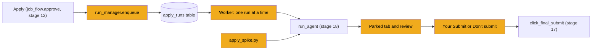
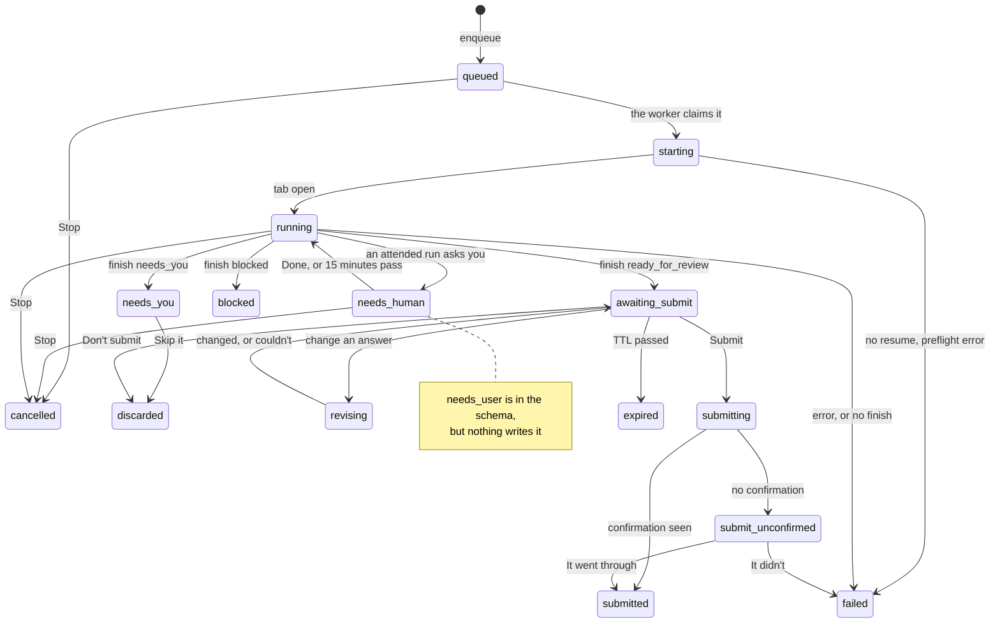
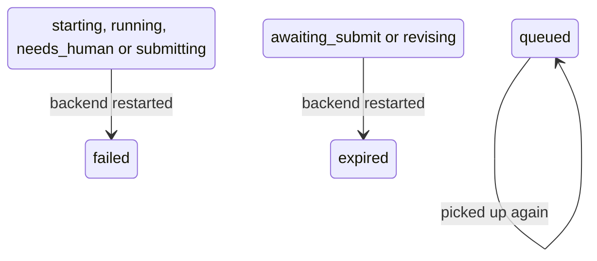
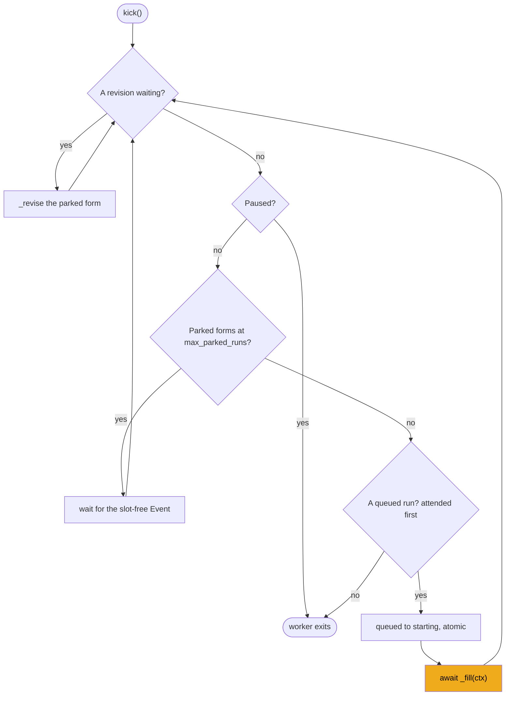

# Stage 21: The run manager

> **Goal:** Turn "Apply" into a queue that a background worker works through one form at a time, parking each filled form in its open Chrome tab until you say Submit or Don't submit. Then fill your first real application from the terminal.
>
> **By the end you will have:** `apply/answers.py`, which remembers answers you approved; `apply/runs.py`, the run manager: a queue kept in the `apply_runs` table, one worker, parked forms with a time limit, the single server-side Submit click, and recovery after a restart; `scripts/apply_spike.py`, which fills a real form from your terminal while you watch; and a temporary `main.py` that starts and stops the run manager with the server.

## Where this fits

The apply agent from [stage 18](18-apply-agent.md) can fill one form, but something has to drive it: open Chrome, hand it the right files, record what it does, wait for your decision, and click Submit only after you say so. Inside the server, that's the run manager. In your terminal, it's `apply_spike.py`.



Stage 12's `job_flow.approve` already calls `run_manager.enqueue`, through an import inside the function. From this stage on, that import finds a real module. The HTTP endpoints for runs (`/api/apply-runs/...`) and their tests, `tests/test_apply_runs.py`, come in [stage 23](23-api-actions-and-setup.md).

## New ideas in plain words

**A queue kept in the database.** A *queue* is a waiting line: first come, first served. JobBee's queue is the `apply_runs` table from [stage 3](03-database.md). "Queue a run" means "insert a row with status `queued`". Rows survive a restart, so nothing you approved is forgotten. What can't survive is *live* state: an open Chrome tab, the connection to it, a conversation with Claude in progress. Those exist only inside the running Python process.

**One worker, one form at a time.** A *worker* is a loop that takes the next queued row and fills it. JobBee runs exactly one. There's one Chrome window and one budget, and two agents clicking in the same browser would get in each other's way. One at a time is slower, but predictable.

**Parking a filled form.** When the agent calls `finish("ready_for_review")`, the form is filled but not sent. JobBee keeps that tab open, with its driver still connected, and saves a screenshot. The form waits there, *parked*, until you decide. A parked form doesn't hold up the worker: it moves on to the next job.

**Slots and a time limit.** Parked forms cost memory, a Chrome tab, and a site session that may time out. So only `max_parked_runs` forms (2 by default, from `config.py` in [stage 1](01-backend-skeleton.md)) may be parked at once. Think of them as parking *slots*. When both are full, the worker waits. Each parked form also has a *TTL* (time to live), `submit_ttl_min`, 45 minutes by default. If you don't decide in time, the form *expires*: its tab closes, and you can fill it again later.

**Attended and unattended runs.** Most runs are *unattended*: nobody is watching, so the agent never waits for a person. If it meets something only a person can do (a CAPTCHA, a code sent by SMS), it calls `finish("needs_you")` and the application is *set aside*. When you click **I'm at my PC**, JobBee queues a new *attended* run. In an attended run, the agent may hand you the browser and wait up to 15 minutes for you.

**asyncio coordination, from zero.** [Stage 8](08-reading-job-postings.md) introduced `async`/`await`: one *event loop* runs many coroutines, switching whenever one of them waits. [Stage 11](11-messages-and-telegram.md) started a background *task* with `create_task`. The run manager needs a few more tools from `asyncio`:

| Tool | Everyday picture | What it does |
|---|---|---|
| `Task` | A job you hand to a helper | `loop.create_task(coro)` runs a coroutine in the background and gives you a handle to it. |
| `task.cancel()` | Tapping the helper on the shoulder: "stop" | The task's current `await` raises `CancelledError`. Its `except` and `finally` blocks still run, so it can tidy up. |
| `Future` | A restaurant pager | An empty box for a result that doesn't exist yet. One piece of code `await`s it. Another calls `future.set_result(x)`: the pager buzzes, and the `await` returns `x`. |
| `asyncio.wait_for(x, t)` | "I'll wait 15 minutes, then leave" | Waits for `x` for at most `t` seconds. When time runs out, it cancels the wait and raises `TimeoutError`. |
| `Event` | A "table free" light | `await event.wait()` sleeps until someone calls `event.set()`. `event.clear()` turns the light off again. |
| `Lock` | The one key to a café's bathroom | `async with lock:` lets one task in at a time. The others wait their turn. |

Here they are in a toy you can run. It's practice, not part of JobBee. Save it as `practice/try_asyncio.py` in your project folder, next to `backend/`:

<!-- practice: practice/try_asyncio.py -->
```python
"""Practice, not part of JobBee: the five asyncio tools the run manager uses."""

import asyncio


async def main() -> None:
    loop = asyncio.get_running_loop()

    # 1. A Future is a pager: one side awaits it, another side buzzes it.
    pager = loop.create_future()

    async def kitchen() -> None:
        await asyncio.sleep(1)  # cooking...
        pager.set_result("pizza")  # buzz!

    cook = asyncio.create_task(kitchen())
    print("1. got", await asyncio.wait_for(pager, timeout=5))
    await cook

    # 2. wait_for gives up when the time runs out.
    never = loop.create_future()  # nobody buzzes this one
    try:
        await asyncio.wait_for(never, timeout=0.5)
    except TimeoutError:
        print("2. gave up waiting")

    # 3. Cancelling a task raises CancelledError at the line it is waiting on.
    async def long_job() -> None:
        try:
            await asyncio.sleep(60)
        finally:
            print("3. cleaning up after Stop")

    job = asyncio.create_task(long_job())
    await asyncio.sleep(0.1)
    job.cancel()
    await asyncio.gather(job, return_exceptions=True)
    print("   cancelled:", job.cancelled())

    # 4. An Event is a light: wait() sleeps until someone calls set().
    slot_free = asyncio.Event()

    async def user_decides() -> None:
        await asyncio.sleep(0.5)
        slot_free.set()

    decider = asyncio.create_task(user_decides())
    await slot_free.wait()
    print("4. a parking slot is free")
    await decider

    # 5. A Lock lets one task in at a time; the others queue.
    lock = asyncio.Lock()

    async def use_chrome(name: str) -> None:
        async with lock:
            print(f"5. {name} has Chrome")
            await asyncio.sleep(0.2)
            print(f"   {name} is done with Chrome")

    await asyncio.gather(use_chrome("run A"), use_chrome("run B"))


asyncio.run(main())
```
<!-- /practice -->

Run it from your project folder with `.\backend\.venv\Scripts\python.exe practice\try_asyncio.py` (on Mac or Linux, `backend/.venv/bin/python practice/try_asyncio.py`):

```text
1. got pizza
2. gave up waiting
3. cleaning up after Stop
   cancelled: True
4. a parking slot is free
5. run A has Chrome
   run A is done with Chrome
5. run B has Chrome
   run B is done with Chrome
```

<!-- verify: root | python practice/try_asyncio.py -->

Each numbered line matches a place in `runs.py`:

1. The pager is how an attended run waits for your **Done** (`RunHooks._wait`).
2. That wait gives up after 15 minutes.
3. **Stop** cancels the run's task, and its `except` and `finally` blocks close the driver.
4. The worker waits on an `Event` while both parking slots are full.
5. A `Lock` stops one run opening a tab while another one quits Chrome.

`asyncio.gather(..., return_exceptions=True)` in step 3 waits for tasks and hands back their errors instead of raising them. The worker uses it, so a crash in one run can't stop the worker.

**Atomic status changes, again.** In [stage 12](12-the-job-flow.md) you changed an application's status with `UPDATE ... WHERE status = <expected>` and checked that exactly one row changed. Runs use the same trick, in `_transition`. If you click Submit twice, or tap it on your phone while clicking it on your PC, only the first `awaiting_submit → submitting` succeeds. Every other attempt sees zero rows changed and gets "already handled".

**Recovery after a restart.** When the backend starts, a run that was mid-fill can't continue: its tab and its Claude conversation died with the old process. So startup marks those runs `failed` and parked forms `expired`. Queued runs are untouched and start again.

**From now on, run the server without `--reload`.** `--reload` restarts the Python process every time you save a file. Every live thing goes with it: drivers, tabs, pagers. A parked form can't be submitted any more, and a half-filled form is abandoned. Start uvicorn without `--reload` whenever you apply.

## Build it, step by step

### Step 1: Remember approved answers, `backend/app/apply/answers.py`

When you click Submit, the answers the agent decided by itself (its "judgement calls") and the ones you corrected become *saved answers*, so the next application answers the same way. This small file in `backend/app/apply/` does the saving. `runs.py` calls it in Step 2, Part 14.

- `fingerprint` (from `services/application_defaults.py`, [stage 7](07-resume-and-profile.md)) normalizes a question: the "required" `*` dropped, spaces squeezed, lowercase. So "Notice Period *" and "notice  period" share one key.
- The answers live in `user.application_defaults["saved_answers"]`. Stage 18's dossier already shows them to the agent as "Saved answers from earlier applications".
- **The reassign line matters.** SQLAlchemy notices when you *assign* a new value to a column. It doesn't notice when you change something *inside* a JSON dict. So the code copies the dicts, changes the copies, and assigns the result back.

<!-- code: backend/app/apply/answers.py -->
**`backend/app/apply/answers.py`** (whole file, 23 lines)

```python
"""Answers the applicant gives the agent are kept with their profile and reused next time."""

from __future__ import annotations

from ..db import SessionLocal
from ..models import User
from ..services.application_defaults import fingerprint


def remember_answer(user_id: int, question: str, answer: str) -> None:
    key = fingerprint(question)
    if not key or not answer.strip():
        return
    with SessionLocal() as session:
        user = session.get(User, user_id)
        if user is None:
            return
        defaults = dict(user.application_defaults or {})
        saved = dict(defaults.get("saved_answers") or {})
        saved[key] = answer.strip()
        defaults["saved_answers"] = saved
        user.application_defaults = defaults  # reassign so SQLAlchemy sees the JSON change
        session.commit()
```
<!-- /code -->

### Step 2: The run manager, `backend/app/apply/runs.py`

This is the biggest file in JobBee, about 1,250 lines, in `backend/app/apply/`. Before the code, here's the big picture: the statuses a run moves through, and how the worker picks its next job.

**A run's life.** Each arrow is one place in `runs.py` that changes the `status` column:



Three things the picture doesn't show:

- **"I'm at my PC"** on a `needs_you` run doesn't move that run. It queues a *new* run with `attended = True`. The old run stays `needs_you`.
- **`needs_user`** is in `FILL_STATUSES` and in the API schema, left over from an older design where the agent asked you questions in the middle of a run. Nothing writes it any more.
- **After a restart**, live state is gone, so startup moves the in-flight runs on:



**The worker loop.** One worker task runs this loop. It exits when there's nothing to do, and `kick()` starts it again:



**A map of the file.** The parts below follow the file from top to bottom:

| Part | What's in it |
|---|---|
| 1 | Imports, status sets, time limits |
| 2 | Errors, `PreparedRun`, `RunContext` (live state) |
| 3 | Helpers: `build_task`, `build_revise_task`, `merge_answers` |
| 4–5 | `RunHooks`: the agent's hooks inside the server |
| 6 | The manager's memory, database helpers, `_transition` |
| 7 | Restart recovery, startup, shutdown |
| 8 | Queue actions: `enqueue`, `retry`, `attend`, `dismiss` |
| 9 | `kick` and the worker loop |
| 10 | Your actions: answer, Stop, Show, Submit or not, "did it go through?" |
| 11 | `_fill`: one form from start to finish |
| 12 | `_prepare`, `_browser`, `_record_stats` |
| 13 | Parking, setting aside, booking a revision |
| 14 | `_revise` and `_learn` |
| 15 | The review card |
| 16 | Expiry and closing tabs |
| 17 | The Submit click and the confirmation |
| 18 | Scorecard, chat buttons, the shared instance |

#### Part 1: Statuses and time limits

The docstring is a text version of the state diagram, plus two rules: runs are unattended unless you said you're at your PC, and the agent never submits. Its last sentence repeats the warning: start the backend without `--reload` while applying.

The imports pull in most of stages 15 to 20: the agent loop and its config (`agent.py`), the browser session (`browser.py`), prices (`costs.py`), the dossier, the guards' `CONFIRMATION_RE`, the inbox, the scorecard, and `accounts` from stage 20.

The constants:

- `RUNS_DIR`: each run gets a folder, `backend/data/apply_runs/<run id>/`, for its staged uploads and its review screenshot.
- `FILL_STATUSES`: the agent is filling the form (or waiting for you in the middle of it).
- `PARKED_STATUSES`: the form is filled and its tab is parked.
- `OPEN_STATUSES`: anything not finished. An application may have only one open run at a time.
- `_TEXT_LIMIT`: long strings in events are cut to 2,000 characters.
- `_CONFIRM_WAIT_S`: after the Submit click, look for a "thank you" page for 20 seconds.
- `_HUMAN_WAIT_S`: an attended run waits 15 minutes for you.
- `_REVISE_ITERATIONS`: changing answers gets at most 30 agent steps.
- `_DONE_WORDS`: chat replies that mean "I did it".
- `_LEARNED_SOURCES`: which answers are saved when you click Submit (Part 14).

<!-- code: backend/app/apply/runs.py lines=1-90 -->
**`backend/app/apply/runs.py`** (lines 1–90 of 1254)

```python
"""Apply runs: a persistent queue, one agent at a time, filled forms parked for the user's OK.

Lifecycle of a run (ApplyRun.status):
  queued → starting → running (⇄ needs_human, attended runs only)  (filling; one at a time)
         → awaiting_submit   form filled, tab parked, card 2 sent (≤ MAX_PARKED at once)
             ⇄ revising      changing answers the user corrected on card 2
         → submitting → submitted | submit_unconfirmed           (user tapped Submit)
         → discarded                                             (user tapped Don't submit)
         → expired                                               (no answer within the TTL)
  or needs_you (set aside: only a human at the PC can go on, e.g. a CAPTCHA)
  or blocked | failed | cancelled while filling.

Runs are unattended: the agent signs in, answers and consents by itself (within
the user's permissions) and never waits on the user. Something only a person
can do sets the application aside; the user's "I'm at my PC" queues an attended
run, which may hand them the browser.

The agent never submits. After the user's Submit tap (atomic state change),
the server asks the parked driver to click the page's single final-submit
control once (`GuardedBrowserUse.click_final_submit`) and then looks for a
confirmation. Runs execute inside the API process: start the backend without
`--reload` while applying.
"""

from __future__ import annotations

import asyncio
import contextlib
import logging
import re
import shutil
from collections import deque
from dataclasses import dataclass, field, replace
from datetime import datetime, timedelta, timezone
from html import escape
from pathlib import Path
from typing import Any
from urllib.parse import urlsplit

from sqlalchemy import func, select, update

from ..config import BACKEND_DIR, get_settings
from ..db import SessionLocal
from ..models import (
    Application,
    ApplicationStatus,
    ApplyEvent,
    ApplyRun,
    Document,
    DocumentKind,
    Job,
    User,
)
from ..pipeline.sources.email_alerts import inbox_connected
from ..pipeline.state import is_paused
from ..services.documents import get_base_document
from . import accounts, inbox
from .agent import (
    AgentConfig,
    AgentHooks,
    RunStats,
    guarded_driver,
    make_client,
    preflight,
    run_agent,
)
from .answers import remember_answer
from .ats import detect_ats
from .browser import new_browser_session
from .costs import PRICES
from .dossier import UploadFile, build_dossier
from .guards import CONFIRMATION_RE
from .inbox import InboxFind
from .scorecard import append_scorecard, submit_request_rows

logger = logging.getLogger(__name__)

RUNS_DIR = BACKEND_DIR / "data" / "apply_runs"
FILL_STATUSES = {"starting", "running", "needs_user", "needs_human"}
PARKED_STATUSES = {"awaiting_submit", "revising"}
OPEN_STATUSES = {"queued", *FILL_STATUSES, *PARKED_STATUSES, "submitting"}
_TEXT_LIMIT = 2000
_CONFIRM_WAIT_S = 20.0
_HUMAN_WAIT_S = 15 * 60.0  # an attended run waits this long for the human
_REVISE_ITERATIONS = 30
_DONE_WORDS = {"done", "ok", "okay", "finished", "did it", "yes", "✅"}
# Answers the user confirms by tapping Submit, saved for the next application.
_LEARNED_SOURCES = {"judgement", "you"}


```
<!-- /code -->

#### Part 2: What lives only in memory

`RunConflictError` and `RunStateError` are two error types that stage 23's API turns into `409 Conflict`. The first means "this application already has an open run". The second means "this run isn't in a state that accepts that", such as a Submit on a form that already expired.

`PreparedRun` is what `_prepare` hands back (Part 12): the URL, the ATS family, the task text, the uploads folder, the company and the title.

`RunContext` holds one run's live state, the things a database can't store:

| Field | Why it lives in memory |
|---|---|
| `config` | The model, effort and caps for `run_agent` (stage 18's `AgentConfig`) |
| `task` | The background task filling this form, so Stop can cancel it |
| `waiter` | The pager (a `Future`) an attended run waits on |
| `waiter_message_id` | The chat message whose buttons are cleared afterwards |
| `driver`, `tab_id` | The live guarded driver and its tab. A parked form needs both to be submitted later. |
| `reviewed_url` | The exact page in your screenshot. Stage 17's `click_final_submit` refuses any other page. |
| `expiry` | The task that expires the form when its TTL ends |
| `network_mark` | Where the driver's request log stood at review time, so JobBee can list what Submit sent |
| `attended` | Copied from the row: may the agent wait for you? |
| `started_at`, `used_emails` | For `find_email`: read mail from 10 minutes before the run, and never use one email twice |

<!-- code: backend/app/apply/runs.py lines=91-129 -->
**`backend/app/apply/runs.py`** (lines 91–129 of 1254)

```python
class RunConflictError(RuntimeError):
    """The application already has an open run."""


class RunStateError(RuntimeError):
    """The run isn't in a state that accepts this action."""


@dataclass
class PreparedRun:
    url: str
    ats: str
    task: str
    uploads_dir: Path
    company: str
    title: str


@dataclass
class RunContext:
    run_id: int
    application_id: int
    user_id: int
    config: AgentConfig
    task: asyncio.Task | None = None
    waiter: asyncio.Future | None = None
    waiter_message_id: str | None = None
    driver: Any = None
    tab_id: str | None = None
    reviewed_url: str | None = None
    expiry: asyncio.Task | None = None
    company: str = ""
    title: str = ""
    network_mark: dict = field(default_factory=dict)
    attended: bool = False
    started_at: datetime = field(default_factory=lambda: datetime.now(timezone.utc))
    used_emails: set[str] = field(default_factory=set)


```
<!-- /code -->

#### Part 3: Small helpers

- `_now` returns the current UTC time. `_clip` shortens long strings anywhere inside an event's data, however deeply nested, so one huge page text can't bloat the database.
- **`build_task`** is the first message the agent gets: "Apply to this job on the applicant's behalf: <url>", a reminder to hand back with `finish`, then the dossier text. The terminal script imports it from here, which is why `apply_spike.py` arrives in this stage.
- **`build_revise_task`** is the task for changing answers on a parked form: change only these fields, go back to the final review page, never submit, then call `finish`.
- **`merge_answers`** applies your corrections to the answer list. It matches field names without caring about case or surrounding spaces, adds a row for a field that wasn't listed, and marks each corrected answer `source: "you"`.
- `site_host` gives the lowercase host of a URL. `_messaging` imports the shared messaging service when it's called, not when `runs.py` loads, the same lazy-import pattern stage 12's `approve` uses for this file.

<!-- code: backend/app/apply/runs.py lines=130-189 -->
**`backend/app/apply/runs.py`** (lines 130–189 of 1254)

```python
def _now() -> datetime:
    return datetime.now(timezone.utc)


def _clip(value: Any) -> Any:
    if isinstance(value, str) and len(value) > _TEXT_LIMIT:
        return value[:_TEXT_LIMIT] + "..."
    if isinstance(value, dict):
        return {k: _clip(v) for k, v in value.items()}
    if isinstance(value, list):
        return [_clip(v) for v in value]
    return value


def build_task(url: str, dossier_text: str) -> str:
    return (
        f"Apply to this job on the applicant's behalf: {url}\n"
        "The browser is already open on that page. Fill the application completely from the "
        "dossier below, then hand it back with `finish`.\n\n" + dossier_text
    )


def build_revise_task(changes: list[dict]) -> str:
    lines = "\n".join(f'- "{c["field"]}": {c["value"]}' for c in changes)
    return (
        "The application in this tab is already filled and on its final review page. The "
        "applicant checked it and wants these answers changed:\n"
        f"{lines}\n\n"
        "Change only these: go to the page with each field (use the review page's edit links "
        "or Back), set the new value exactly, then return to the final review page. Don't "
        "change anything else and never submit. Then call `finish` with status "
        '"ready_for_review", listing only the fields you changed in `answers`. If a field '
        'can\'t be changed, call `finish` with status "blocked" and say why.'
    )


def merge_answers(answers: list[dict], changes: list[dict]) -> list[dict]:
    """The run's answers with the user's corrections applied (source "you")."""

    merged = [dict(a) for a in answers]
    for change in changes:
        key = change["field"].strip().lower()
        row = next((a for a in merged if str(a.get("field", "")).strip().lower() == key), None)
        if row is None:
            row = {"field": change["field"]}
            merged.append(row)
        row.update(value=change["value"], source="you", note=None)
    return merged


def site_host(url: str) -> str:
    return (urlsplit(url).hostname or "").lower()


def _messaging():
    from ..messaging.service import messaging

    return messaging


```
<!-- /code -->

#### Part 4: `RunHooks`, events and waiting for you

Stage 18's agent loop calls four hooks (`event`, `request_human`, `site_login`, `find_email`) without knowing who is listening. In the terminal, `TerminalHooks` prints and waits for the keyboard (Step 3). In the server, `RunHooks` saves events and reaches you through the web app or chat. It inherits from stage 18's `AgentHooks`, the *protocol* that lists the methods a hooks object must have.

It calls a few `RunManager` methods you'll meet in Part 6: `_update` writes columns of the run's row, `_add_event` inserts one `ApplyEvent` row, and `answer` buzzes the pager.

- **`event`** saves every agent event as an `ApplyEvent` row (`tool_call`, `text`, `guard_block`, `finish` and so on, from stage 18). A `usage` event, sent once per Claude response, also updates the run's step count and cost, so the web app can show them live.
- **`_wait`** is the pager from the toolbox. Follow it line by line:
  1. `create_future()` makes the pager and stores it on the context, where `answer` can find it.
  2. `_update` sets the status (`needs_human`) and `pending`, a JSON note of what the run is waiting for. The web app shows a hand-off card from that row ([stage 27](27-cards-drawer-and-home.md)).
  3. `messaging.router.expect_reply` asks stage 11's chat router to send your next free-text chat message to `on_reply`, so typing "done" in Telegram also counts.
  4. `notify` sends the message with its buttons, and keeps the message id.
  5. `wait_for(ctx.waiter, _HUMAN_WAIT_S)` waits at most 15 minutes. A timeout returns `None`.
  6. `finally` always tidies up, however the wait ended (an answer, a timeout, or Stop cancelling the task): forget the pager, stop routing chat replies, clear the buttons, and set the status back to `running`.

No database session is open during the wait. Each database call opens a session, writes, commits and closes. A session held open for 15 minutes could block other writes to SQLite.

<!-- code: backend/app/apply/runs.py lines=190-229 -->
**`backend/app/apply/runs.py`** (lines 190–229 of 1254)

```python
class RunHooks(AgentHooks):
    """Persists the agent's events; looks up site accounts and site emails; and, in attended
    runs only, hands the browser to the user."""

    def __init__(self, manager: RunManager, ctx: RunContext) -> None:
        self._manager = manager
        self._ctx = ctx

    def event(self, kind: str, data: dict[str, Any]) -> None:
        self._manager._add_event(self._ctx.run_id, kind, data)
        if kind == "usage":
            self._manager._update(
                self._ctx.run_id, iterations=data["iteration"], cost_usd=data["cost_usd"]
            )

    async def _wait(self, status: str, pending: dict, text: str, buttons) -> str | None:
        """The user's reply, or None if none came within `_HUMAN_WAIT_S`."""

        ctx = self._ctx
        ctx.waiter = asyncio.get_running_loop().create_future()
        self._manager._update(ctx.run_id, status=status, pending=pending)
        messaging = _messaging()

        async def on_reply(user_id: int, reply: str) -> None:
            self._manager.answer(ctx.run_id, reply, from_chat=True)

        messaging.router.expect_reply(ctx.user_id, on_reply)
        ctx.waiter_message_id = await messaging.notify(
            ctx.user_id, text, buttons=buttons, html=True, kind=status, run_id=ctx.run_id
        )
        try:
            return await asyncio.wait_for(ctx.waiter, _HUMAN_WAIT_S)
        except TimeoutError:
            return None
        finally:
            ctx.waiter = None
            messaging.router.cancel_reply(ctx.user_id, on_reply)
            await messaging.clear_buttons(ctx.user_id, ctx.waiter_message_id)
            self._manager._update(ctx.run_id, status="running", pending=None)

```
<!-- /code -->

#### Part 5: `RunHooks`, hand-offs, accounts and emails

- **`request_human`** first checks `ctx.attended`. An unattended run returns `None` at once, meaning "nobody is here". Stage 18's `request_human_action` tool then tells Claude to call `finish("needs_you")`, and the application is set aside. An attended run sends a message with **✅ Done** and **❌ Can't do it** buttons and waits. A reply in `_DONE_WORDS` becomes `""`, which stage 18 reads as "the human finished". Any other text is passed on as the reason they couldn't. `escape` makes the company name and the message safe inside an HTML message.
- **`site_login`** is the hook from stage 20: it calls `accounts.credentials` and records the event kind with the host and login, never the password.
- **`find_email`** calls stage 18's `inbox.wait_for_email`. It reads mail from 10 minutes before the run started (the site may have sent it during sign-up), and skips emails this run already used (`used_emails`), so one verification email can't be "found" twice. After a verification email it marks the account `verified`. The event records the sender and whether it found a link or a code, never the email's content.

<!-- code: backend/app/apply/runs.py lines=230-300 -->
**`backend/app/apply/runs.py`** (lines 230–300 of 1254)

```python
    async def request_human(self, kind: str, message: str) -> str | None:
        ctx = self._ctx
        if not ctx.attended:
            return None
        messaging = _messaging()
        group = messaging.new_group()
        buttons = [
            [
                messaging.button(
                    ctx.user_id,
                    "✅ Done",
                    "run_answer",
                    target_id=ctx.run_id,
                    payload={"value": ""},
                    group=group,
                ),
                messaging.button(
                    ctx.user_id,
                    "❌ Can't do it",
                    "run_answer",
                    target_id=ctx.run_id,
                    payload={"value": "The user could not do it right now."},
                    group=group,
                ),
            ]
        ]
        text = (
            f"🖥 <b>Needs you at your PC</b> ({escape(ctx.company)}):\n{escape(message[:900])}\n\n"
            "Do it in the JobBee Chrome window, then tap Done."
        )
        reply = await self._wait(
            "needs_human",
            {"type": "human_action", "kind": kind, "message": message},
            text,
            buttons,
        )
        if reply is None:
            return None
        return "" if reply.strip().lower() in _DONE_WORDS else reply

    def site_login(self, host: str, action: str) -> tuple[str, str]:
        login, password, kind = accounts.credentials(self._ctx.user_id, host, action)
        self.event(kind, {"host": host, "login": login})
        return login, password

    async def find_email(self, host: str, purpose: str) -> InboxFind | None:
        ctx = self._ctx
        since = ctx.started_at - timedelta(minutes=10)
        found = await inbox.wait_for_email(
            ctx.user_id, host, purpose, since, skip=frozenset(ctx.used_emails)
        )
        if found is None:
            self.event("email_checked", {"host": host, "purpose": purpose, "found": False})
            return None
        ctx.used_emails.add(found.message_id)
        if purpose == "verify_email":
            with SessionLocal() as session:
                accounts.mark(session, ctx.user_id, host, status="verified")
        self.event(
            "email_checked",
            {
                "host": host,
                "purpose": purpose,
                "found": True,
                "sender": found.sender,
                "kind": "link" if found.link else "code",
            },
        )
        return found


```
<!-- /code -->

#### Part 6: The manager's memory and its database helpers

`RunManager.__init__` sets up the shared state:

- `_worker`: the worker task (Part 9).
- `_active`: the run being filled right now, at most one.
- `_parked`: a dict from run id to `RunContext` for the forms waiting on you.
- `_slot_freed`: the "slot free" light the worker waits on. The worker loop creates a fresh one each time it starts, so `kick` and `_free_slot` check that it isn't `None`.
- `_revisions`: a second small queue, of parked runs whose answers you asked to change. A `deque` is a list that's fast to take from the front.
- `_session`: the one Browser Use session ([stage 15](15-tool-use-and-browsers.md)): one Chrome window, many tabs. `_session_has_run` remembers whether its first tab was already used.
- `_browser_lock`: the `Lock` that makes "open a tab" and "close a tab or quit Chrome" take turns (Part 16).

Then the database helpers. Each opens a short session, does one thing, commits and closes:

- `_update` writes columns without checking the status first. It's used where nothing else can be changing the run at that moment.
- `_add_event` inserts one event, clipped.
- `_set_app` sets the *application's* status and reason, plus `submitted_at` when it's submitted.
- **`_transition`** is the compare-and-set from stage 12. It runs `UPDATE apply_runs SET status = <dst> WHERE id = <run> AND status IN (<sources>)` and checks `rowcount == 1`, meaning exactly one row changed. It's used wherever two things could race: your click against the expiry timer, a phone tap against a web click. Its `True` or `False` decides who wins.

<!-- code: backend/app/apply/runs.py lines=301-351 -->
**`backend/app/apply/runs.py`** (lines 301–351 of 1254)

```python
class RunManager:
    def __init__(self) -> None:
        self._worker: asyncio.Task | None = None
        self._active: RunContext | None = None
        self._parked: dict[int, RunContext] = {}
        self._slot_freed: asyncio.Event | None = None
        self._revisions: deque[int] = deque()  # parked runs with answers to change
        self._session = None  # browser-use BrowserSession, open while a form's tab is
        self._session_has_run = False
        self._browser_lock = asyncio.Lock()  # opening a tab vs. quitting Chrome

    # --- persistence helpers --------------------------------------------------------------

    @staticmethod
    def _update(run_id: int, **values: Any) -> None:
        with SessionLocal() as session:
            session.execute(update(ApplyRun).where(ApplyRun.id == run_id).values(**values))
            session.commit()

    @staticmethod
    def _add_event(run_id: int, kind: str, data: dict[str, Any]) -> None:
        with SessionLocal() as session:
            session.add(ApplyEvent(run_id=run_id, kind=kind, data=_clip(data)))
            session.commit()

    @staticmethod
    def _set_app(application_id: int, status: ApplicationStatus, reason: str | None = None) -> None:
        with SessionLocal() as session:
            app = session.get(Application, application_id)
            if app is None:
                return
            app.status = status
            if reason is not None:
                app.stage_reason = reason
            if status == ApplicationStatus.submitted:
                app.submitted_at = _now()
            session.commit()

    def _transition(self, run_id: int, src: set[str] | str, dst: str, **values: Any) -> bool:
        """Atomic status change; False if the run wasn't in `src` (double taps, races)."""

        sources = {src} if isinstance(src, str) else src
        with SessionLocal() as session:
            result = session.execute(
                update(ApplyRun)
                .where(ApplyRun.id == run_id, ApplyRun.status.in_(sources))
                .values(status=dst, **values)
            )
            session.commit()
            return result.rowcount == 1

```
<!-- /code -->

#### Part 7: Restart recovery, startup and shutdown

`mark_interrupted_runs` runs at startup:

- Runs that were filling or submitting (`FILL_STATUSES` plus `submitting`) become `failed`, with "The backend restarted during this run." A `submitting` run is marked failed rather than guessed: JobBee can't know whether the click landed, so check the site if you see this.
- Parked forms (`awaiting_submit`, `revising`) become `expired`, and their applications go back to `approved` with "The filled form was lost when JobBee restarted.", so you can fill them again.
- `queued` rows are left alone.

`startup` runs that, then calls `kick()` to start the worker, so queued runs carry on.

`shutdown` runs when the server stops cleanly. It cancels the worker, the active fill and every expiry timer, waits for them all with `gather(..., return_exceptions=True)`, closes the parked forms' drivers, and kills Chrome. An active run stopped this way ends `cancelled` (Part 11). After a crash nothing runs at shutdown, and the next startup marks the run `failed`.

<!-- code: backend/app/apply/runs.py lines=352-406 -->
**`backend/app/apply/runs.py`** (lines 352–406 of 1254)

```python
    # --- lifecycle ------------------------------------------------------------------------

    def mark_interrupted_runs(self) -> int:
        """After a restart nothing in flight can resume: fills fail, parked forms expire."""

        now = _now()
        with SessionLocal() as session:
            failed = session.execute(
                update(ApplyRun)
                .where(ApplyRun.status.in_(FILL_STATUSES | {"submitting"}))
                .values(
                    status="failed",
                    pending=None,
                    error="The backend restarted during this run.",
                    finished_at=now,
                )
            ).rowcount
            parked = (
                session.execute(select(ApplyRun).where(ApplyRun.status.in_(PARKED_STATUSES)))
                .scalars()
                .all()
            )
            for run in parked:
                run.status = "expired"
                run.pending = None
                app = session.get(Application, run.application_id)
                if app is not None and app.status == ApplicationStatus.awaiting_submit:
                    app.status = ApplicationStatus.approved
                    app.stage_reason = "The filled form was lost when JobBee restarted."
            session.commit()
            return (failed or 0) + len(parked)

    async def startup(self) -> None:
        self.mark_interrupted_runs()
        self.kick()

    async def shutdown(self) -> None:
        tasks = [self._worker]
        if self._active and self._active.task:
            tasks.append(self._active.task)
        tasks += [ctx.expiry for ctx in self._parked.values()]
        for task in tasks:
            if task and not task.done():
                task.cancel()
        await asyncio.gather(*(t for t in tasks if t), return_exceptions=True)
        for ctx in list(self._parked.values()):
            await self._close_driver(ctx)
        self._parked.clear()
        if self._session is not None:
            try:
                await self._session.kill()
            except Exception:  # pragma: no cover - best effort on shutdown
                logger.exception("Closing the apply browser failed")
            self._session = None

```
<!-- /code -->

#### Part 8: Putting runs in the queue

**`enqueue`** checks four things. Each failure has its own error type, so stage 23's API can pick the right status code:

| Check | Error |
|---|---|
| The model is in stage 6's `PRICES` | `ValueError` (400) |
| The application exists | `LookupError` (404) |
| It's `approved` or `awaiting_approval` | `ValueError` (400) |
| It has no open run | `RunConflictError` (409) |

Then it sets the application to `approved` and inserts a `queued` row with the URL, the ATS family from stage 8's `detect_ats`, the model and the effort. Last, it calls `kick()` to wake the worker. `enqueue` is a plain `def`: it's quick and never waits. But `kick` needs a running event loop, so `enqueue` can only be called from async code (Part 9).

- **`retry`** moves a `failed` application back to `approved` and calls `enqueue`. The **Try again** and **Fill it again** buttons use it.
- **`attend`** is **I'm at my PC**. It checks the run is `needs_you` *and* is the application's newest run (`func.max(ApplyRun.id)`), so a double click can't queue two retries. Then it calls `enqueue(..., attended=True)`.
- **`dismiss`** is **Skip it** on a set-aside application: `_transition(run_id, "needs_you", "discarded")`, and the application becomes `rejected_by_user`.

<!-- code: backend/app/apply/runs.py lines=407-485 -->
**`backend/app/apply/runs.py`** (lines 407–485 of 1254)

```python
    # --- queue ----------------------------------------------------------------------------

    def enqueue(
        self,
        application_id: int,
        *,
        model: str | None = None,
        effort: str | None = None,
        attended: bool = False,
    ) -> int:
        settings = get_settings()
        model = model or settings.apply_model
        if model not in PRICES:
            raise ValueError(f"Unknown model {model!r}.")
        with SessionLocal() as session:
            app = session.get(Application, application_id)
            if app is None:
                raise LookupError("Application not found.")
            if app.status not in (ApplicationStatus.approved, ApplicationStatus.awaiting_approval):
                raise ValueError("Only approved applications can be applied to.")
            open_run = session.execute(
                select(ApplyRun.id).where(
                    ApplyRun.application_id == application_id,
                    ApplyRun.status.in_(OPEN_STATUSES),
                )
            ).first()
            if open_run is not None:
                raise RunConflictError("This application is already being worked on.")
            app.status = ApplicationStatus.approved
            job = session.get(Job, app.job_id)
            run = ApplyRun(
                application_id=app.id,
                status="queued",
                url=job.url,
                ats=detect_ats(job.url),
                model=model,
                effort=effort or settings.apply_effort,
                attended=attended,
            )
            session.add(run)
            session.commit()
            run_id = run.id
        self.kick()
        return run_id

    def retry(self, application_id: int) -> int:
        """Queue a fresh run for an application whose last run failed or timed out."""

        with SessionLocal() as session:
            app = session.get(Application, application_id)
            if app is not None and app.status == ApplicationStatus.failed:
                app.status = ApplicationStatus.approved
                session.commit()
        return self.enqueue(application_id)

    def attend(self, run_id: int) -> int:
        """The user is at their PC: retry a set-aside application; it may hand them the browser."""

        with SessionLocal() as session:
            run = session.get(ApplyRun, run_id)
            if run is None or run.status != "needs_you":
                raise RunStateError("This application isn't waiting for you.")
            latest = session.execute(
                select(func.max(ApplyRun.id)).where(ApplyRun.application_id == run.application_id)
            ).scalar_one()
            if latest != run_id:
                raise RunStateError("This application was already tried again.")
            application_id = run.application_id
        return self.enqueue(application_id, attended=True)

    def dismiss(self, run_id: int) -> None:
        """Don't apply after all to a set-aside application."""

        if not self._transition(run_id, "needs_you", "discarded"):
            raise RunStateError("This application isn't waiting for you.")
        with SessionLocal() as session:
            application_id = session.get(ApplyRun, run_id).application_id
        self._set_app(application_id, ApplicationStatus.rejected_by_user, "You skipped it.")

```
<!-- /code -->

#### Part 9: `kick` and the worker loop

**`kick`** does two things. It turns on the "slot free" light, in case the worker is waiting for a slot. And it starts the worker task if none is running. `asyncio.get_running_loop()` only works inside the event loop, which is why `kick` (and so `enqueue`) must be called from async code. The worker *exits* when there's nothing to do, so `kick` is how anything (a new run, a freed slot, a revision, startup) brings it back.

**`_worker_loop`**, one pass at a time (compare with the flowchart above):

1. **Revisions first.** You're looking at a review card, waiting for your change, so that comes before a new job.
2. **Paused?** Then exit. Queued rows stay in the table. Stage 22's resume endpoint calls `kick()`.
3. **Both slots full?** Turn the light off (`clear`), then sleep until someone turns it on (`set`). That happens when a parked form is decided or expires (`_free_slot`), or on any `kick`. Then go round again.
4. **Pick the next run.** `order_by(ApplyRun.attended.desc(), ApplyRun.id)` puts attended runs first, because you're sitting at your PC waiting, then the oldest. No queued run? Exit.
5. **Build its `RunContext`**, with an `AgentConfig` made from the row and the settings (`apply_max_iterations`, `apply_max_cost_usd`).
6. **Claim it** with `_transition(queued → starting)`. If that fails, someone cancelled it a moment ago, so go round again.
7. **Fill it.** Create a task for `_fill(ctx)`, store it on the context so Stop can cancel it, and wait for it to end. The worker does nothing else meanwhile: one fill at a time. `return_exceptions=True` means a crash inside `_fill` can't kill the worker.

One consequence: a revision you ask for while another job is being filled waits until that fill ends.

<!-- code: backend/app/apply/runs.py lines=486-540 -->
**`backend/app/apply/runs.py`** (lines 486–540 of 1254)

```python
    def kick(self) -> None:
        if self._slot_freed is not None:
            self._slot_freed.set()
        if self._worker is None or self._worker.done():
            self._worker = asyncio.get_running_loop().create_task(self._worker_loop())

    async def _worker_loop(self) -> None:
        self._slot_freed = asyncio.Event()
        while True:
            if self._revisions:  # the user is waiting on these; they come first
                ctx = self._parked.get(self._revisions.popleft())
                if ctx is not None:
                    await self._revise(ctx)
                continue
            if is_paused():
                return  # queued runs wait; resuming kicks the worker again
            if len(self._parked) >= get_settings().max_parked_runs:
                self._slot_freed.clear()
                await self._slot_freed.wait()
                continue
            with SessionLocal() as session:
                run = (
                    session.execute(
                        select(ApplyRun)
                        .where(ApplyRun.status == "queued")
                        .order_by(ApplyRun.attended.desc(), ApplyRun.id)
                    )
                    .scalars()
                    .first()
                )
                if run is None:
                    return
                app = session.get(Application, run.application_id)
                settings = get_settings()
                ctx = RunContext(
                    run_id=run.id,
                    application_id=run.application_id,
                    user_id=app.user_id,
                    config=AgentConfig(
                        model=run.model,
                        effort=run.effort,
                        max_iterations=settings.apply_max_iterations,
                        max_cost_usd=settings.apply_max_cost_usd,
                    ),
                    attended=run.attended,
                )
            if not self._transition(ctx.run_id, "queued", "starting"):
                continue
            self._active = ctx
            ctx.task = asyncio.get_running_loop().create_task(self._fill(ctx))
            try:
                await asyncio.gather(ctx.task, return_exceptions=True)
            finally:
                self._active = None

```
<!-- /code -->

#### Part 10: Your actions: answer, Stop, Show, decide

- **`answer`** buzzes the pager. It's what the **Done** button and a "done" chat reply call. It checks that the active run is this one and is really waiting (`waiter` exists and isn't done yet), then calls `set_result(text)`. The `wait_for` in `_wait` returns that text.
- **`cancel`** is **Stop**. It tries three things in order: a queued run moves to `cancelled` (with `_transition`); the active run's task is cancelled (Part 11 handles the rest); a parked form is treated as **Don't submit**. Anything else raises `RunStateError`.
- **`focus`** is **Show**. It brings a run's tab to the front with the CDP command `Page.bringToFront`. (CDP is Chrome's remote control, from stage 15.)
- **`decide`** is your answer on the review card:
  1. **The atomic gate.** `_transition(awaiting_submit → submitting or discarded)`. Only one can ever succeed; a second click, from any device, raises `RunStateError`.
  2. **Free the slot** at once, so the worker can start the next job.
  3. No context any more (the form was lost, for example because you closed Chrome)? Mark it `expired` and say so.
  4. Cancel the expiry timer and clear the card's buttons.
  5. **Don't submit:** close the driver and the tab, set the application to `rejected_by_user`, add a scorecard row, and send "OK — not submitting".
  6. **Submit:** send "Submitting…", save your approved answers (`_learn`, Part 14), do the click (`_submit`, Part 17), and add a scorecard row.
- **`resolve_unconfirmed`** answers "did it go through?" after an unconfirmed submit: an atomic `submit_unconfirmed → submitted` or `→ failed`, and the application follows.

<!-- code: backend/app/apply/runs.py lines=541-625 -->
**`backend/app/apply/runs.py`** (lines 541–625 of 1254)

```python
    # --- public actions (API + chat) ------------------------------------------------------

    def answer(self, run_id: int, text: str, *, from_chat: bool = False) -> None:
        ctx = self._active
        if ctx is None or ctx.run_id != run_id or ctx.waiter is None or ctx.waiter.done():
            raise RunStateError("The agent isn't waiting for you right now.")
        ctx.waiter.set_result(text)

    async def cancel(self, run_id: int) -> None:
        if self._transition(run_id, "queued", "cancelled", finished_at=_now()):
            return
        ctx = self._active
        if ctx is not None and ctx.run_id == run_id and ctx.task and not ctx.task.done():
            ctx.task.cancel()
            return
        if run_id in self._parked:
            await self.decide(run_id, submit=False)
            return
        raise RunStateError("This run isn't running.")

    async def focus(self, run_id: int) -> None:
        ctx = self._parked.get(run_id) or (
            self._active if self._active and self._active.run_id == run_id else None
        )
        if self._session is None or ctx is None or ctx.tab_id is None:
            raise RunStateError("The browser tab for this run isn't open.")
        cdp = await self._session.get_or_create_cdp_session(ctx.tab_id, focus=True)
        await cdp.cdp_client.send.Page.bringToFront(session_id=cdp.session_id)

    async def decide(self, run_id: int, *, submit: bool) -> str:
        """The user's answer to card 2. Returns the run's resulting status."""

        target = "submitting" if submit else "discarded"
        if not self._transition(run_id, "awaiting_submit", target):
            raise RunStateError("This form was already handled or has expired.")
        ctx = self._parked.pop(run_id, None)
        self._free_slot()
        if ctx is None:
            self._update(run_id, status="expired", finished_at=_now())
            raise RunStateError("The filled form isn't open any more.")
        if ctx.expiry and not ctx.expiry.done():
            ctx.expiry.cancel()
        messaging = _messaging()
        with SessionLocal() as session:
            card_id = session.get(ApplyRun, run_id).submit_card_message_id
        await messaging.clear_buttons(ctx.user_id, card_id)

        if not submit:
            await self._close_driver(ctx, close_tab=True)
            self._update(run_id, pending=None)
            self._update(run_id, finished_at=_now())
            self._set_app(
                ctx.application_id,
                ApplicationStatus.rejected_by_user,
                "You chose not to submit after reviewing the form.",
            )
            self._score(run_id)
            await messaging.notify(
                ctx.user_id, f"OK — not submitting {ctx.company}.", run_id=ctx.run_id
            )
            return "discarded"

        await messaging.notify(ctx.user_id, f"🚀 Submitting {ctx.company}…", run_id=ctx.run_id)
        self._learn(run_id, ctx.user_id)
        status = await self._submit(ctx)
        self._score(run_id)
        return status

    async def resolve_unconfirmed(self, run_id: int, *, went_through: bool) -> None:
        dst = "submitted" if went_through else "failed"
        if not self._transition(run_id, "submit_unconfirmed", dst, finished_at=_now()):
            raise RunStateError("Nothing to confirm for this run.")
        with SessionLocal() as session:
            run = session.get(ApplyRun, run_id)
            app_id, user_id = (
                run.application_id,
                session.get(Application, run.application_id).user_id,
            )
        if went_through:
            self._set_app(app_id, ApplicationStatus.submitted)
            await _messaging().notify(user_id, "✅ Marked as applied.", run_id=run_id)
        else:
            self._set_app(app_id, ApplicationStatus.failed, "Submission didn't go through.")
            await _messaging().notify(user_id, "Noted — marked as not submitted.", run_id=run_id)

```
<!-- /code -->

#### Part 11: `_fill`, one form from start to finish

Setting up:

1. `_prepare` stages the files and builds the task (Part 12).
2. `make_client()`, then stage 18's `preflight`: one tiny Claude call with the real settings, which also checks the budget. A bad key or an empty budget fails here, before Chrome opens.
3. Under the lock, `_browser()` returns the Chrome session and `navigate_to` opens the posting. The first run uses Chrome's start tab; later runs open a new tab (`new_tab=self._session_has_run`). `agent_focus_target_id` is the id of the tab it opened.
4. The status becomes `running`, and the tab id is saved.
5. `guarded_driver` (stage 18) wraps the session with every guard. `await driver.__aenter__()` opens it by hand, which is what entering an `async with` block would do. An `async with` block would close the driver when this function returns, but a parked form needs it to stay open. `pin_to_tab` (stage 17) puts the tabs of other parked forms off-limits to this agent.
6. `run_agent` runs stage 18's Claude loop until `finish`, a cap, or an error.

If `run_agent` raises anything, even `CancelledError` (a `BaseException`, not an `Exception`), the inner `except` closes the driver and raises the error again. Look at `close_tab=not isinstance(e, asyncio.CancelledError)`: a run you stopped **keeps its tab**, in case you stopped it to finish the form yourself.

Then `_record_stats` saves the counts and the cost (Part 12), and one of three endings follows:

| Ending | What happens | Application becomes |
|---|---|---|
| `finish("ready_for_review")` | `_park` keeps the driver and tab and sends the review (Part 13) | `awaiting_submit` |
| `finish("needs_you")` | Close the tab; `_set_aside` sends **I'm at my PC** / **Skip it** | `approved`, reason "Needs you: …" |
| `blocked`, or no `finish` | Close the tab, send **Try again** | `failed` |

The outer `except` blocks catch whatever got out:

- **`CancelledError`**: you pressed Stop. The run becomes `cancelled`, and the application goes back to `approved` with "Stopped." This handler doesn't raise the error again, so the worker carries on with the next run. (At shutdown the worker itself is cancelled too, and that stops it.)
- **Any other exception** (no resume, a preflight error, Chrome failing to start): the run and the application become `failed`, and the message is saved and sent.

`_notify_failure` sends "I couldn't finish the … application" with a **🔁 Try again** button (`run_retry`, Part 18).

<!-- code: backend/app/apply/runs.py lines=626-703 -->
**`backend/app/apply/runs.py`** (lines 626–703 of 1254)

```python
    # --- filling --------------------------------------------------------------------------

    async def _fill(self, ctx: RunContext) -> None:
        hooks = RunHooks(self, ctx)
        try:
            prepared = self._prepare(ctx)
            ctx.company, ctx.title = prepared.company, prepared.title
            client = make_client()
            await preflight(client, ctx.config.model, ctx.config.effort)

            async with self._browser_lock:
                session = await self._browser()
                await session.navigate_to(prepared.url, new_tab=self._session_has_run)
                self._session_has_run = True
                ctx.tab_id = session.agent_focus_target_id
            self._update(ctx.run_id, status="running", tab_id=ctx.tab_id)
            hooks.event("status", {"status": "running", "url": prepared.url})

            driver = guarded_driver(session, prepared.uploads_dir, hooks)
            await driver.__aenter__()
            driver.pin_to_tab(ctx.tab_id)
            try:
                stats = await run_agent(
                    client,
                    driver,
                    task=prepared.task,
                    ats=prepared.ats,
                    config=ctx.config,
                    hooks=hooks,
                )
            except BaseException as e:
                ctx.driver = driver
                # A run you stopped keeps its tab, in case you stopped it to take over.
                await self._close_driver(ctx, close_tab=not isinstance(e, asyncio.CancelledError))
                raise
            self._record_stats(ctx.run_id, stats)
            if stats.finish and stats.finish["status"] == "ready_for_review":
                await self._park(ctx, driver, stats)
                return
            ctx.driver = driver
            if stats.outcome == "needs_you":
                await self._close_driver(ctx, close_tab=True)
                await self._set_aside(ctx, stats)
                return
            await self._close_driver(ctx, close_tab=True)
            reason = (stats.finish or {}).get("summary") or stats.error or "It got stuck."
            self._set_app(ctx.application_id, ApplicationStatus.failed, reason)
            self._score(ctx.run_id)
            await self._notify_failure(ctx, reason)
        except asyncio.CancelledError:
            self._update(ctx.run_id, status="cancelled", pending=None, finished_at=_now())
            self._add_event(ctx.run_id, "status", {"status": "cancelled"})
            self._set_app(ctx.application_id, ApplicationStatus.approved, "Stopped.")
        except Exception as e:  # surfaced in chat and the UI
            logger.exception("Apply run %s failed", ctx.run_id)
            message = str(e) or e.__class__.__name__
            self._update(
                ctx.run_id, status="failed", pending=None, error=message, finished_at=_now()
            )
            self._add_event(ctx.run_id, "error", {"message": message})
            self._set_app(ctx.application_id, ApplicationStatus.failed, message)
            await self._notify_failure(ctx, message)

    async def _notify_failure(self, ctx: RunContext, reason: str) -> None:
        messaging = _messaging()
        retry = messaging.button(
            ctx.user_id, "🔁 Try again", "run_retry", target_id=ctx.application_id
        )
        await messaging.notify(
            ctx.user_id,
            f"⚠️ I couldn't finish the <b>{escape(ctx.company or 'job')}</b> application: "
            f"{escape(reason[:500])}",
            buttons=[[retry]],
            html=True,
            kind="run_failed",
            run_id=ctx.run_id,
        )

```
<!-- /code -->

#### Part 12: Files, Chrome and stats

**`_prepare`** gathers what the agent needs, in one short session:

- **The documents.** The tailored CV from stage 10 (`app.resume_doc_id`), or else your base resume. The cover letter: the tailored one, or else your base one.
- **Staging.** The resume PDF is *copied* into this run's own folder, `data/apply_runs/<id>/uploads/`. The driver's file policy (stage 18's `guarded_driver`) allows uploads only from that folder, so the agent can't upload anything else from your disk. With no PDF at all, it raises "Upload your resume as a PDF in JobBee first."
- The cover letter is staged the same way when it has a PDF.
- **The dossier** (stage 18) also learns whether JobBee has an account on this site (`accounts.get_account` from stage 20: its status, or `"none"`) and whether an inbox is connected (`inbox_connected`, [stage 13](13-email-alerts.md)). So the agent knows whether to sign in or create an account.
- `build_task` wraps the dossier into the agent's first message.

**`_browser`** reuses the open Chrome if it's still connected (`is_cdp_connected`). If you closed the window by hand, the parked forms went with it, so `_parked` is cleared and a fresh session starts with `new_browser_session` (stage 15). `contextlib.suppress(Exception)` ignores errors while killing the old session, which is already gone.

**`_record_stats`** copies stage 18's `RunStats` into the row: the finish, the answers, the token counts, the cost, the guard trips. Unless the form is ready for review, it also sets the final status. `stats.outcome` is the finish status (`needs_you` or `blocked`), or `failed` when there was no finish.

<!-- code: backend/app/apply/runs.py lines=704-784 -->
**`backend/app/apply/runs.py`** (lines 704–784 of 1254)

```python
    def _prepare(self, ctx: RunContext) -> PreparedRun:
        with SessionLocal() as session:
            app = session.get(Application, ctx.application_id)
            job = session.get(Job, app.job_id)
            user = session.get(User, app.user_id)
            base = get_base_document(session, user.id, DocumentKind.resume)
            tailored = session.get(Document, app.resume_doc_id) if app.resume_doc_id else None
            cover = session.get(Document, app.cover_doc_id) if app.cover_doc_id else None
            if cover is None:
                cover = get_base_document(session, user.id, DocumentKind.cover_letter)

            uploads_dir = RUNS_DIR / str(ctx.run_id) / "uploads"
            uploads_dir.mkdir(parents=True, exist_ok=True)
            uploads: list[UploadFile] = []
            resume_doc = None
            if tailored and tailored.pdf_path and Path(tailored.pdf_path).is_file():
                resume_doc, source = tailored, Path(tailored.pdf_path)
            elif base and base.file_path and Path(base.file_path).is_file():
                resume_doc, source = base, Path(base.file_path)
            else:
                raise ValueError("Upload your resume as a PDF in JobBee first.")
            staged = uploads_dir / source.name
            shutil.copy2(source, staged)
            uploads.append(UploadFile("resume", staged))
            if cover is not None and cover.pdf_path and Path(cover.pdf_path).is_file():
                cover_staged = uploads_dir / Path(cover.pdf_path).name
                shutil.copy2(cover.pdf_path, cover_staged)
                uploads.append(UploadFile("cover_letter", cover_staged))

            account = accounts.get_account(session, user.id, site_host(job.url))
            dossier = build_dossier(
                user,
                resume=resume_doc,
                cover_letter=cover,
                job=job,
                uploads=uploads,
                site_account=account.status if account else "none",
                inbox=inbox_connected(session, user),
            )
            return PreparedRun(
                url=job.url,
                ats=detect_ats(job.url),
                task=build_task(job.url, dossier.render()),
                uploads_dir=uploads_dir,
                company=job.company or "the company",
                title=job.title,
            )

    async def _browser(self):
        if self._session is not None and self._session.is_cdp_connected:
            return self._session
        if self._session is not None:  # the window was closed
            with contextlib.suppress(Exception):
                await self._session.kill()
            self._parked.clear()
        self._session = new_browser_session()
        self._session_has_run = False
        await self._session.start()
        return self._session

    def _record_stats(self, run_id: int, stats: RunStats) -> None:
        self._update(
            run_id,
            pending=None,
            finish=stats.finish,
            error=stats.error,
            answers=(stats.finish or {}).get("answers"),
            iterations=stats.iterations,
            tool_calls=stats.tool_calls,
            input_tokens=stats.input_tokens,
            output_tokens=stats.output_tokens,
            cache_read_tokens=stats.cache_read_tokens,
            cache_write_tokens=stats.cache_write_tokens,
            cost_usd=stats.cost_usd,
            guard_trips=stats.guard_trips,
            uninspected_clicks=stats.uninspected_clicks,
        )
        if not (stats.finish and stats.finish["status"] == "ready_for_review"):
            self._update(run_id, status=stats.outcome, finished_at=_now())
            self._add_event(run_id, "status", {"status": stats.outcome})

```
<!-- /code -->

#### Part 13: Park, set aside, or book a revision

**`_park`**:

1. `screenshot_png` (stage 17) saves `review.png` and returns the page's URL at that moment. That URL becomes `reviewed_url`: the page you approve.
2. `network_mark` notes where the request log stands, so "what did Submit send?" can be answered later.
3. The context goes into `_parked`, which takes one slot.
4. The row gets `awaiting_submit`, the review URL, the screenshot path and `expires_at`. The application becomes `awaiting_submit`.
5. `_send_submit_card` sends the review (Part 15).
6. A separate task, `_expire_later`, starts the countdown (Part 16).

**`_set_aside`** handles `needs_you`. The application goes back to `approved` with "Needs you: <what the agent said>", and a message offers **🖥 I'm at my PC** (`run_attend`) and **Skip it** (`run_dismiss`). The other applications carry on.

**`revise`** books a change of answers on a parked form. It only books the work:

1. An atomic move from `awaiting_submit` to `revising`, with the changes saved in `pending`. Now nobody can submit in the middle of the change.
2. If the context is gone, the form is `expired`.
3. The expiry timer is cancelled, so the form can't expire while it waits for the worker.
4. The run joins `_revisions`, and `kick()` wakes the worker, which does revisions first.

<!-- code: backend/app/apply/runs.py lines=785-851 -->
**`backend/app/apply/runs.py`** (lines 785–851 of 1254)

```python
    # --- parking + card 2 -----------------------------------------------------------------

    async def _park(self, ctx: RunContext, driver: Any, stats: RunStats) -> None:
        shot = RUNS_DIR / str(ctx.run_id) / "review.png"
        shot.parent.mkdir(parents=True, exist_ok=True)
        ctx.driver = driver
        ctx.reviewed_url = await driver.screenshot_png(ctx.tab_id, shot)
        ctx.network_mark = driver.network_mark()
        self._parked[ctx.run_id] = ctx
        ttl = timedelta(minutes=get_settings().submit_ttl_min)
        self._update(
            ctx.run_id,
            status="awaiting_submit",
            review_url=ctx.reviewed_url,
            screenshot_path=str(shot),
            expires_at=_now() + ttl,
        )
        self._add_event(ctx.run_id, "status", {"status": "awaiting_submit"})
        self._set_app(ctx.application_id, ApplicationStatus.awaiting_submit)
        await self._send_submit_card(ctx, stats.finish or {}, shot, ttl)
        ctx.expiry = asyncio.get_running_loop().create_task(self._expire_later(ctx, ttl))

    async def _set_aside(self, ctx: RunContext, stats: RunStats) -> None:
        """Only a human at the PC can go on: tell the user, and move on to the next run."""

        reason = (stats.finish or {}).get("summary") or "Something only you can do at your PC."
        self._set_app(ctx.application_id, ApplicationStatus.approved, f"Needs you: {reason}")
        self._score(ctx.run_id)
        messaging = _messaging()
        group = messaging.new_group()
        buttons = [
            [
                messaging.button(
                    ctx.user_id, "🖥 I'm at my PC", "run_attend", target_id=ctx.run_id, group=group
                ),
                messaging.button(
                    ctx.user_id, "Skip it", "run_dismiss", target_id=ctx.run_id, group=group
                ),
            ]
        ]
        await messaging.notify(
            ctx.user_id,
            f"🖥 Set aside <b>{escape(ctx.company)}</b> for when you're at your PC:\n"
            f"{escape(reason[:600])}\n\nThe other applications carry on.",
            buttons=buttons,
            html=True,
            kind="set_aside",
            run_id=ctx.run_id,
        )

    async def revise(self, run_id: int, changes: list[dict]) -> None:
        """Change answers on a parked form; the worker does it before its next run."""

        if not self._transition(
            run_id, "awaiting_submit", "revising", pending={"type": "revise", "changes": changes}
        ):
            raise RunStateError("This form was already handled or has expired.")
        ctx = self._parked.get(run_id)
        if ctx is None:
            self._update(run_id, status="expired", pending=None, finished_at=_now())
            raise RunStateError("The filled form isn't open any more.")
        if ctx.expiry and not ctx.expiry.done():
            ctx.expiry.cancel()
        self._add_event(run_id, "revise", {"changes": changes})
        self._revisions.append(run_id)
        self.kick()

```
<!-- /code -->

#### Part 14: Change the answers, and learn from your Submit

**`_revise`** runs stage 18's `run_agent` again, with:

- the **parked driver**, so it's the same tab with the same filled form;
- `build_revise_task(changes)`, the short task from Part 3;
- `max_iterations` lowered to 30 with `dataclasses.replace`, which copies the config with one field changed.

If the agent raises an error, it becomes a `RunStats` holding that error, and the form stays parked. Then:

- **On success**, a new screenshot and a new `reviewed_url`. This matters: `click_final_submit` only fires on the reviewed page, and the edit may have moved through other pages. `merge_answers` puts your values into the answer list.
- **On failure**, the old answers stay, and `error` says why.
- Either way, the status goes back to `awaiting_submit` with a **fresh TTL**, the cost is added to the run's total, the old card's buttons are cleared, a new review is sent, and a new expiry task starts.

`_revise` skips `preflight`, so it doesn't check the daily budget. Its cost cap is the per-run one, counted from zero.

**`_learn`** runs when you click Submit. It saves every answer whose source is `judgement` (the agent's own call) or `you` (your correction), using `remember_answer` from Step 1. Answers from your profile, your resume or your standard answers are already known, and consents are left out. Your Submit click is the approval.

<!-- code: backend/app/apply/runs.py lines=852-915 -->
**`backend/app/apply/runs.py`** (lines 852–915 of 1254)

```python
    async def _revise(self, ctx: RunContext) -> None:
        with SessionLocal() as session:
            run = session.get(ApplyRun, ctx.run_id)
            changes = list((run.pending or {}).get("changes") or [])
            answers = list(run.answers or [])
            ats, cost = run.ats, run.cost_usd
        try:
            stats = await run_agent(
                make_client(),
                ctx.driver,
                task=build_revise_task(changes),
                ats=ats,
                config=replace(ctx.config, max_iterations=_REVISE_ITERATIONS),
                hooks=RunHooks(self, ctx),
            )
        except Exception as e:  # reported on the card; the form stays parked
            logger.exception("Revising run %s failed", ctx.run_id)
            stats = RunStats(error=str(e) or e.__class__.__name__)
        done = bool(stats.finish and stats.finish["status"] == "ready_for_review")
        shot = RUNS_DIR / str(ctx.run_id) / "review.png"
        if done:
            with contextlib.suppress(Exception):
                ctx.reviewed_url = await ctx.driver.screenshot_png(ctx.tab_id, shot)
                ctx.network_mark = ctx.driver.network_mark()
            answers = merge_answers(answers, changes)
        problem = None if done else ((stats.finish or {}).get("summary") or stats.error)
        ttl = timedelta(minutes=get_settings().submit_ttl_min)
        self._update(
            ctx.run_id,
            status="awaiting_submit",
            pending=None,
            answers=answers,
            review_url=ctx.reviewed_url,
            error=f"Couldn't change the answers: {problem}" if problem else None,
            cost_usd=cost + stats.cost_usd,
            expires_at=_now() + ttl,
        )
        self._add_event(ctx.run_id, "revised", {"changes": changes, "ok": done, "error": problem})
        with SessionLocal() as session:
            run = session.get(ApplyRun, ctx.run_id)
            finish = {**(run.finish or {}), "answers": answers}
            card_id = run.submit_card_message_id
        messaging = _messaging()
        await messaging.clear_buttons(ctx.user_id, card_id)
        if problem:
            await messaging.notify(
                ctx.user_id,
                f"I couldn't change the {ctx.company} answers: {problem}",
                run_id=ctx.run_id,
            )
        await self._send_submit_card(ctx, finish, shot, ttl)
        ctx.expiry = asyncio.get_running_loop().create_task(self._expire_later(ctx, ttl))

    @staticmethod
    def _learn(run_id: int, user_id: int) -> None:
        """Judgement calls and corrections the user approved by tapping Submit."""

        with SessionLocal() as session:
            answers = session.get(ApplyRun, run_id).answers or []
        for answer in answers:
            field_name, value = answer.get("field"), answer.get("value")
            if answer.get("source") in _LEARNED_SOURCES and field_name and value:
                remember_answer(user_id, str(field_name), str(value))

```
<!-- /code -->

#### Part 15: The review card

`_send_submit_card` sends two chat messages:

1. The screenshot, with the job title, the company, the agent's summary and up to five "Please check" items.
2. Up to 40 answers, each marked by where it came from (🤔 the agent's judgement, ✍️ a consent it gave, ✏️ your change), then **🚀 Submit** and **✋ Don't submit** buttons. The buttons expire with the form (`ttl=ttl`).

The second message's id is saved as `submit_card_message_id`, so `decide` and `_expire_later` can clear its buttons later. Without a linked Telegram chat, `notify` only logs the messages and the id stays empty. The web app reads the same facts from the run's row instead (stages 22 and 27).

<!-- code: backend/app/apply/runs.py lines=916-974 -->
**`backend/app/apply/runs.py`** (lines 916–974 of 1254)

```python
    async def _send_submit_card(
        self, ctx: RunContext, finish: dict, shot: Path, ttl: timedelta
    ) -> None:
        messaging = _messaging()
        checks = finish.get("fields_needing_review") or []
        caption = f"📝 <b>{escape(ctx.title[:90])}</b> — {escape(ctx.company[:60])}\n" + escape(
            (finish.get("summary") or "")[:400]
        )
        if checks:
            caption += "\n\n<b>Please check:</b>\n" + "\n".join(
                f"• {escape(c[:120])}" for c in checks[:5]
            )
        await messaging.notify(
            ctx.user_id, caption, photo=shot, html=True, kind="review", run_id=ctx.run_id
        )
        answers = finish.get("answers") or []
        marks = {"judgement": "🤔 ", "consent": "✍️ ", "you": "✏️ "}
        lines = [
            f"• {marks.get(a.get('source'), '')}<b>{escape(str(a.get('field', ''))[:80])}</b>: "
            f"{escape(str(a.get('value', ''))[:160])}"
            for a in answers[:40]
        ]
        if len(answers) > 40:
            lines.append(f"…and {len(answers) - 40} more.")
        group = messaging.new_group()
        buttons = [
            [
                messaging.button(
                    ctx.user_id,
                    "🚀 Submit",
                    "run_submit",
                    target_id=ctx.run_id,
                    group=group,
                    ttl=ttl,
                ),
                messaging.button(
                    ctx.user_id,
                    "✋ Don't submit",
                    "run_discard",
                    target_id=ctx.run_id,
                    group=group,
                    ttl=ttl,
                ),
            ]
        ]
        minutes = int(ttl.total_seconds() // 60)
        legend = (
            "🤔 my judgement call · ✍️ a consent I gave · ✏️ your change\n\n"
            if any(a.get("source") in marks for a in answers)
            else ""
        )
        text = (
            "<b>What I filled in</b>\n" + "\n".join(lines) + "\n\n" + legend if lines else ""
        ) + f"Submit this application? (The form stays open for {minutes} minutes.)"
        message_id = await messaging.notify(
            ctx.user_id, text, buttons=buttons, html=True, kind="submit_card", run_id=ctx.run_id
        )
        self._update(ctx.run_id, submit_card_message_id=message_id)

```
<!-- /code -->

#### Part 16: Expiry, free slots, closing tabs

**`_expire_later`** sleeps for the TTL, then tries `_transition(awaiting_submit → expired)`. The timer and your Submit click race each other, and `_transition` picks the winner. If you clicked first, the status isn't `awaiting_submit` any more, the transition returns `False`, and the timer stops quietly. If the timer wins: the slot is freed (which wakes the worker), the driver and the tab close, the application goes back to `approved`, and a message offers **🔁 Fill it again**.

**`_free_slot`** turns on the "slot free" light. Every path that takes a form out of `_parked` must call it, or the worker could wait forever.

**`_close_driver`** closes the driver and, if asked, the tab. Errors while closing are ignored on purpose: tidying up must never hide the real result.

**`_close_tab`** closes a run's tab, unless it's the last one. Closing the last tab would quit Chrome, and Browser Use would then try to reconnect. So for the last tab, JobBee calls `kill()` on purpose and forgets the session; the next run opens Chrome again. **Why the lock?** Picture run A closing the last tab (which quits Chrome) at the same moment run B opens a tab in that same Chrome. B's tab would die with it. `_browser_lock` makes the two take turns.

<!-- code: backend/app/apply/runs.py lines=975-1035 -->
**`backend/app/apply/runs.py`** (lines 975–1035 of 1254)

```python
    async def _expire_later(self, ctx: RunContext, ttl: timedelta) -> None:
        await asyncio.sleep(ttl.total_seconds())
        if not self._transition(ctx.run_id, "awaiting_submit", "expired", finished_at=_now()):
            return
        self._parked.pop(ctx.run_id, None)
        self._free_slot()
        await self._close_driver(ctx, close_tab=True)
        self._set_app(
            ctx.application_id,
            ApplicationStatus.approved,
            "The filled form timed out before you approved it. Fill it again: JobBee reuses "
            "the account and your answers.",
        )
        self._score(ctx.run_id)
        messaging = _messaging()
        with SessionLocal() as session:
            card_id = session.get(ApplyRun, ctx.run_id).submit_card_message_id
        await messaging.clear_buttons(ctx.user_id, card_id)
        refill = messaging.button(
            ctx.user_id, "🔁 Fill it again", "run_retry", target_id=ctx.application_id
        )
        await messaging.notify(
            ctx.user_id,
            f"⏰ The {ctx.company} form timed out before you approved it, so I closed it. "
            "Filling it again needs nothing from you.",
            buttons=[[refill]],
            run_id=ctx.run_id,
        )

    def _free_slot(self) -> None:
        if self._slot_freed is not None:
            self._slot_freed.set()

    async def _close_driver(self, ctx: RunContext, *, close_tab: bool = False) -> None:
        driver, ctx.driver = ctx.driver, None
        if driver is None:
            return
        with contextlib.suppress(Exception):
            await driver.close()
        if close_tab and ctx.tab_id and self._session is not None:
            with contextlib.suppress(Exception):
                await self._close_tab(ctx.tab_id)

    async def _close_tab(self, tab_id: str) -> None:
        """Close a run's tab, or quit Chrome when it's the last one; the next run reopens it.

        Closing the last tab would quit Chrome anyway, and browser-use would then try to
        reconnect. `kill()` tells it the stop is on purpose.
        """
        async with self._browser_lock:
            session = self._session
            if session is None:
                return
            manager = session.session_manager
            pages = manager.get_all_page_targets() if manager else []
            if any(page.target_id != tab_id for page in pages):
                await session.close_page(tab_id)
                return
            self._session = None
            await session.kill()

```
<!-- /code -->

#### Part 17: The one Submit click and the confirmation

**`_submit`** runs after your Submit:

1. `driver.click_final_submit(tab_id, reviewed_url)` is the server-side method from [stage 17](17-guarded-driver.md). It finds the page's single final-submit button and grants a *one-shot allowance* for this tab and this page. If the page changed since your review, it refuses. Claude can't call it; only this line can. Any exception counts as "not clicked", with the reason kept.
2. If it clicked, `_await_confirmation` reads the page text every 1.5 seconds for up to 20 seconds. It looks for `CONFIRMATION_RE` from `guards.py` ("Thank you for applying", "application submitted"…), or a URL containing words such as `thank` or `submitted`. `loop.time()` is a clock that only moves forward, which makes it safe for deadlines.
3. `driver.requests_since(network_mark)` lists the POST, PUT and PATCH requests sent since the review, and `submit_request_rows` (stage 18's scorecard) shortens them to method, host and path. They're kept as evidence.

Then one of two outcomes:

- **Confirmed:** the run becomes `submitted`, the application `submitted` (with `submitted_at`), the tab closes, and you get "✅ Applied to …".
- **Not confirmed** (no "thank you" seen, or no safe button found): the run becomes `submit_unconfirmed`, the application stays `awaiting_submit`, and the tab **stays open** so you can look. You're asked **✅ It went through** or **❌ It didn't**, which calls `resolve_unconfirmed`.

JobBee never retries the click by itself. A second click could send a second application.

<!-- code: backend/app/apply/runs.py lines=1036-1139 -->
**`backend/app/apply/runs.py`** (lines 1036–1139 of 1254)

```python
    # --- submitting -----------------------------------------------------------------------

    async def _submit(self, ctx: RunContext) -> str:
        messaging = _messaging()
        driver = ctx.driver
        try:
            clicked, detail = await driver.click_final_submit(ctx.tab_id, ctx.reviewed_url)
        except Exception as e:
            clicked, detail = False, str(e) or e.__class__.__name__
        self._add_event(ctx.run_id, "submit_click", {"clicked": clicked, "detail": detail})

        confirmation: dict[str, Any] = {"clicked": clicked, "detail": detail}
        confirmed = False
        if clicked:
            confirmed, evidence = await self._await_confirmation(ctx)
            confirmation.update(evidence)
        posts = submit_request_rows(driver.requests_since(ctx.network_mark)) if driver else []
        confirmation["requests"] = posts[:5]

        if confirmed:
            self._update(
                ctx.run_id,
                status="submitted",
                confirmation=confirmation,
                submit_candidates=posts,
                finished_at=_now(),
            )
            self._set_app(ctx.application_id, ApplicationStatus.submitted)
            await self._close_driver(ctx, close_tab=True)
            await messaging.notify(
                ctx.user_id,
                f"✅ Applied to <b>{escape(ctx.title[:90])}</b> at {escape(ctx.company)}.",
                html=True,
                kind="submitted",
                run_id=ctx.run_id,
            )
            return "submitted"

        self._update(
            ctx.run_id,
            status="submit_unconfirmed",
            confirmation=confirmation,
            submit_candidates=posts,
        )
        await self._close_driver(ctx)  # its tab stays open for the user to check
        group = messaging.new_group()
        buttons = [
            [
                messaging.button(
                    ctx.user_id,
                    "✅ It went through",
                    "run_outcome",
                    target_id=ctx.run_id,
                    payload={"ok": True},
                    group=group,
                ),
                messaging.button(
                    ctx.user_id,
                    "❌ It didn't",
                    "run_outcome",
                    target_id=ctx.run_id,
                    payload={"ok": False},
                    group=group,
                ),
            ]
        ]
        if clicked:
            text = (
                f"I clicked Submit on the {escape(ctx.company)} form but didn't see a "
                "confirmation. Please check the tab in the JobBee Chrome window."
            )
        else:
            text = (
                f"I couldn't submit the {escape(ctx.company)} form safely "
                f"({escape(detail[:200])}). "
                "It's still open in the JobBee Chrome window: submit it there if it looks right."
            )
        await messaging.notify(
            ctx.user_id,
            text,
            buttons=buttons,
            html=True,
            kind="submit_unconfirmed",
            run_id=ctx.run_id,
        )
        return "submit_unconfirmed"

    async def _await_confirmation(self, ctx: RunContext) -> tuple[bool, dict]:
        loop = asyncio.get_running_loop()
        deadline = loop.time() + _CONFIRM_WAIT_S
        url, text = ctx.reviewed_url or "", ""
        while loop.time() < deadline:
            await asyncio.sleep(1.5)
            try:
                url, text = await ctx.driver.page_text(ctx.tab_id)
            except Exception:
                continue
            match = CONFIRMATION_RE.search(text or "")
            if match:
                return True, {"url": url, "text": match.group(0)}
            if re.search(r"(thank|confirm|success|submitted|applied)", url or "", re.I):
                return True, {"url": url, "text": ""}
        return False, {"url": url, "text": ""}

```
<!-- /code -->

#### Part 18: Scorecard, chat buttons and the shared instance

- **`_score`** appends one row per finished run to the scorecard file from stage 18 (`data/spike/scorecard.jsonl`), with the run id `ui-<id>`. The terminal script writes to the same file, so `apply_spike.py --report` compares runs from both.
- **`register_chat_actions`** tells stage 11's chat router which method each button calls: `run_answer` → `answer`, `run_submit` and `run_discard` → `decide`, `run_outcome` → `resolve_unconfirmed`, `run_retry` → `retry`, `run_attend` → `attend`, `run_dismiss` → `dismiss`. In these handlers, `ctx` is the button's context from the router (who tapped, plus the button's `target_id` and `payload`), not a `RunContext`. Submit and Don't submit go through `messaging.spawn`, because a submit can take 20 seconds or more and the chat poller shouldn't wait for it. A `RunStateError` comes back to you as a chat message.
- **`latest_run_ids`** finds each application's newest run in one query. Nothing in JobBee calls it at the moment.
- `run_manager = RunManager()` is the one shared instance.

<!-- code: backend/app/apply/runs.py lines=1140-1254 -->
**`backend/app/apply/runs.py`** (lines 1140–1254 of 1254)

```python
    # --- scorecard ------------------------------------------------------------------------

    @staticmethod
    def _score(run_id: int) -> None:
        with SessionLocal() as session:
            run = session.get(ApplyRun, run_id)
            if run is None:
                return
            start = (
                run.created_at
                if run.created_at.tzinfo
                else run.created_at.replace(tzinfo=timezone.utc)
            )
            row = {
                "run_id": f"ui-{run.id}",
                "url": run.url,
                "ats": run.ats,
                "model": run.model,
                "effort": run.effort,
                "finish": run.finish,
                "error": run.error,
                "outcome": run.status,
                "iterations": run.iterations,
                "tool_calls": run.tool_calls,
                "cost_usd": run.cost_usd,
                "guard_trips": run.guard_trips,
                "uninspected_clicks": run.uninspected_clicks,
                "wall_s": round((_now() - start).total_seconds()),
                "submit_candidates": (run.submit_candidates or [])[:5],
                "reached_review": bool(
                    run.finish and run.finish.get("status") == "ready_for_review"
                ),
                "agent_submitted": False,
            }
        append_scorecard(row)

    # --- chat buttons ---------------------------------------------------------------------

    def register_chat_actions(self, messaging) -> None:
        router = messaging.router

        async def on_answer(ctx) -> None:
            try:
                self.answer(ctx.token.target_id, (ctx.token.payload or {}).get("value", ""))
            except RunStateError as e:
                await messaging.notify(ctx.user_id, str(e))

        async def on_submit(ctx) -> None:
            messaging.spawn(self._decide_from_chat(ctx, submit=True))

        async def on_discard(ctx) -> None:
            messaging.spawn(self._decide_from_chat(ctx, submit=False))

        async def on_outcome(ctx) -> None:
            try:
                await self.resolve_unconfirmed(
                    ctx.token.target_id, went_through=bool((ctx.token.payload or {}).get("ok"))
                )
            except RunStateError as e:
                await messaging.notify(ctx.user_id, str(e))

        async def on_retry(ctx) -> None:
            await messaging.clear_buttons(ctx.user_id, ctx.message_id)
            try:
                self.retry(ctx.token.target_id)
                await messaging.notify(ctx.user_id, "🔁 Queued it again.")
            except (RunConflictError, ValueError, LookupError) as e:
                await messaging.notify(ctx.user_id, str(e))

        async def on_attend(ctx) -> None:
            await messaging.clear_buttons(ctx.user_id, ctx.message_id)
            try:
                self.attend(ctx.token.target_id)
                await messaging.notify(ctx.user_id, "🖥 Trying it again now, with you there.")
            except (RunStateError, RunConflictError, ValueError, LookupError) as e:
                await messaging.notify(ctx.user_id, str(e))

        async def on_dismiss(ctx) -> None:
            await messaging.clear_buttons(ctx.user_id, ctx.message_id)
            try:
                self.dismiss(ctx.token.target_id)
                await messaging.notify(ctx.user_id, "OK, skipped.")
            except RunStateError as e:
                await messaging.notify(ctx.user_id, str(e))

        router.register_action("run_attend", on_attend)
        router.register_action("run_dismiss", on_dismiss)
        router.register_action("run_answer", on_answer)
        router.register_action("run_submit", on_submit)
        router.register_action("run_discard", on_discard)
        router.register_action("run_outcome", on_outcome)
        router.register_action("run_retry", on_retry)

    async def _decide_from_chat(self, ctx, *, submit: bool) -> None:
        try:
            await self.decide(ctx.token.target_id, submit=submit)
        except RunStateError as e:
            await _messaging().notify(ctx.user_id, str(e))

    # --- queries --------------------------------------------------------------------------

    @staticmethod
    def latest_run_ids(application_ids: list[int]) -> dict[int, int]:
        if not application_ids:
            return {}
        with SessionLocal() as session:
            rows = session.execute(
                select(ApplyRun.application_id, ApplyRun.id)
                .where(ApplyRun.application_id.in_(application_ids))
                .order_by(ApplyRun.id)
            ).all()
        return {app_id: run_id for app_id, run_id in rows}


run_manager = RunManager()
```
<!-- /code -->

### Step 3: Fill a real form from the terminal, `backend/scripts/apply_spike.py`

This script lives in `backend/scripts/`. It runs the same agent as the run manager, but in your terminal, with you watching every step. Use it to try the agent on real postings before you trust the background queue. It imports `build_task` from `runs.py`, so it can only be typed now.

#### Part 1: Imports and console helpers

- The script isn't inside the `app` package, so `sys.path.insert(0, str(BACKEND_DIR))` lets it import `app`. The `# noqa: E402` comments tell the linter (Ruff, from stage 1's `pyproject.toml`) that these imports come after other code on purpose.
- **`ainput`** reads a line from the keyboard without freezing the event loop. Plain `input()` blocks the whole program, including the connection to Chrome. `asyncio.to_thread` runs it on a helper thread while the loop carries on.
- `say` prints and flushes at once, so you see progress immediately.
- `sys.stdout.reconfigure(errors="replace")`: a Windows console can't show every character a web page contains. This prints `?` instead of crashing.
- `short` turns a tool's input into one short line of JSON.

<!-- code: backend/scripts/apply_spike.py lines=1-84 -->
**`backend/scripts/apply_spike.py`** (lines 1–84 of 354)

```python
"""Phase 1 capability spike: Claude + the browser toolset fills real job applications.

Run from backend/ (your ANTHROPIC_API_KEY in backend/.env):

    .venv\\Scripts\\python.exe scripts\\apply_spike.py --url <job posting URL> [--url ...]
    .venv\\Scripts\\python.exe scripts\\apply_spike.py --job-id 42 --model claude-sonnet-5-5
    .venv\\Scripts\\python.exe scripts\\apply_spike.py --report

The same agent also runs from the UI (Apply page -> "Apply with Claude"); both write to
data/spike/scorecard.jsonl, which --report summarises.

For each URL it opens your own Chrome (a dedicated JobBee profile, headed) on the posting,
waits while you sign in to anything you need, then lets Claude fill the application using
your JobBee profile and base resume. Claude never submits: JobBee's driver blocks final-submit
clicks and Claude hands back at the review page. You check the browser, optionally submit
yourself, and answer three review questions. Each run writes data/spike/runs/<run>/ (transcript,
network HAR without bodies, summary).
"""

from __future__ import annotations

import argparse
import asyncio
import json
import shutil
import sys
import time
from datetime import datetime, timedelta, timezone
from pathlib import Path
from typing import Any

BACKEND_DIR = Path(__file__).resolve().parent.parent
sys.path.insert(0, str(BACKEND_DIR))

from sqlalchemy import select  # noqa: E402

from app.apply.accounts import credentials  # noqa: E402
from app.apply.agent import (  # noqa: E402
    EFFORTS,
    AgentConfig,
    PreflightError,
    guarded_driver,
    make_client,
    preflight,
    run_agent,
)
from app.apply.ats import detect_ats  # noqa: E402
from app.apply.browser import PROFILE_DIR, new_browser_session  # noqa: E402
from app.apply.costs import PRICES  # noqa: E402
from app.apply.dossier import UploadFile, build_dossier  # noqa: E402
from app.apply.inbox import wait_for_email  # noqa: E402
from app.apply.runs import build_task  # noqa: E402
from app.apply.scorecard import (  # noqa: E402
    SPIKE_DIR,
    append_scorecard,
    read_scorecard,
    submit_request_rows,
)
from app.config import get_settings  # noqa: E402
from app.db import SessionLocal, init_db  # noqa: E402
from app.models import DocumentKind, Job, User  # noqa: E402
from app.services.documents import get_base_document  # noqa: E402

RUNS_DIR = SPIKE_DIR / "runs"


async def ainput(prompt: str) -> str:
    return (await asyncio.to_thread(input, prompt)).strip()


def say(text: str) -> None:
    print(text, flush=True)


# Page text echoed to the console can contain anything; never crash on a narrow code page.
if hasattr(sys.stdout, "reconfigure"):
    sys.stdout.reconfigure(errors="replace")


def short(value: Any, limit: int = 140) -> str:
    text = json.dumps(value, ensure_ascii=False, default=str)
    return text if len(text) <= limit else text[: limit - 3] + "..."


```
<!-- /code -->

#### Part 2: `TerminalHooks` and the review questions

`TerminalHooks` gives stage 18's four hooks a console version:

| Hook | In the terminal |
|---|---|
| `event` | Writes every event to `transcript.jsonl`, and prints tool calls, Claude's text, guard blocks and errors |
| `request_human` | Always waits for you: press Enter when done, or type why you couldn't. You're there, so terminal runs are always attended. |
| `site_login` | Calls `credentials` from stage 20 and logs the host and login |
| `find_email` | Calls `wait_for_email` for mail from the last 10 minutes |

`review_questions` asks three questions after the agent finishes: did it reach the review page, roughly what percentage of fields were right, and did it submit anything by itself. The answers go into the scorecard.

<!-- code: backend/scripts/apply_spike.py lines=85-139 -->
**`backend/scripts/apply_spike.py`** (lines 85–139 of 354)

```python
class TerminalHooks:
    """Agent hooks for the console: print progress, hand over with input()."""

    def __init__(self, transcript: Path, user_id: int) -> None:
        self._file = transcript.open("a", encoding="utf-8")
        self._user_id = user_id

    def close(self) -> None:
        self._file.close()

    def event(self, kind: str, data: dict) -> None:
        row = {"t": datetime.now(timezone.utc).isoformat(), "kind": kind, **data}
        self._file.write(json.dumps(row, ensure_ascii=False, default=str) + "\n")
        self._file.flush()
        if kind == "tool_call":
            say(f"   [{data['iteration']:>3}] {data['tool']} {short(data['input'])}")
        elif kind == "text":
            say(f"   [{data['iteration']:>3}] says: {data['text'].strip()[:300]}")
        elif kind == "guard_block":
            say(f"   [blocked] guard refused {data['action']} on {data['label']!r}")
        elif kind == "error":
            say(f"   [!] {data['message']}")

    async def request_human(self, kind: str, message: str) -> str:
        say(f"\n[you] Claude needs you ({kind}): {message}")
        return await ainput(
            "   Do it in the browser, then press Enter (or type why you couldn't): "
        )

    def site_login(self, host: str, action: str) -> tuple[str, str]:
        login, password, kind = credentials(self._user_id, host, action)
        self.event(kind, {"host": host, "login": login})
        return login, password

    async def find_email(self, host: str, purpose: str):
        since = datetime.now(timezone.utc) - timedelta(minutes=10)
        found = await wait_for_email(self._user_id, host, purpose, since)
        self.event("email_checked", {"host": host, "purpose": purpose, "found": bool(found)})
        return found


async def review_questions() -> dict:
    say("\nCheck the application in the browser, then answer:")
    reached = await ainput("  1. Did it reach the final review/submit step, form filled? [y/n] ")
    correct = await ainput("  2. Roughly what % of filled fields were correct? (0-100 or blank) ")
    submitted = await ainput("  3. Did the agent submit anything by itself? [y/n] ")
    notes = await ainput("  Notes (optional): ")
    return {
        "reached_review": reached.lower().startswith("y"),
        "field_accuracy_pct": int(correct) if correct.isdigit() else None,
        "agent_submitted": submitted.lower().startswith("y"),
        "notes": notes,
    }


```
<!-- /code -->

#### Part 3: `run_one`, one posting

1. Make a folder, `data/spike/runs/<time>_<ats>/`, and **stage the resume** in its `uploads` folder, as the run manager does.
2. Build the dossier. The script passes no `site_account` or `inbox` values, so the dossier doesn't say whether an account exists. The agent can still call `site_account`.
3. Open Chrome with stage 15's `new_browser_session`, on JobBee's own Chrome profile (`data/browser-chrome`), recording a network log (`network.har`, without request bodies).
4. Open the posting and **wait for you**. Sign in to anything you need (LinkedIn, an existing Workday account), then press Enter. The profile keeps those sign-ins for next time.
5. Run the agent inside `async with guarded_driver(...)`, with `build_task` from `runs.py`.
6. Print the finish status, the summary, the "check" items, and the counts and cost.
7. Ask the review questions.
8. **You submit by hand, if you want to.** Claude never submits, and this script never calls `click_final_submit`. If the form looks right, click the site's Submit button yourself, then press Enter. `requests_since(mark)` records the requests your click sent, which shows how this ATS submits.
9. `finally` always kills Chrome and closes the transcript.
10. Write `submit_candidates.json` and `summary.json`, and append the row to the scorecard.

<!-- code: backend/scripts/apply_spike.py lines=140-247 -->
**`backend/scripts/apply_spike.py`** (lines 140–247 of 354)

```python
async def run_one(
    client,
    *,
    url: str,
    user: User,
    resume_path: Path,
    resume_doc,
    cover_doc,
    job: Job | None,
    config: AgentConfig,
    profile_dir: Path,
) -> dict:
    ats = detect_ats(url)
    run_id = datetime.now().strftime("%Y%m%d-%H%M%S") + f"_{ats}"
    run_dir = RUNS_DIR / run_id
    uploads_dir = run_dir / "uploads"
    uploads_dir.mkdir(parents=True, exist_ok=True)
    staged_resume = uploads_dir / resume_path.name
    shutil.copy2(resume_path, staged_resume)

    dossier = build_dossier(
        user,
        resume=resume_doc,
        cover_letter=cover_doc,
        job=job,
        uploads=[UploadFile("resume", staged_resume)],
    )
    hooks = TerminalHooks(run_dir / "transcript.jsonl", user.id)

    say(f"\n=== {run_id} | {ats} | {config.model} (effort {config.effort}) ===\n{url}")
    started = time.time()
    session = new_browser_session(profile_dir=profile_dir, har_path=run_dir / "network.har")
    await session.start()
    human: dict = {}
    observed: list[dict] = []
    try:
        await session.navigate_to(url)
        await ainput(
            "\nChrome is open on the posting. Sign in to anything you need there (LinkedIn, "
            "Workday...), then press Enter to start the agent: "
        )
        async with guarded_driver(session, uploads_dir, hooks) as driver:
            say("Agent running. Watch the browser; Ctrl+C aborts the run without scoring it.\n")
            stats = await run_agent(
                client,
                driver,
                task=build_task(url, dossier.render()),
                ats=ats,
                config=config,
                hooks=hooks,
            )
            mark = driver.network_mark()

            say("\n--- agent finished ---")
            if stats.finish:
                say(f"status: {stats.finish['status']}\n{stats.finish['summary']}")
                for item in stats.finish["fields_needing_review"]:
                    say(f"  - check: {item}")
            else:
                say(f"No finish() call ({stats.error}).")
            say(
                f"iterations {stats.iterations} | tool calls {stats.tool_calls} | "
                f"guard blocks {stats.guard_trips} | est. ${stats.cost_usd:.2f} | "
                f"{time.time() - started:.0f}s"
            )

            human = await review_questions()
            await ainput(
                "\nIf you want to submit this application, do it now in the browser (JobBee "
                "records the network request to learn this ATS's submit endpoint). "
                "Press Enter when done to close the browser: "
            )
            observed = driver.requests_since(mark)
    finally:
        await session.kill()
        hooks.close()

    candidates = submit_request_rows(observed)
    (run_dir / "submit_candidates.json").write_text(
        json.dumps(candidates, indent=2), encoding="utf-8"
    )
    row = {
        "run_id": run_id,
        "url": url,
        "ats": ats,
        "model": config.model,
        "effort": config.effort,
        "finish": stats.finish,
        "error": stats.error,
        "iterations": stats.iterations,
        "tool_calls": stats.tool_calls,
        "input_tokens": stats.input_tokens,
        "output_tokens": stats.output_tokens,
        "cache_read_tokens": stats.cache_read_tokens,
        "cache_write_tokens": stats.cache_write_tokens,
        "cost_usd": stats.cost_usd,
        "guard_trips": stats.guard_trips,
        "uninspected_clicks": stats.uninspected_clicks,
        "human_actions": [a["kind"] for a in stats.human_actions],
        "wall_s": round(time.time() - started),
        "submit_candidates": candidates[:5],
        **human,
    }
    (run_dir / "summary.json").write_text(json.dumps(row, indent=2, default=str), encoding="utf-8")
    append_scorecard(row)
    return row


```
<!-- /code -->

#### Part 4: The scorecard report

`print_report` reads every scorecard row and prints a table: run, ATS, model, finish status, whether it reached review, field accuracy, whether the agent submitted (it should always say `no`), guard blocks, steps, cost and seconds. Then it prints one summary line per model: how many runs reached review, the average cost, and the number of agent submits. That's how you compare models on the same postings.

<!-- code: backend/scripts/apply_spike.py lines=248-280 -->
**`backend/scripts/apply_spike.py`** (lines 248–280 of 354)

```python
def print_report() -> None:
    rows = read_scorecard()
    if not rows:
        say("No runs yet.")
        return
    header = f"{'run':<26} {'ats':<20} {'model':<18} {'status':<17} {'review':<6} {'acc%':>4} "
    header += f"{'submit!':<7} {'guard':>5} {'iters':>5} {'$':>6} {'secs':>5}"
    say(header)
    say("-" * len(header))
    for r in rows:
        status = (r.get("finish") or {}).get("status") or (r.get("error") or "-")[:16]
        reached = "yes" if r.get("reached_review") else "no"
        accuracy = r.get("field_accuracy_pct") or "-"
        agent_submitted = "YES" if r.get("agent_submitted") else "no"
        say(
            f"{r['run_id']:<26} {r['ats']:<20} {r['model']:<18} {status:<17} "
            f"{reached:<6} {accuracy:>4} {agent_submitted:<7} {r.get('guard_trips', 0):>5} "
            f"{r.get('iterations', 0):>5} {r.get('cost_usd', 0):>6.2f} {r.get('wall_s') or 0:>5}"
        )
    by_model: dict[str, list[dict]] = {}
    for r in rows:
        by_model.setdefault(r["model"], []).append(r)
    say("")
    for model, items in by_model.items():
        reached = sum(1 for r in items if r.get("reached_review"))
        cost = sum(r.get("cost_usd", 0) for r in items) / len(items)
        submits = sum(1 for r in items if r.get("agent_submitted"))
        say(
            f"{model}: reached review {reached}/{len(items)} | avg ${cost:.2f}/application | "
            f"agent submits {submits}"
        )


```
<!-- /code -->

#### Part 5: `main` and the flags

| Flag | Default | What it does |
|---|---|---|
| `--url URL` | none | The posting to fill. Repeat it to fill several in a row. |
| `--job-id N` | none | Use a job from your JobBee database: its URL, and its description goes into the dossier |
| `--model` | `apply_model` (`claude-opus-5-5`) | Any model listed in stage 6's `PRICES` |
| `--effort` | `apply_effort` (`medium`) | How hard Claude thinks, from `low` to `max` |
| `--max-iterations` | 150 | Cap on agent steps |
| `--max-cost` | 5 | Stop when the estimated cost passes this many dollars |
| `--resume PATH` | your base resume | A different file to upload |
| `--profile-dir` | `data/browser-chrome` | Which Chrome profile folder to use |
| `--report` | off | Print the scorecard and exit |

`main` then:

1. Prints the report and stops, if `--report` was given.
2. Loads the first user, the base resume and cover letter, and the job if `--job-id` was given. `expunge_all` detaches them so they can be used after the session closes.
3. Checks there's a resume file and at least one URL, with a clear message if not.
4. Builds the `AgentConfig` and the client, and runs `preflight`. A refused request (a bad key, or a model that doesn't accept these settings) stops here, before Chrome opens.
5. Calls `run_one` for each URL, then prints the report.

Ctrl+C raises `KeyboardInterrupt`, which prints "Interrupted." instead of a traceback. A run you interrupt isn't scored.

<!-- code: backend/scripts/apply_spike.py lines=281-354 -->
**`backend/scripts/apply_spike.py`** (lines 281–354 of 354)

```python
async def main() -> None:
    settings = get_settings()
    parser = argparse.ArgumentParser(
        description=__doc__, formatter_class=argparse.RawDescriptionHelpFormatter
    )
    parser.add_argument("--url", action="append", default=[], help="Job posting URL (repeatable).")
    parser.add_argument("--job-id", type=int, help="A JobBee job id; adds its description.")
    parser.add_argument("--model", default=settings.apply_model, choices=sorted(PRICES))
    parser.add_argument("--effort", default=settings.apply_effort, choices=EFFORTS)
    parser.add_argument("--max-iterations", type=int, default=settings.apply_max_iterations)
    parser.add_argument("--max-cost", type=float, default=settings.apply_max_cost_usd)
    parser.add_argument("--resume", type=Path, help="Resume file to upload (default: base resume).")
    parser.add_argument("--profile-dir", type=Path, default=PROFILE_DIR)
    parser.add_argument("--report", action="store_true", help="Print the scorecard and exit.")
    args = parser.parse_args()

    if args.report:
        print_report()
        return

    init_db()
    with SessionLocal() as session:
        user = session.execute(select(User).order_by(User.id)).scalars().first()
        if user is None:
            raise SystemExit("No JobBee profile yet. Complete onboarding first.")
        resume_doc = get_base_document(session, user.id, DocumentKind.resume)
        cover_doc = get_base_document(session, user.id, DocumentKind.cover_letter)
        job = session.get(Job, args.job_id) if args.job_id else None
        session.expunge_all()

    if resume_doc is None:
        raise SystemExit("Upload your resume in JobBee first (Onboarding).")
    resume_path = args.resume or (Path(resume_doc.file_path) if resume_doc.file_path else None)
    if resume_path is None or not resume_path.is_file():
        raise SystemExit("Your base resume has no file on disk; pass --resume path\\to\\resume.pdf")
    urls = list(args.url) or ([job.url] if job else [])
    if not urls:
        raise SystemExit("Pass --url (or --job-id).")

    config = AgentConfig(
        model=args.model,
        effort=args.effort,
        max_iterations=args.max_iterations,
        max_cost_usd=args.max_cost,
    )
    client = make_client()
    say(f"Preflight: checking {args.model} accepts the request shape...")
    try:
        await preflight(client, args.model, args.effort)
    except PreflightError as e:
        raise SystemExit(str(e)) from e
    say("Preflight OK.")

    for url in urls:
        await run_one(
            client,
            url=url,
            user=user,
            resume_path=resume_path,
            resume_doc=resume_doc,
            cover_doc=cover_doc,
            job=job if job and job.url == url else None,
            config=config,
            profile_dir=args.profile_dir,
        )
    say("")
    print_report()


if __name__ == "__main__":
    try:
        asyncio.run(main())
    except KeyboardInterrupt:
        say("\nInterrupted.")
```
<!-- /code -->

### Step 4: Start the run manager with the server, temporary `backend/app/main.py`

Replace `backend/app/main.py` with this version. Compared with stage 19's, three things changed:

1. A new import: `run_manager`.
2. Two new startup lines, after `job_flow.register()`:
   - `run_manager.register_chat_actions(messaging)` registers the run buttons (`run_submit`, `run_attend` and the rest) with the chat router, as `job_flow.register()` does for the job cards.
   - `await run_manager.startup()` runs restart recovery, then starts the worker.
   Both run before `messaging.start()`. So by the time the Telegram poller can deliver a tap, the handlers exist and old runs are cleaned up.
3. One new shutdown line, last: `await run_manager.shutdown()`. It runs after messaging has stopped, so no chat tap can reach the manager while it closes Chrome.

The run manager also starts in tests (`APP_ENV=test`). With nothing queued, the worker starts and exits at once.

Stage 22 changes this file again, and stage 23 replaces it with the final version.

<!-- temp: backend/app/main.py -->
```python
"""FastAPI entry point.

Temporary version from stage 21. Stage 23 replaces it with the final file.
"""

from __future__ import annotations

import asyncio
import sys

# Playwright spawns a browser subprocess; uvicorn's default Windows loop cannot do that.
if sys.platform == "win32":
    asyncio.set_event_loop_policy(asyncio.WindowsProactorEventLoopPolicy())

from contextlib import asynccontextmanager

from fastapi import FastAPI
from fastapi.middleware.cors import CORSMiddleware

from . import __version__
from .api import health
from .api import settings as settings_router
from .api import llm
from .api import profile as profile_router
from .api import documents as documents_router
from .api import email as email_router
from .api import messaging as messaging_router
from .api import preferences as preferences_router
from .api import watchlist as watchlist_router
from .apply.runs import run_manager
from .config import get_settings
from .db import init_db
from .messaging.service import messaging
from .pipeline.discovery import discovery
from .pipeline.flow import job_flow
from .pipeline.scheduler import scheduler


@asynccontextmanager
async def lifespan(_: FastAPI):
    init_db()
    job_flow.register()
    run_manager.register_chat_actions(messaging)
    await run_manager.startup()
    await messaging.start()
    if get_settings().app_env != "test":
        scheduler.start()
    yield
    await scheduler.stop()
    await discovery.stop()
    await messaging.stop()
    await run_manager.shutdown()


def create_app() -> FastAPI:
    settings = get_settings()
    app = FastAPI(
        title="JobBee API",
        version=__version__,
        lifespan=lifespan,
    )

    # In dev the Vite proxy handles same-origin, but allow direct browser calls too.
    app.add_middleware(
        CORSMiddleware,
        allow_origins=["http://localhost:5173", "http://127.0.0.1:5173"]
        if settings.is_dev
        else [],
        allow_credentials=True,
        allow_methods=["*"],
        allow_headers=["*"],
    )

    app.include_router(health.router, prefix="/api")
    app.include_router(settings_router.router, prefix="/api")
    app.include_router(llm.router, prefix="/api")
    app.include_router(profile_router.router, prefix="/api")
    app.include_router(documents_router.router, prefix="/api")
    app.include_router(email_router.router, prefix="/api")
    app.include_router(messaging_router.router, prefix="/api")
    app.include_router(preferences_router.router, prefix="/api")
    app.include_router(watchlist_router.router, prefix="/api")

    @app.get("/", include_in_schema=False)
    def root() -> dict:
        return {
            "name": "JobBee API",
            "version": __version__,
            "docs": "/docs",
            "health": "/api/health",
        }

    return app


app = create_app()
```
<!-- /temp -->

## Check it works

**1. The server starts with the run manager.** From `backend/`:

```powershell
cd backend
.\.venv\Scripts\python.exe -c "from fastapi.testclient import TestClient; from app.main import app; c = TestClient(app).__enter__(); print(c.get('/api/health').json())"
```

On Mac or Linux, use `.venv/bin/python`. You should see a dict that begins with `{'status': 'ok', ...}`. Startup now also runs restart recovery. To see it on its own, run `.\.venv\Scripts\python.exe -c "from app.apply.runs import run_manager; print(run_manager.mark_interrupted_runs())"`. It prints `0`: there are no runs yet, so nothing was interrupted.

**2. The terminal script loads.**

```powershell
.\.venv\Scripts\python.exe scripts\apply_spike.py --help
```

It prints the docstring, then the flags:

```text
options:
  -h, --help            show this help message and exit
  --url URL             Job posting URL (repeatable).
  --job-id JOB_ID       A JobBee job id; adds its description.
  --model {claude-haiku-5-5,claude-opus-5-5,claude-sonnet-5-5}
  --effort {low,medium,high,xhigh,max}
  --max-iterations MAX_ITERATIONS
  --max-cost MAX_COST
  --resume RESUME       Resume file to upload (default: base resume).
  --profile-dir PROFILE_DIR
  --report              Print the scorecard and exit.
```

**3. Merging your corrections, free and offline:**

```powershell
.\.venv\Scripts\python.exe -c "from app.apply.runs import merge_answers; print(merge_answers([{'field': 'Notice period', 'value': '2 weeks', 'source': 'judgement'}], [{'field': 'notice period', 'value': '1 month'}]))"
```

```text
[{'field': 'Notice period', 'value': '1 month', 'source': 'you', 'note': None}]
```

The field matched even though the case differed, and the answer is now marked as yours.

**4. Optional: your first real form fill.** This costs real money, about $0.50 to $1 per form with Opus, and it drives a real job site. Pick a low-stakes posting; Greenhouse and Lever forms are the simplest. You need:

- Google Chrome installed in its usual Windows folder (stage 15's `find_chrome` looks there; on Mac or Linux, add your Chrome path to it);
- your profile with an email, and your base resume uploaded as a file (stage 7);
- your Claude key (stage 6).

Run, from `backend/`:

```powershell
.\.venv\Scripts\python.exe scripts\apply_spike.py --url https://job-boards.greenhouse.io/<company>/jobs/<id>
```

What happens:

1. `Preflight: checking claude-opus-5-5 accepts the request shape...`, then `Preflight OK.`
2. A header line with the run id, the ATS and the model, and Chrome opens on the posting. Sign in to anything you need, then press Enter in the terminal.
3. One line per tool call, numbered by step, plus what Claude says. Watch the browser at the same time. If the guard blocks a click, you'll see a `[blocked]` line.
4. `--- agent finished ---`, then the status (`ready_for_review` if all went well), the summary, any `- check:` items, and a line such as `iterations 41 | tool calls 57 | guard blocks 1 | est. $0.74 | 412s`. Your numbers will differ.
5. The three review questions. Then, if the form looks right and you really want to apply, submit it yourself in Chrome and press Enter. Otherwise press Enter without submitting. Chrome closes either way.
6. The scorecard table.

Afterwards, look in `backend\data\spike\runs\<run>\`: `transcript.jsonl` holds every step, and `summary.json` the scorecard row.

To spend less, try `--model claude-sonnet-5-5`: in `PRICES`, Sonnet's input and output tokens cost half as much as Opus's, and Haiku's much less again. Whether a cheaper model still reaches the review page is exactly what the scorecard lets you compare (`--report`). `--max-cost 1` stops any run that passes one dollar.

The tests, `tests/test_apply_runs.py`, arrive in [stage 23](23-api-actions-and-setup.md) together with the `/api/apply-runs` endpoints. They run the real run manager and database, with a fake Chrome and a scripted fake Claude, and check the whole story: queue, park, change an answer, exactly one Submit click, a second decision refused, set aside and attended retry, Stop, expiry and restart recovery.

<!-- verify: backend | SECRET_STORE=memory python -c "from fastapi.testclient import TestClient; from app.main import app; c = TestClient(app).__enter__(); print(c.get('/api/health').json())" -->
<!-- verify: backend | python scripts/apply_spike.py --help -->

## Common mistakes

- **Holding a database session while waiting for a person.** If `_wait` kept a session open around `await wait_for(...)`, it could hold SQLite's write lock for 15 minutes, and every other write would fail with "database is locked". Open a session, write, commit, close; then wait.
- **Forgetting to free a parking slot.** Every path that takes a form out of `_parked` (`decide`, `_expire_later`) must call `_free_slot()`. Miss one, and once the slots fill up the worker sleeps forever on `_slot_freed.wait()`, with runs stuck in `queued`.
- **Double submits.** Two clicks, a web click and a phone tap, or a click racing the expiry timer: each could start a submit. JobBee stops this twice over. The atomic `awaiting_submit → submitting` lets only one caller through, and stage 17's one-shot allowance lets only one submit click through the guard.
- **Restarting the server while applying.** `--reload`, or a restart while a form is parked, wipes the in-memory `RunContext`. The fill fails and the parked form expires on the next start. (The final `main.py` docstring in stage 23 mentions `--reload` for development; leave it off whenever you apply.)
- **Expecting the daily budget to stop a run.** `check_budget` runs only in `preflight`, before the browser opens. During a run only the per-run cap applies (`apply_max_cost_usd`, $5 by default), so a long run can push the day past its budget. A revision skips `preflight` and has its own per-run cap, counted from zero.
- **Calling `enqueue` or `kick()` outside the event loop.** `kick` uses `asyncio.get_running_loop()`, which raises `RuntimeError: no running event loop` in plain synchronous code. That's why stage 22's resume endpoint is an `async def`.
- **Running the terminal script while the server has Chrome open.** Both use the same Chrome profile folder, and Chrome won't run one profile twice. Stop the server first, or give the script another folder with `--profile-dir`.

## Recap

- The queue is the `apply_runs` table. Rows survive restarts; tabs, drivers and pagers live in `RunContext` and don't.
- One worker fills one form at a time. It does revisions first, waits on an `Event` when the parking slots are full, and exits when there's nothing to do. `kick()` brings it back.
- A filled form is parked in its live tab with a screenshot and a TTL. `_transition` decides every race: Submit against expiry, phone against web.
- An attended run waits for you with a `Future` and `wait_for` (15 minutes). An unattended run never waits: it sets the application aside.
- Stop cancels the run's task, and a stopped run keeps its tab.
- Submit goes through an atomic status change, then stage 17's one-shot `click_final_submit`, then a search for a confirmation. JobBee never clicks twice.
- After a restart, fills fail and parked forms expire; queued runs carry on.
- `apply_spike.py` fills a real form from your terminal, attended, and you submit by hand.

**Next:** [Stage 22: The API: home inbox and agent controls](22-api-home-and-agent.md)
