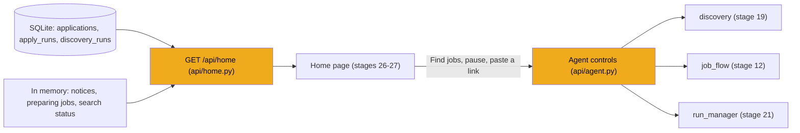
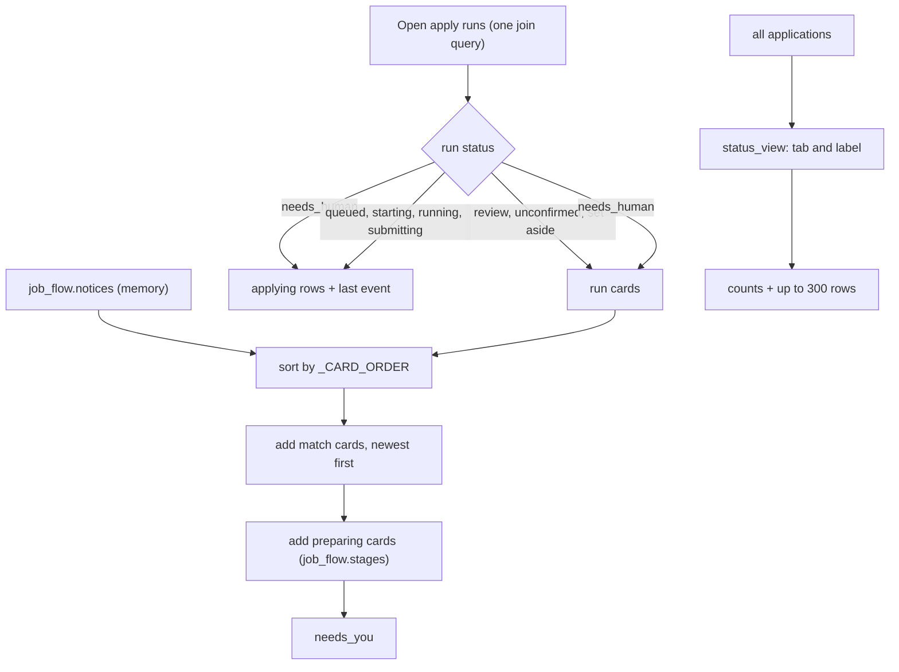

# Stage 22: The API: home inbox and agent controls

> **Goal:** Give the home page one endpoint that describes the whole screen, and give the agent bar its buttons: find jobs now, prepare more, pause, resume, dismiss or retry a notice, and paste a link.
>
> **By the end you will have:** `GET /api/home`, which returns your setup status, what the agent is doing, every card that needs you, the forms being filled right now, tab counts and your history, all in one response. You will also have the `/api/agent/...` endpoints and `POST /api/jobs/link`, mounted in a temporary `main.py`.

## Where this fits

Stages 12 to 21 built the parts that do the work: the job flow, discovery and the apply queue. So far you can only reach them through `/docs`. This stage adds the endpoint the home page reads, plus the agent's controls. Stage 23 adds the remaining action endpoints, and stages 24 to 27 build the page that calls them.



## New ideas in plain words

### One request for the whole screen

The home page shows six things: whether setup is done, what the agent is doing, the "Needs you" cards, the forms being filled now, the tab counts and your history. Each could have its own endpoint. JobBee returns all six from `GET /api/home`, for three reasons:

1. **One consistent snapshot.** All six parts are read during the same request, so they agree with each other. The page never shows a card that the counts say is already gone.
2. **One trip per refresh.** The page asks again every 2 seconds while something is happening, and every 15 seconds otherwise. Asking "anything new?" on a timer like this is called **polling**. One request per poll is cheaper than six.
3. **A simple page.** The frontend makes one fetch and keeps one piece of data. Stage 26 builds the code that polls.

The price is that every poll runs several database queries. For one person on one PC that's fine, and a 300-row limit on the history keeps each answer small.

### A list that mixes card types

"Needs you" holds four kinds of card: **run cards** (a filled form to review, a hand-off, a "did it go through?" question, or a job set aside), **notices** (a problem or a short note from the job flow), **match cards** (a new job with its tailored CV) and **preparing** placeholders. Each kind has different fields. What they share is a field called `type` that holds a fixed string. You typed these models in stage 4:

From [`backend/app/schemas.py`](../../backend/app/schemas.py):
```python
class NoticeCard(BaseModel):
    type: Literal["notice"] = "notice"
    id: int
    text: str
    level: str
    application_id: int | None = None
    retry: bool = False
    created_at: datetime
```

- `Literal["notice"]` means "this field can only ever be the string `"notice"`". The `= "notice"` default means you never have to pass it.
- The response declares the list as `list[RunCard | MatchCard | NoticeCard | PreparingCard]`. The `|` between classes means "or", as in `str | None`. So each item is one of the four.
- Whoever reads the JSON looks at `type` first, and then knows which other fields exist. This pattern is called a **tagged union** (or *discriminated union*). The `type` field is the tag. Stage 27's React code switches on it to pick the right card component.

`RunCard` is the one model that can carry four different tags: `review`, `handoff`, `set_aside` and `unconfirmed`. It has the same fields for all four, and the ones that don't apply stay empty.

### Joining tables

A run card needs data from three tables: the run (`apply_runs`), its application (`applications`) and the job (`jobs`), for the title and company. A **join** combines rows from two tables that belong together. It's like matching rows on two spreadsheet tabs by an ID column.

```python
select(ApplyRun, Application, Job)
    .join(Application, Application.id == ApplyRun.application_id)
    .join(Job, Job.id == Application.job_id)
```

Read it as: "give me each run, together with the application whose `id` equals the run's `application_id`, and the job whose `id` equals that application's `job_id`." Each result row is a tuple of three objects, so the loop can say `for run, app, job in runs:`. One query replaces a separate lookup for every run.

You know `select(...).where(...)` from stage 3. Two more tools appear in this file:

- `func.max(ApplyRun.id)` is SQL's `MAX()`: the largest value.
- `.group_by(ApplyRun.application_id)` makes one group per application, so `MAX` is worked out inside each group. Together they answer "what is the newest run of each application?" in a single query.

### Some of the screen lives in memory

Three things on the home page don't come from the database:

| What | Where it lives | Built in |
|---|---|---|
| Notices, such as "Couldn't read that posting" | `job_flow.notices`, a list of at most 20 | stage 12 |
| Jobs being screened or tailored right now | `job_flow.stages`, a dict of application id to `"screening"` or `"tailoring"` | stage 12 |
| Whether a search is running, and its current step | `discovery.running` and `discovery.stage` | stage 19 |

They describe work happening inside the running Python process. When the backend restarts, they start empty again. That's correct: the work they describe stopped with the restart.

### `def` or `async def` for an endpoint?

FastAPI accepts both kinds of function, and runs them in different places:

- A plain **`def` endpoint** runs on a helper thread. Slow blocking work, like a database query, then doesn't freeze the server. `home` is a plain `def`: it only reads the database.
- An **`async def` endpoint** runs on the event loop itself. Stage 8 explained the event loop: the single "cook" that switches between tasks while they wait.

Some code only works on the event loop. `discovery.start`, `run_manager.kick` and `job_flow.start` all call `asyncio.get_running_loop()` to start a background task (stage 12). On a helper thread there is no running loop, so that call raises `RuntimeError: no running event loop`. That's why the endpoints that start background work are `async def`, even when they never `await` anything.

### Status codes you'll see

Stage 4 introduced status codes. These are the ones this stage and the next use:

| Code | Name | JobBee uses it when |
|---|---|---|
| 200 | OK | the request worked |
| 202 | Accepted | work started in the background; check back later |
| 400 | Bad Request | you must fix something first, such as adding a Claude key or a valid link |
| 404 | Not Found | the thing doesn't exist, or isn't yours |
| 409 | Conflict | the request clashes with the current state, such as "a search is already running" |
| 422 | Unprocessable Entity | FastAPI rejected the request body before your code ran, such as a number out of range |

### Time zones on the way out

JobBee stores every date in UTC. SQLite, though, keeps dates without a time zone, so a date read back from the database has no zone attached. Python calls that a *naive* datetime. Sent as JSON, it looks like `2026-10-22T09:00:00` with nothing at the end, and a browser reads such a date as *local* time. In Toronto, "5 min ago" would be off by four or five hours. The small helper `_aware` attaches the UTC zone to every date before it leaves the server.

## Build it, step by step

### Step 1: The home endpoint, `backend/app/api/home.py`

This file lives in `backend/app/api/`, next to `profile.py` (stage 7) and `documents.py` (stage 10). It's the largest API file, because it gathers data from nearly every part of the backend. Here is the shape of what it returns:

```text
HomeResponse
├── setup         SetupStatus: five yes/no answers
│                 claude_key, resume, onboarded, telegram, inbox
├── agent         AgentStatus: what the agent is doing
│                 paused, searching, search_stage, next_search_at, last_search,
│                 looking_for, sent_today, jobs_per_day, shortlisted,
│                 spend_today_usd, daily_budget_usd, budget_reached
├── needs_you     cards, most urgent first; each has a "type":
│                 review, handoff, unconfirmed, set_aside   (RunCard)
│                 notice                                    (NoticeCard)
│                 match                                     (MatchCard)
│                 preparing                                 (PreparingCard)
├── applying      ApplyingRow for each form being filled:
│                 run_id, application_id, job, status, last_event, started_at
├── counts        {"applied": 3, "in_progress": 5, "skipped": 2,
│                  "not_a_fit": 9, "didnt_finish": 1, "needs_you": 2}
└── applications  up to 300 ApplicationRow, most recently changed first:
                  id, job, status, group, label, stage_reason, score,
                  updated_at, submitted_at
```

The response models are all in `schemas.py`. The work in this file is filling them in. The diagram below shows how the endpoint puts the inbox together; the parts after it walk through the code in file order.



#### Part 1: Imports and the lookup tables

The imports are a map of the whole backend: the apply queue (stage 21), the database session (stage 3), spend tracking (stage 6), messaging (stage 11), the job flow (stage 12), discovery and the scheduler (stage 19), email alerts (stage 13), the pause flag (stage 5) and the Claude key (stage 2). `get_or_create_local_user` comes from stage 7: JobBee has one local user, and every endpoint starts by fetching it.

`router = APIRouter(tags=["home"])` has no URL prefix of its own. The path `/home` plus the `/api` prefix that `main.py` adds gives `/api/home`. The `tags` group the endpoint under "home" in `/docs`.

Then four constants:

- `_APPLICATION_ROWS = 300` is the most history rows one response carries (Part 7).
- `_RUN_CARD_TYPES` maps a run status to the card it becomes. These are the statuses where a run is waiting for you:

| Run status | Card `type` | What the card asks |
|---|---|---|
| `awaiting_submit` | `review` | Here is the filled form, with a screenshot and every answer. Submit or don't? |
| `revising` | `review` | The same card, locked while your corrections are typed in |
| `needs_human` | `handoff` | Do this step in the Chrome window, then press Done (attended runs only) |
| `needs_you` | `set_aside` | This job needs you at your PC some time |
| `submit_unconfirmed` | `unconfirmed` | JobBee clicked Submit but saw no confirmation. Did it go through? |

- `_CARD_ORDER` sorts cards by urgency. A review card comes first, because its parked form expires after a time limit (stage 21). A hand-off is next: an attended run is waiting with Chrome open. An unconfirmed submit needs a quick look. A set-aside job can wait until you're at your PC, and a notice is only information.
- `_RUN_LABELS` gives an approved application a short label in the history list, based on what its newest run is doing: "Queued", "Applying", "Form timed out" and so on.

<!-- code: backend/app/api/home.py lines=1-75 -->
**`backend/app/api/home.py`** (lines 1–75 of 398)

```python
"""The home page in one call: agent status, what needs the user, what's applying, history.

GET /api/home
"""

from __future__ import annotations

from datetime import datetime, timezone

from fastapi import APIRouter, Depends
from sqlalchemy import func, select
from sqlalchemy.orm import Session

from ..apply.runs import FILL_STATUSES
from ..db import get_session
from ..llm.usage import spend_summary
from ..messaging.service import messaging
from ..models import (
    Application,
    ApplicationStatus,
    ApplyEvent,
    ApplyRun,
    DiscoveryRun,
    DocumentKind,
    Job,
    User,
)
from ..pipeline.discovery import STAGES, discovery, prepared_today, shortlist
from ..pipeline.flow import job_flow
from ..pipeline.prefs import load_preferences
from ..pipeline.scheduler import last_search_day, next_search_at, parse_time
from ..pipeline.sources.email_alerts import inbox_connected
from ..pipeline.state import is_paused
from ..schemas import (
    AgentStatus,
    ApplicationRow,
    ApplyingRow,
    HomeResponse,
    JobCardInfo,
    LastSearch,
    MatchCard,
    NoticeCard,
    PreparingCard,
    RunCard,
    SetupStatus,
)
from ..services.documents import get_base_document
from ..services.secrets import claude_api_key
from .profile import get_or_create_local_user

router = APIRouter(tags=["home"])

_APPLICATION_ROWS = 300
_RUN_CARD_TYPES = {
    "awaiting_submit": "review",
    "revising": "review",
    "needs_human": "handoff",
    "needs_you": "set_aside",
    "submit_unconfirmed": "unconfirmed",
}
_CARD_ORDER = {"review": 0, "handoff": 1, "unconfirmed": 2, "set_aside": 3, "notice": 4}
_RUN_LABELS = {
    "queued": "Queued",
    "starting": "Applying",
    "running": "Applying",
    "needs_human": "Needs you at your PC",
    "needs_you": "Needs you at your PC",
    "revising": "Updating answers",
    "submitting": "Submitting",
    "expired": "Form timed out",
    "cancelled": "Stopped",
    "discarded": "Not submitted",
}


```
<!-- /code -->

#### Part 2: Small helpers and the history tabs

`job_info` copies what every card shows about a job (title, company, location, work mode, salary and link) into a `JobCardInfo`. Cards, rows and stage 23's drawer endpoint all use it, so they describe a job the same way.

`status_view` decides which history tab an application belongs to, and its label. Eight statuses collapse into five tabs a person cares about:

| Application status | Tab (`group`) | Label |
|---|---|---|
| `submitted` | `applied` | Applied |
| `awaiting_submit` | `in_progress` | Ready to submit |
| `awaiting_approval` | `in_progress` | Waiting for your OK |
| `approved` | `in_progress` | from `_RUN_LABELS`, e.g. "Applying"; "Approved" if there's no run |
| `matched`, kept by screening | `in_progress` | Shortlisted |
| `matched`, anything else | `None` (hidden) | New |
| `rejected_by_user` | `skipped` | Skipped |
| `filtered_out` | `not_a_fit` | Not a fit |
| anything else (`failed`) | `didnt_finish` | Didn't finish |

Two details matter:

- A `matched` job without a "keep" verdict, usually one that hasn't been screened yet, gets tab `None`. The caller skips it, so it doesn't clutter your history before JobBee has even judged it.
- The `run_status` argument lets an approved application say what its run is doing. `_RUN_LABELS.get(run_status or "", "Approved")` turns `None` into `""`, which isn't a key, so the default "Approved" is used.

The other helpers:

- `_aware` attaches UTC to a naive date (see "Time zones on the way out"). A date that already has a zone passes through unchanged, and `None` stays `None`.
- `_prepared_at` reads the `prepared_at` stamp that stage 12's flow writes into the `tailoring` JSON when it makes a card. It's stored as text, so `datetime.fromisoformat` turns it back into a date. A broken stamp gives `None` instead of crashing the whole home page.
- `can_restyle` says whether the CV may still change style (stage 10's CV styles). If the tailored CV was saved in structured form (`tailoring["cv"]`), changing style only re-renders the PDF, with no Claude call, so it's allowed while the application waits for you, is approved, or failed. Older cards from before styles existed have no structured CV, so only a card still waiting for approval may be rewritten, which costs one Claude call. Either way, a CV that has been sent with an application never changes.

<!-- code: backend/app/api/home.py lines=76-139 -->
**`backend/app/api/home.py`** (lines 76–139 of 398)

```python
def job_info(job: Job) -> JobCardInfo:
    return JobCardInfo(
        id=job.id,
        title=job.title,
        company=job.company,
        location=job.location,
        work_mode=job.work_mode,
        salary_text=job.salary_text,
        url=job.url,
    )


def status_view(app: Application, run_status: str | None) -> tuple[str | None, str]:
    """(tab, label) for an application in the history list; tab None hides it."""

    status = app.status
    if status == ApplicationStatus.submitted:
        return "applied", "Applied"
    if status == ApplicationStatus.awaiting_submit:
        return "in_progress", "Ready to submit"
    if status == ApplicationStatus.awaiting_approval:
        return "in_progress", "Waiting for your OK"
    if status == ApplicationStatus.approved:
        return "in_progress", _RUN_LABELS.get(run_status or "", "Approved")
    if status == ApplicationStatus.matched:
        if app.screen and app.screen.get("decision") == "keep":
            return "in_progress", "Shortlisted"
        return None, "New"
    if status == ApplicationStatus.rejected_by_user:
        return "skipped", "Skipped"
    if status == ApplicationStatus.filtered_out:
        return "not_a_fit", "Not a fit"
    return "didnt_finish", "Didn't finish"


def _aware(value: datetime | None) -> datetime | None:
    if value is None:
        return None
    return value if value.tzinfo else value.replace(tzinfo=timezone.utc)


def _prepared_at(tailoring: dict | None) -> datetime | None:
    try:
        stamp = (tailoring or {}).get("prepared_at")
        return datetime.fromisoformat(stamp) if stamp else None
    except ValueError:
        return None


def can_restyle(app: Application) -> bool:
    """The CV can change style while nothing has been sent with it yet."""

    if not app.resume_doc_id:
        return False
    if (app.tailoring or {}).get("cv"):
        return app.status in (
            ApplicationStatus.awaiting_approval,
            ApplicationStatus.approved,
            ApplicationStatus.failed,
        )
    # Made before styles existed: only a card can be rewritten (one Claude call).
    return app.status == ApplicationStatus.awaiting_approval


```
<!-- /code -->

#### Part 3: Match cards and run cards

`match_card` flattens two JSON columns into one card. From `screen` (stage 9) it takes the score, Claude's decision, its one-line summary, the reasons and the gaps. From `tailoring` (stage 10) it takes what changed in the CV, which claims the fact-check removed, and the style. `list(screen.get("reasons") or [])` turns a missing or `None` value into an empty list, so the card always has a list.

`older_resume` is true when you uploaded a new resume after this CV was tailored. The comparison only runs when both dates exist (`resume_since and prepared_at and ...`), so a missing date means "not older". The card can then offer to tailor the CV again from your current resume.

`run_card` turns a waiting run into a card:

1. `kind = _RUN_CARD_TYPES[run.status]` picks the card type. The caller only passes runs whose status is in that dict.
2. `message` comes from a different column for each kind. A hand-off shows what the agent asked you to do (`pending["message"]`). A set-aside card shows the agent's `finish` summary, such as "Solve the CAPTCHA on sign-up", or the run's error. An unconfirmed card shows why JobBee isn't sure (`confirmation["detail"]`). A review card has no message: the dict's `.get(kind)` gives `None`.
3. `error` only matters on a review card. It holds "Couldn't change the answers: ..." after a revision failed (stage 21).
4. `answers` prefers `run.answers` over the agent's original list in `finish`. `run.answers` includes your corrections, marked `source: "you"`.
5. `checks` are the fields the agent itself flagged for your review (`fields_needing_review`).
6. `screenshot_url` points at stage 23's screenshot endpoint, but only if a screenshot was taken. The browser fetches the PNG from there.
7. `clicked` only matters on an unconfirmed card: it says whether the Submit click happened at all.

<!-- code: backend/app/api/home.py lines=140-193 -->
**`backend/app/api/home.py`** (lines 140–193 of 398)

```python
def match_card(app: Application, job: Job, resume_since: datetime | None = None) -> MatchCard:
    """`resume_since`: when the current resume was uploaded; a CV tailored before then was
    made from the previous one."""

    screen = app.screen or {}
    tailoring = app.tailoring or {}
    prepared_at = _prepared_at(app.tailoring)
    return MatchCard(
        application_id=app.id,
        job=job_info(job),
        score=screen.get("score"),
        decision=screen.get("decision"),
        summary=screen.get("summary"),
        reasons=list(screen.get("reasons") or []),
        gaps=list(screen.get("gaps") or []),
        changes=list(tailoring.get("changes") or []),
        removed_claims=list(tailoring.get("removed_claims") or []),
        resume_doc_id=app.resume_doc_id,
        cover_doc_id=app.cover_doc_id,
        style=tailoring.get("style"),
        can_restyle=can_restyle(app),
        prepared_at=prepared_at,
        older_resume=bool(resume_since and prepared_at and _aware(prepared_at) < resume_since),
    )


def run_card(run: ApplyRun, job: Job) -> RunCard:
    kind = _RUN_CARD_TYPES[run.status]
    pending = run.pending or {}
    finish = run.finish or {}
    confirmation = run.confirmation or {}
    message = {
        "handoff": pending.get("message"),
        "set_aside": finish.get("summary") or run.error,
        "unconfirmed": confirmation.get("detail"),
    }.get(kind)
    return RunCard(
        type=kind,  # type: ignore[arg-type]
        run_id=run.id,
        application_id=run.application_id,
        job=job_info(job),
        handoff_kind=pending.get("kind") if kind == "handoff" else None,
        updating=run.status == "revising",
        error=run.error if kind == "review" else None,
        message=message,
        summary=finish.get("summary"),
        checks=list(finish.get("fields_needing_review") or []),
        answers=list(run.answers or finish.get("answers") or []),
        screenshot_url=f"/api/apply-runs/{run.id}/screenshot" if run.screenshot_path else None,
        expires_at=_aware(run.expires_at),
        clicked=confirmation.get("clicked") if kind == "unconfirmed" else None,
    )


```
<!-- /code -->

#### Part 4: What the agent is doing, and what setup is done

`_looking_for` builds the line at the top of the agent bar, such as "Backend Engineer, Platform Engineer · Toronto, Remote". It uses up to three target roles, or your headline, or a friendly fallback. If you accept remote work and "Remote" isn't already in the list, it adds it.

`_agent_status` collects the agent bar's data from pieces you built earlier:

- `last` is the most recent full search. "Prepare more" runs (`trigger == "more"`) are left out, because they only tailor jobs that were already screened.
- `next_search_at` uses the scheduler's own helpers from stage 19 (`next_search_at`, `parse_time`, `last_search_day`), so the page and the scheduler can't disagree. There is no next search while paused or before you finish the welcome flow (`onboarded_at` is still empty).
- `searching` and `search_stage` read the live `discovery` object. `STAGES` turns its step key into text such as "Checking which ones fit".
- `sent_today` counts cards prepared since local midnight, and `jobs_per_day` is your daily target. Together they show "2 of 5 sent today".
- `shortlisted` counts good jobs that were screened but not tailored yet. The home page offers to prepare more of them.
- `budget_reached` lets the page explain why nothing new is happening. A daily budget of `0` means "no limit", which is why it checks `bool(budget)` first. This mirrors `check_budget` from stage 6.

`setup_status` answers five yes/no questions: is there a Claude key (from the keyring or `.env`, via `claude_api_key()` from stage 2), is there a resume with text, is the welcome flow finished, is Telegram linked, and is an email inbox connected. The web app uses it to send you to the welcome flow until you finish it (stages 24 and 25). Stage 23's `GET /api/setup` returns the same object.

<!-- code: backend/app/api/home.py lines=194-254 -->
**`backend/app/api/home.py`** (lines 194–254 of 398)

```python
def _looking_for(user: User) -> str:
    roles = ", ".join((user.target_roles or [])[:3]) or user.headline or "jobs that fit your resume"
    places = list(user.target_locations or [])[:3]
    if "remote" in (user.work_modes or []) and "Remote" not in places:
        places.append("Remote")
    return f"{roles} · {', '.join(places)}" if places else roles


def _agent_status(session: Session, user: User) -> AgentStatus:
    prefs = load_preferences(user)
    paused = is_paused()
    last = session.execute(
        select(DiscoveryRun)
        .where(DiscoveryRun.user_id == user.id, DiscoveryRun.trigger != "more")
        .order_by(DiscoveryRun.id.desc())
        .limit(1)
    ).scalar_one_or_none()
    spend = spend_summary()
    budget = spend["daily_budget_usd"]
    next_at = None
    if not paused and user.onboarded_at is not None:
        now_local = datetime.now().astimezone()
        next_at = next_search_at(now_local, parse_time(prefs.discovery_time), last_search_day())
    return AgentStatus(
        paused=paused,
        searching=discovery.running,
        search_stage=STAGES.get(discovery.stage or "") if discovery.running else None,
        next_search_at=next_at,
        last_search=LastSearch(
            trigger=last.trigger,
            status=last.status,
            found=last.found,
            kept=last.kept,
            sent=last.sent,
            error=last.error,
            started_at=_aware(last.started_at),
            finished_at=_aware(last.finished_at),
        )
        if last
        else None,
        looking_for=_looking_for(user),
        sent_today=prepared_today(user.id),
        jobs_per_day=prefs.jobs_per_day,
        shortlisted=len(shortlist(user.id, prefs.min_match_score)),
        spend_today_usd=round(spend["today_usd"], 2),
        daily_budget_usd=budget,
        budget_reached=bool(budget) and spend["today_usd"] >= budget,
    )


def setup_status(session: Session, user: User) -> SetupStatus:
    resume = get_base_document(session, user.id, DocumentKind.resume)
    return SetupStatus(
        claude_key=bool(claude_api_key()),
        resume=resume is not None and bool((resume.content or "").strip()),
        onboarded=user.onboarded_at is not None,
        telegram=messaging.linked(user.id) is not None,
        inbox=inbox_connected(session, user),
    )


```
<!-- /code -->

#### Part 5: `GET /api/home`, the apply runs

The endpoint starts with the apply runs, because they produce the most urgent cards and the "Applying now" rows.

**The runs query** joins runs to their applications and jobs, keeps only your own, and keeps only the statuses that matter here: the five card statuses, the filling statuses from stage 21 (`FILL_STATUSES`: `starting`, `running`, `needs_user` and `needs_human`), plus `queued` and `submitting`. (`needs_user` is an older status that nothing sets today.) Finished runs, like `submitted` or `failed`, are not on the home page; their applications show up in the history instead. `.order_by(ApplyRun.id)` puts the oldest run first.

**`latest`** is a dict of application id to its newest run id, built with `func.max` and `group_by` as explained above. It looks at *all* runs of those applications, not only the open ones.

**The loop** puts each run in one of three places:

1. **A set-aside run (`needs_you`) becomes a card only while it still applies.** When you press "I'm at my PC", stage 21's `attend` creates a *new* run and leaves the old one at `needs_you`. So the card shows only if this run is the application's newest (`latest.get(app.id) == run.id`) and the application is still `approved`. After a retry or a skip, the card disappears by itself. `continue` jumps to the next run either way.
2. **A hand-off run (`needs_human`) becomes a card *and* an "Applying now" row.** There is no `continue` after it, so the code falls through to the row below. The run is still in progress, and the row's Stop button must stay reachable while you're being asked for help.
3. **The other card statuses** (review, unconfirmed) become a card only.

Everything left (`queued`, `starting`, `running`, `submitting`) becomes an **applying row**. Each row carries the run's latest step: the newest event of kind `tool_call`, `text` or `status` from the `apply_events` table (stage 21). Other kinds, such as `usage`, would only say "a Claude call happened", which isn't a useful step to show. The page turns that event into a short line such as "Uploading your CV" (`describeEvent` in stage 24's `format.ts`).

<!-- code: backend/app/api/home.py lines=255-308 -->
**`backend/app/api/home.py`** (lines 255–308 of 398)

```python
@router.get("/home", response_model=HomeResponse)
def home(session: Session = Depends(get_session)) -> HomeResponse:
    user = get_or_create_local_user(session)

    runs = session.execute(
        select(ApplyRun, Application, Job)
        .join(Application, Application.id == ApplyRun.application_id)
        .join(Job, Job.id == Application.job_id)
        .where(
            Application.user_id == user.id,
            ApplyRun.status.in_(set(_RUN_CARD_TYPES) | FILL_STATUSES | {"queued", "submitting"}),
        )
        .order_by(ApplyRun.id)
    ).all()
    latest = dict(
        session.execute(
            select(ApplyRun.application_id, func.max(ApplyRun.id))
            .where(ApplyRun.application_id.in_({app.id for _, app, _ in runs}))
            .group_by(ApplyRun.application_id)
        ).all()
    )
    cards: list = []
    applying: list[ApplyingRow] = []
    for run, app, job in runs:
        if run.status == "needs_you":
            # Set aside until the user is at their PC; gone once retried or skipped.
            if latest.get(app.id) == run.id and app.status == ApplicationStatus.approved:
                cards.append(run_card(run, job))
            continue
        if run.status == "needs_human":
            cards.append(run_card(run, job))
        elif run.status in _RUN_CARD_TYPES:
            cards.append(run_card(run, job))
            continue
        last_event = session.execute(
            select(ApplyEvent)
            .where(
                ApplyEvent.run_id == run.id, ApplyEvent.kind.in_(("tool_call", "text", "status"))
            )
            .order_by(ApplyEvent.id.desc())
            .limit(1)
        ).scalar_one_or_none()
        applying.append(
            ApplyingRow(
                run_id=run.id,
                application_id=app.id,
                job=job_info(job),
                status=run.status,
                last_event={"kind": last_event.kind, "data": last_event.data}
                if last_event
                else None,
                started_at=_aware(run.created_at),
            )
        )
```
<!-- /code -->

#### Part 6: Notices, the card order, match cards and preparing cards

**Notices** come from memory (`job_flow.notices`, stage 12). Each one becomes a `NoticeCard`. If `retry` is true, the page shows a Try again button that calls the retry endpoint in Step 2.

**The sort.** `cards.sort(key=lambda c: _CARD_ORDER.get(c.type, 9))` orders the run cards and notices by urgency. Python's sort is *stable*: cards with the same type keep their order from before the sort. Any type missing from `_CARD_ORDER` would get 9 and go last.

**Match cards** are applications waiting for your Apply or Skip (`awaiting_approval`). Two filters run in the list comprehension:

- `app.tailoring` must exist, so a card never shows before its CV does.
- `app.id not in job_flow.stages` hides a card while its CV is being tailored again. You can't click Apply on a half-made CV.

`resume_since` is the upload time of your current base resume, passed to `match_card` for the `older_resume` check. The match cards are then sorted newest CV first. A card without a stamp sorts as if it was made at `datetime.min` (the earliest possible date, with a UTC zone so it can be compared), so it goes last.

The match cards are added *after* the sort, so they always sit below the run cards and notices. A new job can wait for your Apply; a parked form with a time limit can't.

**Preparing cards** come from `job_flow.stages`. The code first copies its keys into a list, then loads those applications and their jobs in one query, limited to your own. `home` runs on a helper thread while background tasks on the event loop add and remove entries, so the dict can change while this code runs. Working from a copy, and checking `if stage:` again, skips a job that finished in the meantime. Preparing cards go last: they don't need you yet.

<!-- code: backend/app/api/home.py lines=309-354 -->
**`backend/app/api/home.py`** (lines 309–354 of 398)

```python
    for notice in job_flow.notices:
        if notice.user_id == user.id:
            cards.append(
                NoticeCard(
                    id=notice.id,
                    text=notice.text,
                    level=notice.level,
                    application_id=notice.application_id,
                    retry=notice.retry,
                    created_at=notice.created_at,
                )
            )
    cards.sort(key=lambda c: _CARD_ORDER.get(c.type, 9))

    matches = session.execute(
        select(Application, Job)
        .join(Job, Job.id == Application.job_id)
        .where(
            Application.user_id == user.id,
            Application.status == ApplicationStatus.awaiting_approval,
        )
        .order_by(Application.updated_at.desc())
    ).all()
    resume = get_base_document(session, user.id, DocumentKind.resume)
    resume_since = _aware(resume.created_at) if resume else None
    match_cards = [
        match_card(app, job, resume_since)
        for app, job in matches
        if app.tailoring and app.id not in job_flow.stages
    ]
    match_cards.sort(
        key=lambda c: c.prepared_at or datetime.min.replace(tzinfo=timezone.utc), reverse=True
    )
    cards += match_cards

    preparing_ids = [app_id for app_id in job_flow.stages]
    if preparing_ids:
        for app, job in session.execute(
            select(Application, Job)
            .join(Job, Job.id == Application.job_id)
            .where(Application.id.in_(preparing_ids), Application.user_id == user.id)
        ).all():
            stage = job_flow.stages.get(app.id)
            if stage:
                cards.append(PreparingCard(application_id=app.id, job=job_info(job), stage=stage))

```
<!-- /code -->

#### Part 7: History rows and counts

**`latest_runs`** maps each application to its newest run's status, with a small trick. The query returns `(application_id, status)` pairs ordered by run id, oldest first. Building a dict from them writes each application's key again and again, and the last write wins. So every application ends up with its newest run's status. `status_view` uses it for the "Applying" or "Form timed out" labels.

**The history loop** walks through all your applications, most recently changed first:

1. `status_view` gives each one a tab and a label. Hidden ones (`group is None`) are skipped.
2. `counts[group] += 1` counts every application, however many there are.
3. `if len(rows) >= _APPLICATION_ROWS: continue` stops adding rows after 300, but the loop goes on counting. Each poll stays small as your history grows, and the tab counts stay right.
4. The score is stored in the `screen` JSON. `int(score)` makes sure it's a whole number, and a missing score stays `None`.

`counts["needs_you"]` counts the cards, leaving out preparing cards, because those don't need you yet. The page shows it as the badge next to "Needs you".

Finally, `HomeResponse` puts everything together. `setup_status` and `_agent_status` from Part 4 fill the first two fields.

<!-- code: backend/app/api/home.py lines=355-398 -->
**`backend/app/api/home.py`** (lines 355–398 of 398)

```python
    latest_runs = dict(
        session.execute(
            select(ApplyRun.application_id, ApplyRun.status).order_by(ApplyRun.id)
        ).all()
    )
    rows: list[ApplicationRow] = []
    counts = {"applied": 0, "in_progress": 0, "skipped": 0, "not_a_fit": 0, "didnt_finish": 0}
    apps = session.execute(
        select(Application, Job)
        .join(Job, Job.id == Application.job_id)
        .where(Application.user_id == user.id)
        .order_by(Application.updated_at.desc())
    ).all()
    for app, job in apps:
        group, label = status_view(app, latest_runs.get(app.id))
        if group is None:
            continue
        counts[group] += 1
        if len(rows) >= _APPLICATION_ROWS:
            continue
        score = (app.screen or {}).get("score")
        rows.append(
            ApplicationRow(
                id=app.id,
                job=job_info(job),
                status=app.status.value,
                group=group,  # type: ignore[arg-type]
                label=label,
                stage_reason=app.stage_reason,
                score=int(score) if score is not None else None,
                updated_at=_aware(app.updated_at),
                submitted_at=_aware(app.submitted_at),
            )
        )
    counts["needs_you"] = len([c for c in cards if c.type != "preparing"])

    return HomeResponse(
        setup=setup_status(session, user),
        agent=_agent_status(session, user),
        needs_you=cards,
        applying=applying,
        counts=counts,
        applications=rows,
    )
```
<!-- /code -->

### Step 2: The agent controls, `backend/app/api/agent.py`

This file also lives in `backend/app/api/`. It holds the buttons of the agent bar, plus the "paste a job link" box. One router serves two URL families: `/agent/...` and `/jobs/link`.

| Endpoint | What it calls | Answers |
|---|---|---|
| `POST /api/agent/search` | `discovery.start(user.id, "manual")` (stage 19) | 202; 409 if a search is running |
| `POST /api/agent/more` `{count}` | `discovery.start_more(user.id, count)` | 202; 409 if a search is running |
| `POST /api/agent/pause` | `set_paused(True)` (stage 5) | 200 |
| `POST /api/agent/resume` | `set_paused(False)`, then `run_manager.kick()` (stage 21) | 200 |
| `POST /api/agent/notices/{id}/dismiss` | `job_flow.dismiss_notice` (stage 12) | 200 |
| `POST /api/agent/notices/{id}/retry` | `job_flow.start(..., user_requested=True)` | 200; 404 if there's nothing to retry |
| `POST /api/jobs/link` `{url}` | `job_flow.add_link`, then `job_flow.start` | 202; 400 for a link JobBee can't read |

#### Part 1: The request body and the readiness check

`MoreRequest` describes the optional body of `/agent/more`. `Field(default=3, ge=1, le=10)` means "3 if you don't say, and between 1 and 10" (`ge` is "greater or equal", `le` is "less or equal"). FastAPI answers 422 for anything outside that range, before your code runs.

`require_ready` is the gatekeeper for anything that will call Claude. Searching and tailoring need a Claude key and a resume with text. Without them, the endpoint answers 400 straight away with a message that says what to do. The alternative would be to start a background task that fails a minute later, where you'd never see why. Stage 23 uses `require_ready` again for "prepare", for changing a CV's style, and for finishing setup.

<!-- code: backend/app/api/agent.py lines=1-44 -->
**`backend/app/api/agent.py`** (lines 1–44 of 119)

```python
"""Tell the agent what to do: search now, prepare more, pause/resume, read a link.

POST /api/agent/search            find jobs now (background)
POST /api/agent/more              prepare cards for the next shortlisted jobs
POST /api/agent/pause | resume
POST /api/agent/notices/{id}/dismiss | retry
POST /api/jobs/link               read a posting the user pasted, then screen + tailor it
"""

from __future__ import annotations

from fastapi import APIRouter, Depends, HTTPException, status
from pydantic import BaseModel, Field
from sqlalchemy.orm import Session

from ..apply.runs import run_manager
from ..db import get_session
from ..models import DocumentKind, User
from ..pipeline.discovery import discovery
from ..pipeline.flow import job_flow
from ..pipeline.ingest import IngestError
from ..pipeline.state import set_paused
from ..schemas import ActionResponse, JobLinkRequest, JobLinkResponse
from ..services.documents import get_base_document
from ..services.secrets import claude_api_key
from .profile import get_or_create_local_user

router = APIRouter(tags=["agent"])


class MoreRequest(BaseModel):
    count: int = Field(default=3, ge=1, le=10)


def require_ready(session: Session, user: User) -> None:
    """Searching and tailoring need a Claude key and a resume."""

    if not claude_api_key():
        raise HTTPException(status_code=400, detail="Connect Claude first (Settings → Claude).")
    resume = get_base_document(session, user.id, DocumentKind.resume)
    if resume is None or not (resume.content or "").strip():
        raise HTTPException(status_code=400, detail="Upload your resume first.")


```
<!-- /code -->

#### Part 2: Search, prepare more, pause, resume and notices

- **`search_now`** checks readiness, then asks discovery to start a search in the background. `discovery.start` returns `False` if a search is already running, which becomes a 409. Otherwise the answer is 202 Accepted: the search runs on, and the home page's polling shows its progress.
- **`prepare_more`** does the same with `start_more`, which tailors the next `count` shortlisted jobs. `payload: MoreRequest | None = None` makes the body optional, and `(payload or MoreRequest()).count` falls back to the default of 3.
- **`pause`** sets the pause flag. That stops the daily scheduled search (stage 19) and stops the apply worker from starting the next queued form (stage 21). A form already being filled carries on, and buttons you press yourself, like Find jobs now, still work. The flag lives in the database, so it survives a restart. `pause` only writes a flag, so it can stay a plain `def`.
- **`resume`** clears the flag and calls `run_manager.kick()`. The worker exits while paused, so without the kick, queued forms would wait until something else woke it. `kick` uses the running event loop, which is why `resume` is `async def`.
- **`dismiss_notice`** removes a notice from memory. An unknown id is ignored, and the answer is still 200: the notice is gone either way.
- **`retry_notice`** finds the notice and checks three things: it exists, it's yours, and it belongs to an application. Then it checks readiness, removes the notice, and starts the job flow again with `user_requested=True`. The readiness check comes before the removal, so if your key is missing, the notice stays on screen.

`user_requested=True` tells the flow (stage 12) that you asked for this job yourself. The flow then tailors it even if the fit score is low. If a hard filter still stops it, you get an info notice that says why.

<!-- code: backend/app/api/agent.py lines=45-96 -->
**`backend/app/api/agent.py`** (lines 45–96 of 119)

```python
@router.post("/agent/search", response_model=ActionResponse, status_code=status.HTTP_202_ACCEPTED)
async def search_now(session: Session = Depends(get_session)) -> ActionResponse:
    user = get_or_create_local_user(session)
    require_ready(session, user)
    if not discovery.start(user.id, "manual"):
        raise HTTPException(status_code=409, detail="A search is already running.")
    return ActionResponse(message="Searching for jobs…")


@router.post("/agent/more", response_model=ActionResponse, status_code=status.HTTP_202_ACCEPTED)
async def prepare_more(
    payload: MoreRequest | None = None, session: Session = Depends(get_session)
) -> ActionResponse:
    user = get_or_create_local_user(session)
    require_ready(session, user)
    count = (payload or MoreRequest()).count
    if not discovery.start_more(user.id, count):
        raise HTTPException(status_code=409, detail="A search is already running.")
    return ActionResponse(message=f"Preparing {count} more…")


@router.post("/agent/pause", response_model=ActionResponse)
def pause() -> ActionResponse:
    set_paused(True)
    return ActionResponse(message="Paused. Nothing new starts until you resume.")


@router.post("/agent/resume", response_model=ActionResponse)
async def resume() -> ActionResponse:
    set_paused(False)
    run_manager.kick()
    return ActionResponse(message="Back on.")


@router.post("/agent/notices/{notice_id}/dismiss", response_model=ActionResponse)
def dismiss_notice(notice_id: int) -> ActionResponse:
    job_flow.dismiss_notice(notice_id)
    return ActionResponse()


@router.post("/agent/notices/{notice_id}/retry", response_model=ActionResponse)
async def retry_notice(notice_id: int, session: Session = Depends(get_session)) -> ActionResponse:
    user = get_or_create_local_user(session)
    notice = next((n for n in job_flow.notices if n.id == notice_id), None)
    if notice is None or notice.user_id != user.id or notice.application_id is None:
        raise HTTPException(status_code=404, detail="Nothing to retry.")
    require_ready(session, user)
    job_flow.dismiss_notice(notice_id)
    job_flow.start(notice.application_id, user_requested=True)
    return ActionResponse(message="Trying again…")


```
<!-- /code -->

#### Part 3: Paste a link

`add_link` is the "paste a job link" box:

1. `JobLinkRequest` (stage 4) only accepts a `url` of 8 to 2048 characters.
2. `require_ready` checks for a key and a resume.
3. `await job_flow.add_link(...)` reads the posting **inside the request**. That's stage 8's `ingest_url`: the URL safety check, the fetch, and storing the job once. It takes a second or two. Doing it here means a bad link gets an immediate 400 with stage 8's explanation, such as "That doesn't look like a public job posting link."
4. `job_flow.needs_processing(result)` decides whether there's work to do. A new link needs processing. So does a duplicate that is still `matched` or `filtered_out`, so pasting a link you were shown before gives it a second chance.
5. The slow part, screening and tailoring, goes to the background with `job_flow.start`. The answer is 202 with the application id, and a preparing card appears on the next poll.
6. Otherwise the message says "You already have this one", followed by its status with underscores turned into spaces, such as "(awaiting approval)".

<!-- code: backend/app/api/agent.py lines=97-119 -->
**`backend/app/api/agent.py`** (lines 97–119 of 119)

```python
@router.post("/jobs/link", response_model=JobLinkResponse, status_code=status.HTTP_202_ACCEPTED)
async def add_link(
    payload: JobLinkRequest, session: Session = Depends(get_session)
) -> JobLinkResponse:
    user = get_or_create_local_user(session)
    require_ready(session, user)
    try:
        result = await job_flow.add_link(user.id, payload.url, source="link")
    except IngestError as e:
        raise HTTPException(status_code=400, detail=str(e)) from e
    processing = job_flow.needs_processing(result)
    if processing:
        job_flow.start(result.application_id, user_requested=True)
        message = "Got it. Checking the fit and tailoring your CV…"
    else:
        message = f"You already have this one ({result.status.value.replace('_', ' ')})."
    return JobLinkResponse(
        application_id=result.application_id,
        status=result.status.value,  # type: ignore[arg-type]
        duplicate=result.duplicate,
        processing=processing,
        message=message,
    )
```
<!-- /code -->

### Step 3: Mount both routers in the temporary `backend/app/main.py`

Compared with stage 21's version, only four lines are new:

- two imports, `from .api import home as home_router` and `from .api import agent as agent_router`;
- two `app.include_router(..., prefix="/api")` lines, after the messaging router.

The lifespan is unchanged. The `as ..._router` names follow the pattern of most earlier router imports. It avoids name clashes: `settings`, for example, is also the name of a local variable inside `create_app`.

Stage 23 replaces this file with the final `main.py`, which adds four more routers: applications, apply runs, setup and site accounts.

<!-- temp: backend/app/main.py -->
```python
"""FastAPI entry point.

Temporary version from stage 22. Stage 23 replaces it with the final file.
"""

from __future__ import annotations

import asyncio
import sys

# Playwright spawns a browser subprocess; uvicorn's default Windows loop cannot do that.
if sys.platform == "win32":
    asyncio.set_event_loop_policy(asyncio.WindowsProactorEventLoopPolicy())

from contextlib import asynccontextmanager

from fastapi import FastAPI
from fastapi.middleware.cors import CORSMiddleware

from . import __version__
from .api import health
from .api import settings as settings_router
from .api import llm
from .api import profile as profile_router
from .api import documents as documents_router
from .api import email as email_router
from .api import messaging as messaging_router
from .api import home as home_router
from .api import agent as agent_router
from .api import preferences as preferences_router
from .api import watchlist as watchlist_router
from .apply.runs import run_manager
from .config import get_settings
from .db import init_db
from .messaging.service import messaging
from .pipeline.discovery import discovery
from .pipeline.flow import job_flow
from .pipeline.scheduler import scheduler


@asynccontextmanager
async def lifespan(_: FastAPI):
    init_db()
    job_flow.register()
    run_manager.register_chat_actions(messaging)
    await run_manager.startup()
    await messaging.start()
    if get_settings().app_env != "test":
        scheduler.start()
    yield
    await scheduler.stop()
    await discovery.stop()
    await messaging.stop()
    await run_manager.shutdown()


def create_app() -> FastAPI:
    settings = get_settings()
    app = FastAPI(
        title="JobBee API",
        version=__version__,
        lifespan=lifespan,
    )

    # In dev the Vite proxy handles same-origin, but allow direct browser calls too.
    app.add_middleware(
        CORSMiddleware,
        allow_origins=["http://localhost:5173", "http://127.0.0.1:5173"]
        if settings.is_dev
        else [],
        allow_credentials=True,
        allow_methods=["*"],
        allow_headers=["*"],
    )

    app.include_router(health.router, prefix="/api")
    app.include_router(settings_router.router, prefix="/api")
    app.include_router(llm.router, prefix="/api")
    app.include_router(profile_router.router, prefix="/api")
    app.include_router(documents_router.router, prefix="/api")
    app.include_router(email_router.router, prefix="/api")
    app.include_router(messaging_router.router, prefix="/api")
    app.include_router(home_router.router, prefix="/api")
    app.include_router(agent_router.router, prefix="/api")
    app.include_router(preferences_router.router, prefix="/api")
    app.include_router(watchlist_router.router, prefix="/api")

    @app.get("/", include_in_schema=False)
    def root() -> dict:
        return {
            "name": "JobBee API",
            "version": __version__,
            "docs": "/docs",
            "health": "/api/health",
        }

    return app


app = create_app()
```
<!-- /temp -->

## Check it works

**1. The home endpoint answers.** This is the same check the guide's tool runs. From the `backend` folder, in PowerShell:

```powershell
$env:SECRET_STORE = "memory"
.\.venv\Scripts\python.exe -c "from fastapi.testclient import TestClient; from app.main import app; c = TestClient(app).__enter__(); r = c.get('/api/home'); assert r.status_code == 200, r.text; print(sorted(r.json()))"
Remove-Item Env:SECRET_STORE
```

On Mac or Linux:

```bash
SECRET_STORE=memory .venv/bin/python -c "from fastapi.testclient import TestClient; from app.main import app; c = TestClient(app).__enter__(); r = c.get('/api/home'); assert r.status_code == 200, r.text; print(sorted(r.json()))"
```

`SECRET_STORE=memory` keeps the check away from your real keyring. `TestClient(app).__enter__()` starts the app with its lifespan, as `with TestClient(app) as c:` would. You may see database log lines first. The last line should be the six top-level keys:

```text
['agent', 'applications', 'applying', 'counts', 'needs_you', 'setup']
```

**2. Look at it in `/docs`.** Start the backend without `--reload`. A reload restarts the server, and a restart drops any form being filled, as the docstring of stage 21's `runs.py` warns:

```powershell
.\.venv\Scripts\python.exe -m uvicorn app.main:app --host 127.0.0.1 --port 8000
```

Open http://127.0.0.1:8000/docs, find `GET /api/home`, click **Try it out**, then **Execute**. On a fresh database the answer looks like this:

```json
{
  "setup": {"claude_key": false, "resume": false, "onboarded": false, "telegram": false, "inbox": false},
  "agent": {
    "paused": false, "searching": false, "search_stage": null, "next_search_at": null,
    "last_search": null, "looking_for": "jobs that fit your resume", "sent_today": 0,
    "jobs_per_day": 5, "shortlisted": 0, "spend_today_usd": 0.0,
    "daily_budget_usd": 10.0, "budget_reached": false
  },
  "needs_you": [],
  "applying": [],
  "counts": {"applied": 0, "in_progress": 0, "skipped": 0, "not_a_fit": 0, "didnt_finish": 0, "needs_you": 0},
  "applications": []
}
```

Your values will differ if you saved a key or uploaded a resume in earlier stages.

**3. Try the controls.**

- `POST /api/agent/pause`, then `GET /api/home` again: `"paused": true`. Then `POST /api/agent/resume` gives `"message": "Back on."`.
- `POST /api/agent/notices/99/retry` gives 404 `"Nothing to retry."`.
- `POST /api/jobs/link` with `{"url": "https://jobs.lever.co/acme/123"}`. Without a Claude key you get 400 `"Connect Claude first (Settings → Claude)."`: `require_ready` at work. The proper setup endpoint for the key arrives in stage 23. If you already saved a key (in `.env`, or in the keyring through `PUT /api/settings` in stage 6) and imported a resume in stage 7, the link is really read and tailored instead, which costs a few cents.

There are no new test files in this stage. Stage 23 adds `tests/test_home_api.py`, which drives these endpoints from end to end.

<!-- verify: backend | SECRET_STORE=memory python -c "from fastapi.testclient import TestClient; from app.main import app; c = TestClient(app).__enter__(); r = c.get('/api/home'); assert r.status_code == 200, r.text; print(sorted(r.json()))" -->

## Common mistakes

- **Making a background-starting endpoint a plain `def`.** `search_now`, `prepare_more`, `resume`, `retry_notice` and `add_link` call code that uses `asyncio.get_running_loop()`. In a `def` endpoint FastAPI runs your code on a helper thread, and you get `RuntimeError: no running event loop`. Keep them `async def`.
- **Adding `continue` after the hand-off card.** It looks tidy, but the `needs_human` run then disappears from "Applying now", and its Stop button goes with it, exactly while the agent waits for you.
- **Showing every `needs_you` run.** "I'm at my PC" leaves the old run at `needs_you` and starts a new one. Without the `latest` and `approved` checks, an old set-aside card would stay on screen after a retry or a skip.
- **Counting only the rows you send.** If the loop stopped at 300 rows, every tab count would be capped too. Keep counting all applications, and stop only adding rows.
- **Forgetting `_aware` on a date.** The JSON then has no time zone, the browser reads it as local time, and "expires in 9 min" or "5 min ago" is off by hours.
- **Showing a match card that's being re-tailored.** Without the `app.id not in job_flow.stages` check, you could press Apply while the CV is being rewritten.

## Recap

- `GET /api/home` returns the whole home screen in one consistent snapshot: setup, agent status, cards, applying rows, counts and up to 300 history rows.
- A fixed `type` field on every card model makes a tagged union that both Pydantic and the frontend understand.
- Runs become cards (`_RUN_CARD_TYPES`), applying rows, or both (`needs_human`). A set-aside card shows only while its run is the application's newest and the application is still approved.
- Cards are sorted by urgency (`_CARD_ORDER`); match cards come after, newest CV first; preparing cards come last.
- Notices, preparing jobs and the search status live in memory and reset on restart.
- `status_view` turns eight application statuses into five history tabs, and the loop counts every application while sending at most 300 rows.
- `require_ready` refuses Claude work without a key and a resume, and endpoints that start background tasks are `async def`.

**Next:** [Stage 23: The API: actions, apply runs and setup](23-api-actions-and-setup.md)
