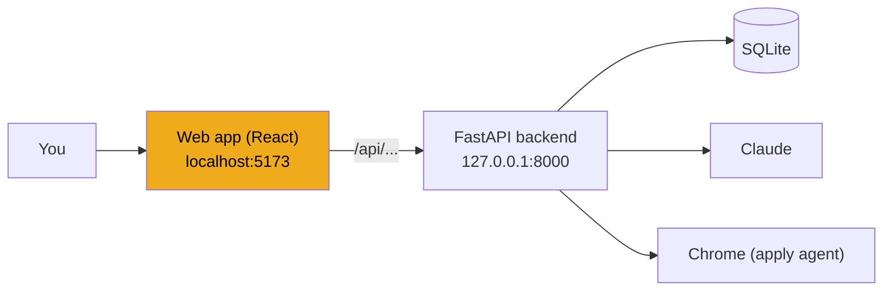
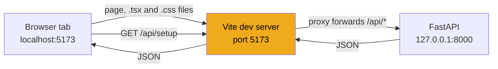
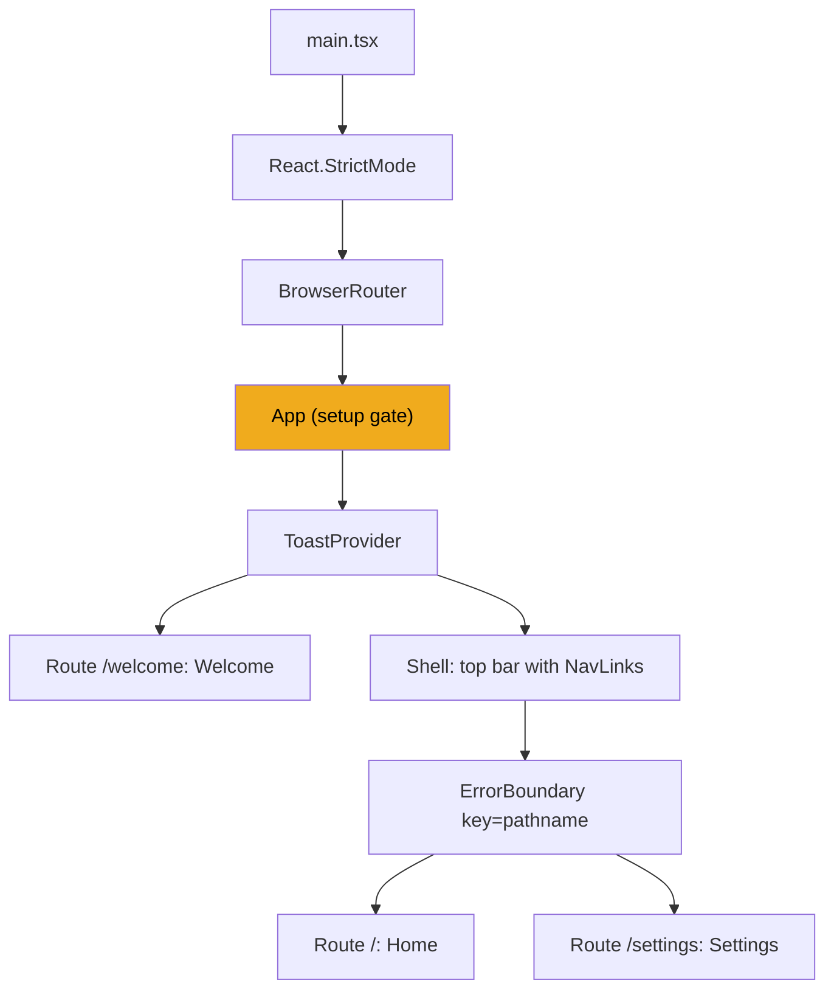

# Stage 24: Frontend basics

> **Goal:** Start the web app: a React + TypeScript project that runs in your browser, talks to your backend through `/api`, and sends you to a welcome page until setup is done.
>
> **By the end you will have:** a dev server at http://localhost:5173 with the final app shell (top bar, page routing, toast messages, error boxes), the complete stylesheet, a typed client for every backend endpoint, and three placeholder pages that the next stages replace.

## Where this fits

The backend is complete ([stage 23](23-api-actions-and-setup.md), Milestone 1). Until now you tried everything in `/docs`. From this stage on you build the second program: the web app that runs in your browser and calls the backend over HTTP.



## New ideas in plain words

This stage has more new ideas than any other. Read them once now, then come back to them while you build.

**Browser vs server.** The backend is a program on your PC that waits for requests. The frontend is code that the browser downloads and runs inside a tab. The browser can't read your database, your keyring or your files. It can only ask the backend over HTTP. That's why everything that matters in JobBee (Claude calls, secrets, Chrome, the database) lives in Python. The browser shows data and sends your clicks.

**HTML, CSS and JavaScript.** A web page has three layers:

| Layer | Job | Python-world comparison |
|---|---|---|
| HTML | What is on the page: headings, buttons, text boxes | The data structure |
| CSS | How it looks: colours, spacing, fonts, layout | A theme file |
| JavaScript (JS) | What happens: clicks, fetching data, changing the page | The program |

The browser keeps the page in memory as a tree of elements called the **DOM** (Document Object Model). JavaScript changes the page by changing that tree. Browsers only run JavaScript, so the TypeScript you write is turned into JavaScript first.

**Node.js and npm.** Node.js runs JavaScript outside a browser, the way `python` runs `.py` files. You won't write a Node server. You use Node only to run the build tools. **npm** is Node's package manager, the equivalent of pip.

| Python | Node / npm |
|---|---|
| `pyproject.toml` | `package.json` |
| `pip install -e ".[dev]"` | `npm install` |
| `.venv/` (this project's installed packages) | `node_modules/` |
| A pinned lock file | `package-lock.json` (commit it) |
| `python -m uvicorn ...` | `npm run dev` (runs a script named in `package.json`) |

**TypeScript.** TypeScript (TS) is JavaScript plus type annotations, like Python's type hints. The difference: Python ignores hints when it runs, while the TypeScript compiler (`tsc`) checks them **at build time** and refuses to build if they're wrong. Then the types are removed, and the browser runs plain JavaScript.

```python
def greet(name: str, times: int | None = None) -> str: ...
```

```ts
function greet(name: string, times: number | null = null): string { ... }
```

**A short JavaScript tour for Python people.** You'll see these in every file:

| TypeScript / JavaScript | Python equivalent |
|---|---|
| `const x = { a: 1, b: "hi" }` | `x = {"a": 1, "b": "hi"}`. An *object* works like a dict. Read it with `x.a` or `x["a"]`. |
| `let n = 0` | `n = 0`. `let` can be reassigned later. `const` can't. |
| `` `Hello ${name}` `` | `f"Hello {name}"` (a *template string*, with backticks) |
| `(x) => x * 2` | `lambda x: x * 2` (an *arrow function*). With `{ ... }` after the arrow it can hold several lines and a `return`. |
| `a === b`, `a !== b` | `a == b`, `a != b`. Use three `=` signs: two of them convert types first, so `"1" == 1` is true. The one common exception is `x == null`, which is true for both `null` and `undefined`. |
| `null`, `undefined` | `None`. JavaScript has two kinds of "nothing". `undefined` is what you get for a missing field. |
| `user?.name` | `user.name if user is not None else None` |
| `value ?? "default"` | `value if value is not None else "default"` |
| `a && b`, `a \|\| b`, `!a` | `a and b`, `a or b`, `not a` |
| `{ ...prefs, jobs: 5 }` | `{**prefs, "jobs": 5}` (a copy with one change) |
| `[...items, 4]` | `[*items, 4]` |
| `const { a, b } = x` | `a, b = x["a"], x["b"]` (*destructuring*) |
| `items.map((i) => i * 2)` | `[i * 2 for i in items]` |
| `items.filter((i) => i > 1)` | `[i for i in items if i > 1]` |
| `items.some((i) => i > 1)` | `any(i > 1 for i in items)` |
| `import { api } from "./api"` | `from .api import api` |
| `export function f() {}` | A public function other modules may import. Anything not exported stays private to its file. |

**Promises and `async`/`await`.** A *Promise* is a value that arrives later, like a Python coroutine you `await`. More exactly, it's like an `asyncio` task: the work has already started when you get it. `fetch(url)` (the browser's HTTP client) returns a Promise of a response. Inside an `async function` you write `await fetch(url)`, exactly as in Python's `async def`. You can also chain: `promise.then((value) => ...)` runs a function when the value arrives, and `.catch((error) => ...)` runs one if it fails.

**Vite.** Vite (French for "fast", said "veet") plays the role uvicorn `--reload` plays for the backend. In development it serves your files, turns TypeScript into JavaScript on the fly, and *hot reloads*: when you save a file, the page updates in place, often without losing what you typed. `vite build` produces the final optimised files in `dist/`.

**React.** React is a library for building a page out of **components**. A component is a function that returns a description of some UI, written in **JSX**, an HTML-like syntax inside TypeScript. Files that contain JSX end in `.tsx`.

```tsx
function Greeting({ name }: { name: string }) {
  const [count, setCount] = useState(0);
  return (
    <div className="card">
      <p>Hello {name}, you clicked {count} times.</p>
      <button onClick={() => setCount(count + 1)}>Click</button>
    </div>
  );
}
```

- **Props** are the component's arguments (`name` here). A parent passes them like HTML attributes: `<Greeting name="Ada" />`. The `{ name }: { name: string }` part destructures them and gives their type.
- **State** (`useState`) is the component's memory. `count` is the current value. `setCount` stores a new one.
- **Re-rendering.** When state changes, React calls the function again and updates the page to match the new JSX. Ordinary variables inside the function are recalculated on every call. Only state survives between calls.
- **Effects** (`useEffect`) run code *after* React has drawn the page, for example loading data: `useEffect(() => { load(); }, [])`. The list at the end is the *dependency list*: React runs the effect again whenever a value in it changes. An empty list means "once, after the first render". An effect may return a *cleanup* function, which React calls before running the effect again and when the component disappears.
- **JSX details.** Write `className` instead of `class` (a reserved word in JavaScript). Put any expression inside `{...}`. Pass styles as an object: `style={{ marginTop: 8 }}`. `{cond && <p>Hi</p>}` shows the paragraph only when `cond` is true.

Functions whose names start with `use` (`useState`, `useEffect`, and your own, like `useAction` in this stage) are called **hooks**. React's one strict rule: call hooks at the top level of a component, never inside an `if` or a loop. React tells the hooks apart by their order, so the order must be the same on every render.

**Single-page app and client-side routing.** The browser loads one HTML page, once. After that, React swaps what's on screen when you click a link, without asking the server for a new page. That's a *single-page app* (SPA). The library **react-router** keeps the address bar in sync (`/`, `/settings`, `/welcome`) and picks the component to show for each address. The Back and Forward buttons still work.

**The `/api` proxy, and why it avoids CORS.** Browsers have a safety rule called the *same-origin policy*. An *origin* is the scheme, host and port of a page, like `http://localhost:5173`. A page from one origin may not read responses from another origin (`http://127.0.0.1:8000`) unless that server opts in with special headers. That opt-in is called **CORS** (Cross-Origin Resource Sharing). Vite sidesteps the whole problem. The browser only ever talks to Vite, and Vite forwards every request whose path starts with `/api` to FastAPI behind the scenes. The browser sees one origin, so there's nothing to block. Server-to-server requests aren't subject to the browser's rule at all.



## Build it, step by step

All the files of this stage live in `frontend/`, next to `backend/`:

```text
my-jobbee/
  backend/          stages 1-23
  frontend/
    package.json    step 1
    tsconfig.json   step 2
    vite.config.ts  step 3
    index.html      step 4
    src/
      main.tsx      step 5
      styles.css    step 6
      api.ts        step 7
      components/   Icon, Toast, ErrorBoundary (steps 8-10); more in stages 25-28
      lib/          format.ts (step 11)
      pages/        Home, Settings, Welcome (placeholders, steps 12-14)
      App.tsx       step 15
```

### Step 1: The project file, `frontend/package.json`

`package.json` is the frontend's `pyproject.toml`. It names the project, lists the packages it needs, and defines short commands called *scripts*.

<!-- code: frontend/package.json -->
**`frontend/package.json`** (whole file, 24 lines)

```json
{
  "name": "jobbee-frontend",
  "private": true,
  "version": "0.1.0",
  "type": "module",
  "scripts": {
    "dev": "vite",
    "build": "tsc -b && vite build",
    "preview": "vite preview",
    "lint": "tsc -b --noEmit"
  },
  "dependencies": {
    "react": "^18.3.1",
    "react-dom": "^18.3.1",
    "react-router-dom": "^6.26.2"
  },
  "devDependencies": {
    "@types/react": "^18.3.5",
    "@types/react-dom": "^18.3.0",
    "@vitejs/plugin-react": "^4.3.1",
    "typescript": "^5.5.4",
    "vite": "^5.4.6"
  }
}
```
<!-- /code -->

- **`"private": true`** stops npm from ever publishing this folder as a public package.
- **`"type": "module"`** tells Node to read `.js` files with the modern `import`/`export` syntax.
- **`^18.3.1`** means "18.3.1 or any newer 18.x". It's like `>=18.3.1,<19` in Python. `package-lock.json`, which `npm install` writes, records the exact versions it installed.

The three **dependencies** end up in the code your browser runs:

| Package | What it does |
|---|---|
| `react` | Components, state and hooks |
| `react-dom` | Draws React components into the browser's DOM |
| `react-router-dom` | Client-side routing: `<Routes>`, `<Link>`, `<Navigate>` |

The five **devDependencies** are only needed while you develop and build, like the `dev` extras in `pyproject.toml`:

| Package | What it does |
|---|---|
| `@types/react`, `@types/react-dom` | Type descriptions for React, so TypeScript knows what `useState` returns. React itself ships plain JavaScript. |
| `@vitejs/plugin-react` | Teaches Vite about React: JSX, plus *Fast Refresh*, which keeps component state during a hot reload |
| `typescript` | The `tsc` type checker |
| `vite` | The dev server and build tool |

The **scripts** are shortcuts you run with `npm run <name>`:

| Script | Runs | Use it to |
|---|---|---|
| `dev` | `vite` | Start the dev server with hot reload |
| `build` | `tsc -b && vite build` | Type-check everything, then build `dist/`. `&&` means the second command runs only if the first succeeded, so a type error stops the build. |
| `preview` | `vite preview` | Serve the built `dist/` folder to try it |
| `lint` | `tsc -b --noEmit` | Type-check only |

Install the packages now, from the `frontend` folder:

```powershell
cd frontend
npm install
```

If PowerShell answers *"npm.ps1 cannot be loaded because running scripts is disabled on this system"*, type `npm.cmd` instead of `npm` (`npm.cmd install`, `npm.cmd run dev`). PowerShell blocks script files by default, and `npm` is one; `npm.cmd` is the same program as a plain command file.

This creates `node_modules/` (the installed packages, like `.venv/`) and `package-lock.json`. Make sure your `.gitignore` lists `node_modules/` and `dist/`. Commit `package-lock.json`.

### Step 2: TypeScript settings, `frontend/tsconfig.json`

This file tells `tsc` how strict to be and what kind of code it's checking.

<!-- code: frontend/tsconfig.json -->
**`frontend/tsconfig.json`** (whole file, 23 lines)

```json
{
  "compilerOptions": {
    "target": "ES2022",
    "useDefineForClassFields": true,
    "lib": ["ES2022", "DOM", "DOM.Iterable"],
    "module": "ESNext",
    "skipLibCheck": true,
    "moduleResolution": "Bundler",
    "allowImportingTsExtensions": true,
    "resolveJsonModule": true,
    "isolatedModules": true,
    "moduleDetection": "force",
    "noEmit": true,
    "jsx": "react-jsx",
    "strict": true,
    "noUnusedLocals": true,
    "noUnusedParameters": true,
    "noFallthroughCasesInSwitch": true,
    "esModuleInterop": true,
    "forceConsistentCasingInFileNames": true
  },
  "include": ["src"]
}
```
<!-- /code -->

The options that change how you write code:

| Option | Why |
|---|---|
| `strict: true` | Turns on TypeScript's strict checks. The big one: a value typed `string \| null` can't be used as a `string` until you've checked it isn't `null`. This catches the JavaScript version of `'NoneType' object has no attribute ...` before you run anything. |
| `noUnusedLocals`, `noUnusedParameters` | A variable or parameter you never use is an error. It keeps leftovers out of the code. |
| `noFallthroughCasesInSwitch` | Stops one `case` of a `switch` statement from silently running into the next one. |
| `jsx: "react-jsx"` | Lets you write JSX in `.tsx` files without importing React in each one. |
| `noEmit: true` | `tsc` only checks types and writes no JavaScript. Vite does the real compiling. |
| `lib: ["ES2022", "DOM", "DOM.Iterable"]` | Includes the types for modern JavaScript and for browser objects like `document`, `window` and `fetch`. |
| `include: ["src"]` | Check only the `src/` folder. |

The rest tune module handling for Vite: `target`/`module` say which JavaScript version to expect, `moduleResolution: "Bundler"` resolves imports the way Vite does, `isolatedModules` makes sure every file can be compiled on its own (which is how Vite works), `skipLibCheck` skips type-checking the packages in `node_modules`, and `forceConsistentCasingInFileNames` catches `./icon` vs `./Icon` mistakes that work on Windows but break on Linux.

### Step 3: The dev server and the proxy, `frontend/vite.config.ts`

<!-- code: frontend/vite.config.ts -->
**`frontend/vite.config.ts`** (whole file, 16 lines)

```ts
import { defineConfig } from "vite";
import react from "@vitejs/plugin-react";

// Proxies /api to the FastAPI dev server so the frontend can use same-origin paths.
export default defineConfig({
  plugins: [react()],
  server: {
    port: 5173,
    proxy: {
      "/api": {
        target: "http://127.0.0.1:8000",
        changeOrigin: true,
      },
    },
  },
});
```
<!-- /code -->

- **`plugins: [react()]`** switches on the React plugin from step 1.
- **`port: 5173`** is Vite's usual port. The backend's CORS settings in `main.py` (stage 23) and its `frontend_url` setting (used by the Gmail sign-in in stage 13) expect it.
- **`proxy`** says: any request whose path starts with `/api` goes to the backend. Everything else (the page, your `.tsx` files) Vite serves itself. This works because every backend endpoint lives under `/api`.
- **`target`** uses `127.0.0.1`, not `localhost`. Uvicorn listens on the IPv4 address `127.0.0.1`. On some machines Node resolves `localhost` to the IPv6 address `::1` first, where nothing is listening.
- **`changeOrigin: true`** rewrites the forwarded request's `Host` header, so it looks as if it was sent to the backend directly.
- **`export default`** makes this object the file's main export, which is what Vite reads.

The proxy exists only in the dev server. That's fine for JobBee, which always runs this way on your PC.

### Step 4: The one HTML page, `frontend/index.html`

A single-page app has exactly one HTML file. React fills it in.

<!-- code: frontend/index.html -->
**`frontend/index.html`** (whole file, 23 lines)

```html
<!doctype html>
<html lang="en">
  <head>
    <meta charset="UTF-8" />
    <meta name="viewport" content="width=device-width, initial-scale=1.0" />
    <meta name="theme-color" content="#f0ab1d" />
    <link
      rel="icon"
      href="data:image/svg+xml,%3Csvg xmlns='http://www.w3.org/2000/svg' viewBox='0 0 32 32'%3E%3Cpath d='M16 2.5l11.7 6.75v13.5L16 29.5 4.3 22.75V9.25z' fill='%23f0ab1d'/%3E%3Cpath d='M11 13.5h10M10 17.5h12M11.5 21.5h9' stroke='%232e2100' stroke-width='2.4' stroke-linecap='round'/%3E%3C/svg%3E"
    />
    <link rel="preconnect" href="https://fonts.googleapis.com" />
    <link rel="preconnect" href="https://fonts.gstatic.com" crossorigin />
    <link
      href="https://fonts.googleapis.com/css2?family=Inter:wght@400;500;600;700&display=swap"
      rel="stylesheet"
    />
    <title>JobBee</title>
  </head>
  <body>
    <div id="root"></div>
    <script type="module" src="/src/main.tsx"></script>
  </body>
</html>
```
<!-- /code -->

- **`<head>`** holds information about the page, not visible content. `charset` and `viewport` make text and phone screens behave. `theme-color` tints the browser bar honey on phones.
- **The icon** (`rel="icon"`) is the honeycomb shown in the browser tab. It's an SVG image written straight into the address (a `data:` URL), so there's no image file to manage.
- **The two `preconnect` links and the stylesheet link** load the Inter font from Google Fonts. Without internet the page falls back to your system font (step 6 lists the fallbacks).
- **`<div id="root"></div>`** is the empty box React draws into.
- **`<script type="module" src="/src/main.tsx">`** loads the first file of your code. A browser can't run `.tsx` itself. Vite turns it into JavaScript when the browser asks for it.

### Step 5: The entry point, `frontend/src/main.tsx`

This is the first code that runs. It finds the empty `<div id="root">` and asks React to draw the app inside it.

<!-- code: frontend/src/main.tsx -->
**`frontend/src/main.tsx`** (whole file, 13 lines)

```tsx
import React from "react";
import ReactDOM from "react-dom/client";
import { BrowserRouter } from "react-router-dom";
import App from "./App";
import "./styles.css";

ReactDOM.createRoot(document.getElementById("root")!).render(
  <React.StrictMode>
    <BrowserRouter>
      <App />
    </BrowserRouter>
  </React.StrictMode>,
);
```
<!-- /code -->

- **`document.getElementById("root")!`** finds the div. The `!` tells TypeScript "this isn't null, trust me". Without it, strict mode complains that the element might be missing.
- **`import "./styles.css"`** loads the stylesheet. Vite knows how to bundle CSS that a script imports.
- **`BrowserRouter`** watches the address bar and lets any component inside it read and change the URL. It must wrap `App`, because `App` uses routing hooks.
- **`React.StrictMode`** is a development helper. It renders each component twice and runs each effect, cleans it up, and runs it again. An effect that forgets to clean up (a timer that keeps running, say) shows its bug at once instead of weeks later. The visible side effect: in `npm run dev`, every startup request appears **twice** in the browser's Network tab. That's expected. A production build runs effects once.

### Step 6: The stylesheet, `frontend/src/styles.css`

Every component in stages 24–28 uses classes from this one file, so you type it all now. It's long (about 1,800 lines), but it's simple. You don't need to understand every line. Read the explanation of each part, type or paste it, and come back when a component uses a class you want to look up.

Four CSS ideas cover almost everything here:

- **A rule** is a *selector* and some *properties*: `.card { padding: 20px; }` gives every element with `className="card"` 20 pixels of padding. `.notice.bad` means "has both classes". `.nav a` means "an `a` link inside `.nav`".
- **Variables** (*custom properties*) are named values: `--accent: #f0ab1d;` defines one, `var(--accent)` uses it.
- **Flexbox** lays children out in a line. `display: flex` puts them in a row, `flex-direction: column` stacks them, `gap` sets the space between them, and `flex: 1` lets one child take the leftover space. **Grid** (`display: grid`) does the same in rows *and* columns.
- **Media queries** (`@media (...) { ... }`) apply rules only under a condition, such as a dark operating system theme or a narrow screen.

#### Part 1: Design tokens

<!-- code: frontend/src/styles.css lines=1-41 -->
**`frontend/src/styles.css`** (lines 1–41 of 1831)

```css
/* JobBee — calm, warm, one accent (honey). Light by default, dark follows the OS. */

:root {
  --bg: #f7f6f2;
  --surface: #ffffff;
  --surface-2: #f3f1ec;
  --surface-3: #ebe8e1;
  --border: #e5e1d8;
  --border-strong: #d6d1c5;
  --text: #1e1c17;
  --text-2: #57524a;
  --text-3: #8b8578;

  --accent: #f0ab1d;
  --accent-hover: #e39c0c;
  --accent-ink: #2e2100;
  --accent-soft: #fdf2d8;
  --accent-line: #f3d48a;

  --ok: #1d8049;
  --ok-soft: #e4f3ea;
  --warn: #a8650a;
  --warn-soft: #fdf0d7;
  --bad: #be3a26;
  --bad-soft: #fbe7e3;
  --info: #2f66d0;
  --info-soft: #e7eefb;

  --radius: 16px;
  --radius-md: 12px;
  --radius-sm: 8px;
  --shadow: 0 1px 2px rgba(30, 28, 23, 0.04), 0 4px 16px rgba(30, 28, 23, 0.04);
  --shadow-lg: 0 12px 40px rgba(30, 28, 23, 0.16);
  --ring: 0 0 0 3px rgba(240, 171, 29, 0.35);

  --font: "Inter", ui-sans-serif, system-ui, -apple-system, "Segoe UI", Roboto, sans-serif;
  --mono: ui-monospace, "Cascadia Code", "SF Mono", Consolas, monospace;

  color-scheme: light;
}

```
<!-- /code -->

These variables are the app's *design tokens*: every colour, corner radius, shadow and font, defined once on `:root` (the whole page). Every other rule refers to them by name. There are layered surface colours (`--bg` behind everything, `--surface` for cards, `--surface-2` and `-3` for shaded areas), three text shades from dark to faint, the honey accent with its hover, ink and soft variants, and four status colours (`ok` green, `warn` amber, `bad` red, `info` blue), each with a pale `-soft` background. `--ring` is the honey glow around a focused control. `color-scheme: light` tells the browser to draw its own parts (scrollbars, date pickers) light.

#### Part 2: Dark mode and base elements

<!-- code: frontend/src/styles.css lines=42-119 -->
**`frontend/src/styles.css`** (lines 42–119 of 1831)

```css
@media (prefers-color-scheme: dark) {
  :root {
    --bg: #12110f;
    --surface: #1b1a17;
    --surface-2: #22201c;
    --surface-3: #2b2924;
    --border: #2e2b26;
    --border-strong: #3b3832;
    --text: #f2efe8;
    --text-2: #bdb6a8;
    --text-3: #8a8476;

    --accent: #f5b636;
    --accent-hover: #ffc54f;
    --accent-ink: #261b00;
    --accent-soft: #33280f;
    --accent-line: #5a4517;

    --ok: #4cc47f;
    --ok-soft: #16301f;
    --warn: #f0b04a;
    --warn-soft: #362812;
    --bad: #f07a63;
    --bad-soft: #3a1c16;
    --info: #7aa7ff;
    --info-soft: #182540;

    --shadow: 0 1px 2px rgba(0, 0, 0, 0.3);
    --shadow-lg: 0 16px 48px rgba(0, 0, 0, 0.5);
    color-scheme: dark;
  }
}

* {
  box-sizing: border-box;
}

html,
body {
  margin: 0;
  background: var(--bg);
  color: var(--text);
  font-family: var(--font);
  font-size: 15px;
  line-height: 1.5;
  -webkit-font-smoothing: antialiased;
}

a {
  color: inherit;
}

h1,
h2,
h3 {
  margin: 0;
  letter-spacing: -0.01em;
}

h1 {
  font-size: 26px;
  font-weight: 700;
}

h2 {
  font-size: 18px;
  font-weight: 650;
}

h3 {
  font-size: 15px;
  font-weight: 650;
}

p {
  margin: 0;
}

```
<!-- /code -->

- **Dark mode costs almost nothing.** `@media (prefers-color-scheme: dark)` applies only when your operating system uses a dark theme, and it only redefines the variables. Every rule that says `background: var(--bg)` changes colour by itself.
- **`* { box-sizing: border-box }`** makes an element's width include its padding and border, so `width: 100%` never overflows. Almost every modern stylesheet starts with it.
- **`html, body`** set the page background, text colour and the base font: Inter at 15 pixels.
- **Headings and paragraphs** lose the browser's default margins. Components set their own spacing, so the defaults would only get in the way.

#### Part 3: The shell

<!-- code: frontend/src/styles.css lines=120-244 -->
**`frontend/src/styles.css`** (lines 120–244 of 1831)

```css
/* ---------- shell ---------- */

.app {
  min-height: 100vh;
  display: flex;
  flex-direction: column;
}

.topbar {
  position: sticky;
  top: 0;
  z-index: 20;
  background: color-mix(in srgb, var(--bg) 86%, transparent);
  backdrop-filter: blur(10px);
  border-bottom: 1px solid var(--border);
}

.topbar-inner {
  max-width: 920px;
  margin: 0 auto;
  padding: 10px 20px;
  display: flex;
  align-items: center;
  gap: 18px;
}

.brand {
  display: flex;
  align-items: center;
  gap: 9px;
  text-decoration: none;
  font-weight: 750;
  font-size: 17px;
  letter-spacing: -0.02em;
}

.brand-mark {
  width: 28px;
  height: 28px;
  color: var(--accent);
}

.nav {
  display: flex;
  gap: 4px;
  margin-left: 8px;
}

.nav a {
  text-decoration: none;
  color: var(--text-2);
  padding: 6px 12px;
  border-radius: 999px;
  font-weight: 550;
  font-size: 14px;
}

.nav a:hover {
  color: var(--text);
  background: var(--surface-2);
}

.nav a.active {
  color: var(--text);
  background: var(--surface-3);
}

.topbar-spacer {
  flex: 1;
}

.main {
  flex: 1;
  width: 100%;
  max-width: 760px;
  margin: 0 auto;
  padding: 28px 20px 80px;
}

.main.narrow {
  max-width: 600px;
}

.page-head {
  display: flex;
  align-items: flex-end;
  justify-content: space-between;
  gap: 12px;
  margin-bottom: 20px;
}

.section {
  margin-top: 36px;
}

.section-head {
  display: flex;
  align-items: center;
  gap: 10px;
  margin-bottom: 12px;
}

.section-head h2 {
  font-size: 16px;
}

.count {
  display: inline-flex;
  min-width: 22px;
  height: 22px;
  padding: 0 7px;
  align-items: center;
  justify-content: center;
  border-radius: 999px;
  background: var(--accent);
  color: var(--accent-ink);
  font-size: 12px;
  font-weight: 700;
}

.count.muted {
  background: var(--surface-3);
  color: var(--text-2);
}

```
<!-- /code -->

The *shell* is the frame around every page, which `App.tsx` builds in step 15:

- **`.app`** is a full-height column. **`.topbar`** sticks to the top while you scroll (`position: sticky`). Its background is the page colour mixed with transparency (`color-mix`) and blurred, so content slides under it softly. `z-index: 20` keeps it above the page content.
- **`.topbar-inner`**, **`.brand`**, **`.brand-mark`** lay out the logo, and **`.nav a`** turns the Home and Settings links into rounded pills. **`.nav a.active`** highlights the current page. react-router adds the `active` class for you.
- **`.main`** is the 760-pixel-wide column every page sits in, centred with `margin: 0 auto`.
- **`.page-head`**, **`.section`** and **`.section-head`** space out page titles and sections. **`.count`** is the honey number pill next to "Needs you".

#### Part 4: Surfaces, layout helpers and text

<!-- code: frontend/src/styles.css lines=245-340 -->
**`frontend/src/styles.css`** (lines 245–340 of 1831)

```css
/* ---------- surfaces ---------- */

.card {
  background: var(--surface);
  border: 1px solid var(--border);
  border-radius: var(--radius);
  box-shadow: var(--shadow);
  padding: 20px;
}

.card + .card {
  margin-top: 12px;
}

.stack {
  display: flex;
  flex-direction: column;
  gap: 12px;
}

.stack.tight {
  gap: 6px;
}

.row {
  display: flex;
  align-items: center;
  gap: 10px;
  flex-wrap: wrap;
}

.row.between {
  justify-content: space-between;
}

.row.nowrap {
  flex-wrap: nowrap;
}

.grow {
  flex: 1;
  min-width: 0;
}

.divider {
  height: 1px;
  background: var(--border);
  margin: 16px 0;
  border: 0;
}

/* ---------- text ---------- */

.muted {
  color: var(--text-2);
}

.faint {
  color: var(--text-3);
}

.small {
  font-size: 13px;
}

.tiny {
  font-size: 12px;
}

.strong {
  font-weight: 650;
}

.truncate {
  overflow: hidden;
  text-overflow: ellipsis;
  white-space: nowrap;
}

.code {
  font-family: var(--mono);
  font-size: 0.9em;
  background: var(--surface-2);
  border: 1px solid var(--border);
  border-radius: 6px;
  padding: 1px 6px;
}

.eyebrow {
  font-size: 12px;
  font-weight: 650;
  text-transform: uppercase;
  letter-spacing: 0.06em;
  color: var(--text-3);
}

```
<!-- /code -->

- **`.card`** is the white box with a border, rounded corners and a faint shadow that most content sits in. **`.card + .card`** means "a card that directly follows another card" and adds space between them.
- **Layout helpers** save writing the same flexbox rules everywhere. **`.stack`** is a vertical column with a gap. **`.row`** is a horizontal row that wraps; `.between` pushes its items to the two ends, and `.nowrap` stops wrapping. **`.grow`** takes the leftover space. Its `min-width: 0` matters: without it, long text inside a flex child refuses to shrink and can't be cut off.
- **Text helpers.** `.muted` and `.faint` are the second and third text shades. `.small`, `.tiny` and `.strong` change size and weight. `.truncate` cuts a long line with "…". `.code` is monospace on a grey background. `.eyebrow` is the small uppercase label above a heading, like "LOOKING FOR".

#### Part 5: Buttons

<!-- code: frontend/src/styles.css lines=341-457 -->
**`frontend/src/styles.css`** (lines 341–457 of 1831)

```css
/* ---------- buttons ---------- */

button,
.btn {
  font: inherit;
  font-size: 14px;
  font-weight: 600;
  display: inline-flex;
  align-items: center;
  justify-content: center;
  gap: 7px;
  height: 38px;
  padding: 0 16px;
  border-radius: 10px;
  border: 1px solid var(--border-strong);
  background: var(--surface);
  color: var(--text);
  cursor: pointer;
  text-decoration: none;
  white-space: nowrap;
  transition:
    background 0.12s,
    border-color 0.12s,
    transform 0.05s;
}

button:hover:not(:disabled),
.btn:hover {
  background: var(--surface-2);
}

button:active:not(:disabled) {
  transform: translateY(1px);
}

button:focus-visible,
.btn:focus-visible,
input:focus-visible,
textarea:focus-visible,
select:focus-visible {
  outline: none;
  box-shadow: var(--ring);
}

button:disabled {
  opacity: 0.5;
  cursor: default;
}

.primary {
  background: var(--accent);
  border-color: var(--accent);
  color: var(--accent-ink);
}

.primary:hover:not(:disabled) {
  background: var(--accent-hover);
  border-color: var(--accent-hover);
}

.ghost {
  background: transparent;
  border-color: transparent;
  color: var(--text-2);
}

.ghost:hover:not(:disabled) {
  background: var(--surface-2);
  color: var(--text);
}

.danger {
  color: var(--bad);
}

.btn-sm,
button.sm {
  height: 30px;
  padding: 0 11px;
  font-size: 13px;
  border-radius: 8px;
}

.btn-lg,
button.lg {
  height: 46px;
  padding: 0 22px;
  font-size: 15px;
  border-radius: 12px;
}

.link {
  background: none;
  border: none;
  height: auto;
  padding: 0;
  color: var(--text-2);
  font-weight: 550;
  text-decoration: underline;
  text-underline-offset: 3px;
  text-decoration-color: var(--border-strong);
}

.link:hover:not(:disabled) {
  background: none;
  color: var(--text);
}

.icon-btn {
  width: 34px;
  height: 34px;
  padding: 0;
  border-color: transparent;
  background: transparent;
  color: var(--text-2);
}

```
<!-- /code -->

- **One base look.** Every `<button>`, and every link with `className="btn"`, gets the same height, padding, border and font. That way a link like **View CV** looks exactly like a button.
- **States.** `:hover:not(:disabled)` darkens only buttons you can press. `:active` nudges the button down one pixel while you click. `:focus-visible` draws the honey ring when you reach a control with the keyboard (Tab), not when you click it with the mouse. `:disabled` fades the button to half opacity.
- **Variants** are extra classes: `primary` (honey, the main action), `ghost` (transparent, a quiet action), `danger` (red text). **Sizes:** `sm` and `lg` (or `btn-sm` and `btn-lg` on links).
- **`.link`** makes a button look like an underlined text link. **`.icon-btn`** is a square button holding only an icon, like the drawer's ×.

#### Part 6: Form controls

<!-- code: frontend/src/styles.css lines=458-588 -->
**`frontend/src/styles.css`** (lines 458–588 of 1831)

```css
/* ---------- forms ---------- */

input,
textarea,
select {
  font: inherit;
  font-size: 14px;
  width: 100%;
  min-height: 40px;
  padding: 8px 12px;
  color: var(--text);
  background: var(--surface);
  border: 1px solid var(--border-strong);
  border-radius: 10px;
}

textarea {
  resize: vertical;
  line-height: 1.45;
}

input::placeholder,
textarea::placeholder {
  color: var(--text-3);
}

.field {
  display: flex;
  flex-direction: column;
  gap: 6px;
  min-width: 0;
}

.field > label,
.label {
  font-size: 13px;
  font-weight: 600;
  color: var(--text-2);
}

.hint {
  font-size: 12px;
  color: var(--text-3);
}

.fields {
  display: grid;
  grid-template-columns: 1fr 1fr;
  gap: 14px 16px;
}

.fields .full {
  grid-column: 1 / -1;
}

.input-row {
  display: flex;
  gap: 8px;
}

.input-row input {
  flex: 1;
}

.segmented {
  display: inline-flex;
  padding: 3px;
  gap: 3px;
  background: var(--surface-2);
  border: 1px solid var(--border);
  border-radius: 11px;
  flex-wrap: wrap;
}

.segmented button {
  height: 32px;
  border: none;
  background: transparent;
  color: var(--text-2);
  font-weight: 550;
  border-radius: 8px;
  padding: 0 14px;
}

.segmented button.on {
  background: var(--surface);
  color: var(--text);
  box-shadow: var(--shadow);
}

.switch {
  position: relative;
  width: 40px;
  height: 24px;
  padding: 0;
  border-radius: 999px;
  background: var(--surface-3);
  border: 1px solid var(--border-strong);
  flex-shrink: 0;
}

.switch::after {
  content: "";
  position: absolute;
  top: 2px;
  left: 2px;
  width: 18px;
  height: 18px;
  border-radius: 50%;
  background: var(--surface);
  box-shadow: 0 1px 3px rgba(0, 0, 0, 0.25);
  transition: transform 0.15s;
}

.switch.on {
  background: var(--accent);
  border-color: var(--accent);
}

.switch.on::after {
  transform: translateX(16px);
}

.switch:hover:not(:disabled) {
  background: var(--surface-3);
}

.switch.on:hover:not(:disabled) {
  background: var(--accent-hover);
}

```
<!-- /code -->

- **`input, textarea, select`** share one look, full width, with faint placeholder text.
- **`.field`** stacks a label above its control, and **`.hint`** is the small grey help line under it. **`.fields`** is a two-column grid of fields (`grid-template-columns: 1fr 1fr` means two equal columns); a field with `.full` spans both.
- **`.input-row`** puts a text box and a button side by side, like the "Paste a job link" box.
- **`.segmented`** is a row of toggle buttons in a grey tray, like Remote / Hybrid / On-site. The chosen ones get the class `on`.
- **`.switch`** is an on/off toggle drawn entirely in CSS. The `::after` *pseudo-element* (an extra box CSS adds after the element's content) draws the round knob. When the button has class `on`, the background turns honey and `transform: translateX(16px)` slides the knob right. `transition` animates the slide.

#### Part 7: Chips and tags

<!-- code: frontend/src/styles.css lines=589-674 -->
**`frontend/src/styles.css`** (lines 589–674 of 1831)

```css
/* chip input (roles, locations, companies) */
.chips-input {
  display: flex;
  flex-wrap: wrap;
  gap: 6px;
  align-items: center;
  min-height: 42px;
  padding: 5px 6px;
  background: var(--surface);
  border: 1px solid var(--border-strong);
  border-radius: 10px;
  cursor: text;
}

.chips-input:focus-within {
  box-shadow: var(--ring);
}

.chips-input input {
  flex: 1;
  min-width: 120px;
  min-height: 30px;
  border: none;
  padding: 2px 6px;
  background: transparent;
}

.chips-input input:focus-visible {
  box-shadow: none;
}

.chip {
  display: inline-flex;
  align-items: center;
  gap: 4px;
  height: 28px;
  padding: 0 6px 0 10px;
  border-radius: 999px;
  background: var(--accent-soft);
  border: 1px solid var(--accent-line);
  color: var(--text);
  font-size: 13px;
  font-weight: 550;
}

.chip button {
  width: 20px;
  height: 20px;
  padding: 0;
  border: none;
  background: transparent;
  color: var(--text-2);
  border-radius: 50%;
}

.chip button:hover:not(:disabled) {
  background: color-mix(in srgb, var(--accent) 25%, transparent);
}

.tag {
  display: inline-flex;
  align-items: center;
  gap: 5px;
  height: 24px;
  padding: 0 9px;
  border-radius: 999px;
  background: var(--surface-2);
  border: 1px solid var(--border);
  color: var(--text-2);
  font-size: 12.5px;
  font-weight: 550;
  white-space: nowrap;
}

.option-chips {
  display: flex;
  flex-wrap: wrap;
  gap: 8px;
}

.option-chips button {
  height: 34px;
  border-radius: 999px;
  font-weight: 550;
}

```
<!-- /code -->

- **`.chips-input`** looks like a text box but holds removable chips plus a small borderless input (stage 25's `ChipInput`). `:focus-within` draws the focus ring on the whole box when the input inside it has focus.
- **`.chip`** is a honey pill with a small round × button.
- **`.tag`** is a grey pill, used for the skills in the resume summary.
- **`.option-chips`** isn't used by any component today. It's a harmless leftover.

#### Part 8: Badges, notices, icons, spinner and skeletons

<!-- code: frontend/src/styles.css lines=675-811 -->
**`frontend/src/styles.css`** (lines 675–811 of 1831)

```css
/* ---------- badges + notices ---------- */

.badge {
  display: inline-flex;
  align-items: center;
  gap: 6px;
  height: 24px;
  padding: 0 9px;
  border-radius: 999px;
  font-size: 12.5px;
  font-weight: 650;
  background: var(--surface-2);
  color: var(--text-2);
  white-space: nowrap;
}

.badge.ok {
  background: var(--ok-soft);
  color: var(--ok);
}

.badge.warn {
  background: var(--warn-soft);
  color: var(--warn);
}

.badge.bad {
  background: var(--bad-soft);
  color: var(--bad);
}

.badge.info {
  background: var(--info-soft);
  color: var(--info);
}

.badge.accent {
  background: var(--accent-soft);
  color: var(--warn);
}

.dot {
  width: 8px;
  height: 8px;
  border-radius: 50%;
  background: currentColor;
  flex-shrink: 0;
}

.dot.pulse {
  animation: pulse 1.6s ease-in-out infinite;
}

@keyframes pulse {
  50% {
    opacity: 0.35;
  }
}

.notice {
  display: flex;
  gap: 10px;
  align-items: flex-start;
  padding: 11px 14px;
  border-radius: var(--radius-md);
  font-size: 14px;
  background: var(--surface-2);
  border: 1px solid var(--border);
}

.notice.ok {
  background: var(--ok-soft);
  border-color: transparent;
}

.notice.bad {
  background: var(--bad-soft);
  border-color: transparent;
}

.notice.warn {
  background: var(--warn-soft);
  border-color: transparent;
}

.notice.info {
  background: var(--info-soft);
  border-color: transparent;
}

.notice .icon {
  margin-top: 2px;
  flex-shrink: 0;
}

/* ---------- icons + spinner ---------- */

.icon {
  width: 16px;
  height: 16px;
  flex-shrink: 0;
}

.icon.lg {
  width: 20px;
  height: 20px;
}

.spinner {
  width: 16px;
  height: 16px;
  border-radius: 50%;
  border: 2px solid var(--border-strong);
  border-top-color: var(--accent);
  animation: spin 0.8s linear infinite;
  flex-shrink: 0;
}

@keyframes spin {
  to {
    transform: rotate(360deg);
  }
}

.skeleton {
  border-radius: 6px;
  background: linear-gradient(90deg, var(--surface-2), var(--surface-3), var(--surface-2));
  background-size: 200% 100%;
  animation: shimmer 1.4s ease-in-out infinite;
}

@keyframes shimmer {
  to {
    background-position: -200% 0;
  }
}

```
<!-- /code -->

- **`.badge`** is a small rounded label like "New match" or "Applied". The variants `ok`, `warn`, `bad`, `info` and `accent` colour it.
- **`.dot`** is a small coloured circle. With `.pulse` it fades in and out forever. `@keyframes pulse` defines the animation: at the halfway point (`50%`) the dot is 35% visible.
- **`.notice`** is a message box with an icon. Its variants `ok`, `bad`, `warn` and `info` change the background.
- **`.icon`** sizes the line icons from step 8 to 16 pixels (20 with `.lg`).
- **`.spinner`** is a circle with one honey edge, turned forever by `@keyframes spin`.
- **`.skeleton`** is a grey placeholder shape with a moving shimmer. Pages show skeletons while their data loads, so the layout doesn't jump when it arrives.

#### Part 9: The agent bar

<!-- code: frontend/src/styles.css lines=812-870 -->
**`frontend/src/styles.css`** (lines 812–870 of 1831)

```css
/* ---------- agent bar ---------- */

.agent-bar {
  padding: 22px;
}

.agent-looking {
  font-size: 19px;
  font-weight: 650;
  letter-spacing: -0.01em;
  line-height: 1.35;
}

.agent-meta {
  display: flex;
  flex-wrap: wrap;
  gap: 6px 14px;
  color: var(--text-2);
  font-size: 13.5px;
}

.agent-meta span {
  display: inline-flex;
  align-items: center;
  gap: 6px;
}

.agent-actions {
  display: flex;
  gap: 10px;
  margin-top: 16px;
}

.agent-actions .link-input {
  flex: 1;
}

.status-pill {
  display: inline-flex;
  align-items: center;
  gap: 7px;
  height: 32px;
  padding: 0 12px;
  border-radius: 999px;
  font-size: 13px;
  font-weight: 600;
  border: 1px solid var(--border);
  background: var(--surface);
  color: var(--ok);
}

.status-pill.paused {
  color: var(--warn);
}

.status-pill.searching {
  color: var(--info);
}

```
<!-- /code -->

These style the card at the top of Home (stage 26's `AgentBar`): the large "Looking for" line, the row of small facts (next search, sent today, spend), and the action row where the link box takes the leftover width. `.status-pill` isn't used by any component today.

#### Part 10: Cards in the feed

<!-- code: frontend/src/styles.css lines=871-990 -->
**`frontend/src/styles.css`** (lines 871–990 of 1831)

```css
/* ---------- cards in the feed ---------- */

.feed {
  display: flex;
  flex-direction: column;
  gap: 14px;
}

.feed-card {
  background: var(--surface);
  border: 1px solid var(--border);
  border-radius: var(--radius);
  box-shadow: var(--shadow);
  overflow: hidden;
}

.feed-card.attention {
  border-color: var(--accent-line);
  box-shadow:
    0 0 0 3px color-mix(in srgb, var(--accent) 14%, transparent),
    var(--shadow);
}

.feed-card-head {
  display: flex;
  align-items: center;
  gap: 10px;
  padding: 14px 18px 0;
  color: var(--text-2);
  font-size: 13px;
  font-weight: 600;
}

.feed-card-body {
  padding: 12px 18px 18px;
}

.feed-card-foot {
  display: flex;
  align-items: center;
  gap: 8px;
  flex-wrap: wrap;
  padding: 12px 18px;
  border-top: 1px solid var(--border);
  background: var(--surface-2);
}

.job-title {
  font-size: 17px;
  font-weight: 680;
  letter-spacing: -0.01em;
  line-height: 1.3;
}

.job-sub {
  display: flex;
  flex-wrap: wrap;
  gap: 4px 12px;
  margin-top: 3px;
  color: var(--text-2);
  font-size: 13.5px;
}

.job-sub span {
  display: inline-flex;
  align-items: center;
  gap: 5px;
}

.fit {
  display: grid;
  grid-template-columns: 1fr 1fr;
  gap: 12px 18px;
  margin-top: 14px;
}

.fit ul,
.plain-list {
  list-style: none;
  margin: 6px 0 0;
  padding: 0;
  display: flex;
  flex-direction: column;
  gap: 5px;
}

.fit li,
.plain-list li {
  display: flex;
  gap: 8px;
  align-items: flex-start;
  font-size: 14px;
}

.fit li .icon {
  margin-top: 3px;
}

.good {
  color: var(--ok);
}

.gap {
  color: var(--warn);
}

.cv-box {
  margin-top: 14px;
  padding: 12px 14px;
  border-radius: var(--radius-md);
  background: var(--accent-soft);
  border: 1px solid var(--accent-line);
}

.cv-box ul {
  margin: 6px 0 0;
  padding-left: 18px;
  font-size: 14px;
}

```
<!-- /code -->

The "Needs you" cards of stage 27:

- **`.feed`** stacks the cards. **`.feed-card`** has three areas: `-head` (badge and time), `-body` and `-foot` (the buttons, on a grey strip).
- **`.feed-card.attention`** adds a honey outline and glow to cards with a deadline or a question for you, like "Ready to submit".
- **`.job-title`** and **`.job-sub`** are the job's title and its company, place and salary line.
- **`.fit`** is a two-column grid for "Why it fits" and "Gaps". **`.good`** and **`.gap`** colour their icons green and amber. **`.plain-list`** is a list without bullets.
- **`.cv-box`** is the honey box that holds "Your CV for this job".

#### Part 11: CV style previews

<!-- code: frontend/src/styles.css lines=991-1102 -->
**`frontend/src/styles.css`** (lines 991–1102 of 1831)

```css
/* ---------- CV styles ---------- */

.style-grid {
  display: grid;
  grid-template-columns: repeat(3, minmax(0, 1fr));
  gap: 16px;
}

@media (max-width: 560px) {
  .style-grid {
    grid-template-columns: repeat(2, minmax(0, 1fr));
    gap: 12px;
  }
}

.style-tile {
  display: flex;
  flex-direction: column;
  gap: 4px;
  min-width: 0;
}

.style-pick {
  flex: 1;
  display: flex;
  flex-direction: column;
  align-items: stretch;
  justify-content: flex-start;
  gap: 6px;
  height: auto;
  padding: 8px;
  border-radius: var(--radius-md);
  border: 1.5px solid var(--border);
  background: var(--surface);
  text-align: left;
  white-space: normal;
}

.style-pick:hover:not(:disabled) {
  background: var(--surface);
  border-color: var(--border-strong);
}

.style-tile.on .style-pick {
  border-color: var(--accent);
  box-shadow: var(--ring);
}

.style-thumb {
  position: relative;
  width: 100%;
  aspect-ratio: 8.5 / 11;
  overflow: hidden;
  border-radius: 6px;
  border: 1px solid var(--border);
  background: #fff;
}

.style-thumb iframe {
  position: absolute;
  top: 0;
  left: 0;
  border: 0;
  transform-origin: 0 0;
  pointer-events: none;
  background: #fff;
}

.style-name {
  display: flex;
  align-items: center;
  gap: 6px;
  font-weight: 650;
  font-size: 14px;
  padding: 2px 2px 0;
}

.style-name .icon {
  color: var(--accent-hover);
}

.style-desc {
  padding: 0 2px 2px;
  font-weight: 450;
  line-height: 1.35;
}

.style-open {
  align-self: flex-start;
  display: inline-flex;
  align-items: center;
  gap: 4px;
  color: var(--text-2);
  padding-left: 4px;
}

.style-switch {
  display: inline-flex;
  align-items: center;
  gap: 6px;
}

.style-switch select {
  width: auto;
  min-height: 30px;
  height: 30px;
  padding: 0 28px 0 10px;
  font-size: 13px;
  font-weight: 600;
  border-radius: 8px;
}

```
<!-- /code -->

Stage 26's style gallery and style menu:

- **`.style-grid`** is a three-column grid of preview tiles, and two columns on screens narrower than 560 pixels (the `@media (max-width: 560px)` block).
- **`.style-thumb`** has `aspect-ratio: 8.5 / 11`, the shape of a US Letter page, and hides anything that spills out (`overflow: hidden`).
- **`.style-thumb iframe`** is a full-size page shrunk with a `transform` (stage 26 explains it). `transform-origin: 0 0` shrinks it towards the top-left corner. `pointer-events: none` lets clicks pass through the preview to the button around it.
- **`.style-pick`**, **`.style-name`**, **`.style-desc`** and **`.style-open`** lay out the tile's button, name, description and "Full size" link. **`.style-switch`** is the small "Style" dropdown on a card.

#### Part 12: The score ring, screenshots and answer grids

<!-- code: frontend/src/styles.css lines=1103-1161 -->
**`frontend/src/styles.css`** (lines 1103–1161 of 1831)

```css
.score-ring {
  position: relative;
  width: 52px;
  height: 52px;
  flex-shrink: 0;
}

.score-ring svg {
  transform: rotate(-90deg);
}

.score-ring-value {
  position: absolute;
  inset: 0;
  display: flex;
  align-items: center;
  justify-content: center;
  font-weight: 750;
  font-size: 16px;
}

.shot {
  display: block;
  width: 100%;
  max-height: 240px;
  object-fit: cover;
  object-position: top;
  border-radius: var(--radius-md);
  border: 1px solid var(--border);
  cursor: zoom-in;
  background: var(--surface-2);
}

.answers {
  display: grid;
  grid-template-columns: minmax(120px, 38%) 1fr;
  gap: 1px;
  margin: 10px 0 0;
  border-radius: var(--radius-sm);
  overflow: hidden;
  border: 1px solid var(--border);
  background: var(--border);
  font-size: 13.5px;
}

.answers dt,
.answers dd {
  margin: 0;
  padding: 7px 10px;
  background: var(--surface);
  overflow-wrap: anywhere;
}

.answers dt {
  color: var(--text-2);
  font-weight: 550;
  background: var(--surface-2);
}

```
<!-- /code -->

- **`.score-ring svg`** is rotated by -90 degrees. SVG circles start drawing at three o'clock, so the rotation makes the coloured arc start at twelve. **`.score-ring-value`** puts the number in the middle: `inset: 0` stretches it over the whole ring, and flexbox centres the text.
- **`.shot`** is the screenshot of a filled form on a review card. It shows only the top 240 pixels (`object-fit: cover` with `object-position: top` crops the rest), and the `zoom-in` cursor hints that a click enlarges it.
- **`.answers`** is a two-column grid for question/answer pairs (an HTML *definition list*, `<dl>` with `<dt>` and `<dd>`). The grid has 1-pixel gaps over a border-coloured background, so the gaps show as thin lines between cells.

#### Part 13: Answer lists, checks and empty states

<!-- code: frontend/src/styles.css lines=1162-1296 -->
**`frontend/src/styles.css`** (lines 1162–1296 of 1831)

```css
/* answers an apply run filled in, grouped by where they came from */
.answer-group {
  margin-top: 12px;
}

.answer-list {
  list-style: none;
  margin: 8px 0 0;
  padding: 0;
  border: 1px solid var(--border);
  border-radius: var(--radius-sm);
  overflow: hidden;
  font-size: 13.5px;
}

.answer {
  padding: 8px 12px;
  background: var(--surface);
}

.answer + .answer {
  border-top: 1px solid var(--border);
}

.answer.warn {
  box-shadow: inset 3px 0 0 var(--warn);
}

.answer.info {
  box-shadow: inset 3px 0 0 var(--info);
}

.answer.ok {
  box-shadow: inset 3px 0 0 var(--ok);
}

.answer-head,
.answer-value {
  display: flex;
  justify-content: space-between;
  align-items: baseline;
  gap: 10px;
}

.answer-field {
  color: var(--text-2);
  font-weight: 550;
  font-size: 13px;
}

.answer-value {
  margin-top: 2px;
  overflow-wrap: anywhere;
}

.answer .input-row {
  margin-top: 6px;
}

.source {
  flex-shrink: 0;
  font-size: 11.5px;
  font-weight: 600;
  color: var(--text-3);
}

.source.warn {
  color: var(--warn);
}

.source.info {
  color: var(--info);
}

.source.ok {
  color: var(--ok);
}

.highlights {
  margin: 8px 0 0;
  padding-left: 18px;
  font-size: 13.5px;
}

.highlights li + li {
  margin-top: 3px;
}

.secret {
  display: inline-block;
  margin-top: 4px;
  padding: 2px 6px;
  border-radius: 6px;
  background: var(--surface-2);
  font-family: var(--mono);
  font-size: 12.5px;
  user-select: all;
}

.checks {
  margin-top: 12px;
  padding: 10px 14px;
  border-radius: var(--radius-md);
  background: var(--warn-soft);
}

.checks ul {
  margin: 4px 0 0;
  padding-left: 18px;
  font-size: 14px;
}

.quote {
  margin-top: 8px;
  padding: 12px 14px;
  border-left: 3px solid var(--accent);
  background: var(--surface-2);
  border-radius: 0 var(--radius-sm) var(--radius-sm) 0;
  font-size: 15px;
  white-space: pre-wrap;
}

.empty {
  text-align: center;
  padding: 36px 20px;
  color: var(--text-2);
}

.empty .hex {
  width: 44px;
  height: 44px;
  color: var(--accent);
  margin-bottom: 10px;
}

```
<!-- /code -->

- **`.answer-list`** and **`.answer`** show the answers an apply run filled in (stage 26's `AnswerList`). A flagged answer gets a coloured bar on its left edge from `box-shadow: inset 3px 0 0 ...`, a shadow drawn inside the box, which costs no extra element.
- **`.source`** is the small "Profile" / "JobBee's call" label, coloured by the same tones.
- **`.highlights`** lists a run's headline facts in the drawer. **`.secret`** shows a revealed site password in monospace, and `user-select: all` selects the whole password with one click.
- **`.checks`** is the amber "Please check" box. **`.empty`** is the centred "All caught up" state, with a large honeycomb (`.hex`). `.quote` isn't used by any component today.

#### Part 14: Menus, lists and tabs

<!-- code: frontend/src/styles.css lines=1297-1432 -->
**`frontend/src/styles.css`** (lines 1297–1432 of 1831)

```css
/* menus */
.menu-wrap {
  position: relative;
}

.menu {
  position: absolute;
  z-index: 30;
  bottom: calc(100% + 6px);
  left: 0;
  min-width: 190px;
  padding: 5px;
  background: var(--surface);
  border: 1px solid var(--border);
  border-radius: var(--radius-md);
  box-shadow: var(--shadow-lg);
}

.menu button {
  width: 100%;
  justify-content: flex-start;
  border: none;
  background: transparent;
  height: 34px;
  font-weight: 500;
}

.menu .menu-title {
  padding: 6px 10px 4px;
  font-size: 12px;
  color: var(--text-3);
  font-weight: 600;
}

/* ---------- lists ---------- */

.list {
  background: var(--surface);
  border: 1px solid var(--border);
  border-radius: var(--radius);
  box-shadow: var(--shadow);
  overflow: hidden;
}

.list-row {
  display: flex;
  align-items: center;
  gap: 12px;
  width: 100%;
  height: auto;
  padding: 12px 16px;
  border: none;
  border-radius: 0;
  background: transparent;
  text-align: left;
  font-weight: inherit;
  white-space: normal;
}

.list-row + .list-row {
  border-top: 1px solid var(--border);
}

button.list-row:hover:not(:disabled) {
  background: var(--surface-2);
}

.row-link {
  display: flex;
  flex-direction: column;
  align-items: flex-start;
  gap: 1px;
  height: auto;
  min-width: 0;
  padding: 0;
  border: none;
  background: transparent;
  text-align: left;
  font-weight: inherit;
}

.row-link:hover:not(:disabled) {
  background: transparent;
}

.row-link > span {
  max-width: 100%;
}

.field .segmented {
  align-self: flex-start;
}

.avatar {
  width: 34px;
  height: 34px;
  border-radius: 10px;
  display: flex;
  align-items: center;
  justify-content: center;
  font-weight: 700;
  font-size: 14px;
  background: var(--surface-3);
  color: var(--text-2);
  flex-shrink: 0;
}

.tabs {
  display: flex;
  gap: 4px;
  overflow-x: auto;
  padding-bottom: 2px;
  margin-bottom: 12px;
}

.tabs button {
  height: 32px;
  border-radius: 999px;
  border-color: transparent;
  background: transparent;
  color: var(--text-2);
  font-weight: 550;
  padding: 0 12px;
}

.tabs button.on {
  background: var(--text);
  color: var(--bg);
}

.tabs button .n {
  color: inherit;
  opacity: 0.6;
  font-weight: 600;
}

```
<!-- /code -->

- **`.menu-wrap`** is `position: relative`, so the **`.menu`** inside it (`position: absolute`) can sit right above its button: `bottom: calc(100% + 6px)` means "6 pixels above the top of the wrapper". The Skip menu on a match card uses it.
- **`.list`** is a card that holds rows. **`.list-row`** is a full-width button styled as a row, so the whole row is clickable. **`.row-link`** is a smaller clickable area inside a row.
- **`.avatar`** is the square with a company's initials. **`.tabs`** are the pill-shaped tabs over "Your applications": the active tab (`.on`) is dark, and `.n` shows its count.

#### Part 15: The drawer, the overlay and the lightbox

<!-- code: frontend/src/styles.css lines=1433-1530 -->
**`frontend/src/styles.css`** (lines 1433–1530 of 1831)

```css
/* ---------- drawer + modal ---------- */

.overlay {
  position: fixed;
  inset: 0;
  z-index: 50;
  background: rgba(15, 14, 12, 0.42);
  animation: fade 0.15s ease-out;
}

@keyframes fade {
  from {
    opacity: 0;
  }
}

.drawer {
  position: fixed;
  top: 0;
  right: 0;
  bottom: 0;
  z-index: 51;
  width: min(560px, 100vw);
  background: var(--bg);
  border-left: 1px solid var(--border);
  box-shadow: var(--shadow-lg);
  display: flex;
  flex-direction: column;
  animation: slide 0.2s ease-out;
}

@keyframes slide {
  from {
    transform: translateX(24px);
    opacity: 0;
  }
}

.drawer-head {
  display: flex;
  align-items: flex-start;
  gap: 12px;
  padding: 18px 20px;
  border-bottom: 1px solid var(--border);
  background: var(--surface);
}

.drawer-body {
  flex: 1;
  overflow-y: auto;
  padding: 18px 20px 40px;
  display: flex;
  flex-direction: column;
  gap: 14px;
}

.lightbox {
  position: fixed;
  inset: 0;
  z-index: 60;
  display: flex;
  align-items: center;
  justify-content: center;
  padding: 24px;
  background: rgba(10, 9, 8, 0.75);
  cursor: zoom-out;
}

.lightbox img {
  max-width: 100%;
  max-height: 100%;
  border-radius: var(--radius-md);
  box-shadow: var(--shadow-lg);
}

.jd {
  white-space: pre-wrap;
  font-size: 14px;
  color: var(--text-2);
  max-height: 360px;
  overflow-y: auto;
}

.steps-log {
  display: flex;
  flex-direction: column;
  gap: 4px;
  font-size: 13px;
  color: var(--text-2);
  max-height: 320px;
  overflow-y: auto;
}

.steps-log div {
  padding-left: 12px;
  border-left: 2px solid var(--border);
}

```
<!-- /code -->

- **`position: fixed`** places an element relative to the browser window instead of the page, so it stays put while you scroll. **`inset: 0`** stretches it over the whole window.
- **`z-index`** decides which layer is on top when elements overlap; higher wins. The order: top bar 20, menus 30, overlay 50, drawer 51, lightbox 60, toasts 70.
- **`.overlay`** darkens the page behind the drawer and fades in. **`.drawer`** is the panel that slides in from the right (stage 27), `min(560px, 100vw)` wide: 560 pixels, or the whole screen on a phone. Its body scrolls on its own.
- **`.lightbox`** shows a screenshot full screen on a dark background. **`.jd`** is the job description: `white-space: pre-wrap` keeps its line breaks. **`.steps-log`** is the scrollable list of an apply run's steps.

#### Part 16: Toasts and the welcome flow

<!-- code: frontend/src/styles.css lines=1531-1671 -->
**`frontend/src/styles.css`** (lines 1531–1671 of 1831)

```css
/* ---------- toasts ---------- */

.toasts {
  position: fixed;
  z-index: 70;
  left: 50%;
  bottom: 24px;
  transform: translateX(-50%);
  display: flex;
  flex-direction: column;
  gap: 8px;
  width: min(440px, calc(100vw - 32px));
}

.toast {
  display: flex;
  gap: 10px;
  align-items: flex-start;
  padding: 12px 14px;
  border-radius: var(--radius-md);
  background: var(--text);
  color: var(--bg);
  box-shadow: var(--shadow-lg);
  font-size: 14px;
  animation: rise 0.18s ease-out;
}

.toast.bad {
  background: var(--bad);
  color: #fff;
}

@keyframes rise {
  from {
    transform: translateY(8px);
    opacity: 0;
  }
}

/* ---------- welcome ---------- */

.welcome {
  max-width: 560px;
  margin: 0 auto;
  padding: 40px 20px 80px;
}

.welcome-brand {
  display: flex;
  align-items: center;
  gap: 10px;
  justify-content: center;
  margin-bottom: 28px;
  font-weight: 750;
  font-size: 20px;
}

.welcome-brand .brand-mark {
  width: 34px;
  height: 34px;
}

.progress {
  display: flex;
  gap: 6px;
  margin-bottom: 26px;
}

.progress div {
  flex: 1;
  height: 4px;
  border-radius: 999px;
  background: var(--surface-3);
}

.progress div.done {
  background: var(--accent);
}

.welcome h1 {
  margin-bottom: 8px;
}

.welcome .lead {
  color: var(--text-2);
  font-size: 15.5px;
  margin-bottom: 22px;
}

.dropzone {
  display: flex;
  flex-direction: column;
  align-items: center;
  justify-content: center;
  gap: 6px;
  min-height: 170px;
  padding: 24px;
  border: 2px dashed var(--border-strong);
  border-radius: var(--radius);
  background: var(--surface);
  text-align: center;
  cursor: pointer;
  transition:
    border-color 0.12s,
    background 0.12s;
}

.dropzone:hover,
.dropzone.dragging {
  border-color: var(--accent);
  background: var(--accent-soft);
}

.dropzone .icon {
  width: 30px;
  height: 30px;
  color: var(--accent);
}

.profile-summary {
  display: flex;
  gap: 14px;
  align-items: flex-start;
}

.profile-summary .avatar {
  width: 48px;
  height: 48px;
  border-radius: 14px;
  font-size: 18px;
  background: var(--accent-soft);
  color: var(--warn);
}

.skill-cloud {
  display: flex;
  flex-wrap: wrap;
  gap: 6px;
  margin-top: 10px;
}

```
<!-- /code -->

- **`.toasts`** pins the message stack to the bottom centre: `left: 50%` puts its left edge in the middle, and `transform: translateX(-50%)` moves it back by half its own width. **`.toast`** is dark (red with `.bad`) and rises in with `@keyframes rise`.
- **The welcome page** (stage 25) is a narrow centred column (`.welcome`) with the logo (`.welcome-brand`), a three-segment progress bar (`.progress`, filled segments have `.done`), a large intro line (`.lead`), the dashed resume drop zone (`.dropzone`, honey while a file hovers over it with `.dragging`) and the resume summary (`.profile-summary`, `.skill-cloud`).

#### Part 17: The settings page and folding boxes

<!-- code: frontend/src/styles.css lines=1672-1777 -->
**`frontend/src/styles.css`** (lines 1672–1777 of 1831)

```css
/* ---------- settings ---------- */

.settings-nav {
  display: flex;
  gap: 4px;
  overflow-x: auto;
  margin: -6px 0 20px;
  padding-bottom: 2px;
}

.settings-nav a {
  flex-shrink: 0;
  text-decoration: none;
  font-size: 13.5px;
  font-weight: 550;
  color: var(--text-2);
  padding: 6px 12px;
  border-radius: 999px;
  border: 1px solid var(--border);
  background: var(--surface);
}

.settings-nav a:hover {
  color: var(--text);
}

.settings-section {
  scroll-margin-top: 70px;
}

.settings-section + .settings-section {
  margin-top: 16px;
}

.settings-section > .card > h2 {
  margin-bottom: 4px;
}

.settings-section > .card > .muted {
  margin-bottom: 16px;
}

.setting-row {
  display: flex;
  align-items: center;
  gap: 14px;
  padding: 12px 0;
}

.setting-row + .setting-row {
  border-top: 1px solid var(--border);
}

.stat {
  display: flex;
  flex-direction: column;
  gap: 2px;
  padding: 12px 14px;
  border-radius: var(--radius-md);
  background: var(--surface-2);
  min-width: 120px;
  flex: 1;
}

.stat b {
  font-size: 20px;
}

.steps {
  margin: 0 0 14px;
  padding-left: 20px;
  display: flex;
  flex-direction: column;
  gap: 4px;
}

.google-signin-btn {
  gap: 10px;
}

.google-mark {
  width: 18px;
  height: 18px;
}

details summary {
  cursor: pointer;
  font-weight: 600;
  color: var(--text-2);
  font-size: 14px;
  list-style: none;
}

details summary::-webkit-details-marker {
  display: none;
}

details summary::before {
  content: "▸ ";
  color: var(--text-3);
}

details[open] summary::before {
  content: "▾ ";
}

```
<!-- /code -->

- **`.settings-nav`** is the row of jump links at the top of Settings (stage 28). It scrolls sideways on a narrow screen (`overflow-x: auto`).
- **`.settings-section`** has `scroll-margin-top: 70px`. When the browser jumps to a section, it stops 70 pixels early, so the sticky top bar doesn't cover the heading.
- **`.setting-row`** is one line of a settings card: icon, text, switch. **`.stat`** is a number box like "Today $0.42". **`.steps`** is a numbered how-to list. **`.google-signin-btn`** and **`.google-mark`** style the Google button.
- **`details summary`** restyles the built-in folding box (`<details>`, used for "From your profile and resume" and others). It hides the browser's default marker and draws ▸ when closed and ▾ when open.

#### Part 18: Small screens

<!-- code: frontend/src/styles.css lines=1778-1831 -->
**`frontend/src/styles.css`** (lines 1778–1831 of 1831)

```css
/* ---------- small screens ---------- */

@media (max-width: 640px) {
  .main {
    padding: 18px 14px 80px;
  }

  .topbar-inner {
    padding: 10px 14px;
    gap: 10px;
  }

  .brand-text {
    display: none;
  }

  .nav {
    margin-left: 0;
  }

  .fields,
  .fit {
    grid-template-columns: 1fr;
  }

  .agent-actions {
    flex-direction: column;
  }

  .agent-looking {
    font-size: 17px;
  }

  .feed-card-foot > * {
    flex: 1;
  }

  .answers {
    grid-template-columns: 1fr;
  }

  .drawer {
    width: 100vw;
  }

  .hide-sm {
    display: none;
  }

  .section-head {
    flex-wrap: wrap;
    row-gap: 2px;
  }
}
```
<!-- /code -->

Everything inside `@media (max-width: 640px)` applies only on screens up to 640 pixels wide, such as phones. It tightens the padding, hides the "JobBee" text next to the logo, turns two-column grids into one column, stacks the agent bar's actions, lets the card buttons share the width, makes the drawer full width, and hides anything marked `.hide-sm` (like the "Show" label on the Applying now rows).

### Step 7: The backend client, `frontend/src/api.ts`

Every request the web app makes goes through this one file. Components never write a URL or call `fetch` themselves. That gives you three things:

1. **Types for every response.** Each `type` here mirrors a Pydantic schema from the backend ([stage 4](04-api-shapes-health-and-tests.md) and later), field for field. TypeScript then checks every component that reads them.
2. **One way to handle errors.** Every failure becomes an `ApiError` with one sentence a person can read.
3. **One place for every endpoint.** If a URL changes, you change it here.

The file has three sections, in this order: the types (parts 1–4), the transport that sends requests (part 5), and the `api` object with one function per endpoint (part 6).

#### Part 1: Profile and document types

<!-- code: frontend/src/api.ts lines=1-96 -->
**`frontend/src/api.ts`** (lines 1–96 of 532)

```ts
// Typed client for the JobBee backend. Everything goes through `/api/*` (proxied by Vite in dev).

export type WorkMode = "remote" | "hybrid" | "onsite";
export type WorkAuthorization = "yes_no_restrictions" | "yes_with_restrictions" | "no";
export type YesNo = "yes" | "no";

export type ApplicationDefaults = {
  phone: string | null;
  phone_extension: string | null;
  phone_device_type: string | null;
  country_phone_code: string | null;
  address_line1: string | null;
  address_line2: string | null;
  city: string | null;
  province: string | null;
  postal_code: string | null;
  country: string | null;
  work_country: string | null;
  work_authorization: WorkAuthorization | null;
  requires_sponsorship: YesNo | null;
  referral_source: string | null;
  willing_to_relocate: YesNo | null;
  saved_answers: Record<string, string>;
};

export type Profile = {
  id: number;
  name: string;
  email: string | null;
  headline: string | null;
  location: string | null;
  years_experience: number | null;
  min_salary: number | null;
  summary: string | null;
  target_roles: string[];
  target_locations: string[];
  work_modes: WorkMode[];
  skills: string[];
  links: Record<string, string>;
  application_defaults: ApplicationDefaults;
  onboarded_at: string | null;
  is_complete: boolean;
};

export type ProfileUpdate = Partial<{
  name: string;
  email: string;
  headline: string;
  location: string;
  years_experience: number;
  min_salary: number;
  summary: string;
  target_roles: string[];
  target_locations: string[];
  work_modes: WorkMode[];
  skills: string[];
  links: Record<string, string>;
  application_defaults: Partial<ApplicationDefaults>;
}>;

export type ProfileDraft = {
  name?: string | null;
  email?: string | null;
  headline?: string | null;
  location?: string | null;
  years_experience?: number | null;
  min_salary?: number | null;
  summary?: string | null;
  target_roles: string[];
  target_locations: string[];
  work_modes: WorkMode[];
  skills: string[];
  links: Record<string, string>;
  application_defaults: ApplicationDefaults;
};

export type ProfileImportResponse = {
  draft: ProfileDraft;
  sources: Record<string, string>;
  document_id: number | null;
  warnings: string[];
};

export type DocumentInfo = {
  id: number;
  kind: "resume" | "cover_letter";
  label: string;
  original_filename: string | null;
  has_file: boolean;
  text_length: number;
  is_base: boolean;
  application_id: number | null;
  created_at: string;
  updated_at: string;
};

```
<!-- /code -->

TypeScript types read much like Python type hints:

| TypeScript | Python |
|---|---|
| `type WorkMode = "remote" \| "hybrid" \| "onsite"` | `WorkMode = Literal["remote", "hybrid", "onsite"]` |
| `string \| null` | `str \| None` |
| `string[]` | `list[str]` |
| `Record<string, string>` | `dict[str, str]` |
| `type Profile = { name: string; ... }` | a `TypedDict` (an object with these fields) |
| `name?: string \| null` | the field may be missing, `null` or a string |
| `Partial<{ ... }>` | every field becomes optional |

- **`ApplicationDefaults`** are your standard answers for application forms (phone, address, work authorization, and so on) from [stage 7](07-resume-and-profile.md). `saved_answers` holds the answers you gave the agent during earlier applications.
- **`Profile`** is what `GET /api/profile` returns. **`ProfileUpdate`** is the body for `PUT /api/profile`. It's wrapped in `Partial`, because that endpoint changes only the fields you send.
- **`ProfileDraft`** is what Claude read from a resume. **`ProfileImportResponse`** is the reply from `POST /api/profile/import`: the draft, warnings, and the id of the stored document.
- **`DocumentInfo`** describes one uploaded or generated document from `GET /api/documents` ([stage 10](10-tailoring-and-pdfs.md)).

#### Part 2: The home page's cards

<!-- code: frontend/src/api.ts lines=97-187 -->
**`frontend/src/api.ts`** (lines 97–187 of 532)

```ts
// --- home -----------------------------------------------------------------------

export type ApplicationStatus =
  | "matched"
  | "filtered_out"
  | "awaiting_approval"
  | "approved"
  | "awaiting_submit"
  | "submitted"
  | "rejected_by_user"
  | "failed";

export type ApplicationGroup = "applied" | "in_progress" | "skipped" | "not_a_fit" | "didnt_finish";

export type JobInfo = {
  id: number;
  title: string;
  company: string | null;
  location: string | null;
  work_mode: string | null;
  salary_text: string | null;
  url: string;
};

/** Where an answer came from; "judgement" and "consent" are the agent's own calls. */
export type AnswerSource =
  | "profile"
  | "resume"
  | "standard_answer"
  | "saved_answer"
  | "judgement"
  | "consent"
  | "you";

export type FilledField = { field: string; value: string; source?: AnswerSource; note?: string | null };

export type MatchCard = {
  type: "match";
  application_id: number;
  job: JobInfo;
  score: number | null;
  decision: string | null;
  summary: string | null;
  reasons: string[];
  gaps: string[];
  changes: string[];
  removed_claims: string[];
  resume_doc_id: number | null;
  cover_doc_id: number | null;
  style: string | null;
  can_restyle: boolean;
  prepared_at: string | null;
  older_resume: boolean;
};

export type RunCard = {
  type: "review" | "handoff" | "set_aside" | "unconfirmed";
  run_id: number;
  application_id: number;
  job: JobInfo;
  handoff_kind: string | null;
  updating: boolean;
  error: string | null;
  message: string | null;
  summary: string | null;
  checks: string[];
  answers: FilledField[];
  screenshot_url: string | null;
  expires_at: string | null;
  clicked: boolean | null;
};

export type PreparingCard = {
  type: "preparing";
  application_id: number;
  job: JobInfo;
  stage: string;
};

export type NoticeCard = {
  type: "notice";
  id: number;
  text: string;
  level: "error" | "info";
  application_id: number | null;
  retry: boolean;
  created_at: string;
};

export type Card = MatchCard | RunCard | PreparingCard | NoticeCard;

```
<!-- /code -->

These types describe the "Needs you" list that `GET /api/home` returns ([stage 22](22-api-home-and-agent.md)):

- **`ApplicationStatus`** lists the eight statuses of an application from the database ([stage 3](03-database.md)). **`ApplicationGroup`** lists the five history tabs that `status_view` sorts them into.
- **`JobInfo`** is the short job summary every card carries.
- **`AnswerSource`** and **`FilledField`** describe one answer the apply agent typed ([stage 18](18-apply-agent.md)), plus the `"you"` source the run manager adds when you change an answer ([stage 21](21-run-manager.md)).
- **`MatchCard`** is a new match waiting for Apply or Skip. **`RunCard`** is an apply run that needs you: a review, a hand-off, a set-aside job or an unconfirmed submit. **`PreparingCard`** is a job being screened or tailored. **`NoticeCard`** is a message from the job flow.
- **`Card`** is any of the four. Each one has a `type` field with a fixed string, which lets TypeScript tell them apart. Stage 27 shows how.

#### Part 3: Rows, status and the rest of the home page

<!-- code: frontend/src/api.ts lines=188-323 -->
**`frontend/src/api.ts`** (lines 188–323 of 532)

```ts
export type ApplyEvent = {
  id: number;
  kind: string;
  data: Record<string, unknown>;
  created_at: string;
};

export type ApplyingRow = {
  run_id: number;
  application_id: number;
  job: JobInfo;
  status: string;
  last_event: { kind: string; data: Record<string, unknown> } | null;
  started_at: string;
};

export type ApplicationRow = {
  id: number;
  job: JobInfo;
  status: ApplicationStatus;
  group: ApplicationGroup;
  label: string;
  stage_reason: string | null;
  score: number | null;
  updated_at: string;
  submitted_at: string | null;
};

export type LastSearch = {
  trigger: string;
  status: string;
  found: number;
  kept: number;
  sent: number;
  error: string | null;
  started_at: string;
  finished_at: string | null;
};

export type AgentStatus = {
  paused: boolean;
  searching: boolean;
  search_stage: string | null;
  next_search_at: string | null;
  last_search: LastSearch | null;
  looking_for: string;
  sent_today: number;
  jobs_per_day: number;
  shortlisted: number;
  spend_today_usd: number;
  daily_budget_usd: number;
  budget_reached: boolean;
};

export type SetupStatus = {
  claude_key: boolean;
  resume: boolean;
  onboarded: boolean;
  telegram: boolean;
  inbox: boolean;
};

export type Home = {
  setup: SetupStatus;
  agent: AgentStatus;
  needs_you: Card[];
  applying: ApplyingRow[];
  counts: Record<ApplicationGroup | "needs_you", number>;
  applications: ApplicationRow[];
};

export type ActionResult = { ok: boolean; message: string; run_id: number | null };

export type JobLinkResult = {
  application_id: number;
  status: ApplicationStatus;
  duplicate: boolean;
  processing: boolean;
  message: string;
};

export type SkipReason = "not_interested" | "level" | "location" | "salary" | "company";

export type RunSummary = {
  id: number;
  status: string;
  created_at: string;
  finished_at: string | null;
  cost_usd: number;
  iterations: number;
  error: string | null;
  summary: string | null;
  attended: boolean;
  answers: FilledField[];
  checks: string[];
  screenshot_url: string | null;
};

export type ApplicationView = {
  id: number;
  status: ApplicationStatus;
  group: ApplicationGroup | null;
  label: string;
  stage_reason: string | null;
  job: JobInfo;
  description: string | null;
  posted_at: string | null;
  discovered_via: string | null;
  screen: { decision?: string; score?: number; summary?: string; reasons?: string[]; gaps?: string[] } | null;
  changes: string[];
  removed_claims: string[];
  resume_doc_id: number | null;
  cover_doc_id: number | null;
  style: string | null;
  can_restyle: boolean;
  runs: RunSummary[];
  can_retry: boolean;
  created_at: string;
  updated_at: string;
  submitted_at: string | null;
};

export type RunDetail = {
  run: { id: number; status: string; cost_usd: number; iterations: number; error: string | null };
  events: ApplyEvent[];
};

export type SiteAccount = {
  id: number;
  host: string;
  login: string;
  status: string;
  created_at: string;
  last_used_at: string | null;
};

```
<!-- /code -->

- **`ApplyEvent`** is one step an apply run recorded. `data` is `Record<string, unknown>`: a dict whose values could be anything. `unknown` is TypeScript's safe "any type": you must check a value before using it.
- **`ApplyingRow`** is one line of "Applying now", with the run's latest step. **`ApplicationRow`** is one line of "Your applications".
- **`LastSearch`** and **`AgentStatus`** fill the agent bar: paused or searching, the next search time, what it's looking for, today's spend and budget.
- **`SetupStatus`** is what `GET /api/setup` returns: five yes/no flags. `App.tsx` reads it in step 15.
- **`Home`** is the whole `GET /api/home` response. Its `counts` field is `Record<ApplicationGroup | "needs_you", number>`: one number per tab, plus how many cards need you.
- **`ActionResult`** (`ok`, `message`, `run_id`) is the small reply most action endpoints send. **`JobLinkResult`** is the reply to a pasted link. **`SkipReason`** lists the reasons the Skip menu offers.
- **`RunSummary`**, **`ApplicationView`** and **`RunDetail`** are what the application drawer shows (stage 27). **`SiteAccount`** is one job-site account the agent made ([stage 20](20-site-accounts.md)).

#### Part 4: Settings types

<!-- code: frontend/src/api.ts lines=324-388 -->
**`frontend/src/api.ts`** (lines 324–388 of 532)

```ts
// --- settings ---------------------------------------------------------------------

export type Preferences = {
  target_roles: string[];
  target_locations: string[];
  work_modes: WorkMode[];
  min_salary: number | null;
  work_authorization: WorkAuthorization | null;
  requires_sponsorship: YesNo | null;
  jobs_per_day: number;
  min_match_score: number;
  excluded_companies: string[];
  discovery_time: string;
  max_job_age_days: number;
  web_search_enabled: boolean;
  document_style: string;
  agent_accounts: boolean;
  agent_consents: boolean;
};

export type DocumentStyle = { id: string; name: string; description: string };

export type ClaudeStatus = {
  connected: boolean;
  source: "app" | "env" | "none";
  workspace_id: string;
  models: Record<string, string>;
  spend_today_usd: number;
  spend_month_usd: number;
  daily_budget_usd: number;
  monthly_budget_usd: number;
};

export type WatchlistItem = {
  id: number;
  name: string;
  ats: string;
  slug: string;
  careers_url: string | null;
  last_polled_at: string | null;
  last_error: string | null;
};

export type EmailStatus = {
  connected: boolean;
  provider: "disabled" | "gmail" | "imap";
  configured: boolean;
  connected_email: string | null;
  gmail_oauth_available: boolean;
  last_sync_at: string | null;
};

export type MessagingStatus = {
  channel: string;
  bot_configured: boolean;
  bot_username: string | null;
  linked: boolean;
  linked_at: string | null;
  polling: boolean;
  last_error: string | null;
  paused: boolean;
};

export type MessagingLink = { bot_username: string; link_url: string };

```
<!-- /code -->

- **`Preferences`** is everything `GET /api/preferences` returns ([stage 10](10-tailoring-and-pdfs.md)): what you're looking for, how many jobs a day, how picky, the search time, the CV style and the agent's two permission switches.
- **`DocumentStyle`** is one CV style. **`ClaudeStatus`** is the key status, the model per task, spend and limits from `GET /api/setup/claude`.
- **`WatchlistItem`** is one company you follow ([stage 14](14-job-sources.md)). **`EmailStatus`** is the Gmail connection ([stage 13](13-email-alerts.md)). **`MessagingStatus`** and **`MessagingLink`** describe the Telegram connection ([stage 11](11-messages-and-telegram.md)).

#### Part 5: The transport and readable error messages

<!-- code: frontend/src/api.ts lines=389-441 -->
**`frontend/src/api.ts`** (lines 389–441 of 532)

```ts
// --- transport ----------------------------------------------------------------------

export class ApiError extends Error {
  constructor(
    message: string,
    readonly status: number,
  ) {
    super(message);
  }
}

function detailMessage(status: number, body: string): string {
  try {
    const parsed = JSON.parse(body) as { detail?: unknown };
    if (typeof parsed.detail === "string") return parsed.detail;
    if (Array.isArray(parsed.detail) && parsed.detail.length > 0) {
      const first = parsed.detail[0] as { msg?: string; loc?: unknown[] };
      const field = Array.isArray(first.loc) ? first.loc[first.loc.length - 1] : null;
      return field ? `${String(field)}: ${first.msg}` : String(first.msg);
    }
  } catch {
    // not JSON
  }
  if (status === 502 || status === 503 || status === 504) {
    return "JobBee's backend isn't responding. Is it running?";
  }
  return body.trim().slice(0, 200) || `Request failed (${status}).`;
}

async function request<T>(path: string, init?: RequestInit): Promise<T> {
  const headers: Record<string, string> = { ...(init?.headers as Record<string, string> | undefined) };
  if (init?.body && typeof init.body === "string" && !headers["Content-Type"]) {
    headers["Content-Type"] = "application/json";
  }
  let resp: Response;
  try {
    resp = await fetch(path, { ...init, headers });
  } catch {
    throw new ApiError("Can't reach JobBee's backend. Is it running?", 0);
  }
  if (!resp.ok) {
    const text = await resp.text().catch(() => "");
    throw new ApiError(detailMessage(resp.status, text), resp.status);
  }
  if (resp.status === 204) return undefined as T;
  return (await resp.json()) as T;
}

const post = <T>(path: string, body?: unknown) =>
  request<T>(path, { method: "POST", body: JSON.stringify(body ?? {}) });
const put = <T>(path: string, body: unknown) =>
  request<T>(path, { method: "PUT", body: JSON.stringify(body) });

```
<!-- /code -->

- **`ApiError`** is an exception class, like `class ApiError(Exception)` in Python. `extends Error` makes it a real JavaScript error. `readonly status: number` in the constructor both declares and stores a field, so `error.status` holds the HTTP status code (0 when the backend couldn't be reached at all).
- **`detailMessage`** turns an error response into one sentence. FastAPI sends errors in two shapes:
  - `HTTPException(detail="Upload your resume first.")` arrives as `{"detail": "Upload your resume first."}`. The text is shown as it is. That's why every backend error message was written for a person to read.
  - A 422 validation error has a list: `{"detail": [{"loc": ["body", "url"], "msg": "String should have at least 8 characters"}]}`. The helper takes the first problem and shows `url: String should have at least 8 characters`.
  - `try { ... } catch { ... }` is `try: ... except: ...`. If the body isn't JSON at all, `JSON.parse` throws and the code moves on.
  - **502, 503 and 504** without a `detail` are what a proxy usually sends when the server behind it doesn't answer, so those get "JobBee's backend isn't responding. Is it running?". Anything else falls back to the first 200 characters of the body, or `Request failed (500).` when the body is empty.
- **`request<T>`** is a *generic* function. `T` is a placeholder type, like a `TypeVar` in Python. `request<SetupStatus>("/api/setup")` returns a `Promise<SetupStatus>`. TypeScript doesn't check the JSON at runtime: `as T` is a promise from you, like `typing.cast`. That's why the types above must match the backend's schemas exactly.
- **`fetch`** is the browser's built-in HTTP client, like `httpx`. It throws only when the network fails (nothing answered at all). Then you get "Can't reach JobBee's backend. Is it running?".
- **`resp.ok`** is true for status codes 200–299. For anything else, the body is read as text and turned into an `ApiError`.
- **The JSON header** is added only when the body is a string. `post` and `put` always send strings made by `JSON.stringify` (Python's `json.dumps`). Stage 25 uploads a resume as `FormData`, and that body must *not* get this header (stage 25 explains why).
- **204** means "done, nothing to return", so there's no JSON to read.
- **`post` and `put`** are arrow functions that fill in the method and encode the body. `body ?? {}` sends `{}` when you pass nothing.

#### Part 6: The `api` object, one function per endpoint

<!-- code: frontend/src/api.ts lines=442-532 -->
**`frontend/src/api.ts`** (lines 442–532 of 532)

```ts
export const api = {
  // home + agent
  home: () => request<Home>("/api/home"),
  searchNow: () => post<ActionResult>("/api/agent/search"),
  prepareMore: (count = 3) => post<ActionResult>("/api/agent/more", { count }),
  pause: () => post<ActionResult>("/api/agent/pause"),
  resume: () => post<ActionResult>("/api/agent/resume"),
  dismissNotice: (id: number) => post<ActionResult>(`/api/agent/notices/${id}/dismiss`),
  retryNotice: (id: number) => post<ActionResult>(`/api/agent/notices/${id}/retry`),
  addLink: (url: string) => post<JobLinkResult>("/api/jobs/link", { url }),

  // applications
  getApplication: (id: number) => request<ApplicationView>(`/api/applications/${id}`),
  apply: (id: number) => post<ActionResult>(`/api/applications/${id}/apply`),
  skip: (id: number, reason?: SkipReason) =>
    post<ActionResult>(`/api/applications/${id}/skip`, reason ? { reason } : {}),
  prepare: (id: number) => post<ActionResult>(`/api/applications/${id}/prepare`),
  retry: (id: number) => post<ActionResult>(`/api/applications/${id}/retry`),
  restyle: (id: number, style: string) => post<ActionResult>(`/api/applications/${id}/style`, { style }),
  documentUrl: (docId: number) => `/api/documents/${docId}/file`,
  documentStyles: () => request<DocumentStyle[]>("/api/documents/styles"),
  stylePreviewUrl: (style: string, kind: "resume" | "cover_letter") =>
    `/api/documents/styles/${style}/preview?kind=${kind}`,

  // apply runs
  getRun: (runId: number, afterId = 0) =>
    request<RunDetail>(`/api/apply-runs/${runId}?after_id=${afterId}`),
  /** Every event of a run (the API pages them 200 at a time). */
  getRunEvents: async (runId: number) => {
    const events: ApplyEvent[] = [];
    for (;;) {
      const page = await request<RunDetail>(
        `/api/apply-runs/${runId}?after_id=${events.length ? events[events.length - 1].id : 0}`,
      );
      events.push(...page.events);
      if (page.events.length < 200) return events;
    }
  },
  handoffDone: (runId: number, note = "") => post<unknown>(`/api/apply-runs/${runId}/resume`, { note }),
  attend: (runId: number) => post<unknown>(`/api/apply-runs/${runId}/attend`),
  dismissRun: (runId: number) => post<unknown>(`/api/apply-runs/${runId}/dismiss`),
  revise: (runId: number, changes: { field: string; value: string }[]) =>
    post<unknown>(`/api/apply-runs/${runId}/revise`, { changes }),
  cancelRun: (runId: number) => post<unknown>(`/api/apply-runs/${runId}/cancel`),
  focusRun: (runId: number) => post<void>(`/api/apply-runs/${runId}/focus`),
  decide: (runId: number, submit: boolean) => post<unknown>(`/api/apply-runs/${runId}/decision`, { submit }),
  outcome: (runId: number, wentThrough: boolean) =>
    post<unknown>(`/api/apply-runs/${runId}/outcome`, { went_through: wentThrough }),

  // setup + profile
  setup: () => request<SetupStatus>("/api/setup"),
  finishSetup: () => post<ActionResult>("/api/setup/finish"),
  claude: () => request<ClaudeStatus>("/api/setup/claude"),
  saveClaudeKey: ({ apiKey, workspaceId }: { apiKey?: string; workspaceId?: string }) =>
    put<ClaudeStatus>("/api/setup/claude-key", { api_key: apiKey, workspace_id: workspaceId }),
  forgetClaudeKey: () => request<ClaudeStatus>("/api/setup/claude-key", { method: "DELETE" }),
  saveBudget: (body: { daily_budget_usd?: number; monthly_budget_usd?: number }) =>
    put<ClaudeStatus>("/api/setup/budget", body),
  getProfile: () => request<Profile>("/api/profile"),
  updateProfile: (body: ProfileUpdate) => put<Profile>("/api/profile", body),
  importProfile: (resumeFile: File) => {
    const form = new FormData();
    form.append("resume_file", resumeFile);
    return request<ProfileImportResponse>("/api/profile/import", { method: "POST", body: form });
  },
  listDocuments: () => request<DocumentInfo[]>("/api/documents"),
  getPreferences: () => request<Preferences>("/api/preferences"),
  savePreferences: (body: Partial<Preferences>) => put<Preferences>("/api/preferences", body),

  // job-site accounts the agent made
  siteAccounts: () => request<SiteAccount[]>("/api/site-accounts"),
  revealSiteAccount: (id: number) =>
    post<{ password: string }>(`/api/site-accounts/${id}/reveal`),
  forgetSiteAccount: (id: number) => request<void>(`/api/site-accounts/${id}`, { method: "DELETE" }),

  // sources
  watchlist: () => request<WatchlistItem[]>("/api/watchlist"),
  addCompany: (company: string) => post<WatchlistItem>("/api/watchlist", { company }),
  removeCompany: (id: number) => request<void>(`/api/watchlist/${id}`, { method: "DELETE" }),
  getEmailStatus: () => request<EmailStatus>("/api/email/status"),
  startGmailConnect: () =>
    request<{ authorization_url: string }>("/api/email/gmail/authorize?popup=1"),
  disconnectEmail: () => post<unknown>("/api/email/disconnect"),

  // Telegram (optional)
  getMessagingStatus: () => request<MessagingStatus>("/api/messaging/status"),
  setupTelegram: (token: string) => post<MessagingLink>("/api/messaging/telegram", { token }),
  newTelegramLink: () => post<MessagingLink>("/api/messaging/telegram/link"),
  sendTestMessage: () => post<void>("/api/messaging/test"),
  disconnectTelegram: () => request<void>("/api/messaging/telegram", { method: "DELETE" }),
};
```
<!-- /code -->

`api` is an object whose values are small functions, a bit like a Python module full of one-line helpers. Components call `api.setup()` or `api.apply(7)` and never see a URL. Paths start with `/api`, not `http://127.0.0.1:8000`, so they always go through Vite's proxy.

| Group | Functions | Backend |
|---|---|---|
| Home and agent | `home`, `searchNow`, `prepareMore`, `pause`, `resume`, `dismissNotice`, `retryNotice`, `addLink` | [stage 22](22-api-home-and-agent.md) |
| Applications | `getApplication`, `apply`, `skip`, `prepare`, `retry`, `restyle` | [stage 23](23-api-actions-and-setup.md) |
| Documents | `documentUrl`, `documentStyles`, `stylePreviewUrl` | [stage 10](10-tailoring-and-pdfs.md) |
| Apply runs | `getRun`, `getRunEvents`, `handoffDone`, `attend`, `dismissRun`, `revise`, `cancelRun`, `focusRun`, `decide`, `outcome` | [stage 23](23-api-actions-and-setup.md), driving the run manager of [stage 21](21-run-manager.md) |
| Setup and profile | `setup`, `finishSetup`, `claude`, `saveClaudeKey`, `forgetClaudeKey`, `saveBudget`, `getProfile`, `updateProfile`, `importProfile`, `listDocuments`, `getPreferences`, `savePreferences` | stages [7](07-resume-and-profile.md), [10](10-tailoring-and-pdfs.md), [23](23-api-actions-and-setup.md) |
| Site accounts | `siteAccounts`, `revealSiteAccount`, `forgetSiteAccount` | [stage 23](23-api-actions-and-setup.md) |
| Sources | `watchlist`, `addCompany`, `removeCompany`, `getEmailStatus`, `startGmailConnect`, `disconnectEmail` | stages [13](13-email-alerts.md), [14](14-job-sources.md) |
| Telegram | `getMessagingStatus`, `setupTelegram`, `newTelegramLink`, `sendTestMessage`, `disconnectTelegram` | [stage 11](11-messages-and-telegram.md) |

A few entries are worth a closer look:

- **`documentUrl` and `stylePreviewUrl` fetch nothing.** They only build an address. The browser opens a PDF or a preview page itself, from a link or an `<iframe>`.
- **`getRunEvents` pages.** `GET /api/apply-runs/{id}` returns at most 200 events per call. The loop (`for (;;)` is `while True:`) keeps asking for "events after the last id I have" until a page comes back shorter than 200. This is *cursor paging*: the cursor is the last event id, so no event is skipped or repeated, even while new ones are being added.
- **`skip`** sends `{ reason }` only when there is one. `{ reason }` is shorthand for `{ reason: reason }`.
- **`saveClaudeKey`** takes named arguments and renames them to the backend's snake_case fields. When `apiKey` is `undefined`, `JSON.stringify` leaves the field out, and the backend keeps the key it already has.
- **`importProfile`** builds `FormData` instead of using `post`. Stage 25 explains it.
- **`removeCompany`, `forgetSiteAccount`, `forgetClaudeKey` and `disconnectTelegram`** call `request` directly with `method: "DELETE"`, because there's no `del` helper.

### Step 8: Line icons, `frontend/src/components/Icon.tsx`

`components/` holds the reusable pieces of UI. The first one draws small line icons from SVG path strings, so the app needs no icon library.

<!-- code: frontend/src/components/Icon.tsx -->
**`frontend/src/components/Icon.tsx`** (whole file, 71 lines)

```tsx
/** Small inline icon set (stroke icons, 24px grid). */

const PATHS: Record<string, string> = {
  check: "M5 12.5l4.5 4.5L19 7.5",
  x: "M6 6l12 12M18 6L6 18",
  alert:
    "M12 8v5m0 3.5v.01M10.3 3.9L2.4 18a2 2 0 001.7 3h15.8a2 2 0 001.7-3L13.7 3.9a2 2 0 00-3.4 0z",
  info: "M12 11v5m0-8.5v.01M21 12a9 9 0 11-18 0 9 9 0 0118 0z",
  external: "M14 4h6v6M20 4l-9 9M18 14v5a1 1 0 01-1 1H5a1 1 0 01-1-1V7a1 1 0 011-1h5",
  file: "M14 3H7a2 2 0 00-2 2v14a2 2 0 002 2h10a2 2 0 002-2V8l-5-5zM14 3v5h5M9 13h6M9 17h6",
  search: "M11 18a7 7 0 100-14 7 7 0 000 14zM20 20l-4-4",
  link: "M10 14a4 4 0 005.66 0l3-3a4 4 0 00-5.66-5.66l-1 1M14 10a4 4 0 00-5.66 0l-3 3a4 4 0 005.66 5.66l1-1",
  pause: "M9 5v14M15 5v14",
  play: "M7 5l12 7-12 7V5z",
  chevron: "M9 6l6 6-6 6",
  down: "M6 9l6 6 6-6",
  monitor: "M4 5h16v11H4zM9 20h6M12 16v4",
  question: "M9.1 9a3 3 0 015.8 1c0 2-3 3-3 3m0 3.5v.01M21 12a9 9 0 11-18 0 9 9 0 0118 0z",
  pin: "M12 21s-7-6.2-7-11.5a7 7 0 0114 0C19 14.8 12 21 12 21zM12 12a2.5 2.5 0 100-5 2.5 2.5 0 000 5z",
  money: "M3 7h18v10H3zM12 15a3 3 0 100-6 3 3 0 000 6zM6 10v4M18 10v4",
  clock: "M12 7v5l3 2M21 12a9 9 0 11-18 0 9 9 0 0118 0z",
  send: "M4 12l16-8-6 16-2.5-6.5L4 12z",
  upload: "M12 16V4M7 9l5-5 5 5M4 16v3a1 1 0 001 1h14a1 1 0 001-1v-3",
  sparkle: "M12 3l1.8 5.2L19 10l-5.2 1.8L12 17l-1.8-5.2L5 10l5.2-1.8L12 3z",
  key: "M15 7a4 4 0 11-3.9 4.9L4 19v2h3v-2h2v-2h2l1.1-1.1A4 4 0 0115 7z",
  phone: "M8 3h8a1 1 0 011 1v16a1 1 0 01-1 1H8a1 1 0 01-1-1V4a1 1 0 011-1zM11 18h2",
  mail: "M4 6h16v12H4zM4 7l8 6 8-6",
  building:
    "M5 21V4a1 1 0 011-1h8a1 1 0 011 1v17M15 9h3a1 1 0 011 1v11M9 7h2M9 11h2M9 15h2M3 21h18",
  trash: "M5 7h14M10 11v6M14 11v6M6 7l1 13h10l1-13M9 7V4h6v3",
  refresh: "M20 11a8 8 0 00-14.9-3.9M4 5v4h4M4 13a8 8 0 0014.9 3.9M20 19v-4h-4",
};

export default function Icon({ name, className = "icon" }: { name: string; className?: string }) {
  return (
    <svg
      className={className}
      viewBox="0 0 24 24"
      fill="none"
      stroke="currentColor"
      strokeWidth={2}
      strokeLinecap="round"
      strokeLinejoin="round"
      aria-hidden="true"
    >
      <path d={PATHS[name] ?? ""} />
    </svg>
  );
}

/** The JobBee mark: a honeycomb cell. */
export function BeeMark({ className = "brand-mark" }: { className?: string }) {
  return (
    <svg className={className} viewBox="0 0 32 32" aria-hidden="true">
      <path d="M16 2.5l11.7 6.75v13.5L16 29.5 4.3 22.75V9.25z" fill="currentColor" opacity="0.18" />
      <path
        d="M16 2.5l11.7 6.75v13.5L16 29.5 4.3 22.75V9.25z"
        fill="none"
        stroke="currentColor"
        strokeWidth="2.2"
        strokeLinejoin="round"
      />
      <path
        d="M11 13.5h10M10 17.5h12M11.5 21.5h9"
        stroke="currentColor"
        strokeWidth="2.2"
        strokeLinecap="round"
      />
    </svg>
  );
}
```
<!-- /code -->

- **SVG** is a text format for drawings. A `<path d="M5 12.5l4.5 4.5...">` is a pen route: `M` moves to a point, `l` draws a line, and so on. You don't need to read the paths; copy them.
- **`PATHS`** is a `Record<string, string>`, a `dict[str, str]` from icon name to path.
- **The props are destructured with a default**: `{ name, className = "icon" }` works like `def Icon(name, class_name="icon")`. In the type, `className?: string` marks the prop as optional.
- **`stroke="currentColor"`** draws the icon in the surrounding text colour, so an icon inside a red notice is red.
- **`aria-hidden="true"`** tells screen readers to skip the icon. The text next to it already says the same thing.
- **`PATHS[name] ?? ""`** draws nothing for an unknown name instead of crashing.
- **`BeeMark`** is the honeycomb logo: a hexagon filled at 18% opacity, its outline, and three lines. `export default` marks `Icon` as the file's main export. `BeeMark` is a *named* export, imported with braces: `import Icon, { BeeMark } from "./Icon"`.

### Step 9: Toasts and the `useAction` pattern, `frontend/src/components/Toast.tsx`

A **toast** is a short message that pops up at the bottom of the screen ("Saved.", or an error in red) and disappears after a few seconds. Any component, however deep, must be able to show one.

Passing a `notify` function down as a prop through every level would be tiresome. React's **context** solves this. A *provider* near the top of the tree holds a value, and any component inside it can read that value with `useContext`. Think of it as a global variable that exists only inside one part of the page.

<!-- code: frontend/src/components/Toast.tsx -->
**`frontend/src/components/Toast.tsx`** (whole file, 68 lines)

```tsx
import { createContext, useCallback, useContext, useState, type ReactNode } from "react";
import Icon from "./Icon";

type Toast = { id: number; text: string; bad: boolean };
type Notify = (text: string, opts?: { bad?: boolean }) => void;

const ToastContext = createContext<Notify>(() => {});
let nextId = 1;

/** One place for "Done" / "Something went wrong" messages, bottom-centre. */
export function ToastProvider({ children }: { children: ReactNode }) {
  const [toasts, setToasts] = useState<Toast[]>([]);

  const notify = useCallback<Notify>((text, opts) => {
    const id = nextId++;
    setToasts((prev) => [...prev.slice(-2), { id, text, bad: Boolean(opts?.bad) }]);
    window.setTimeout(
      () => setToasts((prev) => prev.filter((t) => t.id !== id)),
      opts?.bad ? 7000 : 3500,
    );
  }, []);

  return (
    <ToastContext.Provider value={notify}>
      {children}
      <div className="toasts" role="status" aria-live="polite">
        {toasts.map((t) => (
          <div key={t.id} className={`toast ${t.bad ? "bad" : ""}`}>
            <Icon name={t.bad ? "alert" : "check"} />
            <span>{t.text}</span>
          </div>
        ))}
      </div>
    </ToastContext.Provider>
  );
}

export function useToast(): Notify {
  return useContext(ToastContext);
}

export function errorText(e: unknown): string {
  return e instanceof Error ? e.message : String(e);
}

/** Run an action, toast its message (or its error), and report whether it worked. */
export function useAction() {
  const toast = useToast();
  const [busy, setBusy] = useState(false);
  const run = useCallback(
    async (fn: () => Promise<unknown>, success?: string | null | ((result: unknown) => string | null)) => {
      setBusy(true);
      try {
        const result = await fn();
        const message = typeof success === "function" ? success(result) : success;
        if (message) toast(message);
        return true;
      } catch (e) {
        toast(errorText(e), { bad: true });
        return false;
      } finally {
        setBusy(false);
      }
    },
    [toast],
  );
  return { busy, run };
}
```
<!-- /code -->

**The provider.**

- `type Notify = (text: string, opts?: { bad?: boolean }) => void` is the type of a function, like `Callable[[str, dict | None], None]`.
- `createContext<Notify>(() => {})` creates the context. The empty function is the default for a component that isn't inside a provider: it does nothing.
- `children` is whatever you put between `<ToastProvider>` and `</ToastProvider>`. The provider draws it, then the toast stack on top. `ReactNode` is the type for "anything React can draw".
- **`setToasts((prev) => ...)`** passes a function instead of a value, and React calls it with the current list. That matters here: `notify` is created only once (see `useCallback` below), so a plain `toasts` inside it would stay frozen at its first value, an empty list. The function form always sees the latest list, including inside the `setTimeout` that runs seconds later.
- **`prev.slice(-2)`** keeps the last two toasts and adds the new one, so at most three show. `window.setTimeout(fn, ms)` runs `fn` once after `ms` milliseconds, like `loop.call_later`. Each toast removes itself after 3.5 seconds, or 7 seconds for errors, which take longer to read.
- **`useCallback(fn, [])`** keeps the same `notify` function object between renders. Without it, every render would create a new function, and every component that depends on `notify` would think something had changed.
- **`key={t.id}`** gives each item in a list a stable identity. When a list changes, React matches old and new items by key. Use an id that stays with the item, not its position in the list, whenever you have one.
- `role="status"` and `aria-live="polite"` make screen readers read new toasts aloud.

**`useToast`** returns the `notify` function from the context. **`errorText`** turns anything thrown into a string: `instanceof` is Python's `isinstance`.

**`useAction`, the pattern behind almost every button.** Nearly every button in JobBee does the same dance: disable the button, call the API, show "Done" or the error, enable the button again. `useAction` packages that dance into one hook. It returns two things:

- **`busy`**: true while an action runs. Put it on the button as `disabled={busy}`, so a second click can't start a second request.
- **`run(fn, success)`**: calls `fn`, then shows `success` as a toast. `success` can be a fixed string, `undefined` for no toast, or a function that builds the message from the result (handy when the backend's reply says what happened). On an error, it shows the error in red instead.

`run` resolves to `true` if it worked and `false` if it failed. It never throws, because it has already shown the error. So the caller decides what happens next, on success only:

```tsx
const { busy, run } = useAction();
// ...
<button disabled={busy} onClick={() => void run(() => api.pause(), "Paused.").then((ok) => ok && refresh())}>
  Pause
</button>
```

`ok && refresh()` calls `refresh()` only when `ok` is true. `void` in front of a Promise says "I'm deliberately not waiting for this", which keeps the click handler short. You'll see this exact line shape dozens of times in stages 26–28.

### Step 10: A safety net, `frontend/src/components/ErrorBoundary.tsx`

If a component throws an error while rendering (say, it reads `card.job.title` and `job` is missing), React removes the whole page and leaves a blank screen. An **error boundary** catches that error and shows a message in place of the broken part.

<!-- code: frontend/src/components/ErrorBoundary.tsx -->
**`frontend/src/components/ErrorBoundary.tsx`** (whole file, 33 lines)

```tsx
import { Component, type ReactNode } from "react";
import Icon from "./Icon";

type Props = { children: ReactNode; label?: string };
type State = { error: Error | null };

/** Keeps one broken section from blanking the whole page. */
export default class ErrorBoundary extends Component<Props, State> {
  state: State = { error: null };

  static getDerivedStateFromError(error: Error): State {
    return { error };
  }

  render() {
    if (!this.state.error) return this.props.children;
    return (
      <div className="notice bad" role="alert">
        <Icon name="alert" />
        <div className="grow">
          <div className="strong">{this.props.label ?? "This part of the page"} hit a problem.</div>
          <div className="small" style={{ marginTop: 2 }}>
            {this.state.error.message}. If you just updated JobBee, restart the backend, then
            reload.
          </div>
          <button className="sm" style={{ marginTop: 8 }} onClick={() => window.location.reload()}>
            Reload
          </button>
        </div>
      </div>
    );
  }
}
```
<!-- /code -->

- **Why a class?** This is the only class component in JobBee, and it has to be one. React reports render errors only to a special class method, `getDerivedStateFromError`, and there's no hook that does the same. `extends Component<Props, State>` is like subclassing a generic base class in Python.
- **How it works.** `state` starts with no error. When a child throws while rendering, React calls `getDerivedStateFromError` (a `static` method, like a Python `@staticmethod`) and stores what it returns as the new state. `render` then shows the red notice instead of the children. `this` is Python's `self`.
- **The message** names the broken part through the `label` prop ("Claude hit a problem") and suggests restarting the backend. The most common cause in practice is a frontend that's newer than the running backend: a field the page expects isn't in the response yet.
- **Reload** reloads the whole page, which starts every component fresh.

One limit to remember: a boundary catches errors thrown *while rendering*. A failed request inside an effect or a click handler is not a render error. `useAction` and `.catch(...)` handle those.

### Step 11: Formatting helpers, `frontend/src/lib/format.ts`

`lib/` holds plain functions with no UI. These turn backend values (dates, money, apply events) into short text.

#### Part 1: Names, times and money

<!-- code: frontend/src/lib/format.ts lines=1-45 -->
**`frontend/src/lib/format.ts`** (lines 1–45 of 125)

```ts
import type { ApplyEvent } from "../api";

export function initials(name: string | null | undefined): string {
  const words = (name ?? "").trim().split(/\s+/).filter(Boolean);
  if (!words.length) return "?";
  return (words[0][0] + (words[1]?.[0] ?? "")).toUpperCase();
}

export function timeAgo(iso: string | null | undefined): string {
  if (!iso) return "";
  const seconds = Math.round((Date.now() - new Date(iso).getTime()) / 1000);
  if (seconds < 45) return "just now";
  const minutes = Math.round(seconds / 60);
  if (minutes < 60) return `${minutes} min ago`;
  const hours = Math.round(minutes / 60);
  if (hours < 24) return `${hours} h ago`;
  const days = Math.round(hours / 24);
  if (days < 7) return `${days} d ago`;
  return new Date(iso).toLocaleDateString(undefined, { month: "short", day: "numeric" });
}

export function clock(iso: string): string {
  return new Date(iso).toLocaleTimeString(undefined, { hour: "numeric", minute: "2-digit" });
}

/** "9:00 AM", "tomorrow 9:00 AM" or "Mon 9:00 AM". */
export function when(iso: string): string {
  const d = new Date(iso);
  const now = new Date();
  const day = (x: Date) => new Date(x.getFullYear(), x.getMonth(), x.getDate()).getTime();
  const diff = Math.round((day(d) - day(now)) / 86_400_000);
  if (diff <= 0) return clock(iso);
  if (diff === 1) return `tomorrow ${clock(iso)}`;
  return `${d.toLocaleDateString(undefined, { weekday: "short" })} ${clock(iso)}`;
}

export function minutesLeft(iso: string | null): number | null {
  if (!iso) return null;
  return Math.max(0, Math.round((new Date(iso).getTime() - Date.now()) / 60_000));
}

export function usd(value: number): string {
  return value < 10 ? `$${value.toFixed(2)}` : `$${Math.round(value)}`;
}

```
<!-- /code -->

- **`initials`** turns "Ada Lovelace" into "AL" for the avatar squares. `split(/\s+/)` splits on runs of whitespace (a regular expression, like `re.split(r"\s+", ...)`), and `filter(Boolean)` drops empty strings. `words[1]?.[0]` reads the second word's first letter, or `undefined` if there's no second word.
- **`timeAgo`** turns an ISO date string from the backend into "just now", "5 min ago", "3 h ago" or "2 d ago", and into a short date after a week. `new Date(iso)` parses the string. `Date.now()` is milliseconds since 1970, like `time.time() * 1000`.
- **`clock`** formats a time as "9:00 AM" or "09:00", depending on your system's language. `undefined` as the first argument of `toLocaleTimeString` means "use the browser's own locale".
- **`when`** says "9:00 AM" for today, "tomorrow 9:00 AM", or "Mon 9:00 AM". It compares calendar days (midnight to midnight), so 11 PM to 9 AM still says "tomorrow". `86_400_000` is the number of milliseconds in a day; underscores in numbers work as in Python.
- **`minutesLeft`** turns a deadline into whole minutes left, never below 0. The review card uses it for "form stays open 38 more min".
- **`usd`** shows money as `$0.42` below ten dollars and as a rounded `$12` above.

These dates are only right because the backend sends them with a time zone. SQLite stores dates without one, and `_aware` in `api/home.py` ([stage 22](22-api-home-and-agent.md)) marks them as UTC. A date without a zone would be read as local time, and "5 min ago" would be off by hours.

#### Part 2: One line per agent step, `describeEvent`

<!-- code: frontend/src/lib/format.ts lines=46-125 -->
**`frontend/src/lib/format.ts`** (lines 46–125 of 125)

```ts
function compact(value: unknown, limit = 90): string {
  const text = typeof value === "string" ? value : JSON.stringify(value);
  if (!text) return "";
  return text.length > limit ? `${text.slice(0, limit - 1)}…` : text;
}

const EMAIL_PURPOSES: Record<string, string> = {
  verify_email: "verification",
  reset_password: "password reset",
  sign_in_code: "sign-in code",
};

/** One line per agent step, for the progress line and the step log. */
export function describeEvent(event: Pick<ApplyEvent, "kind" | "data">): string | null {
  const d = event.data;
  switch (event.kind) {
    case "tool_call": {
      const tool = String(d.tool ?? "").replace(/^browser\./, "");
      const input = d.input as Record<string, unknown> | undefined;
      if (tool === "form_input") return `Filling in ${compact(input?.value, 50)}`;
      if (tool === "navigate") return "Opening the application";
      if (tool === "find") return `Looking for “${compact(input?.query, 50)}”`;
      if (tool === "file_upload") return "Uploading your CV";
      if (tool === "screenshot") return "Checking the page";
      if (tool === "scroll") return "Scrolling";
      if (tool === "left_click" || tool === "click") return "Clicking through the form";
      if (tool === "type") return "Typing";
      if (tool === "tool.site_account") return "Filling in the sign-in details";
      if (tool === "tool.check_inbox") return "Checking your inbox for the site's email";
      if (tool.startsWith("tool.")) return null;
      return tool ? tool.replace(/_/g, " ") : null;
    }
    case "text":
      return compact(d.text, 140);
    case "guard_block":
      return `Stopped a click on “${compact(d.label, 40)}”. Only you can submit.`;
    case "question":
      return `Asked you: ${compact(d.question, 110)}`;
    case "answer":
      return `You answered: ${compact(d.answer || "(skipped)", 70)}`;
    case "human_action":
      return `Handed to you: ${compact(d.message, 110)}`;
    case "human_done":
      return d.reply ? `You couldn't: ${compact(d.reply, 90)}` : "You finished at your PC";
    case "account_created":
      return `Filled the sign-up form on ${d.host} as ${d.login} (password saved on this PC)`;
    case "account_signed_in":
      return `Filled sign-in on ${d.host} as ${d.login}`;
    case "account_rejected":
      return `${d.host} refused the password, so JobBee won't try it again`;
    case "password_reset":
      return `Set a new password on ${d.host} (saved on this PC)`;
    case "email_checked":
      return d.found
        ? `Used the ${EMAIL_PURPOSES[String(d.purpose)] ?? "site's"} email from ${d.sender}`
        : `No email from ${d.host} arrived`;
    case "sensitive_blocked":
      return `Left a sensitive field for you${d.field ? `: ${compact(d.field, 60)}` : ""}`;
    case "revise":
      return `You asked to change ${(d.changes as unknown[] | undefined)?.length ?? 0} answer(s)`;
    case "revised":
      return d.ok ? "Changed the answers you corrected" : `Couldn't change them: ${compact(d.error, 100)}`;
    case "sensitive_refused":
      return `Skipped a sensitive question: ${compact(d.question, 80)}`;
    case "submit_click":
      return d.clicked
        ? "Clicked Submit (you approved it)"
        : `Couldn't submit: ${compact(d.detail, 100)}`;
    case "status":
      if (d.status === "running") return "Started";
      if (d.status === "needs_you") return "Set aside until you're at your PC";
      return `Status: ${String(d.status).replace(/_/g, " ")}`;
    case "error":
      return `Error: ${compact(d.message, 140)}`;
    case "finish":
      return `Finished: ${compact(d.summary, 140)}`;
    default:
      return null;
  }
}
```
<!-- /code -->

The apply agent records every step as an `ApplyEvent` ([stage 21](21-run-manager.md)). `describeEvent` turns one into a short sentence for the "Applying now" progress line (stage 26) and the drawer's step log (stage 27).

- **`Pick<ApplyEvent, "kind" | "data">`** means "any object with at least `kind` and `data`". Both a full event and an applying row's `last_event` fit.
- **`switch (event.kind)`** is like Python's `match event.kind:`. Each `case` returns a sentence. `default: return null` means "don't show a line for this kind" (for example the `usage` events that only record cost).
- **Tool calls.** Tool names arrive as `browser.form_input` or `tool.finish` ([stage 18](18-apply-agent.md)). `.replace(/^browser\./, "")` strips the `browser.` prefix. Browser steps get friendly words ("Filling in Toronto", "Uploading your CV"). JobBee's own `tool.` steps mostly return `null`, except the two that matter to you: filling in sign-in details and checking your inbox.
- **The other kinds** cover the rest of a run's story: a blocked submit click ("Only you can submit"), questions and answers, hand-offs, site accounts ([stage 20](20-site-accounts.md)), inbox checks, revisions, the submit click and errors.
- **`compact`** (private, since it isn't exported) clips long values with "…" so one step never fills the screen. It also turns non-string values into JSON text first.
- **`EMAIL_PURPOSES`** turns the inbox reader's purpose keys into words for "Used the verification email from ...".

### Step 12: A temporary `frontend/src/pages/Home.tsx`

`pages/` holds one component per page. `App.tsx` (step 15) imports all three pages, so they must exist before anything compiles. Each starts as a tiny placeholder.

<!-- temp: frontend/src/pages/Home.tsx -->
```tsx
// Temporary placeholder. Stage 27 replaces this file.
export default function Home() {
  return <div className="card">Home: coming in stage 27.</div>;
}
```
<!-- /temp -->

It draws one card. [Stage 27](27-cards-drawer-and-home.md) replaces this file with the real home inbox.

### Step 13: A temporary `frontend/src/pages/Settings.tsx`

<!-- temp: frontend/src/pages/Settings.tsx -->
```tsx
// Temporary placeholder. Stage 28 replaces this file.
export default function Settings() {
  return <div className="card">Settings: coming in stage 28.</div>;
}
```
<!-- /temp -->

The same idea. [Stage 28](28-settings-page.md) replaces it with the real settings page.

### Step 14: A temporary `frontend/src/pages/Welcome.tsx`

<!-- temp: frontend/src/pages/Welcome.tsx -->
```tsx
// Temporary placeholder. Stage 25 replaces this file.
import type { SetupStatus } from "../api";

export default function Welcome({ setup, onDone }: { setup: SetupStatus; onDone: () => Promise<void> }) {
  return (
    <div className="welcome">
      <p>Welcome: coming in stage 25. Claude key saved: {setup.claude_key ? "yes" : "no"}.</p>
      <button onClick={() => void onDone()}>Reload setup</button>
    </div>
  );
}
```
<!-- /temp -->

The welcome page receives two props from `App`, so the placeholder accepts them with the same types the real page will have:

- **`setup`** is the `SetupStatus` from `GET /api/setup`. The placeholder shows one of its flags, so you can see real backend data on screen.
- **`onDone`** is a function that returns a `Promise<void>`. `App` passes its own `loadSetup`, which reads the setup status again. The button calls it.
- **`import type`** imports only a type. It disappears from the built JavaScript.

[Stage 25](25-welcome-flow.md) replaces this file with the three setup steps.

### Step 15: The app shell, `frontend/src/App.tsx`

`App` decides what's on screen: a loading spinner, an error, the welcome flow, or the normal app with its top bar. This is its final version.

<!-- code: frontend/src/App.tsx -->
**`frontend/src/App.tsx`** (whole file, 86 lines)

```tsx
import { useCallback, useEffect, useState } from "react";
import { Link, Navigate, NavLink, Route, Routes, useLocation } from "react-router-dom";
import { api, type SetupStatus } from "./api";
import ErrorBoundary from "./components/ErrorBoundary";
import { BeeMark } from "./components/Icon";
import { ToastProvider } from "./components/Toast";
import Home from "./pages/Home";
import Settings from "./pages/Settings";
import Welcome from "./pages/Welcome";

export default function App() {
  const [setup, setSetup] = useState<SetupStatus | null>(null);
  const [error, setError] = useState<string | null>(null);
  const location = useLocation();

  const loadSetup = useCallback(async () => {
    try {
      setSetup(await api.setup());
      setError(null);
    } catch (e) {
      setError(e instanceof Error ? e.message : String(e));
    }
  }, []);

  useEffect(() => {
    void loadSetup();
  }, [loadSetup]);

  if (setup == null) {
    return (
      <div className="welcome" style={{ textAlign: "center" }}>
        <div className="welcome-brand">
          <BeeMark />
          JobBee
        </div>
        {error ? (
          <div className="stack" style={{ alignItems: "center" }}>
            <div className="notice bad">{error}</div>
            <button onClick={() => void loadSetup()}>Try again</button>
          </div>
        ) : (
          <div className="spinner" style={{ margin: "0 auto" }} />
        )}
      </div>
    );
  }

  const onWelcome = location.pathname.startsWith("/welcome");
  if (!setup.onboarded && !onWelcome) return <Navigate to="/welcome" replace />;

  return (
    <ToastProvider>
      {onWelcome ? (
        <Routes>
          <Route path="/welcome" element={<Welcome setup={setup} onDone={loadSetup} />} />
        </Routes>
      ) : (
        <div className="app">
          <header className="topbar">
            <div className="topbar-inner">
              <Link to="/" className="brand">
                <BeeMark />
                <span className="brand-text">JobBee</span>
              </Link>
              <nav className="nav">
                <NavLink to="/" end>
                  Home
                </NavLink>
                <NavLink to="/settings">Settings</NavLink>
              </nav>
            </div>
          </header>
          <main className="main">
            <ErrorBoundary key={location.pathname} label="This page">
              <Routes>
                <Route path="/" element={<Home />} />
                <Route path="/settings" element={<Settings />} />
                <Route path="*" element={<Navigate to="/" replace />} />
              </Routes>
            </ErrorBoundary>
          </main>
        </div>
      )}
    </ToastProvider>
  );
}
```
<!-- /code -->

**Loading the setup status.**

- `useState<SetupStatus | null>(null)` starts empty. `null` means "not loaded yet".
- `useLocation()` is a react-router hook that returns the current address. `App` re-renders whenever it changes.
- **`loadSetup`** calls `GET /api/setup` and stores the answer, or the error message. It's wrapped in `useCallback` with an empty dependency list, so it's the same function forever. That makes the effect below run once (twice in development, because of StrictMode). `App` also hands `loadSetup` to the welcome page as `onDone`.
- **While `setup` is `null`**, the page shows the logo and a spinner, or the error with a **Try again** button that calls `loadSetup` again. An early `return` in a component works like an early `return` in any function.

**The setup gate.** `onWelcome` is true when the address starts with `/welcome`. If onboarding isn't finished and you're not on the welcome page, `<Navigate to="/welcome" replace />` redirects you there. `replace` swaps the current history entry instead of adding one, so the Back button doesn't bounce you to a page that redirects again.

**Two layouts.**

- `ToastProvider` wraps both, so every page can show toasts.
- **The welcome flow** gets the whole screen, with no top bar. It receives `setup` and `onDone={loadSetup}`. Stage 25 calls `onDone` at the end so `App` reads the status again, sees `onboarded: true`, and lets you in.
- **The normal app** has the top bar and the main column. `<Routes>` shows the `<Route>` whose `path` matches the address best: `/` is Home, `/settings` is Settings, and `path="*"` catches anything else and sends it home.
- **`Link` and `NavLink`** are links that change the address without reloading the page. `NavLink` also adds the class `active` when its address is the current one, which the `.nav a.active` rule from step 6 highlights. `end` on the Home link means "only exactly `/`". Without it, Home would count as active on every page, because every path starts with `/`.

**The `key={location.pathname}` trick.** When a component's `key` changes, React throws the old one away and builds a fresh one. Here the key is the current path, so moving to another page gives you a brand-new `ErrorBoundary` with no error in it. Without the key, one crash on Home would keep showing the error notice even after you clicked Settings.

This is the component tree you've built:



## Check it works

1. **Install the packages** if you haven't yet, from `frontend\`:

   ```powershell
   npm install
   ```

   It ends with a line like `added 71 packages`. Use `npm.cmd install` if PowerShell blocks `npm`.

2. **Start the backend** in its own terminal, from `backend\`:

   ```powershell
   .\.venv\Scripts\python.exe -m uvicorn app.main:app --host 127.0.0.1 --port 8000
   ```

   On Mac/Linux: `.venv/bin/python -m uvicorn app.main:app --host 127.0.0.1 --port 8000`.

3. **Start the frontend** in a second terminal, from `frontend\`:

   ```powershell
   npm run dev
   ```

   You should see:

   ```text
     VITE v5.4.21  ready in 268 ms

     ➜  Local:   http://localhost:5173/
   ```

4. **Open http://localhost:5173.** The address changes to `/welcome` and you see "Welcome: coming in stage 25. Claude key saved: yes." (or "no"). If your database already says you're onboarded (for example, you called `POST /api/setup/finish` in `/docs`), you see the Home placeholder instead, with the top bar. Press F12, open the **Network** tab and reload: `setup` is requested twice (StrictMode), with status 200.
5. **See hot reload.** Change the text in `pages/Welcome.tsx` and save. The page updates without a reload. Undo the change.
6. **See the error path.** Stop the backend (Ctrl+C in its terminal) and reload the page. You get a red box with **Try again**, and Vite's terminal prints `http proxy error: /api/setup` and `ECONNREFUSED 127.0.0.1:8000`. The message reads `Request failed (500).`: when Vite can't reach the backend it answers 500 with an empty body, so `detailMessage` falls back to its last line. Start the backend again and press **Try again**. The page comes back.
7. **Type-check and build.** Stop the dev server (Ctrl+C) or use a third terminal:

   ```powershell
   npm run build
   ```

   It ends with `✓ built in ...`. Now break a type on purpose: add `const n: number = "five";` inside the `Home` placeholder and build again. `tsc` stops with `Type 'string' is not assignable to type 'number'` (and `'n' is declared but its value is never read`). Undo the change.

There are no new Python tests in this stage.

<!-- verify: frontend | npm run build -->

## Common mistakes

- **`npm.ps1 cannot be loaded because running scripts is disabled`**: PowerShell blocks script files by default, and `npm` is one. Type `npm.cmd` instead (`npm.cmd install`, `npm.cmd run dev`, `npm.cmd run build`).
- **Calling `http://127.0.0.1:8000/api/...` from the frontend**: it skips the proxy. The page then depends on the backend's CORS settings and breaks when they or the address change. Always use paths that start with `/api`, through the `api` object.
- **The page works in `npm run dev`, but `npm run build` fails**: the dev server doesn't type-check. It only strips the types. Run `npm run build` (or `npm run lint`) before you call a change done.
- **"My effect runs twice!"**: that's StrictMode in development, on purpose. Don't remove StrictMode to hide it. Make the effect safe to run twice: clean up timers and listeners in the function it returns.
- **Changing state in place**: `prefs.target_roles.push("QA"); setPrefs(prefs)` shows nothing. React compares the old and new value, sees the same object, and skips the re-render. Always make a copy: `setPrefs({ ...prefs, target_roles: [...prefs.target_roles, "QA"] })`.
- **A blank page**: open F12 → Console. A typo in an import path, or a component that throws outside any error boundary, shows up there first.

## Recap

- The browser runs the frontend. The backend does the real work. They talk over HTTP through `/api`.
- npm and `package.json` play the roles of pip and `pyproject.toml`. Vite serves and builds the app. TypeScript checks the types at build time.
- React components are functions that return JSX. Changing state re-renders them. Effects run after rendering and can clean up after themselves.
- Vite's proxy forwards `/api` to FastAPI, so the browser sees one origin and CORS never gets in the way.
- `api.ts` holds a type for every response, one function per endpoint, and turns every error into one readable sentence.
- `useAction` turns a button into "busy → call → toast → true/false". `ErrorBoundary` keeps one broken part from blanking the page.
- `App` reads `GET /api/setup` and redirects to `/welcome` until onboarding is done. The three pages are placeholders for now.

**Next:** [Stage 25: The welcome flow](25-welcome-flow.md)
