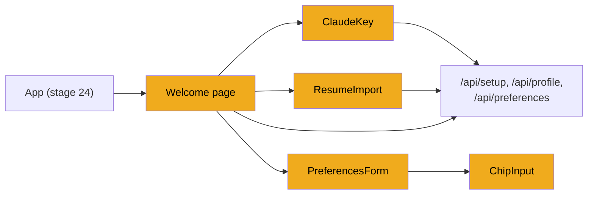
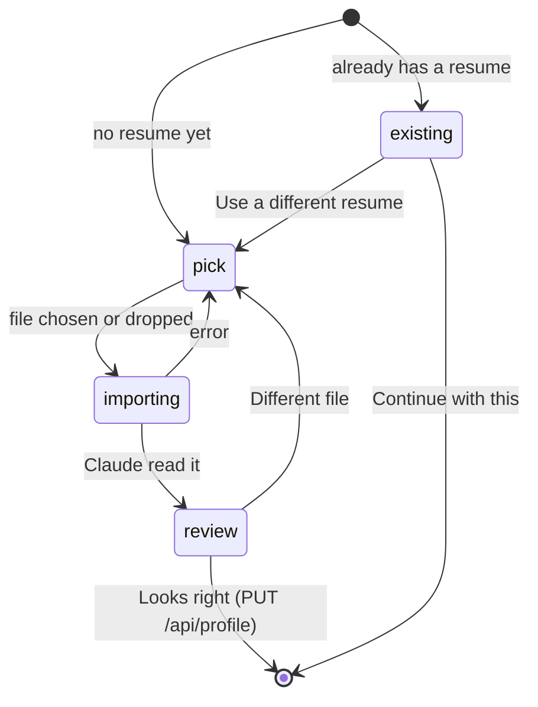
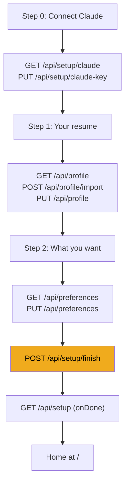

# Stage 25: The welcome flow

> **Goal:** Build the three setup steps a new user sees: connect Claude, drop in a resume, say what jobs you want. The last click saves everything and starts the first job search.
>
> **By the end you will have:** a real `/welcome` page that walks you through setup with your own resume and lands you on Home (still a placeholder) while JobBee searches for your first jobs.

## Where this fits

The welcome flow is a friendly front door to endpoints you already built: the Claude key and `POST /api/setup/finish` ([stage 23](23-api-actions-and-setup.md)), resume import and profile ([stage 7](07-resume-and-profile.md)) and preferences ([stage 10](10-tailoring-and-pdfs.md)). This stage replaces the placeholder `Welcome.tsx` from [stage 24](24-frontend-basics.md) with four reusable components and the real page.



## New ideas in plain words

**Controlled inputs.** In plain HTML, a text box keeps its own value. In React you usually keep the value in state and hand it back to the input on every render: `<input value={key} onChange={(e) => setKey(e.target.value)} />`. Each keystroke calls `onChange`, which updates the state, which re-renders the input with the new value. The input is *controlled* by your state, so your code always knows exactly what's typed and can check it, trim it or clear it. `e` is the *event* object the browser passes to a handler. `e.target` is the element it happened on.

**Lifting state up.** When two components need the same data, the state lives in their nearest common parent. The parent passes down the value as a prop and a function to change it. `PreferencesForm` doesn't own the preferences: `Welcome` does, and passes `value={prefs}` and `onChange={setPrefs}`. That way `Welcome` can read the preferences when you press "Start finding jobs", and Settings (stage 28) can reuse the same form with its own state. A component that only gets `value` and `onChange` is easy to reuse anywhere.

**A component as a small state machine.** Some components move through a fixed set of phases. The welcome page is on step 0, 1 or 2. The resume box is in one of four phases: `existing` (you already have a resume), `pick` (choose a file), `importing` (Claude is reading it) and `review` (check the result). One state variable holds the phase, and the component draws a different screen for each one. TypeScript makes the list explicit: `type Phase = "existing" | "pick" | "importing" | "review"`, so a typo like `"reveiw"` is a build error, not a blank screen.

**Forms and the Enter key.** Wrapping inputs in a `<form>` lets you press Enter to submit. Two browser habits need taming:

- Submitting a form normally *reloads the page*. The `onSubmit` handler calls `e.preventDefault()` to stop that.
- Inside a form, a `<button>` without a `type` is a *submit* button. Helper buttons (remove a chip, show a hidden field) need `type="button"`, or clicking them submits the form.

**File uploads with `FormData`.** JSON can't carry a file. Browsers send files as `multipart/form-data`, the same format as an HTML form with a file field. In code you build a `FormData` object, append the file under the field name the backend expects, and pass it as the request body. FastAPI reads it with `UploadFile = File(...)`, as you saw in stage 7. A multipart body needs a *boundary*, a random marker that separates the parts, written into the `Content-Type` header. Only the browser knows the boundary it chose, so the browser must write that header itself. That's why `request` in `api.ts` adds the JSON header only for string bodies.

**Drag and drop.** Any element can accept files dropped on it with `onDragOver` and `onDrop`. The browser's default action for a dropped file is to open it in the tab, so both handlers call `e.preventDefault()`. The dropped files are in `e.dataTransfer.files`.

**Refs.** `useRef` gives you a small box (`ref.current`) that survives re-renders but doesn't cause one when it changes. Put `ref={fileRef}` on an element and React stores that DOM element in `fileRef.current`. The resume box uses it to open a hidden file picker from code: `fileRef.current?.click()`.

**Generic setters.** A form with many fields needs a way to change one field at a time. Instead of one function per field, JobBee writes one *generic* setter:

```ts
const set = <K extends keyof Preferences>(key: K, v: Preferences[K]) => onChange({ ...value, [key]: v });
```

- `keyof Preferences` is the list of field names: `"target_roles" | "jobs_per_day" | ...`.
- `<K extends keyof Preferences>` makes `set` generic: `K` is "one of those names", like a `TypeVar` bound to them.
- `Preferences[K]` is the type of that field.
- `{ ...value, [key]: v }` copies the object with one field replaced. `[key]` is a *computed key*: the field name comes from the variable, like `{**value, key: v}` in Python.

So `set("jobs_per_day", 5)` builds, while `set("jobs_per_day", "five")` and `set("jobs_per_dya", 5)` don't.

**Optional callbacks.** A prop can be an optional function: `onStatus?: (status: ClaudeStatus) => void`. The component calls it with `onStatus?.(s)`, which does nothing if the parent didn't pass one. The welcome page passes it to move to the next step. Settings uses it to read the spend figures.

## Build it, step by step

The four components go in `frontend/src/components/`, and the page replaces `frontend/src/pages/Welcome.tsx`. Each component comes before the files that import it.

### Step 1: A list of words, `frontend/src/components/ChipInput.tsx`

Roles, places and excluded companies are lists of short words. `ChipInput` shows each one as a removable "chip", with a text box to add more and optional one-click suggestions.

<!-- code: frontend/src/components/ChipInput.tsx -->
**`frontend/src/components/ChipInput.tsx`** (whole file, 79 lines)

```tsx
import { useState } from "react";
import Icon from "./Icon";

type Props = {
  values: string[];
  onChange: (values: string[]) => void;
  placeholder?: string;
  suggestions?: string[];
};

/** Type and press Enter (or a comma) to add; click × to remove. */
export default function ChipInput({ values, onChange, placeholder, suggestions = [] }: Props) {
  const [draft, setDraft] = useState("");

  const add = (raw: string) => {
    const parts = raw
      .split(",")
      .map((s) => s.trim())
      .filter(Boolean);
    const next = [...values];
    for (const p of parts) {
      if (!next.some((v) => v.toLowerCase() === p.toLowerCase())) next.push(p);
    }
    if (next.length !== values.length) onChange(next);
    setDraft("");
  };

  const unused = suggestions.filter((s) => {
    const low = s.toLowerCase();
    return !values.some((v) => low.includes(v.toLowerCase()) || v.toLowerCase().includes(low));
  });

  return (
    <div className="stack tight">
      <label className="chips-input">
        {values.map((v) => (
          <span key={v} className="chip">
            {v}
            <button
              type="button"
              aria-label={`Remove ${v}`}
              onClick={() => onChange(values.filter((x) => x !== v))}
            >
              <Icon name="x" />
            </button>
          </span>
        ))}
        <input
          value={draft}
          placeholder={values.length ? "Add more…" : placeholder}
          onChange={(e) => {
            if (e.target.value.endsWith(",")) add(e.target.value);
            else setDraft(e.target.value);
          }}
          onKeyDown={(e) => {
            if (e.key === "Enter") {
              e.preventDefault();
              add(draft);
            } else if (e.key === "Backspace" && !draft && values.length) {
              onChange(values.slice(0, -1));
            }
          }}
          onBlur={() => {
            if (draft.trim()) add(draft);
          }}
        />
      </label>
      {unused.length > 0 && (
        <div className="row" style={{ gap: 6 }}>
          {unused.slice(0, 6).map((s) => (
            <button key={s} type="button" className="sm ghost" onClick={() => add(s)}>
              + {s}
            </button>
          ))}
        </div>
      )}
    </div>
  );
}
```
<!-- /code -->

- **Lifted state.** The list (`values`) belongs to the parent. `ChipInput` keeps only the half-typed word (`draft`). Adding or removing calls `onChange` with a *new* array (`[...values]`, `values.filter(...)`, `values.slice(0, -1)`). It never changes `values` in place, because React would not notice.
- **`add`** accepts several items at once ("Toronto, Vancouver"): it splits on commas, trims, drops empty pieces and skips duplicates regardless of case. `for (const p of parts)` is `for p in parts:`. It calls `onChange` only when something was actually added, then clears the box.
- **Three ways to add:** press Enter, type a comma (`onChange` sees the text end with `,`), or leave the box (`onBlur` fires when the input loses focus). **Backspace** in an empty box removes the last chip.
- **Enter calls `e.preventDefault()`.** If this input sits inside a `<form>`, Enter would otherwise submit the whole form.
- **`type="button"`** on the × and suggestion buttons keeps them from submitting a surrounding form.
- **Suggestions.** `unused` keeps the suggestions that don't overlap a value you already have (in either direction, so "Backend Engineer" hides once you've added "Backend"). Up to six show as "+ Backend Engineer" buttons.
- **The words themselves are the keys** (`key={v}`). That's safe because `add` never lets a duplicate in.
- **`<label className="chips-input">`** wraps the chips and the input so the whole box looks like one text field. Stage 24's `.chips-input` rule styles it. The `<label>` has a side effect worth knowing; see Common mistakes.

### Step 2: The Claude key box, `frontend/src/components/ClaudeKey.tsx`

This component shows whether Claude is connected, or a form to paste a key. The welcome page uses it in step 0, and Settings reuses it (with a **Change** button) in stage 28.

#### Part 1: State, the first status check and saving

<!-- code: frontend/src/components/ClaudeKey.tsx lines=1-61 -->
**`frontend/src/components/ClaudeKey.tsx`** (lines 1–61 of 196)

```tsx
import { useEffect, useState } from "react";
import { api, type ClaudeStatus } from "../api";
import Icon from "./Icon";
import { errorText } from "./Toast";

/**
 * Paste an Anthropic API key; it's checked with Anthropic and kept in Windows Credential Manager.
 * Keys made for a whole organization also need the workspace ID to use.
 */
export default function ClaudeKey({
  onStatus,
  allowReplace = false,
}: {
  onStatus?: (status: ClaudeStatus) => void;
  allowReplace?: boolean;
}) {
  const [status, setStatus] = useState<ClaudeStatus | null>(null);
  const [key, setKey] = useState("");
  const [workspace, setWorkspace] = useState("");
  const [showWorkspace, setShowWorkspace] = useState(false);
  const [editing, setEditing] = useState(false);
  const [busy, setBusy] = useState(false);
  const [error, setError] = useState<string | null>(null);

  useEffect(() => {
    api
      .claude()
      .then((s) => {
        setStatus(s);
        setWorkspace(s.workspace_id ?? "");
        setShowWorkspace(Boolean(s.workspace_id));
        onStatus?.(s);
      })
      .catch((e) => setError(errorText(e)));
    // eslint-disable-next-line react-hooks/exhaustive-deps
  }, []);

  const keepingKey = Boolean(status?.connected) && !key.trim();
  const canSave = key.trim().length >= 20 || (keepingKey && workspace.trim() !== (status?.workspace_id ?? ""));

  const save = async () => {
    setBusy(true);
    setError(null);
    try {
      const next = await api.saveClaudeKey({
        apiKey: key.trim() || undefined,
        workspaceId: workspace.trim(),
      });
      setStatus(next);
      setKey("");
      setEditing(false);
      onStatus?.(next);
    } catch (e) {
      const message = errorText(e);
      if (message.toLowerCase().includes("workspace")) setShowWorkspace(true);
      setError(message);
    } finally {
      setBusy(false);
    }
  };

```
<!-- /code -->

- **Props.** `onStatus` is the optional callback from "New ideas". `allowReplace` defaults to `false`; when true, the connected notice gets a **Change** button.
- **State.** `status` is the backend's answer, `key` and `workspace` are the two text boxes, `showWorkspace` and `editing` control what's visible, and `busy` and `error` track the save.
- **The effect** runs once, when the component first appears. It calls `GET /api/setup/claude` ([stage 23](23-api-actions-and-setup.md)), stores the status, pre-fills the workspace box (and shows it if a workspace is set), and tells the parent through `onStatus`. If a key is already connected, the welcome page moves on at once.
- **The `eslint-disable` comment** is a note for a linter (a code-style checker) that leaving `onStatus` out of the dependency list is deliberate: the check should run once, not every time the parent passes a new function. JobBee doesn't run ESLint, so the comment has no effect on the build.
- **`keepingKey` and `canSave`** are worked out on every render from state; they aren't state themselves. You can save when you've typed something key-sized (20 characters or more), or when you're keeping the current key but changed the workspace. Values you can calculate from state should be calculated, not stored, so they can never get out of step.
- **`save`** calls `PUT /api/setup/claude-key`. The backend checks the key with Anthropic (a free token-counting call) before it stores it in the keyring ([stage 2](02-secrets.md)). That takes a second or two, so `busy` turns the button into a spinner with "Checking…".
  - `key.trim() || undefined` sends no key at all when the box is empty, so the backend keeps the one it has. That's how "change only the workspace" works.
  - After a save, the typed key is cleared from state at once. The browser has no reason to keep it.
  - If the error mentions "workspace" (Anthropic needs one for organization-wide keys), the workspace field appears. It's hidden otherwise, because most people never need it.

#### Part 2: Loading, connected, and an outdated backend

<!-- code: frontend/src/components/ClaudeKey.tsx lines=62-110 -->
**`frontend/src/components/ClaudeKey.tsx`** (lines 62–110 of 196)

```tsx
  if (status == null) {
    return error ? (
      <div className="notice bad">{error}</div>
    ) : (
      <div className="skeleton" style={{ height: 44 }} />
    );
  }

  if (status.connected && !editing) {
    return (
      <div className="notice ok">
        <Icon name="check" />
        <div className="grow">
          <div className="strong">Claude is connected</div>
          <div className="small muted">
            {status.source === "app"
              ? "Your key is stored in Windows Credential Manager on this PC."
              : "Using ANTHROPIC_API_KEY from backend/.env."}
            {status.workspace_id ? ` Workspace ${status.workspace_id}.` : ""}
          </div>
        </div>
        {allowReplace && (
          <button className="sm ghost" onClick={() => setEditing(true)}>
            Change
          </button>
        )}
      </div>
    );
  }

  // A backend started before the workspace update doesn't report this field.
  if (status.workspace_id === undefined) {
    return (
      <div className="notice warn">
        <Icon name="alert" />
        <div className="grow">
          <div className="strong">Restart JobBee's backend to change the key</div>
          <div className="small" style={{ marginTop: 2 }}>
            It's still running the previous version. Press Ctrl+C in its terminal, start it again,
            then reload this page.
          </div>
          <button className="sm" style={{ marginTop: 8 }} onClick={() => window.location.reload()}>
            Reload
          </button>
        </div>
      </div>
    );
  }

```
<!-- /code -->

Each `if` returns a different screen. The first one that matches wins:

1. **No status yet:** a grey skeleton, or the error if the first check failed.
2. **Connected and not editing:** a green "Claude is connected" notice. `status.source` says where the key lives: `"app"` means the keyring, `"env"` means `ANTHROPIC_API_KEY` in `backend/.env`. With `allowReplace`, a **Change** button switches to the form.
3. **An outdated backend:** a backend started before the workspace feature existed doesn't send `workspace_id` at all, so the field is `undefined` (not even an empty string). Rather than show a form that would fail, the component asks you to restart the backend. This is the "frontend newer than backend" problem from stage 24's `ErrorBoundary`, handled gracefully.

#### Part 3: The key form

<!-- code: frontend/src/components/ClaudeKey.tsx lines=111-196 -->
**`frontend/src/components/ClaudeKey.tsx`** (lines 111–196 of 196)

```tsx
  return (
    <div className="stack">
      {!status.connected && (
        <ol className="steps small muted">
          <li>
            Open{" "}
            <a href="https://console.anthropic.com/settings/keys" target="_blank" rel="noreferrer">
              console.anthropic.com → API keys
            </a>{" "}
            and create a key, ideally inside a workspace.
          </li>
          <li>
            Make sure the account has credit. Max and Team plans include monthly API credits: link
            the organization under claude.ai → Settings → Billing.
          </li>
          <li>Paste the key here.</li>
        </ol>
      )}
      <form
        className="stack"
        onSubmit={(e) => {
          e.preventDefault();
          if (canSave) void save();
        }}
      >
        <div className="input-row">
          <input
            type="password"
            autoComplete="off"
            value={key}
            placeholder={status.connected ? "New key (leave empty to keep the current one)" : "sk-ant-…"}
            onChange={(e) => setKey(e.target.value)}
            aria-label="Anthropic API key"
          />
          <button className="primary" disabled={busy || !canSave}>
            {busy ? <span className="spinner" /> : <Icon name="key" />}
            {busy ? "Checking…" : status.connected ? "Save" : "Connect"}
          </button>
        </div>
        {showWorkspace ? (
          <div className="field">
            <label>Workspace ID</label>
            <input
              value={workspace}
              placeholder="wrkspc_…"
              onChange={(e) => setWorkspace(e.target.value)}
              aria-label="Anthropic workspace ID"
            />
            <span className="hint">
              Only for keys made for the whole organization. Find it in the Console under Settings →
              Workspaces.
            </span>
          </div>
        ) : (
          <button
            type="button"
            className="link small"
            style={{ alignSelf: "flex-start" }}
            onClick={() => setShowWorkspace(true)}
          >
            My key is for the whole organization
          </button>
        )}
      </form>
      {editing && (
        <button
          className="link small"
          style={{ alignSelf: "flex-start" }}
          onClick={() => {
            setEditing(false);
            setError(null);
            setWorkspace(status.workspace_id ?? "");
          }}
        >
          Cancel
        </button>
      )}
      {error && (
        <div className="notice bad small">
          <Icon name="alert" />
          {error}
        </div>
      )}
    </div>
  );
}
```
<!-- /code -->

- **The steps list** shows only before a key is connected: where to make a key, and a reminder that the account needs credit. `{" "}` adds a space between JSX pieces, which JSX would otherwise drop at a line break.
- **`<form onSubmit>`** lets you press Enter to save. `e.preventDefault()` stops the page reload, and `if (canSave)` guards against Enter on an empty box. The **Connect** button is inside the form and has no `type`, so it submits the form. That's why it has no `onClick`.
- **`type="password"`** shows dots instead of the key, so it doesn't appear on a shared screen. `autoComplete="off"` asks the browser not to offer to save it. The placeholder changes when a key is already connected: "leave empty to keep the current one".
- **The workspace field** appears when `showWorkspace` is true. Otherwise a small link-style button, "My key is for the whole organization", reveals it. That button has `type="button"`, so it doesn't submit the form.
- **Cancel** (when editing) puts the workspace back to the saved value and hides the form again.

### Step 3: The resume box, `frontend/src/components/ResumeImport.tsx`

This is the biggest component of the stage. Its four phases form a small state machine:



#### Part 1: State, importing a file and saving

<!-- code: frontend/src/components/ResumeImport.tsx lines=1-56 -->
**`frontend/src/components/ResumeImport.tsx`** (lines 1–56 of 306)

```tsx
import { useRef, useState } from "react";
import { api, type ApplicationDefaults, type Profile, type ProfileDraft, type ProfileUpdate } from "../api";
import { initials } from "../lib/format";
import Icon from "./Icon";
import { errorText } from "./Toast";

type Phase = "existing" | "pick" | "importing" | "review";

/** Drop a resume → Claude reads it → confirm the summary. Saves the profile on "Looks right". */
export default function ResumeImport({
  profile,
  hasResume,
  onSaved,
}: {
  profile: Profile;
  hasResume: boolean;
  onSaved: (profile: Profile) => void;
}) {
  const [phase, setPhase] = useState<Phase>(hasResume && profile.name ? "existing" : "pick");
  const [draft, setDraft] = useState<ProfileDraft | null>(null);
  const [fileName, setFileName] = useState<string | null>(null);
  const [warnings, setWarnings] = useState<string[]>([]);
  const [editing, setEditing] = useState(false);
  const [saving, setSaving] = useState(false);
  const [error, setError] = useState<string | null>(null);
  const [dragging, setDragging] = useState(false);
  const fileRef = useRef<HTMLInputElement>(null);

  const importFile = async (file: File) => {
    setError(null);
    setFileName(file.name);
    setPhase("importing");
    try {
      const result = await api.importProfile(file);
      setDraft(mergeDraft(profile, result.draft));
      setWarnings(result.warnings);
      setPhase("review");
    } catch (e) {
      setError(errorText(e));
      setPhase("pick");
    }
  };

  const save = async () => {
    if (!draft) return;
    setSaving(true);
    setError(null);
    try {
      onSaved(await api.updateProfile(toUpdate(draft)));
    } catch (e) {
      setError(errorText(e));
    } finally {
      setSaving(false);
    }
  };

```
<!-- /code -->

- **Props.** `profile` is the current profile, `hasResume` comes from `setup.resume`, and `onSaved` is what the parent does with the saved profile.
- **The starting phase** is `existing` only if there's a resume *and* the profile has a name. Otherwise there's nothing to show yet, so it starts at `pick`.
- **`fileRef`** holds the hidden `<input type="file">` (see "Refs" above).
- **`importFile`** moves to `importing` and calls `POST /api/profile/import` ([stage 7](07-resume-and-profile.md)). The backend saves the file as your base resume right away, extracts its text, and asks Claude for a *draft* profile. It doesn't change your profile. The draft is merged with what you already have (`mergeDraft`, part 4), and the phase moves to `review`. On an error (a scanned PDF with no text, say), it goes back to `pick` and shows the message.
- **`save`** sends the reviewed draft to `PUT /api/profile` and passes the saved profile to `onSaved`. **Review before save** is the point: if Claude misread something, nothing wrong has reached your profile yet.

#### Part 2: The three screens

<!-- code: frontend/src/components/ResumeImport.tsx lines=57-161 -->
**`frontend/src/components/ResumeImport.tsx`** (lines 57–161 of 306)

```tsx
  if (phase === "existing") {
    return (
      <div className="stack">
        <ProfileSummary draft={profileToDraft(profile)} />
        <div className="row">
          <button className="primary lg" onClick={() => onSaved(profile)}>
            Continue with this
          </button>
          <button className="ghost" onClick={() => setPhase("pick")}>
            Use a different resume
          </button>
        </div>
      </div>
    );
  }

  if (phase === "pick" || phase === "importing") {
    return (
      <div className="stack">
        <div
          className={`dropzone ${dragging ? "dragging" : ""}`}
          role="button"
          tabIndex={0}
          onClick={() => phase === "pick" && fileRef.current?.click()}
          onKeyDown={(e) => e.key === "Enter" && fileRef.current?.click()}
          onDragOver={(e) => {
            e.preventDefault();
            setDragging(true);
          }}
          onDragLeave={() => setDragging(false)}
          onDrop={(e) => {
            e.preventDefault();
            setDragging(false);
            const file = e.dataTransfer.files?.[0];
            if (file && phase === "pick") void importFile(file);
          }}
        >
          {phase === "importing" ? (
            <>
              <div className="spinner" style={{ width: 28, height: 28, borderWidth: 3 }} />
              <div className="strong">Reading {fileName}…</div>
              <div className="small muted">Claude is pulling out your experience and skills.</div>
            </>
          ) : (
            <>
              <Icon name="upload" />
              <div className="strong">Drop your resume here</div>
              <div className="small muted">or click to choose · PDF or Word works best</div>
            </>
          )}
          <input
            ref={fileRef}
            type="file"
            accept=".pdf,.docx,.txt,.md"
            hidden
            onChange={(e) => {
              const f = e.target.files?.[0];
              if (f) void importFile(f);
              e.target.value = "";
            }}
          />
        </div>
        {error && (
          <div className="notice bad small">
            <Icon name="alert" />
            {error}
          </div>
        )}
      </div>
    );
  }

  return (
    <div className="stack">
      {draft && !editing && <ProfileSummary draft={draft} />}
      {draft && editing && <DetailsForm draft={draft} onChange={setDraft} />}
      {warnings.map((w) => (
        <div key={w} className="notice warn small">
          <Icon name="alert" />
          {w}
        </div>
      ))}
      {error && (
        <div className="notice bad small">
          <Icon name="alert" />
          {error}
        </div>
      )}
      <div className="row">
        <button className="primary lg" disabled={saving} onClick={() => void save()}>
          {saving ? "Saving…" : editing ? "Save" : "Looks right"}
        </button>
        {!editing && (
          <button className="ghost" onClick={() => setEditing(true)}>
            Fix something
          </button>
        )}
        <button className="ghost" onClick={() => setPhase("pick")}>
          Different file
        </button>
      </div>
    </div>
  );
}

```
<!-- /code -->

- **`existing`** shows a summary of your current profile, with **Continue with this** (calls `onSaved` with the profile as it is) and **Use a different resume**.
- **`pick` and `importing`** share the drop zone:
  - `onDragOver` must call `preventDefault()`, or the browser won't allow a drop at all. `dragging` adds the CSS class that turns the zone honey while a file hovers over it, and `onDragLeave` removes it.
  - `onDrop` takes the first dropped file (`e.dataTransfer.files?.[0]`).
  - `phase === "pick"` guards both the click and the drop, so you can't start a second import while one is running.
  - `role="button"`, `tabIndex={0}` and the Enter key handler make the `<div>` usable from the keyboard, like a real button.
  - The hidden `<input type="file">` opens the system file picker when clicked through `fileRef`. `accept` limits the picker to PDF, Word, text and Markdown. After a file is picked, `e.target.value = ""` resets the input; without it, picking the same file again wouldn't fire `onChange`.
  - While importing, the zone shows a spinner and "Reading cv.pdf…". `<>...</>` is a *fragment*: it groups several elements without adding an extra `<div>` to the page.
- **`review`** (the final `return`) shows the summary, or the edit form when you press **Fix something**, any warnings from the import, and three buttons: **Looks right** (or **Save** while editing), **Fix something** and **Different file**.

#### Part 3: The summary card and the edit form

<!-- code: frontend/src/components/ResumeImport.tsx lines=162-236 -->
**`frontend/src/components/ResumeImport.tsx`** (lines 162–236 of 306)

```tsx
function ProfileSummary({ draft }: { draft: ProfileDraft }) {
  const facts = [
    draft.location,
    draft.years_experience != null ? `${draft.years_experience} years experience` : null,
    draft.email,
  ].filter(Boolean);
  return (
    <div className="card">
      <div className="profile-summary">
        <div className="avatar">{initials(draft.name)}</div>
        <div className="grow">
          <div className="strong" style={{ fontSize: 17 }}>
            {draft.name || "Your name"}
          </div>
          {draft.headline && <div className="muted">{draft.headline}</div>}
          {facts.length > 0 && <div className="small faint" style={{ marginTop: 2 }}>{facts.join(" · ")}</div>}
        </div>
      </div>
      {draft.skills.length > 0 && (
        <div className="skill-cloud">
          {draft.skills.slice(0, 14).map((s) => (
            <span key={s} className="tag">
              {s}
            </span>
          ))}
          {draft.skills.length > 14 && <span className="tag">+{draft.skills.length - 14}</span>}
        </div>
      )}
    </div>
  );
}

function DetailsForm({ draft, onChange }: { draft: ProfileDraft; onChange: (d: ProfileDraft) => void }) {
  const set = <K extends keyof ProfileDraft>(key: K, value: ProfileDraft[K]) => onChange({ ...draft, [key]: value });
  return (
    <div className="card fields">
      <div className="field">
        <label>Name</label>
        <input value={draft.name ?? ""} onChange={(e) => set("name", e.target.value)} />
      </div>
      <div className="field">
        <label>Email</label>
        <input value={draft.email ?? ""} onChange={(e) => set("email", e.target.value)} />
      </div>
      <div className="field full">
        <label>Headline</label>
        <input value={draft.headline ?? ""} onChange={(e) => set("headline", e.target.value)} />
      </div>
      <div className="field">
        <label>Where you live</label>
        <input value={draft.location ?? ""} onChange={(e) => set("location", e.target.value)} />
      </div>
      <div className="field">
        <label>Years of experience</label>
        <input
          type="number"
          min={0}
          step={0.5}
          value={draft.years_experience ?? ""}
          onChange={(e) => set("years_experience", e.target.value ? Number(e.target.value) : null)}
        />
      </div>
      <div className="field full">
        <label>Phone (for application forms)</label>
        <input
          value={draft.application_defaults.phone ?? ""}
          onChange={(e) =>
            set("application_defaults", { ...draft.application_defaults, phone: e.target.value || null })
          }
        />
      </div>
    </div>
  );
}

```
<!-- /code -->

- **`ProfileSummary`** draws your initials (with `initials` from stage 24's `format.ts`), name, headline, a line of facts and up to 14 skills, plus "+N" for the rest. `[...].filter(Boolean)` drops the facts that are empty before joining them with " · ".
- **`DetailsForm`** edits the name, email, headline, location, years of experience and phone. It uses the same generic setter pattern as "New ideas", typed for `ProfileDraft`.
  - `value={draft.name ?? ""}` shows an empty box for `null`. A controlled input needs a string or a number, never `null`.
  - **Inputs give you strings.** Even `type="number"` reports `e.target.value` as text. An empty box becomes `null`, anything else goes through `Number(...)`.
  - The phone lives inside `application_defaults`, so the setter replaces that whole object with a copy that has the new phone: `{ ...draft.application_defaults, phone: ... }`.

#### Part 4: Helpers, `mergeDraft` and `toUpdate`

<!-- code: frontend/src/components/ResumeImport.tsx lines=237-306 -->
**`frontend/src/components/ResumeImport.tsx`** (lines 237–306 of 306)

```tsx
// --- helpers --------------------------------------------------------------------------

export function profileToDraft(p: Profile): ProfileDraft {
  return {
    name: p.name,
    email: p.email,
    headline: p.headline,
    location: p.location,
    years_experience: p.years_experience,
    min_salary: p.min_salary,
    summary: p.summary,
    target_roles: p.target_roles,
    target_locations: p.target_locations,
    work_modes: p.work_modes,
    skills: p.skills,
    links: p.links,
    application_defaults: p.application_defaults,
  };
}

function union(a: string[], b: string[]): string[] {
  const seen = new Set(a.map((s) => s.toLowerCase()));
  return [...a, ...b.filter((s) => !seen.has(s.toLowerCase()))];
}

/** Imported values win for scalars; lists are merged; existing answers are kept. */
function mergeDraft(profile: Profile, imported: ProfileDraft): ProfileDraft {
  const existing = profileToDraft(profile);
  const pick = <T,>(a: T | null | undefined, b: T | null | undefined): T | null =>
    a !== null && a !== undefined && a !== "" ? a : (b ?? null);
  const defaults: ApplicationDefaults = { ...existing.application_defaults };
  for (const [k, v] of Object.entries(imported.application_defaults ?? {})) {
    if (v !== null && v !== undefined && k !== "saved_answers") {
      (defaults as Record<string, unknown>)[k] = v;
    }
  }
  return {
    name: pick(imported.name, existing.name),
    email: pick(imported.email, existing.email),
    headline: pick(imported.headline, existing.headline),
    location: pick(imported.location, existing.location),
    years_experience: pick(imported.years_experience, existing.years_experience),
    min_salary: pick(existing.min_salary, imported.min_salary),
    summary: pick(imported.summary, existing.summary),
    target_roles: union(existing.target_roles, imported.target_roles),
    target_locations: union(existing.target_locations, imported.target_locations),
    work_modes: existing.work_modes.length ? existing.work_modes : imported.work_modes,
    skills: union(imported.skills, existing.skills),
    links: { ...existing.links, ...imported.links },
    application_defaults: defaults,
  };
}

function toUpdate(d: ProfileDraft): ProfileUpdate {
  const { saved_answers: _ignored, ...defaults } = d.application_defaults;
  return {
    name: d.name ?? "",
    email: d.email || undefined,
    headline: d.headline || undefined,
    location: d.location || undefined,
    years_experience: d.years_experience ?? undefined,
    summary: d.summary || undefined,
    target_roles: d.target_roles,
    target_locations: d.target_locations,
    work_modes: d.work_modes,
    skills: d.skills,
    links: d.links,
    application_defaults: defaults,
  };
}
```
<!-- /code -->

- **`profileToDraft`** turns a saved `Profile` into the `ProfileDraft` shape, so the summary and the merge can treat both the same way. It's exported, though no other file uses it today.
- **`union`** joins two lists, keeping the first list's order and skipping words already present, ignoring case. `new Set(...)` is Python's `set(...)`.

**`mergeDraft`** decides what happens when you import a resume on top of a profile you already have. You don't want to lose roles you typed or answers you saved:

| Field | Rule | Why |
|---|---|---|
| Name, email, headline, location, experience, summary | The new resume wins, unless it left the field empty | A new resume is the freshest source |
| Minimum salary, work modes | What you already set wins | Resumes rarely say these. You chose them. |
| Target roles and locations | Yours first, then new ones | Never drop a role you typed |
| Skills | New ones first, then your old ones | The new resume's skills lead |
| Links | Combined; the new resume wins for the same key | |
| Application answers | New non-empty values fill in; `saved_answers` are always kept | Answers you gave the agent stay |

- `pick` is a small generic helper: "the first value if it's set, otherwise the second". The `<T,>` with a comma is how you write a generic arrow function in a `.tsx` file, so the `<T>` isn't mistaken for a JSX tag.
- `Object.entries(obj)` is Python's `obj.items()`. The cast `(defaults as Record<string, unknown>)[k] = v` tells TypeScript "trust me, assigning any key is fine here".
- **`toUpdate`** turns the draft into the body for `PUT /api/profile`. Empty optional fields (email, headline, location, summary) become `undefined`, so `JSON.stringify` leaves them out and the backend keeps the old values. The destructuring `const { saved_answers: _ignored, ...defaults } = ...` copies the application answers *without* `saved_answers`, so this form can never overwrite them. The leading `_` marks `_ignored` as deliberately unused. `min_salary` isn't sent at all; the preferences step sets it.

### Step 4: What you want, `frontend/src/components/PreferencesForm.tsx`

`PreferencesForm` is fully controlled by its parent: it gets `value` and calls `onChange` with a changed copy. The welcome page shows the basic fields. Settings (stage 28) sets `extended` to show the finer controls too.

#### Part 1: Options, props and the generic setter

<!-- code: frontend/src/components/PreferencesForm.tsx lines=1-44 -->
**`frontend/src/components/PreferencesForm.tsx`** (lines 1–44 of 195)

```tsx
import type { Preferences, WorkAuthorization, WorkMode, YesNo } from "../api";
import ChipInput from "./ChipInput";

const MODES: { value: WorkMode; label: string }[] = [
  { value: "remote", label: "Remote" },
  { value: "hybrid", label: "Hybrid" },
  { value: "onsite", label: "On-site" },
];

const AUTH: { value: WorkAuthorization; label: string }[] = [
  { value: "yes_no_restrictions", label: "Yes, no restrictions" },
  { value: "yes_with_restrictions", label: "Yes, with restrictions" },
  { value: "no", label: "No" },
];

const PER_DAY = [3, 5, 10, 15];

type Props = {
  value: Preferences;
  onChange: (next: Preferences) => void;
  roleSuggestions?: string[];
  locationSuggestions?: string[];
  /** Settings shows the finer controls too. */
  extended?: boolean;
};

/** What to look for. Shared by the welcome flow and Settings. */
export default function PreferencesForm({
  value,
  onChange,
  roleSuggestions = [],
  locationSuggestions = [],
  extended = false,
}: Props) {
  const set = <K extends keyof Preferences>(key: K, v: Preferences[K]) => onChange({ ...value, [key]: v });

  const toggleMode = (mode: WorkMode) =>
    set(
      "work_modes",
      value.work_modes.includes(mode)
        ? value.work_modes.filter((m) => m !== mode)
        : [...value.work_modes, mode],
    );

```
<!-- /code -->

- **`MODES`, `AUTH` and `PER_DAY`** list the choices the form offers. Typing them as `{ value: WorkMode; label: string }[]` means a typo in a value is a build error.
- **`set`** is the generic setter from "New ideas". Every field uses it, and TypeScript checks each call.
- **`toggleMode`** adds or removes a work mode, always building a new array: `includes` is Python's `in`.

#### Part 2: Roles, places, salary and visas

<!-- code: frontend/src/components/PreferencesForm.tsx lines=45-141 -->
**`frontend/src/components/PreferencesForm.tsx`** (lines 45–141 of 195)

```tsx
  return (
    <div className="stack" style={{ gap: 18 }}>
      <div className="field">
        <label>Roles</label>
        <ChipInput
          values={value.target_roles}
          onChange={(v) => set("target_roles", v)}
          placeholder="e.g. Backend Engineer"
          suggestions={roleSuggestions}
        />
      </div>

      <div className="field">
        <label>Where</label>
        <ChipInput
          values={value.target_locations}
          onChange={(v) => set("target_locations", v)}
          placeholder="e.g. Toronto, Vancouver"
          suggestions={locationSuggestions}
        />
        <div className="segmented" style={{ marginTop: 6, alignSelf: "flex-start" }}>
          {MODES.map((m) => (
            <button
              key={m.value}
              type="button"
              className={value.work_modes.includes(m.value) ? "on" : ""}
              aria-pressed={value.work_modes.includes(m.value)}
              onClick={() => toggleMode(m.value)}
            >
              {m.label}
            </button>
          ))}
        </div>
      </div>

      <div className="fields">
        <div className="field">
          <label>Minimum salary</label>
          <input
            type="number"
            min={0}
            step={5000}
            value={value.min_salary ?? ""}
            placeholder="e.g. 120000"
            onChange={(e) => set("min_salary", e.target.value ? Number(e.target.value) : null)}
          />
          <span className="hint">Per year. Leave empty if you're flexible.</span>
        </div>
        <div className="field">
          <label>Jobs to send you per day</label>
          <div className="segmented">
            {PER_DAY.map((n) => (
              <button
                key={n}
                type="button"
                className={value.jobs_per_day === n ? "on" : ""}
                onClick={() => set("jobs_per_day", n)}
              >
                {n}
              </button>
            ))}
          </div>
          <span className="hint">Only the best matches, each with a tailored CV.</span>
        </div>
        <div className="field">
          <label>Can you work there without a new visa?</label>
          <select
            value={value.work_authorization ?? ""}
            onChange={(e) =>
              set("work_authorization", (e.target.value || null) as WorkAuthorization | null)
            }
          >
            <option value="">Choose…</option>
            {AUTH.map((a) => (
              <option key={a.value} value={a.value}>
                {a.label}
              </option>
            ))}
          </select>
        </div>
        <div className="field">
          <label>Need visa sponsorship?</label>
          <div className="segmented">
            {(["no", "yes"] as YesNo[]).map((v) => (
              <button
                key={v}
                type="button"
                className={value.requires_sponsorship === v ? "on" : ""}
                onClick={() => set("requires_sponsorship", v)}
              >
                {v === "yes" ? "Yes" : "No"}
              </button>
            ))}
          </div>
        </div>
      </div>

```
<!-- /code -->

- **Roles and Where** are two `ChipInput`s. The parent passes suggestions (the welcome page in step 5 suggests a role from your headline and your city from your resume).
- **Remote / Hybrid / On-site** is a `.segmented` row of toggle buttons. `className={... ? "on" : ""}` highlights the chosen ones, and `aria-pressed` tells screen readers each button's on/off state.
- **Minimum salary** is a number box: empty means "no minimum" (`null`). `value={value.min_salary ?? ""}` shows an empty box for `null`.
- **Jobs to send you per day** is a segmented choice of 3, 5, 10 or 15.
- **Work authorization** is a `<select>` dropdown. `""` stands for "not chosen" and maps to `null`. `as WorkAuthorization | null` tells TypeScript the string is one of the allowed values.
- **Visa sponsorship** is a Yes/No pair. `(["no", "yes"] as YesNo[])` gives the list its proper type so `set` accepts each value.

Where these go: `PUT /api/preferences` ([stage 10](10-tailoring-and-pdfs.md)) saves roles, places, work modes and salary on your profile, the two visa answers in your application answers, and the rest in your preferences.

#### Part 3: The finer controls

<!-- code: frontend/src/components/PreferencesForm.tsx lines=142-195 -->
**`frontend/src/components/PreferencesForm.tsx`** (lines 142–195 of 195)

```tsx
      {extended && (
        <>
          <div className="fields">
            <div className="field">
              <label>
                Lowest match score to send: <span className="strong">{value.min_match_score}</span>
              </label>
              <input
                type="range"
                min={40}
                max={90}
                step={5}
                value={value.min_match_score}
                onChange={(e) => set("min_match_score", Number(e.target.value))}
                style={{ padding: 0, minHeight: 28, accentColor: "var(--accent)" }}
              />
              <span className="hint">Higher means fewer, better-fitting jobs.</span>
            </div>
            <div className="field">
              <label>Daily search time</label>
              <input
                type="time"
                value={value.discovery_time}
                onChange={(e) => set("discovery_time", e.target.value || "09:00")}
              />
              <span className="hint">If your PC is off then, it searches when it's back on.</span>
            </div>
            <div className="field">
              <label>Ignore postings older than</label>
              <select
                value={value.max_job_age_days}
                onChange={(e) => set("max_job_age_days", Number(e.target.value))}
              >
                {[7, 14, 30, 60].map((d) => (
                  <option key={d} value={d}>
                    {d} days
                  </option>
                ))}
              </select>
            </div>
          </div>
          <div className="field">
            <label>Never send jobs from</label>
            <ChipInput
              values={value.excluded_companies}
              onChange={(v) => set("excluded_companies", v)}
              placeholder="Company names"
            />
          </div>
        </>
      )}
    </div>
  );
}
```
<!-- /code -->

These show only when `extended` is true, which only Settings sets:

- **Lowest match score** is a slider (`type="range"`) from 40 to 90 in steps of 5. The job flow ([stage 12](12-the-job-flow.md)) and discovery ([stage 19](19-discovery-and-scheduler.md)) send you only jobs that score at least this.
- **Daily search time** is a `type="time"` input, which gives `"HH:MM"`, the format the scheduler ([stage 19](19-discovery-and-scheduler.md)) expects. Clearing it falls back to `"09:00"`.
- **Ignore postings older than** is a dropdown of 7, 14, 30 or 60 days.
- **Never send jobs from** is a third `ChipInput`, for excluded companies.

### Step 5: The page, `frontend/src/pages/Welcome.tsx`

Replace the placeholder from stage 24 with the real page. It owns the step, the profile and the preferences, and wires the three components together.

#### Part 1: State, loading and the final click

<!-- code: frontend/src/pages/Welcome.tsx lines=1-58 -->
**`frontend/src/pages/Welcome.tsx`** (lines 1–58 of 149)

```tsx
import { useEffect, useState } from "react";
import { useNavigate } from "react-router-dom";
import { api, type Preferences, type Profile, type SetupStatus } from "../api";
import ClaudeKey from "../components/ClaudeKey";
import Icon, { BeeMark } from "../components/Icon";
import PreferencesForm from "../components/PreferencesForm";
import ResumeImport from "../components/ResumeImport";
import { errorText } from "../components/Toast";

type Step = 0 | 1 | 2;

/** Three steps: connect Claude, drop your resume, say what you want. Then the agent starts. */
export default function Welcome({ setup, onDone }: { setup: SetupStatus; onDone: () => Promise<void> }) {
  const navigate = useNavigate();
  const [step, setStep] = useState<Step>(setup.claude_key ? 1 : 0);
  const [profile, setProfile] = useState<Profile | null>(null);
  const [prefs, setPrefs] = useState<Preferences | null>(null);
  const [error, setError] = useState<string | null>(null);
  const [starting, setStarting] = useState(false);

  useEffect(() => {
    api.getProfile().then(setProfile).catch((e) => setError(errorText(e)));
  }, []);

  useEffect(() => {
    if (step === 2) {
      api
        .getPreferences()
        .then((p) =>
          setPrefs({
            ...p,
            work_modes: p.work_modes.length ? p.work_modes : ["remote", "hybrid"],
            target_locations:
              p.target_locations.length || !profile?.location ? p.target_locations : [profile.location],
          }),
        )
        .catch((e) => setError(errorText(e)));
    }
  }, [step, profile?.location]);

  const start = async () => {
    if (!prefs) return;
    setStarting(true);
    setError(null);
    try {
      await api.savePreferences(prefs);
      await api.finishSetup();
      await onDone();
      navigate("/", { replace: true });
    } catch (e) {
      setError(errorText(e));
      setStarting(false);
    }
  };

  const ready = prefs != null && prefs.target_roles.length > 0 && prefs.work_modes.length > 0;
  const roleSuggestions = profile?.headline ? [profile.headline.split(/[·|,–-]/)[0].trim()] : [];

```
<!-- /code -->

- **`type Step = 0 | 1 | 2`** allows only those three numbers.
- **The starting step** skips step 0 when a Claude key is already set (`setup.claude_key`, from `App`).
- **The profile** loads once, on mount, because step 1's `ResumeImport` needs it.
- **The preferences** load when you reach step 2, with friendly defaults filled in: Remote and Hybrid if no work mode is set yet, and the location from your resume if you haven't chosen any places. These defaults exist only in the form until you press the button. The dependency list `[step, profile?.location]` re-runs the effect if either changes.
- **`start`** runs four calls in a fixed order:
  1. **`savePreferences`** first, because `POST /api/setup/finish` refuses to run without target roles.
  2. **`finishSetup`** checks setup again on the server (Claude key, resume, roles), stamps `onboarded_at` and starts the first search ([stage 19](19-discovery-and-scheduler.md)'s discovery).
  3. **`onDone`** is `App`'s `loadSetup`. It reads `GET /api/setup` again, so `App` now knows you're onboarded.
  4. **`navigate("/", { replace: true })`** goes to Home. If you navigated before `onDone`, `App` would still think you weren't onboarded and send you straight back to `/welcome`.

  `starting` disables the button for the whole sequence. It's reset only on an error, because on success the page goes away.
- **`ready`** keeps the button disabled until there's at least one role and one work mode.
- **`roleSuggestions`** takes the first part of your resume headline: "Backend Engineer · Python" suggests "Backend Engineer". The split characters include the hyphen, so a title like "Full-stack Developer" is cut to "Full". It's only a suggestion; type your own role if it's wrong.

#### Part 2: The three steps on screen

<!-- code: frontend/src/pages/Welcome.tsx lines=59-149 -->
**`frontend/src/pages/Welcome.tsx`** (lines 59–149 of 149)

```tsx
  return (
    <div className="welcome">
      <div className="welcome-brand">
        <BeeMark />
        JobBee
      </div>
      <div className="progress" aria-label={`Step ${step + 1} of 3`}>
        {[0, 1, 2].map((i) => (
          <div key={i} className={i <= step ? "done" : ""} />
        ))}
      </div>

      {step === 0 && (
        <>
          <h1>Connect Claude</h1>
          <p className="lead">
            JobBee uses Claude to find jobs, check the fit, tailor your CV and fill in applications.
            You pay Anthropic directly for what it uses.
          </p>
          <ClaudeKey onStatus={(s) => s.connected && setStep(1)} />
        </>
      )}

      {step === 1 && (
        <>
          <h1>Your resume</h1>
          <p className="lead">
            Everything starts from it: which jobs fit, and the tailored CV for each one. Nothing is
            made up. Claims your resume doesn't support are left out.
          </p>
          {profile ? (
            <ResumeImport
              profile={profile}
              hasResume={setup.resume}
              onSaved={(p) => {
                setProfile(p);
                setStep(2);
              }}
            />
          ) : (
            <div className="skeleton" style={{ height: 170, borderRadius: 16 }} />
          )}
        </>
      )}

      {step === 2 && (
        <>
          <h1>What are you looking for?</h1>
          <p className="lead">
            Every day JobBee searches job boards, keeps the best matches and sends them to you with a
            tailored CV. You approve each one, and you see the filled form before it's submitted.
          </p>
          {prefs ? (
            <div className="card">
              <PreferencesForm
                value={prefs}
                onChange={setPrefs}
                roleSuggestions={roleSuggestions}
                locationSuggestions={profile?.location ? [profile.location] : []}
              />
            </div>
          ) : (
            <div className="skeleton" style={{ height: 320, borderRadius: 16 }} />
          )}
          <div className="row between" style={{ marginTop: 18 }}>
            <button className="ghost" onClick={() => setStep(1)}>
              Back
            </button>
            <button className="primary lg" disabled={!ready || starting} onClick={() => void start()}>
              {starting ? <span className="spinner" /> : <Icon name="search" />}
              Start finding jobs
            </button>
          </div>
          {!ready && prefs && (
            <p className="hint" style={{ textAlign: "right", marginTop: 6 }}>
              Add at least one role and one work mode.
            </p>
          )}
        </>
      )}

      {error && (
        <div className="notice bad" style={{ marginTop: 16 }}>
          <Icon name="alert" />
          {error}
        </div>
      )}

    </div>
  );
}
```
<!-- /code -->

- **The progress bar** has three segments. `i <= step` fills the ones you've reached. `aria-label` tells screen readers "Step 2 of 3".
- **Step 0** shows `ClaudeKey`. Its `onStatus` moves to step 1 as soon as a key is connected: `s.connected && setStep(1)` calls `setStep` only when `connected` is true.
- **Step 1** shows `ResumeImport` once the profile has loaded (a skeleton until then). Its `onSaved` stores the saved profile and moves to step 2.
- **Step 2** shows `PreferencesForm` in a card, with `onChange={setPrefs}`: the form edits the page's state directly. **Back** returns to step 1. **Start finding jobs** runs `start`, and a hint explains why it's disabled when it is.
- **One error box** at the bottom shows any failed load or save, whatever the step.

Here is the whole flow, with the calls each step makes:



## Check it works

1. **Build** from `frontend\`:

   ```powershell
   npm run build
   ```

   It should end with `✓ built in ...` (use `npm.cmd` if PowerShell blocks `npm`).

2. **Start both servers.** The backend from `backend\`:

   ```powershell
   .\.venv\Scripts\python.exe -m uvicorn app.main:app --host 127.0.0.1 --port 8000
   ```

   and the frontend from `frontend\` with `npm run dev`.

3. **See step 0.** If a key is already saved, the flow starts at step 1. To see step 0, call `DELETE /api/setup/claude-key` in http://127.0.0.1:8000/docs first. A key in `backend/.env` counts too: blank `ANTHROPIC_API_KEY` there and restart the backend. Then open http://localhost:5173.
4. **Connect Claude.** Paste a wrong key first and press **Connect**: after "Checking…" you see "Anthropic didn't accept that key." in red. Paste your real key: the page moves to step 1.
5. **Import your resume.** Drop your real resume (PDF or Word) on the box. After a few seconds of "Reading …", check the summary. Press **Fix something**, correct a field, then **Save**. The page moves to step 2.
6. **Say what you want.** Add a role (or click the suggestion), pick work modes, and press **Start finding jobs**. You land on the Home placeholder with the top bar.
7. **Check what was saved** in `/docs`:
   - `GET /api/profile` shows your name, skills and target roles.
   - `GET /api/preferences` shows your roles, work modes and jobs per day.
   - `GET /api/setup` shows `"onboarded": true`.
8. **Check the search started.** In the browser's Network tab (F12), the `finish` request answered `{"ok": true, "message": "Looking for your first jobs…", "run_id": null}`. While that search runs (a few minutes), `POST /api/agent/search` in `/docs` answers 409, "A search is already running."

To walk through the flow again later, there's no "un-onboard" button. Open http://localhost:5173/welcome directly: `App` shows the welcome page whenever the address starts with `/welcome`.

<!-- verify: frontend | npm run build -->

## Common mistakes

- **Double-submitting a form**: Enter and a click, or two quick clicks, can send the same request twice. Guard the submit handler (`if (canSave) void save()`) and disable the button while the request runs.
- **No visible "busy" state**: the user sees nothing happen for two seconds and clicks again. Tie `disabled` to a `busy`, `saving` or `starting` state, and show a spinner so they know it's working.
- **Setting `Content-Type` yourself for a `FormData` upload**: the header then lacks the multipart boundary, so FastAPI can't split the body into its parts and the upload fails. Let the browser write it. `request` adds the JSON header only when the body is a string.
- **A `<button>` inside a form without `type="button"`**: it submits the form. Every helper button inside a form (remove a chip, show the workspace field) needs `type="button"`.
- **Navigating before the app knows you're onboarded**: if you call `navigate("/")` before `onDone()`, `App` redirects you back to `/welcome`. Refresh the shared state first, then navigate.
- **A `<label>` around buttons**: clicking a label "clicks" its first form control, and a button counts as one. `ChipInput` wraps its chips in a `<label>`, so once you have chips, clicking the chip text or the empty part of the box clicks the *first* chip's × and removes it. Click inside the text box itself to type. If you want to fix it, use a `<div>` instead of the `<label>`, and focus the input through a ref when the box is clicked.

## Recap

- Controlled inputs keep form values in state, so the code always knows what's typed.
- State lives in the parent that needs it (`Welcome` owns `prefs`). Children get `value` and `onChange`, which makes them reusable in Settings.
- A single state variable with a fixed set of values (`step`, `phase`) is a small state machine that decides what to draw.
- Files go up as `FormData`, and the browser writes the multipart header itself.
- `mergeDraft` combines a new resume with your existing profile without losing roles or saved answers, and your profile changes only when you click **Looks right**.
- The last click saves preferences, calls `POST /api/setup/finish`, reloads the setup status, and only then navigates home.

**Next:** [Stage 26: Inbox building blocks](26-inbox-building-blocks.md)
