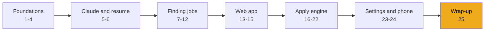
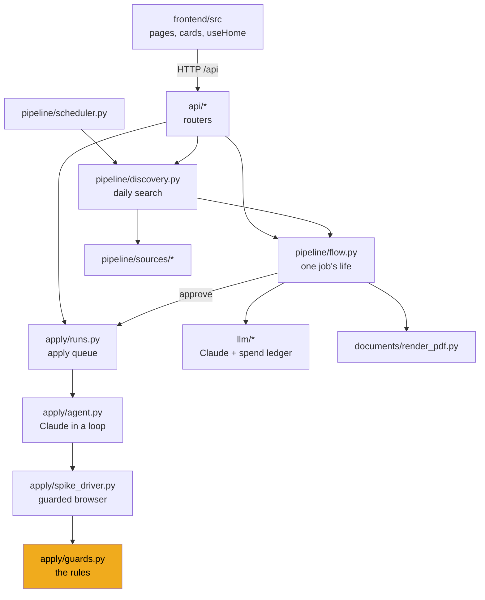

# Stage 25: Wrap-up

> **Goal:** Step back and see the whole system you built, how its safety layers fit together, where the real code has limits, and where you could take it next.
>
> **By the end you will have:** a clear map of JobBee in your head, a list of known weak spots, and ideas for your own improvements.

## Where this fits

This is the last stage. There's nothing new to build. Instead, you'll connect the pieces from the other 24 stages.

## The whole system, one more time

Here are the main modules you wrote and how they call each other. Each box is a folder or file in `backend/app/` or `frontend/src/`.

Underneath all of these sit the database (`models.py`, stage 2), the secret store (`services/secrets.py`, stage 4) and the settings (`config.py`, stage 1).

## The life of one job, end to end

| Step | What happens | Where (stage) |
|---|---|---|
| 1 | The scheduler ticks and sees it's time for today's search. | `pipeline/scheduler.py` (11) |
| 2 | Discovery gathers candidate links from the watchlist, web search and email alerts. | `pipeline/discovery.py`, `pipeline/sources/` (11, 12) |
| 3 | Each posting is fetched, cleaned and stored once. It becomes an application with status `matched`. | `pipeline/jd.py`, `pipeline/ingest.py` (7) |
| 4 | Quick filters drop obvious misfits. Haiku scores the rest. | `pipeline/screen.py` (8) |
| 5 | The best few get a tailored CV and cover letter from Sonnet, fact-checked by Haiku and printed to PDF. | `pipeline/tailor.py`, `documents/render_pdf.py` (9) |
| 6 | The application moves to `awaiting_approval` and appears as a card. | `pipeline/flow.py`, `api/home.py` (10, 15) |
| 7 | You click **Apply**. It moves to `approved` and an apply run is queued. | `job_flow.approve`, `run_manager.enqueue` (10, 21) |
| 8 | The worker opens Chrome. Opus fills the form through the guarded driver. | `apply/runs.py`, `apply/agent.py`, `apply/spike_driver.py` (18, 19, 21) |
| 9 | The filled form is parked. You get a review card with a screenshot and every answer. | `_park`, `ReviewCard` (21, 22) |
| 10 | You click **Submit**. The server clicks the page's one final-submit button once, then looks for a confirmation. | `decide`, `click_final_submit` (18, 21) |

## The safety layers, together

No single check keeps JobBee safe. It's several layers, each covering gaps in the others. The ones near the top are enforced by code; the bottom one is only advice.

1. **Untrusted text goes to tool-less calls.** Job pages and emails are read by model calls that have no tools and must return JSON that passes a Pydantic check (stages 5, 8, 9). The only model that reads pages *and* has tools is the apply agent.
2. **Capabilities are removed, not forbidden.** The apply agent has no JavaScript tool, no raw mouse events, no access to other tabs, and no tool that submits (stage 18).
3. **Every action is checked by code.** Clicks, key presses and field fills go through pure functions that block final submits and sensitive fields (stage 17).
4. **Submitting needs your click.** Only the server can grant a one-shot allowance, tied to the same tab and the page you reviewed (stages 18, 21).
5. **Secrets never reach the model.** API keys and site passwords live in the keyring. Passwords are typed by the driver, not the model (stages 4, 20).
6. **Spending is capped.** Daily and monthly budgets apply to every Claude call, and there's a per-application cap for the agent (stages 5, 19).
7. **Atomic status changes.** Two clicks, or a click on the web and a tap on the phone, can't both succeed (stages 10, 21, 24).
8. **The prompt says page content is data.** This helps, but it's the weakest layer, which is why the layers above exist.

## Known limits in the real code

These are real behaviours of the current code, found while writing this guide. None of them is a disaster, but you should know about them. Several make good exercises.

- **The fact-check fails open.** If Haiku's fact-check reply isn't valid JSON, `tailor_cv` treats it as "nothing unsupported" and keeps every statement. A stricter version could retry, or keep the base resume's wording. See [`pipeline/tailor.py`](../../backend/app/pipeline/tailor.py).
- **Spending can go a little over budget.** `check_budget` runs *before* each call, and screening runs three calls at once, so the last few can overshoot. During an apply run, the daily budget is checked only once, in `preflight`. After that only the per-application cap applies, checked after each turn. See [`llm/usage.py`](../../backend/app/llm/usage.py) and [`apply/agent.py`](../../backend/app/apply/agent.py).
- **Some state lives only in memory.** `job_flow.notices` (the error cards, capped at 20) and `job_flow.stages` (the "preparing" cards) disappear on restart. So do parked forms: they need a live Chrome tab, so `mark_interrupted_runs` marks them expired at the next startup. This is why you must not run the backend with `--reload`.
- **The URL policy is a text check.** `url_refusal_reason` blocks `localhost`, `127.0.0.1`, `::1` and private IPv4 ranges written the usual way. Other spellings of a local address (such as `http://127.1` or the decimal form `http://2130706433`) pass. It also applies to `navigate`, inbox links and ingested links, not to links the agent clicks inside a page. An improvement: resolve the host and check the address with Python's `ipaddress` module. See [`apply/guards.py`](../../backend/app/apply/guards.py).
- **Cross-origin iframes are a blind spot.** When a form is embedded from another site, the probe can't see inside. Clicks there are only counted (`uninspected_clicks`), not classified. Enter is refused there. The final-submit search only covers same-origin frames, so such forms end in `submit_unconfirmed` and ask you to finish by hand.
- **"Same page" means same tab and same URL.** Some single-page apps keep one URL through every step. Then the "exactly one final-submit button" rule in `pick_final_submit` becomes the main protection.
- **The sensitive-field check fails closed.** A harmless question like "Experience at a bank?" matches `SENSITIVE_RE`, so the agent refuses it and may set the job aside. That's the safe direction to be wrong in.
- **`finish` doesn't stop the loop by itself.** The tool records the result and tells the model to stop. The loop ends when the model ends its turn, with the iteration cap as a backstop.
- **One user, one PC.** There is no login. The API trusts anything that can reach `127.0.0.1:8000`, which is why `POST /api/site-accounts/{id}/reveal` is acceptable only because the server listens on localhost.
- **Windows first.** `find_chrome` only checks Windows install folders, and `test_spike_driver.py` skips without Chrome there.
- **No frontend tests.** `npm run build` type-checks the frontend, but no tests click through it.

## Ideas to go further

Pick one that interests you. Each builds on a stage you already know.

| Idea | Builds on | A first step |
|---|---|---|
| Resolve hostnames and block private addresses with `ipaddress` | Stage 7, 17 | Write failing tests for `http://127.1` and `http://[::ffff:127.0.0.1]` in `test_apply_guards.py` |
| Fail closed on the fact-check | Stage 9 | Retry once on bad JSON, then mark the CV as "not checked" on the card |
| Save notices in the database | Stage 10, 15 | Add a `notices` table and a migration; read it in `api/home.py` |
| Block submits at the network level | Stage 18 | Use the POST requests `requests_since` records to learn each ATS's submit endpoint |
| Push updates instead of polling | Stage 15 | Try server-sent events from FastAPI and an `EventSource` in `useHome` |
| Add frontend tests | Stage 13 | Add Vitest + React Testing Library and test `ChipInput` |
| A new ATS playbook | Stage 19 | Write `playbooks/<ats>.md` and add the host to `apply/ats.py` |
| A second chat channel | Stage 24 | Implement the `Channel` protocol for another messenger |
| Reserve budget before concurrent calls | Stage 5 | Hold an estimated cost before each call, release the difference after |

## Comparing your build with the real one

- **Use the real tests as a spec.** Copy a test file, such as `tests/test_apply_guards.py`, into your project and make it pass with your own code.
- **Diff one module at a time.** Once your version works, put it side by side with the real file. Ask yourself why each difference exists.
- **Run the real app** (see the main [README](../../README.md)) whenever you want to see how a feature is supposed to feel.

## Recap

- JobBee is a pipeline (find → screen → tailor → approve) feeding an apply engine (queue → agent → guarded driver → review → submit).
- Safety comes from layers. The strongest ones are in code, and the prompt is the last line, not the first.
- The design keeps you in control at two points: **Apply** and **Submit**.
- The real code has a few known limits. They make good next projects.

You've reached the end of the guide. Back to the [start page](README.md).
