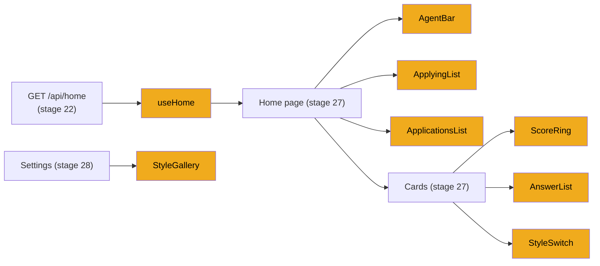

# Stage 26: Inbox building blocks

> **Goal:** Build the pieces the home inbox and the settings page are made of: the score ring, the answer list, the CV style previews, the agent bar, the two lists, and the hook that keeps the home data fresh.
>
> **By the end you will have:** seven new files that type-check and build. Nothing new shows on screen yet: stage 27 puts these pieces on the home page, and stage 28 puts the style gallery in Settings.

## Where this fits

`GET /api/home` ([stage 22](22-api-home-and-agent.md)) returns the whole home screen in one response. This stage builds the hook that polls it and the components that draw most of it. [Stage 27](27-cards-drawer-and-home.md) adds the cards, the drawer and the page that ties them together.



## New ideas in plain words

**One snapshot for the whole screen.** Home shows the agent's status, the cards, the counts, the running applications and your history. The backend returns all of it from one endpoint. One request is faster than five. More important, it's one consistent *snapshot*: the cards and the counts come from the same moment, so you never see a card that the counts say is gone. The frontend stays simple too: one fetch, one piece of state.

**Polling vs pushing.** The page needs to notice when a search finishes or a form is ready to submit. There are two ways:

| | Polling | Pushing (WebSocket) |
|---|---|---|
| How | The page asks "anything new?" every few seconds | The server keeps a connection open and sends changes |
| Pros | Plain HTTP, easy to debug, survives backend restarts | Instant, no wasted requests |
| Cons | Some wasted requests, a short delay | More code on both sides, reconnect logic |

For one person on one PC, polling is plenty. JobBee polls.

**Adaptive polling.** JobBee polls every **2 seconds** while something is happening (a search, a CV being tailored, an application being filled, a form waiting for your Submit) and every **15 seconds** otherwise. It skips polls while the browser tab is hidden and refreshes the moment you come back. The browser tells you whether the tab is visible with `document.visibilityState`, and fires a `visibilitychange` event when that changes.

**Timers.** `window.setInterval(fn, ms)` calls `fn` every `ms` milliseconds until you stop it with `window.clearInterval(id)`. In React you start a timer in an effect and stop it in the effect's cleanup function, so it never keeps running after the component is gone.

**Refs vs state.** Both survive re-renders. Changing *state* re-renders the component, and the new value is visible only on the next render. Changing a *ref* (`ref.current = true`) re-renders nothing and is visible at once. That makes a ref the right tool for "is a request already running?": two calls in a row must see each other's flag immediately.

**Custom hooks.** A function whose name starts with `use` and that calls other hooks is a *custom hook*. It lets components share logic, not only UI. `useHome` owns the home data and the polling, so the page only calls `const { home, error, refresh } = useHome()`.

**Module-level variables.** A variable declared at the top of a file, outside any component, exists once for the whole page, like a module-level variable in Python. The CV style list is fetched into one: the first component that needs it starts the request and stores the *Promise*, and every later component reuses that same Promise. Ten style menus on the page make one request.

**SVG.** SVG is a text format for drawings that the browser renders, like HTML for shapes. `<svg>` is the canvas, `<circle cx cy r>` draws a circle, and `stroke`/`strokeWidth` set its outline. In JSX you write SVG like any other element.

**iframes, `sandbox` and CSP.** An `<iframe>` shows another web page inside yours. The style gallery uses one per style for a live preview. The previews contain text from job postings and from Claude, so they're treated as untrusted, behind two locks:
- **`sandbox=""`** (set by your page) takes every power away from the framed page: it can't run scripts, submit forms, open pop-ups, or act as your site.
- **Content-Security-Policy** (set by the server, [stage 10](10-tailoring-and-pdfs.md)) is a response header that tells the browser what the page may load. The preview endpoint allows only its own inline styles, nothing else.

**ResizeObserver.** A browser API that calls you back whenever an element changes size. The previews are drawn at the real size of a page and shrunk to fit their tile; the observer tells the code the tile's width, also after you resize the window.

**`<details>` and `<summary>`.** A built-in HTML folding box. The `<summary>` line is always visible; clicking it shows or hides the rest. No JavaScript needed.

## Build it, step by step

Six components go in `frontend/src/components/`, and the hook goes in a new folder, `frontend/src/hooks/`.

### Step 1: The match score, `frontend/src/components/ScoreRing.tsx`

A match card shows Claude's fit score ([stage 9](09-screening.md)) as a ring that fills up: green from 80, honey from 60, grey below.

<!-- code: frontend/src/components/ScoreRing.tsx -->
**`frontend/src/components/ScoreRing.tsx`** (whole file, 34 lines)

```tsx
/** Match score as a ring: green from 80, honey from 60, grey below. */
export default function ScoreRing({ score, size = 52 }: { score: number | null; size?: number }) {
  const value = score ?? 0;
  const stroke = 5;
  const r = (size - stroke) / 2;
  const circumference = 2 * Math.PI * r;
  const color = value >= 80 ? "var(--ok)" : value >= 60 ? "var(--accent)" : "var(--text-3)";
  return (
    <div className="score-ring" style={{ width: size, height: size }} title={`Match ${value}/100`}>
      <svg width={size} height={size}>
        <circle
          cx={size / 2}
          cy={size / 2}
          r={r}
          fill="none"
          stroke="var(--surface-3)"
          strokeWidth={stroke}
        />
        <circle
          cx={size / 2}
          cy={size / 2}
          r={r}
          fill="none"
          stroke={color}
          strokeWidth={stroke}
          strokeLinecap="round"
          strokeDasharray={circumference}
          strokeDashoffset={circumference * (1 - value / 100)}
        />
      </svg>
      <div className="score-ring-value">{score ?? "–"}</div>
    </div>
  );
}
```
<!-- /code -->

Two circles sit on top of each other: a grey full ring (`stroke="var(--surface-3)"`), and a coloured one that's only partly drawn. The trick is SVG's dashed-line settings:

- **`strokeDasharray={circumference}`** turns the outline into dashes as long as the whole circle, with gaps of the same length. So there's exactly one dash, covering the full ring.
- **`strokeDashoffset`** slides that dash along the circle. Slide it by the full circumference and nothing shows. Slide it by 0 and the whole ring shows. For a score of 82, it slides by 18% of the length (`circumference * (1 - 82 / 100)`), so 82% of the ring is drawn.

The rest:

- **`r = (size - stroke) / 2`** keeps the 5-pixel outline inside the box. A stroke is centred on the circle's edge, so half of it would otherwise stick out. `circumference = 2 * Math.PI * r` is the school formula.
- **The colour** is picked with two chained `? :` conditions (a *ternary*, like Python's `a if cond else b`), using the colour tokens from stage 24.
- **SVG circles start drawing at three o'clock.** The `.score-ring svg` rule from stage 24 rotates the drawing by -90 degrees so the arc starts at the top. The number sits in the middle in a separate `div`.
- **No score yet** (`null`) draws an empty ring with "–". `title` shows "Match 82/100" when you hover.
- `size` defaults to 52 pixels. The drawer uses a smaller ring (46).

### Step 2: The answers a form got, `frontend/src/components/Answers.tsx`

When the apply agent finishes a form ([stage 18](18-apply-agent.md)), it reports every answer it typed, with a `source` saying where the answer came from. Most come from your profile, resume or saved answers. Three kinds deserve your eye:

| Source | Meaning | Why it's flagged |
|---|---|---|
| `judgement` | The agent's own best answer, where nothing you gave it answered the question | It might be wrong |
| `consent` | Terms, privacy statements and attestations it accepted in your name | You're agreeing to something |
| `you` | An answer you changed on the review card ([stage 21](21-run-manager.md)) | So you can see your change took |

This file shows those answers **first**, folds the rest away, and lets you change any answer. The review card (stage 27) uses it with editing, the drawer without.

#### Part 1: Source labels and the list

<!-- code: frontend/src/components/Answers.tsx lines=1-56 -->
**`frontend/src/components/Answers.tsx`** (lines 1–56 of 139)

```tsx
import { useState } from "react";
import type { AnswerSource, ApplyEvent, FilledField } from "../api";
import { describeEvent } from "../lib/format";

const SOURCES: Record<AnswerSource, { label: string; tone?: "warn" | "info" | "ok" }> = {
  profile: { label: "Profile" },
  resume: { label: "Resume" },
  standard_answer: { label: "Standard answer" },
  saved_answer: { label: "Saved answer" },
  judgement: { label: "JobBee's call", tone: "warn" },
  consent: { label: "Consent", tone: "info" },
  you: { label: "Your change", tone: "ok" },
};

const FLAGGED = new Set<string>(["judgement", "consent", "you"]);

// Event kinds worth a line in a run's summary (the full step log has the rest).
const REPORTED = new Set(["account_created", "account_signed_in", "account_rejected", "password_reset", "email_checked", "sensitive_blocked"]);

/** The answers a run filled in: JobBee's own calls, consents and your changes first. */
export function AnswerList({
  answers,
  onChange,
  disabled = false,
}: {
  answers: FilledField[];
  onChange?: (field: string, value: string) => Promise<boolean>;
  disabled?: boolean;
}) {
  const flagged = answers.filter((a) => FLAGGED.has(a.source ?? ""));
  const rest = answers.filter((a) => !FLAGGED.has(a.source ?? ""));
  const rows = (list: FilledField[]) => (
    <ul className="answer-list">
      {list.map((a, i) => (
        <AnswerRow key={`${a.field}-${i}`} answer={a} onChange={onChange} disabled={disabled} />
      ))}
    </ul>
  );
  return (
    <>
      {flagged.length > 0 && (
        <div className="answer-group">
          <div className="strong small">JobBee's calls and consents ({flagged.length})</div>
          {rows(flagged)}
        </div>
      )}
      {rest.length > 0 && (
        <details className="answer-group" open={flagged.length === 0 && rest.length <= 5}>
          <summary>From your profile and resume ({rest.length})</summary>
          {rows(rest)}
        </details>
      )}
    </>
  );
}

```
<!-- /code -->

- **`SOURCES`** is typed `Record<AnswerSource, ...>`, which forces one entry per source. Add a new source to the type in `api.ts` and forget it here, and the build fails. `tone` picks a colour from stage 24's `.answer` and `.source` rules: amber for the agent's calls, blue for consents, green for your changes.
- **`FLAGGED`** is a `Set` of the three sources that go first. **`REPORTED`** lists the event kinds worth a line in a run's highlights (part 3).
- **`AnswerList`** splits the answers in two with `filter`. `a.source ?? ""` handles an answer with no source at all.
- **`rows`** is a small function that returns JSX for a list. The key is `` `${a.field}-${i}` ``: the field label plus its position, because a long form can ask the same question label twice.
- **The flagged group** always shows, under "JobBee's calls and consents (N)". **The rest** go inside a `<details>` box, "From your profile and resume (N)". It starts open only when nothing is flagged and there are five answers or fewer.
- **`onChange` is optional.** With it, each row gets a **Change** link. Without it (in the drawer), the list is read-only. It returns a `Promise<boolean>` so the row can tell whether the change worked.

#### Part 2: One answer, with inline editing

<!-- code: frontend/src/components/Answers.tsx lines=57-119 -->
**`frontend/src/components/Answers.tsx`** (lines 57–119 of 139)

```tsx
function AnswerRow({
  answer,
  onChange,
  disabled,
}: {
  answer: FilledField;
  onChange?: (field: string, value: string) => Promise<boolean>;
  disabled: boolean;
}) {
  const [editing, setEditing] = useState(false);
  const [value, setValue] = useState(answer.value);
  const [saving, setSaving] = useState(false);
  const source = SOURCES[answer.source ?? "profile"] ?? SOURCES.profile;
  const next = value.trim();

  return (
    <li className={`answer ${source.tone ?? ""}`}>
      <div className="answer-head">
        <span className="answer-field">{answer.field}</span>
        <span className={`source ${source.tone ?? ""}`}>{source.label}</span>
      </div>
      {editing && onChange ? (
        <form
          className="input-row"
          onSubmit={(e) => {
            e.preventDefault();
            setSaving(true);
            void onChange(answer.field, next).then((ok) => {
              setSaving(false);
              if (ok) setEditing(false);
            });
          }}
        >
          <input autoFocus value={value} aria-label={`New answer for ${answer.field}`} onChange={(e) => setValue(e.target.value)} />
          <button className="primary sm" disabled={saving || !next || next === answer.value}>
            Save
          </button>
          <button
            type="button"
            className="ghost sm"
            onClick={() => {
              setEditing(false);
              setValue(answer.value);
            }}
          >
            Cancel
          </button>
        </form>
      ) : (
        <div className="answer-value">
          <span>{answer.value || "—"}</span>
          {onChange && (
            <button className="link small" disabled={disabled} onClick={() => setEditing(true)}>
              Change
            </button>
          )}
        </div>
      )}
      {answer.note && <div className="small faint">{answer.note}</div>}
    </li>
  );
}

```
<!-- /code -->

Each `AnswerRow` keeps a little state of its own: `editing`, the draft `value` and `saving`. Because it's a separate component, every row has its own copy.

- **The source label** is looked up with two fallbacks: `SOURCES[answer.source ?? "profile"] ?? SOURCES.profile`. If the backend ever sends a source this file doesn't know, the row shows "Profile" instead of crashing.
- **Editing** shows a small form: a text box (`autoFocus` puts the cursor in it at once), **Save** and **Cancel**.
  - `onSubmit` calls `e.preventDefault()` (no page reload), sets `saving`, and calls `onChange(field, next)`. The editor closes only if `onChange` reports success, so a failed request leaves your text in place to try again.
  - **Save** is disabled while saving, for an empty answer, or when nothing changed (`next === answer.value`).
  - **Cancel** has `type="button"`, so it doesn't submit the form, and puts the original value back.
- **Not editing** shows the value ("—" if empty) and the **Change** link. `disabled` turns the link off while the card is busy or the form is being updated.
- `answer.note` is the agent's one-line reason for a judgement call, or what a consent agreed to.

#### Part 3: A run's highlights

<!-- code: frontend/src/components/Answers.tsx lines=120-139 -->
**`frontend/src/components/Answers.tsx`** (lines 120–139 of 139)

```tsx
/** The headline facts of a run: accounts, emails, consents and fields left for you. */
export function RunHighlights({ events, answers }: { events: ApplyEvent[]; answers: FilledField[] }) {
  const lines = events
    .filter((e) => REPORTED.has(e.kind))
    .map((e) => ({ key: `e${e.id}`, text: describeEvent(e) }))
    .concat(
      answers
        .filter((a) => a.source === "consent")
        .map((a, i) => ({ key: `c${i}`, text: `Agreed to ${a.note || a.field}` })),
    )
    .filter((l): l is { key: string; text: string } => Boolean(l.text));
  if (lines.length === 0) return null;
  return (
    <ul className="highlights">
      {lines.map((l) => (
        <li key={l.key}>{l.text}</li>
      ))}
    </ul>
  );
}
```
<!-- /code -->

`RunHighlights` lists the headline facts of one apply run for the drawer (stage 27): the account and email events ([stage 20](20-site-accounts.md)), described with `describeEvent` from stage 24, plus "Agreed to …" for each consent answer.

- `.concat(...)` joins two lists, like `+` on Python lists.
- The last `.filter((l): l is { key: string; text: string } => Boolean(l.text))` drops lines with no text. The `l is ...` part is a *type predicate*: it tells TypeScript that after this filter, `text` is a string, never `null`.
- A component that returns `null` draws nothing, so a run with no highlights adds no empty list.

### Step 3: CV style previews, `frontend/src/components/DocumentStyle.tsx`

Tailoring ([stage 10](10-tailoring-and-pdfs.md)) keeps a CV's *content* separate from its *look*: five styles, each a block of CSS. This file shows live previews of them (for Settings) and a small menu that switches one job's CV to another style (for the cards).

#### Part 1: The shared style list, a width hook and a preview tile

<!-- code: frontend/src/components/DocumentStyle.tsx lines=1-57 -->
**`frontend/src/components/DocumentStyle.tsx`** (lines 1–57 of 155)

```tsx
import { useEffect, useRef, useState } from "react";
import { api, type DocumentStyle } from "../api";
import Icon from "./Icon";
import { useAction } from "./Toast";

const PAGE_WIDTH = 816; // 8.5in at 96dpi, what the preview page is laid out for
const PAGE_HEIGHT = 1056;

let stylesRequest: Promise<DocumentStyle[]> | null = null;

/** The CV styles, fetched once per page load. */
function useStyles(): DocumentStyle[] | null {
  const [styles, setStyles] = useState<DocumentStyle[] | null>(null);
  useEffect(() => {
    if (!stylesRequest) {
      stylesRequest = api.documentStyles().catch((e) => {
        stylesRequest = null;
        throw e;
      });
    }
    stylesRequest.then(setStyles).catch(() => setStyles(null));
  }, []);
  return styles;
}

function useWidth<T extends HTMLElement>() {
  const ref = useRef<T>(null);
  const [width, setWidth] = useState(0);
  useEffect(() => {
    const el = ref.current;
    if (!el) return;
    const observer = new ResizeObserver(([entry]) => setWidth(entry.contentRect.width));
    observer.observe(el);
    return () => observer.disconnect();
  }, []);
  return [ref, width] as const;
}

function Thumb({ style, kind }: { style: DocumentStyle; kind: "resume" | "cover_letter" }) {
  const [ref, width] = useWidth<HTMLDivElement>();
  const scale = width / PAGE_WIDTH;
  return (
    <div ref={ref} className="style-thumb">
      {width > 0 && (
        <iframe
          src={api.stylePreviewUrl(style.id, kind)}
          title={`${style.name} preview`}
          sandbox=""
          tabIndex={-1}
          aria-hidden="true"
          style={{ width: PAGE_WIDTH, height: PAGE_HEIGHT, transform: `scale(${scale})` }}
        />
      )}
    </div>
  );
}

```
<!-- /code -->

- **`PAGE_WIDTH` and `PAGE_HEIGHT`** are a US Letter page (8.5 × 11 inches) at 96 pixels per inch, the size the preview page is laid out for.
- **`stylesRequest`** is the module-level Promise cache from "New ideas". `useStyles` starts the request only if no one has yet, then waits on the shared Promise. If the request fails, the `.catch` clears the cache (so the next component to appear tries again) and re-throws, so this caller still sees the failure and sets `styles` to `null`.
- **`useWidth`** is a small generic custom hook. It attaches a `ResizeObserver` to the element in `ref` and stores its width. `([entry]) => ...` destructures the first item of the list the observer passes. The cleanup disconnects the observer when the element goes away. `return [ref, width] as const` returns a fixed pair, like a Python tuple, so each item keeps its own type.
- **`Thumb`** draws one preview:
  - The iframe is drawn at full page size (816 × 1056 pixels), so the CV lays out exactly as it will print. `transform: scale(...)` then shrinks it to the tile's width. Stage 24's `.style-thumb` rules give the tile the page's shape and make the iframe shrink towards its top-left corner.
  - The iframe is created only once the width is known (`width > 0`), so it never loads at scale 0.
  - `src` is `GET /api/documents/styles/{id}/preview` ([stage 10](10-tailoring-and-pdfs.md)), which fills the style with your latest tailored CV, or a sample CV until you have one.
  - `sandbox=""` removes every power from the preview page. `tabIndex={-1}` and `aria-hidden` keep keyboard focus and screen readers out of it; the button around the tile is what you interact with.

#### Part 2: The gallery for Settings

<!-- code: frontend/src/components/DocumentStyle.tsx lines=58-113 -->
**`frontend/src/components/DocumentStyle.tsx`** (lines 58–113 of 155)

```tsx
/** Settings: pick the style every new CV and cover letter uses. */
export function StyleGallery({
  value,
  onChange,
}: {
  value: string | null;
  onChange: (style: string) => Promise<void>;
}) {
  const styles = useStyles();
  const [kind, setKind] = useState<"resume" | "cover_letter">("resume");
  const { busy, run } = useAction();

  if (!styles) return <div className="skeleton" style={{ height: 260 }} />;

  return (
    <div className="stack">
      <div className="segmented" role="tablist" aria-label="Preview" style={{ alignSelf: "flex-start" }}>
        <button className={kind === "resume" ? "on" : ""} onClick={() => setKind("resume")}>
          CV
        </button>
        <button className={kind === "cover_letter" ? "on" : ""} onClick={() => setKind("cover_letter")}>
          Cover letter
        </button>
      </div>
      <div className="style-grid" role="radiogroup" aria-label="CV style">
        {styles.map((s) => {
          const chosen = s.id === value;
          return (
            <div key={s.id} className={`style-tile ${chosen ? "on" : ""}`}>
              <button
                className="style-pick"
                role="radio"
                aria-checked={chosen}
                disabled={busy}
                onClick={() => {
                  if (!chosen) void run(() => onChange(s.id), `New CVs will use the ${s.name} style.`);
                }}
              >
                <Thumb style={s} kind={kind} />
                <span className="style-name">
                  {s.name}
                  {chosen && <Icon name="check" />}
                </span>
                <span className="tiny muted style-desc">{s.description}</span>
              </button>
              <a className="tiny style-open" href={api.stylePreviewUrl(s.id, kind)} target="_blank" rel="noreferrer">
                Full size <Icon name="external" />
              </a>
            </div>
          );
        })}
      </div>
    </div>
  );
}

```
<!-- /code -->

`StyleGallery` shows one tile per style, and saves the one you click as the style for every new CV. Settings uses it in stage 28.

- **Props.** `value` is the current style. `onChange` is an `async` function the parent provides, which saves the choice.
- **A skeleton** shows until the style list has loaded.
- **The CV / Cover letter toggle** (a `.segmented` row) switches every tile between the two documents.
- **Each tile** is a button with `role="radio"` and `aria-checked`, inside a `role="radiogroup"`: screen readers announce "one of five, selected". Clicking an unchosen tile runs `onChange` through `useAction`, which shows "New CVs will use the Modern style." Every tile is disabled while a save runs.
- **"Full size"** is a plain link that opens the preview in a new tab (`target="_blank"`). `rel="noreferrer"` stops the new tab from getting a handle back to this page.

#### Part 3: The style menu for one CV

<!-- code: frontend/src/components/DocumentStyle.tsx lines=114-155 -->
**`frontend/src/components/DocumentStyle.tsx`** (lines 114–155 of 155)

```tsx
/** On a card or in the drawer: render this job's CV and letter in another style. */
export function StyleSwitch({
  applicationId,
  style,
  onChanged,
}: {
  applicationId: number;
  style: string | null;
  onChanged: () => void;
}) {
  const styles = useStyles();
  const { busy, run } = useAction();

  if (!styles) return null;
  const current = style ?? "";

  return (
    <label className="style-switch">
      <span className="tiny muted">Style</span>
      {busy && <span className="spinner" />}
      <select
        value={current}
        disabled={busy}
        aria-label="CV style for this job"
        onChange={(e) => {
          const next = e.target.value;
          void run(
            () => api.restyle(applicationId, next),
            (r) => (r as { message: string }).message,
          ).then((ok) => ok && onChanged());
        }}
      >
        {!current && <option value="">Original</option>}
        {styles.map((s) => (
          <option key={s.id} value={s.id}>
            {s.name}
          </option>
        ))}
      </select>
    </label>
  );
}
```
<!-- /code -->

`StyleSwitch` is a small dropdown on a match card and in the drawer (stage 27). Picking a style calls `api.restyle`, which is `POST /api/applications/{id}/style` ([stage 23](23-api-actions-and-setup.md)). The job flow ([stage 12](12-the-job-flow.md)) reprints the stored CV content with the new style's CSS. No model is called, so it's free and takes a second or two. (A CV made before styles existed has no stored content; for those, the backend tailors it again in the chosen style, which does call Claude once.)

- **It renders nothing** (`return null`) until the style list has loaded.
- **`current`** is the CV's style, or `""` when it has none. The extra "Original" option appears only then, so the `<select>` always has an option matching its value.
- **The toast** is the server's own message (the function form of `run`'s second argument), and `onChanged` refreshes the card on success.
- A spinner shows next to "Style" while the restyle runs, and the menu is disabled.

### Step 4: The agent bar, `frontend/src/components/AgentBar.tsx`

The card at the top of Home answers "what is JobBee looking for, what is it doing, and when does it search next?". It also holds the two things you can ask of it: search now, or read a link you paste.

#### Part 1: What it's looking for, and Pause

<!-- code: frontend/src/components/AgentBar.tsx lines=1-56 -->
**`frontend/src/components/AgentBar.tsx`** (lines 1–56 of 164)

```tsx
import { useState } from "react";
import { Link } from "react-router-dom";
import { api, type AgentStatus } from "../api";
import { timeAgo, usd, when } from "../lib/format";
import Icon from "./Icon";
import { useAction } from "./Toast";

/** What the agent is looking for, what it's doing, and the two things you can ask of it. */
export default function AgentBar({
  agent,
  onChanged,
}: {
  agent: AgentStatus;
  onChanged: () => void;
}) {
  const { busy, run } = useAction();
  const last = agent.last_search;

  return (
    <section className="card agent-bar">
      <div className="row between nowrap" style={{ alignItems: "flex-start" }}>
        <div className="grow">
          <div className="eyebrow">Looking for</div>
          <div className="agent-looking">{agent.looking_for}</div>
        </div>
        <div className="row nowrap" style={{ gap: 4 }}>
          <Link to="/settings#preferences" className="btn btn-sm ghost">
            Edit
          </Link>
          {agent.paused ? (
            <button
              className="sm primary"
              disabled={busy}
              onClick={() => void run(() => api.resume(), "Back on.").then(onChanged)}
            >
              <Icon name="play" />
              Resume
            </button>
          ) : (
            <button
              className="sm ghost"
              disabled={busy}
              title="Stop new searches and applications until you resume"
              onClick={() =>
                void run(() => api.pause(), "Paused. Nothing new starts until you resume.").then(
                  onChanged,
                )
              }
            >
              <Icon name="pause" />
              Pause
            </button>
          )}
        </div>
      </div>

```
<!-- /code -->

- **Props.** `agent` is the `AgentStatus` from `GET /api/home`. `onChanged` is the page's `refresh`, called after an action so the screen shows the new state.
- **"Looking for"** is the line the backend builds from your roles and places ("Backend Engineer · Toronto, Remote").
- **Edit** is a react-router `Link` to `/settings#preferences`. The part after `#` (the *hash*) names the section to scroll to; stage 28 makes Settings scroll there.
- **Pause / Resume** call `POST /api/agent/pause` and `/resume` ([stage 22](22-api-home-and-agent.md)), which flip the pause flag from [stage 5](05-flags-and-app-config.md). While paused, no search or application starts. These buttons call `onChanged` whatever the result (`.then(onChanged)`), so the bar refreshes either way.

#### Part 2: The status line, warnings and actions

<!-- code: frontend/src/components/AgentBar.tsx lines=57-127 -->
**`frontend/src/components/AgentBar.tsx`** (lines 57–127 of 164)

```tsx
      <div className="agent-meta" style={{ marginTop: 10 }}>
        {agent.searching ? (
          <span style={{ color: "var(--info)" }}>
            <span className="spinner" />
            {agent.search_stage ?? "Searching"}…
          </span>
        ) : agent.paused ? (
          <span style={{ color: "var(--warn)" }}>
            <Icon name="pause" />
            Paused: no searches or applications start
          </span>
        ) : agent.next_search_at ? (
          <span>
            <Icon name="clock" />
            {new Date(agent.next_search_at).getTime() <= Date.now() + 60_000
              ? "Searching shortly"
              : `Next search ${when(agent.next_search_at)}`}
          </span>
        ) : null}
        <span>
          <Icon name="send" />
          {agent.sent_today} of {agent.jobs_per_day} sent today
        </span>
        <span title="Claude usage today">
          <Icon name="money" />
          {usd(agent.spend_today_usd)} today
        </span>
      </div>

      {last && !agent.searching && last.status === "done" && (
        <div className="small faint" style={{ marginTop: 6 }}>
          Last search {timeAgo(last.finished_at ?? last.started_at)}: found {last.found}, kept{" "}
          {last.kept}, sent {last.sent}.{last.error ? ` Some sources failed: ${last.error}` : ""}
        </div>
      )}
      {last && !agent.searching && last.status !== "done" && (
        <div className="notice bad small" style={{ marginTop: 12 }}>
          <Icon name="alert" />
          <span>
            The last search {timeAgo(last.started_at)} didn't finish: {last.error ?? last.status}
          </span>
        </div>
      )}

      {agent.budget_reached && (
        <div className="notice warn small" style={{ marginTop: 12 }}>
          <Icon name="alert" />
          <span>
            Today's Claude budget ({usd(agent.daily_budget_usd)}) is used up, so JobBee waits until
            tomorrow. <Link to="/settings#claude">Change the budget</Link>
          </span>
        </div>
      )}

      <div className="agent-actions">
        <button
          className="primary"
          disabled={busy || agent.searching}
          onClick={() =>
            void run(() => api.searchNow(), "Searching for jobs…").then((ok) => ok && onChanged())
          }
        >
          <Icon name="search" />
          {agent.searching ? "Searching…" : "Find jobs now"}
        </button>
        <LinkInput onAdded={onChanged} />
      </div>
    </section>
  );
}

```
<!-- /code -->

- **The status line** shows one of three states, in order: searching (with the stage, such as "Checking which ones fit…", and a spinner), paused, or the next search time. A next search less than a minute away (`60_000` milliseconds) reads "Searching shortly". After that come two facts that always show: how many cards were sent today out of your daily number, and today's Claude spend.
- **The last search.** When the last search finished, a faint line summarises it: found, kept, sent, and any sources that failed. When it didn't finish, a red notice says why.
- **The budget warning** appears when today's Claude spending limit ([stage 6](06-talking-to-claude.md)) is used up, with a link to `/settings#claude` to change it. It explains why nothing new is happening.
- **Find jobs now** calls `POST /api/agent/search`. It's disabled while a search runs. `.then((ok) => ok && onChanged())` refreshes only if the request worked, so a 409 "A search is already running." shows its red toast and nothing else.

#### Part 3: The paste-a-link box

<!-- code: frontend/src/components/AgentBar.tsx lines=128-164 -->
**`frontend/src/components/AgentBar.tsx`** (lines 128–164 of 164)

```tsx
function LinkInput({ onAdded }: { onAdded: () => void }) {
  const [url, setUrl] = useState("");
  const { busy, run } = useAction();

  const submit = () =>
    void run(
      () => api.addLink(url.trim()),
      (r) => (r as { message: string }).message,
    ).then((ok) => {
      if (ok) {
        setUrl("");
        onAdded();
      }
    });

  return (
    <form
      className="input-row link-input"
      onSubmit={(e) => {
        e.preventDefault();
        if (url.trim()) submit();
      }}
    >
      <input
        value={url}
        inputMode="url"
        placeholder="Paste a job link (Greenhouse, Lever, Workday…)"
        onChange={(e) => setUrl(e.target.value)}
        aria-label="Job posting link"
      />
      <button disabled={busy || url.trim().length < 8}>
        {busy ? <span className="spinner" /> : <Icon name="link" />}
        Add
      </button>
    </form>
  );
}
```
<!-- /code -->

`LinkInput` sends a job link you paste to `POST /api/jobs/link` ([stage 22](22-api-home-and-agent.md)), which reads the posting and starts screening and tailoring it.

- **The toast is the server's reply.** The second argument to `run` is a function, `(r) => (r as { message: string }).message`, so the toast reads "Got it. Checking the fit and tailoring your CV…" or "You already have this one (…)", whatever the backend answered. `r` arrives as `unknown`, so the cast tells TypeScript it has a `message`.
- **The box is cleared only on success**, so a mistyped link stays there for you to fix.
- **`inputMode="url"`** asks phones for a keyboard with `/` and `.com` keys.
- **Add** is disabled until there are at least 8 characters, the backend's own minimum length for a link.

### Step 5: Your history, `frontend/src/components/ApplicationsList.tsx`

"Your applications" groups every application into five tabs. The backend sorts each application into a tab and gives it a label (`status_view`, [stage 22](22-api-home-and-agent.md)). This component only draws them.

<!-- code: frontend/src/components/ApplicationsList.tsx -->
**`frontend/src/components/ApplicationsList.tsx`** (whole file, 77 lines)

```tsx
import { useState } from "react";
import type { ApplicationGroup, ApplicationRow } from "../api";
import { initials, timeAgo } from "../lib/format";
import Icon from "./Icon";

const TABS: { key: ApplicationGroup; label: string }[] = [
  { key: "applied", label: "Applied" },
  { key: "in_progress", label: "In progress" },
  { key: "skipped", label: "Skipped" },
  { key: "not_a_fit", label: "Not a fit" },
  { key: "didnt_finish", label: "Didn't finish" },
];

const BADGE: Record<ApplicationGroup, string> = {
  applied: "ok",
  in_progress: "accent",
  skipped: "",
  not_a_fit: "",
  didnt_finish: "bad",
};

/** Your history, by outcome. Click a row for details. */
export default function ApplicationsList({
  rows,
  counts,
  onOpen,
}: {
  rows: ApplicationRow[];
  counts: Record<string, number>;
  onOpen: (applicationId: number) => void;
}) {
  const firstNonEmpty = TABS.find((t) => (counts[t.key] ?? 0) > 0)?.key ?? "applied";
  const [tab, setTab] = useState<ApplicationGroup | null>(null);
  const active = tab ?? firstNonEmpty;
  const visible = rows.filter((r) => r.group === active);

  return (
    <>
      <div className="tabs" role="tablist">
        {TABS.map((t) => (
          <button
            key={t.key}
            role="tab"
            aria-selected={active === t.key}
            className={active === t.key ? "on" : ""}
            onClick={() => setTab(t.key)}
          >
            {t.label} <span className="n">{counts[t.key] ?? 0}</span>
          </button>
        ))}
      </div>
      {visible.length === 0 ? (
        <div className="card empty small">Nothing here yet.</div>
      ) : (
        <div className="list">
          {visible.map((row) => (
            <button key={row.id} className="list-row" onClick={() => onOpen(row.id)}>
              <div className="avatar">{initials(row.job.company ?? row.job.title)}</div>
              <div className="grow">
                <div className="strong truncate">{row.job.title}</div>
                <div className="small muted truncate">
                  {row.job.company ?? "Unknown company"}
                  {row.stage_reason && row.group !== "applied" ? ` · ${row.stage_reason}` : ""}
                </div>
              </div>
              <div className="stack tight" style={{ alignItems: "flex-end" }}>
                <span className={`badge ${BADGE[row.group]}`}>{row.label}</span>
                <span className="tiny faint">{timeAgo(row.submitted_at ?? row.updated_at)}</span>
              </div>
              <Icon name="chevron" className="icon faint" />
            </button>
          ))}
        </div>
      )}
    </>
  );
}
```
<!-- /code -->

- **`TABS`** lists the tabs in order. **`BADGE`** picks each tab's badge colour. It's typed `Record<ApplicationGroup, string>`, so every tab must have an entry.
- **Which tab is open.** Until you click one, `tab` is `null` and the list shows the first tab that has anything in it (`firstNonEmpty`). Once you click, your choice sticks across polls. `active = tab ?? firstNonEmpty` is calculated on every render, not stored.
- **`TABS.find(...)?.key ?? "applied"`**: `find` returns the first match or `undefined`, `?.key` reads its key safely, and `?? "applied"` is the fallback when every tab is empty.
- **Each tab button** shows its count from `counts`. The backend counts every application but sends at most 300 rows, so the counts stay right even when the list is cut short.
- **Each row** is a button, so the whole row is clickable. It shows the company's initials, the title, the company and why it stopped (`stage_reason`, such as "Skipped: Salary"), a coloured badge, and how long ago it changed. Clicking calls `onOpen(row.id)`, which opens the drawer in stage 27.

### Step 6: Applications in progress, `frontend/src/components/ApplyingList.tsx`

"Applying now" lists the apply runs that are busy: queued, starting, filling in the form, or waiting for you. The run manager ([stage 21](21-run-manager.md)) fills one form at a time; the rest wait their turn.

<!-- code: frontend/src/components/ApplyingList.tsx -->
**`frontend/src/components/ApplyingList.tsx`** (whole file, 82 lines)

```tsx
import { api, type ApplyingRow } from "../api";
import { describeEvent } from "../lib/format";
import Icon from "./Icon";
import { useAction } from "./Toast";

const STATUS: Record<string, string> = {
  queued: "Waiting its turn",
  starting: "Opening the application",
  running: "Filling in the form",
  needs_user: "Waiting for your answer",
  needs_human: "Waiting for you at your PC",
  submitting: "Submitting",
};

/** Applications the agent is filling right now (one at a time; the rest queue). */
export default function ApplyingList({
  rows,
  paused,
  onOpen,
  onChanged,
}: {
  rows: ApplyingRow[];
  paused: boolean;
  onOpen: (applicationId: number) => void;
  onChanged: () => void;
}) {
  return (
    <div className="list">
      {rows.map((row) => (
        <ApplyingItem key={row.run_id} row={row} paused={paused} onOpen={onOpen} onChanged={onChanged} />
      ))}
    </div>
  );
}

function ApplyingItem({
  row,
  paused,
  onOpen,
  onChanged,
}: {
  row: ApplyingRow;
  paused: boolean;
  onOpen: (applicationId: number) => void;
  onChanged: () => void;
}) {
  const { busy, run } = useAction();
  const step = row.last_event ? describeEvent(row.last_event) : null;
  const waiting = row.status === "queued";
  const detail =
    waiting && paused
      ? "Paused: resume to start"
      : row.status === "running" && step
        ? step
        : STATUS[row.status] ?? row.status;

  return (
    <div className="list-row">
      {waiting ? <Icon name="clock" className="icon faint" /> : <span className="spinner" />}
      <button className="row-link grow" onClick={() => onOpen(row.application_id)}>
        <span className="strong truncate">
          {row.job.title}
          {row.job.company ? ` · ${row.job.company}` : ""}
        </span>
        <span className="small muted truncate">{detail}</span>
      </button>
      {!waiting && (
        <button className="sm ghost" disabled={busy} onClick={() => void run(() => api.focusRun(row.run_id))}>
          <Icon name="monitor" />
          <span className="hide-sm">Show</span>
        </button>
      )}
      <button
        className="sm ghost danger"
        disabled={busy}
        onClick={() => void run(() => api.cancelRun(row.run_id), "Stopped.").then((ok) => ok && onChanged())}
      >
        Stop
      </button>
    </div>
  );
}
```
<!-- /code -->

- **Why two components?** Each row needs its own `useAction`, so that stopping one run doesn't disable the buttons on every other row. Hooks can't be called inside a loop (stage 24's one strict rule), so each row is its own component, `ApplyingItem`, and `ApplyingList` maps the rows to it, keyed by `run_id`.
- **The live progress line.** While a run is `running`, the row shows its latest step in words ("Filling in Toronto", "Clicking through the form"), from `describeEvent` (stage 24) on the `last_event` the backend sends. Otherwise it shows a fixed phrase from `STATUS`, or the raw status if the phrase is missing.
- **Paused** is called out: a queued run won't start until you resume.
- **Show** calls `POST /api/apply-runs/{id}/focus`, which brings the run's Chrome tab to the front. It's hidden for queued runs, which have no tab yet. **Stop** calls `/cancel` and refreshes the page. The title opens the drawer.
- A clock icon marks a waiting run, a spinner a working one.

### Step 7: Keeping the data fresh, `frontend/src/hooks/useHome.ts`

`useHome` owns the home data and polls `GET /api/home`. Create the `hooks` folder for it.

<!-- code: frontend/src/hooks/useHome.ts -->
**`frontend/src/hooks/useHome.ts`** (whole file, 49 lines)

```ts
import { useCallback, useEffect, useRef, useState } from "react";
import { api, type Home } from "../api";

const FAST_MS = 2000;
const SLOW_MS = 15000;

/** Polls /api/home: every 2s while something is happening, every 15s otherwise. */
export function useHome() {
  const [home, setHome] = useState<Home | null>(null);
  const [error, setError] = useState<string | null>(null);
  const inFlight = useRef(false);

  const refresh = useCallback(async () => {
    if (inFlight.current) return;
    inFlight.current = true;
    try {
      setHome(await api.home());
      setError(null);
    } catch (e) {
      setError(e instanceof Error ? e.message : String(e));
    } finally {
      inFlight.current = false;
    }
  }, []);

  const live =
    home != null &&
    (home.agent.searching ||
      home.applying.length > 0 ||
      home.needs_you.some((c) => c.type === "preparing" || c.type === "review"));

  useEffect(() => {
    void refresh();
  }, [refresh]);

  useEffect(() => {
    const tick = () => {
      if (document.visibilityState === "visible") void refresh();
    };
    const timer = window.setInterval(tick, live ? FAST_MS : SLOW_MS);
    document.addEventListener("visibilitychange", tick);
    return () => {
      window.clearInterval(timer);
      document.removeEventListener("visibilitychange", tick);
    };
  }, [live, refresh]);

  return { home, error, refresh };
}
```
<!-- /code -->

- **`refresh`** loads the home data once. `inFlight` is a **ref**, not state. If a request takes longer than the interval, the next `refresh` sees `inFlight.current === true` and does nothing, so requests never overlap and an older answer can't overwrite a newer one. It also absorbs StrictMode's double effect on mount. State would be wrong here: a state update is visible only on the next render, so two calls in a row would both see "not in flight".
- **A failed poll keeps the old data.** `setError` stores the message, which the page shows above the content, and the next successful poll clears it.
- **`live`** is calculated from the data on every render. It's true while a search runs, an application is being filled, a CV is being prepared, or a review card is showing. The review card counts because it has a countdown ("form stays open 38 more min") and it updates itself after you change an answer.
- **The first effect** loads the data once, when the page appears.
- **The second effect** starts the interval: 2 seconds when `live`, 15 seconds otherwise. Its cleanup stops the interval and removes the listener. Because `live` is in the dependency list, React runs the cleanup and starts a new interval whenever the page switches between busy and idle.
- **`tick`** skips the poll while the tab is hidden. The same `tick` also listens for `visibilitychange`, so coming back to the tab refreshes at once.

## Check it works

1. **Build** from `frontend\`:

   ```powershell
   npm run build
   ```

   It should end with `✓ built in ...`. Nothing imports these files yet, but `tsc` checks every file in `src/`, so a typo here still fails the build.

2. **Look at the data these components will draw.** With the backend running, open http://127.0.0.1:8000/docs and try `GET /api/home`. Find `agent` (the agent bar), `applying` (Applying now), `applications` and `counts` (your history), and `needs_you` (the cards of stage 27).
3. **Open a style preview.** With both servers running, open http://localhost:5173/api/documents/styles/modern/preview in the browser. You see a CV in the Modern style, filled with your latest tailored CV or the sample. Try `classic`, `minimal`, `compact` and `bold`, and add `?kind=cover_letter`.
4. **Optional: see a score ring now.** Temporarily replace the body of the `Home` placeholder from stage 24 so it shows three rings, then open http://localhost:5173:

   ```tsx
   import ScoreRing from "../components/ScoreRing";

   export default function Home() {
     return (
       <div className="card row">
         <ScoreRing score={92} />
         <ScoreRing score={70} />
         <ScoreRing score={null} />
       </div>
     );
   }
   ```

   You see a green ring nine-tenths full, a honey one at 70%, and an empty one with "–". Stage 27 replaces this file anyway.

<!-- verify: frontend | npm run build -->

## Common mistakes

- **Polling too fast**: polling every 200 ms "to feel instant" makes hundreds of requests a minute, each running several database queries. Poll fast only while something is changing, and slowly otherwise.
- **Overlapping requests**: with `setInterval` and a slow backend, a new request starts before the last one answers, and an older response can land after a newer one and overwrite it. The `inFlight` ref skips a poll while one is still running.
- **A flag in state instead of a ref**: `const [busy, setBusy] = useState(false)` in `refresh` wouldn't stop a second call made before the next render, because both calls see the old `false`. Use a ref for "is this running right now?".
- **Forgetting to clean up an interval**: an effect that calls `setInterval` without returning `clearInterval` leaves the timer running after the component is gone, and StrictMode would start a second one at once. Always return the cleanup.
- **Calling a hook inside a loop**: `rows.map((row) => { const { busy } = useAction(); ... })` breaks React's rule that hooks run in the same order on every render. Make each row its own component, as `ApplyingItem` does.
- **An iframe without `sandbox` for content you didn't write**: an unsandboxed preview from your own origin could run scripts with your page's powers, including calling your API. Use `sandbox=""` and add back only what you need.

## Recap

- `GET /api/home` is one consistent snapshot, and `useHome` keeps it fresh: every 2 s while something is happening, every 15 s otherwise, never while the tab is hidden, and never two requests at once.
- A ref holds the "in flight" flag because it changes instantly and causes no re-render.
- `ScoreRing` draws a partial circle with one long SVG dash slid along the outline.
- `AnswerList` shows the agent's judgement calls, consents and your changes first, and each row can be edited in place.
- Style previews are untrusted pages, shown in `sandbox=""` iframes, scaled from a full page with a `ResizeObserver`. One shared Promise fetches the style list once per page.
- `AgentBar`, `ApplicationsList` and `ApplyingList` draw parts of the snapshot, and every button uses `useAction` and calls `onChanged` to refresh.

**Next:** [Stage 27: Cards, the drawer and the home page](27-cards-drawer-and-home.md)
