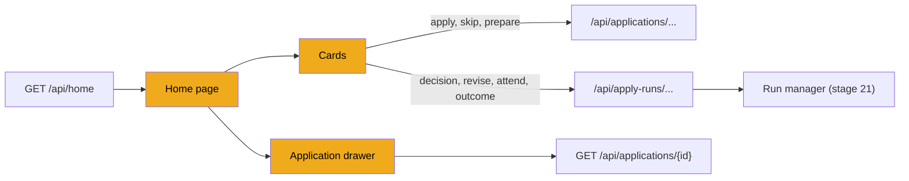
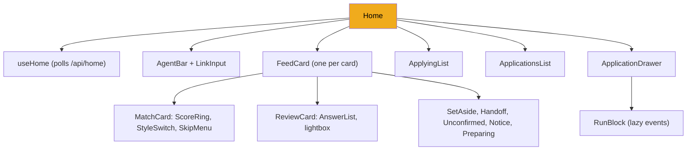
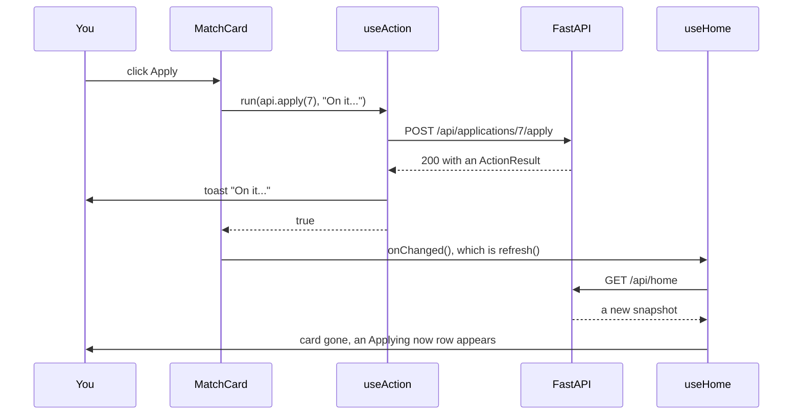

# Stage 27: Cards, the drawer and the home page

> **Goal:** Build the home inbox: the "Needs you" cards with their Apply, Skip and Submit buttons, the drawer with everything about one application, and the page that puts them together with stage 26's pieces.
>
> **By the end you will have:** a working Home page. JobBee's matches show up as cards with a score and a tailored CV, filled forms show up as review cards with a screenshot and every answer, and a click on any application opens its full history.

## Where this fits

Stage 26 built the building blocks and the polling hook. This stage builds the cards that call the action endpoints of [stage 23](23-api-actions-and-setup.md), and replaces the placeholder `Home.tsx` from [stage 24](24-frontend-basics.md) with the real page.



## New ideas in plain words

**Discriminated unions.** The "Needs you" list mixes seven kinds of cards: matches, four kinds of apply-run cards, notices and "preparing" placeholders. Each kind has different fields, but every one has a `type` field with a fixed string. The `type` field *discriminates* between them:

```ts
type Card = MatchCard | RunCard | PreparingCard | NoticeCard;
// MatchCard has type: "match", NoticeCard has type: "notice", ...
```

After `switch (card.type) { case "match": ... }`, TypeScript knows that inside that case `card` is a `MatchCard`. So `card.score` is allowed there, and passing that card to the notice component is a build error. Python has the same idea: Pydantic models that each have a `Literal` type field, branched on with `match card.type:`. The backend's card schemas ([stage 4](04-api-shapes-health-and-tests.md), filled in by `api/home.py` in [stage 22](22-api-home-and-agent.md)) are built exactly that way.

**Stable keys between polls.** Home re-renders every 2 or 15 seconds with fresh data. React matches old and new cards by their `key`. If a card's key stays the same, React keeps the component and its state (an open Skip menu, a half-typed answer). If the key changed on every poll, React would rebuild every card each time, and open menus would close by themselves.

**The `onChanged` pattern.** Home owns the data, and the cards never edit it. Each card that performs an action receives an `onChanged` function and calls it after the action succeeds. Home then fetches a fresh snapshot, so the screen always shows what the server says, not a guess about what the action probably did.

**Show exactly what will be sent.** Before you approve something on your own behalf, you need to see it. The review card shows a screenshot of the form's final page (the page the Submit click will happen on) plus every answer the agent gave, across all pages. You don't have to scroll through a twelve-page form in Chrome to check it.

**The human is the final gate.** The agent can't submit. The guards of [stage 16](16-safety-guards.md) block submit clicks, and the driver of [stage 17](17-guarded-driver.md) refuses them. Only your click on **Submit application** reaches the run manager's `decide` ([stage 21](21-run-manager.md)), which clicks the final submit button once, on the page you reviewed. The UI's job is to make that click an informed one, and impossible to make at the wrong moment.

**Unconfirmed outcomes.** After the Submit click, JobBee looks for a "thank you" page. Sometimes it doesn't find one: the site shows a page with no clear words, or JobBee couldn't find a single safe submit button. Then the honest answer is "I don't know", and a card asks you to check the tab and say whether it went through.

**Lazy loading.** Load data only when someone looks at it. The drawer lists every apply run of an application, but fetches a run's step log only when you open that run's box.

**Listening on the whole page.** Some behaviour needs events from outside a component: closing a menu when you click elsewhere, or closing the drawer with Escape. An effect adds a listener with `document.addEventListener(...)` (or `window.`) and removes it in its cleanup, so listeners never pile up.

## Build it, step by step

### Step 1: The cards, `frontend/src/components/cards.tsx`

One file holds every card type, because they share helpers (`JobLine`, `ShowBrowser`) and the dispatcher that picks the right card.

#### Part 1: Shared types, the dispatcher, keys and the job line

<!-- code: frontend/src/components/cards.tsx lines=1-93 -->
**`frontend/src/components/cards.tsx`** (lines 1–93 of 545)

```tsx
import { useEffect, useRef, useState } from "react";
import {
  api,
  type Card,
  type JobInfo,
  type MatchCard as Match,
  type NoticeCard as Notice,
  type PreparingCard as Preparing,
  type RunCard,
  type SkipReason,
} from "../api";
import { minutesLeft, timeAgo } from "../lib/format";
import { AnswerList } from "./Answers";
import { StyleSwitch } from "./DocumentStyle";
import Icon from "./Icon";
import ScoreRing from "./ScoreRing";
import { errorText, useAction, useToast } from "./Toast";

type CardProps<T> = { card: T; onChanged: () => void };

const MODES: Record<string, string> = { remote: "Remote", hybrid: "Hybrid", onsite: "On-site" };

const SKIP_REASONS: { value: SkipReason; label: string }[] = [
  { value: "not_interested", label: "Not interested" },
  { value: "level", label: "Wrong level" },
  { value: "location", label: "Location" },
  { value: "salary", label: "Salary" },
  { value: "company", label: "Not this company" },
];

const HANDOFF_TITLES: Record<string, string> = {
  login: "Sign in to continue",
  account_required: "Create an account or sign in",
  captcha: "Solve the CAPTCHA",
  email_verification: "Enter the verification code",
  blocked_click: "Click this one yourself",
  other: "Your turn",
};

export function FeedCard({ card, onChanged }: CardProps<Card>) {
  switch (card.type) {
    case "match":
      return <MatchCard card={card} onChanged={onChanged} />;
    case "review":
      return <ReviewCard card={card} onChanged={onChanged} />;
    case "handoff":
      return <HandoffCard card={card} onChanged={onChanged} />;
    case "set_aside":
      return <SetAsideCard card={card} onChanged={onChanged} />;
    case "unconfirmed":
      return <UnconfirmedCard card={card} onChanged={onChanged} />;
    case "notice":
      return <NoticeCard card={card} onChanged={onChanged} />;
    case "preparing":
      return <PreparingCard card={card} />;
  }
}

export function cardKey(card: Card): string {
  if (card.type === "notice") return `notice-${card.id}`;
  if ("run_id" in card) return `${card.type}-${card.run_id}`;
  return `${card.type}-${card.application_id}`;
}

export function JobLine({ job, big = true }: { job: JobInfo; big?: boolean }) {
  const mode = job.work_mode ? MODES[job.work_mode] ?? job.work_mode : null;
  const repeated = mode && job.location?.toLowerCase().includes(mode.toLowerCase());
  const where = [job.location, repeated ? null : mode].filter(Boolean).join(" · ");
  return (
    <div className="grow">
      <div className={big ? "job-title" : "strong"}>{job.title}</div>
      <div className="job-sub">
        <span>
          <Icon name="building" />
          {job.company ?? "Unknown company"}
        </span>
        {where && (
          <span>
            <Icon name="pin" />
            {where}
          </span>
        )}
        {job.salary_text && (
          <span>
            <Icon name="money" />
            {job.salary_text}
          </span>
        )}
      </div>
    </div>
  );
}

```
<!-- /code -->

- **Renamed imports.** `type MatchCard as Match` imports the `MatchCard` *type* under the name `Match`, because this file also defines a `MatchCard` *component*. Python's `import ... as ...` does the same.
- **`CardProps<T>`** is a generic props type: `CardProps<Match>` means "a match card plus `onChanged`".
- **`SKIP_REASONS`** are the reasons the Skip menu offers ([stage 12](12-the-job-flow.md) records them). **`HANDOFF_TITLES`** turns the kind of hand-off the agent asked for ([stage 18](18-apply-agent.md)) into a heading: "Solve the CAPTCHA", "Sign in to continue", and so on.
- **`FeedCard`** is the discriminated union at work. Inside `case "match":`, TypeScript has narrowed `card` to a match card, so passing it to `MatchCard` builds. Passing it to `NoticeCard` would not. The four run-card types (`review`, `handoff`, `set_aside`, `unconfirmed`) all share the `RunCard` type, but each gets its own component.
- **`cardKey`** gives each card a key that stays the same across polls:
  - notices by their own id;
  - run cards by type and run id. `"run_id" in card` checks whether the object has that field (like `"run_id" in d` for a Python dict), and TypeScript narrows `card` to `RunCard` after it. A retried application can have a set-aside card from its old run and a hand-off card from its new run at the same moment, so the run id keeps them apart;
  - everything else by type and application id.
- **`JobLine`** is the title, then company, place and salary with small icons. It avoids "Remote · Remote": if the location already contains the work mode, the mode isn't repeated. `big` picks the large or the normal title style.

#### Part 2: The match card

<!-- code: frontend/src/components/cards.tsx lines=94-226 -->
**`frontend/src/components/cards.tsx`** (lines 94–226 of 545)

```tsx
// --- match (tap 1) --------------------------------------------------------------------

function MatchCard({ card, onChanged }: CardProps<Match>) {
  const { busy, run } = useAction();

  const apply = () =>
    void run(
      () => api.apply(card.application_id),
      "On it. You'll check the filled form before anything is submitted.",
    ).then((ok) => ok && onChanged());

  const skip = (reason?: SkipReason) =>
    void run(
      () => api.skip(card.application_id, reason),
      (r) => (r as { message: string }).message,
    ).then((ok) => ok && onChanged());

  const retailor = () =>
    void run(
      () => api.prepare(card.application_id),
      (r) => (r as { message: string }).message,
    ).then((ok) => ok && onChanged());

  return (
    <article className="feed-card">
      <div className="feed-card-head">
        <span className="badge accent">
          <Icon name="sparkle" />
          New match
        </span>
        <span className="faint">{timeAgo(card.prepared_at)}</span>
      </div>
      <div className="feed-card-body">
        <div className="row nowrap" style={{ alignItems: "flex-start", gap: 14 }}>
          <ScoreRing score={card.score} />
          <JobLine job={card.job} />
        </div>
        {card.summary && <p style={{ marginTop: 12 }}>{card.summary}</p>}
        {card.decision === "drop" && (
          <div className="notice warn small" style={{ marginTop: 10 }}>
            <Icon name="alert" />
            Probably not a fit, but you sent this one, so here it is.
          </div>
        )}
        {(card.reasons.length > 0 || card.gaps.length > 0) && (
          <div className="fit">
            {card.reasons.length > 0 && (
              <div>
                <div className="eyebrow">Why it fits</div>
                <ul>
                  {card.reasons.map((r) => (
                    <li key={r}>
                      <Icon name="check" className="icon good" />
                      {r}
                    </li>
                  ))}
                </ul>
              </div>
            )}
            {card.gaps.length > 0 && (
              <div>
                <div className="eyebrow">Gaps</div>
                <ul>
                  {card.gaps.map((g) => (
                    <li key={g}>
                      <Icon name="alert" className="icon gap" />
                      {g}
                    </li>
                  ))}
                </ul>
              </div>
            )}
          </div>
        )}
        <div className="cv-box">
          <div className="row between">
            <div className="strong">
              <Icon name="file" /> Your CV for this job
            </div>
            <div className="row" style={{ gap: 6 }}>
              {card.resume_doc_id && (
                <a className="btn btn-sm" href={api.documentUrl(card.resume_doc_id)} target="_blank" rel="noreferrer">
                  View CV
                </a>
              )}
              {card.cover_doc_id && (
                <a className="btn btn-sm ghost" href={api.documentUrl(card.cover_doc_id)} target="_blank" rel="noreferrer">
                  Cover letter
                </a>
              )}
              {card.can_restyle && (
                <StyleSwitch applicationId={card.application_id} style={card.style} onChanged={onChanged} />
              )}
            </div>
          </div>
          {card.older_resume && (
            <div className="notice warn small" style={{ marginTop: 10, alignItems: "center" }}>
              <Icon name="alert" />
              <span className="grow">Made from your previous resume, before you replaced it.</span>
              <button className="sm" disabled={busy} onClick={retailor}>
                Update CV
              </button>
            </div>
          )}
          {card.changes.length > 0 && (
            <ul>
              {card.changes.slice(0, 4).map((c) => (
                <li key={c}>{c}</li>
              ))}
            </ul>
          )}
          {card.removed_claims.length > 0 && (
            <div className="small muted" style={{ marginTop: 6 }}>
              Left out {card.removed_claims.length} claim{card.removed_claims.length > 1 ? "s" : ""}{" "}
              your resume doesn't back up.
            </div>
          )}
        </div>
      </div>
      <div className="feed-card-foot">
        <button className="primary" disabled={busy} onClick={apply}>
          <Icon name="send" />
          Apply
        </button>
        <SkipMenu disabled={busy} onSkip={skip} />
        <a className="btn ghost" href={card.job.url} target="_blank" rel="noreferrer">
          Posting <Icon name="external" />
        </a>
      </div>
    </article>
  );
}

```
<!-- /code -->

A match card is a job that passed screening and has a tailored CV ([stages 9](09-screening.md) and [10](10-tailoring-and-pdfs.md)). Its three actions are small functions built on `useAction` from stage 24:

| Button | Calls | What the backend does |
|---|---|---|
| **Apply** | `api.apply` → `POST /api/applications/{id}/apply` | Approves the job and queues an apply run ([stages 12](12-the-job-flow.md) and [21](21-run-manager.md)) |
| **Skip** → a reason | `api.skip` → `POST /api/applications/{id}/skip` | Marks it skipped and records the reason ([stage 12](12-the-job-flow.md)) |
| **Update CV** | `api.prepare` → `POST /api/applications/{id}/prepare` | Tailors the CV again from your current resume |

Each one calls `onChanged` only when it worked (`ok && onChanged()`), so a failed request shows its red toast and the card stays. Apply's toast is fixed: "On it. You'll check the filled form before anything is submitted." Skip and Update CV show the server's own message.

The card, from top to bottom:

- **The head**: a "New match" badge and when the CV was made.
- **The score ring and the job line**, then Claude's one-line summary.
- **A warning when screening said `drop`.** Normally such a job never becomes a card. It appears only when you sent the link yourself, so the card says "Probably not a fit, but you sent this one, so here it is."
- **Why it fits / Gaps**: two lists from the screening result, in stage 24's two-column `.fit` grid.
- **The CV box**:
  - **View CV** and **Cover letter** are plain links (`<a>`) to `GET /api/documents/{id}/file` ([stage 10](10-tailoring-and-pdfs.md)), which sends the PDF *inline*, so the browser opens it in a new tab (`target="_blank"`) instead of downloading it.
  - **`StyleSwitch`** (stage 26) shows only when `can_restyle` is true: the CV can still change style because nothing has been sent with it yet.
  - **"Made from your previous resume"** appears when `older_resume` is true (you uploaded a new resume after this CV was made), with **Update CV**.
  - The first four changes the tailoring made, and how many claims the fact-check left out because your resume doesn't back them up.
- **The foot**: **Apply**, the **Skip** menu, and a link to the posting. `busy` disables Apply and Skip together, so you can't press both.

#### Part 3: The Skip menu

<!-- code: frontend/src/components/cards.tsx lines=227-275 -->
**`frontend/src/components/cards.tsx`** (lines 227–275 of 545)

```tsx
function SkipMenu({ disabled, onSkip }: { disabled: boolean; onSkip: (r?: SkipReason) => void }) {
  const [open, setOpen] = useState(false);
  const ref = useRef<HTMLDivElement>(null);

  useEffect(() => {
    if (!open) return;
    const close = (e: MouseEvent) => {
      if (!ref.current?.contains(e.target as Node)) setOpen(false);
    };
    document.addEventListener("mousedown", close);
    return () => document.removeEventListener("mousedown", close);
  }, [open]);

  return (
    <div className="menu-wrap" ref={ref}>
      <button disabled={disabled} onClick={() => setOpen(!open)} aria-expanded={open}>
        Skip <Icon name="down" />
      </button>
      {open && (
        <div className="menu" role="menu">
          <div className="menu-title">Why? It helps pick better jobs.</div>
          {SKIP_REASONS.map((r) => (
            <button
              key={r.value}
              role="menuitem"
              onClick={() => {
                setOpen(false);
                onSkip(r.value);
              }}
            >
              {r.label}
            </button>
          ))}
          <button
            role="menuitem"
            className="faint"
            onClick={() => {
              setOpen(false);
              onSkip();
            }}
          >
            Just skip
          </button>
        </div>
      )}
    </div>
  );
}

```
<!-- /code -->

The menu asks *why* you skip, because the answer improves later picks: the job flow keeps a tally of reasons, and "Not this company" adds the company to your excluded list.

- **`open`** shows or hides the menu. `aria-expanded` tells screen readers whether it's open.
- **Closing on an outside click.** The effect adds a `mousedown` listener to the whole page, but only while the menu is open (`if (!open) return;` exits early and adds nothing). `ref.current?.contains(e.target as Node)` asks "did the click land inside the menu?". If not, the menu closes. The cleanup removes the listener when the menu closes or the card disappears.
- **Each item** closes the menu, then calls `onSkip` with its reason. **Just skip** sends no reason.
- `role="menu"` and `role="menuitem"` tell screen readers what these buttons are.

#### Part 4: The review card, where you Submit

<!-- code: frontend/src/components/cards.tsx lines=276-371 -->
**`frontend/src/components/cards.tsx`** (lines 276–371 of 545)

```tsx
// --- review & submit (tap 2) ---------------------------------------------------------

function ReviewCard({ card, onChanged }: CardProps<RunCard>) {
  const { busy, run } = useAction();
  const toast = useToast();
  const [zoom, setZoom] = useState(false);
  const left = minutesLeft(card.expires_at);

  const decide = (submit: boolean) =>
    void run(
      () => api.decide(card.run_id, submit),
      submit ? undefined : "OK, not submitted.",
    ).then((ok) => ok && onChanged());

  const change = async (field: string, value: string) => {
    try {
      await api.revise(card.run_id, [{ field, value }]);
      toast("Changing it in the form. This takes a minute.");
      onChanged();
      return true;
    } catch (e) {
      toast(errorText(e), { bad: true });
      return false;
    }
  };

  return (
    <article className="feed-card attention">
      <div className="feed-card-head">
        {card.updating ? (
          <span className="badge info">
            <span className="spinner" />
            Changing your answers…
          </span>
        ) : (
          <span className="badge warn">
            <span className="dot pulse" />
            Ready to submit
          </span>
        )}
        {left != null && <span className="faint">form stays open {left} more min</span>}
      </div>
      <div className="feed-card-body">
        <JobLine job={card.job} />
        {card.summary && <p style={{ marginTop: 10 }}>{card.summary}</p>}
        {card.error && <div className="notice bad small" style={{ marginTop: 10 }}>{card.error}</div>}
        {card.checks.length > 0 && (
          <div className="checks">
            <div className="strong small">Please check</div>
            <ul>
              {card.checks.map((c) => (
                <li key={c}>{c}</li>
              ))}
            </ul>
          </div>
        )}
        {card.screenshot_url && (
           setZoom(true)}
          />
        )}
        <AnswerList answers={card.answers} onChange={change} disabled={busy || card.updating} />
      </div>
      <div className="feed-card-foot">
        <button className="primary" disabled={busy || card.updating} onClick={() => decide(true)}>
          <Icon name="send" />
          {busy ? "Submitting…" : "Submit application"}
        </button>
        <button disabled={busy || card.updating} onClick={() => decide(false)}>
          Don't submit
        </button>
        <ShowBrowser runId={card.run_id} />
      </div>
      {zoom && card.screenshot_url && (
        <div className="lightbox" onClick={() => setZoom(false)}>
          
        </div>
      )}
    </article>
  );
}

function ShowBrowser({ runId }: { runId: number }) {
  const { busy, run } = useAction();
  return (
    <button className="ghost" disabled={busy} onClick={() => void run(() => api.focusRun(runId))}>
      <Icon name="monitor" />
      Show browser
    </button>
  );
}

```
<!-- /code -->

A review card appears when the agent has filled a form and parked it, waiting for you ([stage 21](21-run-manager.md)). This card is the final gate.

**The actions:**

- **`decide(true)`**, **Submit application**, calls `POST /api/apply-runs/{id}/decision` with `{ submit: true }`. The run manager clicks the final submit button once, on the parked page, and checks for a confirmation. The request finishes only after that, so the button reads "Submitting…" while `busy`. There's no success toast: after `onChanged()` refreshes the page, the card is gone and the job shows under **Applied** (or a "Did it go through?" card appears).
- **`decide(false)`**, **Don't submit**, sends `{ submit: false }`. The tab closes, the job moves to Skipped, and the toast says "OK, not submitted."
- **`change`** sends one corrected answer to `POST /api/apply-runs/{id}/revise`. It doesn't use `run`, for two reasons: it must return `true` or `false` so the answer row knows whether to close its editor (stage 26), and it shouldn't set the card's `busy`. So it calls `toast` directly. The run moves to `revising`, the agent changes the answer in the open form, takes a new screenshot and parks it again.

**The card:**

- **The head** shows "Ready to submit" with a pulsing dot and "form stays open N more min", or "Changing your answers…" with a spinner while `card.updating` is true. `minutesLeft` (stage 24) is recalculated on every render, and `useHome` re-renders every 2 seconds while a review card is showing, so the countdown stays fresh. After 45 minutes (the backend's `submit_ttl_min` setting) the form expires and the card goes away.
- **The body**: the job line, the agent's summary, an error if a revision failed, the agent's "Please check" list (`checks`), the screenshot, and the `AnswerList` from stage 26 with `onChange={change}`.
- **The screenshot** is shown cropped to its top (stage 24's `.shot` style). Clicking it sets `zoom`, which shows a *lightbox*: a dark full-screen layer with the whole image. Clicking anywhere closes it.
- **Every button is disabled while `busy || card.updating`.** `busy` covers your own click in flight. `updating` covers a revision running on the server. You can't submit a form the agent is in the middle of editing. The server backs this up: `decide` accepts only a form that's `awaiting_submit`, never `revising`.

**`ShowBrowser`** is a small button with its own `useAction`. It calls `POST /api/apply-runs/{id}/focus`, which brings the run's Chrome tab to the front so you can look at the real form. That endpoint answers 204 with no body, hence `post<void>` in `api.ts`.

#### Part 5: Cards only you can act on

<!-- code: frontend/src/components/cards.tsx lines=372-492 -->
**`frontend/src/components/cards.tsx`** (lines 372–492 of 545)

```tsx
// --- only a person can do it ----------------------------------------------------------

/** Set aside: something only the user can do at their PC. The other applications carry on. */
function SetAsideCard({ card, onChanged }: CardProps<RunCard>) {
  const { busy, run } = useAction();
  return (
    <article className="feed-card">
      <div className="feed-card-head">
        <span className="badge">
          <Icon name="monitor" />
          For when you're at your PC
        </span>
        <span className="faint truncate">
          {card.job.company} · {card.job.title}
        </span>
      </div>
      <div className="feed-card-body">
        {card.message && <p>{card.message}</p>}
        <p className="small faint" style={{ marginTop: 8 }}>
          The other applications carry on without it. When you're at your PC, JobBee tries again
          and hands you the browser for this one step.
        </p>
      </div>
      <div className="feed-card-foot">
        <button
          className="primary"
          disabled={busy}
          onClick={() =>
            void run(() => api.attend(card.run_id), "Trying again now. Watch the JobBee Chrome window.").then(
              (ok) => ok && onChanged(),
            )
          }
        >
          <Icon name="monitor" />
          I'm at my PC, try now
        </button>
        <button
          className="ghost"
          disabled={busy}
          onClick={() => void run(() => api.dismissRun(card.run_id), "Skipped.").then((ok) => ok && onChanged())}
        >
          Skip this job
        </button>
      </div>
    </article>
  );
}

function HandoffCard({ card, onChanged }: CardProps<RunCard>) {
  const { busy, run } = useAction();
  const done = (note = "") =>
    void run(() => api.handoffDone(card.run_id, note)).then((ok) => ok && onChanged());

  return (
    <article className="feed-card attention">
      <div className="feed-card-head">
        <span className="badge warn">
          <Icon name="monitor" />
          Needs you at your PC
        </span>
        <span className="faint truncate">
          {card.job.company} · {card.job.title}
        </span>
      </div>
      <div className="feed-card-body">
        <h3>{HANDOFF_TITLES[card.handoff_kind ?? "other"] ?? "Your turn"}</h3>
        {card.message && <p className="muted" style={{ marginTop: 6 }}>{card.message}</p>}
        <p className="small faint" style={{ marginTop: 8 }}>
          Do it in the JobBee Chrome window, then press Done. JobBee carries on from there.
        </p>
      </div>
      <div className="feed-card-foot">
        <button className="primary" disabled={busy} onClick={() => done()}>
          <Icon name="check" />
          Done, continue
        </button>
        <ShowBrowser runId={card.run_id} />
        <button className="ghost" disabled={busy} onClick={() => done("The user could not do it right now.")}>
          I can't right now
        </button>
      </div>
    </article>
  );
}

function UnconfirmedCard({ card, onChanged }: CardProps<RunCard>) {
  const { busy, run } = useAction();
  const answer = (went: boolean) =>
    void run(
      () => api.outcome(card.run_id, went),
      went ? "Marked as applied." : "Marked as not submitted.",
    ).then((ok) => ok && onChanged());

  return (
    <article className="feed-card attention">
      <div className="feed-card-head">
        <span className="badge warn">
          <Icon name="question" />
          Did it go through?
        </span>
      </div>
      <div className="feed-card-body">
        <JobLine job={card.job} big={false} />
        <p className="muted" style={{ marginTop: 10 }}>
          {card.clicked
            ? "JobBee clicked Submit but didn't see a confirmation. Check the tab in the JobBee Chrome window."
            : `JobBee couldn't submit safely${card.message ? ` (${card.message})` : ""}. The form is still open in the JobBee Chrome window: submit it there if it looks right.`}
        </p>
      </div>
      <div className="feed-card-foot">
        <button className="primary" disabled={busy} onClick={() => answer(true)}>
          It went through
        </button>
        <button disabled={busy} onClick={() => answer(false)}>
          It didn't
        </button>
      </div>
    </article>
  );
}

```
<!-- /code -->

Three run cards ask for something only a person can do:

| Card | Shown when the run is | Buttons | Calls |
|---|---|---|---|
| `SetAsideCard` "For when you're at your PC" | `needs_you`: the agent hit something only you can do (a CAPTCHA, a phone code) and moved on to other jobs | **I'm at my PC, try now** / **Skip this job** | `attend` / `dismissRun` |
| `HandoffCard` "Needs you at your PC" | `needs_human`: an attended run is waiting for you right now | **Done, continue** / **Show browser** / **I can't right now** | `handoffDone(id)` / `focusRun` / `handoffDone(id, "The user could not do it right now.")` |
| `UnconfirmedCard` "Did it go through?" | `submit_unconfirmed` | **It went through** / **It didn't** | `outcome(id, true)` / `outcome(id, false)` |

- **Set aside.** `card.message` says what's needed ("Solve the CAPTCHA on sign-up"). **I'm at my PC, try now** calls `POST /api/apply-runs/{id}/attend`, which starts a new *attended* run of the same application: one that hands you the browser at the hard step instead of setting the job aside again. **Skip this job** calls `/dismiss`.
- **Hand-off.** The heading comes from `HANDOFF_TITLES`, keyed by `handoff_kind`, with "Your turn" as the fallback. **Done, continue** calls `POST /api/apply-runs/{id}/resume` with an empty note, and the agent carries on. **I can't right now** sends a note saying so. The agent is told you couldn't do it, and carries on if it can or finishes the run.
- **Unconfirmed.** The text depends on `clicked`. If JobBee clicked Submit, the question is whether the site accepted it. If it never clicked (it couldn't find a single safe submit button), the form is still open: you can submit it by hand in that tab, then say so. **It went through** marks the job as applied. **It didn't** marks it as not submitted.

#### Part 6: Notices and "preparing" cards

<!-- code: frontend/src/components/cards.tsx lines=493-545 -->
**`frontend/src/components/cards.tsx`** (lines 493–545 of 545)

```tsx
// --- status cards --------------------------------------------------------------------

function NoticeCard({ card, onChanged }: CardProps<Notice>) {
  const { busy, run } = useAction();
  return (
    <div className={`notice ${card.level === "error" ? "bad" : "info"}`}>
      <Icon name={card.level === "error" ? "alert" : "info"} />
      <div className="grow">
        <div>{card.text}</div>
        <div className="row" style={{ marginTop: 8, gap: 6 }}>
          {card.retry && (
            <button
              className="sm"
              disabled={busy}
              onClick={() => void run(() => api.retryNotice(card.id), "Trying again…").then(onChanged)}
            >
              <Icon name="refresh" />
              Try again
            </button>
          )}
          <button
            className="sm ghost"
            disabled={busy}
            onClick={() => void run(() => api.dismissNotice(card.id)).then(onChanged)}
          >
            Dismiss
          </button>
        </div>
      </div>
    </div>
  );
}

function PreparingCard({ card }: { card: Preparing }) {
  return (
    <article className="feed-card">
      <div className="feed-card-body">
        <div className="row nowrap" style={{ gap: 14 }}>
          <div className="spinner" />
          <div className="grow">
            <div className="strong truncate">
              {card.job.title}
              {card.job.company ? ` · ${card.job.company}` : ""}
            </div>
            <div className="small muted">
              {card.stage === "tailoring" ? "Tailoring your CV…" : "Checking the fit…"}
            </div>
          </div>
        </div>
      </div>
    </article>
  );
}
```
<!-- /code -->

- **`NoticeCard`** shows a message the job flow saved ([stage 12](12-the-job-flow.md)), such as "Couldn't read that posting", in a red or blue notice. **Try again** (only when `retry` is true) calls `POST /api/agent/notices/{id}/retry`, which starts that job again. **Dismiss** calls `/dismiss`. Both refresh the page whatever the result. Notices live in the backend's memory, so restarting the backend clears them.
- **`PreparingCard`** has no buttons. It shows a spinner with "Checking the fit…" or "Tailoring your CV…" while the job flow works on a job, then a match card takes its place.

### Step 2: The application drawer, `frontend/src/components/ApplicationDrawer.tsx`

Clicking a row in "Your applications" or "Applying now" opens a panel from the right with everything about one application: its status, the fit, the CV, every apply run, and the posting. It loads its own data from `GET /api/applications/{id}` ([stage 23](23-api-actions-and-setup.md)).

#### Part 1: Labels, loading and keyboard

<!-- code: frontend/src/components/ApplicationDrawer.tsx lines=1-77 -->
**`frontend/src/components/ApplicationDrawer.tsx`** (lines 1–77 of 294)

```tsx
import { useCallback, useEffect, useState } from "react";
import { api, type ApplicationView, type ApplyEvent, type RunSummary } from "../api";
import { describeEvent, timeAgo, usd } from "../lib/format";
import { AnswerList, RunHighlights } from "./Answers";
import { JobLine } from "./cards";
import { StyleSwitch } from "./DocumentStyle";
import Icon from "./Icon";
import ScoreRing from "./ScoreRing";
import { errorText, useAction } from "./Toast";

const GROUP_BADGE: Record<string, string> = {
  applied: "ok",
  in_progress: "accent",
  skipped: "",
  not_a_fit: "",
  didnt_finish: "bad",
};

const RUN_LABELS: Record<string, string> = {
  queued: "Queued",
  starting: "Starting",
  running: "Filling the form",
  needs_user: "Waiting for your answer",
  needs_human: "Waiting for you at your PC",
  needs_you: "Set aside for when you're at your PC",
  awaiting_submit: "Waiting for your Submit",
  revising: "Changing your answers",
  submitting: "Submitting",
  submitted: "Submitted",
  submit_unconfirmed: "Not confirmed",
  discarded: "You chose not to submit",
  expired: "Form timed out",
  blocked: "Got stuck",
  failed: "Failed",
  cancelled: "Stopped",
};

/** Everything about one application: fit, CV, the posting, and what the agent did. */
export default function ApplicationDrawer({
  applicationId,
  onClose,
  onChanged,
}: {
  applicationId: number;
  onClose: () => void;
  onChanged: () => void;
}) {
  const [view, setView] = useState<ApplicationView | null>(null);
  const [error, setError] = useState<string | null>(null);
  const { busy, run } = useAction();

  const load = useCallback(() => {
    api
      .getApplication(applicationId)
      .then(setView)
      .catch((e) => setError(errorText(e)));
  }, [applicationId]);

  useEffect(load, [load]);

  useEffect(() => {
    const onKey = (e: KeyboardEvent) => e.key === "Escape" && onClose();
    window.addEventListener("keydown", onKey);
    return () => window.removeEventListener("keydown", onKey);
  }, [onClose]);

  const act = (fn: () => Promise<unknown>, message: string) =>
    void run(fn, message).then((ok) => {
      if (ok) {
        load();
        onChanged();
      }
    });

  const screen = view?.screen;
  const canPrepare = view && (view.status === "matched" || view.status === "filtered_out");

```
<!-- /code -->

- **`GROUP_BADGE`** colours the status badge by history tab. **`RUN_LABELS`** has one phrase for every apply-run status of [stage 21](21-run-manager.md), from "Queued" to "Form timed out".
- **`load`** fetches the application. It depends on `applicationId`, so opening a different application gives a new `load`, and the effect runs again. `useEffect(load, [load])` passes `load` itself as the effect; it returns nothing, so there's no cleanup.
- **Escape closes the drawer.** The second effect listens for key presses on the whole window and removes the listener in its cleanup.
- **`act`** runs an action, and on success refreshes both the drawer (`load`) and Home (`onChanged`), so the two never disagree.
- **`canPrepare`** is true for jobs that have no tailored CV yet: shortlisted ones (`matched`) and ones screening filtered out.

The drawer doesn't poll. It shows the application as it was when you opened it, and refreshes after its own actions. Close and reopen it to see later changes.

#### Part 2: The frame, the status and the actions

<!-- code: frontend/src/components/ApplicationDrawer.tsx lines=78-127 -->
**`frontend/src/components/ApplicationDrawer.tsx`** (lines 78–127 of 294)

```tsx
  return (
    <>
      <div className="overlay" onClick={onClose} />
      <aside className="drawer" role="dialog" aria-modal="true" aria-label="Application details">
        <div className="drawer-head">
          {view ? <JobLine job={view.job} big /> : <div className="grow skeleton" style={{ height: 40 }} />}
          <button className="icon-btn" onClick={onClose} aria-label="Close">
            <Icon name="x" className="icon lg" />
          </button>
        </div>
        <div className="drawer-body">
          {error && <div className="notice bad">{error}</div>}
          {view && (
            <>
              <div className="row between">
                <span className={`badge ${GROUP_BADGE[view.group ?? "in_progress"]}`}>{view.label}</span>
                <span className="small faint">
                  {view.discovered_via ? `Found via ${view.discovered_via.replace(/_/g, " ")} · ` : ""}
                  {timeAgo(view.created_at)}
                </span>
              </div>
              {view.stage_reason && <div className="notice small">{view.stage_reason}</div>}

              <div className="row">
                <a className="btn btn-sm" href={view.job.url} target="_blank" rel="noreferrer">
                  Posting <Icon name="external" />
                </a>
                {view.status === "awaiting_approval" && (
                  <button className="sm primary" disabled={busy} onClick={() => act(() => api.apply(view.id), "On it.")}>
                    Apply
                  </button>
                )}
                {canPrepare && (
                  <button className="sm" disabled={busy} onClick={() => act(() => api.prepare(view.id), "Tailoring your CV…")}>
                    <Icon name="sparkle" />
                    {view.status === "filtered_out" ? "Prepare anyway" : "Prepare CV"}
                  </button>
                )}
                {view.can_retry && (
                  <button
                    className={view.runs.length ? "sm" : "sm primary"}
                    disabled={busy}
                    onClick={() => act(() => api.retry(view.id), view.runs.length ? "Queued it again." : "On it.")}
                  >
                    <Icon name={view.runs.length ? "refresh" : "send"} />
                    {view.runs.length ? "Fill the form again" : "Apply now"}
                  </button>
                )}
              </div>

```
<!-- /code -->

- **`.overlay`** darkens the page behind the drawer. Clicking it closes the drawer.
- **`<aside role="dialog" aria-modal="true">`** tells screen readers this is a dialog over the page.
- **The head** shows the job line (a skeleton while loading) and a × button.
- **The status row** shows the label from `status_view` in a coloured badge, where the job was found ("Found via web search"), and when. `.replace(/_/g, " ")` turns every underscore into a space (`/_/g` is a regular expression with the *global* flag, so all of them are replaced, not only the first). `stage_reason` (such as "Skipped: Salary" or why a run failed) shows below it.
- **The action buttons** depend on the application's state:
  - **Posting** always opens the original job ad.
  - **Apply** shows while the job is waiting for your OK (`awaiting_approval`), like the match card's button.
  - **Prepare CV** (or **Prepare anyway** for a job screening filtered out) calls `POST /api/applications/{id}/prepare`, so you can get a card for a job JobBee didn't send you.
  - **Fill the form again** shows when `can_retry` is true: no run is open and the application failed or is still approved. It calls `POST /api/applications/{id}/retry`. With no runs yet, the same button reads **Apply now**.

#### Part 3: Fit, CV, runs and the posting

<!-- code: frontend/src/components/ApplicationDrawer.tsx lines=128-231 -->
**`frontend/src/components/ApplicationDrawer.tsx`** (lines 128–231 of 294)

```tsx
              {screen && (
                <section className="card">
                  <div className="row nowrap" style={{ gap: 14, alignItems: "flex-start" }}>
                    <ScoreRing score={screen.score ?? null} size={46} />
                    <div className="grow">
                      <h3>Fit</h3>
                      {screen.summary && <p className="muted small">{screen.summary}</p>}
                    </div>
                  </div>
                  {(screen.reasons?.length || screen.gaps?.length) ? (
                    <ul className="plain-list" style={{ marginTop: 10 }}>
                      {screen.reasons?.map((r) => (
                        <li key={r}>
                          <Icon name="check" className="icon good" />
                          {r}
                        </li>
                      ))}
                      {screen.gaps?.map((g) => (
                        <li key={g}>
                          <Icon name="alert" className="icon gap" />
                          {g}
                        </li>
                      ))}
                    </ul>
                  ) : null}
                </section>
              )}

              {(view.resume_doc_id || view.changes.length > 0) && (
                <section className="card">
                  <div className="row between">
                    <h3>Your CV for this job</h3>
                    <div className="row" style={{ gap: 6 }}>
                      {view.resume_doc_id && (
                        <a className="btn btn-sm" href={api.documentUrl(view.resume_doc_id)} target="_blank" rel="noreferrer">
                          View CV
                        </a>
                      )}
                      {view.cover_doc_id && (
                        <a className="btn btn-sm ghost" href={api.documentUrl(view.cover_doc_id)} target="_blank" rel="noreferrer">
                          Cover letter
                        </a>
                      )}
                      {view.can_restyle && (
                        <StyleSwitch
                          applicationId={view.id}
                          style={view.style}
                          onChanged={() => {
                            load();
                            onChanged();
                          }}
                        />
                      )}
                    </div>
                  </div>
                  {view.changes.length > 0 && (
                    <ul className="small" style={{ margin: "8px 0 0", paddingLeft: 18 }}>
                      {view.changes.map((c) => (
                        <li key={c}>{c}</li>
                      ))}
                    </ul>
                  )}
                  {view.removed_claims.length > 0 && (
                    <details style={{ marginTop: 8 }}>
                      <summary className="small">Left out {view.removed_claims.length} unverified claim(s)</summary>
                      <ul className="small muted" style={{ paddingLeft: 18 }}>
                        {view.removed_claims.map((c) => (
                          <li key={c}>{c}</li>
                        ))}
                      </ul>
                    </details>
                  )}
                </section>
              )}

              {view.runs.length > 0 && (
                <section className="card">
                  <h3>What JobBee did</h3>
                  <div className="stack" style={{ marginTop: 8 }}>
                    {view.runs.map((r, i) => (
                      <RunBlock key={r.id} run={r} defaultOpen={i === 0} />
                    ))}
                  </div>
                </section>
              )}

              {view.description && (
                <section className="card">
                  <details>
                    <summary>The job posting</summary>
                    <div className="jd" style={{ marginTop: 10 }}>
                      {view.description}
                    </div>
                  </details>
                </section>
              )}
            </>
          )}
        </div>
      </aside>
    </>
  );
}

```
<!-- /code -->

- **Fit** shows a smaller score ring, the summary and every reason and gap. The odd-looking `(screen.reasons?.length || screen.gaps?.length) ? (...) : null` avoids a React trap: `{0 && <ul/>}` would draw the number `0` on the page, so the code uses a ternary with `null` instead of `&&`.
- **Your CV for this job** has the same links as the match card, a `StyleSwitch` whose `onChanged` refreshes both the drawer and Home, the full list of changes, and the left-out claims in a `<details>` box.
- **What JobBee did** shows one `RunBlock` per apply run, newest first. Only the newest starts open (`defaultOpen={i === 0}`).
- **The job posting** sits in a `<details>` box, folded, because it's long.

#### Part 4: One apply run, loaded when opened

<!-- code: frontend/src/components/ApplicationDrawer.tsx lines=232-294 -->
**`frontend/src/components/ApplicationDrawer.tsx`** (lines 232–294 of 294)

```tsx
function RunBlock({ run, defaultOpen }: { run: RunSummary; defaultOpen: boolean }) {
  const [events, setEvents] = useState<ApplyEvent[] | null>(null);
  const [open, setOpen] = useState(defaultOpen);

  useEffect(() => {
    if (open && events == null) {
      api
        .getRunEvents(run.id)
        .then(setEvents)
        .catch(() => setEvents([]));
    }
  }, [open, events, run.id]);

  const lines = (events ?? [])
    .map((e) => ({ id: e.id, text: describeEvent(e) }))
    .filter((l) => l.text);

  return (
    <details open={open} onToggle={(e) => setOpen((e.target as HTMLDetailsElement).open)}>
      <summary>
        {RUN_LABELS[run.status] ?? run.status} · {timeAgo(run.created_at)}
        {run.attended && " · with you at your PC"}
        <span className="faint" style={{ fontWeight: 500 }}>
          {" "}
          · {run.iterations} steps · {usd(run.cost_usd)}
        </span>
      </summary>
      {run.summary && <p className="small" style={{ marginTop: 6 }}>{run.summary}</p>}
      {run.error && <div className="notice bad small" style={{ marginTop: 6 }}>{run.error}</div>}
      {events == null ? (
        <div className="skeleton" style={{ height: 60, marginTop: 8 }} />
      ) : (
        <>
          <RunHighlights events={events} answers={run.answers} />
          {run.checks.length > 0 && (
            <div className="checks">
              <div className="strong small">It asked you to check</div>
              <ul>
                {run.checks.map((c) => (
                  <li key={c}>{c}</li>
                ))}
              </ul>
            </div>
          )}
          <AnswerList answers={run.answers} />
          {run.screenshot_url && (
            <div style={{ marginTop: 10 }}>
              <a className="small" href={run.screenshot_url} target="_blank" rel="noreferrer">
                The filled form, as you reviewed it <Icon name="external" />
              </a>
            </div>
          )}
          <details style={{ marginTop: 10 }}>
            <summary className="small">Every step ({lines.length})</summary>
            <div className="steps-log" style={{ marginTop: 8 }}>
              {lines.length === 0 ? <div>No steps recorded.</div> : lines.map((l) => <div key={l.id}>{l.text}</div>)}
            </div>
          </details>
        </>
      )}
    </details>
  );
}
```
<!-- /code -->

- **Lazy loading.** `events == null` means "not loaded yet". The effect fetches every event of the run (`getRunEvents` pages through them, stage 24) only when the block is open and nothing is loaded. An application with five old runs doesn't download five step logs you'll never look at.
- **On an error**, `setEvents([])` shows "No steps recorded." instead of a skeleton that never goes away.
- **`<details open={open} onToggle={...}>`** keeps React's `open` state in step with the box: when you click the summary, the browser folds or unfolds it and fires `toggle`, and the handler copies the new state into `open`, which triggers the load.
- **The summary line**: the run's status in words, when it started, "with you at your PC" for attended runs, the number of steps and what it cost.
- **Inside**: the agent's summary or the error, then (once loaded) `RunHighlights`, the "It asked you to check" list, a read-only `AnswerList` (no `onChange`, so no Change links), a link to the screenshot "as you reviewed it", and a folded "Every step (N)" log built with `describeEvent`. Events that `describeEvent` has no words for are filtered out.

### Step 3: The page, `frontend/src/pages/Home.tsx`

Replace the stage 24 placeholder. Home calls `useHome`, draws the agent bar, the cards, the applying list and your history, and opens the drawer.

#### Part 1: Data and the first load

<!-- code: frontend/src/pages/Home.tsx lines=1-33 -->
**`frontend/src/pages/Home.tsx`** (lines 1–33 of 128)

```tsx
import { useState } from "react";
import { Link } from "react-router-dom";
import { api } from "../api";
import AgentBar from "../components/AgentBar";
import ApplicationDrawer from "../components/ApplicationDrawer";
import ApplicationsList from "../components/ApplicationsList";
import ApplyingList from "../components/ApplyingList";
import { cardKey, FeedCard } from "../components/cards";
import Icon, { BeeMark } from "../components/Icon";
import { useAction } from "../components/Toast";
import { useHome } from "../hooks/useHome";
import { when } from "../lib/format";

/** The inbox: what the agent needs from you, what it's doing, and your history. */
export default function Home() {
  const { home, error, refresh } = useHome();
  const [openId, setOpenId] = useState<number | null>(null);
  const { busy, run } = useAction();

  if (!home) {
    return error ? (
      <div className="notice bad">
        <Icon name="alert" />
        {error}
      </div>
    ) : (
      <HomeSkeleton />
    );
  }

  const { agent, needs_you: cards } = home;
  const attention = cards.filter((c) => c.type !== "preparing").length;

```
<!-- /code -->

- **`useHome()`** (stage 26) returns the snapshot, the last error, and `refresh`.
- **`openId`** is the application shown in the drawer, or `null` when it's closed. Rows and cards set it; the drawer's `onClose` clears it.
- **`useAction`** here serves only the "Show more good matches" button.
- **Before the first answer**, the page shows a grey skeleton (`HomeSkeleton`, at the bottom of the file), or the error if the first request failed. A function declared with `function` can be used above the line that defines it; JavaScript *hoists* it.
- **`const { agent, needs_you: cards } = home`** destructures and renames in one go: `cards` is `home.needs_you`.
- **`attention`** counts the cards that need you. Preparing cards don't: they're only progress.

#### Part 2: The sections

<!-- code: frontend/src/pages/Home.tsx lines=34-128 -->
**`frontend/src/pages/Home.tsx`** (lines 34–128 of 128)

```tsx
  return (
    <>
      {error && (
        <div className="notice bad small" style={{ marginBottom: 12 }}>
          <Icon name="alert" />
          {error}
        </div>
      )}
      <AgentBar agent={agent} onChanged={refresh} />

      <section className="section">
        <div className="section-head">
          <h2>Needs you</h2>
          {attention > 0 && <span className="count">{attention}</span>}
        </div>
        {cards.length > 0 ? (
          <div className="feed">
            {cards.map((card) => (
              <FeedCard key={cardKey(card)} card={card} onChanged={refresh} />
            ))}
          </div>
        ) : (
          <div className="card empty">
            <BeeMark className="hex" />
            <h3>All caught up</h3>
            <p className="small" style={{ marginTop: 4 }}>
              {agent.searching
                ? "Searching now. New matches show up here."
                : agent.next_search_at
                  ? `JobBee looks again ${when(agent.next_search_at)}. Paste a link above anytime.`
                  : "Paste a job link above, or press Find jobs now."}
            </p>
            {agent.shortlisted > 0 && !agent.searching && (
              <button
                style={{ marginTop: 14 }}
                disabled={busy}
                onClick={() =>
                  void run(
                    () => api.prepareMore(Math.min(3, agent.shortlisted)),
                    "Tailoring your CV for the next ones…",
                  ).then(refresh)
                }
              >
                <Icon name="sparkle" />
                Show {Math.min(3, agent.shortlisted)} more good match
                {Math.min(3, agent.shortlisted) > 1 ? "es" : ""}
              </button>
            )}
          </div>
        )}
      </section>

      {home.applying.length > 0 && (
        <section className="section">
          <div className="section-head">
            <h2>Applying now</h2>
            <span className="small faint">One at a time. Nothing is submitted without you.</span>
          </div>
          <ApplyingList rows={home.applying} paused={agent.paused} onOpen={setOpenId} onChanged={refresh} />
        </section>
      )}

      <section className="section">
        <div className="section-head">
          <h2>Your applications</h2>
        </div>
        <ApplicationsList rows={home.applications} counts={home.counts} onOpen={setOpenId} />
      </section>

      {!home.setup.telegram && (
        <p className="small faint" style={{ marginTop: 28, textAlign: "center" }}>
          Want these cards on your phone? <Link to="/settings#phone">Connect Telegram</Link>
        </p>
      )}

      {openId != null && (
        <ApplicationDrawer applicationId={openId} onClose={() => setOpenId(null)} onChanged={refresh} />
      )}
    </>
  );
}

function HomeSkeleton() {
  return (
    <div className="stack">
      <div className="card">
        <div className="skeleton" style={{ height: 14, width: 90 }} />
        <div className="skeleton" style={{ height: 24, width: "70%", marginTop: 10 }} />
        <div className="skeleton" style={{ height: 14, width: "50%", marginTop: 14 }} />
        <div className="skeleton" style={{ height: 40, marginTop: 18 }} />
      </div>
      <div className="skeleton" style={{ height: 220, borderRadius: 16, marginTop: 24 }} />
    </div>
  );
}
```
<!-- /code -->

- **A failed poll after the first load** shows a small red notice at the top, over the last good data. The next successful poll removes it.
- **`AgentBar`** gets the agent status and `refresh`.
- **Needs you** shows the count, then one `FeedCard` per card, keyed by `cardKey`, each with `onChanged={refresh}`.
- **The empty state** never leaves you with a blank box. It says what's happening and what you can do: searching now, when the next search is, or "paste a link". When screening has shortlisted good jobs that don't have a CV yet (`agent.shortlisted`), a button offers to prepare up to three more: `POST /api/agent/more`.
- **Applying now** shows only while something is applying, with the reminder "Nothing is submitted without you."
- **Your applications** is stage 26's tabbed list. Clicking a row sets `openId`.
- **A Telegram hint** appears when Telegram isn't connected, linking to `/settings#phone` (stage 28).
- **The drawer** is drawn only while `openId` isn't `null`. Closing it sets `openId` back to `null`, which removes it from the page.

Here's how the page fits together:



And this is what happens when you click a button on a card. Every action in the app follows the same path:



## Check it works

1. **Build** from `frontend\`:

   ```powershell
   npm run build
   ```

   It should end with `✓ built in ...`.

2. **Start both servers** (backend from `backend\`, without `--reload`, as in [stage 21](21-run-manager.md); frontend with `npm run dev`) and open http://localhost:5173. You need to have finished the welcome flow of stage 25.
3. **See the page.** The agent bar shows what JobBee is looking for and the next search time. "Needs you" shows cards, or "All caught up".
4. **Watch the polling.** Open F12 → **Network**. While nothing happens, `home` is requested every 15 seconds. Press **Find jobs now**: the toast says "Searching for jobs…", the status line walks through the search stages, and `home` is requested every 2 seconds. Switch to another tab for a while and come back: no requests while it was hidden, and one right away when you return.
5. **Match cards.** After a few minutes, cards appear with a score ring, "Why it fits", "Gaps" and "Your CV for this job". Press **View CV**: the tailored PDF opens in a new tab.
6. **Skip with a reason.** Open **Skip** → **Salary**. The card disappears, and the **Skipped** tab in "Your applications" holds the job, with "Skipped: Salary".
7. **Open the drawer.** Click any row in "Your applications". The drawer shows the status, the fit, the CV and the posting. Press Escape, or click the dark area, to close it.
8. **Paste a link.** Paste a Greenhouse or Lever job link into the box and press **Add**. A "Checking the fit…" card appears, then turns into a match card.

You can press **Apply** on a card now if you like. It opens Chrome and costs real Claude credit. Stage 28 ends with Milestone 2, a step-by-step walk through the whole apply flow, review card included.

<!-- verify: frontend | npm run build -->

## Common mistakes

- **Keys that change between polls**: keying cards by their position in the list, or by something rebuilt on every response, makes React rebuild every card on every poll. Open menus close and half-typed answers vanish. Use a stable id, as `cardKey` does.
- **Showing stale data after an action**: after Apply, the old card stays in state until the next poll, up to 15 seconds away. Call `onChanged` (the page's `refresh`) as soon as an action succeeds.
- **Letting the user submit while a revision runs**: the agent is editing the form in that very tab, so a Submit click could send a half-edited form that doesn't match the screenshot. The review card disables every button while `card.updating` is true, and `decide` on the server refuses anything that isn't `awaiting_submit`.
- **Expecting a new screenshot after a change**: the screenshot address is always `/api/apply-runs/{id}/screenshot`, even after a revision saves a new picture. Because the `src` text doesn't change, React leaves the `` alone and the browser keeps the picture it already has. Reload the page (Ctrl+F5 if needed) to see the new one. A fix you could add: put a version in the address in `api/home.py`'s `run_card`, such as `?v=` plus the `expires_at` time, which changes after every revision.
- **Acting on an expired form**: the countdown is only a display. Once the time is up, the run manager closes the tab. A click on a card that hasn't refreshed yet gets a 409, "This form was already handled or has expired.", as a red toast. The card disappears on the next poll, and the drawer offers **Fill the form again**.
- **`{count && <Thing />}` with a number**: when `count` is `0`, React draws a literal "0". Use `count > 0 && ...` or a ternary, as the drawer does.

## Recap

- `Card` is a discriminated union: `switch (card.type)` picks the component, and TypeScript knows each card's fields inside its `case`.
- `cardKey` keeps each card's identity stable across polls, so menus and edits survive a refresh.
- Every card action goes through `useAction`, then `onChanged` refetches `GET /api/home`, so the screen always matches the server.
- The review card shows the screenshot of the exact page that will be submitted and every answer, and its buttons are locked while a revision runs. Only your Submit click reaches `decide`.
- Set-aside, hand-off and unconfirmed cards cover the moments only a person can handle.
- The drawer loads one application on open, and each run's step log only when you open that run.

**Next:** [Stage 28: The settings page](28-settings-page.md)
