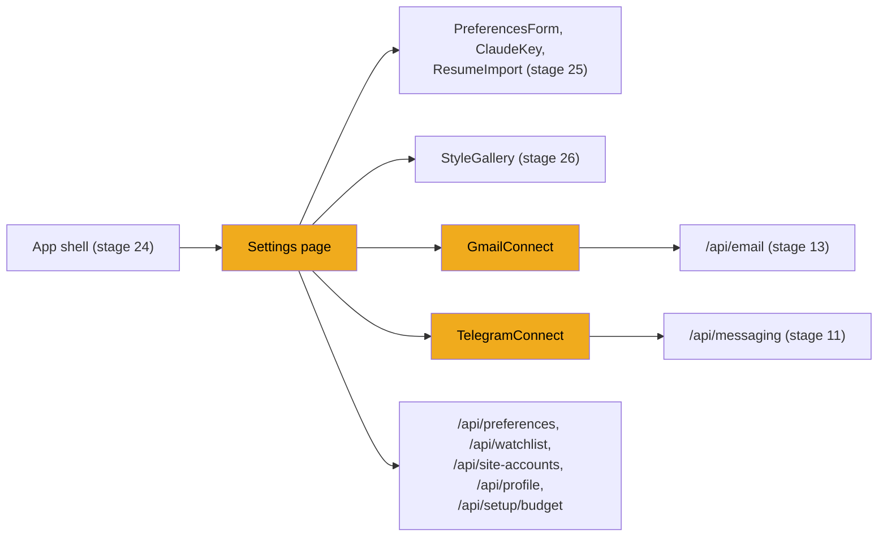

# Stage 28: The settings page

> **Goal:** Build one page where you can change everything JobBee does: what it looks for, where it looks, what the agent may do for you, your resume and form answers, the CV style, your Claude key and spending limits, and the optional Gmail and Telegram connections.
>
> **By the end you will have:** the final `/settings` page, made of independent sections, and the whole app running end to end. That's **Milestone 2**.
>
> Connecting Gmail and Telegram stays optional. You type both components, because the page imports them, but you can leave them unconnected.

## Where this fits

Every setting already has an endpoint from the backend stages. Until now you changed most of them in `/docs`, or once in the welcome flow. This stage gives each one a home in the web app, reusing components from stages 25 and 26, and replaces the placeholder `Settings.tsx` from [stage 24](24-frontend-basics.md).



## New ideas in plain words

**Independent sections.** The page is a column of cards. Each card is its own component that fetches its own data when it appears, so a slow or failing endpoint holds up only its own card. Each one is also wrapped in its own `ErrorBoundary` (stage 24): if one card throws while drawing, that card shows "Where to look hit a problem" and everything else still works. The cost is a few duplicate requests (four sections each read `GET /api/preferences`), which is nothing for an app on your own PC.

**"Dirty" detection.** A form is *dirty* when what's on screen differs from what's saved. The preferences section keeps two copies: `saved` (what the server last returned) and `prefs` (what you're editing). `JSON.stringify(saved) !== JSON.stringify(prefs)` compares them. You can't write `saved !== prefs`: for objects, `!==` asks "is it a different object?", not "does it hold different values?". It's Python's `is not`, not `!=`. Comparing the JSON text works here because both copies come from the same server response, so their keys are in the same order. When the form is dirty, **Save** turns on and **Undo changes** appears.

**Partial saves.** `PUT /api/preferences` ([stage 10](10-tailoring-and-pdfs.md)) changes only the fields you send: it uses Pydantic's `model_dump(exclude_unset=True)`. That matters when several sections share one settings object. The preferences card loads its copy when the page opens. If you then flip "Web search" in another card and press Save in the first, sending its whole copy would switch web search back on. So each card sends only the fields it edits.

**Hash links.** The part of an address after `#` (the *hash*) points at the element with that `id` on the page: `/settings#claude` means "the element with `id="claude"`". The agent bar's **Edit** goes to `/settings#preferences`, and the budget warning to `/settings#claude`.

**Pop-up sign-in and `postMessage`.** Signing in with Google ([stage 13](13-email-alerts.md)) happens in a small pop-up window, so you don't lose your place. When Google is done, the pop-up shows a tiny page from the backend whose script sends a message back to the page that opened it, with `window.opener.postMessage(...)`. Any window can send your page a message, so the receiver must check where it came from (`event.origin`) before believing it.

**Pairing by link.** Connecting Telegram ([stage 11](11-messages-and-telegram.md)) ends with you pressing **Start** in the Telegram app, on your phone or PC. The web page can't see that happen, so it asks the backend every 2 seconds whether the chat is linked yet, and stops as soon as it is.

**Text in number boxes.** A spending limit box holds a *string* in state, not a number. If it held a number, typing "1." on the way to "1.5" would be turned back into "1" on the next render, and you could never type the decimal point. The text becomes a number only when it's compared or saved.

## Build it, step by step

The two connection components go in `frontend/src/components/`, then the page replaces `frontend/src/pages/Settings.tsx`.

### Step 1: The Gmail button, `frontend/src/components/GmailConnect.tsx`

`GmailConnect` shows whether Gmail is connected, or a **Sign in with Google** button. JobBee reads LinkedIn and Indeed alert emails from your inbox ([stage 13](13-email-alerts.md)), and the confirmation emails job sites send to the accounts the agent makes ([stage 20](20-site-accounts.md)).

#### Part 1: Listening for the pop-up, and opening it

<!-- code: frontend/src/components/GmailConnect.tsx lines=1-61 -->
**`frontend/src/components/GmailConnect.tsx`** (lines 1–61 of 125)

```tsx
import { useEffect, useState } from "react";
import { api, type EmailStatus } from "../api";

type GmailConnectProps = {
  emailStatus: EmailStatus | null;
  onStatusChange?: () => void | Promise<void>;
  compact?: boolean;
};

export default function GmailConnect({ emailStatus, onStatusChange, compact = false }: GmailConnectProps) {
  const [busy, setBusy] = useState(false);
  const [message, setMessage] = useState<string | null>(null);
  const [ok, setOk] = useState(true);

  useEffect(() => {
    const onMessage = (event: MessageEvent) => {
      const allowedOrigins = new Set([
        window.location.origin,
        "http://127.0.0.1:8000",
        "http://localhost:8000",
      ]);
      if (!allowedOrigins.has(event.origin)) return;
      const data = event.data as { type?: string; ok?: boolean; message?: string } | null;
      if (!data || data.type !== "jobbee:gmail-oauth") return;
      setBusy(false);
      setOk(Boolean(data.ok));
      setMessage(data.message || (data.ok ? "Gmail connected." : "Could not connect Gmail."));
      void onStatusChange?.();
    };
    window.addEventListener("message", onMessage);
    return () => window.removeEventListener("message", onMessage);
  }, [onStatusChange]);

  const onSignInWithGoogle = async () => {
    setBusy(true);
    setMessage(null);
    try {
      const { authorization_url } = await api.startGmailConnect();
      const popup = window.open(
        authorization_url,
        "jobbee-gmail-oauth",
        "width=520,height=720,menubar=no,toolbar=no,status=no",
      );
      if (!popup) {
        window.location.href = authorization_url;
        return;
      }
      const timer = window.setInterval(() => {
        if (popup.closed) {
          window.clearInterval(timer);
          setBusy(false);
          void onStatusChange?.();
        }
      }, 500);
    } catch (e) {
      setOk(false);
      setMessage(e instanceof Error ? e.message : String(e));
      setBusy(false);
    }
  };

```
<!-- /code -->

- **Props.** `emailStatus` comes from the parent (`GET /api/email/status`). `onStatusChange` asks the parent to reload it, and may return a Promise (`void | Promise<void>`). `compact` hides the long explanation.
- **The message listener.** The effect adds a `message` listener to the window and removes it in the cleanup. When a message arrives, it checks two things before believing it:
  1. **Where it came from.** `event.origin` is the origin of the *sending* page. The pop-up's final page is served by the backend's Google callback, which runs at `http://127.0.0.1:8000` (the redirect address registered with Google in stage 13). `window.location.origin` is in the list too, for a setup where the callback goes through the Vite proxy. Anything else is ignored.
  2. **What it is.** The data must have `type: "jobbee:gmail-oauth"`, the label the backend's pop-up page uses. Other scripts and browser extensions also send messages; those are ignored.

  Then it stores the result, shows the message, and asks the parent to reload the status.
- **The sending side** (stage 13's `oauth_popup_result_html`) addresses its message to one exact origin, the backend's `frontend_url` setting (`http://localhost:5173`), and closes the pop-up after 0.6 seconds. Naming the target origin means a page from any other origin can't read the message.
- **`onSignInWithGoogle`**:
  1. Asks the backend for Google's sign-in address: `GET /api/email/gmail/authorize?popup=1`. `popup=1` tells the callback to answer with the message-sending page instead of a redirect.
  2. Opens it with `window.open` in a 520 × 720 pop-up named `jobbee-gmail-oauth`.
  3. If the browser blocked the pop-up (`window.open` returned `null`), it sends the whole page to Google instead. The sign-in still completes, but you end on the backend's small "Gmail connected" page; go back to http://localhost:5173/settings.
  4. Checks every half second whether the pop-up was closed. When it is (for example, you closed it without finishing), the button resets and the status reloads. This also covers a message that never arrived.
- **If the backend has no Google credentials** set up, the authorize call fails with "Gmail sign-in is not available on this install.", shown in red.

#### Part 2: What it shows

<!-- code: frontend/src/components/GmailConnect.tsx lines=62-125 -->
**`frontend/src/components/GmailConnect.tsx`** (lines 62–125 of 125)

```tsx
  if (emailStatus?.connected) {
    return (
      <div className="gmail-connect">
        <div className="notice ok small">
          Connected as <span className="strong">{emailStatus.connected_email ?? "Gmail"}</span>
        </div>
      </div>
    );
  }

  const oauthReady = emailStatus?.gmail_oauth_available;

  return (
    <div className={`gmail-connect ${compact ? "compact" : ""}`}>
      {!compact && (
        <p>
          Import job alerts from LinkedIn, Indeed, and similar senders, and let JobBee confirm the
          job-site accounts it makes for you. JobBee only reads your inbox — it never sends email.
        </p>
      )}

      {oauthReady ? (
        <button
          type="button"
          className="google-signin-btn"
          onClick={onSignInWithGoogle}
          disabled={busy}
        >
          <GoogleMark />
          {busy ? "Waiting for Google…" : "Sign in with Google"}
        </button>
      ) : (
        <div className="notice small">
          Gmail sign-in isn't set up on this install yet (see README → Gmail OAuth).
        </div>
      )}

      {message && <div className={`notice ${ok ? "ok" : "bad"}`}>{message}</div>}
    </div>
  );
}

function GoogleMark() {
  return (
    <svg className="google-mark" viewBox="0 0 48 48" aria-hidden="true">
      <path
        fill="#EA4335"
        d="M24 9.5c3.54 0 6.71 1.22 9.21 3.6l6.85-6.85C35.9 2.38 30.47 0 24 0 14.62 0 6.51 5.38 2.56 13.22l7.98 6.19C12.43 13.72 17.74 9.5 24 9.5z"
      />
      <path
        fill="#4285F4"
        d="M46.98 24.55c0-1.57-.15-3.09-.38-4.55H24v9.02h12.94c-.56 2.98-2.26 5.5-4.82 7.18l7.73 6c4.51-4.16 7.11-10.28 7.11-17.65z"
      />
      <path
        fill="#FBBC05"
        d="M10.53 28.59c-.48-1.45-.76-2.99-.76-4.59s.27-3.14.76-4.59l-7.98-6.19C.92 16.46 0 20.12 0 24c0 3.88.92 7.54 2.56 10.78l7.97-6.19z"
      />
      <path
        fill="#34A853"
        d="M24 48c6.48 0 11.93-2.13 15.89-5.81l-7.73-6c-2.15 1.45-4.92 2.3-8.16 2.3-6.26 0-11.57-4.22-13.47-9.91l-7.98 6.19C6.51 42.62 14.62 48 24 48z"
      />
    </svg>
  );
}
```
<!-- /code -->

- **Connected:** a green "Connected as you@gmail.com".
- **Not connected:** an explanation (unless `compact`), then the Google button when `gmail_oauth_available` is true, or a note that Gmail sign-in isn't set up on this install. The button reads "Waiting for Google…" while the pop-up is open.
- **`GoogleMark`** is Google's four-colour "G" as an SVG, so the button looks like the sign-in buttons people know.

### Step 2: The Telegram pairing, `frontend/src/components/TelegramConnect.tsx`

`TelegramConnect` walks you through creating a bot, pasting its token, and pairing it with your chat. After that, JobBee sends the same cards to Telegram, with buttons ([stage 11](11-messages-and-telegram.md)).

#### Part 1: State, polling and a local `run`

<!-- code: frontend/src/components/TelegramConnect.tsx lines=1-55 -->
**`frontend/src/components/TelegramConnect.tsx`** (lines 1–55 of 163)

```tsx
import { useCallback, useEffect, useState } from "react";
import { api, type MessagingStatus } from "../api";

const POLL_MS = 2000;

type Props = {
  onConnected?: () => void;
};

/** Create-a-bot guide → token → pairing link → live "Connected ✓". Reused by onboarding. */
export default function TelegramConnect({ onConnected }: Props) {
  const [status, setStatus] = useState<MessagingStatus | null>(null);
  const [token, setToken] = useState("");
  const [linkUrl, setLinkUrl] = useState<string | null>(null);
  const [busy, setBusy] = useState(false);
  const [error, setError] = useState<string | null>(null);
  const [notice, setNotice] = useState<string | null>(null);

  const refresh = useCallback(async () => {
    try {
      const next = await api.getMessagingStatus();
      setStatus((prev) => {
        if (prev && !prev.linked && next.linked) onConnected?.();
        return next;
      });
    } catch (e) {
      setError(e instanceof Error ? e.message : String(e));
    }
  }, [onConnected]);

  useEffect(() => {
    void refresh();
  }, [refresh]);

  const waitingForPairing = Boolean(linkUrl) && status != null && !status.linked;
  useEffect(() => {
    if (!waitingForPairing) return;
    const timer = window.setInterval(() => void refresh(), POLL_MS);
    return () => window.clearInterval(timer);
  }, [waitingForPairing, refresh]);

  const run = async (fn: () => Promise<void>) => {
    setBusy(true);
    setError(null);
    setNotice(null);
    try {
      await fn();
      await refresh();
    } catch (e) {
      setError(e instanceof Error ? e.message : String(e));
    } finally {
      setBusy(false);
    }
  };

```
<!-- /code -->

- **`refresh`** reads `GET /api/messaging/status`. It uses the function form of `setStatus` to compare the previous status with the new one: when `linked` turns from false to true, it calls the optional `onConnected`. Settings doesn't pass `onConnected`, so here that branch does nothing. (In general, keep updater functions free of side effects: React may call them twice in development.)
- **`waitingForPairing`** is true after you've got a pairing link and before the chat is linked. Only then does the second effect poll every 2 seconds. When the status comes back linked, `waitingForPairing` turns false, the effect's cleanup stops the timer, and no new one starts.
- **`run`** is a small local version of stage 24's `useAction`. It shows errors inside the card instead of as toasts, clears old messages, and refreshes the status after every action.

#### Part 2: Connected

<!-- code: frontend/src/components/TelegramConnect.tsx lines=56-96 -->
**`frontend/src/components/TelegramConnect.tsx`** (lines 56–96 of 163)

```tsx
  if (status == null) return <p className="muted small">Checking Telegram…</p>;

  if (status.linked) {
    return (
      <div>
        <div className="notice ok">
          Connected to <strong>@{status.bot_username}</strong>. JobBee will message you there.
        </div>
        {status.last_error && <div className="notice bad">Last error: {status.last_error}</div>}
        {notice && <div className="notice ok">{notice}</div>}
        {error && <div className="notice bad">{error}</div>}
        <div className="row">
          <button
           
            disabled={busy}
            onClick={() =>
              void run(async () => {
                await api.sendTestMessage();
                setNotice("Sent — check Telegram.");
              })
            }
          >
            Send test message
          </button>
          <button
            className="ghost danger"
            disabled={busy}
            onClick={() =>
              void run(async () => {
                await api.disconnectTelegram();
                setLinkUrl(null);
              })
            }
          >
            Disconnect
          </button>
        </div>
      </div>
    );
  }

```
<!-- /code -->

- Until the first status arrives, it shows "Checking Telegram…".
- **When linked**, it shows the bot's name, the last error the bot hit (if any), and two buttons. **Send test message** calls `POST /api/messaging/test` and says "Sent — check Telegram.". **Disconnect** calls `DELETE /api/messaging/telegram`, which forgets the bot and the pairing.
- The first button has an empty line where an attribute once was. It has no effect.

#### Part 3: Setting up a bot and pairing

<!-- code: frontend/src/components/TelegramConnect.tsx lines=97-163 -->
**`frontend/src/components/TelegramConnect.tsx`** (lines 97–163 of 163)

```tsx
  return (
    <div>
      {!status.bot_configured || !linkUrl ? (
        <>
          <ol className="steps small">
            <li>
              Open{" "}
              <a href="https://t.me/BotFather" target="_blank" rel="noreferrer">
                @BotFather
              </a>{" "}
              in Telegram and send <span className="code">/newbot</span>.
            </li>
            <li>Pick any name, then a username ending in “bot” (e.g. lin_jobbee_bot).</li>
            <li>Copy the token BotFather replies with and paste it here.</li>
          </ol>
          <div className="input-row">
            <input
              type="password"
              value={token}
              placeholder="123456789:AA…"
              onChange={(e) => setToken(e.target.value)}
            />
            <button
              disabled={busy || token.trim().length < 20}
              onClick={() =>
                void run(async () => {
                  const link = await api.setupTelegram(token.trim());
                  setLinkUrl(link.link_url);
                  setToken("");
                })
              }
            >
              {busy ? "Checking…" : "Connect"}
            </button>
          </div>
          {status.bot_configured && !linkUrl && (
            <button
              className="link small"
              disabled={busy}
              onClick={() =>
                void run(async () => {
                  const link = await api.newTelegramLink();
                  setLinkUrl(link.link_url);
                })
              }
            >
              Already added @{status.bot_username}? Get a new pairing link
            </button>
          )}
        </>
      ) : (
        <>
          <p className="small">
            Last step: open your bot and press <strong>Start</strong>. This page updates by itself.
          </p>
          <div className="row">
            <a className="btn primary" href={linkUrl} target="_blank" rel="noreferrer">
              Open Telegram
            </a>
          </div>
          <p className="muted small">Waiting for you to press Start… (link valid for 10 minutes)</p>
        </>
      )}
      {error && <div className="notice bad">{error}</div>}
    </div>
  );
}
```
<!-- /code -->

Two screens, depending on whether you have a pairing link yet:

1. **No link yet.** Three steps explain how to make a bot with Telegram's @BotFather. The token box is a password field. **Connect** (enabled from 20 characters, the backend's minimum) calls `POST /api/messaging/telegram`. The backend checks the token with Telegram, saves it in the keyring ([stage 2](02-secrets.md)), and returns a one-time pairing link. If a bot is already set up, a link-style button gets a fresh pairing link instead (`POST /api/messaging/telegram/link`).
2. **A link.** **Open Telegram** opens the bot, where you press **Start**. The link carries a one-time code that's valid for 10 minutes. Meanwhile the page polls, and switches to the connected view as soon as the backend sees your Start.

### Step 3: The page, `frontend/src/pages/Settings.tsx`

Replace the stage 24 placeholder. The file is long, but it's seven small sections that follow the same few patterns.

#### Part 1: The page frame

<!-- code: frontend/src/pages/Settings.tsx lines=1-90 -->
**`frontend/src/pages/Settings.tsx`** (lines 1–90 of 692)

```tsx
import { useEffect, useState } from "react";
import { useLocation } from "react-router-dom";
import {
  api,
  type ApplicationDefaults,
  type ClaudeStatus,
  type DocumentInfo,
  type EmailStatus,
  type Preferences,
  type Profile,
  type SiteAccount,
  type WatchlistItem,
  type YesNo,
} from "../api";
import ClaudeKey from "../components/ClaudeKey";
import { StyleGallery } from "../components/DocumentStyle";
import ErrorBoundary from "../components/ErrorBoundary";
import GmailConnect from "../components/GmailConnect";
import Icon from "../components/Icon";
import PreferencesForm from "../components/PreferencesForm";
import ResumeImport from "../components/ResumeImport";
import TelegramConnect from "../components/TelegramConnect";
import { useAction, useToast } from "../components/Toast";
import { timeAgo, usd } from "../lib/format";

const SECTIONS = [
  { id: "preferences", label: "Job preferences" },
  { id: "sources", label: "Where to look" },
  { id: "applying", label: "Applying for you" },
  { id: "profile", label: "Resume & answers" },
  { id: "style", label: "CV style" },
  { id: "claude", label: "Claude" },
  { id: "phone", label: "Phone updates" },
];

export default function Settings() {
  const { hash } = useLocation();

  useEffect(() => {
    if (!hash) return;
    const el = document.getElementById(hash.slice(1));
    window.setTimeout(() => el?.scrollIntoView({ behavior: "smooth", block: "start" }), 50);
  }, [hash]);

  return (
    <>
      <div className="page-head">
        <h1>Settings</h1>
      </div>
      <nav className="settings-nav">
        {SECTIONS.map((s) => (
          <a key={s.id} href={`#${s.id}`}>
            {s.label}
          </a>
        ))}
      </nav>
      <ErrorBoundary label="Job preferences">
        <PreferencesSection />
      </ErrorBoundary>
      <ErrorBoundary label="Where to look">
        <SourcesSection />
      </ErrorBoundary>
      <ErrorBoundary label="Applying for you">
        <ApplyingSection />
      </ErrorBoundary>
      <ErrorBoundary label="Resume & answers">
        <ProfileSection />
      </ErrorBoundary>
      <ErrorBoundary label="CV style">
        <StyleSection />
      </ErrorBoundary>
      <ErrorBoundary label="Claude">
        <ClaudeSection />
      </ErrorBoundary>
      <section id="phone" className="settings-section">
        <div className="card">
          <h2>Phone updates</h2>
          <p className="muted">
            Optional. Get the same cards in Telegram and tap Apply or Submit from your phone. Your PC
            still does the work, so keep JobBee running.
          </p>
          <ErrorBoundary label="Phone updates">
            <TelegramConnect />
          </ErrorBoundary>
        </div>
      </section>
    </>
  );
}

```
<!-- /code -->

- **`SECTIONS`** lists the sections for the row of jump links. Each link is a plain `<a href="#claude">`: the browser scrolls to the element with that id by itself.
- **The effect handles arrivals from other pages.** When the agent bar's **Edit** link opens `/settings#preferences`, react-router changes the page without the browser's usual jump to the hash. The effect reads `hash` from `useLocation()`, finds the element (`hash.slice(1)` drops the `#`), and scrolls to it smoothly. The 50 ms delay lets the sections draw first. Stage 24's `scroll-margin-top` keeps the sticky top bar from covering the heading.
- **Each section sits in its own `ErrorBoundary`** with a `label`, so a broken section says which one it is.
- **The phone section** is written right here, with only `TelegramConnect` inside the boundary. If that component breaks, the card's heading and explanation stay, and only the inner part turns into the error box.

Remember the boundary's limit from stage 24: it catches errors thrown while *drawing*. Several sections below load data without a `.catch`. If such a request fails, the section keeps showing its grey skeleton.

#### Part 2: Job preferences, with dirty detection and a partial save

<!-- code: frontend/src/pages/Settings.tsx lines=91-151 -->
**`frontend/src/pages/Settings.tsx`** (lines 91–151 of 692)

```tsx
// --- preferences -------------------------------------------------------------------------

function PreferencesSection() {
  const [saved, setSaved] = useState<Preferences | null>(null);
  const [prefs, setPrefs] = useState<Preferences | null>(null);
  const { busy, run } = useAction();

  useEffect(() => {
    api.getPreferences().then((p) => {
      setSaved(p);
      setPrefs(p);
    });
  }, []);

  const dirty = JSON.stringify(saved) !== JSON.stringify(prefs);

  return (
    <section id="preferences" className="settings-section">
      <div className="card">
        <h2>Job preferences</h2>
        <p className="muted">What JobBee looks for, and how picky it is.</p>
        {prefs ? (
          <>
            <PreferencesForm value={prefs} onChange={setPrefs} extended />
            <div className="row" style={{ marginTop: 18 }}>
              <button
                className="primary"
                disabled={!dirty || busy}
                onClick={() =>
                  void run(async () => {
                    // Only what this form edits; the other sections save their own switches.
                    const {
                      web_search_enabled: _search,
                      document_style: _style,
                      agent_accounts: _accounts,
                      agent_consents: _consents,
                      ...edited
                    } = prefs;
                    const next = await api.savePreferences(edited);
                    setSaved(next);
                    setPrefs(next);
                  }, "Saved. The next search uses these.")
                }
              >
                Save
              </button>
              {dirty && (
                <button className="ghost" onClick={() => setPrefs(saved)}>
                  Undo changes
                </button>
              )}
            </div>
          </>
        ) : (
          <div className="skeleton" style={{ height: 300 }} />
        )}
      </div>
    </section>
  );
}

```
<!-- /code -->

- **Two copies.** `saved` is the server's version, `prefs` is the one the form edits. Both start as the same response.
- **`dirty`** compares their JSON text on every render.
- **`PreferencesForm`** from stage 25, with `extended`, so it shows the score slider, search time, posting age and excluded companies too.
- **The partial save.** The destructuring pulls out the four fields that other sections own (web search, CV style and the two agent switches) into throwaway variables, and `...edited` collects everything else. It's like `edited = {k: v for k, v in prefs.items() if k not in OTHERS}` in Python. The leading `_` in `_search` marks a variable as deliberately unused, which `noUnusedLocals` accepts.
- **After saving**, both copies are set to the server's answer, so the form is clean again and shows any cleanup the server did (trimmed names, duplicates removed).
- **Undo changes** copies `saved` back into `prefs`.

#### Part 3: Where to look

<!-- code: frontend/src/pages/Settings.tsx lines=152-223 -->
**`frontend/src/pages/Settings.tsx`** (lines 152–223 of 692)

```tsx
// --- sources -------------------------------------------------------------------------------

function SourcesSection() {
  const [prefs, setPrefs] = useState<Preferences | null>(null);
  const [email, setEmail] = useState<EmailStatus | null>(null);
  const { run } = useAction();

  useEffect(() => {
    api.getPreferences().then(setPrefs);
    api.getEmailStatus().then(setEmail).catch(() => setEmail(null));
  }, []);

  return (
    <section id="sources" className="settings-section">
      <div className="card">
        <h2>Where JobBee looks</h2>
        <p className="muted">Every search uses all of these. Links you paste always work too.</p>

        <div className="setting-row">
          <Icon name="search" className="icon lg" />
          <div className="grow">
            <div className="strong">Web search</div>
            <div className="small muted">
              Claude searches Greenhouse, Lever, Ashby, Workday and other job boards for your roles.
            </div>
          </div>
          {prefs && (
            <button
              className={`switch ${prefs.web_search_enabled ? "on" : ""}`}
              role="switch"
              aria-checked={prefs.web_search_enabled}
              aria-label="Web search"
              onClick={() =>
                void run(async () => {
                  setPrefs(await api.savePreferences({ web_search_enabled: !prefs.web_search_enabled }));
                })
              }
            />
          )}
        </div>

        <div className="setting-row" style={{ alignItems: "flex-start" }}>
          <Icon name="building" className="icon lg" />
          <div className="grow">
            <div className="strong">Companies you'd love to work for</div>
            <div className="small muted" style={{ marginBottom: 10 }}>
              JobBee checks their job boards on every search (Greenhouse, Lever and Ashby).
            </div>
            <Watchlist />
          </div>
        </div>

        <div className="setting-row" style={{ alignItems: "flex-start" }}>
          <Icon name="mail" className="icon lg" />
          <div className="grow">
            <div className="strong">LinkedIn job alerts</div>
            <div className="small muted" style={{ marginBottom: 10 }}>
              Sign in with Google and JobBee reads your LinkedIn and Indeed alert emails, plus the
              sign-up emails job sites send to the accounts it makes. It never sends email.
            </div>
            <GmailConnect
              compact
              emailStatus={email}
              onStatusChange={() => api.getEmailStatus().then(setEmail)}
            />
          </div>
        </div>
      </div>
    </section>
  );
}

```
<!-- /code -->

This section has its own copy of the preferences (only for the web search switch) and the email status.

- **The web search switch** saves the moment you click it, and sends one field only: `{ web_search_enabled: !prefs.web_search_enabled }`. It shows the server's answer, not your click: if the save fails, `useAction` shows the error and the switch stays where it was. The switch is a `<button>` styled by stage 24's `.switch` rules. `role="switch"` and `aria-checked` tell screen readers it's an on/off control.
- **Companies you'd love to work for** is the `Watchlist` (next part). Discovery checks their job boards on every search ([stage 14](14-job-sources.md)).
- **LinkedIn job alerts** shows `GmailConnect` in its compact form. `onStatusChange` reloads the email status after a sign-in.

#### Part 4: The watchlist

<!-- code: frontend/src/pages/Settings.tsx lines=224-289 -->
**`frontend/src/pages/Settings.tsx`** (lines 224–289 of 692)

```tsx
function Watchlist() {
  const [items, setItems] = useState<WatchlistItem[] | null>(null);
  const [text, setText] = useState("");
  const { busy, run } = useAction();

  useEffect(() => {
    api.watchlist().then(setItems);
  }, []);

  return (
    <div className="stack tight">
      <form
        className="input-row"
        onSubmit={(e) => {
          e.preventDefault();
          if (text.trim().length < 2) return;
          void run(
            async () => {
              const item = await api.addCompany(text.trim());
              setItems((prev) => [...(prev ?? []).filter((i) => i.id !== item.id), item]);
              setText("");
              return item;
            },
            (item) => `Added ${(item as WatchlistItem).name}.`,
          );
        }}
      >
        <input
          value={text}
          placeholder="Company name or careers page link"
          onChange={(e) => setText(e.target.value)}
        />
        <button disabled={busy || text.trim().length < 2}>{busy ? <span className="spinner" /> : "Add"}</button>
      </form>
      {items && items.length > 0 && (
        <div className="list" style={{ marginTop: 6 }}>
          {items.map((item) => (
            <div key={item.id} className="list-row">
              <div className="grow">
                <div className="strong">{item.name}</div>
                <div className="tiny faint">
                  {item.ats} · {item.slug}
                  {item.last_polled_at ? ` · checked ${timeAgo(item.last_polled_at)}` : " · not checked yet"}
                  {item.last_error ? ` · ${item.last_error}` : ""}
                </div>
              </div>
              <button
                className="icon-btn"
                aria-label={`Remove ${item.name}`}
                onClick={() =>
                  void run(async () => {
                    await api.removeCompany(item.id);
                    setItems((prev) => (prev ?? []).filter((i) => i.id !== item.id));
                  })
                }
              >
                <Icon name="trash" />
              </button>
            </div>
          ))}
        </div>
      )}
    </div>
  );
}

```
<!-- /code -->

- **Adding.** The form accepts a company name or a careers page link (at least 2 characters). `POST /api/watchlist` ([stage 14](14-job-sources.md)) looks for the company's Greenhouse, Lever or Ashby board, and answers with a 404 message suggesting the careers page link when it can't find one.
- **The list updates from the reply**, without reloading. The filter removes an existing entry with the same id before adding the new one: if you add a company twice, the backend returns the existing entry, and it still shows once. The function given to `run` returns the item, so the success message can name it: "Added Stripe."
- **Each row** shows the job board and the company's name on it (`ats · slug`), when it was last checked, and the last error if a check failed. The bin button calls `DELETE /api/watchlist/{id}` and removes the row locally.

#### Part 5: Applying for you

<!-- code: frontend/src/pages/Settings.tsx lines=290-377 -->
**`frontend/src/pages/Settings.tsx`** (lines 290–377 of 692)

```tsx
// --- applying for you ------------------------------------------------------------------------

function ApplyingSection() {
  const [prefs, setPrefs] = useState<Preferences | null>(null);
  const [email, setEmail] = useState<EmailStatus | null>(null);
  const { run } = useAction();

  useEffect(() => {
    api.getPreferences().then(setPrefs);
    api.getEmailStatus().then(setEmail).catch(() => setEmail(null));
  }, []);

  const toggle = (key: "agent_accounts" | "agent_consents") =>
    prefs &&
    void run(async () => {
      setPrefs(await api.savePreferences({ [key]: !prefs[key] }));
    });

  return (
    <section id="applying" className="settings-section">
      <div className="card">
        <h2>Applying for you</h2>
        <p className="muted">
          JobBee fills each application by itself, start to finish, and you only tap Submit. Every
          application's report lists what it did, including anything below.
        </p>

        <div className="setting-row">
          <Icon name="key" className="icon lg" />
          <div className="grow">
            <div className="strong">Create and sign in to job-site accounts</div>
            <div className="small muted">
              Sites like Workday want an account per company. JobBee makes one with your email and a
              strong password it saves in Windows Credential Manager on this PC, and confirms it from
              your inbox.
            </div>
          </div>
          {prefs && (
            <button
              className={`switch ${prefs.agent_accounts ? "on" : ""}`}
              role="switch"
              aria-checked={prefs.agent_accounts}
              aria-label="Create and sign in to job-site accounts"
              onClick={() => toggle("agent_accounts")}
            />
          )}
        </div>
        {prefs?.agent_accounts && email && !email.connected && (
          <div className="notice info small">
            <Icon name="mail" />
            <span>
              Connect Gmail under <a href="#sources">Where to look</a> so JobBee can confirm new
              accounts by itself. Without it, those applications wait for you.
            </span>
          </div>
        )}

        <div className="setting-row">
          <Icon name="check" className="icon lg" />
          <div className="grow">
            <div className="strong">Accept terms and sign with your name</div>
            <div className="small muted">
              Account terms, privacy statements, background-check consent and "I certify this is
              accurate" signatures, typed with your full name and the date.
            </div>
          </div>
          {prefs && (
            <button
              className={`switch ${prefs.agent_consents ? "on" : ""}`}
              role="switch"
              aria-checked={prefs.agent_consents}
              aria-label="Accept terms and sign with your name"
              onClick={() => toggle("agent_consents")}
            />
          )}
        </div>

        <p className="small faint" style={{ marginTop: 12 }}>
          Never done by JobBee: CAPTCHAs, phone codes, ID numbers and bank details. Those applications
          wait on Home for when you're at your PC, and the rest carry on.
        </p>

        <SiteAccounts />
      </div>
    </section>
  );
}

```
<!-- /code -->

Two switches decide what the apply agent may do by itself. One `toggle` function handles both:

- **`{ [key]: !prefs[key] }`** is a computed key (stage 25): the field name comes from the variable. The type `"agent_accounts" | "agent_consents"` allows only those two names.
- **`prefs && void run(...)`** does nothing until the preferences have loaded.
- **Create and sign in to job-site accounts** (`agent_accounts`) lets the agent make accounts on sites like Workday, with passwords it never sees ([stage 20](20-site-accounts.md)). When it's on and Gmail isn't connected, a blue note explains that those applications will wait for you, with a link to the Gmail row (`#sources`, a plain in-page link).
- **Accept terms and sign with your name** (`agent_consents`) tells the apply agent, through the dossier of [stage 18](18-apply-agent.md), whether it may accept terms and type your name as a signature. Each consent then shows up flagged on the review card.
- **The note below** repeats what JobBee never does: CAPTCHAs, phone codes, ID numbers and bank details.

#### Part 6: The accounts JobBee made

<!-- code: frontend/src/pages/Settings.tsx lines=378-440 -->
**`frontend/src/pages/Settings.tsx`** (lines 378–440 of 692)

```tsx
function SiteAccounts() {
  const [accounts, setAccounts] = useState<SiteAccount[] | null>(null);
  const [shown, setShown] = useState<Record<number, string>>({});
  const { busy, run } = useAction();

  useEffect(() => {
    api.siteAccounts().then(setAccounts).catch(() => setAccounts([]));
  }, []);

  if (!accounts || accounts.length === 0) return null;
  return (
    <div style={{ marginTop: 16 }}>
      <div className="strong">Accounts JobBee made ({accounts.length})</div>
      <div className="list" style={{ marginTop: 8 }}>
        {accounts.map((a) => (
          <div key={a.id} className="list-row">
            <div className="grow">
              <div className="strong" style={{ overflowWrap: "anywhere" }}>
                {a.host}
              </div>
              <div className="tiny faint">
                {a.login} · made {timeAgo(a.created_at)}
                {a.last_used_at ? ` · used ${timeAgo(a.last_used_at)}` : ""}
                {a.status === "verified" ? " · email confirmed" : ""}
                {a.status === "rejected" ? " · the site refused this password; JobBee resets it next time" : ""}
              </div>
              {shown[a.id] && <code className="secret">{shown[a.id]}</code>}
            </div>
            <button
              className="sm ghost"
              disabled={busy}
              aria-label={`${shown[a.id] ? "Hide" : "Show"} the password for ${a.host}`}
              onClick={() =>
                shown[a.id]
                  ? setShown(({ [a.id]: _gone, ...rest }) => rest)
                  : void run(async () => {
                      const { password } = await api.revealSiteAccount(a.id);
                      setShown((prev) => ({ ...prev, [a.id]: password }));
                    })
              }
            >
              {shown[a.id] ? "Hide" : "Show"}
            </button>
            <button
              className="icon-btn"
              aria-label={`Forget the ${a.host} account`}
              disabled={busy}
              onClick={() =>
                void run(async () => {
                  await api.forgetSiteAccount(a.id);
                  setAccounts((prev) => (prev ?? []).filter((x) => x.id !== a.id));
                }, "Forgotten. The account still exists on the site.")
              }
            >
              <Icon name="trash" />
            </button>
          </div>
        ))}
      </div>
    </div>
  );
}

```
<!-- /code -->

`SiteAccounts` lists the job-site accounts the agent created. It draws nothing when there are none (or the list failed to load).

- **`shown`** maps an account id to its revealed password: `Record<number, string>`. It starts empty.
- **Show** calls `POST /api/site-accounts/{id}/reveal` ([stage 23](23-api-actions-and-setup.md)), which reads the password from the keyring. It's the one place JobBee ever sends a secret to the browser, only on an explicit click, and the backend listens only on your own PC. The password lives in this component's memory only, shown with stage 24's `.secret` style (one click selects it all).
- **Hide** builds a copy of `shown` without that id. The destructuring `({ [a.id]: _gone, ...rest }) => rest` puts `shown[a.id]` into `_gone` and everything else into `rest`, like `{k: v for k, v in shown.items() if k != a.id}`.
- **The bin** calls `DELETE /api/site-accounts/{id}`, which deletes the saved password and the record. The toast reminds you that the account itself still exists on the site.
- **The small print** under each account says when it was made and last used, and whether its email was confirmed or the site refused the password.

#### Part 7: CV style, and your resume

<!-- code: frontend/src/pages/Settings.tsx lines=441-533 -->
**`frontend/src/pages/Settings.tsx`** (lines 441–533 of 692)

```tsx
// --- CV style ------------------------------------------------------------------------------------

function StyleSection() {
  const [style, setStyle] = useState<string | null>(null);

  useEffect(() => {
    api.getPreferences().then((p) => setStyle(p.document_style));
  }, []);

  return (
    <section id="style" className="settings-section">
      <div className="card">
        <h2>CV &amp; cover letter style</h2>
        <p className="muted">
          How your tailored CVs and cover letters look. Every style is plain, single-column text, so
          application systems read it cleanly. Previews use your latest tailored CV, or a sample until
          you have one. To change a CV that's already made, use the Style menu on its card.
        </p>
        <StyleGallery
          value={style}
          onChange={async (next) => {
            setStyle((await api.savePreferences({ document_style: next })).document_style);
          }}
        />
      </div>
    </section>
  );
}

// --- resume + application answers -------------------------------------------------------------

function ProfileSection() {
  const [profile, setProfile] = useState<Profile | null>(null);
  const [resume, setResume] = useState<DocumentInfo | null>(null);
  const [replacing, setReplacing] = useState(false);
  const toast = useToast();

  useEffect(() => {
    api.getProfile().then(setProfile);
    api.listDocuments().then((docs) => setResume(docs.find((d) => d.is_base && d.kind === "resume") ?? null));
  }, []);

  return (
    <section id="profile" className="settings-section">
      <div className="card">
        <h2>Resume &amp; application answers</h2>
        <p className="muted">
          Your resume is the source for every tailored CV. Answers here fill application forms, so the
          agent asks you less.
        </p>
        {profile && (
          <>
            {replacing ? (
              <ResumeImport
                profile={profile}
                hasResume={false}
                onSaved={(p) => {
                  setProfile(p);
                  setReplacing(false);
                  api.listDocuments().then((docs) => setResume(docs.find((d) => d.is_base && d.kind === "resume") ?? null));
                  toast("Resume updated.");
                }}
              />
            ) : (
              <div className="row between" style={{ padding: "4px 0 14px" }}>
                <div className="row nowrap">
                  <Icon name="file" className="icon lg" />
                  <div>
                    <div className="strong">{resume?.original_filename ?? resume?.label ?? "No resume yet"}</div>
                    {resume && <div className="tiny faint">Uploaded {timeAgo(resume.updated_at)}</div>}
                  </div>
                </div>
                <div className="row" style={{ gap: 6 }}>
                  {resume?.has_file && (
                    <a className="btn btn-sm ghost" href={api.documentUrl(resume.id)} target="_blank" rel="noreferrer">
                      View
                    </a>
                  )}
                  <button className="sm" onClick={() => setReplacing(true)}>
                    Replace resume
                  </button>
                </div>
              </div>
            )}
            <hr className="divider" />
            <ApplicationAnswers profile={profile} onSaved={setProfile} />
          </>
        )}
      </div>
    </section>
  );
}

```
<!-- /code -->

- **`StyleSection`** loads your current style and shows stage 26's `StyleGallery`. Its `onChange` saves one field only, `{ document_style: next }`, and stores the style from the server's answer. New CVs use it. To change a CV that's already made, use the Style menu on its card (stage 27).
- **`ProfileSection`** loads your profile and your current base resume: `listDocuments()` returns every document, and `.find(...)` picks the base resume (`find` returns the first match, or `undefined`, hence `?? null`).
- **Replace resume** shows stage 25's `ResumeImport` with `hasResume={false}`, so it starts at the drop zone instead of "Continue with this". When you confirm the new profile, the section stores it, reloads the resume's details and shows "Resume updated.". Match cards made from the old resume then show "Made from your previous resume" (stage 27).
- **Otherwise** it shows the file name, when it was uploaded, a **View** link (only when the original file is stored) and the **Replace resume** button.
- Below a divider comes `ApplicationAnswers` (next part).

#### Part 8: Common form answers

<!-- code: frontend/src/pages/Settings.tsx lines=534-607 -->
**`frontend/src/pages/Settings.tsx`** (lines 534–607 of 692)

```tsx
const ANSWER_FIELDS: { key: keyof ApplicationDefaults; label: string; placeholder: string }[] = [
  { key: "phone", label: "Phone", placeholder: "+1 416 555 0100" },
  { key: "address_line1", label: "Street address", placeholder: "123 Main St" },
  { key: "city", label: "City", placeholder: "Toronto" },
  { key: "province", label: "Province or state", placeholder: "ON" },
  { key: "postal_code", label: "Postal code", placeholder: "M5V 1A1" },
  { key: "country", label: "Country", placeholder: "Canada" },
  { key: "referral_source", label: "How did you hear about us?", placeholder: "LinkedIn" },
];

function ApplicationAnswers({ profile, onSaved }: { profile: Profile; onSaved: (p: Profile) => void }) {
  const [values, setValues] = useState<ApplicationDefaults>(profile.application_defaults);
  const { busy, run } = useAction();
  const saved = Object.entries(profile.application_defaults.saved_answers ?? {});
  const dirty = JSON.stringify(values) !== JSON.stringify(profile.application_defaults);
  const set = (key: keyof ApplicationDefaults, value: string | null) => setValues({ ...values, [key]: value });

  return (
    <div className="stack">
      <h3>Common form answers</h3>
      <div className="fields">
        {ANSWER_FIELDS.map((f) => (
          <div key={f.key} className="field">
            <label>{f.label}</label>
            <input
              value={(values[f.key] as string | null) ?? ""}
              placeholder={f.placeholder}
              onChange={(e) => set(f.key, e.target.value || null)}
            />
          </div>
        ))}
        <div className="field">
          <label>Willing to relocate?</label>
          <select
            value={values.willing_to_relocate ?? ""}
            onChange={(e) => set("willing_to_relocate", (e.target.value || null) as YesNo | null)}
          >
            <option value="">Not set</option>
            <option value="yes">Yes</option>
            <option value="no">No</option>
          </select>
        </div>
      </div>
      <div className="row">
        <button
          className="primary"
          disabled={!dirty || busy}
          onClick={() =>
            void run(async () => {
              const { saved_answers: _keep, ...patch } = values;
              onSaved(await api.updateProfile({ application_defaults: patch }));
            }, "Saved.")
          }
        >
          Save answers
        </button>
      </div>
      {saved.length > 0 && (
        <details>
          <summary>Answers you gave the agent ({saved.length})</summary>
          <dl className="answers">
            {saved.map(([q, a]) => (
              <div key={q} style={{ display: "contents" }}>
                <dt>{q}</dt>
                <dd>{a}</dd>
              </div>
            ))}
          </dl>
        </details>
      )}
    </div>
  );
}

```
<!-- /code -->

These are the answers application forms ask again and again: phone, address, "How did you hear about us?", willing to relocate. The apply agent reads them from your profile ([stage 7](07-resume-and-profile.md)), so it asks you less.

- **`ANSWER_FIELDS`** lists the text fields. `key: keyof ApplicationDefaults` means a typo in a field name is a build error.
- **`values`** starts as a copy of `profile.application_defaults`. The value passed to `useState` is used only on the first render, so later changes to the prop don't overwrite what you're typing.
- **Dirty detection** compares `values` with the profile's answers, as in part 2. An empty box becomes `null`.
- **Save answers** sends only `application_defaults`, without `saved_answers` (the destructuring keeps them out), to `PUT /api/profile`. The answers you gave the agent during applications can't be overwritten from here.
- **"Answers you gave the agent"** lists those saved answers, read-only, in a `<details>` box. Each pair sits in a `<div style={{ display: "contents" }}>`: React needs one element to put the `key` on, and `display: contents` makes the browser lay out its `<dt>` and `<dd>` as if the `div` weren't there, so they stay cells of stage 24's `.answers` grid.

#### Part 9: Claude: key, spend and limits

<!-- code: frontend/src/pages/Settings.tsx lines=608-692 -->
**`frontend/src/pages/Settings.tsx`** (lines 608–692 of 692)

```tsx
// --- Claude ------------------------------------------------------------------------------------

function ClaudeSection() {
  const [status, setStatus] = useState<ClaudeStatus | null>(null);
  const [daily, setDaily] = useState("");
  const [monthly, setMonthly] = useState("");
  const { busy, run } = useAction();

  useEffect(() => {
    if (status) {
      setDaily(String(status.daily_budget_usd));
      setMonthly(String(status.monthly_budget_usd));
    }
  }, [status]);

  const budgetDirty =
    status != null &&
    (Number(daily) !== status.daily_budget_usd || Number(monthly) !== status.monthly_budget_usd);

  return (
    <section id="claude" className="settings-section">
      <div className="card">
        <h2>Claude</h2>
        <p className="muted">JobBee pays for Claude with your Anthropic key. Limits keep spending in check.</p>
        <ClaudeKey allowReplace onStatus={setStatus} />
        {status?.connected && (
          <>
            <div className="row" style={{ marginTop: 16 }}>
              <div className="stat">
                <span className="small muted">Today</span>
                <b>{usd(status.spend_today_usd)}</b>
              </div>
              <div className="stat">
                <span className="small muted">This month</span>
                <b>{usd(status.spend_month_usd)}</b>
              </div>
            </div>
            <div className="fields" style={{ marginTop: 16 }}>
              <div className="field">
                <label>Daily limit (USD)</label>
                <input type="number" min={0} step={1} value={daily} onChange={(e) => setDaily(e.target.value)} />
              </div>
              <div className="field">
                <label>Monthly limit (USD)</label>
                <input type="number" min={0} step={5} value={monthly} onChange={(e) => setMonthly(e.target.value)} />
              </div>
            </div>
            <div className="row" style={{ marginTop: 12 }}>
              <button
                className="primary"
                disabled={!budgetDirty || busy}
                onClick={() =>
                  void run(async () => {
                    setStatus(
                      await api.saveBudget({
                        daily_budget_usd: Number(daily),
                        monthly_budget_usd: Number(monthly),
                      }),
                    );
                  }, "Limits saved.")
                }
              >
                Save limits
              </button>
            </div>
            <details style={{ marginTop: 14 }}>
              <summary>Which Claude model does what</summary>
              <dl className="answers">
                {Object.entries(status.models).map(([task, model]) => (
                  <div key={task} style={{ display: "contents" }}>
                    <dt>{task}</dt>
                    <dd className="code" style={{ border: "none", borderRadius: 0 }}>
                      {model}
                    </dd>
                  </div>
                ))}
              </dl>
            </details>
          </>
        )}
      </div>
    </section>
  );
}

```
<!-- /code -->

- **`ClaudeKey`** again (stage 25), now with `allowReplace`, which adds a **Change** button to the connected notice. Its `onStatus` hands this section the full status from `GET /api/setup/claude`: spend today and this month, the limits, and the model for each task.
- **The limit boxes hold strings** (see "New ideas"). The effect copies the limits into them whenever `status` changes: on load and after a save.
- **`budgetDirty`** converts the text with `Number(...)` only to compare it with the saved limits.
- **Today / This month** show what Claude has cost, from the usage ledger of [stage 6](06-talking-to-claude.md).
- **Save limits** calls `PUT /api/setup/budget` ([stage 23](23-api-actions-and-setup.md)). It writes `DAILY_BUDGET_USD` and `MONTHLY_BUDGET_USD` into `backend/.env` and reloads the settings, so the budget check uses the new numbers from the next Claude call on.
- **"Which Claude model does what"** lists `status.models` in a folded box: Haiku for screening, Sonnet for tailoring and job search, Opus for applying. `Object.entries` is Python's `.items()`.

## Check it works

1. **Build** from `frontend\`:

   ```powershell
   npm run build
   ```

   It should end with `✓ built in ...`.

2. **Start both servers** and open http://localhost:5173/settings.
3. **Dirty detection.** In "Job preferences", move the score slider. **Save** turns on and **Undo changes** appears. Press **Undo changes**: the slider jumps back and both buttons settle. Change "Jobs to send you per day" and press **Save**: the toast says "Saved. The next search uses these."
4. **Partial saves don't clash.** Turn **Web search** off. Then change something in "Job preferences" and **Save**. Reload the page: web search is still off. (If the card had sent its whole copy, web search would be back on.)
5. **Watchlist.** Add a company you'd like to work for. A toast says "Added …" and a row shows its job board. Remove it with the bin.
6. **Style gallery.** The "CV & cover letter style" grid shows five previews: your latest tailored CV, or the sample. Switch to **Cover letter**, then pick another style: the toast says "New CVs will use the … style."
7. **Restyle a card without Claude.** Note "Today" in the Claude section. On Home, pick a different style in a match card's **Style** menu: the toast says "Your CV and cover letter now use the … style.", and **View CV** opens the new look. Back in Settings, "Today" hasn't changed (as long as no search ran in between), because no Claude call was made.
8. **Budget.** Set the daily limit to `3` and press **Save limits**. Open `backend/.env`: it now has `DAILY_BUDGET_USD=3`. Set it back the same way.
9. **Hash links.** On Home, press **Edit** in the agent bar. Settings opens scrolled to "Job preferences".
10. **One section breaking.** Add `throw new Error("test");` as the first line inside `StyleSection` and save. Only the style card turns into "CV style hit a problem."; every other section still works. Remove the line.
11. **Optional connections.** If you set up Google credentials in stage 13, press **Sign in with Google**: a pop-up opens, and when you finish, the row says "Connected as …". If you want Telegram, follow the steps in "Phone updates" and press **Start** in Telegram: the card turns into "Connected to @…" by itself within 2 seconds. **Send test message** should arrive on your phone.

<!-- verify: frontend | npm run build -->

## Milestone 2: the whole app

Everything is built. This last run goes through the whole app, from a fresh start to a submitted application.

It's a real application on a real site. Filling one form costs about **$0.50–$1** in Claude credit with Opus, each changed answer adds a few cents, and screening and tailoring cost a few cents per job. A run stops by itself if its estimated cost passes $5 (the `APPLY_MAX_COST_USD` setting), and your daily limit still applies. So pick **one low-stakes posting**: a Greenhouse or Lever job you'd be happy to apply to.

**Nothing is sent without your click.** The agent can't press the final submit button: the guards block it and the driver refuses it. Only your click on **Submit application** reaches the run manager's `decide`, which clicks it once, on the page you reviewed.

1. **Start the backend without `--reload`.** A reload restarts the server and drops any application in progress ([stage 21](21-run-manager.md)). From `backend\`:

   ```powershell
   .\.venv\Scripts\python.exe -m uvicorn app.main:app --host 127.0.0.1 --port 8000
   ```

   Then start the frontend from `frontend\` with `npm run dev` (or `npm.cmd run dev`), and open http://localhost:5173.
2. **Welcome.** If you haven't finished it yet, connect Claude, drop your resume, say what you want and press **Start finding jobs** (stage 25). You land on Home.
3. **Find jobs.** The first search runs by itself after the welcome flow, or press **Find jobs now**. The status line walks through the stages ("Looking for new postings", "Checking which ones fit", "Tailoring your CV for the best ones") while Home polls every 2 seconds.
4. **Match cards.** After a few minutes, "Needs you" fills with **New match** cards: a score ring, why it fits, the gaps, and "Your CV for this job". To use your own low-stakes posting, paste its link into the agent bar instead; a card appears within about a minute.
5. **View CV.** Press **View CV** on your chosen card. Your tailored CV opens as a PDF in a new tab. Check it.
6. **Apply.** Press **Apply**. The toast says "On it. You'll check the filled form before anything is submitted.", the card leaves "Needs you", and an **Applying now** row appears with a spinner. A Chrome window opens with the posting.
7. **Applying now.** Watch the row's line change with each step: "Opening the application", "Filling in …", "Uploading your CV", "Clicking through the form". Press **Show** to bring the Chrome tab to the front.
8. **The review card.** When the agent finishes, the row disappears and a **Ready to submit** card appears at the top of "Needs you", with "form stays open 45 more min". Check it: the screenshot (click to zoom), the "Please check" list, **JobBee's calls and consents** first, and the rest under "From your profile and resume".
9. **Change an answer.** Click **Change** next to one answer, type a new value and press **Save**. The badge turns into "Changing your answers…" and every button greys out. Within a minute or two it returns to **Ready to submit**, the answer is labelled **Your change**, and the countdown starts again. (The screenshot only updates when you reload the page; see stage 27's common mistakes.)
10. **Submit, or Don't submit.** Press **Submit application** if everything looks right, or **Don't submit** if you changed your mind.
11. **Applied.** After **Submit**, the card disappears and the job shows under **Applied** in "Your applications". If JobBee saw no confirmation page, a **Did it go through?** card appears instead: check the Chrome tab and answer. After **Don't submit**, the tab closes and the job moves to **Skipped**.
12. **The record.** Click the job's row. The drawer's **What JobBee did** shows the run: its highlights, every answer with its source, the screenshot "as you reviewed it", every step, and what it cost.

If all of that works, you've reached **Milestone 2**: JobBee finds jobs, tailors your CV, fills the application, and submits it only after your click. Well done.

## Common mistakes

- **One save overwriting another section's switch**: sending a whole settings object that was loaded earlier puts back old values for fields another section changed since. Send only the fields this form edits, and make the endpoint a partial update (`exclude_unset=True`).
- **Comparing objects with `===` for dirty checks**: two objects with the same values are still different objects, so the form would always look dirty, or, right after `setPrefs(saved)`, never dirty. Compare values, for example their JSON text.
- **Trusting `postMessage` from anyone**: any window can call `postMessage` on yours. Check `event.origin` against a short list and check the message's `type` before acting on it. On the sending side, name the exact target origin instead of `"*"`.
- **Opening the app as `http://127.0.0.1:5173`**: the Google pop-up addresses its message to `frontend_url`, which is `http://localhost:5173`. From any other origin the browser drops the message, so the button only resets when the pop-up closes. Use http://localhost:5173.
- **Expecting an `ErrorBoundary` to catch a failed request**: it only catches errors while drawing. A section whose request fails without a `.catch` waits forever on its skeleton. Add `.catch` (or use `useAction`) where a failure should show.
- **Number inputs bound to numbers**: converting on every keystroke fights the user while they type decimals. Keep the text in state and convert when you compare or save.

## Recap

- Settings is a stack of independent sections, each loading its own data inside its own `ErrorBoundary`.
- Forms keep a saved copy and an edited copy. Comparing their JSON text tells you when to offer Save and Undo.
- Partial saves send only the fields a section owns, so sections never undo each other's switches.
- The Google sign-in runs in a pop-up that reports back with `postMessage`, and the page trusts only messages from JobBee's own origins with the right `type`.
- Telegram pairing polls every 2 seconds only while it waits for your **Start**.
- Passwords of site accounts are fetched only on an explicit click, and live only in the component's memory.
- Milestone 2: the whole app runs, from the welcome flow to a submitted application, and nothing is sent without your click.

**Next:** [Stage 29: Wrap-up](29-wrap-up.md)
