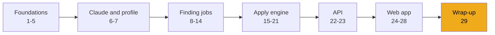
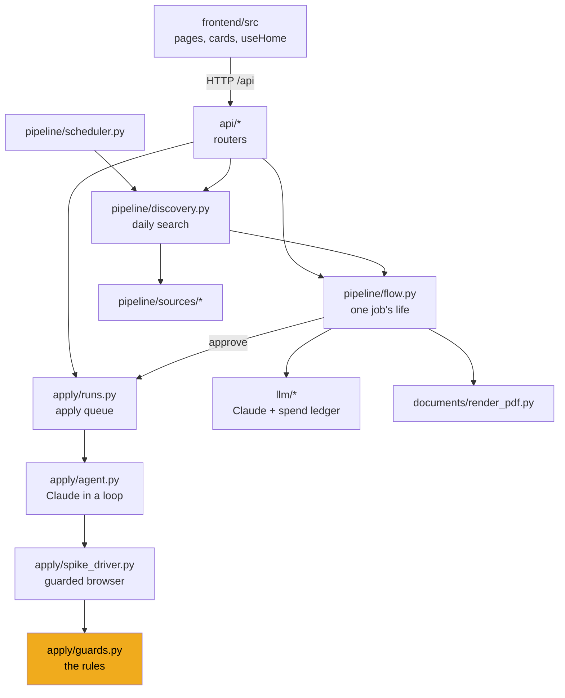

# Stage 29: Wrap-up

> **Goal:** Step back and see the whole system you built, how its safety layers fit together, where the real code has limits, and where you could take it next.
>
> **By the end you will have:** a clear map of JobBee in your head, a list of known weak spots, and ideas for your own improvements.

## Where this fits

This is the last stage. There's no new code. Instead, you'll connect the pieces from the other 28 stages.

## The whole system, one more time

Here are the main modules you wrote and how they call each other. Each box is a folder or file in `backend/app/` or `frontend/src/`.

Underneath all of these sit the settings (`config.py`, stage 1), the secret store (`services/secrets.py`, stage 2) and the database (`models.py` and the migrations, stage 3).

## The life of one job, end to end

| Step | What happens | Where (stage) |
|---|---|---|
| 1 | The scheduler ticks and sees it's time for today's search. | `pipeline/scheduler.py` (19) |
| 2 | Discovery gathers candidate links from the watchlist, web search and email alerts. | `pipeline/discovery.py` (19), `pipeline/sources/` (13, 14) |
| 3 | Each posting is fetched, cleaned and stored once. It becomes an application with status `matched`. | `pipeline/jd.py`, `pipeline/ingest.py` (8) |
| 4 | Quick filters drop obvious misfits. Haiku scores the rest. | `pipeline/screen.py` (9) |
| 5 | The best few get a tailored CV and cover letter from Sonnet, fact-checked by Haiku and printed to PDF. | `pipeline/tailor.py`, `documents/render_pdf.py` (10) |
| 6 | The application moves to `awaiting_approval` and appears as a card. | `pipeline/flow.py` (12), `api/home.py` (22), `cards.tsx` (27) |
| 7 | You click **Apply**. It moves to `approved` and an apply run is queued. | `job_flow.approve` (12), `run_manager.enqueue` (21) |
| 8 | The worker opens Chrome. Opus fills the form through the guarded driver. | `apply/spike_driver.py` (17), `apply/agent.py` (18), `apply/runs.py` (21) |
| 9 | The filled form is parked. You get a review card with a screenshot and every answer. | `_park` (21), `ReviewCard` (27) |
| 10 | You click **Submit**. The server clicks the page's one final-submit button once, then looks for a confirmation. | `click_final_submit` (17), `decide` (21) |

## The safety layers, together

No single check keeps JobBee safe. It's several layers, each covering gaps in the others. The layers near the top are enforced by code; the bottom one is only advice.

1. **Untrusted text goes to tool-less calls.** Job pages and emails are read by model calls that have no tools and must return JSON that passes a Pydantic check (stages 6, 9, 10). The only model that reads pages *and* has tools is the apply agent.
2. **Capabilities are removed, not forbidden.** The apply agent has no JavaScript tool and no raw mouse events. It can't act on other tabs (it can still list their titles and addresses), and it has no tool that submits (stage 17).
3. **Every action is checked by code.** Clicks, key presses and field fills go through pure functions that block final submits and sensitive fields (stage 16).
4. **Submitting needs your click.** Only the server can grant a one-shot allowance, tied to the same tab and the page you reviewed (stages 17, 21).
5. **Secrets never reach the model.** API keys and site passwords live in the keyring. Passwords are typed by the driver, not the model (stages 2, 20).
6. **Spending is capped.** Daily and monthly budgets apply to every Claude call, and there's a per-application cap for the agent (stages 6, 18).
7. **Atomic status changes.** Two clicks, or a click on the web and a tap on the phone, can't both succeed (stages 11, 12, 21).
8. **The prompt says page content is data.** This helps, but it's the weakest layer, which is why the layers above exist.

## Known limits in the real code

These are real behaviours of the current code, found while writing this guide. None of them is a disaster, but you should know about them. Several make good exercises.

- **The fact-check fails open.** If Haiku's fact-check reply isn't valid JSON, `tailor_cv` treats it as "nothing unsupported" and keeps every statement. A stricter version could retry, or keep the base resume's wording. See [`pipeline/tailor.py`](../../backend/app/pipeline/tailor.py).
- **The CV headline isn't fact-checked.** `_statements` gives the fact-check the summary, entries, bullets, skills and certifications, but not the headline. When the summary is flagged, `_remove` replaces it with the headline, which nothing checked.
- **Only Claude errors become notice cards.** The job flow turns an `LLMError` into a notice with a Try again button. Any other failure, such as "no Chrome or Edge available" while printing the PDF, only reaches the log, and the job stays where it was with no card explaining why. See `JobFlow.process` and `_prepare_started` in [`pipeline/flow.py`](../../backend/app/pipeline/flow.py).
- **Spending can go a little over budget.** `check_budget` runs *before* each call, and screening runs three calls at once, so the last few can overshoot. During an apply run, the daily budget is checked only once, in `preflight`. After that only the per-application cap applies, checked after each turn. See [`llm/usage.py`](../../backend/app/llm/usage.py) and [`apply/agent.py`](../../backend/app/apply/agent.py).
- **Some state lives only in memory.** `job_flow.notices` (the error cards, capped at 20) and `job_flow.stages` (the "preparing" cards) disappear on restart. So do parked forms: they need a live Chrome tab, so `mark_interrupted_runs` marks them expired at the next startup. This is why you must not run the backend with `--reload`.
- **The URL policy is a text check.** `url_refusal_reason` blocks `localhost`, `127.0.0.1`, `::1` and private IPv4 ranges written the usual way. Other spellings of a local address (such as `http://127.1` or the decimal form `http://2130706433`) pass. It applies to `navigate`, inbox links, pasted links and web-search results, not to links the agent clicks inside a page. An improvement: resolve the host and check the address with Python's `ipaddress` module. See [`apply/guards.py`](../../backend/app/apply/guards.py).
- **Cross-origin iframes are a blind spot.** When a form is embedded from another site, the probe can't see inside. Clicks there are only counted (`uninspected_clicks`), not classified. Enter is refused there. The final-submit search only covers same-origin frames, so such forms end in `submit_unconfirmed` and ask you to finish by hand.
- **"Same page" means same tab and same URL.** Some single-page apps keep one URL through every step. Then the "exactly one final-submit button" rule in `pick_final_submit` becomes the main protection.
- **The sensitive-field check fails closed.** A question like "Have you worked at a bank before?" matches `SENSITIVE_RE`, so the agent refuses to fill it and may set the job aside. That's the safe direction to be wrong in.
- **Pause doesn't block a manual search.** Pausing stops the scheduler and the apply queue, and the reply says "Nothing new starts until you resume." But `search_now` (the "Find jobs now" button) never checks `is_paused`, so a manual search still runs. See [`api/agent.py`](../../backend/app/api/agent.py).
- **`finish` doesn't stop the loop by itself.** The tool records the result and tells the model to stop. The loop ends when the model ends its turn, with the iteration cap as a backstop.
- **The Gmail sign-in callback page can run injected script.** When Google returns an error, `gmail_callback` puts the error text into the popup page through `oauth_popup_result_html`. That function embeds the message inside a ``. A crafted `http://127.0.0.1:8000/api/email/gmail/callback?state=popup:x&error=...` link could therefore run its own script on the backend's address. Escaping `<` in the JSON (for example `.replace("<", "\\u003c")`) closes the hole. See [`services/gmail_oauth_ui.py`](../../backend/app/services/gmail_oauth_ui.py).
- **One user, one PC.** There is no login. The API trusts anything that can reach `127.0.0.1:8000`, which is why `POST /api/site-accounts/{id}/reveal` is acceptable only because the server listens on localhost.
- **Windows first.** `find_chrome` only checks Windows install folders, and `test_spike_driver.py` skips without Chrome there.
- **Clicking inside a chip box can remove a chip.** `ChipInput` wraps its chips in a `<label>`. Clicking a label clicks the first control inside it, which is the first chip's × button. So clicking a chip's text, or the empty part of the box, removes the first chip. Wrapping them in a `
` and focusing the input through a ref would fix it. See [`ChipInput.tsx`](../../frontend/src/components/ChipInput.tsx).
- **The review screenshot can look stale after a change.** The screenshot's URL is the same before and after you change an answer, so the browser may keep showing the old picture until you reload. Adding a version number to the URL would fix it.
- **No frontend tests.** `npm run build` type-checks the frontend, but no tests click through it. That's how the chip bug above slipped through.

## Ideas to go further

Pick one that interests you. Each builds on a stage you already know.

| Idea | Builds on | A first step |
|---|---|---|
| Resolve hostnames and block private addresses with `ipaddress` | Stages 8, 16 | Write failing tests for `http://127.1` and `http://[::ffff:127.0.0.1]` in `test_apply_guards.py` |
| Fail closed on the fact-check | Stage 10 | Retry once on bad JSON, then mark the CV as "not checked" on the card |
| Save notices in the database | Stages 12, 22 | Add a `notices` table and a migration; read it in `api/home.py` |
| Block submits at the network level | Stage 17 | Use the POST requests `requests_since` records to learn each ATS's submit endpoint |
| Push updates instead of polling | Stage 26 | Try server-sent events from FastAPI and an `EventSource` in `useHome` |
| Add frontend tests | Stage 24 | Add Vitest + React Testing Library and write a test that catches the `ChipInput` label bug |
| A new ATS playbook | Stage 18 | Write `playbooks/<ats>.md` and add the host to `apply/ats.py` |
| A second chat channel | Stage 11 | Implement the `Channel` protocol for another messenger |
| Reserve budget before concurrent calls | Stage 6 | Hold an estimated cost before each call, release the difference after |

## Comparing your build with the real one

- **Run the full test suite** in your `backend` folder: `.\.venv\Scripts\python.exe -m pytest -q`. You should see `218 passed, 4 skipped`, or all 222 passed on a Windows PC with Google Chrome installed.
- **Compare folders.** If something behaves differently, compare a file with the real one: `git diff --no-index my-jobbee\backend\app\pipeline\flow.py JobBee\backend\app\pipeline\flow.py`. No output means the files are identical.
- **Run the real app** (see the main [README](../../README.md)) whenever you want to see how a feature is supposed to feel.

## Recap

- JobBee is a pipeline (find → screen → tailor → approve) feeding an apply engine (queue → agent → guarded driver → review → submit).
- Safety comes from layers. The strongest ones are in code, and the prompt is the last line, not the first.
- The design keeps you in control at two points: **Apply** and **Submit**.
- The real code has a few known limits. They make good next projects.

You've reached the end of the guide. Back to the [start page](README.md).
