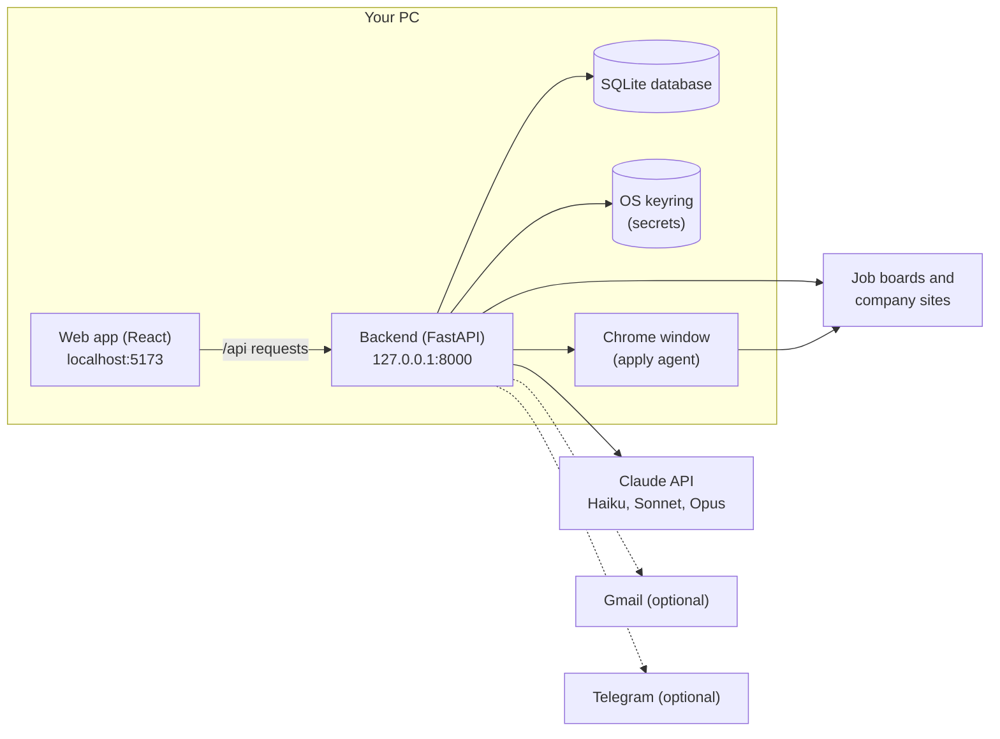
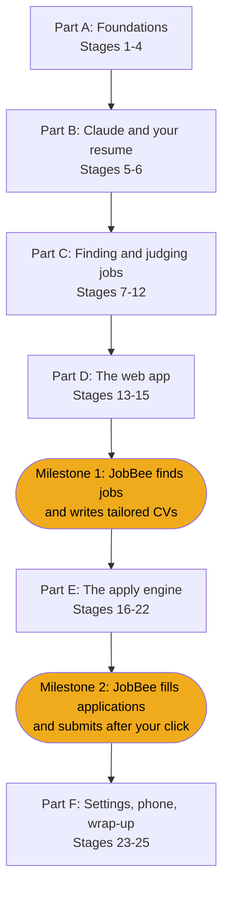

# Build JobBee from scratch: a step-by-step guide

This guide walks you through building JobBee yourself, one piece at a time. Each stage explains what a piece of the real app does and why it works that way. Then you build it and check that it runs.

You only need to know basic Python: functions, classes, lists and dicts, and how to run a script. Everything else is explained when you first meet it. That covers web servers, databases, async code, React, the Claude API and browser automation.

## What JobBee does

JobBee is a job-search assistant that runs on your own PC.

1. **Every day it finds jobs that fit you.** It searches job boards, a list of companies you follow, and (optionally) your LinkedIn alert emails.
2. **It keeps only the best matches.** A fast Claude model scores each job against your resume.
3. **It tailors your CV for each match.** A stronger Claude model rewrites your resume for the job. A second check removes anything your real resume doesn't support.
4. **You approve or skip each job** in a web page on your PC.
5. **On Apply, Claude fills in the application form** in a Chrome window.
6. **Nothing is sent until you click Submit.** You see a screenshot and every answer first. The code, not the prompt, stops the agent from submitting.

## The finished system

This is what you will have at the end. Don't worry if some boxes mean nothing to you yet; each one gets its own stage.



- **The web app** is what you look at and click. It runs in your browser.
- **The backend** is a Python program that does the real work. The web app talks to it over HTTP.
- **The database** is a single file that remembers your profile, jobs and applications.
- **The keyring** is your operating system's password vault. API keys and site passwords live there, never in the database.
- **Claude** is called over the internet for anything that needs judgement or writing.
- **Chrome** is opened by the backend when it's time to fill in an application.

## How this guide is organised

There are 25 stages in six parts. Every stage ends with something you can run.



The order follows the real dependencies in the code. A stage only uses things you built in earlier stages. Optional stages are marked; nothing later depends on them.

| # | Stage | What you build |
|---|---|---|
| | **Part A: Foundations** | |
| 1 | [Backend skeleton](01-backend-skeleton.md) | A FastAPI server with typed settings and a health check |
| 2 | [The database](02-database.md) | SQLite tables with SQLAlchemy, versioned with Alembic |
| 3 | [Tests from day one](03-tests-from-day-one.md) | A pytest setup that never touches your real data or a real model |
| 4 | [Secrets and flags](04-secrets-and-flags.md) | Storing your Claude key in the OS keyring, plus app-wide switches |
| | **Part B: Claude and your resume** | |
| 5 | [Talking to Claude](05-talking-to-claude.md) | One safe way to call Claude, get checked JSON back, and cap spending |
| 6 | [Resume and profile](06-resume-and-profile.md) | Upload a resume, let Claude read it, review and save your profile |
| | **Part C: Finding and judging jobs** | |
| 7 | [Reading job postings](07-reading-job-postings.md) | Fetch a posting from a link, clean it, and store it once |
| 8 | [Screening](08-screening.md) | Your preferences, quick filters, and a Claude fit score |
| 9 | [Tailoring and PDFs](09-tailoring-and-pdfs.md) | A tailored CV and cover letter, fact-checked, printed to PDF |
| 10 | [The job flow](10-the-job-flow.md) | The step-by-step life of one job, from link to Apply or Skip |
| 11 | [Discovery and the scheduler](11-discovery-and-scheduler.md) | A daily search across job boards and the web |
| 12 | [Email alerts](12-email-alerts.md) *(optional)* | Jobs from your LinkedIn alert emails |
| | **Part D: The web app** | |
| 13 | [Frontend basics](13-frontend-basics.md) | A React + TypeScript app that talks to the backend |
| 14 | [The welcome flow](14-welcome-flow.md) | Three setup steps: Claude key, resume, what you want |
| 15 | [The home inbox](15-home-inbox.md) | Match cards with Apply/Skip, and your application history. **Milestone 1** |
| | **Part E: The apply engine** | |
| 16 | [Tool use and browsers](16-tool-use-and-browsers.md) | How Claude uses tools, and how code drives Chrome |
| 17 | [Safety guards](17-safety-guards.md) | Rules in code that block submit clicks and sensitive fields |
| 18 | [The guarded driver](18-guarded-driver.md) | A browser driver that applies those rules to every action |
| 19 | [The apply agent](19-apply-agent.md) | Claude filling a real form from your terminal |
| 20 | [Site accounts and inbox](20-site-accounts-and-inbox.md) *(optional)* | Creating job-site accounts and confirming them by email |
| 21 | [The run manager](21-run-manager.md) | A queue that fills one form at a time and waits for your decision |
| 22 | [Review and submit UI](22-review-and-submit-ui.md) | Review cards with Submit / Don't submit. **Milestone 2** |
| | **Part F: Settings, phone, wrap-up** | |
| 23 | [The settings page](23-settings-page.md) | Every preference and switch in one place |
| 24 | [Telegram](24-telegram.md) *(optional)* | Approve jobs from your phone |
| 25 | [Wrap-up](25-wrap-up.md) | What you built, known limits, and ideas to go further |

## How each stage is laid out

Every stage uses the same sections, so you always know where to look:

1. **Goal**: what you're building and what you'll have at the end.
2. **Where this fits**: a small diagram with this stage's part highlighted.
3. **New ideas in plain words**: the concepts you need, explained from zero.
4. **Build it, step by step**: what to create, why, and the key code.
5. **Check it works**: commands to run and what you should see.
6. **Common mistakes**: traps other people fall into.
7. **How the real repo goes further**: features the stage skipped, with links.
8. **Recap** and a link to the next stage.

### Reading the code snippets

- **"From `backend/app/...`"** means the code is copied exactly from that file in this repo. A line with only `...` (or `# ...`) means some lines were skipped.
- **"Simplified version of `...`"** means a shorter teaching version. It is close to the real code but not identical.
- Click any file link to see the whole file. Functions are named in `backticks` so you can search for them.

The guide doesn't paste every line of the app. JobBee is about 28,000 lines. The snippets show the parts that teach the idea. When a step says "write the rest of the file", open the real file, read it, and type your own version. Typing it yourself, rather than copying, is how it sticks.

## Before you start

### Install these

| Tool | Version | Why |
|---|---|---|
| [Python](https://www.python.org/downloads/) | 3.11 or newer | The backend |
| [Node.js](https://nodejs.org/) | 20 or newer | The frontend build tools |
| [Google Chrome](https://www.google.com/chrome/) | any recent | PDF printing and the apply agent |
| [Git](https://git-scm.com/) | any | Saving your progress |
| A code editor | e.g. VS Code | Writing code |

You also need an **Anthropic API key** with a little credit, from [console.anthropic.com](https://console.anthropic.com/). Stages 1–4 don't need it. Typical costs are a few cents per job screened and tailored, and about $0.50–$1 per application filled.

### Set up your own project folder

Build your version in a **new, empty folder**, not inside this repo. Keep this repo open next to it so you can compare.

```powershell
mkdir my-jobbee
cd my-jobbee
git init
mkdir backend, frontend, docs
```

The finished layout matches the real repo:

```text
my-jobbee/
  backend/
    app/          Python package: the server, pipeline and apply engine
    tests/        pytest tests
    pyproject.toml
  frontend/
    src/          React + TypeScript app
    package.json
```

### Windows, Mac or Linux?

JobBee was written for Windows, so the commands in this guide use **PowerShell**. Most of the code is cross-platform. Where it isn't:

- **Paths to the virtual environment.** On Windows, use `.\.venv\Scripts\python.exe`. On Mac/Linux, use `.venv/bin/python`.
- **The keyring** (stage 4) is Windows Credential Manager on Windows, Keychain on macOS, and the Secret Service (e.g. GNOME Keyring) on Linux. The `keyring` library handles all three.
- **Finding Chrome** (stage 16). The real `find_chrome` function only looks in Windows install folders. On Mac/Linux you'll need to add your Chrome path.
- **The event loop.** The backend switches to a special Windows event loop so it can start Chrome. Stage 1 explains why.

### Compare with the real thing at any time

You can run the finished app from this repo to see what a stage is aiming for. Follow "Run it" in the [main README](../../README.md). The real test suite is a good reference too:

```powershell
cd backend
.\.venv\Scripts\python.exe -m pytest -q
```

## Glossary

You'll meet these words throughout. Each stage explains them properly when they first come up.

| Term | Meaning in plain words |
|---|---|
| **API** | A set of URLs a program answers, so other programs can ask it to do things. |
| **Endpoint** | One URL of an API, like `GET /api/health`. |
| **HTTP** | The language browsers and servers use to talk: a request (method + URL + body) and a response (status code + body). |
| **JSON** | A text format for data, like `{"name": "Ada", "skills": ["python"]}`. Python dicts and lists map onto it directly. |
| **Async / await** | A way to write code that waits for slow things (network, disk) without freezing everything else. |
| **Database, table, row** | A database is a structured store. A table is like a spreadsheet tab. A row is one record in it. |
| **ORM** | A library (here SQLAlchemy) that lets you use Python classes instead of writing SQL by hand. |
| **Migration** | A numbered, saved change to the database layout, so every copy of the database can be upgraded the same way. |
| **Environment variable** | A setting passed to a program from outside its code, e.g. `APP_ENV=dev`. |
| **Keyring** | The OS password vault. Safer than a file for secrets. |
| **LLM** | Large language model: the kind of AI Claude is. |
| **Prompt** | The text instructions and data you send to the model. |
| **Token** | A chunk of text (about ¾ of a word). Models are priced per token. |
| **Tool use** | Letting the model ask your code to run a function (like "click this button") and read the result. |
| **Agent** | A model running in a loop: look, decide, use a tool, repeat, until the job is done. |
| **ATS** | Applicant tracking system: the software companies use for job postings and applications (Greenhouse, Lever, Workday…). |
| **CDP** | Chrome DevTools Protocol: the remote control that lets code drive Chrome. |
| **Component** | A reusable piece of a React web page, written as a function. |
| **Hook** | A React function (like `useState`) that gives a component memory or side effects. |
| **State machine** | A fixed set of statuses and the allowed moves between them, e.g. `matched → awaiting_approval → approved`. |
| **Prompt injection** | Text inside a web page or email that tries to give the model new instructions. JobBee treats such text as data. |
| **SSRF** | Server-side request forgery: tricking a server into fetching a private or local address. JobBee blocks this. |

Ready? Start with [Stage 1: Backend skeleton](01-backend-skeleton.md).
