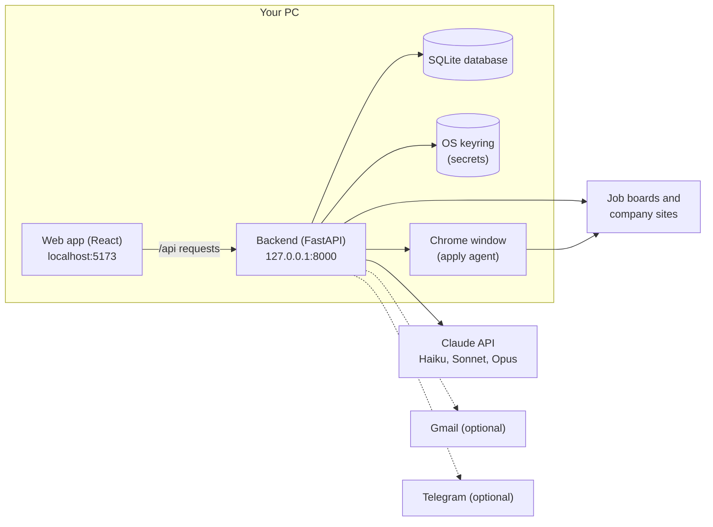
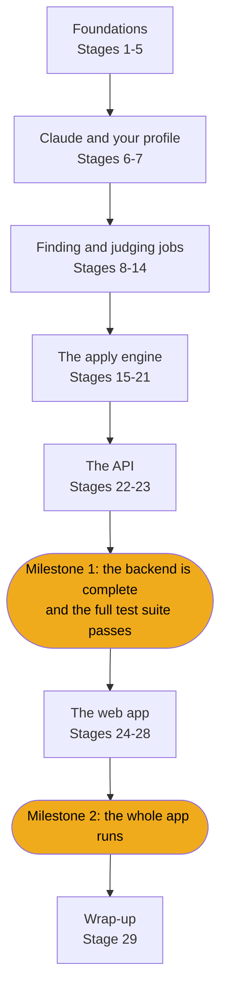

# Build JobBee from scratch: a step-by-step guide

This guide walks you through building JobBee yourself, file by file, until you have the complete working app. **It contains the full code of every file in the project**, about 28,000 lines, in the order you build it. Next to the code, it explains what each part does and why it's written that way, in plain language.

You only need to know basic Python: functions, classes, lists and dicts, and how to run a script. Everything else is explained the first time you meet it. That includes web servers, databases, async code, the Claude API, browser automation, React and TypeScript.

## What JobBee does

JobBee is a job-search assistant that runs on your own PC.

1. **Every day it finds jobs that fit you.** It searches job boards, a list of companies you follow, and (optionally) your LinkedIn alert emails.
2. **It keeps only the best matches.** A fast Claude model scores each job against your resume.
3. **It tailors your CV for each match.** A stronger Claude model rewrites your resume for the job, and a second check removes anything your real resume doesn't support.
4. **You approve or skip each job** in a web page on your PC.
5. **On Apply, Claude fills in the application form** in a Chrome window.
6. **Nothing is sent until you click Submit.** You see a screenshot and every answer first. The code, not the prompt, stops the agent from submitting.

## The finished system

This is what you'll have at the end. Each box gets its own stages.



- **The web app** is what you look at and click. It runs in your browser.
- **The backend** is a Python program that does the real work. The web app talks to it over HTTP.
- **The database** is a single file that remembers your profile, jobs and applications.
- **The keyring** is your operating system's password vault. API keys and site passwords live there, never in the database.
- **Claude** is called over the internet for anything that needs judgement or writing.
- **Chrome** is opened by the backend when it's time to fill in an application.

## How the guide is organised

There are 29 stages. You build the whole backend first (stages 1–23), then the web app (stages 24–28). The order isn't arbitrary: **each file arrives only after every file it imports already exists**, so your project can run and be tested at the end of every stage.



| # | Stage | What you build |
|---|---|---|
| | **Foundations** | |
| 1 | [Backend skeleton](01-backend-skeleton.md) | The project, its dependencies, typed settings and a first running server |
| 2 | [Secrets and the keyring](02-secrets.md) | Storing API keys and passwords in the OS password vault |
| 3 | [The database](03-database.md) | Every table, and the migrations that create them |
| 4 | [API shapes, health check and tests](04-api-shapes-health-and-tests.md) | Request/response shapes, `/api/health`, and the test setup |
| 5 | [Flags and app settings](05-flags-and-app-config.md) | App-wide switches such as "paused", stored in the database |
| | **Claude and your profile** | |
| 6 | [Talking to Claude](06-talking-to-claude.md) | One safe way to call Claude, get checked JSON back, and cap spending |
| 7 | [Resume and profile](07-resume-and-profile.md) | Upload a resume, let Claude read it, review and save your profile |
| | **Finding and judging jobs** | |
| 8 | [Reading job postings](08-reading-job-postings.md) | Fetch a posting from a link, clean it, and store it once |
| 9 | [Screening](09-screening.md) | Your preferences, quick filters, and a Claude fit score |
| 10 | [Tailoring and PDFs](10-tailoring-and-pdfs.md) | A tailored CV and cover letter, fact-checked, printed to PDF |
| 11 | [Messages and Telegram](11-messages-and-telegram.md) | The message system the app uses, with an optional Telegram bot |
| 12 | [The job flow](12-the-job-flow.md) | The step-by-step life of one job, from link to Apply or Skip |
| 13 | [Email alerts](13-email-alerts.md) | Reading LinkedIn alert emails (connecting an inbox is optional) |
| 14 | [Job sources](14-job-sources.md) | Company job boards and Claude web search |
| | **The apply engine** | |
| 15 | [Tool use and browsers](15-tool-use-and-browsers.md) | How Claude uses tools, and how code drives Chrome |
| 16 | [Safety guards](16-safety-guards.md) | Rules in code that block submit clicks and sensitive fields |
| 17 | [The guarded driver](17-guarded-driver.md) | A browser driver that applies those rules to every action |
| 18 | [The apply agent](18-apply-agent.md) | Claude in a loop, filling a form through the guarded driver |
| 19 | [Discovery and the scheduler](19-discovery-and-scheduler.md) | The daily search that ties the sources together |
| 20 | [Site accounts](20-site-accounts.md) | Creating job-site accounts with passwords the model never sees |
| 21 | [The run manager](21-run-manager.md) | A queue that fills one form at a time and waits for your decision. Your first real form fill |
| | **The API** | |
| 22 | [Home inbox and agent controls](22-api-home-and-agent.md) | The endpoint that returns the whole inbox, and the search controls |
| 23 | [Actions, apply runs and setup](23-api-actions-and-setup.md) | Apply, Skip, Submit and setup endpoints, and the final `main.py`. **Milestone 1** |
| | **The web app** | |
| 24 | [Frontend basics](24-frontend-basics.md) | A React + TypeScript app shell that talks to the backend |
| 25 | [The welcome flow](25-welcome-flow.md) | Three setup steps: Claude key, resume, what you want |
| 26 | [Inbox building blocks](26-inbox-building-blocks.md) | The agent bar, lists, answer views and live polling |
| 27 | [Cards, the drawer and the home page](27-cards-drawer-and-home.md) | Match and review cards with Apply, Skip and Submit |
| 28 | [The settings page](28-settings-page.md) | Every preference and switch in one place. **Milestone 2** |
| | | |
| 29 | [Wrap-up](29-wrap-up.md) | What you built, known limits, and ideas to go further |

**Optional to use, but not to type.** Email alerts (stage 13), Telegram (stage 11) and site accounts (stage 20) are features you can leave switched off. Their code is still required, because other files import it.

## How each stage is laid out

1. **Goal**: what you're building and what you'll have at the end.
2. **Where this fits**: a small diagram with this stage's part highlighted.
3. **New ideas in plain words**: the concepts you need, explained from zero.
4. **Build it, step by step**: one step per file, with the code and an explanation of each part.
5. **Check it works**: commands to run and what you should see, plus the real tests for that stage.
6. **Common mistakes**: traps to avoid.
7. **Recap** and a link to the next stage.

### Reading the code blocks

Every block of real code has a label above it telling you exactly what to do:

| Label | What to do |
|---|---|
| **`backend/app/config.py`** (whole file, 187 lines) | Create the file with exactly this content. |
| **`backend/app/apply/runs.py`** (lines 1–80 of 1254) | Long files are split into parts with an explanation before each one. Create the file with the first part, then add each later part to the end, in order. |
| A collapsed box with a test file | Open it and create the test file. Tests check that your code works. |
| A **temporary** version (e.g. of `backend/app/main.py`) | Create or replace the file with this version. A later stage replaces it again, and stage 23 has the final file. |
| A **practice** script under `practice/` | An optional experiment that is not part of JobBee. |

You can type the code or paste it. Typing it is slower, but it's how it sticks. Either way, read the explanation of each part before you move on.

### The guide is checked against the real code

The code blocks are generated from this repository by a script, so they always match the real files exactly. The same script rebuilds the whole project using only the guide. It writes each file in the order the stages give, runs every stage's checks along the way, and finally compares the result with the repository: every file must be byte-for-byte identical. See [For maintainers](#for-maintainers) below.

## Before you start

### Install these

| Tool | Version | Why |
|---|---|---|
| [Python](https://www.python.org/downloads/) | 3.11 or newer | The backend |
| [Node.js](https://nodejs.org/) | 20 or newer | The frontend build tools |
| [Google Chrome](https://www.google.com/chrome/) | any recent | PDF printing and the apply agent |
| [Git](https://git-scm.com/) | any | Saving your progress |
| A code editor | e.g. VS Code | Writing code |

You also need an **Anthropic API key** with a little credit, from [console.anthropic.com](https://console.anthropic.com/). You won't need it until stage 6, and the tests never use it. Typical costs are a few cents per job screened and tailored, and about $0.50–$1 per application filled.

### Set up your own project folder

Build your version in a **new, empty folder**, not inside this repo. Keep this repo open next to it so you can compare.

```powershell
mkdir my-jobbee
cd my-jobbee
git init
mkdir backend, frontend
```

The finished layout:

```text
my-jobbee/
  backend/
    app/          Python package: the server, pipeline and apply engine
    tests/        pytest tests
    scripts/      helper scripts (Gmail setup, terminal apply test)
    pyproject.toml
  frontend/
    src/          React + TypeScript app
    package.json
```

Commit after every stage (`git add -A` then `git commit -m "stage 7"`). If something breaks later, you can see exactly what changed.

### Windows, Mac or Linux?

JobBee was written for Windows, so the commands use **PowerShell**. Most of the code is cross-platform. Where it isn't:

- **Virtual environment paths.** On Windows, use `.\.venv\Scripts\python.exe`. On Mac/Linux, use `.venv/bin/python`.
- **The keyring** (stage 2) is Windows Credential Manager on Windows, Keychain on macOS, and the Secret Service (e.g. GNOME Keyring) on Linux.
- **Finding Chrome** (stage 15). `find_chrome` only looks in Windows install folders. On Mac/Linux you'll need to add your Chrome path.
- **The event loop.** The backend switches to a special Windows event loop so it can start Chrome. Stage 1 explains why.

## For maintainers

[`tools/guide_tool.py`](tools/guide_tool.py) keeps the guide and the code in sync:

```powershell
python docs/learn/tools/guide_tool.py fill      # regenerate every code block from the repo
python docs/learn/tools/guide_tool.py check     # every repo file shown exactly once, parts contiguous, links valid
python docs/learn/tools/guide_tool.py rebuild ..\guide-rebuild --python backend\.venv\Scripts\python.exe
```

`rebuild` builds the project from the guide alone, runs every stage's checks, and fails if the result differs from the repo. After changing the code, run `fill`, then `check`. If a file grew or shrank, adjust the `lines=` ranges of its parts.

## Glossary

| Term | Meaning in plain words |
|---|---|
| **API** | A set of URLs a program answers, so other programs can ask it to do things. |
| **Endpoint** | One URL of an API, like `GET /api/health`. |
| **HTTP** | The language browsers and servers use to talk: a request (method + URL + body) and a response (status code + body). |
| **JSON** | A text format for data, like `{"name": "Ada", "skills": ["python"]}`. Python dicts and lists map onto it directly. |
| **Async / await** | A way to write code that waits for slow things (network, disk) without freezing everything else. |
| **Database, table, row** | A database is a structured store. A table is like a spreadsheet tab. A row is one record in it. |
| **ORM** | A library (here SQLAlchemy) that lets you use Python classes instead of writing SQL by hand. |
| **Migration** | A numbered, saved change to the database layout, so every copy of the database can be upgraded the same way. |
| **Environment variable** | A setting passed to a program from outside its code, e.g. `APP_ENV=dev`. |
| **Keyring** | The OS password vault. Safer than a file for secrets. |
| **LLM** | Large language model: the kind of AI Claude is. |
| **Prompt** | The text instructions and data you send to the model. |
| **Token** | A chunk of text (about ¾ of a word). Models are priced per token. |
| **Tool use** | Letting the model ask your code to run a function (like "click this button") and read the result. |
| **Agent** | A model running in a loop: look, decide, use a tool, repeat, until the job is done. |
| **ATS** | Applicant tracking system: the software companies use for job postings and applications (Greenhouse, Lever, Workday…). |
| **CDP** | Chrome DevTools Protocol: the remote control that lets code drive Chrome. |
| **Component** | A reusable piece of a React web page, written as a function. |
| **Hook** | A React function (like `useState`) that gives a component memory or side effects. |
| **State machine** | A fixed set of statuses and the allowed moves between them, e.g. `matched → awaiting_approval → approved`. |
| **Prompt injection** | Text inside a web page or email that tries to give the model new instructions. JobBee treats such text as data. |
| **SSRF** | Server-side request forgery: tricking a server into fetching a private or local address. JobBee blocks this. |

Ready? Start with [Stage 1: Backend skeleton](01-backend-skeleton.md).
